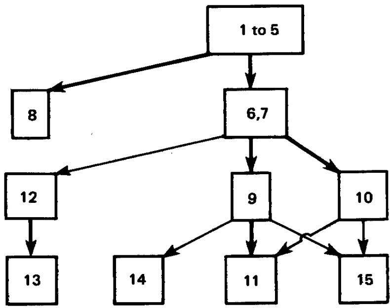
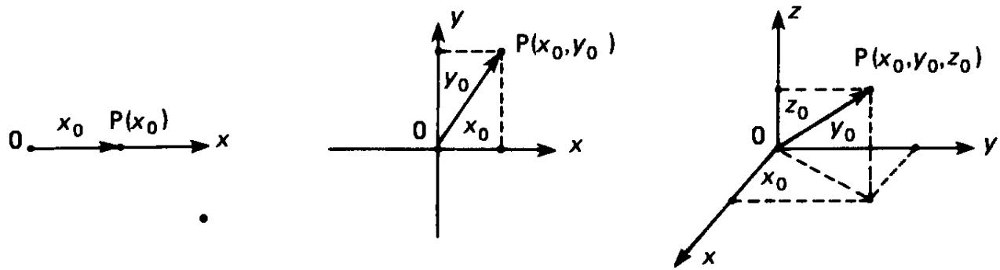
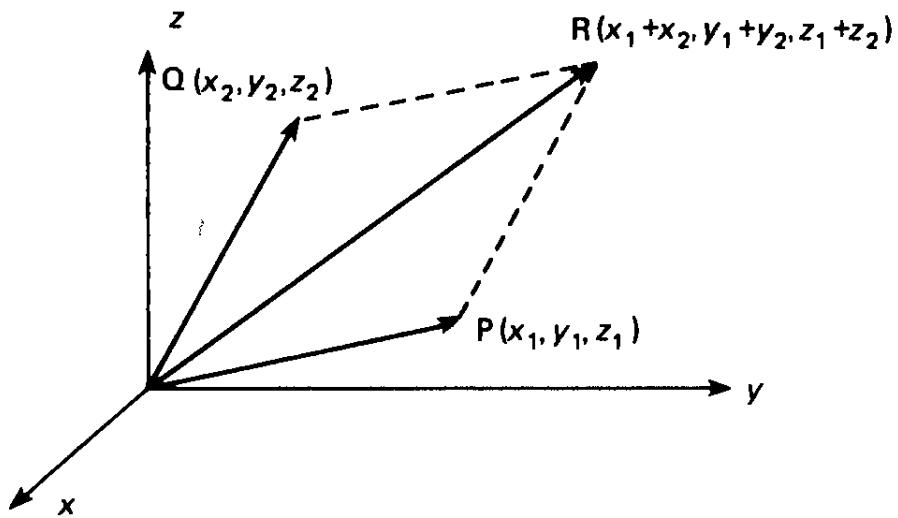
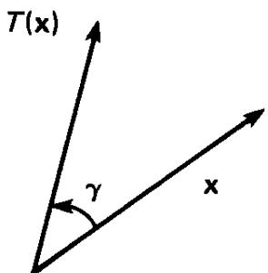

Computer Science and Applied Mathematics

THE THEORY OF MATRICES

SECOND EDITION

WITH APPLICATIONS

Peter Lancaster and Miron Tismenetsky

THE THEORY OF MATRICES

SECOND EDITION

WITH APPLICATIONS

Peter Lancaster and Miron Tismenetsky

The Theory of Matrices

Second Edition

with Applications

# The Theory of Matrices Second Edition

with Applications

Peter Lancaster

Department of Mathematics

University of Calgary

Calgary, Alberta, Canada

Miron Tismenetsky

IBM Scientific Center

Technion City

Haifa, Israel

This is an Academic Press reprint reproduced directly from the pages of a title for which type, plates, or film no longer exist. Although not up to the standards of the original, this method of reproduction makes it possible to provide copies of book which would otherwise be out of print.

Find Us on the Webl http://www.apnet.com

This book is printed on scid-free peper.

Copyright © 1985 by Academic Press

No pan of this publication msy be reproduced or tranmmitted in any fom or by any means, clectronic or mechanical, including pbotocopy. recording. or any information norage end retrieval systemn, without permission in writing from the publiaher.

Academic Press   
A Harcourt Science and Technology Company   
525 B Street, Suite 1900, San Diego, California 92101-4495, USA   
http://www.academicpress.com   
Academic Press   
Harcourt Place, 32 Jamestown Road, London NWI 7BY, UK   
http://www.academicpress.com

## Library of Congress Cataloging im Publication Data

Lancaster, Peter. Date. Tho theory of mstrices. (Computer science and applied mathematics) Includes index. I. Metrices. L Tismenctsky, M. (Miroa) I Title.   
Ⅲ. Series.   
QA188.136 1984 512.9'434 83-15775   
ISBN 0-12-435560-9 (alk. paper).

Printed In The United States Of America 00 01 02 03 IBT 12 11 10 9 8 7

To our wives, Edna and Fania

## Contents

Preface xiii   
1 Matrix Algebra   
1.1 Special Types of Matrices 2   
1.2 The Operations of Addition and Scalar Multiplication 4   
1.3 Matrix Multiplication 7   
1.4 Special Kinds of Matrices Related to Multiplication 10   
1.5 Transpose and Conjugate Transpose 13   
1.6 Submatrices and Partitions of a Matrix 16   
1.7 Polynomials in a Matrix 19   
1.8 Miscellaneous Exercises 21   
2 Determinants, Inverse Matrices, and Rank   
2.1 Definition of the Determinant 23   
2.2 Properties of Determinants 27   
2.3 Cofactor Expansions 32   
2.4 Laplace's Theorem 36   
2.5 The Binet-Cauchy Formula 39   
2.6 Adjoint and Inverse Matrices 42   
2.7 Elementary Operations on Matrices 47   
2.8 Rank of a Matrix 53   
2.9 Systems of Linear Equations and Matrices 56   
2.10 The LU Decomposition 61   
2.11 Miscellaneous Exercises 63   
3 Linear, Euclidean, and Unitary Spaces   
3.1 Definition of a Linear Space 71   
3.2 Subspaces 75   
3.3 Linear Combinations 78   
3.4 Linear Dependence and Independence 80   
3.5 The Notion of a Basis 83   
3.6 Sum and Direct Sum of Subspaces 87   
3.7 Matrix Representation and Rank 91   
3.8 Some Properties of Matrices Related to Rank 95   
3.9 Change of Basis and Transition Matrices 98   
3.10 Solution of Equations 100   
3.11 Unitary and Euclidean Spaces 104   
3.12 Orthogonal Systems 107   
3.13 Orthogonal Subspaces 111   
3.14 Miscellaneous Exercises 113   
4 Linear Transformations and Matrices   
4.1 Linear Transformations 117   
4.2 Matrix Representation of Linear Transformations 122   
4.3 Matrix Representations, Equivalence, and Similarity 127   
4.4 Some Properties of Similar Matrices 131   
4.5 Image and Kernel of a Linear Transformation 133   
4.6 Invertible Transformations 138   
4.7 Restrictions, Invariant Subspaces, and Direct Sums of Transformations 142   
4.8 Direct Sums and Matrices 145   
4.9 Eigenvalues and Eigenvectors of a Transformation 147   
4.10 Eigenvalues and Eigenvectors of a Matrix 152   
4.11 The Characteristic Polynomial 155   
4.12 The Multiplicities of an Eigenvalue 159   
4.13 First Applications to Differential Equations 161   
4.14 Miscellaneous Exercises 164   
5 Linear Transformations in Unitary Spaces and Simple Matrices   
5.1 Adjoint Transformations 168   
5.2 Normal Transformations and Matrices 174   
5.3 Hermitian. Skew-Hermitian, and Definite Matrices 178   
5.4 Square Root of a Definite Matrix and Singular Values 180   
5.5 Congruence and the Inertia of a Matrix 184   
5.6 Unitary Matrices 188   
5.7 Polar and Singular-Value Decompositions 190   
5.8 Idempotent Matrices (Projectors) 194   
5.9 Matrices over the Field of Real Numbers 200   
5.10 Bilinear, Quadratic, and Hermitian Forms 202   
5.11 Finding the Canonical Forms 205   
5.12 The Theory of Small Oscillations 208   
5.13 Admissible Pairs of Matrices 212   
5.14 Miscellaneous Exercises 217   
6 The Jordan Canonical Form: A Geometric Approach   
6.1 Annihilating Polynomials 221   
6.2 Minimal Polynomials 224   
6.3 Generalized Eigenspaces 229   
6.4 The Structure of Generalized Eigenspaces 232   
6.5 The Jordan Theorem 236   
6.6 Parameters of a Jordan Matrix 239   
6.7 The Real Jordan Form 242   
6.8 Miscellaneous Exercises 244   
7 Matrix Polynomials and Normal Forms   
7.1 The Notion of a Matrix Polynomial 246   
7.2 Division of Matrix Polynomials 248   
7.3 Elementary Operations and Equivalence 253   
7.4 A Canonical Form for a Matrix Polynomial 256   
7.5 Invariant Polynomials and the Smith Canonical Form 259   
7.6 Similarity and the First Normal Form 262   
7.7 Elementary Divisors 265   
7.8 The Second Normal Form and the Jordan Normal Form 269   
7.9 The Characteristic and Minimal Polynomials 271   
7.10 The Smith Form: Differential and Difference Equations 274   
7.11 Miscellaneous Exercises 278   
8 The Variational Method   
8.1 Field of Values. Extremal Eigenvalues of a Hermitian Matrix 283   
8.2 Courant-Fischer Theory and the Rayleigh Quotient 286   
8.3 The Stationary Property of the Rayleigh Quotient 289   
8.4 Problems with Constraints 290   
8.5 The Rayleigh Theorem and Definite Matrices 294   
8.6 The Jacobi-Gundelfinger-Frobenius Method 296   
8.7 An Application of the Courant-Fischer Theory 300   
8.8 Applications to the Theory of Small Vibrations 302   
9 Functions of Matrices   
9.1 Functions Defined on the Spectrum of a Matrix 305   
9.2 Interpolatory Polynomials 306   
9.3 Definition of a Function of a Matrix 308   
9.4 Properties of Functions of Matrices 310   
9.5 Spectral Resolution of f(A) 314   
9.6 Component Matrices and Invariant Subspaces 320   
9.7 Further Properties of Functions of Matrices 322   
9.8 Sequences and Series of Matrices 325   
9.9 The Resolvent and the Cauchy Theorem for Matrices 329   
9.10 Applications to Differential Equations 334   
9.11 Observable and Controllable Systems 340   
9.12 Miscellaneous Exercises 345   
10 Norms and Bounds for Eigenvalues   
10.1 The Notion of a Norm 350   
10.2 A Vector Norm as a Metric: Convergence 354   
10.3 Matrix Norms 358   
10.4 Induced Matrix Norms 362   
10.5 Absolute Vector Norms and Lower Bounds of a Matrix 367   
10.6 The Geršgorin Theorem 371   
10.7 Geršgorin Disks and Irreducible Matrices 374   
10.8 The Schur Theorem 377   
10.9 Miscellaneous Exercises 380   
11 Perturbation Theory   
11.1 Perturbations in the Solution of Linear Equations 383   
11.2 Perturbations of the Eigenvalues of a Simple Matrix 387   
11.3 Analytic Perturbations 391   
11.4 Perturbation of the Component Matrices 393   
11.5 Perturbation of an Unrepeated Eigenvalue 395   
11.6 Evaluation of the Perturbation Coefficients 397   
11.7 Perturbation of a Multiple Eigenvalue 399   
12 Linear Matrix Equations and Generalized Inverses   
12.1 The Notion of a Kronecker Product 406   
12.2 Eigenvalues of Kronecker Products and Composite Matrices 411   
12.3 Applications of the Kronecker Product to Matrix Equations 413   
12.4 Commuting Matrices 416   
12.5 Solutions of AX + XB = C 421   
12.6 One-Sided Inverses 424   
12.7 Generalized Inverses 428   
12.8 The Moore-Penrose Inverse 432   
12.9 The Best Approximate Solution of the Equation Ax = b 435   
12.10 Miscellaneous Exercises 438   
13 Stability Problems   
13.1 The Lyapunov Stability Theory and Its Extensions 441   
13.2 Stability with Respect to the Unit Circle 451   
13.3 The Bezoutian and the Resultant 454   
13.4 The Hermite and the Routh-Hurwitz Theorems 461   
13.5 The Schur-Cohn Theorem 466   
13.6 Perturbations of a Real Polynomial 468   
13.7 The Liénard-Chipart Criterion 470   
13.8 The Markov Criterion 474   
13.9 A Determinantal Version of the Routh-Hurwitz Theorem 478   
13.10 The Cauchy Index and Its Applications 482   
14 Matrix Polynomials   
14.1 Linearization of a Matrix Polynomial 490   
14.2 Standard Triples and Pairs 493   
14.3 The Structure of Jordan Triples 500   
14.4 Applications to Differential Equations 506   
14.5 General Solutions of Differential Equations 509   
14.6 Difference Equations 512   
14.7 A Representation Theorem 516   
14.8 Multiples and Divisors 518   
14.9 Solvents of Monic Matrix Polynomials 520   
15 Nonnegative Matrices   
15.1 Irreducible Matriceş 528   
15.2 Nonnegative Matrices and Nonnegative Inverses 530   
15.3 The Perron–Frobenius Theorem (I) 532   
15.4 The Perron-Frobenius Theorem (II) 538   
15.5 Reducible Matrices 543   
15.6 Primitive and Imprimitive Matrices 544   
15.7 Stochastic Matrices 547   
15.8 Markov Chains 550   
Appendix 1: A Survey of Scalar Polynomials 553   
Appendix 2: Some Theorems and Notions from Analysis 557   
Appendix 3: Suggestions for Further Reading 560   
Index 563

## Preface

In this book the authors try to bridge the gap between the treatments of matrix theory and linear algebra to be found in current textbooks and the mastery of these topics required to use and apply our subject matter in several important areas of application, as well as in mathematics itself. At the same time we present a treatment that is as self-contained as is reasonably possible, beginning with the most fundamental ideas and definitions. In order to accomplish this double purpose, the first few chapters include a complete treatment of material to be found in standard courses on matrices and linear algebra. This part includes development of a computational algebraic development (in the spirit of the first edition) and also development of the abstract methods of finite-dimensional linear spaces. Indeed, a balance is maintained through the book between the two powerful techniques of matrix algebra and the theory of linear spaces and transformations.

The later chapters of the book are devoted to the development of material that is widely useful in a great variety of applications. Much of this has become a part of the language and methodology commonly used in modern science and engineering. This material includes variational methods, perturbation theory, generalized inverses, stability theory, and so on, and has innumerable applications in engineering, physics, economics, and statistics, to mention a few.

Beginning in Chapter 4 a few areas of application are developed in some detail. First and foremost we refer to the solution of constant-coefficient systems of differential and difference equations. There are also careful developments of the first steps in the theory of vibrating systems, Markov processes, and systems theory, for example.

The book will be useful for readers in two broad categories. One consists of those interested in a thorough reference work on matrices and linear algebra for use in their scientific work, whether in diverse applications or in mathematics itself. The other category consists of undergraduate or graduate students in a variety of possible programs where this subject matter is required. For example, foundations for courses offered in mathematics, computer science, or engineering programs may be found here. We address the latter audience in more detail.

The first seven chapters are essentially self-contained and require no formal prerequisites beyond college algebra. However, experience suggests that this material is most appropriately used as a second course in matrices or linear algebra at the sophomore or a more senior level.

There are possibilities for several different courses depending on specific needs and specializations. In general, it would not be necessary to work systematically through the first two chapters. They serve to establish notation, terminology, and elementary results, as well as some deeper results concerning determinants, which can be developed or quoted when required. Indeed, the first two chapters are written almost as compendia of primitive definitions, results, and exercises. Material for a traditional course in linear algebra, but with more emphasis on matrices, is then contained in Chapters 3–6, with the possibility of replacing Chapter 6 by Chapter 7 for a more algebraic development of the Jordan normal form including the theory of elementary divisors.

More advanced courses can be based on selected material from subsequent chapters. The logical connections between these chapters are indicated below to assist in the process of course design. It is assumed that in order to absorb any of these chapters the reader has a reasonable grasp of the first seven, as well as some knowledge of calculus. In this sketch the stronger connections are denoted by heavier lines.

  
Prerequisite structure by chapters.

There are many exercises and examples throughout the book. These range from computational exercises to assist the reader in fixing ideas, to extensions of the theory not developed in the text. In some cases complete solutions are given, and in others hints for solution are provided. These are seen as an integral part of the book and the serious reader is expected to absorb the information in them as well as that in the text.

In comparison with the 1969 edition of "The Theory of Matrices"by the first author, this volume is more comprehensive. First, the treatment of material in the first seven chapters (four chapters in the 1969 edition) is completely rewritten and includes a more thorough development of the theory of linear spaces and transformations, as well as the theory of determinants.

Chapters 8–11 and 15 (on variational methods, functions of matrices, norms, perturbation theory, and nonnegative matrices) retain the character and form of chapters of the first edition, with improvements in exposition and some additional material. Chapters 12–14 are essentially extra material and include some quite recent ideas and developments in the theory of matrices. A treatment of linear equations in matrices and generalized inverses that is sufficiently detailed for most applications is the subject of Chapter 12. It includes a complete description of commuting matrices. Chapter 13 is a thorough treatment of stability questions for matrices and scalar polynomials. The classical polynomial criteria of the nineteenth century are developed in a systematic and self-contained way from the more recent inertia theory of matrices. Chapter 14 contains an introduction to the recently developed spectral theory of matrix polynomials in sufficient depth for many applications, as well as providing access to the more general theory of matrix polynomials.

The greater part of this book was written while the second author was a Research Fellow in the Department of Mathematics and Statistics at the University of Calgary. Both authors are pleased to acknowledge support during this period from the University of Calgary. Many useful comments on the first edition are embodied in the second, and we are grateful to many colleagues and readers for providing them. Much of our work has been influenced by the enthusiasms of co-workers I. Gohberg, L. Rodman, and L. Lerer, and it is a pleasure to acknowledge our continued indebtedness to them. We would like to thank H. K. Wimmer for several constructive suggestions on an early draft of the second edition, as well as other colleagues, too numerous to mention by name, who made helpful comments.

The secretarial staff of the Department of Mathematics and Statistics at the University of Calgary has been consistently helpful and skillful in preparing the typescript for this second edition. However, Pat Dalgetty bore the brunt of this work, and we are especially grateful to her. During the period of production we have also benefitted from the skills and patience demonstrated by the staff of Academic Press. It has been a pleasure to work with them in this enterprise.

P. Lancaster M. Tismenetsky Calgary Haifa

## Matrix Algebra

An ordered array of mn elements $a _ { i j } ( i = 1 , 2 , . . . , m ; j = 1 , 2 , . . . , n )$ written in the form

$$
A = { \left[ \begin{array} { l l l l } { a _ { 1 1 } } & { a _ { 1 2 } } & { \cdots } & { a _ { 1 n } } \\ { a _ { 2 1 } } & { a _ { 2 2 } } & { \cdots } & { a _ { 2 n } } \\ { \vdots } & { \vdots } & & { \vdots } \\ { a _ { m 1 } } & { a _ { m 2 } } & { \cdots } & { a _ { m n } } \end{array} \right] }
$$

is said to be a rectangular $m \times n$ matrix. These elements can be taken from an arbitrary field $\mathcal { F }$ . However, for the purposes of this book, $\mathcal { F }$ will always be the set of all real or all complex numbers, denoted by R and C, respectively.

A matrix A may be written more briefly in terms of its elements as

$$
A = [ a _ { i j } ] _ { i , j = 1 } ^ { m , n } , \qquad \mathrm { o r } \qquad A = [ a _ { i j } ] ,
$$

where $a _ { i j } ( 1 \leq i \leq m , 1 \leq j \leq n )$ denotes the element of the matrix lying on the intersection of the ith row and the jth column of A.

Two matrices having the same number of rows (m) and columns (n) are matrices of the same size. Matrices of the same size

$$
A = [ a _ { i j } ] _ { i , j = 1 } ^ { m , n } \qquad \mathrm { a n d } \qquad B = [ b _ { i j } ] _ { i , j = 1 } ^ { m , n }
$$

are equal if and only if all the corresponding elements are identical, that is, $a _ { i j } = b _ { i j }$ for $1 \leq i \leq$ m and $1 \leq j \leq n .$

The set of all $m \times n$ matrices with real elements will be denoted by $\mathbb { R } ^ { m \times \prime }$ Similarly, $\mathbb { C } ^ { m \times n }$ is the set of all $m \times n$ matrices with complex elements.

## 1.1 Special Types of Matrices

If the number of rows of a matrix is equal to the number of columns, that is, $m = n ,$ then the matrix is square or of order n:

$$
A = [ a _ { i j } ] _ { i , j = 1 } ^ { n } = { \left[ \begin{array} { l l l l } { a _ { 1 1 } } & { a _ { 1 2 } } & { \cdots } & { a _ { 1 n } } \\ { a _ { 2 1 } } & { a _ { 2 2 } } & { \cdots } & { a _ { 2 n } } \\ { \vdots } & { \vdots } & & { \vdots } \\ { a _ { n 1 } } & { a _ { n 2 } } & { \cdots } & { a _ { n n } } \end{array} \right] } .
$$

The elements $a _ { 1 1 } , a _ { 2 2 } , \ldots , a _ { n n }$ of a square matrix form its main diagonal, whereas the elements $a _ { 1 n } , a _ { 2 , n - 1 } , \ldots , a _ { n 1 }$ generate the secondary diagonal of the matrix A.

Square matrices whose elements above (respectively, below) the main diagonal are zeros,

$$
A _ { 1 } = { \left[ \begin{array} { l l l l } { a _ { 1 1 } } & { 0 } & { \cdots } & { 0 } \\ { a _ { 2 1 } } & { a _ { 2 2 } } & { \ddots } & { \vdots } \\ { \vdots } & { \ddots } & { \ddots } & { 0 } \\ { a _ { n 1 } } & { \cdots } & { a _ { n , n - 1 } } & { a _ { n n } } \end{array} \right] } , \qquad A _ { 2 } = { \left[ \begin{array} { l l l l } { a _ { 1 1 } } & { a _ { 1 2 } } & { \cdots } & { a _ { 1 n } } \\ { 0 } & { a _ { 2 2 } } & { \ddots } & { \vdots } \\ { \vdots } & { \ddots } & { \ddots } & { a _ { n - 1 , n } } \\ { 0 } & { \cdots } & { 0 } & { a _ { n n } } \end{array} \right] } ,
$$

are called lower- (respectively, upper-) triangular matrices.

Diagonal matrices are a particular case of triangular matrices, for which all the elements lying outside the main diagonal are equal to zero:

$$
A = { \left[ \begin{array} { l l l l } { a _ { 1 1 } } & { 0 } & { \cdots } & { 0 } \\ { 0 } & { a _ { 2 2 } } & { } & { \vdots } \\ { \vdots } & { } & { \ddots } & { 0 } \\ { 0 } & { \cdots } & { 0 } & { a _ { n n } } \end{array} \right] } = \mathrm { d i a g } [ a _ { 1 1 } , a _ { 2 2 } , \ldots , a _ { n n } ] .
$$

If $a _ { 1 1 } = a _ { 2 2 } = \cdot \cdot \cdot = a _ { n n } = a ,$ , then the diagonal matrix A is called a scalar matrix;

$$
A = { \left[ \begin{array} { l l l l } { a } & { 0 } & { \cdots } & { 0 } \\ { 0 } & { a } & { \ddots } & { \vdots } \\ { \vdots } & { \ddots } & { \ddots } & { 0 } \\ { \vdots } & { \cdots } & { 0 } & { a } \end{array} \right] } = \mathrm { d i a g } [ a , a , \ldots , a ] .
$$

In particular, if $a = 1$ , the matrix A becomes the unit, or identity matrix

$$
I = { \left[ \begin{array} { l l l l } { 1 } & { 0 } & { \cdots } & { 0 } \\ { 0 } & { 1 } & { \ddots } & { \vdots } \\ { \vdots } & { \ddots } & { \ddots } & { 0 } \\ { 0 } & { \cdots } & { 0 } & { 1 } \end{array} \right] } ,
$$

and in the case $a = 0 ,$ a square zero-matrix

$$
\begin{array} { r } { 0 = \left[ \begin{array} { l l l l } { 0 } & { 0 } & { \cdots } & { 0 } \\ { 0 } & { } & { \ddots } & { \vdots } \\ { \vdots } & { \ddots } & { } & { 0 } \\ { 0 } & { \cdots } & { 0 } & { 0 } \end{array} \right] } \end{array}
$$

is obtained. A rectangular matrix with all its elements zero is also referred to as a zero-matrix.

A square matrix A is said to be a Hermitian (or self-adjoint) matrix if the elements on the main diagonal are real and whenever two elements are positioned symmetrically with respect to the main diagonal, they are mutually complex conjugate. In other words, Hermitian matrices are of the form

$$
{ \left[ \begin{array} { l l l l } { a _ { 1 1 } } & { a _ { 1 2 } } & { \cdots } & { a _ { 1 n } } \\ { { \bar { a } } _ { 1 2 } } & { a _ { 2 2 } } & { \cdots } & { a _ { 2 n } } \\ { \vdots } & { \vdots } & { \ddots } & { \vdots } \\ { { \bar { a } } _ { 1 n } } & { { \bar { a } } _ { 2 n } } & { \cdots } & { a _ { n n } } \end{array} \right] } ,
$$

so that $a _ { j i } = \vec { a } _ { i j }$ for $i = 1 , 2 , \ldots , n , j = 1 , 2 , \ldots , n ,$ and $\overline { { a } } _ { i j }$ denotes the complex conjugate of the number $a _ { i j }$

If all the elements located symmetrically with respect to the main diagonal are equal, then a square matrix is said to be symmetric:

$$
{ \left[ \begin{array} { l l l l } { a _ { 1 1 } } & { a _ { 1 2 } } & { \cdots } & { a _ { 1 n } } \\ { a _ { 1 2 } } & { a _ { 2 2 } } & { \cdots } & { a _ { 2 n } } \\ { \vdots } & { \vdots } & { \ddots } & { \vdots } \\ { a _ { 1 n } } & { a _ { 2 n } } & { \cdots } & { a _ { n n } } \end{array} \right] } .
$$

It is clear that, in the case of a real matrix (i.e., consisting of real numbers), the notions of Hermitian and symmetric matrices coincide.

Returning to rectangular matrices, note particularly those matrices having only one column (column-matrix) or one row (row-matrix) of length, or size, n:

$$
\pmb { b } = \left[ \begin{array} { c } { b _ { 1 } } \\ { b _ { 2 } } \\ { \vdots } \\ { b _ { n } } \end{array} \right] , \qquad \pmb { c } ^ { \operatorname { T } } = [ c _ { 1 } \quad c _ { 2 } \quad \cdots \quad c _ { n } ] .
$$

The reason for the T symbol, denoting a row-matrix, will be made clear in Section 1.5.

Such $n \times 1$ and $1 \times n$ matrices are also referred to as vectors or ordered n-tuples, and in the cases n = 1, 2, 3 they have an obvious geometrical meaning as the coordinates of a point P (or as components of the vector $\overrightarrow { \mathbf { O P } } )$ in one-, two-, or three-dimensional space with respect to the coordinate axes (Fig. 1.1).

  
Fig. 1.1 Coordinates and position vectors.

For example, a point P in the three-dimensional Euclidean space, having Cartesian coordinates $( x _ { 0 } , y _ { 0 } , z _ { 0 } ) ,$ and the vector ${ \overrightarrow { \mathbf { O P } } } ,$ are associated with the $1 \times 3$ row-matrix $[ x _ { 0 } y _ { 0 } z _ { 0 } ]$ . The location of the point $\mathbf { P } ,$ as well as of the vector $\overrightarrow { \mathbf { O P } } ,$ is described completely by this (position) vector.

Borrowing some geometrical language, the length of a vector (or position vector) is defined by the natural generalization of Euclidean geometry: for a vector $\blacktriangleright$ with elements $b _ { 1 } , b _ { 2 } , \ldots , b _ { n }$ the length is

$$
| b | \triangleq ( | b _ { 1 } | ^ { 2 } + | b _ { 2 } | ^ { 2 } + \cdots + | b _ { n } | ^ { 2 } ) ^ { 1 / 2 } .
$$

Note that, throughout this book, the symbol $\triangleq$ is employed when a relation is used as a definition

## 1.2 The Operations of Addition and Scalar Multiplication

Since vectors are special cases of matrices, the operations on matrices will be defined in such a way that, in the particular cases of column matrices and of row matrices, they correspond to the familiar operations on position vectors. Recall that, in three-dimensional Euclidean space, the sum of two position vectors is introduced as

$$
[ x _ { 1 } \quad y _ { 1 } \quad z _ { 1 } ] + [ x _ { 2 } \quad y _ { 2 } \quad z _ { 2 } ] \triangleq [ x _ { 1 } + x _ { 2 } \quad y _ { 1 } + y _ { 2 } \quad z _ { 1 } + z _ { 2 } ] .
$$

This definition yields the parallelogram law of vector addition, illustrated in Fig. 1.2.

  
Fig. 1.2 The parallelogram law.

For ordered n-tuples written in the form of row- or column-matrices, this operation is naturally extended to

$$
\begin{array} { r l } { [ x _ { 1 } } & { x _ { 2 } \quad \cdots \quad x _ { n } ] + [ y _ { 1 } \quad y _ { 2 } \quad \cdots \quad y _ { n } ] } \\ & { \triangleq [ x _ { 1 } + y _ { 1 } \quad x _ { 2 } + y _ { 2 } \quad \cdots \quad x _ { n } + y _ { n } ] } \end{array}
$$

or

$$
{ \left[ \begin{array} { l } { x _ { 1 } } \\ { x _ { 2 } } \\ { \vdots } \\ { x _ { n } } \end{array} \right] } + { \left[ \begin{array} { l } { y _ { 1 } } \\ { y _ { 2 } } \\ { \vdots } \\ { y _ { n } } \end{array} \right] } \triangleq { \left[ \begin{array} { l } { x _ { 1 } + y _ { 1 } } \\ { x _ { 2 } + y _ { 2 } } \\ { \vdots } \\ { x _ { n } + y _ { n } } \end{array} \right] } .
$$

That is, the elements (or components, or coordinates) of the resulting vector are merely the sums of the corresponding elements of the vectors. Note that only vectors of the same size may be added

Now the following definition of the sum of two matrices $\begin{array} { r } { A = [ a _ { i j } ] _ { i , j = 1 } ^ { m , n } } \end{array}$ and $B = [ b _ { i j } ] _ { i , j = 1 } ^ { m , n }$ of the same size is natural:

$$
A + B \triangleq [ a _ { i j } + b _ { i j } ] _ { i , j = 1 } ^ { m , n } .
$$

The properties of the real and complex numbers (which we refer to as scalars) lead obviously to the commutative and associative laws of matrix addition.

Exercise 1. Show that, for matrices of the same size,

$$
\begin{array} { c } { A + B = B + A , } \\ { ( A + B ) + C = A + ( B + C ) . } \end{array}
$$

These rules allow easy definition and computation of the sum of several matrices of the same size. In particular, it is clear that the sum of any

number of n × n upper- (respectively, lower-) triangular matrices is an upper- (respectively, lower-) triangular matrix. Note also that the sum of several diagonal matrices of the same order is a diagonal matrix.

The operation of subtraction on matrices is defined as for numbers. Namely, the difference of two matrices A and B of the same size, written $A \ : - \ : B ,$ is a matrix X that satisfies

$$
X \cdot + B = A .
$$

Obviously,

$$
A - B = [ a _ { i j } - b _ { i j } ] _ { i , j = 1 } ^ { m , n } ,
$$

where

$$
A = [ a _ { i j } ] _ { i , j = 1 } ^ { m , n } , \qquad B = [ b _ { i j } ] _ { i , j = 1 } ^ { m , n } .
$$

It is clear that the zero-matrix plays the role of the zero in numbers: a matrix does not change if the zero-matrix is added to it or subtracted from it.

Before introducing the operation of multiplication of a matrix by a scalar, recall the corresponding definition for (position) vectors in three-dimensional Euclidean space: If $\mathbf { \sigma } _ { \pmb { a } } ^ { \mathbf { \hat { r } } } = [ \pmb { a } _ { 1 } \quad \pmb { a } _ { 2 } \quad \pmb { a } _ { 3 } ]$ and α denotes a real number, then the vector $\alpha a ^ { \mathbf { T } }$ is defined by

$$
\alpha { \pmb a } ^ { \dag } \triangleq [ \alpha { \pmb a } _ { 1 } \quad \alpha { \pmb a } _ { 2 } \quad \alpha { \pmb a } _ { 3 } ] .
$$

Thus, in the product of a vector with a scalar, each element of the vector is multiplied by this scalar.

This operation has a simple geometrical meaning for real vectors and scalars (see Fig. 1.3). That is, the length of the vector ${ \pmb { \alpha } } { \pmb { a } } ^ { \dagger }$ is $| \alpha |$ times the length of the vector ${ \pmb a } ^ { \dagger }$ , and its orientation does not change if $\alpha > 0$ and it reverses if ${ \pmb { \alpha } } < { \bf 0 }$

Passing from (position) vectors to the general case, the product of the matrix $\pmb { A } = [ a _ { i j } ]$ with a scalar α is the matrix C with elements $\pmb { c } _ { i j } = \alpha \pmb { a } _ { i j }$ that is, $C \triangleq [ \alpha a _ { i j } ]$ . We also write $C = \alpha A$ . The following properties of scalar

  
Fig. 1.3 Scalar multiplication.

## 1.3 MATRIX MULTIPLICATION

multiplication and addition of matrices follow immediately from the definitions and from the corresponding properties of numbers.

Exercise 2. Check that for any two matrices of the same size and any scalars α, $\beta$

$$
\begin{array} { c } { 0 A = 0 , } \\ { \left( \alpha + \beta \right) A = \alpha A + \beta A , } \\ { \alpha ( A + B ) = \alpha A + \alpha B , } \\ { \alpha ( \beta A ) = ( \alpha \beta ) A . \quad \Gamma } \end{array}
$$

Note that by writing $( - 1 ) B \triangleq - B$ we may, alternatively, define the difference $A - B$ as the sum of the matrices A and - B.

## 1.3 Matrix Multiplication

Like other operations on matrices, the notion of the product of two matrices can be motivated by some concepts of vector algebra. Recall that in three-dimensional Euclidean space, the scalar (or dot, or inner) product of the (position) vectors a and b is an important and useful concept. It is defined by

$$
a \cdot b \triangleq | a | | b | \cos \alpha ,\tag{1}
$$

where α denotes the angle between the given vectors. Clearly, for nonzero vectors a and $\mathbf { \delta } _ { \mathbf { \delta } }$ the scalar product is equal to zero if and only if a and b are orthogonal.

If the coordinates $a _ { 1 } , a _ { 2 } , a _ { 3 }$ and $b _ { 1 } , b _ { 2 } , b _ { 3 }$ of the vectors a and $\mathbf { \delta } _ { \mathbf { \delta } }$ respectively, are known, then the computation of the scalar product is simple;

$$
a \cdot b = a _ { 1 } b _ { 1 } + a _ { 2 } b _ { 2 } + a _ { 3 } b _ { 3 } .\tag{2}
$$

The crux of the definition of matrix multiplication lies in the convention of defining the product of row vector ${ \pmb a } ^ { \dagger }$ with column vector $\pmb { b }$ (in this order) to be the sum on the right of Eq. (2). Thus,

$$
\begin{array} { r } { \pmb { a } ^ { \operatorname { T } } \pmb { b } = [ a _ { 1 } \quad a _ { 2 } \quad a _ { 3 } ] \Bigg [ b _ { 1 } \Bigg ] \triangleq a _ { 1 } b _ { 1 } + a _ { 2 } b _ { 2 } + a _ { 3 } b _ { 3 } , } \\ { \pmb { b } _ { 3 } \Bigg ] } \end{array}\tag{3}
$$

and this definition will now supersede the “dot" notation of Eqs. (1) or (2) Not unnaturally, it is described as “row-into-column" multiplication.

In contrast to Eq. (1), the definition in (3) lends itself immediately to broad generalizations that will be very useful indeed. First, the elements of a and $\blacktriangleright$ may be from any field $( \mathbf { i . e . } ,$ , they are not necessarily real numbers), and second, the vectors may equally well have n elements each, for any positive integer n.

Thus, if a, b are each vectors with n elements (the elements can be either real or complex numbers), define

$$
a ^ { \mathrm { T } } b = [ a _ { 1 } \quad a _ { 2 } \quad \cdots \quad a _ { n } ] \left[ { b _ { 1 } \atop b _ { 2 } } \right] \triangleq \sum _ { r = 1 } ^ { n } a _ { r } b _ { r } .\tag{4}
$$

This idea will now be exploited further in the full definition of matrix multiplication.

Let A be any matrix consisting of m rows $\begin{array} { r l } { { \pmb a } _ { i } ^ { \sf T } } & { { } ( 1 \leq i \leq m ) } \end{array}$ of length l (so A is $m \times l )$ and let B denote a matrix containing n columns $b _ { j } ( 1 \leq j \leq n )$ of the same length / (so that B is $l \times n )$ . Then the product of A and B is defined to be the m × n matrix $C = [ c _ { i j } ]$ , where

$$
c _ { i j } = { \pmb a } _ { i } ^ { \operatorname { T } } b _ { j } \qquad ( 1 \leq i \leq m , \quad 1 \leq j \leq n ) .
$$

Thus

$$
\begin{array} { r l } & { A B = \left[ \begin{array} { c c c c c } { a _ { 1 } ^ { \mathsf { T } } } \\ { a _ { 2 } ^ { \mathsf { T } } } \\ { \vdots } \\ { a _ { m } ^ { \mathsf { T } } } \end{array} \right] } \\ & { \qquad \quad \triangleq \left[ \begin{array} { c c c c c } { a _ { 1 } ^ { \mathsf { T } } b _ { 1 } } & { a _ { 1 } ^ { \mathsf { T } } b _ { 2 } } & { \cdots } & { a _ { 1 } ^ { \mathsf { T } } b _ { n } } \\ { a _ { 2 } ^ { \mathsf { T } } b _ { 1 } } & { a _ { 2 } ^ { \mathsf { T } } b _ { 2 } } & { \cdots } & { a _ { 2 } ^ { \mathsf { T } } b _ { n } } \\ { \vdots } & { \vdots } & { \vdots } \\ { a _ { m } ^ { \mathsf { T } } b _ { 1 } } & { a _ { m } ^ { \mathsf { T } } b _ { 2 } } & { \cdots } & { a _ { m } ^ { \mathsf { T } } b _ { n } } \end{array} \right] \equiv [ a _ { i } ^ { \mathsf { T } } b _ { j } ] _ { i , j = 1 } ^ { m , n } . } \end{array}
$$

Using (4) we get the multiplication formula

$$
A B = \left[ \sum _ { k = 1 } ^ { l } a _ { i k } b _ { k j } \right] _ { i , j = 1 } ^ { m , n } .\tag{5}
$$

Exercise 1. Show that

$$
{ \left[ \begin{array} { l l l } { 2 \ - 1 } & { 0 } \\ { 0 } & { 3 } & { 1 } \end{array} \right] } { \left[ \begin{array} { l l } { 3 } & { 0 } \\ { 2 } & { 1 } \\ { 1 } & { 0 } \end{array} \right] } = { \left[ \begin{array} { l l } { 4 \ - 1 } \\ { 7 } & { 3 } \end{array} \right] } . \quad \boxed { \begin{array} { l l } { \boxed { 2 } } & { } \end{array} }
$$

It is important to note that the product of two matrices is defined if and only if the number of columns of the first factor is equal to the number of rows of the second. When this is the case, A and B are said to be conformable (with respect to matrix multiplication).

Exercise 2. If a is a column matrix of size m and $\pmb { b } ^ { \dagger }$ is a row matrix of size n show that ${ \pmb a } { \pmb b } ^ { \dagger }$ is an m × n matrix. (This matrix is sometimes referred to as an outer product of a and b.) □

The above definition of matrix multiplication is standard; it focusses on the rows of the first factor and the columns of the second. There is another representation of the product AB that is frequently useful and, in contrast, is written in terms of the columns of the first factor and the rows of the second.

First note carefully the conclusion of Exercise 2. Then let A be $m \times l$ and B be $l \times n$ (so that A and B are conformable for matrix multiplication). Suppose that the columns of A are ${ a } _ { 1 } , { a } _ { 2 } , \ldots , { a } _ { l }$ and the rows of B are $\pmb { b } _ { 1 } ^ { \top } , \bar { \pmb { b } } _ { 2 } ^ { \top } , \ldots , \pmb { b } _ { l } ^ { \top }$ . Then it is claimed that

$$
A B = \sum _ { k = 1 } ^ { l } a _ { k } \boldsymbol { b } _ { k } ^ { \mathrm { T } } ,\tag{6}
$$

and of course each product ${ \pmb a } _ { k } \pmb { b } _ { k } ^ { \sf T }$ is an $m \times n$ matrix.

Exercise 3. Establish the formula in (6).

Matrix multiplication preserves some properties of multiplication of scalars.

Exercise 4. Check that for any matrices of appropriate orders

$$
\begin{array} { c } { { A I = I A = A , } } \\ { { A ( B + C ) = A B + A C , \qquad ( B + C ) D = B D + C D } } \\ { { A ( B C ) = ( A B ) C \qquad ( \mathrm { a s s o c i a t i v e \ l a w } ) . \quad \bigtriangledown } } \end{array}
$$

(distributive laws),

However, the matrix product does not retain some important properties enjoyed by multiplication of scalars, as the next exercises demonstrate.

Exercise 5. Show, setting

$$
A = { \left[ \begin{array} { l l } { 2 } & { 1 } \\ { 0 } & { 0 } \\ { 1 } & { 0 } \end{array} \right] } \qquad { \mathrm { a n d } } \qquad B = { \left[ \begin{array} { l l l } { 0 } & { 1 } & { 2 } \\ { - 1 } & { 0 } & { 0 } \end{array} \right] }
$$

or

$$
A = { \left[ \begin{array} { l l } { 2 } & { 1 } \\ { 0 } & { 0 } \end{array} \right] } \qquad { \mathrm { a n d } } \qquad B = { \left[ \begin{array} { l l } { 1 } & { 0 } \\ { - 1 } & { 0 } \end{array} \right] } ,
$$

that AB ≠ BA. □

Thus, matrix multiplication is, in general, not commutative.

Exercise 6. Show that $A B = 0$ does not imply that either A or $\pmb { B }$ is a zeromatrix. (In other words, construct matrices $A \neq 0 , B \neq 0$ for which $A B = 0 )$

Exercise 7. Check that if $A B = A C , A \neq 0$ , it does not always follow that $\pmb { B } = \pmb { C } . \ \square$

A particular case of matrix multiplication is that of multiplication of a matrix by itself. Obviously, such multiplication is possible if and only if the matrix is square. So let A denote a square matrix and let $\pmb { p }$ be any positive integer. The matrix

$$
A ^ { p } \triangleq \underbrace { A A \cdot \cdot \cdot A } _ { p { \mathrm { t i m e s } } }
$$

is said to be the pth power of the matrix $A ,$ and $A ^ { \bullet }$ is defined to be the identity matrix with the size of A. Note also that $A ^ { 1 } \triangleq A .$

Exercise 8. Verify that

$$
{ \begin{array} { r } { { \underline { { [ { \hat { 2 } } }  \mathrm { ~ - } } } 1 } \\ { 0 } \end{array} } { \overset { 2 } { \mathrm { 2 } } } { \underline { { ] } } } ^ { 3 } = { [ \begin{array} { l l } { 8 } & { - 1 2 } \\ { 0 } & { 8 } \end{array} ] } .
$$

Exercise 9. Prove the exponent laws;

$$
\begin{array} { l } { { A ^ { p } A ^ { q } = A ^ { p + q } , } } \\ { { ( A ^ { p } ) ^ { q } = A ^ { p q } , } } \end{array}
$$

where $p , q$ are any nonnegative integers.

## 1.4 Special Kinds of Matrices Related to Multiplication

Some types of matrices having special properties with regard to matrix multiplication are presented in this section. As indicated in Exercise 1.3.5, two matrices do not generally commute: $A B \neq B A$ . But when equality does hold, we say that the matrix A commutes with $\mathbf { B }$ ; a situation to be studied in some depth in section 12.4.

Exercise 1. Find all matrices that commute with the matrices

(a)

$$
{ \biggl [ } { \begin{array} { r r } { 1 } & { 0 } \\ { - 1 } & { 0 } \end{array} } { \biggr ] } ,
$$

(b)

$$
{ \left[ \begin{array} { l l l } { 0 } & { 1 } & { 0 } \\ { 0 } & { 0 } & { 1 } \\ { 0 } & { 0 } & { 0 } \end{array} \right] } .
$$

Answers.

(a)

$$
{ \left[ \begin{array} { l l } { d - c } & { 0 } \\ { c } & { d } \end{array} \right] } ,
$$

(b)

$$
{ \left[ \begin{array} { l l l } { a } & { b } & { c } \\ { 0 } & { a } & { b } \\ { 0 } & { 0 } & { a } \end{array} \right] } ,
$$

where $a , b , c ,$ d denote arbitrary scalars. □

It follows from Exercise 1.3.4 that the identity matrix commutes with any square matrix. It turns out that there exist other matrices having this property. A general description of such matrices is given in the next exercise. Following that, other special cases of commuting matrices are illustrated.

Exercise 2. Show that a matrix commutes with any square conformable matrix if and only if it is a scalar matrix.

Exercise 3. Prove that diagonal matrices of the same size commute.

Exercise 4. Show that (nonnegative integer) powers of the same square matrix commute.

Exercise 5. Prove that if a matrix A commutes with a diagonal matrix diagl $[ \overline { { \ b { a } } } _ { 1 } , \ b { a } _ { 2 } , \dotsc , \ b { a } _ { n } ]$ , where $a _ { i } \neq a _ { j } , i \neq j$ , then A is diagonal. □

Another important class of matrices is formed by those that satisfy the equation

$$
A ^ { 2 } = A .\tag{1}
$$

Such a matrix A is said to be idempotent.

Exercise 6. Check that the matrices

$$
A _ { 1 } = { \left[ \begin{array} { l l } { 1 } & { 0 } \\ { 0 } & { 0 } \end{array} \right] } \qquad { \mathrm { a n d } } \qquad A _ { 2 } = { \left[ \begin{array} { l l l } { 1 } & { 2 } & { 2 } \\ { 0 } & { 0 } & { - 1 } \\ { 0 } & { 0 } & { 1 } \end{array} \right] }
$$

are idempotent.

Exercise 7. Show that if A is idempotent, and if $p$ is a positive integer, then $A ^ { p } = A .$

Exercise 8. Describe the class of $2 \times 2$ idempotent matrices. □

A square matrix A is called nilpotent if there is a positive integer p such that

$$
A ^ { p } = 0 .\tag{2}
$$

Obviously, it follows from (2) that any integer kth power of A with $k \geq p$ is also a zero matrix. Hence the notion of the least integer ${ p _ { 0 } }$ satisfying (2) is reasonable and is referred to as the degree of nilpotency of the matrix A.

Exercise 9. Check that the matrix

$$
A = { \left[ \begin{array} { l l l } { 0 } & { 1 } & { 0 } \\ { 0 } & { 0 } & { 1 } \\ { 0 } & { 0 } & { 0 } \end{array} \right] }
$$

is nilpotent with degree of nilpotency equal to 3.

Exercise 10. Prove that every upper-triangular matrix having zeros on the main diagonal is nilpotent.

Exercise 11. Find all nilpotent $2 \times 2$ matrices having degree of nilpotency equal to two.

Answer.

$$
{ \left[ \begin{array} { l l } { a } & { b } \\ { c } & { - a } \end{array} \right] } ,
$$

where $a ^ { 2 } + b c = 0$ and not all of $a , b , c$ are zero. □

The last type of matrix to be considered in this section is the class of involutory matrices. They are those square matrices satisfying the condition

$$
A ^ { 2 } = I .\tag{3}
$$

Exercise 12. Check that for any angle $\theta _ { i }$

$$
A = \left[ \begin{array} { l l } { \cos \theta } & { \sin \theta } \\ { \sin \theta } & { - \cos \theta } \end{array} \right]
$$

is an involutory matrix.

Exercise 13. Show that any matrix having 1 or -1 in all positions on the secondary diagonal and zeros elsewhere is involutory.

Exercise 14. Show that a matrix A is involutory if and only if

$$
( I - A ) ( I + A ) = 0 .
$$

Exercise 15. Find all $2 \times 2$ involutory matrices.

Answer.

$$
{ \left[ \begin{array} { l l } { a } & { b } \\ { c } & { - a } \end{array} \right] } ,
$$

with $a ^ { 2 } + b c = 1$ , or

$$
\left[ \begin{array} { l l } { \varepsilon } & { 0 } \\ { 0 } & { \varepsilon } \end{array} \right]
$$

with $\varepsilon = \pm 1$

Exercise 16. Show that if A is an involutory matrix, then the matrix $\begin{array} { r } { { \pmb B } = \frac { 1 } { 2 } ( { \pmb I } + { \pmb A } ) } \end{array}$ is idempotent. □

## 1.5 Transpose and Conjugate Transpose

In this section some possibilities for forming new matrices from a given one are discussed.

Given an m × n matrix $A = [ a _ { i j } ]$ , the n × m matrix obtained by interchanging the rows and columns of A is called the transpose of the matrix A and is denoted by $A ^ { \mathrm { T } }$ . In more detail, if

$$
A = { \left[ \begin{array} { l l l l } { a _ { 1 1 } } & { a _ { 1 2 } } & { \cdots } & { a _ { 1 n } } \\ { a _ { 2 1 } } & { a _ { 2 2 } } & { \cdots } & { a _ { 2 n } } \\ { \vdots } & { \vdots } & & { \vdots } \\ { a _ { m 1 } } & { a _ { m 2 } } & { \cdots } & { a _ { m n } } \end{array} \right] } , \qquad { \mathrm { t h e n } } \quad A ^ { \operatorname { T } } \triangleq { \left[ \begin{array} { l l l l } { a _ { 1 1 } } & { a _ { 2 1 } } & { \cdots } & { a _ { m 1 } } \\ { a _ { 1 2 } } & { a _ { 2 2 } } & { \cdots } & { a _ { m 2 } } \\ { \vdots } & { \vdots } & & { \vdots } \\ { a _ { 1 n } } & { a _ { 2 n } } & { \cdots } & { a _ { m n } } \end{array} \right] } .
$$

Note that the rows of A become the columns of $A ^ { \boldsymbol { \mathsf { T } } }$ and the columns of A are the rows of its transpose. Furthermore, in view of this definition our notation ${ \pmb a } ^ { \dagger }$ for a row matrix in the previous sections just means that it is the transpose of the corresponding column matrix a.

Exercise 1. The matrices

$$
A = { \left[ \begin{array} { l l l } { 2 } & { 1 } & { 0 } \\ { - 1 } & { 2 } & { 1 } \end{array} \right] } \qquad { \mathrm { a n d } } \qquad B = { \left[ \begin{array} { l l } { 2 } & { - 1 } \\ { 1 } & { 2 } \\ { 0 } & { 1 } \end{array} \right] }
$$

are mutually transposed matrices: $A = B ^ { \mathrm { T } }$ and $B = A ^ { \boldsymbol { \mathsf { T } } }$ . □

The following properties of the transpose are simple consequences of the definition.

Exercise 2. Let A and B be any matrices of an appropriate order and let ${ \pmb x } \in \mathcal { F }$ . Prove that

$$
\begin{array} { c } { { ( A ^ { \mathrm { T } } ) ^ { \mathrm { T } } = A , } } \\ { { \displaystyle ( \alpha A ) ^ { \mathrm { T } } = \alpha A ^ { \mathrm { T } } , } } \\ { { \displaystyle ( A + B ) ^ { \mathrm { T } } = A ^ { \mathrm { T } } + B ^ { \mathrm { T } } , } } \\ { { \displaystyle ( A B ) ^ { \mathrm { T } } = B ^ { \mathrm { T } } A ^ { \mathrm { T } } . \quad \forall } } \end{array}
$$

Using the notion of transpose, a brief definition of a symmetric matrix (equivalent to that in Section 1.1) can be formulated.

Exercise 3. Show that a square matrix A is a symmetric matrix if and only if

$$
A ^ { \mathsf { T } } = A . \quad \bigsqcup\tag{1}
$$

Some additional properties of symmetric matrices follow easily from (1).

Exercise 4. Prove that if A and B are symmetric matrices, then so is $A + B$

Exercise 5. Show that for any square matrix A the matrices $A A ^ { \boldsymbol { \mathsf { T } } } , A ^ { \boldsymbol { \mathsf { T } } } A ,$ , and $A ^ { \boldsymbol { \mathsf { T } } } + A$ are symmetric.□

A matrix A is called skew-symmetric if

$$
A ^ { \mathsf { T } } = - A .\tag{2}
$$

Exercise 6. Check that the matrix

$$
A = \left[ { \begin{array} { r r r } { 0 } & { - 2 } & { - 3 } \\ { 2 } & { 0 } & { - 2 } \\ { 3 } & { 2 } & { 0 } \end{array} } \right]
$$

is skew-symmetric.□

Obviously the elements of an n × n skew-symmetric matrix $A = [ a _ { i j } ]$ satisfy the conditions

$$
a _ { i j } = - a _ { j i } , \qquad 1 \leq i , j \leq n ,
$$

and in particular, the elements of A on the main diagonal are zeros.

Exercise 7. Check that for any square matrix A the matrix $A - A ^ { \boldsymbol { \mathsf { T } } }$ is skew-symmetric.□

The assertion of Exercise 7 together with Exercise 5 admits the following decomposition:

Exercise 8. Show that any square matrix A can be represented in the form

$$
A = A _ { 1 } + A _ { 2 } ,
$$

where $\pmb { A _ { 1 } }$ is a symmetric matrix and $A _ { 2 }$ a skew-symmetric matrix. □

Consider a matrix $A = [ a _ { i j } ] _ { i , j = 1 } ^ { m , n }$ with elements from C. The complex conjugate Ā of A is defined as the matrix obtained from A by changing all its entries to their complex conjugates.† In other words, $\overline { { A } } \triangleq [ \overline { { a } } _ { i j } ] _ { i , j = 1 } ^ { m , n }$ . It is clear that a matrix A is real if and only if ${ \bar { A } } = A .$

† Recall that if $a = c + d i , c , d \in \mathbb { R } ,$ then the complex conjugate is ā $\triangleq c - d i .$

The operations of transposition and conjugation are combined in the important concept of the conjugate transpose $A ^ { * }$ of a matrix A. It is defined by $\mathbf { \bar { \Sigma } } _ { A ^ { * } } \triangleq \mathbf { \bar { A } } ^ { \mathsf { T } }$ . In more detail, for $A = [ a _ { i j } ] _ { i , j = 1 } ^ { m , n }$

$$
A ^ { * } \triangleq \left[ \begin{array} { c c c c } { \overline { { a } } _ { 1 1 } } & { \overline { { a } } _ { 2 1 } } & { \cdot \cdot \cdot } & { \overline { { a } } _ { m 1 } } \\ { \overline { { a } } _ { 1 2 } } & { \overline { { a } } _ { 2 2 } } & { \cdot \cdot \cdot } & { \overline { { a } } _ { m 2 } } \\ { \vdots } & { \vdots } & & { \vdots } \\ { \overline { { a } } _ { 1 n } } & { \overline { { a } } _ { 2 n } } & { \cdot \cdot \cdot } & { \overline { { a } } _ { m n } } \end{array} \right] .
$$

It is clear that for a real matrix A the notions of transpose and conjugate transpose are equivalent.

Exercise 9. Check that the conjugate transposes of the matrices

$$
A = { \left[ \begin{array} { l l } { 2 \ - 3 } \\ { 0 } & { 1 } \\ { 1 } & { 0 } \end{array} \right] } \qquad { \mathrm { a n d } } \qquad B = { \left[ \begin{array} { l l } { i } & { \quad - 3 } \\ { 0 } & { 2 i + 1 } \end{array} \right] }
$$

are the matrices

$$
A ^ { * } = { \left[ \begin{array} { l l l } { 2 } & { 0 } & { 1 } \\ { - 3 } & { 1 } & { 0 } \end{array} \right] } = A ^ { \operatorname { T } } \qquad { \mathrm { a n d } } \qquad B ^ { * } = { \left[ \begin{array} { l l } { - i } & { 0 } \\ { - 3 } & { - 2 i + 1 } \end{array} \right] } ,
$$

respectively.

Exercise 10. (Compare with Exercise 2.) Show that $( A ^ { * } ) ^ { * } = A , ( \alpha A ) ^ { * } =$ $\bar { x } A ^ { * } , ( A + B ) ^ { * } = A ^ { * } + B ^ { * } , ( A B ) ^ { * } = B ^ { * } A ^ { * }$ 口

Applying the notion of the conjugate transpose, a nice characterization of a Hermitian matrix can be formulated.

Exercise 11. Prove that a square matrix A is Hermitian (as defined in Section 1.1) if and only if $A = A ^ { * }$

Exercise 12. Show that for any matrix A, the matrices $A A ^ { * }$ and $A ^ { * } A$ are Hermitian.

Exercise 13. Check that, for any square matrix A, the matrices $A + A ^ { * }$ and $\mathfrak { i } ( A - A ^ { * } )$ are Hermitian.

Observe that the 1 × 1 complex matrices (i.e., those with only one scalar element) correspond precisely to the set of all complex numbers. Furthermore, in this correspondence the $1 \times 1$ Hermitian matrices correspond to the real numbers. More generally, it is useful to consider the embedding of the Hermitian matrices in $\mathbb { C } ^ { n \times n }$ as a generalization of the natural embedding of R in C. In particular, note the analogy between the following representation of a complex square matrix and the familiar Cartesian decomposition of complex numbers.

Exercise 14. Show that every square matrix A can be written uniquely in the form $A = A _ { 1 } + i A _ { 2 }$ , where $A _ { 1 }$ and $A _ { 2 }$ are Hermitian matrices. □

A skew-Hermitian matrix A is defined in terms of the conjugate transpose by $A ^ { * } = - A$

Exercise 15. Check that the matrix

$$
\begin{array} { r } { A = \bigg [ \frac { i } { i } \begin{array} { c c } { i } \\ { i } \end{array} \bigg ] } \end{array}
$$

is skew-Hermitian.

Exercise 16. Show that the diagonal elements of a skew-Hermitian matrix are pure imaginary.

## 1.6 Submatrices and Partitions of a Matrix

Given a matrix $\begin{array} { r } { A = [ a _ { i j } ] _ { i , j = 1 } ^ { m , n } } \end{array}$ , if a number of complete rows or columns of A are deleted, or if some complete rows and complete columns are deleted, the new matrix that is obtained is called a submatrix of A.

Example 1. If

$$
A = { \left[ \begin{array} { l l l l } { 2 } & { 3 } & { - 2 } & { 4 } \\ { 0 } & { 1 } & { 1 } & { 0 } \\ { 2 } & { - 1 } & { 0 } & { 0 } \end{array} \right] } ,
$$

then the matrices

$$
{ \left[ \begin{array} { l l } { 2 } & { 3 } \\ { 0 } & { 1 } \end{array} \right] } , \qquad [ 1 1 ] , \qquad [ 2 \quad 3 \ - 2 \quad 4 ] , \qquad { \left[ \begin{array} { l l } { 2 } & { 4 } \\ { 2 } & { 0 } \end{array} \right] }
$$

are some of the submatrices of A.

There is a special way of dividing a matrix into submatrices by inserting dividing lines between specified rows and between specified columns (each dividing line running the full width or height of the matrix array). Such a division is referred to as a partition of the matrix.

Example 2. The matrix

$$
A = { \left[ \begin{array} { l l l l } { 2 } & { 3 } & { - 2 } & { 4 } \\ { 0 } & { 1 } & { 1 } & { 0 } \\ { 2 } & { - 1 } & { 0 } & { 0 } \end{array} \right] }
$$

can be partitioned as

$$
A = { \left[ \begin{array} { l l l l } { 2 } & { 3 } & { \vdots } & { - 2 } & { 4 } \\ { 0 } & { 1 } & { \vdots } & { 1 } & { 0 } \\ { . . . . . . . . . . . . . . . . . } \\ { 2 } & { - 1 } & { \vdots } & { 0 } & { 0 } \end{array} \right] } \qquad { \mathrm { o r } } \qquad A = { \left[ \begin{array} { l l l l } { 2 } & { \vdots } & { 3 } & { - 2 } & { \vdots } \\ { . . . . } & { . . . . } & { . . . } \\ { 0 } & { . } & { 1 } & { 1 } & { 0 } \\ { 2 } & { . 1 } & { 0 } & { 0 } \end{array} \right] }
$$

and in several other ways. In the first case, the matrix is partitioned into submatrices (or blocks) labeled

$$
A = { \left[ \begin{array} { l l } { A _ { 1 1 } } & { A _ { 1 2 } } \\ { A _ { 2 1 } } & { A _ { 2 2 } } \end{array} \right] } ,\tag{1}
$$

where

$$
A _ { 1 1 } = { \left[ \begin{array} { l l } { 2 } & { 3 } \\ { 0 } & { 1 } \end{array} \right] } , \qquad A _ { 1 2 } = { \left[ \begin{array} { l l } { - 2 } & { 4 } \\ { 1 } & { 0 } \end{array} \right] } , \qquad A _ { 2 1 } = [ 2  &  - 1 ] , \qquad A _ { 2 2 } = [ 0\tag{0].}
$$

In the second partition A can be written in the form

$$
A = { \left[ \begin{array} { l l l } { A _ { 1 1 } } & { A _ { 1 2 } } & { A _ { 1 3 } } \\ { A _ { 2 1 } } & { A _ { 2 2 } } & { A _ { 2 3 } } \end{array} \right] } ,
$$

where

$$
A _ { 1 1 } = [ 2 ] , \qquad A _ { 1 2 } = [ 3 { \mathit { \beta } } - 2 ] , \qquad A _ { 1 3 } = [ 4 ] ,
$$

$$
A _ { 1 2 } = { \binom { 0 } { 2 } } , A _ { 2 2 } = { \binom { 1 } { - 1 } } , 1 { \binom { 1 } { 2 } } , A _ { 2 3 } = { \binom { 0 } { 0 } } .
$$

Note that some blocks may be 1 × 1 matrices, that is, scalars.

The submatrices of a partitioned matrix are referred to as the elements of a block-matrix. For example, the submatrices $A _ { 1 1 } , A _ { 1 2 } , A _ { 2 1 } , A _ { 2 2 }$ of (1) may be considered as the elements of the $2 \times 2$ block-matrix A.

The notions of a square block-matrix, a diagonal block-matrix, and so on, are defined as for matrices with scalar elements (see Section 1.1).

Example 3. The matrices

$$
A = { \left[ \begin{array} { l l } { A _ { 1 1 } } & { A _ { 1 2 } } \\ { 0 } & { A _ { 2 2 } } \end{array} \right] } , \qquad B = { \left[ \begin{array} { l l } { B _ { 1 1 } } & { \ 0 } \\ { 0 } & { B _ { 2 2 } } \end{array} \right] }
$$

are upper-triangular and diagonal block-matrices, respectively.

Square matrices admit some special partitions. If the diagonal blocks $A _ { i i }$ of a square matrix A are square matrices for each i, then such a partition of A is said to be symmetric.

Example 4. The matrix

$$
A = \left[ { \begin{array} { r r r r } { 1 } & { 2 \vdots 2 } \\ { - 1 } & { 0 \vdots 1 } \\ { - - - - - - - \cdots } & { - } \\ { 0 } & { 0 \vdots 3 } \end{array} } \right]
$$

is a symmetrically partitioned matrix.

Example 5. Let the matrices A and B be partitioned as follows,

$$
A = { \left[ \begin{array} { l l } { A _ { 1 1 } } & { A _ { 1 2 } } \\ { A _ { 2 1 } } & { A _ { 2 2 } } \end{array} \right] } , \qquad B = { \left[ \begin{array} { l l } { B _ { 1 1 } } & { B _ { 1 2 } } \\ { B _ { 2 1 } } & { B _ { 2 2 } } \end{array} \right] } ,
$$

and be of the same size. Recalling the definition of matrix addition, it is easily seen that if each pair of blocks $A _ { i j }$ and $B _ { i j } ( 1 \leq i , j \leq 2 )$ is of the same size, then

$$
A \pm B = { \left[ \begin{array} { l l } { A _ { 1 1 } \pm B _ { 1 1 } } & { A _ { 1 2 } \pm B _ { 1 2 } } \\ { A _ { 2 1 } \pm B _ { 2 1 } } & { A _ { 2 2 } \pm B _ { 2 2 } } \end{array} \right] } .
$$

Clearly, if the partition of B differs from that of A, say,

$$
B = { \left[ \begin{array} { l l l } { B _ { 1 1 } } & { B _ { 1 2 } } & { B _ { 1 3 } } \\ { B _ { 2 1 } } & { B _ { 2 2 } } & { B _ { 2 3 } } \end{array} \right] } ,
$$

then A and B cannot be added block by block.

Block-matrix multiplication can also be performed in some cases.

Exercise 6. Let the conformable matrices A and B be partitioned in the following way:

$$
A = \left[ { \begin{array} { r r r } { 2 \ ; \ } & { 1 } & { 3 } \\ { 0 \ ; \ } & { - 1 } & { 2 } \end{array} } \right] \triangleq [ A _ { 1 1 } \quad A _ { 1 2 } ] ,
$$

$$
B = \left[ \begin{array} { c c c } { 3 } & { - 7 } & { - 7 } \\ { \cdots \cdots \cdots \cdots } \\ { - 2 } & { 1 } & { 4 } \\ { 0 } & { 2 } & { 4 } \end{array} \right] \triangleq \left[ \begin{array} { l } { B _ { 1 1 } } \\ { B _ { 2 1 } } \\ { B _ { 2 1 } } \end{array} \right] .
$$

Check by a direct computation that

$$
A B = [ A _ { 1 1 } \quad A _ { 1 2 } ] { \biggl [ } B _ { 1 1 } { \biggr ] } = A _ { 1 1 } B _ { 1 1 } + A _ { 1 2 } B _ { 2 1 } . \quad \boxed { { \vphantom { \biggl [ } B _ { 1 1 } { \biggr ] } } }
$$

The above examples show that in certain cases, the rules of matrix addition and multiplication carry over to block-matrices. The next exercises give the general results.

Exercise 7. Prove that if each pair of blocks $A _ { i j }$ and $B _ { i j }$ of the matrices A and B, respectively, are of the same size, then

$$
A + B = [ A _ { i j } + B _ { i j } ] _ { i , j = 1 } ^ { m , n } , \qquad A - B = [ A _ { i j } - B _ { i j } ] _ { i , j = 1 } ^ { m , n } .
$$

Exercise 8. Prove that if the $m \times l$ matrix A has blocks $A _ { i k }$ of sizes $m _ { i } \times l _ { k }$ where $1 \leq i \leq r$ and $1 \leq k \leq \alpha ,$ and the $l \times n$ matrix B consists of blocks $B _ { k j }$ of sizes $l _ { k } \times n _ { j }$ , where $1 \leq j \leq s ,$ then [see Eq. (1.3.5)]

$$
A B = \left[ \sum _ { k = 1 } ^ { \alpha } A _ { i k } B _ { k j } \right] _ { i , j = 1 } ^ { r , s } . \sqsupset
$$

Note that two “conformable" conditions are required for performing block-matrix multiplication. The number of blocks in a row of A must be the same as the number of blocks in a column of B. Also, the number of columns in A must be the same as the number of rows in Bk for $\pmb { A } _ { i k }$ $B _ { k j }$ $1 \leq k \leq \alpha$ and all possible i and $j .$

## 1.7 Polynomials in a Matrix

Let A denote a square matrix and let

$$
p ( \lambda ) = a _ { 0 } + a _ { 1 } \lambda + \cdot \cdot \cdot + a _ { \mathrm { I } } \lambda ^ { l } \qquad ( a _ { l } \neq 0 )
$$

be a polynomial of degree l with scalar coefficients. The operations on matrices introduced in Sections 1.2 and 1.3 can be combined to define a matrix

$$
p ( A ) \triangleq a _ { 0 } I + a _ { 1 } A + \cdot \cdot \cdot + a _ { l } A ^ { l }
$$

This is said to be a polynomial in A.

Exercise 1. Check that if $p ( \lambda ) = 2 - \lambda + \lambda ^ { 2 }$ and

$$
A = { \left[ \begin{array} { l l l } { 0 } & { 1 } & { 0 } \\ { 0 } & { 1 } & { 0 } \\ { 1 } & { 0 } & { 1 } \end{array} \right] } ,
$$

then

$$
p ( A ) = 2 I - A + A ^ { 2 } = { \left[ \begin{array} { l l l } { 2 } & { 0 } & { 0 } \\ { 0 } & { 2 } & { 0 } \\ { 0 } & { 1 } & { 2 } \end{array} \right] } . \quad \boxed { 1 }
$$

Since every square matrix commutes with itself, all polynomials in a given matrix commute with one another. This fact is required for generalizing the

following familiar properties of scalar polynomials to polynomials in a matrix.

Exercise 2. Show that if $p , q$ are scalar polynomials and

$$
p ( \lambda ) + q ( \lambda ) = h ( \lambda ) , ~ p ( \lambda ) q ( \lambda ) = t ( \lambda ) ,
$$

then, for any square matrix $\pmb { A }$

$$
p ( A ) + q ( A ) = h ( A ) , \qquad p ( A ) q ( A ) = t ( A ) .
$$

Verify also that if

$$
p ( \lambda ) = q ( \lambda ) d ( \lambda ) + r ( \lambda ) ,
$$

then, for any square matrix A;

$$
p ( A ) = q ( A ) d ( A ) + r ( A ) . \quad \square
$$

In the expression $p ( \boldsymbol { \lambda } ) = q ( \boldsymbol { \lambda } ) d ( \boldsymbol { \lambda } ) + r ( \boldsymbol { \lambda } ) , \mathrm { i f } r ( \boldsymbol { \lambda } )$ is the zero polynomial or has degree less than the degree of $d ( \lambda ) _ { i }$ , then $q ( \lambda )$ and $r ( \lambda )$ are, respectively, the quotient and remainder obtained on division of $p ( \lambda )$ by $d ( \lambda )$ . In the case $r ( \lambda ) = 0 , d ( \lambda )$ is a divisor of $p ( \lambda )$ . Exercise 2 shows that such a representation carries over to polynomials in a matrix and, in particular, implies that if $d ( \lambda )$ is a divisor of $p ( \lambda )$ , then $d ( A )$ is a divisor of $p ( A )$ in the sense that $p ( A ) =$ $Q d ( A )$ for some square matrix Q of the same order as $A .$

However, the well-known and important fact that a scalar polynomial of degree l has exactly l complex zeros does not generalize nicely for a polynomial in a matrix. The next example illustrates this.

Example 3. Let

$$
p ( \lambda ) = ( \lambda - 1 ) ( \lambda + 2 )
$$

and let A be an arbitrary $2 \times 2$ matrix. Then in view of Exercise 2,

$$
p ( A ) = ( A - I ) ( A + 2 I ) = A ^ { 2 } + A - 2 I .\tag{1}
$$

In contrast to the scalar polynomial $p ( \lambda )$ , the polynomial $p ( A )$ has more than two zeros, that is, matrices A for which $p ( A ) = 0$ . Indeed, since the product of two matrices $A - I$ and $A + 2 I$ may be the zero matrix even in the case of nonzero factors (see Exercise 1.3.6), the polynomial (1), in addition to the zeros I and $- 2 I , ^ { \dag }$ may have many others. In fact, it is not difficult to check that the matrix

$$
A = { \left[ \begin{array} { l l } { - 2 } & { a } \\ { 0 } & { 1 } \end{array} \right] }
$$

is also a zero of $p ( A )$ for any number $a .$

Exercise 4. Let $p ( \lambda ) = \lambda ^ { 3 } + \lambda ^ { 2 } + 2 \lambda + 2 .$ Show that if

$$
A = { \left[ \begin{array} { l l l l l l } { \lambda } & { 0 } & { 0 } & { 0 } & { 0 } & { 0 } \\ { 0 } & { \mu } & { 1 } & { 0 } & { 0 } & { 0 } \\ { 0 } & { 0 } & { \mu } & { 0 } & { 0 } & { 0 } \\ { 0 } & { 0 } & { 0 } & { \nu } & { 1 } & { 0 } \\ { 0 } & { 0 } & { 0 } & { 0 } & { \nu } & { 1 } \\ { 0 } & { 0 } & { 0 } & { 0 } & { 0 } & { \nu } \end{array} \right] } ,
$$

then

$$
p ( A ) = { \left[ \begin{array} { l l l l l l } { p ( \lambda ) } & { 0 } & { 0 } & { 0 } & { 0 } & { 0 } \\ { 0 } & { p ( \mu ) } & { p ^ { \prime } ( \mu ) } & { 0 } & { 0 } & { 0 } \\ { 0 } & { 0 } & { p ( \mu ) } & { 0 } & { 0 } & { 0 } \\ { 0 } & { 0 } & { 0 } & { p ( \nu ) } & { p ^ { \prime } ( \nu ) } & { { \frac { 1 } { 2 } } p ^ { \prime \prime } ( \nu ) } \\ { 0 } & { 0 } & { 0 } & { 0 } & { p ( \nu ) } & { p ^ { \prime } ( \nu ) } \\ { 0 } & { 0 } & { 0 } & { 0 } & { 0 } & { p ( \nu ) } \end{array} \right] } ,
$$

where $p ^ { \prime }$ and $p ^ { \prime \prime }$ denote the first and second derivatives of ${ p , }$ respectively.

Exercise 5. Let A be a symmetrically partitioned matrix of the form

$$
A = { \left[ \begin{array} { l l } { A _ { 1 1 } } & { A _ { 1 2 } } \\ { O } & { I } \end{array} \right] } .
$$

Prove that for any positive integer $n ,$

$$
\begin{array} { r } { A ^ { n } = \biggl [ { A _ { 1 1 } ^ { n } } \quad p _ { n } ( A _ { 1 1 } ) A _ { 1 2 } \biggr ] , } \\ { O \qquad I \qquad \quad } \end{array}
$$

where $p _ { n } ( \lambda ) = ( \lambda ^ { n } - 1 ) / ( \lambda - 1 )$ .□

## 1.8 Miscellaneous Exercises

1. Let a square matrix $\pmb { A } \in \mathbb { R } ^ { n \times n }$ with nonnegative elements be such that the sum of all elements of each of its rows (each row sum) is equal to one. Such a matrix is referred to as a stochastic matrix. Prove that the product of two stochastic matrices is a stochastic matrix.

2. A matrix $\pmb { A } \in \mathbb { R } ^ { n \times n }$ is said to be doubly stochastic if both A and $A ^ { \boldsymbol { \mathsf { T } } }$ are stochastic matrices. Show that the product of two doubly stochastic matrices is a doubly stochastic matrix.

3. The trace of a matrix $A \in \mathbb { C } ^ { n \times n }$ , written tr A, is defined as the sum of all the elements lying on the main diagonal of A. Prove the following

(a) $\operatorname { t r } ( \alpha A + \beta B ) = \alpha \operatorname { t r } A + \beta$ tr B for any $A , B \in \mathbb { C } ^ { n \times n } ; \quad \alpha , \beta \in \mathbb { C }$

(b) If $A \in \mathbb { C } ^ { n \times m } \mathrm { a n d } B \in \mathbb { C } ^ { m \times n }$ then tr $A B = \operatorname { t r } B A .$

(c) If $\ b { A } = [ a _ { i j } ] _ { i , j = 1 } ^ { n } \in \mathbb { C } ^ { n \times n }$ , then tr $\begin{array} { r } { A A ^ { * } = \operatorname { t r } A ^ { * } A = \sum _ { i , j = 1 } ^ { n } | a _ { i j } | ^ { 2 } } \end{array}$

(d) If $A , B \in \dot { \mathbb { C } } ^ { n \times n }$ and A is idempotent, then $\operatorname { t r } ( A B ) = \operatorname { t r } ( A B A )$

4. Prove that if $n \geq 2 ,$ there are no $n \times n$ matrices A and B such that

$$
A B - B A = I _ { n } .
$$

Hint. Use Exercise 3.

$$
X ^ { r } - Y ^ { r } = \sum _ { j = 0 } ^ { r - 1 } Y ^ { j } ( X - Y ) X ^ { r - 1 - j } .
$$

5. Use induction to prove that if X, $Y \in { \mathcal { F } } ^ { n \times n }$ , then for $r = 1 , 2 , \ldots$

# Determinants, Inverse Matrices, and Rank

The important concepts of the determinant of a matrix and the rank of a matrix are introduced and examined in this chapter. Some applications of these notions to the solution of systems of linear equations are also considered.

## 2.1 Definition of the Determinant

In this section we define the most important scalar-valued function associated with the elements of a square matrix—the determinant. Recall that the notion of the determinant of $2 \times 2$ and $3 \times 3$ matrices has its origin in solving linear systems like

$$
\begin{array} { r } { a _ { 1 1 } x + a _ { 1 2 } y = b _ { 1 } , } \\ { a _ { 2 1 } x + a _ { 2 2 } y = b _ { 2 } } \end{array}\tag{1}
$$

for $x , y$ and

$$
\begin{array} { r l } & { a _ { 1 1 } x + a _ { 1 2 } y + a _ { 1 3 } z = b _ { 1 } , } \\ & { a _ { 2 1 } x + a _ { 2 2 } y + a _ { 2 3 } z = b _ { 2 } , } \\ & { a _ { 3 1 } x + a _ { 3 2 } y + a _ { 3 3 } z = b _ { 3 } } \end{array}\tag{2}
$$

for $x , y ,$ Z.

It is easily seen that in the case $a _ { 1 1 } a _ { 2 2 } - a _ { 1 2 } a _ { 2 1 } \neq 0$ the solution $( x , y )$ of (1) can be written in the form

$$
x = \frac { b _ { 1 } a _ { 2 2 } - b _ { 2 } a _ { 1 2 } } { a _ { 1 1 } a _ { 2 2 } - a _ { 1 2 } a _ { 2 1 } } , \qquad y = \frac { b _ { 2 } a _ { 1 1 } - b _ { 1 } a _ { 2 1 } } { a _ { 1 1 } a _ { 2 2 } - a _ { 1 2 } a _ { 2 1 } } ,\tag{3}
$$

where the denominator in the above expressions is said to be the determinant of the coefficient matrix

$$
A = { \left[ \begin{array} { l l } { a _ { 1 1 } } & { a _ { 1 2 } } \\ { a _ { 2 1 } } & { a _ { 2 2 } } \end{array} \right] }
$$

of system (1). Thus, by definition

$$
\operatorname* { d e t } { \biggl [ } { a _ { 1 1 } } \ { a _ { 1 2 } } { \biggr ] } \triangleq { a _ { 1 1 } a _ { 2 2 } } - { a _ { 1 2 } a _ { 2 1 } } .
$$

Note also that the numerators in (3) can be written as determinants of the matrices

$$
A _ { x } = { \left[ \begin{array} { l l } { b _ { 1 } } & { a _ { 1 2 } } \\ { b _ { 2 } } & { a _ { 2 2 } } \end{array} \right] } \qquad { \mathrm { a n d } } \qquad A _ { y } = { \left[ \begin{array} { l l } { a _ { 1 1 } } & { b _ { 1 } } \\ { a _ { 2 1 } } & { b _ { 2 } } \end{array} \right] } ,
$$

respectively.

Hence, if det $A \neq 0 ,$ the solution of (1) is

$$
x = { \frac { \operatorname* { d e t } A _ { x } } { \operatorname* { d e t } A } } , \qquad y = { \frac { \operatorname* { d e t } A _ { y } } { \operatorname* { d e t } A } } ,\tag{4}
$$

where the matrices Ax and A, are obtained from the coefficient matrix A of $A _ { x }$ $A _ { y }$ the system by putting the column $[ b _ { 1 } b _ { 2 } ] ^ { \boldsymbol { \mathsf { T } } }$ in the place of the appropriate column in A. The formulas in (4) are known as Cramer's rule for finding the solution of the linear system (1)

Similarly, the solution of (2) can be found by Cramer's rule extended to the three-variable case:

$$
x = { \frac { \operatorname* { d e t } A _ { x } } { \operatorname* { d e t } A } } , \qquad y = { \frac { \operatorname* { d e t } A _ { y } } { \operatorname* { d e t } A } } , \qquad z = { \frac { \operatorname* { d e t } A _ { z } } { \operatorname* { d e t } { \bar { A } } } } ,\tag{5}
$$

where the determinant of A is defined by

$$
\begin{array} { r l } { \operatorname* { d e t } \left[ \begin{array} { l l l } { a _ { 1 1 } } & { a _ { 1 2 } } & { a _ { 1 3 } } \\ { a _ { 2 1 } } & { a _ { 2 2 } } & { a _ { 2 3 } } \\ { a _ { 3 1 } } & { a _ { 3 2 } } & { a _ { 3 3 } } \end{array} \right] \triangleq a _ { 1 1 } a _ { 2 2 } a _ { 3 3 } + a _ { 1 2 } a _ { 2 3 } a _ { 3 1 } } & { } \\ & { \hphantom { d _ { 1 1 } } + a _ { 1 3 } a _ { 2 1 } a _ { 3 2 } - a _ { 1 3 } a _ { 2 2 } a _ { 3 1 } - a _ { 1 2 } a _ { 2 1 } a _ { 3 3 } - a _ { 1 1 } a _ { 2 3 } a _ { 3 2 } } \end{array}\tag{6}
$$

and is assumed to be a nonzero number. The matrices $A _ { x } , A _ { y } , A _ { z }$ in (5) are obtained by interchanging the appropriate column of A with the column $\begin{array} { r l } { [ b _ { 1 } } & { { } b _ { 2 } \quad b _ { 3 } ] ^ { \mathbf { T } } } \end{array}$ of right-hand terms from (2).

To define the notion of determinant for an arbitrary n × n square matrix so that Cramer's rule remains true, observe that for a $3 \times 3$ matrix the determinant consists of summands of the form $a _ { 1 j _ { 1 } } a _ { 2 j _ { 2 } } a _ { 3 j _ { 3 } } .$ where $j _ { 1 } , j _ { 2 } , j _ { 3 }$ are the numbers 1, 2, 3 written in any possible order, that is, $( j _ { 1 } , j _ { 2 } , j _ { 3 } )$ is a permutation of the numbers 1, 2, 3. In general, if $j _ { 1 } , j _ { 2 } , \ldots , j _ { n }$ are the numbers $1 , 2 , \ldots , n$ written in any order, then $( j _ { 1 } , j _ { 2 } , \ldots , j _ { n } )$ is said to be a permutation of $1 , 2 , \ldots , n$

Let $\begin{array} { r } { A = [ a _ { i j } ] _ { i , j = 1 } ^ { n } } \end{array}$ denote an arbitrary square matrix. Keeping in mind the structure of determinants of small-sized matrices, we define a diagonal of A as a sequence of n elements of the matrix containing one and only one element from each row of A and one and only one element from each column of A. A diagonal of A is always assumed to be ordered according to the row indices ; therefore it can be written in the form

$$
a _ { 1 j _ { 1 } } , a _ { 2 j _ { 2 } } , \ldots , a _ { n j _ { n } } ,\tag{7}
$$

where $( j _ { 1 } , j _ { 2 } , \ldots , j _ { n } )$ is a permutation of the numbers $1 , 2 , \ldots , n .$ In particular, if $( j _ { 1 } , j _ { 2 } , \ldots , j _ { n } ) = ( 1 , 2 , \ldots , n )$ , we obtain the main diagonal of A. In the case $( j _ { 1 } , j _ { 2 } , \ldots , j _ { n } ) = ( n , n - 1 , \ldots , 1 )$ , the secondary diagonal of A is obtained (see Section 1.1). Clearly, an $n \times n$ matrix has exactly n! distinct diagonals.

Exercise 1. Check that the determinants of $2 \times 2$ and $3 \times 3$ matrices are algebraic sums of products of the elements from each diagonal.

For defining the signs of the products [in (6), for example], we need some facts about permutations. We say that a pair of numbers $j _ { k }$ and $j _ { p }$ in the permutation $( j _ { 1 } , j _ { 2 } , \ldots , j _ { n } )$ form an inversion if $j _ { k } > j _ { p }$ while $k < p ,$ that is, if a larger number in the permutation precedes a smaller one. Each permutation $j = ( j _ { 1 } , j _ { 2 } , \dots , j _ { n } )$ has a certain number of inversions associated with it, denoted briefly by $t ( j )$ . This number is uniquely defined if the inversions are counted successively, in the way illustrated in the next example. The permutation is called odd or even according to whether the number $t ( j )$ is odd or even. This property is known as the parity of the permutation.

Exercise 2. Find $t ( j )$ , where $j = ( 2 , 4 , 3 , 1 , 5 )$

SoLUTion. The number 2 occurs before 1 and therefore forms an inversion. The number 4 is in inversion with both 3 and 1, while 3 forms an inversion with 1. Thus, the total number of inversions $t ( j )$ in the given permutation is $^ { 4 , }$ and j is an even permutation.

Exercise 3. Show that interchanging two neighbouring elements in an odd (respectively, even) permutation produces an even (respectively, odd) one.

Exercise 4. Prove that interchanging any two elements in a permutation changes it from odd to even or vice versa.

Hint. Show that if there are k numbers between the given elements a and $\begin{array} { r } { \pmb { b } , } \end{array}$ then $2 k + 1$ interchanges of neighbouring elements are required to interchange a and b.

Exercise 5. Show that the parity of a permutation j can be decided by counting the number of interchanges of pairs of elements required to transform j to the sequence $j _ { 0 }$ in natural order, that is, $j _ { 0 } = ( 1 , 2 , \ldots , n )$ . (In general, this transformation can be completed in many ways, but the number of interchanges required will always be even or odd as $t ( j )$ is even or odd.) □

Now we are in position to give a definition of the determinant of an $n \times n$ matrix. Let A be a square matrix of order n. The determinant of $A ,$ denoted det A, is defined by

$$
\operatorname* { d e t } A \triangleq \sum _ { j } ( - 1 ) ^ { t ( j ) } a _ { 1 j _ { 1 } } a _ { 2 j _ { 2 } } \cdot \cdot \cdot a _ { n j _ { n } } ,\tag{8}
$$

where $t ( j )$ is the number of inversions in the permutation $j = ( j _ { 1 } , j _ { 2 } , \dots , j _ { n } )$ and j varies over all $n !$ permutations of $1 , 2 , \ldots , n .$

In other words, det A is a sum of n! products. Each product involves n elements of A belonging to the same diagonal. The product is multiplied by + 1 or —1 according to whether the permutation $( j _ { 1 } , j _ { 2 } , \ldots , j _ { n } )$ that defines the diagonal is even or odd, respectively.

Exercise 6. Verify that the above definition of determinant coincides with those for $2 \times 2$ and $3 \times 3$ matrices.

Exercise 7. Evaluate det A, where

$$
\begin{array} { r } { A = \left[ \begin{array} { c c c c c } { 0 } & { a _ { 1 2 } } & { 0 } & { 0 } & { 0 } \\ { 0 } & { 0 } & { 0 } & { a _ { 2 4 } } & { 0 } \\ { 0 } & { 0 } & { a _ { 3 3 } } & { a _ { 3 4 } } & { 0 } \\ { a _ { 4 1 } } & { a _ { 4 2 } } & { 0 } & { 0 } & { 0 } \\ { 0 } & { 0 } & { 0 } & { a _ { 5 4 } } & { a _ { 5 5 } } \end{array} \right] . } \end{array}
$$

SoLUTION. Obviously, if a diagonal of a matrix contains a zero, then the corresponding term for the determinant (8) is zero. Since the given matrix has only one diagonal of possibly nonzero elements, namely,

$$
a _ { 1 2 } , a _ { 2 4 } , a _ { 3 3 } , a _ { 4 1 } , a _ { 5 5 } ,
$$

it thus follows that

$$
\left| \operatorname * { d e t } A \right| = a _ { 1 2 } a _ { 2 4 } a _ { 3 3 } a _ { 4 1 } a _ { 5 5 } .
$$

Consider the corresponding permutation $j = ( 2 , 4 , 3 , 1 , 5 )$ . The number $t ( j )$ is equal to $4$ (see Exercise 2) and hence the permutation is even. Thus,

$$
\operatorname * { d e t } A = { a _ { 1 2 } a _ { 2 4 } a _ { 3 3 } a _ { 4 1 } a _ { 5 5 } } .
$$

Exercise 8. Check that

$$
\operatorname* { d e t } \mathrm { d i a g } [ a _ { 1 1 } , a _ { 2 2 } , \dotsc , a _ { n n } ] = a _ { 1 1 } a _ { 2 2 } \cdot \cdot \cdot a _ { n n } .
$$

Exercise 9. Verify that the determinant of a square matrix containing a zero row (or column) is equal to zero.

Exercise 10. Check that the determinant of a triangular matrix is equal to the product of its elements on the main diagonal.

Exercise 11. Let the matrix A of order n have only zero elements above (or below) the secondary diagonal. Show that

$$
\operatorname* { d e t } A = ( - 1 ) ^ { n ( n - 1 ) / 2 } a _ { 1 n } a _ { 2 , n - 1 } \cdot \cdot \cdot a _ { n 1 } . \quad \bigsqcup
$$

Some general methods for computing determinants will be suggested later after a study of the properties of determinants in the next section.

## 2.2 Properties of Determinants

In what follows A denotes an arbitrary n × n matrix. First we note some properties of determinants that are immediate consequences of the definition.

Exercise 1. Prove that if $\tilde { A }$ denotes a matrix obtained from a square matrix A by multiplying one of its rows (or columns) by a scalar $k ,$ then

$$
\operatorname* { d e t } { \tilde { A } } = k \operatorname* { d e t } A . \quad \bigsqcup
$$

Recall that a function $f$ is homogeneous over a field ${ \mathcal { F } } \operatorname { i f } f ( k x ) = k f ( x )$ for every $k \in \mathcal { F }$ . The assertion of Exercise 1 thus shows that the determinant is a homogeneous function of the ith row (or column) of the matrix A. Applying this property n times, it is easily seen that for any scalar k and n × n matrix A

$$
\operatorname* { d e t } ( k A ) = k ^ { n } \operatorname* { d e t } A .\tag{1}
$$

A function f is additive if $f ( a + b ) = f ( a ) + f ( b )$ for every a, b in the domain of f. The following proposition shows that det A is an additive function of a row (or column) of the matrix A.

Exercise 2. Prove that if each element of the ith row of an $n \times n$ matrix A can be represented in the form

$$
a _ { i j } = b _ { j } + c _ { j } , \qquad j = 1 , 2 , \ldots , n ,
$$

then

$$
\operatorname* { d e t } A = \operatorname* { d e t } B + \operatorname* { d e t } C ,
$$

where all rows of B and C except the ith one are identical to those of A, and the ith rows are given by

$$
B _ { i } = [ b _ { 1 } \quad b _ { 2 } \quad \cdots \quad b _ { n } ] , \qquad C _ { i } = [ c _ { 1 } \quad c _ { 2 } \quad \cdots \quad c _ { n } ] .
$$

Note that a similar result holds concerning the columns of A.

Combining the results of Exercises 1 and 2 yields the following.

Property 1. The determinant of a square matrix is an additive and homogeneous function of the ith row (or column) of A, $1 \leq i \leq n .$

We now continue to establish several other important properties of the determinant function.

Property 2. The determinant of A is equal to the determinant of its transpose;

$$
\operatorname* { d e t } A = \operatorname* { d e t } A ^ { \boldsymbol { \mathsf { T } } } .
$$

PRooF. Recalling the definition of the transpose, it is not difficult to see that a diagonal

$$
a _ { 1 j _ { 1 } } , a _ { 2 j _ { 2 } } , \ldots , a _ { n j _ { n } }\tag{2}
$$

of A ordered, as usual, according to the row indices, and corresponding to the permutation

$$
j = ( j _ { 1 } , j _ { 2 } , \dots , j _ { n } )\tag{3}
$$

of $1 , 2 , \ldots , n ,$ is also a diagonal of $A ^ { \boldsymbol { \mathsf { T } } } .$ Since the element $a _ { i j } ( 1 \leq i , j \leq n )$ of A is in the $( j , i ) \mathrm { t h }$ position in $A ^ { \boldsymbol { \mathsf { T } } } ,$ , the second indices in (2) determine the row of $A ^ { \mathrm { T } }$ in which each element lies. To arrive at a term of det $A ^ { \boldsymbol { \mathsf { T } } } ,$ , the elements must be permuted so that the second indices are in the natural order. Suppose that this reordering of the elements in (2) produces the diagonal

$$
a _ { k _ { 1 } 1 } , a _ { k _ { 2 } 2 } , \ldots , a _ { k _ { n } n } .\tag{4}
$$

Then the sign to be attached to the term (4) in det $A ^ { \boldsymbol { \mathsf { T } } }$ is $( - 1 ) ^ { t ( k ) }$ , where k denotes the permutation

$$
k = ( k _ { 1 } , k _ { 2 } , \ldots , k _ { n } ) .\tag{5}
$$

To establish Property 2 it remains to show only that permutations (3) and (5) are both odd or both even. Consider pairs of indices

$$
( 1 , j _ { 1 } ) , \quad ( 2 , j _ { 2 } ) , \quad \ldots , \quad ( n , j _ { n } )\tag{6}
$$

corresponding to a term of det A and pairs

$$
( k _ { 1 } , 1 ) , \quad ( k _ { 2 } , 2 ) , \quad \ldots , ( k _ { n } , n )\tag{7}
$$

obtained from (6) by a reordering according to the second entries. Observe that each interchange of pairs in (6) yields a simultaneous interchange of numbers in the permutations

$$
j _ { 0 } = ( 1 , 2 , . . . , n ) \qquad \mathrm { a n d } \qquad j = ( j _ { 1 } , j _ { 2 } , . . . , j _ { n } ) .
$$

Thus, a sequence of interchanges applied to j to bring it to the natural order $j _ { 0 }$ (refer to Exercise 2.1.5) will simultaneously transform $j _ { 0 }$ to k. But then the same sequence of interchanges applied in the reverse order will transform k to j. Thus, using Exercise 2.1.5, it is found that $t ( j ) = t ( k )$ . This completes the proof.

Note that this result establishes an equivalence between the rows and columns concerning properties of determinants. This allows the derivation of properties of determinants involving columns from those involving rows of the transposed matrix and vice versa. Taking advantage of this, subsequent proofs will be only of properties concerning the rows of a matrix.

Property 3. If the $n \times n$ matrix B is obtained by interchanging two rows (or columns) of A, then det $B = - d e t$ A.

ProoF. Observe that the terms of det A and det B consist of the same factors, taking one and only one from each row and each column. It suffices, therefore, to show that the signs of each term are changed.

We first prove this result when B is obtained by interchanging the first two rows of A. We have

$$
b _ { 1 j _ { 1 } } = a _ { 2 j _ { 1 } } , \qquad b _ { 2 j _ { 2 } } = a _ { 1 j _ { 2 } } , \qquad b _ { k j _ { k } } = a _ { k j _ { k } } \qquad ( k = 3 , 4 , \ldots , n ) ,
$$

and so the expansion for det B becomes

$$
\begin{array} { l } { { \operatorname* { d e t } B = \sum _ { j } ( - 1 ) ^ { t ( j ) } b _ { 1 j _ { 1 } } b _ { 2 j _ { 2 } } \cdot \cdot \cdot b _ { n j _ { n } } } } \\ { { \mathrm { } } } \\ { { \mathrm { } = \sum _ { j } ( - 1 ) ^ { t ( j ) } a _ { 1 j _ { 2 } } a _ { 2 j _ { 1 } } a _ { 3 j _ { 3 } } \cdot \cdot \cdot a _ { n j _ { n } } , } } \end{array}
$$

Let $\tilde { j }$ be the permutation $\left( j _ { 2 } , j _ { 1 } , j _ { 3 } , \ldots , j _ { n } \right)$ and j denote the permutation $( j _ { 1 } , j _ { 2 } , \ldots , j _ { n } )$ . By Exercise 2.1.4, $t ( \tilde { j } ) = t ( j ) \pm 1$ and therefore

$$
\operatorname * { d e t } B = - \sum _ { j } ( - 1 ) ^ { t ( \tilde { j } ) } a _ { 1 j _ { 2 } } a _ { 2 j _ { 1 } } a _ { 3 j _ { 3 } } \cdot \cdot \cdot a _ { n j _ { n } } .
$$

But summing over all permutations $\tilde { j }$ gives the same $n !$ terms as summing over all permutations $j .$ Thus det $B = - \mathrm { d e t } \ A ,$ as required.

There is nothing new in principle in proving this result when any two neighbouring rows are interchanged: the indices 1 and 2 above are merely replaced by the numbers of the rows.

Now let the rows be in general position, with row numbers $r , s ,$ and $r < s ,$ say. Then with $s - r$ interchanges of neighbouring rows, rows r, $r + 1 , \ldots ,$ $s - 1$ , s are brought into positions $r + 1 , r + 2 , \ldots , s , r$ .A further $s - r - 1$ interchanges of neighbouring rows produces the required order $s , r + 1 ,$ $r + 2 , \ldots , s - 1 ,$ , r. Thus, a total of $2 ( s - r ) - 1$ interchanges of neighbouring rows has the net effect of interchanging rows r and s. Since the number of such interchanges is always odd, the effect on the determinant is, once more, simply to change the sign.

The next property follows immediately from Property 3.

Property 4. If the n × n matrix A has two rows (or columns) alike, then

$$
\operatorname* { d e t } A = 0 .
$$

PRooF. The interchange of identical rows (or columns) obviously does not change the matrix. On the other hand, Property 3 implies that its determinant must change sign. Thus, det A = —det A, hence det ${ \pmb A } = { \bf 0 }$

Exercise 3. Prove that if a row (or column) of A is a multiple of another row (or column) of the matrix, then det $\pmb { A } = \pmb { 0 }$

Hint. Use Exercise 1 and Property 4. □

Combining the result in Exercise 3 with that of Exercise $^ { 2 , }$ we obtain the following.

Property 5. Let B be the matrix obtained from A by adding the elements of its ith row (or column) to the corresponding elements of its jth row (or column) multiplied by a scalar α $( j \neq i )$ . Then

$$
\operatorname* { d e t } B = \operatorname* { d e t } A .
$$

When the operation described in Property 5 is applied several times, the evaluation of the determinant can be reduced to that of a triangular matrix. This is the essence of Gauss's method for computing determinants. It is illustrated in the next example.

Example 4. To compute the determinant of the matrix

$$
A = { \left[ \begin{array} { l l l } { 4 } & { - 5 } & { 1 0 } & { 3 } \\ { 1 } & { - 1 } & { 3 } & { 1 } \\ { 2 } & { - 4 } & { 5 } & { 2 } \\ { - 3 } & { 2 } & { - 7 } & { - 1 } \end{array} \right] } ,
$$

interchange the first two rows. Next add —4 (respectively, —2 and 3) times the first row of the new matrix to the second (respectively, third and fourth) rows to derive, using Properties 3 and $5 ,$

$$
\operatorname* { d e t } A = - \operatorname* { d e t } { \left[ \begin{array} { l l l l } { 1 } & { - 1 } & { 3 } & { 1 } \\ { 0 } & { - 1 } & { - 2 } & { - 1 } \\ { 0 } & { - 2 } & { - 1 } & { 0 } \\ { 0 } & { - 1 } & { 2 } & { 2 } \end{array} \right] } .
$$

Now add -2 (respectively, -1) times the second row to the third (respectively, fourth) to obtain

$$
\operatorname* { d e t } A = - \operatorname* { d e t } { \left[ \begin{array} { l l l l } { 1 } & { - 1 } & { 3 } & { 1 } \\ { 0 } & { - 1 } & { - 2 } & { - 1 } \\ { 0 } & { 0 } & { 3 } & { 2 } \\ { 0 } & { 0 } & { 4 } & { 3 } \end{array} \right] } .
$$

It remains now to add the third row multiplied by $- \frac { 4 } { 3 }$ to the last row to get the desired (upper-) triangular form:

$$
\operatorname* { d e t } A = - \operatorname* { d e t } { \left[ \begin{array} { l l l l } { 1 } & { - 1 } & { 3 } & { 1 } \\ { 0 } & { - 1 } & { - 2 } & { - 1 } \\ { 0 } & { 0 } & { 3 } & { 2 } \\ { 0 } & { 0 } & { 0 } & { { \frac { 1 } { 3 } } } \end{array} \right] } .
$$

Thus, by Exercise 2.1.10, det $A = 1$

Exercise 5. If A is an $n \times n$ matrix and $\bar { A }$ denotes its complex conjugate, prove that det ${ \overline { { A } } } = { \overline { { \operatorname* { d e t } } } } { \overline { { A } } }$

Exercise 6. Prove that the determinant of any Hermitian matrix is a real number.

Exercise 7. Show that for any matrix A, det $( A ^ { * } A )$ is a nonnegative number.

Exercise 8. Show that the determinant of any skew-symmetric matrix of odd order is equal to zero

Exercise 9. Show that the determinant of the n × n companion matrix

$$
C _ { a } = \left[ \begin{array} { c c c c c } { { 0 } } & { { 1 } } & { { 0 } } & { { \cdots } } & { { 0 } } \\ { { } } & { { } } & { { 1 } } & { { } } & { { \vdots } } \\ { { \vdots } } & { { } } & { { \ddots } } & { { \ddots } } & { { } } \\ { { } } & { { } } & { { \cdots } } & { { } } & { { 0 } } & { { 1 } } \\ { { - a _ { 0 } } } & { { - a _ { 1 } } } & { { - a _ { 2 } } } & { { \cdots } } & { { - a _ { n - 1 } } } \end{array} \right] ,
$$

where $a _ { 0 } , a _ { 1 } , \ldots , a _ { n - 1 } \in \mathbb { C } ,$ is equal to $( - 1 ) ^ { n } a _ { 0 }$

Hint. Multiply the ith row $( i = 1 , 2 , \ldots , n - 1 )$ by $a _ { i }$ and add it to the last one.

Exercise 10. If $A = [ a _ { i j } ] _ { i , j = 1 } ^ { m , n } , m \leq n ,$ and $B = [ b _ { i j } ] _ { i , j = 1 } ^ { n , m }$ , check that

$$
\operatorname * { d e t } \biggl [ \begin{array} { r r } { \boldsymbol { A } } & { \boldsymbol { 0 } } \\ { - \boldsymbol { I } _ { n } } & { \boldsymbol { B } } \end{array} \biggr ] = \operatorname * { d e t } \biggl [ \begin{array} { r r } { \boldsymbol { A } } & { \boldsymbol { A } \boldsymbol { B } } \\ { - \boldsymbol { I } _ { n } } & { \boldsymbol { 0 } } \end{array} \biggr ] ,
$$

where $I _ { n }$ stands for the $n \times n$ identity matrix.

Hint. Use Property 5 and add $b _ { j k }$ times the jth column $( 1 \leq j \leq n )$ of the matrix on the left to the $( n + k )$ th column, $k = 1 , 2 , \ldots , m .$ □

## 2.3 Cofactor Expansions

Another method for computation of determinants is based on their reduction to determinants of matrices of smaller sizes. This is in contrast to the method of Gauss (see Example 2.2.4). The following notion is important for this approach.

Let A be an n × n matrix. A minor of order n – 1 of A is defined to be the determinant of a submatrix of A obtained by striking out one row and one column from A. The minor obtained by striking out the ith row and jth column is written $\begin{array} { r l } { M _ { i j } } & { { } ( 1 \leq i , j \leq n ) } \end{array}$

Exercise 1. Concerning the companion matrix of order 4 in Exercise 2.2.9,

$$
M _ { 1 1 } = \operatorname* { d e t } \left[ { \begin{array} { r r r } { 0 } & { 1 } & { 0 } \\ { 0 } & { 0 } & { 1 } \\ { - a _ { 1 } } & { - a _ { 2 } } & { - a _ { 3 } } \end{array} } \right] = - a _ { 1 } ,
$$

$$
M _ { 4 1 } = \operatorname* { d e t } { \left[ \begin{array} { l l l } { 1 } & { 0 } & { 0 } \\ { 0 } & { 1 } & { 0 } \\ { 0 } & { 0 } & { 1 } \end{array} \right] } = 1 . \quad \bigsqcup
$$

Minors can play an important role in computing the determinant, in view of the following result.

Theorem 1 (Cofactor expansion). Let A be an arbitrary $n \times n$ matrix. Then for any $\begin{array} { r l } { i , j } & { { } ( 1 \leq i , j \leq n ) } \end{array}$

$$
\operatorname* { d e t } A = a _ { i 1 } A _ { i 1 } + a _ { i 2 } A _ { i 2 } + \cdot \cdot \cdot + a _ { i n } A _ { i n }\tag{1}
$$

$o r ,$ similarly,

$$
\operatorname* { d e t } A = a _ { 1 j } A _ { 1 j } + a _ { 2 j } A _ { 2 j } + \cdot \cdot \cdot + a _ { n j } A _ { n j } ,\tag{2}
$$

where $A _ { p q } = ( - 1 ) ^ { p + q } M _ { p q }$

Before proceeding with the details of the proof, note that the numbers $\begin{array} { r l } { A _ { p q } } & { { } ( 1 \leq p , q \leq n ) } \end{array}$ are called the cofactors of the elements $a _ { p q }$ and, therefore, formulas (1) and (2) are referred to as, respectively, row and column cofactor expansions of det A. Thus, the cofactor $A _ { p q }$ is just the minor $M _ { p q }$ multiplied by + 1 or — 1, according to whether the sum of the subscripts is even or odd.

ProoF. The proof begins with the observation that every term in Eq. (2.1.8) for det A contains an element of the ith row. Therefore, collecting together the terms containing $a _ { i j } ( j = 1 , 2 , \ldots , n )$ , we obtain

$$
\operatorname* { d e t } A = a _ { i 1 } \widetilde A _ { i 1 } + a _ { i 2 } \widetilde A _ { i 2 } + \cdot \cdot \cdot + a _ { i n } \widetilde A _ { i n } \qquad ( 1 \leq i \leq n ) .\tag{3}
$$

Hence, to establish (1), it suffices to show that

$$
\tilde { A _ { i j } } = A _ { i j }\tag{4}
$$

for all $i , j .$

Consider first the case $i = j = 1$ ; we show that $\tilde { A } _ { 1 1 } = A _ { 1 1 }$ . Indeed, from (2.1.8) and the construction of $\tilde { A } _ { 1 1 }$ in (3), it follows that

$$
\widetilde { A } _ { 1 1 } = \sum _ { j } ( - 1 ) ^ { t ( j ) } a _ { 2 j _ { 2 } } a _ { 3 j _ { 3 } } \cdot \cdot \cdot a _ { n j _ { n } } ,\tag{5}
$$

where $t ( j )$ denotes the number of inversions of the permutation $( 1 , j _ { 2 } , j _ { 3 } , . . . . j _ { n } )$ or, equivalently, of permutation $( j _ { 2 } , j _ { 3 } , \ldots , j _ { n } )$ of the numbers $2 , 3 , \ldots , n .$

Using the definition of the determinant for the $( n - 1 ) \times ( n - 1 )$ matrix obtained by deleting the first row and the first column of A, it is easily concluded that the expression in (5) is that determinant, that is, $M _ { 1 1 }$ . Thus $\tilde { A } _ { 1 1 } = M _ { 1 1 } = ( - 1 ) ^ { 1 + 1 } M _ { 1 1 } = A _ { 1 1 }$

To prove (4) in the general case, we first shift $a _ { i j }$ to the (1, 1) position by means of $i - 1$ successive interchanges of adjacent rows followed by $j - 1$ interchanges of adjacent columns. Call the rearranged matrix B. The minor associated with $a _ { i j }$ is the same in both A and B because the relative positions of rows and columns of the submatrix corresponding to this minor $M _ { i j }$ are unchanged. Hence, using the special case already proved,

$$
\operatorname* { d e t } B = a _ { i j } M _ { i j } + ( \mathrm { t e r m s \ n o t \ i n v o l v i n g \ } a _ { i j } ) .
$$

But Property 3 of determinants implies that

$$
\operatorname* { d e t } B = ( - 1 ) ^ { i - 1 } ( - 1 ) ^ { j - 1 } \operatorname* { d e t } A = ( - 1 ) ^ { i + j } \operatorname* { d e t } A .
$$

Hence

$$
\operatorname* { d e t } A = ( - 1 ) ^ { i + j } a _ { i j } M _ { i j } + ( { \mathrm { t e r m s ~ n o t ~ i n v o l v i n g ~ } } a _ { i j } ) .
$$

The result now follows on comparison with (3). Equation (2) can now be obtained using Eq. (1) and the fact that det $\mathbf { \nabla } _ { A } = \operatorname* { d e t } { \mathbf { \nabla } _ { A } } ^ { \mathbf { T } }$

Exercise 2. The determinant of the matrix

$$
A = \left[ { \begin{array} { r r r r } { 3 } & { 1 2 } & { - 1 } & { 0 } \\ { - 1 } & { 0 } & { 5 } & { 6 } \\ { 0 } & { 3 } & { 0 } & { 0 } \\ { 0 } & { 4 } & { - 1 } & { 2 } \end{array} } \right]
$$

can be easily evaluated by use of the cofactor expansion along the third row. Indeed, the third row contains only one nonzero element and, therefore, in view of (1);

$$
\operatorname* { d e t } \ A = 3 A _ { 3 2 } = 3 ( - 1 ) ^ { 3 + 2 } \operatorname* { d e t } { \left[ \begin{array} { r r } { 3 \ - 1 } & { 0 } \\ { - 1 } & { 5 } & { 6 } \\ { 0 } & { - 1 } & { 2 } \end{array} \right] } = ( - 3 ) 4 6 = - 1 3 8 .
$$

The next exercise shows that if in expression (1) the cofactors $A _ { i j } ( 1 \leq i \leq n , j = 1 , 2 , . . . , n )$ are replaced by those corresponding to elements of another row, then the expression obtained is equal to zero. A similar result holds for columns.

Exercise 3. Show that if $i \neq r ,$ then

$$
a _ { i 1 } A _ { r 1 } + a _ { i 2 } A _ { r 2 } + \cdots + a _ { i n } A _ { r n } = 0 ,\tag{6}
$$

and $\operatorname { i f } j \neq s ,$ then

$$
a _ { 1 j } A _ { 1 s } + a _ { 2 j } A _ { 2 s } + \dots + a _ { n j } A _ { n s } = 0 .\tag{7}
$$

Hint. Consider the matrix obtained from A by replacing row i by row r $( i \neq r )$ and use Property 4.

Exercise 4. Check that det $A ,$ where A is the $n \times n$ Fibonacci matrix

$$
A = { \left[ \begin{array} { l l l l l } { 1 } & { 1 } & { 0 } & { \cdots } & { 0 } \\ { - 1 } & { 1 } & { 1 } & { \ddots } & { \vdots } \\ { 0 } & { - 1 } & { } & { \ddots } & { 0 } \\ { \vdots } & { \ddots } & { \ddots } & { } & { 1 } \\ { 0 } & { \cdots } & { 0 } & { - 1 } & { 1 } \end{array} \right] } ,
$$

is exactly the nth term in the Fibonacci sequence

$$
1 , 2 , 3 , 5 , 8 , 1 3 , . . . = \{ a _ { n } \} _ { n = 1 } ^ { \infty } ,
$$

where $a _ { n } = a _ { n - 1 } + a _ { n - 2 } ( n \geq 3 )$

Exercise 5. (The Fibonacci matrix is an example of a “tridiagonal" matrix. This exercise concerns general tridiagonal matrices.) Let $J _ { n }$ denote the Jacobi matrix of order n;

$$
J _ { n } = { \left[ \begin{array} { l l l l l l } { a _ { 1 } } & { b _ { 1 } } & { 0 } & { \cdots } & { 0 } \\ { c _ { 1 } } & { a _ { 2 } } & { b _ { 2 } } & & { \vdots } \\ { 0 } & { c _ { 2 } } & { a _ { 3 } } & { b _ { 3 } } & { \cdots } & { 0 } \\ { \vdots } & & { \ddots } & { \ddots } & { \ddots } & { b _ { n - 1 } } \\ { 0 } & & { \cdots } & & { c _ { n - 1 } } & { a _ { n } } \end{array} \right] } .
$$

Show that

$$
| J _ { n } | = a _ { n } | J _ { n - 1 } | - b _ { n - 1 } c _ { n - 1 } | J _ { n - 2 } | \qquad ( n \geq 3 ) ,
$$

where the abbreviation $| A | ,$ as well as det $A ,$ , denotes the determinant of A.

Exercise 6. Confirm that

$$
\operatorname* { d e t } { \left[ \begin{array} { l l l l } { 1 } & { 1 } & { \cdots } & { 1 } \\ { x _ { 1 } } & { x _ { 2 } } & { x _ { n } } \\ { x _ { 1 } ^ { 2 } } & { x _ { 2 } ^ { 2 } } & { x _ { n } ^ { 2 } } \\ { \vdots } & { \vdots } & & { \vdots } \\ { x _ { 1 } ^ { n - 1 } } & { x _ { 2 } ^ { n - 1 } } & { \cdots } & { x _ { n } ^ { n - 1 } } \end{array} \right] } = \prod _ { 1 \leq j < i \leq n } ( x _ { i } - x _ { j } ) .\tag{8}
$$

The matrix in (8), written $V _ { n } ,$ , is called the Vandermonde matrix of order n. The relation in (8) states that its determinant is equal to the product of all differences of the form $x _ { i } - x _ { j } ( 1 \leq j < i \leq n )$

Hint. Use Property 5 of Section 2.2 and add the ith row multiplied by $- { \pmb x } _ { 1 }$ to the row $i + 1 \left( i = n - 1 , n - 2 , \ldots , 1 \right)$ . Apply a column cofactor expansion formula for the reduction of det $V _ { n }$ to det $V _ { n - 1 }$

Exercise 7. Show that if $C _ { a }$ denotes the companion matrix (see Exercise 2.2.9) associated with the (monic) polynomial

$$
a ( \lambda ) = a _ { 0 } + a _ { 1 } \lambda + \cdots + a _ { n - 1 } \lambda ^ { n - 1 } + \lambda _ { 1 } ^ { m } ,
$$

then

$$
\operatorname * { d e t } ( \lambda I - C _ { a } ) = a ( \lambda ) .
$$

Deduce that det $( \lambda _ { 0 } I - C _ { a } ) = 0$ if and only if $\lambda _ { 0 }$ is a zero of ${ \pmb a } ( \lambda )$ □

## 2.4 Laplace's Theorem

The row and column cofactor expansions of a determinant can be generalized in a natural way, using the idea of a minor of order $p \left( 1 \leq p \leq n \right)$ Recall that we have already defined minors of order $n - 1$ of an n × n determinant.† More generally, if A is an m × n matrix, then the determinant of a $p \times p$ submatrix of $A \left( 1 \leq p \leq \operatorname* { m i n } ( m , n ) \right)$ , obtained from A by striking out $m - p$ rows and $n - p$ columns, is called a minor of order p of A.

In more detail, if the rows and columns retained are given by subscripts

$$
1 \leq i _ { 1 } < i _ { 2 } < \cdot \cdot \cdot < i _ { p } \leq m , \qquad 1 \leq j _ { 1 } < j _ { 2 } < \cdot \cdot \cdot < j _ { p } \leq n ,\tag{1}
$$

respectively, then the corresponding $p \times p$ minor is denoted by

$$
A \binom { i _ { 1 } } { j _ { 1 } } \quad i _ { 2 } \quad \cdots \quad i _ { p } \atop j _ { 2 } \quad \cdots \quad j _ { p } \wedge j \equiv \operatorname * { d e t } [ a _ { i _ { k } j _ { k } } ] _ { k = 1 } ^ { p } .\tag{2}
$$

For example, the minor $M _ { 1 n }$ of order $n - 1$ of an $n \times n$ matrix A is, in this notation,

$$
M _ { 1 n } = A { \binom { 2 } { 1 } } \begin{array} { c c c } { { 3 } } & { { \cdots } } & { { n } } \\ { { 2 } } & { { \cdots } } & { { n - 1 } } \end{array} \biggr ) ,
$$

and the minors of order one are merely the elements of the matrix.

The minors for which $i _ { k } = j _ { k } ( k = 1 , 2 , . . . , p )$ are called the principal minors of A of order $p ,$ and the minors with $i _ { k } = j _ { k } = k ( k = 1 , 2 , . . . , p )$ are referred to as the leading principal minors of A.

Before proceeding to a generalization of Eqs. (2.3.1) and (2.3.2), we also need the notion of complementary minors, that is, the determinant of the sub-

matrix of a square matrix A resulting from the deletion of the rows and columns listed in (1). We denote it by

$$
A { \binom { i _ { 1 } } { j _ { 1 } } } _ { j _ { 2 } } \quad { \stackrel { i _ { 2 } } { \dots } } _ { j _ { p } } \quad { \stackrel { i _ { p } } { \dots } } _ { p } ^ { \mathrm { c } }
$$

The complementary cofactor to (2) is then defined by

$$
A ^ { \mathsf { c } } { \binom { i _ { 1 } } { j _ { 1 } } } \quad i _ { 2 } \quad \cdots \quad i _ { p } \atop j _ { 2 } \quad \cdots \quad j _ { p } \Bigg ) \triangleq ( - 1 ) ^ { s } A { \binom { i _ { 1 } } { j _ { 1 } } } \quad i _ { 2 } \quad \cdots \quad i _ { p } \Bigg ) ^ { \mathsf { c } } ,
$$

where $s = ( i _ { 1 } + i _ { 2 } + \cdots + i _ { p } ) + ( j _ { 1 } + j _ { 2 } + \cdots + j _ { p } ) .$ Obviously, in the case $p = 1$ , this notion coincides with the previously defined cofactor of an element. Note that only the position of the index $^ { \mathrm { i } \mathfrak { s } } \mathfrak { c } ^ { \mathfrak { s } }$ indicates whether we are considering a complementary minor (on the right) or complementary cofactor (on the left).

Example 1. Consider a $5 \times 5$ matrix $A = [ a _ { i j } ] _ { i , j = 1 } ^ { 5 }$ . Then, for instance,

$$
A { \binom { 2 } { 1 } } { \begin{array} { l l l } { 3 } & { 5 } \\ { 2 } & { 4 } \end{array} } = { \left| \begin{array} { l l l } { a _ { 2 1 } } & { a _ { 2 2 } } & { a _ { 2 4 } } \\ { a _ { 3 1 } } & { a _ { 3 2 } } & { a _ { 3 4 } } \\ { a _ { 5 1 } } & { a _ { 5 2 } } & { a _ { 5 4 } } \end{array} \right| } ,
$$

$$
A { \binom { 2 } { 1 } } \quad 3 \quad 5 \atop 2 \quad 4 { \pmod { 3 } } \quad 5 \neq { \frac { } { } } { \frac { } { } } { \frac { } { } } = { \left| \begin{array} { l l } { a _ { 1 3 } } & { a _ { 1 5 } } \\ { a _ { 4 3 } } & { a _ { 4 5 } } \end{array} \right| } ,
$$

$$
A ^ { \circ } { \binom { 2 } { 1 } } \quad 3 \quad 5 \atop 2 \quad 4 { \Big ) } = ( - 1 ) ^ { s } { \Big | } a _ { 1 3 } \quad a _ { 1 5 } { \Big | } = - { \Big | } a _ { 1 3 } \quad a _ { 1 5 } { \Big | } ,
$$

where $s = ( 2 + 3 + 5 ) + ( 1 + 2 + 4 ) = 1 7 . \quad \bigsqcup$

Theorem 1 (Laplace's theorem). Let A denote an arbitrary $n \times n$ matrix and let any p rows (or columns) of A be chosen. Then det A is equal to the sum of the products of all $C _ { n , p }$ minors† lying in these rows with their corresponding complementary cofactors:

$$
\operatorname* { d e t } A = \sum _ { j } A { \binom { i _ { 1 } } { j _ { 1 } } } \quad i _ { 2 } \quad \cdot \cdot \cdot \quad i _ { p } ) A ^ { \mathrm { c } } { \binom { i _ { 1 } } { j _ { 1 } } } \quad i _ { 2 } \quad \cdot \cdot \cdot \quad i _ { p } ) ,\tag{3}
$$

where the summation extends over all $C _ { n , p }$ distinct sets of (column) indices $j _ { 1 } , j _ { 2 } , \ldots , j _ { p } \left( 1 \leq j _ { 1 } < j _ { 2 } < \cdots < j _ { p } \leq n \right)$ . Or, equivalently, using columns,

$$
\operatorname* { d e t } A = \sum _ { i } A { \binom { i _ { 1 } } { j _ { 1 } } } \quad i _ { 2 } \quad \cdots \quad i _ { p } ) A ^ { \operatorname { c } } { \binom { i _ { 1 } } { j _ { 1 } } } \quad i _ { 2 } \quad \cdots \quad i _ { p } ) .\tag{4}
$$

where $1 \leq i _ { 1 } < i _ { 2 } < \cdots < i _ { p } \leq n .$

ProoF. The proof of this theorem can be arranged similarly to that of the cofactor expansion formula. However, we prefer here the folowing slightly different approach. First we prove that the product of the $p \times p$ leading principal minor with its complementary minor provides $p ! ( n - p ) !$ elements of det A. Indeed, if

$$
( - 1 ) ^ { t ( j ^ { * } ) } a _ { 1 j _ { 1 } } a _ { 2 j _ { 2 } } \cdots a _ { p j _ { p } } \qquad \mathrm { a n d } \qquad ( - 1 ) ^ { t ( j ^ { * } ) } a _ { p + , 1 , j _ { p + 1 } } a _ { p + 2 , j _ { p + 2 } } \cdots a _ { n j _ { n } }
$$

are any terms of the given minor and its cofactor, then the product

$$
( - 1 ) ^ { t ( j ^ { \prime } ) + t ( j ^ { \prime \prime } ) } a _ { 1 j _ { 1 } } a _ { 2 j _ { 2 } } \cdot \cdot \cdot a _ { n j _ { n } }
$$

is a term of det $A ,$ because $j _ { k } \ ( 1 \le k \le p )$ is less than $j _ { r } \left( p + 1 \leq r \leq n \right)$ Therefore the number $t ( j ^ { \prime } ) + t ( j ^ { \prime \prime } )$ is the number of inversions in the permutation $j = ( j _ { 1 } , j _ { 2 } , \dots , j _ { n } )$ , so it is equal to $t ( j )$

Since a $p \times p$ minor has p! terms and the $( n - p ) \times ( n - p )$ corresponding complementary cofactor has $( n - p ) !$ terms, their product provides $p ! ( n - p ) !$ elements of det A.

Now consider an arbitrary minor

$$
A { \binom { i _ { 1 } } { j _ { 1 } } } _ { \ j _ { 2 } } \quad \cdots \quad i _ { p } )\tag{5}
$$

lying in the chosen rows of A. Starting with its $i _ { 1 }$ th row, we successively interchange the rows of $\pmb { A }$ with the preceding ones so that eventually the minor in (5) lies in the first $\pmb { p }$ rows of A. Note that $\sum _ { k = 1 } ^ { p } i _ { k } - \sum _ { k = 1 } ^ { p }$ k interchanges of rows are performed. Similarly, the shifting of (5) to the position of the $p \times p$ leading submatrix of A requires $\sum _ { k = 1 } ^ { p } j _ { k } ^ { \phantom { \dagger } } - \sum _ { k = 1 } ^ { p }$ k interchanges of columns. Observe that the complementary minor to (5) did not change and that, using the part of the theorem already proved and Property 3 of determinants, its product with the minor provides $p ! ( n - p ) !$ terms of $( - 1 ) ^ { s }$ det A, where $\begin{array} { r } { s = \sum _ { k = 1 } ^ { p } i _ { k } + \sum _ { k = 1 } ^ { p } j _ { k } } \end{array}$

It suffices now to replace the complementary minor by the corresponding complementary cofactor. Thus, each of $C _ { n , p }$ distinct products of minors lying in the chosen $p$ rows with their complementary cofactors provides $p ! ( n - p ) !$ distinct element of det A. Consequently, the sum of these products gives exactly

$$
C _ { n , p } p ! ( n - p ) ! = n !
$$

distinct terms of det A.

The proof of (3) is completed. The formula in (4) follows from (3) by use of Property 2 of determinants.

Exercise 2. If A1 and A₄ are square matrices, show that $A _ { 1 }$ $A _ { 4 }$

$$
\operatorname* { d e t } { \left[ \begin{array} { l l } { A _ { 1 } } & { \ 0 } \\ { A _ { 3 } } & { A _ { 4 } } \end{array} \right] } = ( \operatorname* { d e t } A _ { 1 } ) ( \operatorname* { d e t } A _ { 4 } ) .
$$

Exercise 3. Show that if a square matrix A is of a block-triangular form, with square blocks $A _ { i } ( i = 1 , 2 , \ldots , k )$ on the main (block) diagonal, then

$$
\operatorname* { d e t } A = \prod _ { i = 1 } ^ { k } \operatorname* { d e t } A _ { i } .
$$

Exercise 4. Prove that if the $n \times n$ matrix A is of the form

$$
A = { \left[ \begin{array} { l l } { A _ { 1 } } & { A _ { 2 } } \\ { A _ { 3 } } & { 0 } \end{array} \right] } ,
$$

where $A _ { 2 }$ and $A _ { 3 }$ are $p \times p$ and $( n - p ) \times ( n - p )$ matrices, respectively, $p < n ,$ then

$$
\operatorname* { d e t } A = ( - 1 ) ^ { ( n + 1 ) p } ( \operatorname* { d e t } A _ { 2 } ) ( \operatorname* { d e t } A _ { 3 } ) .
$$

Exercise 5. Compute the determinant of the $n \times n$ matrix $[ - D \_ B ] .$ where B is an $n \times m$ matrix $( m < n )$ and D is obtained from the $n \times n$ identity matrix $I _ { n }$ by striking out the columns

$$
j _ { 1 } , j _ { 2 } , . . . , j _ { m } \quad ( 1 \leq j _ { 1 } < j _ { 2 } < \cdot \cdot \cdot < j _ { m } \leq n ) .
$$

Answer.

$$
\operatorname* { d e t } [ - D \quad B ] = ( - 1 ) ^ { t } B { \binom { j _ { 1 } } { 1 } } \quad { \dot { j } } _ { 2 } \quad \cdots \quad { \dot { j } } _ { m } \rangle ,
$$

where

$$
t = ( n - m ) + \left( \sum _ { k = 1 } ^ { n } k + \sum _ { k = 1 } ^ { m } j _ { k } \right) - \sum _ { k = 1 } ^ { n - m } k .\tag{6}
$$

Hint. Observe that the submatrix —D possesses only one nonzero minor of order $n - m ,$ and use (4).

Exercise 6. Show that if all minors of order k $( 1 \leq k < \operatorname* { m i n } ( m , n ) )$ of an m × n matrix A are equal to zero, then any minor of A of order greater than k is also zero.

Hint. Use Laplace's theorem for finding a larger minor by expansion along any k rows (or columns).

## 2.5 The Binet-Cauchy Formula

As an important application of Laplace's theorem, we prove the following result concerning the determinant of a product of two matrices.

Theorem 1 (Binet-Cauchy formula). Let A and B be $m \times n$ and $n \times m$ matrices, respectively. If $m \leq n$ and $C = A B ,$ then

$$
\operatorname* { d e t } C = \sum _ { \substack { 1 \leq j _ { 1 } < j _ { 2 } < \cdots < j _ { m } \leq n } } A \binom { 1 } { j _ { 1 } } \quad 2 \quad \cdots \quad j _ { m } \bigg ) B \binom { j _ { 1 } } { 1 } \quad j _ { 2 } \quad \cdots \quad j _ { m } \bigg ) .\tag{1}
$$

That is, the determinant of the product AB is equal to the sum of the products of all possible minors of (the maximal) order m of A with corresponding minors of B of the same order.†

ProoF. To prove the theorem, we first construct a block-triangular $( n + m ) \times ( n + m )$ matrix

$$
{ \tilde { C } } = { \left[ \begin{array} { l l } { A } & { 0 } \\ { - I _ { n } } & { B } \end{array} \right] } ,
$$

where $I _ { n }$ denotes the $n \times n$ identity matrix. Now use Exercise 2.2.10 to deduce

$$
\operatorname * { d e t } { \tilde { C } } = \operatorname * { d e t } { \left[ \begin{array} { l l } { A } & { A B } \\ { - I _ { n } } & { 0 } \end{array} \right] } = \operatorname * { d e t } { \left[ \begin{array} { l l } { A } & { C } \\ { - I _ { n } } & { 0 } \end{array} \right] }
$$

and hence, by Exercise 2.4.4,

$$
\operatorname* { d e t } { \tilde { C } } = ( - 1 ) ^ { ( m + n + 1 ) m } ( \operatorname* { d e t } C ) ( - 1 ) ^ { n } = ( - 1 ) ^ { ( m + n ) ( m + 1 ) } \operatorname* { d e t } C .\tag{2}
$$

Now we evaluate det $\tilde { C }$ in a different way. Since

$$
\tilde { C } \binom { 1 \quad 2 \quad \cdots \quad m } { j _ { 1 } \quad j _ { 2 } \quad \cdots \quad j _ { m } } = 0
$$

for at least one $j _ { r } > n ( 1 \leq r \leq m )$ , it follows, using Laplace's theorem, that

$$
\mathsf { d e t } \tilde { C } = \sum _ { \substack { 1 \leq j _ { 1 } < j _ { 2 } \cdots < j _ { m } \leq n } } A \binom { 1 } { j _ { 1 } } \quad j _ { 2 } \quad \cdots \quad m _ { m } \bigg ) \tilde { C } ^ { \circ } \binom { 1 } { j _ { 1 } } \quad 2 \quad \cdots \quad m _ { m } \bigg ) .\tag{3}
$$

Recalling the definition of $\tilde { C }$ and the result of Exercise 2.4.5, it is not difficult to see that

$$
{ \widetilde { C } } { \widetilde { \bf \ L } } { \left( \begin{array} { l l l l } { 1 } & { 2 } & { \cdots } & { m } \\ { j _ { 1 } } & { j _ { 2 } } & { \cdots } & { j _ { m } } \end{array} \right) } = ( - 1 ) ^ { s } ( - 1 ) ^ { t } B { \left( \begin{array} { l l l l } { j _ { 1 } } & { j _ { 2 } } & { \cdots } & { j _ { m } } \\ { 1 } & { 2 } & { \cdots } & { m } \end{array} \right) } ,\tag{4}
$$

where $\begin{array} { r } { s = \sum _ { k = 1 } ^ { m } k + \sum _ { k = 1 } ^ { m } j _ { k } } \end{array}$ and t is given by Eq. (2.4.6).‡ A little calculation gives

$$
s + t = n ( m + 1 ) + 2 \sum _ { k = 1 } ^ { m } j _ { k } ,
$$

and so

$$
( s + t ) - ( m + n ) ( m + 1 ) = 2 \sum _ { k = 1 } ^ { m } j _ { k } - m ( m + 1 ) ,
$$

which is always even.

Substituting (4) in (3) and comparing with (2), we complete the proof of the theorem.■

By putting $m = n$ in (1), the following useful fact is obtained:

Corollary 1. The determinant of the product of two square matrices A and B is the product of the determinants of the factors:

$$
\operatorname* { d e t } A B = ( \operatorname* { d e t } A ) ( \operatorname* { d e t } B ) .\tag{5}
$$

Example 1. Let

$$
A = { \left[ \begin{array} { l l l } { 1 } & { 0 } & { 2 } \\ { - 1 } & { 1 } & { 1 } \end{array} \right] } \qquad { \mathrm { a n d } } \qquad B = { \left[ \begin{array} { l l } { - 1 } & { - 1 } \\ { - 2 } & { 0 } \\ { 1 } & { 1 } \end{array} \right] } .
$$

Then obviously

$$
C = A B = { \left[ \begin{array} { l l } { 1 } & { 1 } \\ { 0 } & { 2 } \end{array} \right] }
$$

and det $C = 2$ . The same result is obtained by using the Binet-Cauchy formula:

$$
\begin{array} { r l } & { \mathrm { d e t } ~ C = \underset { 1 \leq j _ { 1 } < j _ { 2 } \leq 3 } { \sum } A \binom { 1 } { j _ { 1 } } \binom { 2 } { j _ { 2 } } B \binom { j _ { 1 } } { 1 } \frac { j _ { 2 } } { 2 } \Biggr ) } \\ & { \qquad = A \binom { 1 } { 1 } \quad 2 \Biggr ) B \binom { 1 } { 1 } \quad 2 \Biggr ) + A \binom { 1 } { 1 } \quad 3 \Biggr ) B \binom { 1 } { 1 } \quad \textstyle \frac { 3 } { 2 } \Biggr ) + A \binom { 1 } { 2 } \quad 3 \Biggr ) B \binom { 2 } { 1 } \quad 2 \Biggr ) } \\ & { \qquad = | \quad - 1 \quad 0 | | - 1 \quad - 1 | + | \quad 1 \quad 2 | | - 1 \quad - 1 | + | 0 \quad 2 | | - 2 \quad 0 | } \\ &  \qquad = 2 . \qquad 1 | \end{array}
$$

Exercise 2. Check that for any $k \times n$ matrix A, $k \leq n _ { : }$

$$
\operatorname* { d e t } A A ^ { * } = \sum _ { \substack { 1 \leq j _ { 1 } < j _ { 2 } < \cdots < j _ { k } \leq n } } \left| A \binom { 1 } { j _ { 1 } } \begin{array} { c c c c } { 2 } & { \cdots } & { k } \\ { j _ { 2 } } & { \cdots } & { j _ { k } } \end{array} \right| ^ { 2 } \geq 0 .
$$

Exercise 3. Applying the Binet-Cauchy formula, prove that

$$
{ \left| \begin{array} { l l } { \displaystyle \sum _ { i = 1 } ^ { n } a _ { i } c _ { i } } & { \displaystyle \sum _ { i = 1 } ^ { n } a _ { i } d _ { i } } \\ { \displaystyle \sum _ { i = 1 } ^ { n } b _ { i } c _ { i } } & { \displaystyle \sum _ { i = 1 } ^ { n } b _ { i } d _ { i } } \end{array} \right| } = \sum _ { 1 \leq j < k \leq n } \left| a _ { j } \quad a _ { k } \right| \left| \begin{array} { l l } { c _ { j } } & { c _ { k } } \\ { d _ { j } } & { d _ { k } } \end{array} \right|
$$

and deduce the Cauchy identity:

$$
{ \begin{array} { r l } {  { ( \sum _ { i = 1 } ^ { n } a _ { i } c _ { i } ) ( \sum _ { i = 1 } ^ { n } b _ { i } d _ { i } ) - ( \sum _ { i = 1 } ^ { n } a _ { i } d _ { i } ) ( \sum _ { i = 1 } ^ { n } b _ { i } c _ { i } ) } \quad } & { } \\ & { = \sum _ { 1 \leq j < k \leq n } ( a _ { j } b _ { k } - a _ { k } b _ { j } ) ( c _ { j } d _ { k } - c _ { k } d _ { j } ) . } \end{array} }
$$

Hint. Use the matrices

$$
A = { \left[ \begin{array} { l l l l } { a _ { 1 } } & { a _ { 2 } } & { \cdots } & { a _ { n } } \\ { b _ { 1 } } & { b _ { 2 } } & { \cdots } & { b _ { n } } \end{array} \right] } , \qquad B = { \left[ \begin{array} { l l l l } { c _ { 1 } } & { c _ { 2 } } & { \cdots } & { c _ { n } } \\ { d _ { 1 } } & { d _ { 2 } } & { \cdots } & { d _ { n } } \end{array} \right] } ^ { \mathrm { T } } .
$$

Exercise 4. Prove the Cauchy-Schwarz inequality,

$$
{ \biggl ( } \sum _ { i = 1 } ^ { n } a _ { i } b _ { i } { \biggr ) } ^ { 2 } \leq { \biggl ( } \sum _ { i = 1 } ^ { n } a _ { i } ^ { 2 } { \biggr ) } { \biggl ( } \sum _ { i = 1 } ^ { n } b _ { i } ^ { 2 } { \biggr ) } ,
$$

in real numbers.†

Hint. Use Exercise 3.

Exercise 5. Check that the determinant of the product of any (finite) number of square matrices of the same order is equal to the product of the determinants of the factors.

## 2.6 Adjoint and Inverse Matrices

Let $\begin{array} { r } { A = [ a _ { i j } ] _ { i , j = 1 } ^ { n } } \end{array}$ be any n × n matrix and, as defined in Section 2.4, let $A _ { i j } = A ^ { \mathrm { c } } { \binom { i } { j } }$ be the cofactor of $a _ { i j } ( 1 \leq i , j \leq n )$ . The adjoint of $A ,$ written adj $A ,$ is defined to be the transposed matrix of cofactors of A. Thus

$$
\mathrm { a d j } \ A \triangleq ( [ A _ { i j } ] _ { i , j = 1 } ^ { n } ) ^ { \mathbf { T } } .
$$

Exercise 1. Check that if

$$
A = { \left[ \begin{array} { l l l } { 2 } & { 1 } & { - 1 } \\ { 0 } & { 2 } & { 0 } \\ { 1 } & { - 1 } & { 3 } \end{array} \right] } ,
$$

then

$$
\begin{array}{c} \begin{array}{c} \mathbf { a d j } \ A = [ { \begin{array} { r r r r r } { { | \begin{array} { r r } { 2 } & { 0 } \\ { - 1 } & { 3 } \end{array} | } } & { - { | \begin{array} { l l } { 0 } & { 0 } \\ { 1 } & { 3 } \end{array} | } } & { | \begin{array} { r r } { 0 } & { 2 } \\ { 1 } & { - 1 } \end{array} | } ] ^ { \mathrm { T } } } \\ { - { | \begin{array} { r r } { 1 } & { - 1 } \\ { - 1 } & { 3 } \end{array} | } } & { | \begin{array} { r r } { 2 } & { - 1 } \\ { 1 } & { 3 } \end{array} | } & { - | \begin{array} { r r } { 2 } & { 1 } \\ { 1 } & { - 1 } \end{array} | } \\ { { | \begin{array} { r r } { 1 } & { - 1 } \\ { 2 } & { 0 } \end{array} | } } & { - | \begin{array} { r r } { 2 } & { - 1 } \\ { 0 } & { 0 } \end{array} | } & { 2 } \end{array}  \end{array}  \end{array} ] { [ \begin{array} { r r } { 6 } & { - 2 } & { 2 } \\ { 0 } & { 7 } & { 0 } \\ { - 2 } & { 3 } & { 4 } \end{array} ] } .
$$

Some properties of adjoint matrices follow immediately from the definition.

Exercise 2. Check that for any n × n matrix A and any $k \in \mathcal { F }$

$$
\begin{array} { r l } & { \mathrm { { a d j } } ( A ^ { \mathrm { T } } ) = ( \mathrm { a d j } A ) ^ { \mathrm { T } } , } \\ & { { \mathrm { a d j } } ( A ^ { * } ) = ( \mathrm { a d j } A ) ^ { * } , } \\ & { \quad \mathrm { { a d j } } I = I , } \\ & { \mathrm { { a d j } } ( k A ) = k ^ { n - 1 } \mathrm { a d j } A . \quad \bigtriangledown } \end{array}
$$

The following striking result, and its consequences, are the main reason for interest in the adjoint of a matrix

Theorem 1. For any $n \times n$ matrix A,

$$
A ( \operatorname { a d j } A ) = ( \operatorname* { d e t } A ) I .\tag{1}
$$

ProoF. Computing the product on the left by use of the row expansion formula (2.3.1) and the result of Exercise 2.3.3, we obtain a matrix with the number det A in each position on its main diagonal and zeros elsewhere, that is, (det A)I.

Exercise 3. Prove that

$$
( \operatorname { a d j } A ) A = ( \operatorname* { d e t } A ) I . \quad \varsquare\tag{2}
$$

Theorem 1 has some important consequences. For example, if A is $n \times n$ and det $A \neq 0 ,$ then

$$
\operatorname* { d e t } ( \operatorname { a d j } A ) = ( \operatorname* { d e t } A ) ^ { n - 1 } .\tag{3}
$$

In fact, using the property det $A B = ( \operatorname* { d e t } A ) ( \operatorname* { d e t } B )$ with Eq. (1) and the known determinant of the diagonal matrix, the result follows.

The vanishing or nonvanishing of det A turns out to be a vitally important property of a square matrix and warrants a special definition: A square matrix A is said to be singular or nonsingular according to whether det A is zero or nonzero.

Exercise 4. Confirm that the matrices

$$
A = { \left[ \begin{array} { l l } { 2 } & { 2 } \\ { 1 } & { 1 } \end{array} \right] } \qquad { \mathrm { a n d } } \qquad B = { \left[ \begin{array} { l l l } { 1 } & { 1 } & { 2 } \\ { 0 } & { 1 } & { 1 } \\ { 0 } & { 0 } & { - 4 } \end{array} \right] }
$$

are, respectively, singular and nonsingular.

An n × n matrix B is referred to as an inverse of the n × n matrix A if

$$
A B = B A = I ,\tag{4}
$$

and when this is the case, we write $B = A ^ { - 1 }$ . Also, when A has an inverse, A is said to be invertible. We shall see that a square matrix is invertible if and only if it is nonsingular (Theorem 2 of this section).

Exercise 5. Check that the matrices

$$
A = { \left[ \begin{array} { l l l } { 1 } & { 0 } & { 0 } \\ { { \frac { 1 } { 2 } } } & { - { \frac { 1 } { 2 } } } & { 0 } \\ { 0 } & { - { \frac { 1 } { 2 } } } & { { \frac { 1 } { 2 } } } \end{array} \right] } \qquad { \mathrm { a n d } } \qquad B = { \left[ \begin{array} { l l l } { 1 } & { 0 } & { 0 } \\ { 1 } & { - 2 } & { 0 } \\ { 1 } & { - 2 } & { 2 } \end{array} \right] }
$$

are mutually inverse matrices.

Exercise 6. Show that a square upper- (lower-) triangular matrix is invertible if and only if there are no zeros on the main diagonal. If this is the case, verify that the inverse is a matrix of the same kind.

Exercise 7. Check that the involutory matrices, and only they, are their own inverses.

Exercise 8. Check that if $A ^ { - 1 }$ exists, then

$$
( A ^ { - 1 } ) ^ { \mathrm { { T } } } = ( A ^ { \mathrm { { T } } } ) ^ { - 1 } . \quad \bigsqcup
$$

The notion of an inverse matrix has its origin in the familiar field of the real (or complex) numbers. Indeed, if $a \neq 0 ,$ we may consider the quotient $b = 1 / a$ as the inverse (or reciprocal) of the number ${ \pmb a } ,$ and $b$ satisfies $a b =$ ba = 1, as in Eq. (4). We also write $b = a ^ { - 1 }$ , of course. However, the noncommutativity of matrix multiplication and, especially, the lack of some of the properties of numbers, as mentioned in Section 1.3, yield substantial differences between the algebraic properties of inverse matrices and reciprocals of numbers.

For instance, as the next exercise shows, not all nonzero matrices have an inverse.

Exercise 9. Check that if

$$
A = { \left[ \begin{array} { l l l } { 0 } & { 0 } & { 1 } \\ { 0 } & { 0 } & { 0 } \\ { 0 } & { 0 } & { 0 } \end{array} \right] } ,
$$

then there is no $3 \times 3$ matrix B such that

$$
A B = I , \ \bigcirc
$$

It should be emphasized that, in view of the lack of commutativity of matrix multiplication, if B is an inverse of A the definition requires that it must simultaneously be a left inverse $( B A = I )$ and a $r i g h t$ inverse $( A B = I )$ However, it will be seen shortly that a one-sided inverse for a square matrix is necessarily two-sided.

Furthermore, it should be noted that the definition (4) provides trivially a necessary condition for a matrix to be invertible. Namely, if a square matrix A has even a one-sided inverse, then A is nonsingular, that is, det $A \neq 0 .$ Indeed, if for instance $A B = I ,$ then

$$
\operatorname* { d e t } A B = ( \operatorname* { d e t } A ) ( \operatorname* { d e t } B ) = 1
$$

and, obviously, det $A \neq 0 .$ It turns out that the condition det $A \neq 0$ is also sufficient for A to have an inverse.

Theorem 2. A square matrix is invertible if and only if it is nonsingular.

PROOF. If det $A \neq 0 ,$ then formulas (1) and (2) show that the matrix

$$
B = { \frac { 1 } { \operatorname* { d e t } A } } \operatorname { a d j } A\tag{5}
$$

satisfies conditions (4) and, therefore, is an inverse of A.■

The existence of an inverse in the case det $A \neq 0$ easily implies its uniqueness. To see this, first check that the right inverse is unique, that is, if $A B _ { 1 } = I$ and $A B _ { 2 } = I ,$ then ${ \pmb { { \cal B } } } _ { 1 } = { \pmb { { \cal B } } } _ { 2 }$ . Indeed, $A B _ { 1 } = A B _ { 2 }$ implies $A ( B _ { 1 } - B _ { 2 } ) = 0 ,$ and since A has a right inverse, then det $A \neq 0$ .Applying Theorem $^ { 2 , }$ we deduce the existence of $A ^ { - 1 }$ . Multiplying by $A ^ { - 1 }$ from the left we have

$$
A ^ { - 1 } A ( B _ { 1 } - B _ { 2 } ) = 0 ,
$$

and the required equality $B _ { 1 } = B _ { 2 }$ is obtained.

Similarly, the uniqueness of the left inverse of a nonsingular matrix is established. Hence if det $A \neq 0 ,$ , then both one-sided inverses are unique. Furthermore, since they are both given by Eq. (5), they are equal.

Exercise 10. Check, using Eq. (5), that

$$
{ \begin{array} { r } { { [ \begin{array} { l l l } { 2 } & { 1 } & { - 1 } \\ { 0 } & { 2 } & { 0 } \\ { 1 } & { - 1 } & { 3 } \end{array} ] } ^ { - 1 } = { \frac { 1 } { 1 4 } } { [ \begin{array} { l l l } { 6 } & { - 2 } & { 2 } \\ { 0 } & { 7 } & { 0 } \\ { - 2 } & { 3 } & { 4 } \end{array} ] } . } \end{array} } \  
$$

Numerical calculations with Eq. (5) for large matrices are, in general, notoriously expensive in computing time. Other methods for calculating the inverse will be presented in Exercise 2.7.4 and provide a better basis for general-purpose algorithms.

Exercise 11. Check that if A is nonsingular, then

$$
\operatorname* { d e t } ( A ^ { - 1 } ) = ( \operatorname* { d e t } A ) ^ { - 1 } .
$$

Exercise 12. Confirm that the product of any number of square matrices of the same order is invertible if and only if each factor is invertible.

Exercise 13. Prove that

$$
( A B ) ^ { - 1 } = B ^ { - 1 } A ^ { - 1 } ,
$$

provided A and B are invertible matrices of the same size.

Exercise 14. Show that if A and B are nonsingular matrices of the same size and det A = det B, then there exists a matrix C with determinant 1 such that $A = B C$

Exercise 15. Check that if A is a nonsingular matrix and D is square (A and D may be of different sizes), then

$$
\operatorname* { d e t } { \left[ \begin{array} { l l } { A } & { B } \\ { C } & { D } \end{array} \right] } = \operatorname* { d e t } ( D - C A ^ { - 1 } B ) \operatorname* { d e t } A .\tag{6}
$$

Hint. Use the relation

$$
\left[ \begin{array} { c c } { \boldsymbol { I } } & { \boldsymbol { 0 } } \\ { \boldsymbol { C } \boldsymbol { A } ^ { - 1 } } & { \boldsymbol { I } } \end{array} \right] \left[ \begin{array} { c c } { \boldsymbol { \it 1 } } & { \boldsymbol { 0 } } \\ { \boldsymbol { 0 } } & { \boldsymbol { D } - \boldsymbol { C } \boldsymbol { A } ^ { - 1 } \boldsymbol { B } } \end{array} \right] \left[ \begin{array} { c c } { \boldsymbol { I } } & { \boldsymbol { A } ^ { - 1 } \boldsymbol { B } } \\ { \boldsymbol { 0 } } & { \boldsymbol { I } } \end{array} \right] = \left[ \begin{array} { c c } { \boldsymbol { A } } & { \boldsymbol { B } } \\ { \boldsymbol { C } } & { \boldsymbol { D } } \end{array} \right] ,\tag{7}
$$

as well as Exercises 2.4.2 and 2.5.5. (It is interesting to observe the analogy between Eq. (6) and the formula for the determinant of a $2 \times 2$ matrix. Note also that formulas similar to Eq. (7) in the cases when B, C, or D are invertible can be easily derived.) The matrix $D - C A ^ { - 1 } B$ is known as the Schur complement of A in ${ \left[ \begin{array} { l l } { A } & { B } \\ { C } & { D } \end{array} \right] } .$

Exercise 16. A matrix $\pmb { A } \in \mathbb { R } ^ { n \times n }$ is said to be orthogonal if $A ^ { \mathrm { T } } A = I .$ Show that:

(a) An orthogonal matrix A is invertible, det $A = \pm 1$ , and $\pmb { A } ^ { - 1 } = \pmb { A } ^ { \mathnormal { \tilde { \mathbf { I } } } }$

(b) $\mathrm { I f } n = 2 ,$ all orthogonal matrices have one of the two forms,

$$
{ \begin{array} { r l } { { \Bigl [ } \cos \theta \ - \sin \theta { \Bigr ] } , \quad } & { { \Bigl [ } \cos \theta \quad \sin \theta { \Bigr ] } } \\ { \sin \theta \quad \ \cos \theta { \Bigr ] } , \quad } & { { \Bigl [ } \sin \theta \ - \cos \theta { \Bigr ] } { \mathrm { , } } } \end{array} }
$$

for some angle θ.

Exercise 17. A matrix $U \in \mathbb { C } ^ { n \times n }$ is said to be unitary if $U ^ { * } U = I$ Show that, in this case, U is invertible, |det $U | = 1$ and $U ^ { - 1 } = U ^ { * }$ □

## 2.7 Elementary Operations on Matrices

Properties 1 through 5 of determinants indicate a close relationship between the determinant of a square matrix A and matrices obtained from A by the following operations:

(1) interchanging two rows (or columns) in $\pmb { A }$ う

(2) multiplying all elements of a row (or column) of A by some nonzero number;

(3) adding to any row (or column) of A any other row (or column) of A multiplied by a nonzero number.

The operations 1 through 3 listed above are referred to as elementary row (respectively, column) operations of types 1, 2, and 3 respectively.

Now observe that these manipulations of the rows and columns of a matrix A can be achieved by pre- and postmultiplication (respectively) of A by appropriate matrices. In particular, the interchange of rows $i _ { 1 }$ and $i _ { 2 }$ $( i _ { 1 } < i _ { 2 } )$ of A can be performed by multiplying A from the left by the n × n matrix

$$
\begin{array}{c} E ^ { ( 1 ) } = \begin{array} { c } { { \left[ \begin{array} { l } { { 1 } } \\ { { \ddots } } \\ { { 1 } } \end{array} \right] } } \\ { { \begin{array} { r l } { { ( i _ { 1 } ) } } \\ { { 0 } } \end{array} \quad \cdots \quad 1 } } \\ { { \begin{array} { r l } { { 1 } } \\ { { \vdots } } \\ { { 1 } } \end{array} \quad \ddots \quad \vdots } } \\ { { \begin{array} { r l } { { 1 } } \\ { { ( i _ { 2 } ) } } \\ { { 1 } } \end{array} \quad \cdots \quad 0 } } \end{array}  ,  \\ { { \begin{array} { r l } { { \begin{array} { r l } { { 1 } } \\ { { \ddots } } \\ { { 1 } } \end{array} \quad \cdots \quad 0 } } \\ { { \begin{array} { r l } { { 1 } } \\ { { \ddots } } \\ { { 1 } } \end{array} \quad \ddots } } \\ { { \begin{array} { r l } { { 1 } } \end{array} \quad } } \end{array} } } \end{array}\tag{1}
$$

obtained by interchanging rows $i _ { 1 }$ and $i _ { 2 }$ of the identity matrix. Thus, the matrix $E ^ { ( 1 ) } A$ has the same rows as A except that rows $i _ { 1 }$ and $i _ { 2 }$ are intérchanged.

Furthermore, the effect of multiplying the ith row of A by a nonzero number k can be achieved by forming the product $E ^ { ( 2 ) } A$ , where

$$
E ^ { ( 2 ) } = { \left( \begin{array} { l } { 1 } \\ { \ddots } \\ { \ddots } \\ { \phantom { - } 1 } \\ { \phantom { - } k } \\ { \phantom { - } } \end{array} \right) } _ { \begin{array} { l } { k } \\ { 1 } \\ { \phantom { - } } \end{array} } .\tag{2}
$$

Finally, adding k times row $\mathbf { i } _ { 2 }$ to row $i _ { 1 }$ of A is equivalent to multiplication of A from the left by the matrix

$$
\begin{array} { r } { E ^ { ( 3 ) } = \begin{array} { c } { \left[ 1 , \begin{array} { c } { \ddots } \\ { \ddots } \\ { 1 } \end{array} \right. } \\ { \left. \begin{array} { c } { 1 } \\ { \ddots } \\ { 1 } \end{array} \right. } \\ { \left. \begin{array} { c } { 1 , \quad \vdots } \\ { \ddots } \\ { 1 } \end{array} \right. } \\ { \left. \begin{array} { c } { 1 , } \\ { \ddots } \\ { 1 } \end{array} \right] } \end{array} \quad \mathrm { o r } \quad E ^ { ( 3 ) } = \begin{array} { c } { ( i _ { 2 } ) \left[ \begin{array} { c } { 1 } \\ { \ddots } \\ { 1 } \\ { \vdots } \\ { \vdots } \\ { ( i _ { 3 } ) \left( \begin{array} { c } { \ddots } \\ { \ddots } \\ { \ddots } \\ { 1 } \end{array} \right) } \\ { \vdots } \end{array} \right] } , } \end{array}  \end{array}\tag{3}
$$

depending on whether $i _ { 1 } < i _ { 2 }$ or $i _ { 1 } > i _ { 2 }$ . Again note that the operation to be performed on A is applied to I in order to produce $E ^ { ( 3 ) }$

Similarly, the multiplication of A on the right by the appropriate matrices $E ^ { ( 1 ) } , E ^ { ( 2 ) }$ , or $E ^ { ( 3 ) }$ leads to analogous changes in columns.

The matrices $E ^ { ( 1 ) } , E ^ { ( 2 ) }$ , and $E ^ { ( 3 ) }$ are called elementary matrices of types 1, 2, and 3, respectively.

Properties 1, 3, and 5 of determinants may now be rewritten as follows:

$$
\begin{array} { r l } & { \operatorname* { d e t } E ^ { ( 1 ) } A = \operatorname* { d e t } A E ^ { ( 1 ) } = - \operatorname* { d e t } A , } \\ & { \operatorname* { d e t } E ^ { ( 2 ) } A = \operatorname* { d e t } A E ^ { ( 2 ) } = k \operatorname* { d e t } A , } \\ & { \operatorname* { d e t } E ^ { ( 3 ) } A = \operatorname* { d e t } A E ^ { ( 3 ) } = \operatorname* { d e t } A . } \end{array}\tag{4}
$$

Exercise 1. Check that

$$
\begin{array} { r } { \operatorname* { d e t } E ^ { ( 1 ) } = - 1 , \quad \quad \operatorname* { d e t } E ^ { ( 2 ) } = k , \quad \quad \operatorname* { d e t } E ^ { ( 3 ) } = 1 . } \end{array}
$$

Exercise 2. Check that the inverses of the elementary matrices are also elementary of the same type.

The application of elementary operations admits the reduction of a general m × n matrix to a simpler one, which contains, in particular, more zeros than the original matrix. This approach is known as the Gauss reduction (or elimination) process and is illustrated below. In fact, it was used in Example 2.2.4 for computing a determinant.

Example 3. Consider the matrix

$$
A = \left[ { \begin{array} { r r r r } { 0 } & { 1 } & { 2 } & { - 1 } \\ { - 2 } & { 0 } & { 0 } & { 6 } \\ { 4 } & { - 2 } & { - 4 } & { - 1 0 } \end{array} } \right] .
$$

Multiplying the second row by $- { \frac { 1 } { 2 } } ,$ we obtain

$$
A _ { 1 } = E _ { 1 } ^ { ( 2 ) } A = { \left[ \begin{array} { l l l l } { 0 } & { 1 } & { 2 } & { - 1 } \\ { 1 } & { 0 } & { 0 } & { - 3 } \\ { 4 } & { - 2 } & { - 4 } & { - 1 0 } \end{array} \right] } ,
$$

where $E _ { 1 } ^ { ( 2 ) }$ is a $3 \times 3$ matrix of the type 2 with $\begin{array} { r } { k = - \frac { 1 } { 2 } , i = 2 . } \end{array}$

Multiplying the second row by -4 and adding it to the third, we deduce

$$
A _ { 2 } = E _ { 2 } ^ { ( 3 ) } A _ { 1 } = \left[ { \begin{array} { r r r r } { 0 } & { 1 } & { 2 } & { - 1 } \\ { 1 } & { 0 } & { 0 } & { - 3 } \\ { 0 } & { - 2 } & { - 4 } & { 2 } \end{array} } \right] ,
$$

where $E _ { 2 } ^ { ( 3 ) }$ is a $3 \times 3$ elementary matrix of the third type with $k = - 4 ,$ $i _ { 1 } = 3 , i _ { 2 } = 2$

The interchange of the first two rows provides

$$
A _ { 3 } = E _ { 3 } ^ { ( 1 ) } A _ { 2 } = { \left[ \begin{array} { l l l } { 1 } & { 0 } & { 0 \ - 3 } \\ { 0 } & { 1 } & { 2 \ - 1 } \\ { 0 } & { - 2 } & { - 4 } & { 2 } \end{array} \right] } ,
$$

and the first column of the resulting matrix consists only of zeros except one element equal to 1.

Employing a $3 \times 3$ matrix of type 3, where $k = 2 , i _ { 1 } = 3 , i _ { 2 } = 2$ , we obtain

$$
A _ { 4 } = E _ { 4 } ^ { ( 3 ) } A _ { 3 } = { \left[ \begin{array} { l l l l } { 1 } & { 0 } & { 0 } & { - 3 } \\ { 0 } & { 1 } & { 2 } & { - 1 } \\ { 0 } & { 0 } & { 0 } & { 0 } \end{array} \right] }\tag{5}
$$

and it is clear that $A _ { 4 }$ is the simplest form of the given matrix A that can be achieved by row elementary operations. This is the “reduced row-echelon

form" for A, which is widely used in solving linear systems (see Section 2.9).

Performing appropriate elementary column operations, it is not difficult to see that the matrix A can be further reduced to the diagonal form:

$$
A _ { 5 } = A _ { 4 } E _ { 5 } ^ { ( 3 ) } E _ { 6 } ^ { ( 3 ) } E _ { 7 } ^ { ( 3 ) } = { \left[ \begin{array} { l l l l } { 1 } & { 0 } & { 0 } & { 0 } \\ { 0 } & { 1 } & { 0 } & { 0 } \\ { 0 } & { 0 } & { 0 } & { 0 } \end{array} \right] } ,
$$

where $E _ { 5 } ^ { ( 3 ) } , E _ { 6 } ^ { ( 3 ) } , E _ { 7 } ^ { ( 3 ) }$ denote the following matrices of type (3):

$$
E _ { 5 } ^ { ( 3 ) } = \left[ \begin{array} { l l l l } { 1 } & { 0 } & { 0 } & { 3 } \\ { 0 } & { 1 } & { 0 } & { 0 } \\ { 0 } & { 0 } & { 1 } & { 0 } \\ { 0 } & { 0 } & { 0 } & { 1 } \end{array} \right] , \quad E _ { 6 } ^ { ( 3 ) } = \left[ \begin{array} { l l l l } { 1 } & { 0 } & { 0 } & { 0 } \\ { 0 } & { 1 } & { - 2 } & { 0 } \\ { 0 } & { 0 } & { 1 } & { 0 } \\ { 0 } & { 0 } & { 0 } & { 1 } \end{array} \right] , \quad E _ { 7 } ^ { ( 3 ) } = \left[ \begin{array} { l l l l } { 1 } & { 0 } & { 0 } & { 0 } \\ { 0 } & { 1 } & { 0 } & { 1 } \\ { 0 } & { 0 } & { 1 } & { 0 } \\ { 0 } & { 0 } & { 0 } & { 1 } \end{array} \right] .
$$

Summarizing all of these reductions, we have

$$
\left( E _ { 4 } ^ { ( 3 ) } E _ { 3 } ^ { ( 1 ) } E _ { 2 } ^ { ( 3 ) } E _ { 1 } ^ { ( 2 ) } \right) A ( E _ { 5 } ^ { ( 3 ) } E _ { 6 } ^ { ( 3 ) } E ^ { ( 3 ) } ) = { \left[ \begin{array} { l l l l } { 1 } & { 0 } & { 0 } & { 0 } \\ { 0 } & { 1 } & { 0 } & { 0 } \\ { 0 } & { 0 } & { 0 } & { 0 } \end{array} \right] }\tag{6}
$$

or

$$
P A Q = { \left[ \begin{array} { l l l l } { 1 } & { 0 } & { 0 } & { 0 } \\ { 0 } & { 1 } & { 0 } & { 0 } \\ { 0 } & { 0 } & { 0 } & { 0 } \end{array} \right] } ,\tag{7}
$$

where the matrices P and $Q$ are products of elementary matrices and are, therefore, nonsingular.□

An application of the elimination procedure just used to the case of a generic rectangular m × n matrix leads to the following important result, which is presented without a formal proof.

Theorem 1. Any nonzero m × n matrix can be reduced by elementary row operations to reduced row echelon form, which has the following defining properties:

(1) All zero rows are in the bottom position(s).

(2) The first nonzero element (reading from the left) in a nonzero row is a one (called a “leading one").

(3) For $j = 2 , 3 , \dots , m$ the leading one in row j (if any) appears to the right of the leading one in row $j - 1$

(4) Any column containing a leading one has all other elements equal to zero.

The following matrices are all in reduced row echelon form:

$$
{ \begin{array} { r l } { { \underline { { \left[ 1 \quad 0 \quad - 3 \right] } } } , \quad { \underline { { \left[ 1 \quad 0 \right] } } } , \quad { \underline { { \left[ 1 \quad 2 \quad 1 \right] } } } , \quad { \underline { { \left[ 1 \quad 2 \quad 1 \right] } } } , \quad { \underline { { \left[ 1 \quad - 2 \quad 0 \right] } } } . } \\ { { \underline { { 0 } } } \quad 1 \quad 2 { \mathrm { J } } , \quad { \underline { { \left[ 0 \quad 0 \right] } } } , \quad { \underline { { 0 } } } { \mathrm { J } } } \end{array} }
$$

Observe that these matrices cannot be reduced to simpler forms by the application of elementary row operations. If, however, elementary column operations are also permitted, then further reductions may be possible, as the next theorem shows. Again, a detailed proof is omitted.

Theorem 2. Any nonzero m × n matrix can be reduced by the application of elementary row and column operations to an m × n matrix in one of the following forms:

$$
[ I _ { m } 0 ] , \quad { \binom { I _ { n } } { 0 } } , \quad { \binom { I _ { r } } { 0 } } , \quad I _ { n }\tag{8}
$$

Recalling the connection of elementary operations with elementary matrices, we derive the next theorem from Theorem 2 (see also Eqs. (6) and (7)).

Theorem 3. Let A be an m × n matrix. There exists a finite sequence of elementary matrices $E _ { 1 } , E _ { 2 } , \dots , E _ { k + s }$ such that

$$
E _ { k } E _ { k - 1 } \cdots E _ { 1 } A E _ { k + 1 } E _ { k + 2 } \cdots E _ { k + s }\tag{9}
$$

is one of the matrices in (8).

Since elementary matrices are nonsingular (see Exercise 1), their product is also and, therefore, the matrix in Eq. (9) can be written in the form $P A Q$ where P and $Q$ are nonsingular. This point of view is important enough to justify a formal statement.

Corollary 1. For any m × n matrix A there exist a nonsingular m × m matrix $P$ and a nonsingular n × n matrix $Q$ such that PAQ is one of the matrices in (8).

Consider now the set of all nonzero m × n matrices with fixed m and n. Since the number of matrices of the types in (8) is strictly limited, there must exist many different matrices having the same matrix from (8) as its reduced form.

Consider two such matrices A and B. In view of Theorem 3, there are two sequences of elementary matrices reducing A and B to the same matrix. Hence

$$
E _ { k } E _ { k - 1 } \cdot \cdot \cdot E _ { 1 } A E _ { k + 1 } \cdot \cdot \cdot E _ { k + s } = \widetilde { E } _ { l } \widetilde { E } _ { l - 1 } \cdot \cdot \cdot \widetilde { E } _ { 1 } B \widetilde { E } _ { l + 1 } \cdot \cdot \cdot \widetilde { E } _ { l + t } ,
$$

and since the inverse of an elementary matrix is an elementary matrix of the same kind (Exercise 2), we can conclude that

$$
\begin{array} { r } { A = ( E _ { 1 } ^ { - 1 } E _ { 2 } ^ { - 1 } \cdot \cdot \cdot E _ { k } ^ { - 1 } \widetilde { E } _ { l } \cdot \cdot \cdot \widetilde { E } _ { 1 } ) B ( \widetilde { E } _ { l + 1 } \cdot \cdot \cdot \widetilde { E } _ { l + t } E _ { k + s } ^ { - 1 } \cdot \cdot \cdot E _ { k + 1 } ^ { - 1 } ) . } \end{array}
$$

Hence A can be obtained from B by a number of elementary operations.

In the language of Corollary 1, we have shown that

$$
A = P B Q\tag{10}
$$

for some nonsingular matrices P and $Q$ of appropriate sizes. The next theorem summarizes these results.

Theorem 4. If A and B are matrices of the same size, the following statements are equivalent:

(1) A and B have the same reduced form (8).

(2) Either of these matrices can be obtained from the other by elementary row and column operations.

(3) There exist nonsingular matrices P and Q such that $A = P B Q$

Each of the above statements can be used as a definition of the following notion of equivalence of two matrices. For instance, the matrices A and B are said to be equivalent, written $A \sim B ,$ if statement 3 applies.

Obviously, the relation $A \sim B$ is an equivalence relation in the sense that

(1) $A \sim A$ (a matrix is equivalent to itself). This is the property of reflexivity.

(2) If $A \sim B ,$ then $B \sim A$ (symmetry).

(3) If $A \sim B$ and $B \sim C ,$ then $A \sim C$ (transitivity).

Thus, the set of all m × n matrices with fixed m and n is split into nonintersecting classes of mutually equivalent matrices (equivalence classes). Each m × n matrix A belongs to one and only one class, which can be described as the set of all matrices $P A Q$ where P and $Q$ vary over all nonsingular m × m and $n \times n$ matrices, respectively.

Each equivalence class is represented and determined uniquely by a matrix of the form (8), called the canonical (simplest) form of the matrices of this class. For example, if $r < m < n ,$ then a matrix

$$
\begin{array} { r } { \left[ \begin{array} { l l } { I _ { r } } & { 0 } \\ { 0 } & { 0 } \end{array} \right] } \end{array}\tag{11}
$$

is a representative of a class; it is the canonical form of the matrices of its equivalence class. Obviously, an equivalence class is identified if the number r in (11) is known. This fact justifies a detailed investigation of the number $r ,$ as carried out in the next section.

We conclude this section with a few supplementary exercises. The first provides a method for finding the inverse of an invertible matrix via elementary row operations.

Exercise 4. Show that if A is an $n \times n$ matrix, then the matrices

$$
[ A \quad I _ { n } ] \qquad \mathrm { a n d } \qquad [ I _ { n } \quad B ]\tag{12}
$$

of the same size are row equivalent (that is, each can be reduced to the other by elementary row operations) if and only if A is invertible and $B =$ $A ^ { - 1 }$

Hint. If the matrices in (12) are row equivalent, $\begin{array} { r l } { [ A } & { { } I _ { n } ] = P [ I _ { n } \quad B ] = } \end{array}$ $\begin{array} { r l } { [ P } & { { } P B ] } \end{array}$ . Thus, if the Gauss reduction process applied to $[ A \quad I _ { n } ]$ gives the matrix $[ I _ { n } \quad B ]$ , then necessarily $B = A ^ { - 1 }$ . If such a reduction is impossible then A fails to be invertible.

Exercise 5. Show that if two square matrices are equivalent, then they are either both nonsingular or both singular.

Exercise 6. Check that an $n \times n$ matrix is nonsingular if and only if it is row (or column) equivalent to the identity matrix $I _ { n }$ . Thus, the class of mutually equivalent matrices containing an identity matrix consists of all nonsingular matrices of the appropriate size.

Exercise 7. Show that any nonsingular matrix can be decomposed into a product of elementary matrices.

Exercise 8. Show that the reduced row-echelon form of a given matrix is unique. □

## 2.8 Rank of a Matrix

Let A be an $m \times n$ matrix. The size $r \left( 1 \leq r \leq \operatorname* { m i n } ( m , n ) \right)$ of the identity matrix in the reduced (canonical) form for A of Theorem 2.7.2 is referred to as the rank of A, written $r = \operatorname { r a n k } A$ . Recalling the possible canonical forms of A given by (2.7.8), we have

$$
\mathrm { r a n k } [ I _ { m } \quad 0 ] = m , \qquad \mathrm { r a n k } \biggl \lbrack I _ { n } \biggr \rbrack = n ,
$$

$$
\mathrm { r a n k } \left[ \begin{array} { l l } { I _ { r } } & { 0 } \\ { 0 } & { 0 } \end{array} \right] = r , \qquad \mathrm { r a n k } \ I _ { n } = n .
$$

Clearly, all matrices belonging to the same class of equivalent matrices have the same rank. In other words, mutually equivalent matrices are of the same rank.

Exercise 1. Check that the matrix in Exercise 2.7.3 has rank 2.

Exercise 2. Show that the rank of an n × n matrix A is equal to n if and only if A is nonsingular.

The last exercise shows that in the case det $A \neq 0 ,$ the problem of finding the rank is solved: it is equal to the size of the (square) matrix.

In the general case of a rectangular or singular square matrix, we need a method of finding the rank that is more convenient than its reduction to canonical form. Note that the problem is important, since the rank determines uniquely the whole class of mutually equivalent matrices of the given size.

We start to develop a method for the direct evaluation of rank by examining the matrix A itself with an obvious but suggestive remark. Consider the representative (canonical form)

$$
\begin{array} { r } { \left[ \begin{array} { l l } { I _ { r } } & { 0 } \\ { 0 } & { 0 } \end{array} \right] } \end{array}\tag{1}
$$

of a class of equivalent matrices of rank r and observe that its rank r is equal to the order of the largest nonvanishing minor. The same fact clearly holds for other types of canonical forms in (2.7.8). It turns out that this property of the rank carries over to an arbitrary matrix.

Theorem 1. The rank of an m × n matrix A is equal to the order of its largest nonzero minor.

ProoF. Theorem 2.7.3 states, in fact, that the matrix A can be obtained from its canonical form (2.7.8) by multiplication by elementary matrices (inverses to those in (2.7.9)). Then, in view of the remark preceding Theorem 1, it suffices to show that multiplying a matrix by an elementary matrix does not change the order of its largest nonzero minor.

Indeed, the effect of multiplication by an elementary matrix is expressed in Eqs. 2.7.4: the elementary operations only transform nonzero minors to nonzero minors and zero minors to zero minors. Obviously, the same situation holds if repeated multiplication by elementary matrices is performed.

Example 3. The rank of the matrix

$$
\begin{array} { r } { A = \left[ { \begin{array} { r r r r } { 3 } & { 2 } & { 1 } & { 1 } \\ { 6 } & { 4 } & { 2 } & { 2 } \\ { - 3 } & { - 2 } & { - 1 } & { - 1 } \end{array} } \right] } \end{array}
$$

is equal to 1, because there is a nonzero minor of order 1 (i.e., an element of the matrix) and each minor of order 2 or 3 is equal to zero.

Some properties of the rank are indicated in the following exercises:

Exercise 4. Show that for any rectangular matrix A and any nonsingular matrices $P , Q$ of appropriate sizes,

$$
\operatorname { r a n k } ( P A Q ) = \operatorname { r a n k } A .
$$

Exercise 5. Prove that for any rectangular matrix A,

$$
\operatorname { r a n k } A = \operatorname { r a n k } A ^ { \mathrm { \scriptscriptstyle T } } = \operatorname { r a n k } A ^ { * } .
$$

Exercise 6. Prove that for a block-diagonal matrix,

rank diag[ $A _ { 1 1 } , A _ { 2 2 } , \ldots , A _ { k k } ] = \sum _ { i = 1 } ^ { k } \operatorname { r a n k } A _ { i i } .$ □

For block-triangular matrices we can claim only the following:

Exercise 7. Confirm that

$$
\operatorname { r a n k } { \left[ \begin{array} { l l l l } { A _ { 1 1 } } & { A _ { 1 2 } } & { \cdots } & { A _ { 1 k } } \\ { 0 } & { A _ { 2 2 } } & { \ddots } & { \vdots } \\ { \vdots } & { \ddots } & { \ddots } & { A _ { k - 1 , k } } \\ { 0 } & { \cdots } & { 0 } & { A _ { k k } } \end{array} \right] } \geq \sum _ { i = 1 } ^ { k } \operatorname { r a n k } { A _ { i i } } . \quad \prod
$$

A case in which inequality occurs in Exercise 7 is illustrated in the next exercise.

Exercise 8. The rank of the matrix

$$
\left[ { \begin{array} { l l } { A _ { 1 1 } } & { A _ { 1 2 } } \\ { 0 } & { A _ { 2 2 } } \end{array} } \right] = \left[ { \begin{array} { l l l l } { 1 } & { 0 } & { \vdots } & { 0 } & { 0 } \\ { 0 } & { 0 } & { \vdots } & { 0 } & { 1 } \\ { \ldots } & { \ldots } & { \ldots } & { \ldots } \\ { 0 } & { 0 } & { \vdots } & { 0 } & { 0 } \\ { 0 } & { 0 } & { 1 } & { 0 } \end{array} } \right]
$$

is 3, although

$$
\mathrm { r a n k } { \left[ \begin{array} { l l } { 1 } & { 0 } \\ { 0 } & { 0 } \end{array} \right] } + \mathrm { r a n k } { \left[ \begin{array} { l l } { 0 } & { 0 } \\ { 1 } & { 0 } \end{array} \right] } = 2 . \quad \bigsqcup
$$

The rank of a matrix has now been investigated from two points of view: that of reduction by elementary operations and that of determinants. The concept of rank will be studied once more in Section 3.7, from a third point of view.

Exercise 9. Let A be an invertible n × n matrix and D be square. Confirm that

$$
\operatorname { r a n k } { \left[ { \begin{array} { l l } { A } & { B } \\ { C } & { D } \end{array} } \right] } = n
$$

if and only if $D = C A ^ { - 1 } B$ ; that is, if and only if the Schur complement of A is the zero matrix.

Hint. See Eq. (2.6.7). □

## 2.9 Systems of Linear Equations and Matrices

Consider the set of m linear algebraic equations (a linear system)

$$
\begin{array} { r l r } & { } & { a _ { 1 1 } x _ { 1 } + a _ { 1 2 } x _ { 2 } + \dots + a _ { 1 n } x _ { n } = b _ { 1 } , } \\ & { } & { a _ { 2 1 } x _ { 1 } + a _ { 2 2 } x _ { 2 } + \dots + a _ { 2 n } x _ { n } = b _ { 2 } , } \\ & { } & { \vdots } \\ & { } & { a _ { m 1 } x _ { 1 } + a _ { m 2 } x _ { 2 } + \dots + a _ { m n } x _ { n } = b _ { m } . } \end{array}\tag{1}
$$

in n unknowns $x _ { 1 } , x _ { 2 } , \ldots , x _ { n }$

An n-tuple $( x _ { 1 } ^ { 0 } , x _ { 2 } ^ { 0 } , \ldots , x _ { n } ^ { 0 } )$ is said to be a solution of (1) if, upon substituting $\pmb { x } _ { i } ^ { 0 }$ instead of $x _ { i } ( i = 1 , 2 , \ldots , n )$ in (1), equalities are obtained. We also say in this case that $x _ { i } ^ { 0 } ( i = 1 , 2 , \ldots , n )$ satisfy each of the equations in (1). If the system (1) has no solutions, then it is inconsistent, while the system is consistent if it possesses at least one solution. It is necessary in many applications to solve such a system, that is, to find all its solutions or to show that it is inconsistent. In this section we first present the Gauss reduction method for solving linear systems and then some other methods, using matrix techniques developed earlier. A further investigation of linear systems and their solutions appears in Section 3.10.

Returning to the system (1), observe that the coefficients on the left-hand side form an $m \times n$ matrix

$$
\begin{array} { r } { A = [ a _ { i j } ] _ { i , j = 1 } ^ { m , n } , } \end{array}\tag{2}
$$

called the coefficient matrix of (1). Furthermore, the n unknowns and the m numbers on the right can be written as (column) vectors:

$$
\begin{array} { r } { \boldsymbol { x } = \left[ \begin{array} { c } { x _ { 1 } } \\ { x _ { 2 } } \\ { \vdots } \\ { x _ { n } } \end{array} \right] , \qquad \boldsymbol { b } = \left[ \begin{array} { c } { b _ { 1 } } \\ { b _ { 2 } } \\ { \vdots } \\ { b _ { m } } \end{array} \right] , } \end{array}\tag{3}
$$

and using the definition of the matrix product, we can rewrite (1) in the abbreviated (matrix) form

$$
A \mathbf { x } = \mathbf { b } .\tag{4}
$$

Obviously, solving (1) is equivalent to finding all vectors (if any) satisfying (4). Such vectors are referred to as the solution vectors (or just solutions) of the (matrix) equation (4), and together they form the solution set.

Note also that the system (1) is determined uniquely by its so-called augmented matrix

$$
[ A \quad \pmb { b } ]
$$

of order $m \times ( n + 1 )$

Recall now that the basic elimination (Gauss) method of solving linear systems relies on the replacement of the given system by a simpler one having the same set of solutions, that is, on the transition to an equivalent system. It is easily seen that the following operations on (1) transform the system to an equivalent one:

(1) Interchanging equations in the system;

(2) Multiplying an equation by a nonzero constant;

(3) Adding one equation, multiplied by a number, to another.

Recalling the effect of multiplication of a matrix from the left by elementary matrices, we see that the operations 1 through 3 correspond to left multiplication of the augmented matrix $[ A \quad \pmb { b } ]$ by elementary matrices $E ^ { ( 1 ) } , \bar { E } ^ { ( 2 ) } , E ^ { ( 3 ) }$ , respectively, in fact, by multiplication of both sides of (4) by such matrices on the left. In other words, for any elementary matrix $E _ { m }$ of order m, the systems (4) and

$$
E _ { m } A { \bf x } = E _ { m } b
$$

are equivalent. Moreover, since any nonsingular matrix E can be decomposed into a product of elementary matrices (see Exercise 2.7.8), the original system (4) is equivalent to the system $E A { \mathbf { x } } = E { \mathbf { b } }$ for any nonsingular $m \times m$ matrix E.

Referring to Theorem 2.7.1, any matrix can be reduced by elementary row operations to reduced row-echelon form. Therefore the system (4) can be transformed by multiplication on the left by a nonsingular matrix $\widetilde { E }$ to a simpler equivalent form, say,

$$
\widetilde { E } A x = \widetilde { E } b\tag{5}
$$

where $\begin{array} { r l } { [ \widetilde { E } A } & { { } \widetilde { E } b ] } \end{array}$ has reduced row-echelon form.

This is the reduced row-echelon form of the system, which admits calculation of the solutions very easily. The argument above establishes the following theorem.

Theorem 1. Any system of m linear equations in n unknowns has an equivalent system in which the augmented matrix has reduced row-echelon form.

In practice, the reduction of the system to its reduced row-echelon form is carried out by use of the Gauss elimination process illustrated in Example 2.7.3.

Exercise 1. Let us solve the system

$$
\begin{array} { c } { { x _ { 2 } + 2 x _ { 3 } = - 1 , } } \\ { { - 2 x _ { 1 } = 6 , } } \\ { { 4 x _ { 1 } - 2 x _ { 2 } - 4 x _ { 3 } = - 1 0 , } } \end{array}
$$

having the augmented matrix

$$
\left[ { \begin{array} { r r r r } { 0 } & { 1 } & { 2 } & { - 1 } \\ { - 2 } & { 0 } & { 0 } & { 6 } \\ { 4 } & { - 2 } & { - 4 } & { - 1 0 } \end{array} } \right]
$$

considered in Example 2.7.3. It was shown there that its reduced rowechelon form is

$$
{ \left[ \begin{array} { l l l l } { 1 } & { 0 } & { 0 } & { - 3 } \\ { 0 } & { 1 } & { 2 } & { - 1 } \\ { 0 } & { 0 } & { 0 } & { 0 } \end{array} \right] } ,
$$

(see Eq. 2.7.5) which means that the system

$$
\begin{array} { c } { 1 \cdot x _ { 1 } + 0 \cdot x _ { 2 } + 0 \cdot x _ { 3 } = - 3 , } \\ { 0 \cdot x _ { 1 } + 1 \cdot x _ { 2 } + 2 x _ { 3 } = - 1 } \end{array}
$$

is equivalent to the original one. Hence the relations

$$
x _ { 1 } = - 3 , ~ x _ { 2 } = - 1 - 2 t , ~ x _ { 3 } = t ,
$$

where t may take any value, describe all of the (infinitely many) solutions of the given system. □

Proceeding to the case of a system of n linear equations with n unknowns, we recall that if the coefficient matrix A of the system is nonsingular, then A is row equivalent to the $n \times n$ identity matrix (Exercise 2.7.6). Hence there is a nonsingular matrix B such that $B A = I _ { n }$ , and (4) can be rewritten in an equivalent form,

$$
\begin{array} { r } { { \bf { x } } = B A { \bf { x } } = B { \bf { b } } . } \end{array}
$$

Obviously, $B = A ^ { - 1 }$ and then the solution of (4) is given by ${ \pmb x } = { \pmb A } ^ { - 1 } { \pmb b }$ and is unique, since the inverse is unique.

Theorem 2. If the coefficient matrix A of a linear system $A \pmb { x } = \pmb { b }$ is nonsingular, then the system has a unique solution given by $x = A ^ { - 1 } b$

It should be noted that in spite of the obvious importance of Theorem 2, it is rarely used in computational practice since calculation of the inverse is usually more difficult than direct solution of the system.

Example 2. Consider the system

$$
\begin{array} { r l r } { 2 x _ { 1 } + } & { { } x _ { 2 } - } & { x _ { 3 } = } & { 1 , } \\ { } & { { } 2 x _ { 2 } } & { = - 4 , } \\ { x _ { 1 } - } & { { } x _ { 2 } + 3 x _ { 3 } = } & { 0 . } \end{array}
$$

The matrix

$$
A = { \left[ \begin{array} { l l l } { 2 } & { 1 } & { - 1 } \\ { 0 } & { 2 } & { 0 } \\ { 1 } & { - 1 } & { 3 } \end{array} \right] }
$$

is invertible with the inverse (see Exercise 2.6.10)

$$
\begin{array} { r } { A ^ { - 1 } = \frac { 1 } { 1 4 } \left[ { \begin{array} { r r r } { 6 - 2 } & { 2 } \\ { 0 } & { 7 } & { 0 } \\ { - 2 } & { 3 } & { 4 } \end{array} } \right] . } \end{array}
$$

Then the solution of the given system is

$$
\mathbf { x } = { \left[ \begin{array} { l } { x _ { 1 } } \\ { x _ { 2 } } \\ { x _ { 3 } } \end{array} \right] } = A ^ { - 1 } { \left[ \begin{array} { l } { \ 1 } \\ { - 4 } \\ { \ 0 } \end{array} \right] } = { \left[ \begin{array} { l } { \ 1 } \\ { - 2 } \\ { - 1 } \end{array} \right] }
$$

and

$$
x _ { 1 } = 1 , x _ { 2 } = - 2 , x _ { 3 } = - 1 . \sqcup
$$

Another approach to solving the linear system $A \pmb { x } = \pmb { b }$ with nonsingular A relies on the formula (2.6.5) for finding the inverse $A ^ { - 1 }$ . Thus

$$
{ \pmb x } = A ^ { - 1 } { \pmb b } = { \frac { 1 } { \operatorname* { d e t } A } } ( { \mathrm { a d j } } \ A ) { \pmb b } .
$$

In more detail, if $A _ { i j }$ denotes the cofactor of $a _ { i j }$ in $A ,$ then

$$
{ \left[ \begin{array} { l } { x _ { 1 } } \\ { x _ { 2 } } \\ { \vdots } \\ { x _ { n } } \end{array} \right] } = { \frac { 1 } { \operatorname* { d e t } \ A } } { \left[ \begin{array} { l l l l } { A _ { 1 1 } } & { A _ { 2 1 } } & { \cdots } & { A _ { n 1 } } \\ { A _ { 1 2 } } & { A _ { 2 2 } } & { \cdots } & { A _ { n 2 } } \\ { \vdots } & { \vdots } & { \ddots } & { \vdots } \\ { A _ { 1 n } } & { A _ { 2 n } } & { \cdots } & { A _ { n n } } \end{array} \right] } { \left[ \begin{array} { l } { b _ { 1 } } \\ { b _ { 2 } } \\ { \vdots } \\ { b _ { n } } \end{array} \right] }
$$

or, what is equivalent,

$$
x _ { i } = \frac { 1 } { \operatorname* { d e t } _ { \mathit { A } } } \sum _ { j = 1 } ^ { n } b _ { j } A _ { j i } \quad ( i = 1 , 2 , \ldots , n ) .
$$

Observe now that this summation is just the cofactor expansion along the ith column of the determinant of the matrix $\boldsymbol { A } ^ { ( i ) }$ , where $\hat { A } ^ { ( i ) }$ is obtained from A by replacing its ith column by $\pmb { b } = [ b _ { 1 } \quad b _ { 2 } \quad \cdots \quad b _ { n } ] ^ { \mathrm { \pmb { T } } }$ . Thus we have the formulas

$$
x _ { i } = \frac { \operatorname* { d e t } A ^ { ( i ) } } { \operatorname* { d e t } A } \quad ( i = 1 , 2 , \ldots , n ) .\tag{6}
$$

This is Cramer's rule for solving linear systems of n equations with n unknowns in the case of a nonsingular coefficient matrix. Note that formulas (6) for $n = 2 ,$ ,3 were indicated in Section 2.1.

Example 3. Let us use Cramer's rule to solve the linear system

$$
\begin{array} { r } { 2 x _ { 1 } - x _ { 2 } - 2 x _ { 3 } = 5 , } \\ { 4 x _ { 1 } + x _ { 2 } + 2 x _ { 3 } = 1 , } \\ { 8 x _ { 1 } - x _ { 2 } + x _ { 3 } = 5 . } \end{array}
$$

We have

$$
\operatorname* { d e t } { \left[ \begin{array} { l l l } { 2 } & { - 1 } & { - 2 } \\ { 4 } & { 1 } & { 2 } \\ { 8 } & { - 1 } & { 1 } \end{array} \right] } = 1 8 \neq 0 ,
$$

and therefore Cramer's rule can be applied. Successively replacing the columns of the matrix by the column $[ 5 \mathrm { ~ \bf ~ 1 ~ } \mathrm { ~ } 5 ] ^ { \mathrm { ~ r ~ } }$ and computing the determinants, we deduce

$$
\operatorname* { d e t } { \left[ \begin{array} { l l l } { 5 } & { - 1 } & { - 2 } \\ { 1 } & { 1 } & { 2 } \\ { 5 } & { - 1 } & { 1 } \end{array} \right] } = 1 8 , \quad \operatorname* { d e t } { \left[ \begin{array} { l l l } { 2 } & { 5 } & { - 2 } \\ { 4 } & { 1 } & { 2 } \\ { 8 } & { 5 } & { 1 } \end{array} \right] } = 1 8 , \quad \operatorname* { d e t } { \left[ \begin{array} { l l l } { 2 } & { - 1 } & { 5 } \\ { 4 } & { 1 } & { 1 } \\ { 8 } & { - 1 } & { 5 } \end{array} \right] } = - 3 6 .
$$

Thus

$$
\begin{array} { r } { x _ { 1 } = \frac { 1 8 } { 1 8 } = 1 , \qquad x _ { 2 } = \frac { 1 8 } { 1 8 } = 1 , \qquad x _ { 3 } = - \frac { 3 6 } { 1 8 } = - 2 } \end{array}
$$

is the required solution of the given system. □

It should be mentioned that although Cramer's rule is an important theoretical result and a useful one when the size of A is not too big, it is not recommended as a general-purpose algorithm for the numerical solution of large sets of equations. Algorithms based on reduction by elementary operations are generally more efficient.

It will be seen in Section 3.10 that a complete description of the solution set of $A { \boldsymbol { \mathbf { x } } } = \mathbf { \boldsymbol { b } }$ for a general m × n matrix A can be made tó depend on the solution set of the homogeneous equation $A \pmb { x } = \pmb { \theta }$ (which will always include the trivial solution $\pmb { x } = \pmb { \theta } )$ . We now conclude with two exercises concerning homogeneous linear systems.

Exercise 4. Show that if A is nonsingular, then the homogeneous system $\pmb { A } \pmb { x } = \pmb { 0 }$ has only the trivial solution.□

Note also the following important result concerning homogeneous systems with m < n.

Exercise 5. Check that any homogeneous linear system having more unknowns than equations always has infinitely many solutions.

Hint. Consider the reduced row-echelon form of the system. □

## 2.10 The LU Decomposition

Consider Theorem 2.7.3 once more, and suppose that the matrix A is square of size $n \times n$ and, in addition, is such that the reduction to canonical form can be completed without elementary operations of type 1. Thus, no row or column interchanges are required. In this case, the canonical form is

$$
\bar { D _ { 0 } } = \left[ \begin{array} { l l } { { I _ { r } } } & { { 0 } } \\ { { 0 } } & { { 0 } } \end{array} \right]
$$

if $r < n ,$ and we interpret $D _ { \pmb { 0 } }$ as $I _ { n } \operatorname { i f } r = n .$ Thus, Theorem 2.7.3 gives

$$
( E _ { k } E _ { k - 1 } \cdot \cdot \cdot E _ { 1 } ) A ( E _ { k + 1 } E _ { k + 2 } \cdot \cdot \cdot E _ { k + s } ) = D _ { 0 }
$$

and $E _ { 1 } , E _ { 2 } , \ldots , E _ { k }$ are lower-triangular elementary matrices and $E _ { k + 1 } ,$ $E _ { k + 2 } , \ldots , E _ { k + s }$ are upper-triangular elementary matrices. Since the inverses of elementary matrices are elementary matrices of the same type, it follows that we may write

$$
A = L U ,\tag{1}
$$

where $L = E _ { 1 } ^ { - 1 } E _ { 2 } ^ { - 1 } \cdot \cdot \cdot E _ { k } ^ { - 1 }$ and is a nonsingular lower-triangular matrix. Also, $U = D _ { 0 } E _ { k + s } ^ { - 1 } \cdot \cdot \cdot E _ { k + 2 } ^ { - 1 } E _ { k + 1 } ^ { - 1 }$ , an upper-triangular matrix, which is nonsingular if $D _ { 0 }$ , and hence A, is nonsingular. A factorization of A into triangular factors, as in Eq. (1), is known as an LU decomposition of A.

When such a factorization is known, solving the linear system $\pmb { A } \pmb { x } = \pmb { b }$ is relatively quick and simple. The system $L y = b$ is solved first. Recall that $L$ is nonsingular so, by Theorem 2.9.2, there is a unique solution vector y.

Also, because L is lower triangular, y is easily calculated if the components $y _ { 1 } , y _ { 2 } , \ldots , y _ { n }$ are found successively.

Then the equation $U { \pmb x } = { \pmb y }$ is solved to obtain the solution(s) of $\pmb { A } \pmb { x } = \pmb { b } .$ For $U { \pmb x } = { \pmb y }$ and $L y = b$ clearly imply $L U x = A x = b$ . But once more, the triangular form of U makes the derivation of x from y particularly easy. In this case, the components of x are found in the order $x _ { n } , x _ { n - 1 } , \ldots , x _ { 2 } , x _ { 1 }$

The practical implementation and analysis of elimination algorithms for linear systems depend heavily on the possibility of triangular factorizations, and our next result is the fundamental theorem of this kind. The discussion to this point has required the unsatisfactory hypothesis that row and column interchanges would not be required in the reduction of A to canonical form. The theorem replaces this hypothesis by a condition on the leading principal minors of A (see Section 2.4 for the definition).

Theorem 1. Let $A \in \mathbb { C } ^ { n \times n }$ and assume that the leading principal minors

$$
A { \binom { 1 } { 1 } } , A { \binom { 1 } { 1 } } , 2 \rangle , \dots , A { \binom { 1 } { 1 } } , 2 \dots n - 1 )\tag{2}
$$

are all nonzero. Then there is a unique lower triangular L with diagonal elements all equal to one and a unique upper triangular matrix Ul such that $A = L U$

Furthermore, det ${ \cal A } = \operatorname* { d e t } { \cal U } = u _ { 1 1 } u _ { 2 2 } \cdot \cdot \cdot u _ { n n } .$

ProoF. The proof is by induction on n; the size of matrix A. Clearly, if ${ \pmb n } ;$ $n = 1$ , then $a _ { 1 1 } = 1 \cdot a _ { 1 1 }$ provides the unique factorization of the theorem.

Now assume the theorem true for square matrices of size $( n - 1 ) \times ( n - 1 )$ and partition A as

$$
A = \left[ { \begin{array} { l l } { A _ { n - 1 } } & { a _ { 1 } } \\ { a _ { 2 } ^ { \mathrm { T } } } & { a _ { n n } } \end{array} } \right] ,\tag{3}
$$

where $\ b { a } _ { 1 } , \ b { a } _ { 2 } \in \mathbb { C } ^ { n - 1 }$ . Then the theorem can be applied to $A _ { n - 1 }$ yielding the unique triangular factorization

$$
A _ { n - 1 } = L _ { n - 1 } U _ { n - 1 } ,
$$

where $L _ { n - 1 }$ has diagonal elements all equal to one. Since

$$
\operatorname* { d e t } A _ { n - 1 } = A { \binom { 1 } { 1 } } \quad 2 \quad \cdots \quad n - 1 { \bmod { 2 } } \quad 0 ,
$$

$L _ { n - 1 }$ and $U _ { n - 1 }$ are nonsingular.

Now consider $n \times n$ partitioned triangular matrices

$$
L = { \left[ \begin{array} { l l } { L _ { n - 1 } } & { \theta } \\ { d ^ { \mathrm { T } } } & { 1 } \end{array} \right] } \quad \quad { \mathrm { a n d } } \quad \quad U = { \left[ \begin{array} { l l } { U _ { n - 1 } } & { c } \\ { \theta ^ { \mathrm { T } } } & { a _ { n n } - d ^ { \mathrm { T } } c } \end{array} \right] } ,\tag{4}
$$

where c and d are vectors in $\mathbb { C } ^ { n - 1 }$ to be determined. Form the product

$$
L U = \biggl [ L _ { n - 1 } U _ { n - 1 } \quad L _ { n - 1 } c \biggr ] ,
$$

and compare the result with Eq. (3). It is clear that if c and d are chosen so that

$$
L _ { n - 1 } \boldsymbol { c } = \boldsymbol { a } _ { 1 } , \qquad \boldsymbol { d } ^ { \mathrm { T } } \boldsymbol { U } _ { n - 1 } = \boldsymbol { a } _ { 2 } ^ { \mathrm { T } } ,\tag{5}
$$

then the matrices of (4) will give the required factorization. But Eqs. (5) are uniquely solvable for c and d because $L _ { n - 1 }$ and $U _ { n - 1 }$ are nonsingular. Thus,

$$
\pmb { c } = { \cal L } _ { n - 1 } ^ { - 1 } \pmb { a } _ { 1 } \qquad \mathrm { a n d } \qquad \pmb { d } ^ { \mathrm { T } } = \pmb { a } _ { 2 } ^ { \mathrm { T } } { \cal U } _ { n - 1 } ^ { - 1 } ,
$$

and subsitution in (4) determines the unique triangular factors of A required by the theorem.

For the determinantal property, recall Exercise 2.1.10 and Corollary 2.5.1 to deduce that det $L = 1$ and det A = (det L)(det U). Hence det $A =$ det U.

Exercise 1. Under the hypotheses of Theorem 1, show that there are unique lower- and upper-triangular matrices L and U with all diagonal elements equal to one (for oth matrices) and a unique diagonal matrix D such that $A = L D U$

Exercise 2. In addition to the hypotheses of Theorem 1, assume that A is Hermitian. Show that there is a unique L (as in the theorem) and a unique real diagonal matrix D such that $A = L D L ^ { * }$

Hint. Use Exercise 1 and especially the uniqueness property. (The factorization of this exercise is often known as the Cholesky-factorization.) □

## 2.11 Miscellaneous Exercises

1. Check that if $\alpha = { \sqrt { \textstyle { \frac { 2 } { 7 } } } } , \beta = { \sqrt { \textstyle { \frac { 2 7 } { 2 8 } } } } ,$ then

$$
\operatorname * { d e t } { \left[ \begin{array} { c c c } { { \lambda ^ { 2 } + 2 } } & { { \alpha \lambda } } & { { \beta \lambda } } \\ { { \alpha \lambda } } & { { \lambda ^ { 2 } + 2 } } & { { 0 } } \\ { { \beta \lambda } } & { { 0 } } & { { \lambda ^ { 2 } + { \frac { 1 } { 4 } } } } \end{array} \right] } = ( \lambda ^ { 2 } + 1 ) ^ { 3 } .
$$

2. If A is a square matrix and $A ^ { 2 } + 2 A + I = 0$ , show that A is nonsingular and that $\bar { A } ^ { - 1 } = - ( A + 2 I )$

3. Given that D is a diagonal matrix and nonsingular, prove that if $D =$ $( I + A ) ^ { - 1 } A$ , then A is diagonal.

Hint. Establish first that $D = A ( I - D )$

4. Let matrices I, A, B be $n \times n .$ Check that if $I + A B$ is invertible, then $I + B A$ is invertible and

$$
( I + B A ) ^ { - 1 } = I - B ( I + A B ) ^ { - 1 } A .
$$

5. Verify the Sherman-Morrison formula:

$$
( A + u v ^ { \mathrm { T } } ) ^ { - 1 } = A ^ { - 1 } - \frac { ( A ^ { - 1 } u ) ( v ^ { \mathrm { T } } A ^ { - 1 } ) } { 1 + v ^ { \mathrm { T } } A ^ { - 1 } u } ,
$$

provided the matrices involved exist.

6. Let

$$
P _ { n } = { \left[ \begin{array} { l l l l } { 0 } & { } & { \cdots \cdot 0 } & { } & { 1 } \\ { \vdots } & { } & { } & { \vdots } & { } \\ { 0 } & { } & { 1 } & { \cdots \cdot } & { } & { \vdots } \\ { 1 } & { 0 } & { \cdots \cdot } & { } & { 0 } \end{array} \right] }
$$

be an $n \times n$ matrix. Show that

$$
d _ { n } ( \lambda ) \triangleq \operatorname * { d e t } ( \lambda I _ { n } - P _ { n } ) = \left\{ \begin{array} { c c } { ( \lambda ^ { 2 } - 1 ) ^ { p } ( \lambda - 1 ) } & { \quad \mathrm { i f } \quad n = 2 p + 1 } \\ { ( \lambda ^ { 2 } - 1 ) ^ { p } } & { \quad \mathrm { i f } \quad n = 2 p } \end{array} \right.
$$

Hint. Show first that $d _ { n } ( \lambda ) = ( \lambda ^ { 2 } - 1 ) d _ { n - 2 } ( n \geq 3 )$

7. Consider the $n \times n$ matrix

$$
A = { \left[ \begin{array} { l l l l } { x + \lambda } & { x } & { \cdots } & { x } \\ { x } & { x + \lambda } & { } & { \vdots } \\ { \vdots } & { } & { \ddots } & { x } \\ { x } & { x } & { \cdots } & { x } & { x + \lambda } \end{array} \right] } .
$$

(a) Prove that det $A = \lambda ^ { n - 1 } ( n x + \lambda ) .$

(b) Prove that if f A−1 exists, it is of the same form as A. $A ^ { - 1 }$

Hint. For part (a), add all columns to the first and then subtract the first row from each of the others. For part (b), observe that a matrix A is of the above form if and only if $P A P ^ { \boldsymbol { \mathsf { T } } } = \dot { A }$ for any $n \times n$ permutation matrix. (An $n \times n$ matrix P is a permutation matrix if it is obtained from $I _ { n }$ by interchanges of rows or columns.)

8. Let the elements of the $n \times n$ matrix $\pmb { A } = [ \pmb { a } _ { i j } ]$ be differentiable functions of x. If $A = [ \pmb { a } _ { 1 } \quad \pmb { a } _ { 2 } \quad \cdots \quad \pmb { a } _ { n } ]$ , prove that

$$
{ \begin{array} { r l } { { \cfrac { d } { d x } } \operatorname* { d e t } A = \operatorname* { d e t } { \left[ \cfrac { d } { d x } { \boldsymbol { a } } _ { 1 } \quad { \boldsymbol { a } } _ { 2 } \quad \cdots \quad { \boldsymbol { a } } _ { n } \right] } + \operatorname* { d e t } { \left[ \boldsymbol { a } \right]} _ { 1 } \quad { \cfrac { d } { d x } } { \boldsymbol { a } } _ { 2 } \quad { \boldsymbol { a } } _ { 3 } \quad \cdots \quad { \boldsymbol { a } } _ { n }  + } & \\ { \qquad \cdots + \operatorname* { d e t } { \left[ \boldsymbol { a } \right]} _ { 1 } \quad { \boldsymbol { a } } _ { 2 } \quad \cdots \quad { \cfrac { d } { d x } } { \boldsymbol { a } } _ { n }  , } \end{array} }
$$

where the derivative of a vector is the vector of the derivatives of its elements.

Hint. Use the definition of det A and Property 1.

9. Let A be an $n \times n$ matrix and x, y be vectors of order n. Confirm the relation

$$
\operatorname* { d e t } { \left[ \begin{array} { l l } { A } & { x } \\ { y ^ { \operatorname { T } } } & { \alpha } \end{array} \right] } = \alpha \operatorname* { d e t } A - y ^ { \operatorname { T } } ( \operatorname { a d j } A ) x
$$

for any complex number α. Then deduce

$$
\operatorname* { d e t } { \left[ \begin{array} { l l } { A } & { A { \boldsymbol { \xi } } } \\ { { \boldsymbol { \xi } } ^ { \mathsf { T } } A } & { { \boldsymbol { \alpha } } } \end{array} \right] } = ( \operatorname* { d e t } A ) ( { \boldsymbol { \alpha } } - { \boldsymbol { \xi } } ^ { \mathsf { T } } A { \boldsymbol { \xi } } )
$$

for any vector $\xi$ of order n.

Hint. Expand by the last column and then expand the cofactors by the last row.

10. Let an $n \times n$ matrix $A = [ a _ { i j } ]$ be represented in the form $A = [ A _ { 1 } \quad A _ { 2 } ]$ where $A _ { 1 }$ and $A _ { 2 }$ are $n \times k$ and $n \times ( n - k )$ matrices $( 1 \leq k \leq n - 1 )$ Prove that

$$
| \operatorname * { d e t } A | ^ { 2 } \leq ( \operatorname * { d e t } A _ { 1 } ^ { * } A _ { 1 } ) ( \operatorname * { d e t } A _ { 2 } ^ { * } A _ { 2 } ) .
$$

Hint. Use Laplace's expansion formula along the first k columns, the Cauchy-Schwartz inequality (Exercise 2.5.4), and Exercise 2.5.2.

11. Establish Hadamard's inequality for any square matrix $A = [ a _ { i j } ] _ { i , j = 1 } ^ { n }$

$$
| \operatorname * { d e t } A | ^ { 2 } \leq \prod _ { j \mathop { = } 1 } ^ { n } \sum _ { i \mathop { = } 1 } ^ { n } | a _ { i j } | ^ { 2 } .
$$

Hint. Apply the result of Exercise 10, where $A _ { 1 }$ is a column of A.

12. Check, using Hadamard's inequality, that

$$
\vert \operatorname* { d e t } A \vert \leq M ^ { n } n ^ { n / 2 }
$$

provided $A = [ a _ { i j } ] _ { i , j = 1 } ^ { n }$ and $\begin{array} { r } { | a _ { i j } | \leq M ( 1 \leq i , j \leq n ) , } \end{array}$

13. Evaluate det $H _ { n }$ , where $H _ { n }$ denotes the following Hankel matrix:

$$
H _ { n } = \left[ \begin{array} { l l l l l } { s _ { 0 } } & { s _ { 1 } } & { s _ { 2 } } & { \cdots } & { s _ { n - 1 } } \\ { s _ { 1 } } & { s _ { 2 } } & { \cdots } & { s _ { n } } \\ { s _ { 2 } } & { } & { } & { } \\ { \vdots } & { \vdots } & { } & { \vdots } \\ { s _ { n - 1 } } & { s _ { n } } & { \cdots } & { s _ { 2 n - 2 } } \end{array} \right] \equiv \left[ s _ { i + j - 2 } \right] _ { i , j = 1 } ^ { n } ,
$$

and where the elements have the form

$$
s _ { k } = \sum _ { i = 1 } ^ { n } x _ { i } ^ { k } \qquad ( 0 \leq k \leq 2 n - 2 )
$$

for some numbers $x _ { 1 } , x _ { 2 } , \ldots , x _ { n } \in { \mathcal { F } }$ (The numbers $s _ { 0 } , s _ { 1 } , \ldots , s _ { 2 n - 2 }$ are called Newton sums of $x _ { 1 } , x _ { 2 } , \ldots , x _ { n } . )$

Answer. det $\begin{array} { r } { H _ { n } = \prod _ { 1 \leq j < i \leq n } ( x _ { i } - x _ { j } ) ^ { 2 } } \end{array}$

Hint. $\begin{array} { r } { H _ { n } = V _ { n } V _ { n } ^ { \mathrm { T } } ; } \end{array}$ where $V _ { n }$ is the Vandermonde matrix (see Exercise 2.3.6).

14. Compute the determinant of the circulant matrix

$$
C = \left[ \begin{array} { c c c c c } { c _ { 0 } } & { c _ { 1 } } & { \cdots } & { c _ { n - 1 } } \\ { c _ { n - 1 } } & { c _ { 0 } } & { c _ { 1 } } & { \cdots } & { c _ { n - 2 } } \\ { \vdots } & { \ddots } & { \ddots } & { \vdots } \\ { c _ { 1 } } & { \cdots } & { \ddots } & { c _ { 1 } } \\ { c _ { 1 } } & { \cdots } & { c _ { n - 1 } } & { c _ { 0 } } \end{array} \right]
$$

Answer. det $\begin{array} { r } { C = \prod _ { i = 1 } ^ { n } f ( \varepsilon _ { i } ) } \end{array}$ , where $\begin{array} { r } { f ( x ) = \sum _ { i = 0 } ^ { n - 1 } c _ { i } x ^ { i } } \end{array}$ and $\varepsilon _ { 1 } , \varepsilon _ { 2 } , \ldots , \varepsilon _ { n }$ denote the distinct nth roots of unity.

Hint. $C V _ { n } = V _ { n } \mathrm { d i a g } [ f ( \varepsilon _ { 1 } ) , f ( \varepsilon _ { 2 } ) , \ldots , f ( \varepsilon _ { n } ) ]$ , where $V _ { n }$ is the Vandermonde matrix constructed from the $\varepsilon _ { i } \left( i = 1 , 2 , \dots , n \right)$

15. Prove that the determinant of a generalized circulant matrix ${ \tilde { c } } ,$

$$
\widetilde { C } = \left[ \begin{array} { c c c c c } { c _ { 0 } } & { c _ { 1 } } & { \cdots } & { c _ { n - 1 } } \\ { \alpha c _ { n - 1 } } & { c _ { 0 } } & { c _ { 1 } } & { \cdots } & { c _ { n - 2 } } \\ { \alpha c _ { n - 2 } } & { \alpha c _ { n - 1 } } & { c _ { 0 } } & { \ddots } & { \vdots } \\ { \vdots } & { \vdots } & { \ddots } & { \ddots } & { c _ { 1 } } \\ { \alpha c _ { 1 } } & { \alpha c _ { 2 } } & { \cdots } & { \alpha c _ { n - 1 } } & { c _ { 0 } } \end{array} \right] ,
$$

is equal to $\prod _ { i = 1 } ^ { n } f ( \varepsilon _ { i } )$ , where $\begin{array} { r } { f ( x ) = \sum _ { i = 0 } ^ { n - 1 } c _ { i } x ^ { i } } \end{array}$ and $\varepsilon _ { 1 } , \varepsilon _ { 2 } , \ldots , \varepsilon _ { n }$ are all the nth roots of α.

16. Show that the inverses of the $n \times n$ triangular matrices

$$
A _ { 1 } = { \left[ \begin{array} { l l l l l } { 1 } & { - 1 } & { 0 } & { \cdots } & { 0 } \\ { } & { } & { } & { } & { } \\ { 0 } & { } & { 1 } & { - 1 } & { \vdots } \\ { \vdots } & { } & { } & { \ddots } & { \vdots } \\ { } & { } & { } & { } & { 1 } & { - 1 } \\ { 0 } & { } & { \cdots } & { } & { 0 } & { 1 } \end{array} \right] }
$$

and

$$
A _ { 2 } = { \left[ \begin{array} { l l l l l } { 1 } & { 0 } & { \cdots } & { 0 } \\ { - 1 } & { 1 } & { } & { } & { \vdots } \\ { 0 } & { - 1 } & { \ddots } & { } & { } \\ { \vdots } & { } & { \ddots } & { 1 } & { 0 } \\ { 0 } & { \cdots } & { 0 } & { - 1 } & { 1 } \end{array} \right] }
$$

are matrices with zeros below (respectively, above) the main diagonal and ones elsewhere.

17. Check that the inverses of the $n \times n$ matrices

$$
A = { \left[ \begin{array} { l l l l } { 1 } & { 0 } & { \cdots } & { 0 } \\ { - 2 } & { 1 } & { } & { } \\ { 1 } & { - 2 } & { \ddots } & { } \\ { \vdots } & { \ddots } & { \ddots } & { } \\ { 0 } & { \cdots } & { 1 } & { - 2 } & { 1 } \end{array} \right] }
$$

and

$$
B = \left[ { \begin{array} { r r r r } { 2 } & { - 1 } & { \cdots } & { 0 } \\ { - 1 } & { 2 } & { - 1 } & { . } \\ { \vdots } & { \ddots } & { \ddots } & { - 1 } \\ { 0 } & { } & { - 1 } & { 1 } \end{array} } \right]
$$

are the matrices

$$
\begin{array} { r } { A ^ { - 1 } = \left[ \begin{array} { l l l l l } { 1 } & { 0 } & { \cdots } & { 0 } \\ { 2 } & { } & { } & { } & { } \\ { 3 } & { } & { \ddots } & { \ddots } & { } & { \vdots } \\ { \vdots } & { \ddots } & { \ddots } & { } & { } \\ { n - 1 } & { } & { } & { } & { 1 } & { 0 } \\ { n } & { n - 1 } & { \cdots } & { 2 } & { 1 } \end{array} \right] } \end{array}
$$

and

$$
B ^ { - 1 } = { \left[ \begin{array} { l l l l l } { 1 } & { 1 } & { \cdots } & { 1 } \\ { 1 } & { 2 } & { \cdots } & { 2 } \\ { \vdots } & { \vdots } & { \ddots } & { } & { \vdots } \\ { } & { \vdots } & { } & { n - 1 } & { n - 1 } \\ { 1 } & { 2 } & { \cdots } & { n - 1 } & { n } \end{array} \right] } ,
$$

respectively, where row j of $B ^ { - 1 }$ is $[ 1 \quad 2 \quad \cdots \quad j \quad \cdots \quad j ] .$

Hint. Use $A = A _ { 2 } ^ { 2 } , B = A _ { 1 } A _ { 2 }$ , where $A _ { 1 } , A _ { 2 }$ are defined in Exercise 16.

18. An $n \times n$ matrix $A = [ a _ { i j } ]$ , where

$$
a _ { i j } = a _ { i - j } ( 0 \leq i \leq n - 1 , 0 \leq j \leq n - 1 ) ,
$$

that is,

$$
A = \left[ \begin{array} { c c c c } { a _ { 0 } } & { a _ { - 1 } } & { \cdot \cdot \cdot } & { a _ { - n + 1 } } \\ { a _ { 1 } } & { a _ { 0 } } & { \cdot } & { \vdots } \\ { \vdots } & { \cdot } & { \cdot } & { \cdot } \\ { a _ { n - 1 } } & { \cdot \cdot \cdot } & { a _ { 1 } } & { a _ { 0 } } \end{array} \right] ,
$$

is said to be a Toeplitz matrix, and it is said to be generated by the quasipolynomial

$$
p ( \lambda ) = a _ { n - 1 } \lambda ^ { n - 1 } + \cdot \cdot \cdot + a _ { 1 } \lambda + a _ { 0 } + a _ { - 1 } \lambda ^ { - 1 } + \cdot \cdot \cdot + a _ { - n + 1 } \lambda ^ { - n + 1 } .
$$

(For example, matrices A and B of Exercise 17 are Toeplitz matrices.) Show that an invertible matrix $A = [ a _ { i j } ] _ { i , j = 1 } ^ { n }$ is Toeplitz if and only if there are companion matrices of the forms

$$
C _ { p } ^ { ( 1 ) } = \left[ \begin{array} { c c c c c } { - p _ { n - 1 } } & { - p _ { n - 2 } } & { \hdots } & { - p _ { 0 } } \\ { 1 } & { 0 } & { \hdots } & { 0 } \\ { \vdots } & { \hdots } & { \ddots } & { \vdots } \\ { 0 } & { \hdots } & { 1 } & { 0 } \end{array} \right]
$$

and

$$
C _ { p } ^ { ( 2 ) } = \left[ \begin{array} { r r r r } { { 0 } } & { { \cdot \cdot \cdot } } & { { 0 } } & { { - p _ { 0 } } } \\ { { 1 } } & { { \cdot \cdot } } & { { \vdots } } & { { \vdots } } \\ { { \vdots } } & { { \cdot \cdot } } & { { 0 } } & { { - p _ { n - 2 } } } \\ { { 0 } } & { { \cdot \cdot \cdot } } & { { 1 } } & { { - p _ { n - 1 } } } \end{array} \right]
$$

such that

$$
\begin{array} { l l } { { } } & { { C _ { p } ^ { ( 1 ) } A = A C _ { p } ^ { ( 2 ) } . } } \\ { { \ } } & { { } } \\ { { H i n t . \quad - [ p _ { n - 1 } \quad p _ { n - 2 } \quad \cdots \quad p _ { 0 } ] = [ a _ { - 1 } \quad a _ { - 2 } \quad \cdots \quad a _ { - n } ] A ^ { - 1 } } } \\ { { \ } } & { { \mathrm { f o r ~ a n y ~ } a _ { - n } . } } \end{array}
$$

19. Let the polynomial $p ( \lambda ) = 1 + a \lambda + b \lambda ^ { 2 } ( b \neq 0 )$ with real coefficients have a pair of complex conjugate roots $r e ^ { \pm i \varphi }$ . Confirm the decomposition

$$
{ \left[ \begin{array} { l l l l } { 1 } & { \cdots } & { 0 } \\ { a } & { 1 } & { } \\ { b } & { a } & { 1 } & { } \\ { \vdots } & { \ddots } & { \ddots } & { \ddots } \\ { 0 } & { b } & { a } & { 1 } \end{array} \right] } = { \left[ \begin{array} { l l l l } { 1 } & { \cdots } & { 0 } \\ { c _ { 2 } } & { 1 } & { } & { \vdots } \\ { \vdots } & { c _ { 3 } } & { \ddots } & { } \\ { 0 } & { \cdots } & { c _ { n } } & { 1 } \end{array} \right] } { \left[ \begin{array} { l l l l } { 1 } & { \cdots } & { 0 } \\ { d _ { 2 } } & { 1 } & { } & { \vdots } \\ { \vdots } & { d _ { 3 } } & { \ddots } & { \vdots } \\ { 0 } & { \cdots } & { \ddots } & { d _ { n } } \end{array} \right] } ,
$$

where

$$
c _ { k } = - \frac { \sin ( k - 2 ) \varphi } { r \sin ( k - 1 ) \varphi } , d _ { k } = - \frac { \sin k \varphi } { r \sin ( k - 1 ) \varphi } \quad ( k = 2 , 3 , \ldots , n ) .
$$

20. Consider the $n \times n$ triangular Toeplitz matrix

$$
A = { \left[ \begin{array} { l l l l l } { 1 } & { 0 } & { \cdots } & { } & { 0 } \\ { a _ { 1 } } & { } & { } & { } & { } \\ { \vdots } & { } & { } & { \vdots } \\ { a _ { l } } & { } { \ddots } & { \ddots } & { \ddots } \\ { 0 } & { } { \ddots } & { } & { } & { } \\ { \vdots } & { \ddots } & { } & { } & { 0 } \\ { 0 } & { \cdots 0 } & { a _ { l } } & { \cdots } & { a _ { 1 } } & { 1 } \end{array} \right] } \quad ( a _ { l } \neq 0 , l < n )
$$

generated by the polynomial $\begin{array} { r } { p ( \lambda ) = 1 + \sum _ { i = 1 } ^ { l } a _ { i } \lambda ^ { i } . } \end{array}$ Show that if

$$
p ( \lambda ) = \prod _ { j = 1 } ^ { k } ( 1 - \lambda r _ { j } ) \prod _ { s = 1 } ^ { t } ( 1 + a _ { s } \lambda + b _ { s } \lambda ^ { 2 } ) \qquad ( k + 2 t = l ) , ^ { \dag }
$$

then A can be decomposed as

$$
A = \prod _ { j = 1 } ^ { k } \left[ { \begin{array} { l l l l l l } { 1 } & { \cdots } & { } & { 0 } \\ { r _ { j } } & { } & { } & { } \\ { \vdots } & { \ddots } & { } \\ { 0 } & { \cdots } & { r _ { j } } & { 1 } \\ { } & { } & { } & { } \end{array} } \right] \prod _ { s = 1 } ^ { t } \left[ { \begin{array} { l l l l l } { 1 } & { \cdots } & { } & { 0 } \\ { a _ { s } } & { } & { } & { } \\ { \prod _ { s } } & { } & { \ddots } & { } \\ { \vdots } & { \ddots } & { } & { } \\ { 0 } & { \cdots } & { b _ { s } } & { a _ { s } } & { 1 } \end{array} } \right] .
$$

21. Prove that the companion matrix $C _ { \alpha }$ associated with the monic polynomial $\begin{array} { r } { a ( \lambda ) = \sum _ { i = 0 } ^ { n } a _ { i } \lambda ^ { i } } \end{array}$ (where $a ( \lambda )$ has distinct zeros $x _ { 1 } , x _ { 2 } , \ldots , x _ { n } )$ can be represented in the form

$$
\begin{array} { r } { C _ { a } = V _ { n } \mathrm { d i a g } [ x _ { 1 } , x _ { 2 } , . . . , x _ { n } ] V _ { n } ^ { - 1 } , } \end{array}
$$

where $V _ { n }$ denotes the Vandermonde matrix of $x _ { 1 } , x _ { 2 } , \ldots , x _ { n }$

22. Prove that if $x _ { i } \left( 1 \leq i \leq s \right)$ is a zero of $a ( \lambda )$ with multiplicity $k _ { i }$

$$
{ \biggl ( } \sum _ { i = 1 } ^ { s } k _ { i } = n { \biggr ) } ,
$$

then

$$
C _ { a } = \widetilde { V } _ { n } \operatorname { d i a g } \left[ \underbrace { \left[ \begin{array} { l l l } { x _ { 1 } } & { 1 } \\ & { \ddots } \\ & & { 1 } \\ & & { x _ { 1 } } \end{array} \right] } _ { k _ { 1 } } , \underbrace { \left[ \begin{array} { l l l } { x _ { 2 } } & { 1 } \\ & { \ddots } & \\ & & { 1 } \\ & & { x _ { 2 } } \end{array} \right] } _ { k _ { 2 } } , . . . , \left[ \begin{array} { l l l } { x _ { s } } & { 1 } \\ & { \ddots } & \\ & & { 1 } \\ & & { x _ { s } } \end{array} \right] \right] \widetilde { V } _ { n } ^ { - 1 } ,
$$

† Observe that this is the factorization of the polynomial $q ( \lambda ) = \lambda ^ { \prime } p ( 1 / \lambda )$ into linear and quadratic factors irreducible in R.

where $\widetilde { V } _ { n }$ denotes the generalized Vandermonde matrix

$$
\widetilde { V } _ { n } = [ W _ { 1 } \quad W _ { 2 } \quad \cdots \quad W _ { s } ] .
$$

Here $W _ { i } = [ X _ { i } ^ { ( 0 ) } \quad X _ { i } ^ { ( 1 ) } \quad \cdots \quad X _ { i } ^ { ( k ) } ]$ is an $n \times k _ { i }$ matrix $( 1 \leq i \leq s )$ , and

$$
X _ { i } ^ { ( m ) } = { \frac { 1 } { m ! } } { \frac { d ^ { m } } { d x _ { i } ^ { m } } } \left[ 1 \quad x _ { i } \quad x _ { i } ^ { 2 } \quad \cdots \quad x _ { i } ^ { n } \right] ^ { \mathrm { T } } \quad \quad ( 1 \leq m \leq k _ { i } ) .
$$

23. Let complex matrices $A , B , C , D$ be of sizes $n \times n , n \times l , m \times n ,$ and $m \times l ,$ respectively. The system $\mathcal { S }$

$$
\begin{array} { r } { \lambda \mathbf { x } = A \mathbf { x } + B \pmb { u } \Big \rangle , \qquad \mathbf { x } \in \mathbb { C } ^ { n } , \quad \pmb { u } \in \mathbb { C } ^ { l } , \mathbb { C } \in \mathbb { C } ^ { m } , } \end{array}
$$

where λ is a complex parameter, plays a fundamental role in “systems $\lambda$ theory."

(a) Show that

$$
\begin{array} { r } { \mathbf { y } = [ C ( I _ { n } \lambda - A ) ^ { - 1 } B + D ]  { \boldsymbol { u } } . } \end{array}
$$

The matrix in square parentheses is the transfer function for system $\mathcal { S }$ (and gives the “output” y in terms of the “input" or “control vector” u).

(b) Suppose, in addition, that $m = l$ and $D = I _ { m }$ (the $m \times m$ identity). Show that

$$
- C ( I _ { n } \lambda - A + B C ) ^ { - 1 } B + I _ { m } = [ C ( I _ { n } \lambda - A ) ^ { - 1 } B + I _ { m } ] ^ { - 1 } ,
$$

and find a system whose transfer function is the inverse of that for ${ \mathcal { S } } .$

# Linear, Euclidean, and Unitary Spaces

The notion of an abstract linear space has its origin in the familiar three-dimensional space with its well-known geometrical properties. Consequently, we start the discussion of linear spaces by keeping in mind properties of this particular and important space.

## 3.1 Definition of a Linear Space

Before making a formal definition of a linear space, we first collect some important properties of three-dimensional vectors and discuss them from a more general point of view.

Recall that a vector in three-dimensional space is referred to as a directed line segment. Thus, it is defined by its length, direction, and orientation.† So, the initial point of the vector is not essential: vectors having the same length, direction, and orientation are equivalent and thus describe the same vector.

This definition of a (three-dimensional) vector allows us to consider all vectors in the space as having the same initial point. If the space is equipped with a Cartesian coordinate system, then, putting this common initial point at the origin, we can deduce that a vector à is completely described by three numbers, namely, the coordinates $( a _ { 1 } , a _ { 2 } , a _ { 3 } )$ of the terminal point of the corresponding vector with initial point at the origin. We write

$$
\vec { \bf a } = ( a _ { 1 } , a _ { 2 } , a _ { 3 } ) .
$$

and call this a position vector. Thus, there is a one-to-one correspondence between all position vectors in three-dimensional space and all three-tuples of real numbers.

In the set of all position vectors, the operation of addition is defined as in Section 1.2 Thus, to any two position vectors there corresponds another position vector according to a certain rule. This specific correspondence is a particular case of a binary operation for which we develop a formal definition.

Let $\mathcal { A } , \mathcal { B } ,$ and $\mathcal { S }$ be arbitrary sets, and let ${ \mathcal { A } } \times { \mathcal { B } }$ denote the set of all ordered pairs of elements $( a , b )$ , where $\pmb { a }$ and b are members of $\mathcal { A }$ and ${ \mathcal { B } } ,$ respectively. A binary operation from ${ \mathcal { A } } \times { \mathcal { B } }$ to $\mathcal { S }$ is a rule that associates a unique member of $\mathcal { S }$ with each ordered pair of ${ \mathcal { A } } \times { \mathcal { B } }$

Example 1. (a) If $\mathcal { A } , \mathcal { B } ,$ and $\mathcal { S }$ each refer to the set of all real numbers, then addition, subtraction, and multiplication of real numbers are binary operations from $\mathcal { A } \times \mathcal { A }$ to ${ \mathcal { A } } .$

(b) If we take $\mathcal { A } _ { 1 }$ to be the set of all real numbers excluding zero, then division is a binary operation from $\mathcal { A } \ \times \mathcal { A } _ { 1 }$ to $\mathcal { A } .$

(c) Denoting the set of all position vectors (with real coordinates) as $\mathbb { R } _ { 3 } , \quad \mathrm { w e }$ conclude that vector addition is a binary operation from $\mathbb { R } _ { 3 } \times \mathbb { R } _ { 3 }$ to $\mathbb { R } _ { 3 }$

(d) In the above notation, scalar multiplication of position vectors by a real number is a binary operation from $\mathbb { R } \times \mathbb { R } _ { 3 }$ to $\mathbb { R } _ { 3 } \quad \sqsupset$

A binary operation defined on $\mathcal { A } \times \mathcal { A }$ is said to be closed $( \mathsf { o n } \ \mathcal { A } )$ if the operation is from $\mathcal { A } \times \mathcal { A }$ to $\mathcal { A }$ Thus, vector addition is closed on $\mathbb { R } _ { 3 }$

Let us collect the basic properties of position vectors regarding addition and scalar multiplication for our further consideration.

For any position vectors $\vec { \bf a } , \vec { \bf b } , \vec { \bf c }$ and any real numbers $\alpha , \beta ,$ we have the following properties:

A1 $\overrightarrow { \mathbfit { a } } + \overrightarrow { \mathbfit { b } }$ is a\_unique vector of the set to which $\vec { \mathbf { a } } , \vec { \mathbf { b } }$ belong,

A2 $\vec { \bf a } + \vec { \bf b } = \vec { \bf b } + \vec { \bf a } ,$

$$
\mathbf { A } 3 \quad ( \vec { \mathbf { a } } + \vec { \mathbf { b } } ) + \vec { \mathbf { c } } = \vec { \mathbf { a } } + ( \vec { \mathbf { b } } + \vec { \mathbf { c } } ) ,
$$

A4 There exists a vector $\vec { \bf 0 }$ such that $\vec { \bf a } + \vec { \pmb { 0 } } = \vec { \bf a } ,$

A5 For every a there exists a vector $- \vec { \pmb { \mathfrak { a } } }$ such that $\vec { \bf a } + ( - \vec { \bf a } ) = \vec { \bf 0 } .$

S1 αā is a unique vector of the set to which a belongs,

S2 $\alpha ( \beta \vec { \mathbf { a } } ) = ( \alpha \beta ) \vec { \mathbf { a } } ,$

S3 $\alpha ( \vec { \bf a } + \vec { \bf b } ) = \alpha \vec { \bf a } + \alpha \vec { \bf b } ,$

$$
\begin{array} { r l } { \mathrm { S } 4 } & { { } ( { \boldsymbol { \alpha } } + { \boldsymbol { \beta } } ) \vec { \mathbf { a } } = \alpha \vec { \mathbf { a } } + \beta \vec { \mathbf { a } } , } \\ { \mathrm { S } 5 } & { { } 1 \vec { \mathbf { a } } = \vec { \mathbf { a } } . } \end{array}
$$

It is not difficult to see that these properties yield other fundamental properties of vector addition and scalar multiplication of position vectors. For example, $\alpha \overrightarrow { \mathbfit { 0 } } = \overrightarrow { \mathbfit { 0 } }$ for any real number α. To see this, first use A5 to obtain

$$
\alpha { \vec { 0 } } + ( - \alpha { \vec { 0 } } ) = { \vec { 0 } } ,\tag{1}
$$

Then by A4,

$$
\alpha \vec { \bf 0 } + [ \alpha \vec { \bf 0 } + ( - \alpha \vec { \bf 0 } ) ] = \alpha \vec { \bf 0 } .
$$

Hence, applying A3,

$$
[ \alpha \vec { \bf { 0 } } + \alpha \vec { \bf { 0 } } ] + ( - \alpha \vec { \bf { 0 } } ) = \alpha \vec { \bf { 0 } }
$$

and, using S3 and A4,

$$
\begin{array} { r } { \alpha ( \vec { \mathbf { 0 } } + \vec { \mathbf { 0 } } ) + ( - \alpha \vec { \mathbf { 0 } } ) = \alpha \vec { \mathbf { 0 } } , } \\ { \alpha \vec { \mathbf { 0 } } + ( - \alpha \vec { \mathbf { 0 } } ) = \alpha \vec { \mathbf { 0 } } . } \end{array}
$$

Comparing with (1) we get the desired result, $\begin{array} { r } { \vec { \bf 0 } = \alpha \vec { \bf 0 } . } \end{array}$

Exercise 2. Deduce the following facts from A1-A5 and S1-S5 $( \alpha , \beta$ are real):

(a) 0ā = .   
(b) If αā = , then either α = 0 or ā = , or both.   
(c) α(−) = − αā.   
(d) (−α)a = − αā.   
(e) (α − β)ā = αā − βa.   
(f) α(a − b) = αā − αb. □

Thus, the properties A1–A5 and S1-S5 are basic in the sense that they are sufficient to obtain computational rules on the set of position vectors which extend those of arithmetic in a natural way.

It turns out that there are many sets with operations defined on them like vector addition and scalar multiplication and for which these conditions make sense. This justifies the important unifying concept called a "linear space." We now make a formal definition, which will be followed by a few examples.

Let $\mathcal { S }$ be a set on which a closed binary operation (+) (like vector addition) is defined. Let $\mathcal { F }$ be a field and let a binary operation (scalar multiplication) be defined from $\mathcal { F } \times \mathcal { S }$ to $\mathcal { S } : \mathbb { I f } ,$ in this context, the axioms A1-A5 and S1-S5 are satisfied for any $a , b , c \in S$ and any α, $\beta \in { \mathcal { F } } ,$ then $\mathcal { S }$ is said to be a linear space over $\mathcal { F } .$

In this definition we use the notion of a “field." The definition of a field is an issue we shall avoid. The reader who is not familiar with the concept need only understand that, in this book, wherever a general field $\mathcal { F }$ is introduced, R (the set of real numbers) or C (the set of complex numbers) may be substituted for $\mathcal { F }$

Before proceeding to examples of linear spaces, let us introduce some notational devices. The set of all $m \times n$ matrices with elements from the field $\mathcal { F }$ is denoted by ${ \mathcal { F } } ^ { m \times n }$ In particular, $\mathbb { R } ^ { m \times n }$ (respectively, $\mathbb { C } ^ { m \times n } )$ stands for the set of real (respectively, complex) $m \times n$ matrices. Exploiting this notation, $\mathcal { F } ^ { 1 \times n }$ (respectively, ${ \mathcal { F } } ^ { m \times 1 } )$ denotes the set of all row- (respectively, column-) matrices of length n (respectively, m). For the sake of convenience, the set ${ \mathcal { F } } ^ { m \times 1 }$ will often be denoted by ${ \mathcal { F } } ^ { m }$ . In contrast, the symbol $\mathcal { F } _ { \pmb { \mathscr { n } } }$ stands for the set of all ordered n-tuples of numbers from the field $\mathcal { F } .$ Borrowing some geometrical language, the elements $[ \pmb { a } _ { 1 } \quad \pmb { a } _ { 2 } \quad \cdots \quad \pmb { a } _ { m } ] ^ { \mathtt { T } }$ of ${ \mathcal { F } } ^ { m }$ and $( a _ { 1 } , a _ { 2 } , \ldots , a _ { m } )$ from ${ \mathcal { F } } _ { m }$ are both referred to as vectors of order ${ \pmb m } ,$ as is $[ \pmb { a } _ { 1 } \quad \pmb { a } _ { 2 } \quad \cdots \quad \pmb { a } _ { m } ] \in \mathcal { F } ^ { 1 \times m }$

For solving the following exercises, it suffices to verify the conditions A1-A5 and S1-S5 (called the linear space axioms) for the elements of a set.

Exercise 3. Check that the following sets are linear spaces (with regard to the familiar operations defined on them) over the appropriate field:

(a) $\mathbb { R } ^ { n } , \mathbb { C } ^ { n } , \mathcal { F } ^ { n } , \mathcal { F } _ { n }$

(b) $\mathbb { R } ^ { m \times n } , \mathbb { C } ^ { m \times n } , \mathcal { F } ^ { m \times n } .$

(c) The sets of all upper triangular matrices and all symmetric matrices with real elements.

(d) The set of all polynomials of degree not exceeding n with real coefficients (including the identically zero function).

(e) The set of all real-valued continuous functions defined on [0, 1].

(f) The set of all convergent sequences of real numbers. □

Thus, the concept of a linear space admits the study of structures such as those in Exercise 3 from a unified viewpoint and the development of a general approach for the investigation of such systems. This investigation will be performed in subsequent sections.

Before leaving this section, we make two remarks. The first concerns sets and operations that fail to generate linear spaces; the second concerns the geometrical approach to n-tuples.

Exercise 4. Confirm that the following sets fail to be linear spaces under the familiar operations defined on them over the appropriate field:

(a) the set of all position vectors of unit length in three-dimensional space;

## 3.2 SUBSPACES

(b) the set of all pairs of real numbers of the form (1, a);

(c) the set of all real matrices of the form

$$
\left[ \begin{array} { l l } { a } & { b _ { 0 } } \\ { 0 } & { c } \end{array} \right]
$$

with a fixed $b _ { 0 } \neq 0 ;$

(d) the set of all polynomials of a fixed degree n;

(e) the set of all Hermitian matrices over C;

(f) the set of all rotations of a rigid body about a fixed point over R.

In each case pick out at least one axjom that fails to hold.

It should be noted that a set can be a linear space under certain operations of addition and scalar multiplication but may fail to generate a linear space (over the same field) under other operations. For instance, the set $\mathbb { R } _ { 2 }$ is not a linear space over R under the operations defined by

$$
\begin{array} { c } { { ( a _ { 1 } , a _ { 2 } ) + ( b _ { 1 } , b _ { 2 } ) = ( a _ { 1 } + b _ { 1 } - 1 , a _ { 2 } + b _ { 2 } ) , } } \\ { { { } } } \\ { { \alpha ( a _ { 1 } , a _ { 2 } ) = ( \alpha a _ { 1 } , \alpha a _ { 2 } ) } } \end{array}
$$

for any $( a _ { 1 } , a _ { 2 } ) , ( b _ { 1 } , b _ { 2 } ) \in \mathbb { R } _ { 2 }$ and any $\alpha \in \mathbb { R }$

To avoid any such confusion, we shall always assume that the operations on the sets of n-tuples and matrices are defined as in Chapter 1.

In conclusion, note also that a triple $( a _ { 1 } , a _ { 2 } , a _ { 3 } ) _ { \mathrm { { ; } } }$ , which was referred to as a vector with initial point at the origin and terminal point at the point $\mathbf { P }$ with Cartesian coordinates $( a _ { 1 } , a _ { 2 } , a _ { 3 } )$ (this approach was fruitful, for instance, for the definition of operations on triples), can be considered as a point in three-dimensional space. Similarly, an n-tuple $( a _ { 1 } , a _ { 2 } , \ldots , a _ { n } )$ $( a _ { i } \in \mathcal { F } , i = 1 , 2 , . . . , n )$ may be referred to as a“ point" in the“ n-dimensional" linear space $\mathcal { F } _ { \pmb { \mathscr { n } } }$

## 3.2 Subspaces

Let $\mathcal { S }$ denote a linear space over a field $\mathcal { F }$ and consider a subset $\mathcal { S } _ { \mathfrak { d } }$ of elements from $\mathcal { S }$ The operations of addition and scalar multiplication are defined for all elements of $\mathcal { S }$ and, in particular, for those belonging to $\mathcal { S } _ { \mathfrak { d } }$ The results of these operations on the elements of $\mathcal { S } _ { \mathfrak { d } }$ are elements of $\mathcal { S }$ It may happen, however, that these operations are closed in $\mathcal { S } _ { \mathfrak { d } } ^ { \mathrm { ~ \because ~ } }$ , that is, when both operations are applied to arbitrary elements of $\mathcal { S } _ { \mathfrak { d } }$ , the resulting elements also belong to $\mathscr { S } _ { \mathfrak { d } }$ . In this case we say thàt $\mathscr { S } _ { \mathfrak { d } }$ is a subspace of $\mathscr { s }$

Thus, a nonempty subset $\mathcal { S } _ { \mathfrak { d } }$ of a linear space $\mathcal { S }$ over $\mathcal { F }$ is a subspace of $\mathcal { S }$ if, for every a, $\pmb { b } \in \mathcal { S } _ { 0 }$ and any $\alpha \in \mathcal { F }$

(1) $\pmb { a } + \pmb { b } \in \mathcal { S } _ { \mathfrak { o } }$

(2) $\alpha { \pmb a } \in \mathcal { S } _ { 0 }$

(Observe that here, and in general, bold face letters are used for members of a linear space if some other notation is not already established.)

It is not difficult to see that $\mathcal { S } _ { \mathfrak { d } }$ is itself a linear space under the operations defined in $\mathcal { S }$ and hence the name “subspace."

If $\mathcal { S }$ is a linear space, it is easily seen that if 0 is the zero element of ${ \mathcal { S } } ,$ then the singleton $\{ \pmb { \theta } \}$ and the whole space $\mathcal { S }$ are subspaces of ${ \mathcal { S } } .$ These are known as the trivial subspaces and any other subspace is said to be nontrivial. It is also important to note that the zero element of $\mathcal { S }$ is necessarily the zero element of any subspace $\mathcal { S } _ { \mathfrak { d } }$ of $\mathcal { S }$ (This follows from Exercise 3.1.2(a).)

It is easy to verify that criteria (1) and (2) can be condensed into a single statement that characterizes a subspace. Thus, a nonempty subset $\mathcal { S } _ { \mathfrak { d } }$ of a linear space $\mathcal { S }$ over $\mathcal { F }$ is a subspace of $\mathcal { S }$ if and only if for every a, $\pmb { b } \in \mathcal { S } _ { \pmb { \rho } }$ and ever $\alpha , \beta \in \mathcal { F } , \alpha \pmb { a } + \beta \pmb { b } \in \mathcal { S } _ { 0 }$

Example 1. (a) Any straight line passing through the origin, that is, the set of triples

$$
\{ x = ( x _ { 1 } , x _ { 2 } , x _ { 3 } ) \colon x _ { 1 } = a t , x _ { 2 } = b t , x _ { 3 } = c t , ( - \infty < t < \infty ) \} ,
$$

is a subspace of $\mathbb { R } _ { 3 }$

(b) Any plane in $\mathbb { R } _ { 3 }$ passing through the origin, that is, the set of triples

$$
\{ \mathbf { x } = ( x _ { 1 } , x _ { 2 } , x _ { 3 } ) : a x _ { 1 } + b x _ { 2 } + c x _ { 3 } = 0 , a ^ { 2 } + b ^ { 2 } + c ^ { 2 } > 0 \} ,
$$

for fixed real numbers $a , b , c ,$ is a subspace of $\mathbb { R } _ { 3 }$

(c) The set of all $n \times n$ upper-(lower-) triangular matrices with elements from R is a subspace of $\mathbb { R } ^ { n \times n }$

(d) The set of all real n × n matrices having zero main diagonal is a subspace of $\mathbb { R } ^ { n \times n }$

(e) The set of all symmetric real n × n matrices is a subspace of $\mathbb { R } ^ { n \times n }$ . □

Note again that any subspace is itself a linear space and therefore must contain the zero element. For this reason, any plane in $\mathbb { R } _ { 3 }$ that does not pass through the origin fails to be a subspace of $\mathbb { R } _ { 3 }$

Exercise 2. Prove that if $\mathcal { S } _ { 1 }$ and $\mathcal { S } _ { 2 }$ are subspaces of a linear space ${ \mathcal { S } } ,$ then the set $\mathcal { S } _ { 1 } \cap \mathcal { S } _ { 2 }$ is also a subspace of $\mathcal { S }$ Give an example to show that $\mathcal { S } _ { 1 } \cup \mathcal { S } _ { 2 }$ is not necessarily a subspace of $\mathcal { S }$

Exercise 3. Let $A \in \mathcal { F } ^ { m \times n }$ . Prove that the set of all solutions of the homogeneous equation $A \pmb { x } = \pmb { \theta }$ forms a subspace of ${ \mathcal { F } } ^ { n }$ .□

The set of all vectors x for which $A \mathbf { x } = \pmb \theta$ is the null space or kernel of the matrix A and is written either $N ( A )$ or Ker A. Ohserve that Exercise 3 simply states that Ker A is a subspace.

Exercise 4. Find Ker $A ( \mathrm { i n } \mathbb { R } ^ { 3 } )$ if

$$
A = { \binom { 1 } { 1 } } \quad { \begin{array} { l l } { - 1 } & { 0 } \\ { 1 } & { 1 } \end{array} } .
$$

SOLUTION. A vector $[ { \pmb x } _ { 1 } \quad { \pmb x } _ { 2 } \quad { \pmb x } _ { 3 } ] ^ { \pmb { \Gamma } }$ belongs to Ker A if and only if

$$
A \left[ { \begin{array} { l } { x _ { 1 } } \\ { x _ { 2 } } \\ { x _ { 3 } } \end{array} } \right] = 0
$$

or, what is equivalent,

$$
\begin{array} { r l r } & { } & { x _ { 1 } - x _ { 2 } \qquad = 0 , } \\ & { } & { x _ { 1 } + x _ { 2 } + x _ { 3 } = 0 . } \end{array}
$$

Hence, $x _ { 1 } = x _ { 2 } , x _ { 3 } = - 2 x _ { 2 }$ , and every vector from Ker A is of the form

$$
\left[ \begin{array} { r } { \alpha } \\ { \alpha } \\ { - 2 \alpha } \end{array} \right] = \alpha \left[ \begin{array} { r } { 1 } \\ { 1 } \\ { - 2 } \end{array} \right]
$$

for some (real) α. As in Example 1(a), this is a subspace of R³. $\mathbb { R } ^ { 3 }$

Geometrically, a vector x from R³ belongs to the kernel of $\mathbb { R } ^ { 3 }$ $\pmb { A } = [ a _ { i j } ] _ { i , j = 1 } ^ { m , 3 }$ if and only if it is orthogonal to the row-vectors of A. Thus for $i = 1 , 2 , \dots , m ,$ the vector x must be perpendicular to $[ { a _ { i } } _ { 1 } \quad { a _ { i } } _ { 2 } \quad { a _ { i } } _ { 3 } ]$ . If $m = 2 ,$ as in the previous example, then any x ∈ Ker A must be orthogonal to both of the vectors $[ 1 ~ - 1 ~ 0 ]$ and $[ 1 \quad 1 \quad 1 ] _ { }$ that is, x must be orthogonal to the plane containing these vectors and passing through the origin. It is now obvious that Ker A represents a straight line through the origin orthogonal to this plane.

Now we introduce another subspace associated with a matrix, and this should be seen as a dual, or complementary, concept to that of the kernel.

If A is an m × n matrix, the set

$$
R ( A ) = { \mathrm { I m ~ } } A \triangleq \{ y \in { \mathcal { F } } ^ { m } : y = A x { \mathrm { ~ f o r ~ s o m e ~ } } x \in { \mathcal { F } } ^ { n } \}
$$

is said to be the range (or image) of A.

Exercise 5. The set

$$
\left\{ \left[ \begin{array} { l } { \alpha } \\ { 0 } \end{array} \right] : \alpha \in \mathcal { F } \right\}
$$

is the range of the matrix

$$
A = { \left[ \begin{array} { l l l } { 1 } & { 0 } & { 0 } \\ { 0 } & { 0 } & { 0 } \end{array} \right] } .
$$

Exercise 6. Check that the range of any matrix $A \in \mathcal { F } ^ { m \times n }$ is a subspace of ${ \mathcal { F } } ^ { m }$

Exercise 7. Show that if the matrix product AB is defined, then

$$
\mathbf { K e r } ( A B ) \supset \mathbf { K e r } \ B ,
$$

with equality when A is invertible, and

$$
\mathbf { I m } ( A B ) \subset \mathbf { I m } A ,
$$

with equality when B is invertible. □

Note that the symbol $\mathbf { \Sigma } = \left. \left( \mathbf { o r \Sigma } \supset \right) \right.$ is used consistently to denote either strict inclusion or equality

## 3.3 Linear Combinations

We start with the following problem: Let ${ a } _ { 1 } , \ { a } _ { 2 } , \ldots , \ { a } _ { n }$ be elements of a linear space $\mathcal { S }$ over the field $\mathcal { F } .$ We want to find the minimal subspace $\mathcal { S } _ { 0 }$ of $\mathcal { S }$ containing the given elements. The minimality of $\mathcal { S } _ { 0 }$ is understood in the sense that if $\mathcal { S } _ { 1 }$ is a subspace of $\mathcal { S }$ containing the elements ${ \pmb a } _ { 1 } , { \pmb a } _ { 2 }$ $\dots , a _ { n }$ , then $\mathcal { S } _ { \mathfrak { I } } \supset \mathcal { S } _ { 0 }$

To solve the problem we first note that, according to the definition of a subspace, $\mathcal { S } _ { 0 }$ must contain, along with $a _ { i } ( i = 1 , 2 , \dots , n )$ , all the elements of the form $\alpha _ { i } \pmb { a } _ { i } ( \alpha _ { i } \in \mathscr { F } , i = 1 , 2 , \dots , n )$ . Furthermore, the sums of elements belonging to $\mathcal { S } _ { 0 }$ must also be elements of $\mathcal { S } _ { 0 }$

Thus, any subspace containing the elements ${ a } _ { 1 } , { a } _ { 2 } , \ldots , { a } _ { n }$ must also contain all elements of the form

$$
\alpha _ { 1 } \pmb { a } _ { 1 } + \alpha _ { 2 } \pmb { a } _ { 2 } + \dots + \alpha _ { n } \pmb { a } _ { n }\tag{1}
$$

for any $\alpha _ { i } \in \mathcal { F } \left( i = 1 , 2 , . . . , n \right)$ . An expression of the form (1) is referred to as a linear combination of the elements ${ \mathfrak { a } } _ { 1 } , { \mathfrak { a } } _ { 2 } , \ldots , { \mathfrak { a } } _ { n }$ over the field $\mathcal { F } .$

Example1. (a) Since

$$
a ^ { \mathrm { \bf ~ I } } = [ 2 { \mathrm { ~ } } - 3 { \mathrm { ~ } } - 4 ] = 2 [ 1 { \mathrm { ~ } } 0 { \mathrm { ~ } } 1 ] - 3 [ 0 { \mathrm { ~ } } 1 { \mathrm { ~ } } 2 ] ,
$$

the vector $\pmb { a } ^ { \mathsf { T } } \in \mathbb { R } ^ { 1 \times 3 }$ is a linear combination of the vectors $\pmb { a } _ { 1 } ^ { \mathrm { T } } = [ 1 0 1 ]$ and $\pmb { a } _ { 2 } ^ { \mathrm { T } } = [ 0 \quad 1 \quad 2 ]$

(b) Any vector in F" is a linear combination of the unit vectors ${ \mathcal { F } } ^ { n }$

$$
e _ { 1 } = { \left[ \begin{array} { l } { 1 } \\ { 0 } \\ { 0 } \\ { \vdots } \\ { 0 } \end{array} \right] } , \quad e _ { 2 } = { \left[ \begin{array} { l } { 0 } \\ { 1 } \\ { 0 } \\ { \vdots } \\ { 0 } \end{array} \right] } , \ldots , \quad e _ { n } = { \left[ \begin{array} { l } { 0 } \\ { \vdots } \\ { 0 } \\ { 0 } \\ { 1 } \end{array} \right] } .
$$

Indeed, any $\mathbf { \pmb { a } } = [ \alpha _ { 1 } \quad \alpha _ { 2 } \quad \cdots \quad \alpha _ { n } ] ^ { \mathrm { \bf T } } \in \mathcal { F } ^ { n }$ can be represented in the form $\textstyle { \pmb { a } } = \sum _ { i = 1 } ^ { n } { \pmb { \alpha } } _ { i } { \pmb { e } } _ { i }$

(c) In the linear space ${ \mathcal { F } } ^ { m \times n }$ of m $\times \ n$ matrices over ${ \mathcal { F } } ,$ any matrix A is a linear combination of the mn matrices $E _ { i j } \ ( 1 \leq i \leq m , \ 1 \leq j \leq n )$ with 1 in the $i ,$ jth position and zeros elsewhere.

(d) In the linear space of $n \times n$ Toeplitz matrices $\textstyle A = [ a _ { i - j } ] _ { i , j = 0 } ^ { n - 1 }$ over $\mathcal { F }$ , any matrix is a linear combination of $2 n - 1$ matrices $A _ { k } = \bar { [ \delta _ { i - j , k } ] } _ { i , j = 0 } ^ { n - 1 }$ $( 1 - n \leq k \leq n - 1 )$ , where the Kronecker delta $\delta _ { i j }$ is defined by

$$
\delta _ { i j } = { \left\{ \begin{array} { l l } { 1 } & { \quad { \mathrm { w h e n } } \quad i = j , } \\ { 0 } & { \quad { \mathrm { w h e n } } \quad i \neq j . } \end{array} \right. }
$$

(e) Any polynomial in x of degree not exceeding n can be represented as a linear combination of the monomials $1 , x , x ^ { 2 } , \ldots , x ^ { n }$ □

Returning to the problem formulated above and making use of the new terminology, we conclude that any subspace containing the given elements ${ \pmb a } _ { 1 } , \ldots , { \pmb a } _ { n } ,$ , must contain all their linear combinations.

It is easily verified that the set of all linear combinations (over $\mathcal { F } )$ of the elements ${ a } _ { 1 } , { a } _ { 2 } , \ldots , { a } _ { n }$ belonging to a linear space $\mathcal { S }$ generates a subspace $\mathcal { S } _ { 0 }$ of $\mathcal { S }$ Obviously, this subspace solves the proposed problem: it contains the given elements themselves and is contained in any other subspace $\mathcal { S } _ { 1 }$ of $\mathcal { S }$ such that ${ \pmb a } _ { 1 } , { \pmb a } _ { 2 } , \dots , { \pmb a } _ { n } \in \mathcal { S } _ { 1 }$

The minimal subspace $\mathcal { S } _ { 0 }$ generated by the elements ${ \pmb a } _ { 1 } , { \pmb a } _ { 2 } , . . . , { \pmb a } _ { n } \in \mathcal { S }$ is referred to as the linear hull (or span) of the $a _ { i } ( i = 1 , 2 , \dots , n )$ over $\mathcal { F }$ and is written span $\{ a _ { 1 } , a _ { 2 } , \ldots , a _ { n } \}$ . Thus by definition,

$$
\operatorname { s p a n } \{ a _ { 1 } , a _ { 2 } , \dotsc , a _ { n } \} \triangleq \left\{ a \in { \mathcal { S } } \colon a = \sum _ { i = 1 } ^ { n } \alpha _ { i } a _ { i } , \alpha _ { 1 } , \alpha _ { 2 } , \dotsc , \alpha _ { n } \in { \mathcal { F } } \right\} .
$$

Note that a linear space span $\{ a _ { 1 } , a _ { 2 } , \ldots , a _ { n } \}$ is determined uniquely by the spanning elements $a _ { i } ( i = 1 , 2 , \ldots , n )$ . We have proved the following theorem.

Theorem 1. If $\mathcal { S }$ is a linear space and $\mathbf { } \mathbf { } _ { a _ { 1 } } , \mathbf { } \mathbf { } \mathbf { } \mathbf { } \mathbf { } \mathbf { } \mathbf { } \mathbf { } _ { 2 } , \ldots , \mathbf { } \mathbf { } \mathbf { } \mathbf { } \mathbf { } \mathbf { } \mathbf { } \mathbf { } \in \mathcal { S }$ , then span $\{ a _ { 1 } , \ldots a _ { n } \}$ is the minimal (in the sense of inclusion) subspace containing ${ \mathfrak { a } } _ { 1 } , { \mathfrak { a } } _ { 2 } , \ldots , { \mathfrak { a } } _ { n }$

Example 2. (a) If ${ \pmb a } _ { 1 }$ and ${ \pmb a } _ { 2 }$ stand for two nonparallel position vectors in $\mathbb { R } _ { 3 }$ , then their linear hull is the set of all vectors lying in the plane containing ${ \pmb a } _ { 1 }$ and ${ \pmb a } _ { 2 }$ and passing through the origin. This is obviously the minimal subspace containing the given vectors.

(b) Let ${ \pmb a } _ { 1 }$ and ${ \pmb a } _ { 2 }$ be parallel position vectors in $\mathbb { R } _ { 3 }$ . Then the linear hull of both of them, or of only one of them, is the same, namely, the line parallel to each of ${ \pmb a } _ { 1 }$ and ${ \pmb a } _ { 2 }$ and passing through the origin (in the language of $\mathbb { R } _ { 3 } )$ 口

Example 2 shows that in some cases a subspace span $\left\{ a _ { 1 } , a _ { 2 } , \ldots , a _ { n } \right\}$ may be spanned by a proper subset of the given elements ${ \mathfrak { a } } _ { 1 } , { \mathfrak { a } } _ { 2 } , \ldots , { \mathfrak { a } } _ { n }$ The problem of determining the minimal number of elements that span the subspace will be considered in the next section.

Now we note that the notion we introduced in the previous section of the image of a matrix $A \in \mathcal { F } ^ { m \times n }$ can also be defined using linear combinations. Let $\mathbf { x } = [ x _ { 1 } \quad x _ { 2 } \quad \cdots \quad x _ { n } ] ^ { \mathrm { T } }$ be an arbitrary vector from ${ \mathcal { F } } ^ { n }$ and let $A _ { * j } ( j = 1 , 2 , \ldots , n )$ denote the columns of A considered as vectors from ${ \mathcal { F } } ^ { m }$ . Observe that the vector $A \mathbf { x } \in \mathcal { F } ^ { m }$ can be written as the linear combination.

$$
A { \mathfrak { x } } = A _ { * 1 } x _ { 1 } + A _ { * 2 } x _ { 2 } + \cdot \cdot \cdot + A _ { * n } x _ { n }\tag{2}
$$

of columns of A. Representation (2) shows that every vector y in Im A, the image of $A ,$ is a linear combination of the columns of $A ,$ and conversely. Thus, Im A can be defined as the linear hull of the columns of A.

Note that the span of the columns of A written as vectors from ${ \mathcal { F } } ^ { m }$ is also referred as the column space of A, written $\pmb { \mathcal { C } } _ { A }$ . The row space $\mathbf { \mathcal { R } _ { A } } \subset \mathcal { F } ^ { 1 }$ xn of A is defined similarly. Thus

$$
{ \mathcal { R } } _ { A } = \{ y ^ { \operatorname { T } } { \boldsymbol { : } } y ^ { \operatorname { T } } = a ^ { \operatorname { T } } A { \mathrm { ~ f o r ~ s o m e ~ } } a \in { \mathcal { F } } ^ { m } \} = \{ y ^ { \operatorname { T } } { \boldsymbol { : } } y \in \operatorname { I m } A ^ { \operatorname { T } } \} .
$$

Although the column and row spaces of the matrix A are generally completely different (observe that $\mathcal { C } _ { A } \subset \mathcal { F } ^ { m }$ and $\mathcal { R } _ { A } \subset \mathcal { F } ^ { 1 \times n } )$ , a characteristic common to them both will emerge in Section 3.7.

## 3.4 Linear Dependence and Independence

Let the elements ${ \mathfrak { a } } _ { 1 } , { \mathfrak { a } } _ { 2 } , \ldots , { \mathfrak { a } } _ { n }$ from a linear space $\mathcal { S }$ over $\mathcal { F }$ span the subspace $\mathcal { S } _ { 0 } = \operatorname { s p a n } \{ \pmb { a } _ { 1 } , \pmb { a } _ { 2 } , \dots , \pmb { a } _ { n } \}$ , and suppose that $\mathcal { S } _ { 0 }$ can be spanned by a proper subset of the given elements. For example, suppose that $\mathcal { S } _ { 0 } = \operatorname { s p a n } \{ a _ { 2 } , a _ { 3 } , \dotsc , a _ { n } \}$ . This means that the spaces consisting of linear combinations of the n elements ${ \mathfrak { a } } _ { 1 } , { \mathfrak { a } } _ { 2 } , \ldots , { \mathfrak { a } } _ { n }$ and $n - 1$ elements ${ \pmb a } _ { 2 }$ ${ \pmb a } _ { 3 } , \ldots , { \pmb a } _ { n }$ are identical. In other words, for any fixed linear combination of ${ \mathfrak { a } } _ { 1 } , { \mathfrak { a } } _ { 2 } , \ldots , { \mathfrak { a } } _ { n }$ there exists a linear combination of the last $n - 1$ elements such that they coincide.

For the investigation of this situation we take an element a of the subspace $\mathcal { S } _ { 0 }$ expressed as:

$$
{ \pmb a } = \sum _ { i = 1 } ^ { n } \alpha _ { i } { \pmb a } _ { i } ,
$$

where $\alpha _ { 1 } , \alpha _ { 2 } , \ldots , \alpha _ { n } \in \mathcal { F }$ , and $\alpha _ { 1 } \neq 0$ Since $\mathcal { S } _ { 0 }$ is also the span of $a _ { 2 } , a _ { 3 } , \ldots , a _ { n } ;$ then necessarily $\begin{array} { r } { \pmb { a } = \sum _ { i } ^ { n } = _ { 2 } \beta _ { i } \pmb { a } _ { i } } \end{array}$ , where $\beta _ { 2 } , \beta _ { 3 } , \ldots , \beta _ { n } \in \mathcal { F }$ . Hence

$$
\sum _ { i \mathop { = } 1 } ^ { n } \alpha _ { i } \pmb { a } _ { i } = \sum _ { i \mathop { = } 2 } ^ { n } \beta _ { i } \pmb { a } _ { i }
$$

or, what is equivalent,

$$
\alpha _ { 1 } \pmb { a } _ { 1 } + ( \alpha _ { 2 } - \beta _ { 2 } ) \pmb { a } _ { 2 } + \cdot \cdot \cdot + ( \alpha _ { n } - \beta _ { n } ) \pmb { a } _ { n } = 0 .\tag{1}
$$

with $\smash { \alpha _ { 1 } \neq 0 }$

Thus, in view of (1), a necessary condition that a set of n elements from $\mathcal { S }$ and a subset of $n - 1$ elements from them span the same subspace is that

$$
\gamma _ { 1 } \pmb { a } _ { 1 } + \gamma _ { 2 } \pmb { a } _ { 2 } + \dots + \gamma _ { n } \pmb { a } _ { n } = 0 .\tag{2}
$$

where ,not all of $\gamma _ { 1 } , \gamma _ { 2 } , \ldots , \gamma _ { n }$ are equal to zero. In general, elements ${ \mathfrak { a } } _ { 1 } , { \mathfrak { a } } _ { 2 } , \ldots , { \mathfrak { a } } _ { n }$ satisfying (2) with at least one $\gamma _ { i } \neq 0 \ ( 1 \leq i \leq n )$ are called linearly dependent. Thus, we conclude that n elements ${ \mathfrak { a } } _ { 1 } , { \mathfrak { a } } _ { 2 } , \ldots , { \mathfrak { a } } _ { n }$ and a proper subset of those elements span the same subspace only if ${ \pmb a } _ { 1 } , { \pmb a } _ { 2 }$ $\ldots , a _ { n }$ are linearly dependent.

It turns out that this condition is also sufficient: if ${ \mathfrak { a } } _ { 1 } , { \mathfrak { a } } _ { 2 } , \ldots , { \mathfrak { a } } _ { n }$ are linearly dependent, then the subspace span $\{ a _ { 1 } , a _ { 2 } , \ldots , a _ { n } \}$ can be spanned by some $n - 1$ elements of the set $\{ a _ { 1 } , a _ { 2 } , \ldots , a _ { n } \}$ . Indeed, let there exist scalars $\gamma _ { 1 } , \gamma _ { 2 } , \ldots , \gamma _ { n }$ such that Eq. (2) holds and at least one of the $\gamma _ { i } .$ , say $\gamma _ { j }$ is not zero. Then, dividing Eq. (2) by $\gamma _ { j }$ , we obtain

$$
\pmb { a } _ { j } = - \frac { \gamma _ { 1 } } { \gamma _ { j } } \pmb { a } _ { 1 } - \cdots - \frac { \gamma _ { j - 1 } } { \gamma _ { j } } \pmb { a } _ { j - 1 } - \frac { \gamma _ { j + 1 } } { \gamma _ { j } } \pmb { a } _ { j + 1 } - \cdots - \frac { \gamma _ { n } } { \gamma _ { j } } \ \pmb { a } _ { n } ,
$$

and consequently, a, is a linear combination of the remaining elements of ${ \pmb { a } } _ { j }$ $\{ a _ { 1 } , a _ { 2 } , \ldots , a _ { n } \}$

Furthermore, let ${ \pmb a } \in \mathrm { s p a n } \{ { \pmb a } _ { 1 } , { \pmb a } _ { 2 } , \dots , { \pmb a } _ { n } \}$ , so that a is a linear combination of the spanning elements ${ a } _ { 1 } , { a } _ { 2 } , \ldots , { a } _ { n }$ . Since for some $j ,$ the element ${ \pmb { a } } _ { j }$ is

a linear combination of $a _ { 1 } , \ldots , a _ { j - 1 } , a _ { j + 1 } , \ldots , a _ { n }$ , then so is a. Hence ${ \pmb a } \in \mathrm { s p a n } \{ { \pmb a } _ { 1 } , \ldots , { \pmb a } _ { j - 1 } , { \pmb a } _ { j + 1 } , \ldots , { \pmb a } _ { n } \}$ , and so

$$
\operatorname { s p a n } \{ a _ { 1 } , a _ { 2 } , \dotsc , a _ { n } \} \subset \operatorname { s p a n } \{ a _ { 1 } , \dotsc , a _ { j - 1 } , a _ { j + 1 } , \dotsc , a _ { n } \} .
$$

Since the reverse inclusion is obvious, the two subspaces must agree.

We have now established another characterization of a linearly dependent set of elements.

Theorem 1. The subspace span $\{ a _ { 1 } , a _ { 2 } , \ldots , a _ { n } \}$ is the span of a proper subset of $\left\{ { \pmb a } _ { i } \right\} _ { i } ^ { n } = 1$ if and only if the elements ${ \mathfrak { a } } _ { 1 } , { \mathfrak { a } } _ { 2 } , \ldots , { \mathfrak { a } } _ { n }$ are linearly dependent.

A linearly independent set is now defined as one that is not linearly dependent. Thus, if $\mathcal { S }$ is a linear space, the set of elements ${ \pmb a } _ { 1 } , { \pmb a } _ { 2 } , \dots , { \pmb a } _ { n } \in \mathcal { S }$ is linearly independent if the equation

$$
\sum _ { i \mathop { = } 1 } ^ { n } \gamma _ { i } \pmb { a } _ { i } = \pmb { \mathscr { 0 } } ,
$$

for $\gamma _ { 1 } , \gamma _ { 2 } , \ldots , \gamma _ { n } \in \mathcal { F } ,$ implies that

$$
\gamma _ { 1 } = \gamma _ { 2 } = \cdot \cdot \cdot = \gamma _ { n } = 0 .
$$

We see that, in this case, it is no longer possible to delete an element of the set $\{ a _ { 1 } , a _ { 2 } , \ldots , a _ { n } \}$ in the construction of span $\{ a _ { 1 } , a _ { 2 } , \ldots , a _ { n } \}$

It turns out, therefore, that in this case n is the smallest number of spanning elements of the linear hull being considered. This and other related problems will be discussed in more detail in the next section, while the rest of this section will be devoted to some illustrations.

Exercise 1. Confirm the linear dependence of the following sets:

(a) any two vectors in $\mathbb { R } _ { 2 }$ lying on the same line through the origin (collinear vectors);

(b) any three vectors in $\mathbb { R } _ { 3 }$ lying in the same plane passing through the origin (coplanar vectors);

(c) the set $\{ a _ { 1 } , a _ { 2 } , a _ { 3 } \}$ of elements from $\mathbb { R } ^ { 3 }$ such that $\pmb { a } _ { 1 } ^ { \dag } = [ 2 \ - 3 \quad 0 ]$ ${ \pmb a } _ { 2 } ^ { \operatorname { T } } = [ 1 \quad 0 \ - 1 ] , { \pmb a } _ { 3 } ^ { \operatorname { T } } = [ 3 \ - 6 \quad 1 ]$

(d) The set of polynomials $p _ { 1 } ( x ) = 4 + 2 x - 7 x ^ { 2 } , p _ { 2 } ( x ) = 2 - x ^ { 2 }$

$$
p _ { 3 } ( x ) = 1 - x + 2 x ^ { 2 } .
$$

(e) any set containing the zero element $\pmb { \theta }$

(f) any set containing an element that is a linear combination of the others;

(g) any set having a subset of linearly dependent elements.

Exercise 2. Confirm the linear independence of the following sets:

(a) the set of unit vectors $\boldsymbol { e } _ { 1 } , \boldsymbol { e } _ { 2 } , \ldots , \boldsymbol { e } _ { n } \mathrm { i n } \mathcal { F } ^ { n }$

(b) the set of matrices in $\mathbb { R } ^ { 3 \times 3 }$

$$
{ \left[ \begin{array} { l l l } { 1 } & { 2 } & { 0 } \\ { 0 } & { 1 } & { 0 } \\ { 0 } & { 0 } & { 0 } \end{array} \right] } , \qquad { \left[ \begin{array} { l l l } { 0 } & { 0 } & { 0 } \\ { 0 } & { 0 } & { 1 } \\ { 0 } & { 0 } & { 1 } \end{array} \right] } , \qquad { \left[ \begin{array} { l l l } { 0 } & { 0 } & { 0 } \\ { 0 } & { 0 } & { 0 } \\ { 0 } & { 1 } & { 0 } \end{array} \right] } ;
$$

(c) the set of $m \times n$ matrices $E _ { i j } \left( 1 \leq i \leq m , 1 \leq j \leq n \right)$ with 1 in the (i, j) position and zeros elsewhere;

(d) the set of polynomials

$$
p _ { 1 } ( x ) = 1 + 2 x , p _ { 2 } ( x ) = x ^ { 2 } , p _ { 3 } ( x ) = 3 + 5 x + 2 x ^ { 2 } ;
$$

(e) the set of polynomials $1 , x , x ^ { 2 } , \ldots , x ^ { n }$

(f) any subset of a set of linearly independent elements. □

## 3.5 The Notion of a Basis

Let the elements ${ \pmb a } _ { 1 } , { \pmb a } _ { 2 } , \dots , { \pmb a } _ { m }$ (not all zero) belong to a linear space $\mathcal { S }$ over the field ${ \mathcal { F } } ,$ and let

$$
\mathcal { S } _ { 0 } = \operatorname { s p a n } \{ \pmb { a } _ { 1 } , \pmb { a } _ { 2 } , . . . , \pmb { a } _ { m } \} .
$$

If the elements ${ \pmb a } _ { 1 } , { \pmb a } _ { 2 } , \ldots , { \pmb a } _ { m }$ are linearly independent, that is, if each of them fails to be a linear combination of others, then (Theorem 3.4.1) all $\mathbf { a } _ { i } ( i = 1 , 2 , \ldots , m )$ are necessary for spanning $\mathcal { S } _ { 0 }$ . In the case of linearly dependent elements $a _ { 1 } , a _ { 2 } , \ldots , a _ { m }$ we may, according to the theorem, delete all vectors of the set that are linear combinations of the others so that the span of the remaining (linearly independent) n elements is $\mathcal { S } _ { 0 }$ Thus we can always consider $\mathcal { S } _ { 0 }$ as the linear hull of n linearly independent elements where $1 \leq n \leq m$

Let $\mathcal { S }$ denote an arbitrary linear space over $\mathcal { F } .$ A finite set of elements

$$
\{ a _ { 1 } , a _ { 2 } , \ldots , a _ { n } \}\tag{1}
$$

is said to be a (finite) basis of $\mathcal { S }$ if they are linearly independent and every element $\pmb { a } \in \mathcal { S }$ is a linear combination of the elements in (1):

$$
\pmb { a } = \sum _ { i = 1 } ^ { n } \alpha _ { i } \pmb { a } _ { i } \qquad \alpha _ { i } \in \mathscr { F } , i = 1 , 2 , \ldots , n .\tag{2}
$$

In other words, the elements in (1) form a basis of $\mathcal { S }$ if

$$
\mathcal { S } = \operatorname { s p a n } \{ \pmb { a } _ { 1 } , \pmb { a } _ { 2 } , \dots , \pmb { a } _ { n } \}\tag{3}
$$

and no $\mathbf { a } _ { i } \left( 1 \leq i \leq n \right)$ in Eq. (3) can be discarded. In this case the elements in (1) are referred to as basis elements of $\mathcal { S }$

Recalling our discussion of linear hulls in the first paragraph of this section, we conclude that any space generated by a set of m elements, not all zero, has a basis consisting of n elements, where $1 \leq n \leq m$ .Some examples of bases are presented in the next exercise; the results of Example 3.3.1 and Exercise 3.4.2 are used.

Exercise 1. Verify the following statements:

(a) The set of n unit vectors $e _ { 1 } , e _ { 2 } , \ldots , e _ { n } \in { \mathcal { F } } ^ { n }$ defined in Example 3.3.1(b) is a basis for ${ \mathcal { F } } ^ { n }$ . This is known as the standard basis of the space.

(b) The set $\{ 1 , x , x ^ { 2 } , \ldots , x ^ { n } \}$ is a basis for the space of polynomials (including zero) with degree less than or equal to n.

(c) The mn matrices $E _ { i j } \ ( 1 \leq i \leq m , \ 1 \leq j \leq n )$ defined in Example 3.3.1(c) generate a basis for the space $\mathcal { F } ^ { \mathbf { m } \times \mathbf { r } } \square$

Note that a basis necessarily consists of only finitely many vectors. Accordingly, the linear spaces they generate are said to be finite dimensional; the properties of such spaces pervade the analysis of most of this book. If a linear space (containing nonzero vectors) has no basis, it is said to be of infinite dimension. These spaces are also of great importance in analysis and applications but are not generally within the scope of this book.

Proposition 1. Any element of a (finite-dimensional) space $\mathcal { S }$ is expressed uniquely as a linear combination of the elements of a fixed basis.

In other words, given ${ \pmb a } \in \mathcal { S }$ and a basis $\left\{ a _ { 1 } , a _ { 2 } , \ldots , a _ { n } \right\}$ for ${ \mathcal { S } } .$ , there is one and only one ordered set of scalars $\alpha _ { 1 } , \alpha _ { 2 } , \ldots , x _ { \overline { { \mu } } } \in \mathcal { F }$ such that the representation (2) is valid.

PROOF. If

$$
a = \sum _ { i = 1 } ^ { n } \alpha _ { i } \pmb { a } _ { i } = \sum _ { i = 1 } ^ { n } \beta _ { i } \pmb { a } _ { i } .
$$

then

$$
\sum _ { i = 1 } ^ { n } { \bigl ( } \alpha _ { i } - \beta _ { i } { \bigr ) } \pmb { \mathscr { a } } _ { i } = \pmb { \mathscr { 0 } } .
$$

The linear independence of the basis elements implies $\pmb { x _ { i } } = \beta _ { i }$ for $i = 1 , 2$ $\cdot \cdot \cdot n ,$ and the assertion follows.

Let a belong to a linear space $\mathcal { S }$ over $\mathcal { F }$ having a basis $\{ a _ { 1 } , a _ { 2 } , \ldots , a _ { n } \}$ The column matrix $\ b { \ b { \alpha } } = [ { \alpha _ { 1 } } \quad { \alpha _ { 2 } } \quad \cdot \cdot \cdot \quad { \alpha _ { n } } ] ^ { \mathrm { { T } } } \in \mathcal { F } ^ { n }$ such that the decomposition

$$
{ \pmb a } = \sum _ { i = 1 } ^ { n } \alpha _ { i } \pmb a _ { i }
$$

holds is said to be the representation of a with respect to the basis $\{ a _ { i } \} _ { i = 1 } ^ { n }$ The scalars $\alpha _ { 1 } , \alpha _ { 2 } , \ldots , \alpha _ { n }$ are referred to as the coordinates (or components) of a with respect to the basis. Proposition 1 thus means that the representation of an element with respect to a fixed basis is unique.

Example 2. If $\alpha = [ \alpha _ { 1 } \quad \alpha _ { 2 } \quad \cdots \quad \alpha _ { n } ] ^ { \mathrm { { T } } } \in \mathcal { F } ^ { n }$ , then its representation with respect to the standard basis is again $[ { \alpha } _ { 1 } \quad { \alpha } _ { 2 } \quad \cdots \quad { \alpha } _ { n } ] ^ { \mathsf { T } }$ . □

The following example illustrates the fact that, in general, a linear space does not have a unique basis.

Exercise 3. Check that the vectors

$$
\begin{array} { r } { \mathbf { \boldsymbol { a } } _ { 1 } = \displaystyle \left[ \begin{array} { l } { 1 } \\ { 1 } \\ { 0 } \end{array} \right] , \qquad \mathbf { \boldsymbol { a } } _ { 2 } = \displaystyle \left[ \begin{array} { l } { 0 } \\ { 1 } \\ { 1 } \end{array} \right] , \qquad \mathbf { \boldsymbol { a } } _ { 3 } = \displaystyle \left[ \begin{array} { l } { 1 } \\ { 0 } \\ { 1 } \end{array} \right] } \end{array}
$$

form a basis for $\mathbb { R } ^ { 3 }$ , as do the unit vectors $\boldsymbol { e } _ { 1 } , \boldsymbol { e } _ { 2 } , \boldsymbol { e } _ { 3 }$

Hint. Observe that if $\pmb { a } = [ \alpha _ { 1 } \quad \alpha _ { 2 } \quad \alpha _ { 3 } ] ^ { \mathbf { T } } \in \mathbb { R } ^ { 3 }$ , then its representation with respect to the basis $\left\{ a _ { 1 } , a _ { 2 } , a _ { 3 } \right\}$ is

$$
\begin{array} { r l } { \frac 1 2 [ \alpha _ { 1 } + \alpha _ { 2 } - \alpha _ { 3 } } & { { } - \alpha _ { 1 } + \alpha _ { 2 } + \alpha _ { 3 } \quad \alpha _ { 1 } - \alpha _ { 2 } + \alpha _ { 3 } ] ^ { \mathrm { T } } } \end{array}
$$

and differs from the representation $[ { \pmb { \alpha } } _ { 1 } \quad { \pmb { \alpha } } _ { 2 } \quad { \pmb { \alpha } } _ { 3 } ] ^ { \pmb { \Gamma } }$ of $\pmb { a }$ with respect to the standard basis. □

In view of Exercise 3, the question of whether or not all bases for $\mathcal { S }$ have the same number of elements naturally arises. The answer is affirmative.

Theorem 1. All bases of a finite-dimensional linear space $\mathcal { S }$ have the same number of elements.

PROOF. Let $\{ b _ { 1 } , b _ { 2 } , \ldots , b _ { n } \}$ and $\{ \pmb { c } _ { 1 } , \pmb { c } _ { 2 } , \dots , \pmb { c } _ { m } \}$ be two bases in $\mathcal { S }$ . Our aim is to show that $n = m .$ Let us assume, on the contrary, that $n < m$

First, since $\{ b _ { 1 } , b _ { 2 } , \ldots , b _ { n } \}$ constitutes a basis for $\mathcal { S }$ this system consists of linearly independent elements. Second, every element of $\mathcal { S }$ and, in particular, each $\mathfrak { c } _ { j } ( 1 \le j \le m )$ is a linear combination of the ${ \bf b } _ { i } ( i = 1 , 2 ,$ $\cdots , n )$ , say,

$$
\pmb { c } _ { j } = \sum _ { i = 1 } ^ { n } \beta _ { i j } \pmb { b } _ { i } , 1 \leq j \leq m .\tag{4}
$$

We shall show that Eq. (4) yields a contradiction of the assumed linear independence of the set $\{ c _ { 1 } , \ldots , c _ { m } \}$ . In fact, let

$$
\sum _ { j = 1 } ^ { m } \gamma _ { j } \pmb { c } _ { j } = \pmb { \theta } .\tag{5}
$$

Substituting from Eq. (4), we obtain

$$
\sum _ { j = 1 } ^ { m } \gamma _ { j } \bigg ( \sum _ { i = 1 } ^ { n } \beta _ { i j } \pmb { b } _ { i } \bigg ) = \sum _ { i = 1 } ^ { n } \bigg ( \sum _ { j = 1 } ^ { m } \gamma _ { j } \beta _ { i j } \bigg ) \pmb { b } _ { i } = \pmb { \theta } .
$$

The linear independence of the system $\left\{ { \pmb b } _ { 1 } , { \pmb b } _ { 2 } , \ldots , { \pmb b } _ { n } \right\}$ now implies that

$$
\sum _ { j = 1 } ^ { m } \gamma _ { j } \beta _ { i j } = 0 , \qquad i = 1 , 2 , \ldots , n ,\tag{6}
$$

and, in view of Exercise 2.9.5, our assumption $m > n$ yields the existence of a nontrivial solution $( \gamma _ { 1 } , \gamma _ { 2 } , \dots , \gamma _ { m } )$ of (6). This means [see Eq. (5)] that the elements $c _ { 1 } , c _ { 2 } , \ldots , c _ { m }$ are linearly dependent, and a contradiction with the assumption $m > n$ is derived.

If $m < n ,$ exchanging roles of the bases again leads to a contradiction. Thus $m = n$ and all bases of S possess the same number of elements. $\mathcal { S }$

The number of basis elements of a finite-dimensional space ${ \bf i s } ,$ therefore, a characteristic of the space that is invariant under different choices of basis. We formally define the number of basis elements of a (finite-dimensional) space $\mathcal { S }$ to be in the dimension of the space, and write dim $\mathcal { S }$ for this number.

In other words, if dim $\mathcal { S } = n$ (in which case $\mathcal { S }$ is called an n-dimensional space), then $\mathcal { S }$ has n linearly independent elements and each set of $n + 1$ elements of $\mathcal { S }$ is necessarily linearly dependent. Note that if ${ \mathcal { S } } = \{ \mathbf { 0 } \}$ then, by definition, dim $\mathcal { S } = 0 .$

The terminology “finite-dimensional space" can now be clarified as meaning a space having finite dimension. The “dimension" of an infinitedimensional space is infinite in the sense that the span of any finite number of elements from the space is only a proper subspace of the space.

Exercise 4. Show that any n linearly independent elements ${ \pmb b } _ { 1 } , { \pmb b } _ { 2 } , \dots , { \pmb b } _ { n }$ in an n-dimensional linear space $\mathcal { S }$ constitutes a basis for $\mathcal { S }$

SOLUTION. If, on the contrary, span $\left\{ b _ { 1 } , b _ { 2 } , \ldots , b _ { n } \right\}$ is not the whole space, then there is an ${ \pmb a } \in \mathcal { S }$ such that $a , b _ { 1 } , b _ { 2 } , \ldots , b _ { n }$ are linearly independent. Hence dim $\mathcal { S } \ge n + 1$ and a contradiction is achieved

Exercise 5. Check that if $\mathcal { S } _ { \mathbf { 0 } }$ is a nontrivial subspace of the linear space ${ \mathcal { S } } ,$ then

$$
\dim { \mathcal { S } } _ { 0 } < \dim { \mathcal { S } } . \quad \sqcap
$$

Let $\mathcal { S } _ { \mathfrak { d } }$ be a subspace of $\mathcal { F } ^ { \pi }$ and let $A \in { \mathcal { F } } ^ { m \times \prime }$ . The subspace

$$
\{ A { \bf { x } } : { \bf { x } } \in \mathcal { S } _ { \bf { 0 } } \}
$$

in ${ \mathcal { F } } ^ { m }$ is known as the image of $\mathcal { S } _ { \mathfrak { d } }$ under A and is written $A ( \mathcal { S } _ { \mathfrak { d } } )$

## Exercise 6. Prove that

$$
\dim A ( { \mathcal { S } } _ { 0 } ) \leq \dim { \mathcal { S } } _ { 0 } ,
$$

with equality when A is invertible.

Hint. Use Exercise 3.2.7 and Exercise 5 in this section.

Let $\mathcal { S }$ be an n-dimensional linear space. It turns out that any system of r linearly independent elements from $\mathcal { S } \left( 1 \leq r \leq n - 1 \right)$ can be extended to form a basis for the space.

Proposition 2. If the elements $\{ a _ { i } \} _ { i = 1 } ^ { r } ( 1 \leq r \leq n - 1 )$ from a space $\mathcal { S }$ of dimension n are linearly independent, then there exist $n \sim r$ elements ${ \pmb a } _ { r + 1 } , { \pmb a } _ { r + 2 } , \ldots , { \pmb a } _ { n }$ such that $\left\{ { \pmb a } _ { i } \right\} _ { i = 1 } ^ { n }$ constitutes a basis in $\mathcal { S }$

PrOOF. Since dim $\mathcal { S } = n > r ,$ the subspace $\mathcal { S } _ { 1 } \equiv \operatorname { s p a n } \{ \pmb { a } _ { 1 } , \pmb { a } _ { 2 } , \dots , \pmb { a } _ { r } \}$ is a proper subspace of S. Hence there is an element ${ \pmb a } _ { r + 1 } \in \mathcal { S }$ that does not belong to $\mathcal { S } _ { 1 }$ . The elements $\left\{ a _ { i } \right\} _ { i = 1 } ^ { r + 1 }$ are consequently linearly independent, since otherwise $a _ { r + 1 }$ would be a linear combination of $\left\{ { \pmb a } _ { i } \right\} _ { i = 1 } ^ { r }$ and would belong to $\mathcal { S } _ { 1 } . \mathrm { H } r + 1 = n ,$ then in view of Exercise 4 the proof is completed. If $r + 1 < n$ the argument can be applied repeatedly, beginning with span $\left\{ a _ { 1 } , a _ { 2 } , \ldots , a _ { r + 1 } \right\}$ , until n linearly independent elements are constructed.

Let $a _ { 1 } , a _ { 2 } , \ldots , a _ { r } \left( 1 \leq r \leq n - 1 \right)$ belong to ${ \mathcal { S } } ,$ with dim ${ \mathcal { S } } = n .$ Denote $\mathcal { S } _ { 1 } = \operatorname { s p a n } \{ a _ { 1 } , a _ { 2 } , \ldots , a _ { r } \}$ . Proposition 2 asserts the existence of basis elements $a _ { r + 1 } , \ a _ { r + 2 } , \ldots , a _ { n }$ spanning a subspace $\mathcal { S } _ { 2 }$ in $\mathcal { S }$ such that the union of bases in $\mathcal { S } _ { 1 }$ and $\mathcal { S } _ { 2 }$ gives a basis in $\mathcal { S }$ In view of Eq. (2), this provides a representation of any element $a \in \mathcal S$ as a sum of the elements

$$
{ \pmb a } ^ { ( 1 ) } = \sum _ { i = 1 } ^ { r } \alpha _ { i } { \pmb a } _ { i } \quad ( \in { \mathcal { S } } _ { 1 } ) \qquad \mathrm { a n d } \qquad { \pmb a } ^ { ( 2 ) } = \sum _ { i = r + 1 } ^ { n } \alpha _ { i } { \pmb a } _ { i } \quad ( \in { \mathcal { S } } _ { 2 } ) .
$$

We write

$$
{ a } = { a } ^ { ( 1 ) } + { a } ^ { ( 2 ) } ,
$$

where ${ \pmb a } ^ { ( 1 ) } \in \mathcal { S } _ { 1 }$ and ${ \pmb a } ^ { ( 2 ) } \in \mathcal { S } _ { 2 }$ . We will study this idea in more detail in the next section.

Exercise 7. Check that, with the notation of the last paragraph, $\mathcal { S } _ { 1 } \cap \mathcal { S } _ { 2 }$ $= \{ \pmb { \theta } \} . \square$

## 3.6 Sum and Direct Sum of Subspaces

Let $\mathcal { S }$ be a finite-dimensional linear space and let $\mathcal { S } _ { \mathfrak { a } }$ and $\mathcal { S } _ { 2 }$ be subspaces of S. The sum $\mathcal { S } _ { 1 } + \mathcal { S } _ { 2 }$ of the subspaces $\mathcal { S } _ { 1 }$ and $\mathcal { S } _ { 2 }$ is defined to be the set consisting of all sums of the form ${ \pmb a } _ { 1 } + { \pmb a } _ { 2 }$ , where ${ \pmb a } _ { 1 } \in \mathcal { S } _ { 1 }$ and ${ \pmb a } _ { 2 } \in \mathcal { S } _ { 2 }$

It is easily seen that $\mathcal { S } _ { 1 } + \mathcal { S } _ { 2 }$ is also a subspace in $\mathcal { S }$ and that the operation of addition of subspaces satisfies the axioms A1-A4 of a linear space (see Section 3.1), but does not satisfy axiom A5.

Note also that the notion of the sum of several subspaces can be defined similarly.

Exercise 1. Show that if $\begin{array} { r } { \pmb { a } _ { 1 } = [ 1 \quad 0 \quad 1 ] ^ { \mathrm { T } } , \pmb { a } _ { 2 } = [ 0 \quad 2 \ - 1 ] ^ { \mathrm { T } } , \pmb { b } _ { 1 } = } \end{array}$ [2 2 $1 ] ^ { \mathrm { T } } , \boldsymbol { b } _ { 2 } = [ 0 \mathrm { ~ ~ \bf ~ 0 ~ ~ } \mathrm { ~ \bf ~ 1 ] ^ { \mathrm { T } } } ,$ and

$$
\mathcal { S } _ { 1 } = \mathrm { s p a n } \{ a _ { 1 } , a _ { 2 } \} , \qquad \mathcal { S } _ { 2 } = \mathrm { s p a n } \{ b _ { 1 } , b _ { 2 } \} ,
$$

then $\mathcal { S } _ { 1 } + \mathcal { S } _ { 2 } = \mathbb { R } ^ { 3 }$ . Observe that dim $\mathcal { S } _ { 1 } = \mathrm { d i m } ~ \mathcal { S } _ { 2 } = 2 ,$ while dim $\mathbb { R } ^ { 3 }$ $= 3 . \square$

A general relationship between the dimension of a sum of subspaces and that of its summands is given below.

Proposition 1. For arbitrary subspaces S1 and S2 of a finite-dimensional $\mathcal { S } _ { 1 }$ $\mathcal { S } _ { 2 }$ space,

$$
\dim ( { \mathcal { S } } _ { 1 } + { \mathcal { S } } _ { 2 } ) + \dim ( { \mathcal { S } } _ { 1 } \cap { \mathcal { S } } _ { 2 } ) = \dim { \mathcal { S } } _ { 1 } + \dim { \mathcal { S } } _ { 2 } .\tag{1}
$$

The proof of (1) is easily derived by extending a basis of $\mathcal { S } _ { 1 } \cap \mathcal { S } _ { 2 }$ (see Proposition 3.5.2) to bases for $\mathcal { S } _ { 1 }$ and $\mathcal { S } _ { 2 }$

Obviously, Eq. (1) is valid for the subspaces considered in Exercise 1. More generally, the following statement is a consequence of Eq. (1).

Exercise 2. Show that for any positive integer k,

$$
\dim ( { \mathcal { S } } _ { 1 } + { \mathcal { S } } _ { 2 } + \cdots + { \mathcal { S } } _ { k } ) \leq \sum _ { i = 1 } ^ { k } \dim { \mathcal { S } } _ { i } . ~ \sqsubseteq
$$

Note that by definition of $\mathcal { S } _ { 1 } + \mathcal { S } _ { 2 }$ every element a of $\mathcal { S } _ { 1 } + \mathcal { S } _ { 2 }$ can be represented in the form

$$
{ \pmb a } = { \pmb a } _ { 1 } + { \pmb a } _ { 2 } ,\tag{2}
$$

where $a _ { 1 } \in \mathcal { S } _ { 1 } , a _ { 2 } \in \mathcal { S } _ { 2 }$ , although in general, the decomposition in Eq. (2) is not unique.

Exercise 3. Let $\mathcal { S } _ { 1 } , \mathcal { S } _ { 2 } , a _ { 1 } , a _ { 2 } , b _ { 1 }$ , and ${ \pmb { b } } _ { 2 }$ be defined as in Exercise 1. Confirm the following representations of the element $\mathbf { \Omega } ^ { \mathbf { 0 } } = [ 1 \quad \mathbf { 0 } \quad \mathbf { 0 } ] ^ { \mathbf { T } }$

$$
\begin{array} { r } { \pmb { a } = \pmb { a } _ { 1 } - \pmb { b } _ { 2 } = - \frac { 1 } { 2 } \pmb { a } _ { 2 } + \frac { 1 } { 2 } \pmb { b } _ { 1 } - \pmb { b } _ { 2 } . \quad \big \sqcup } \end{array}
$$

It turns out that nonuniqueness in Eq. (2) is a result of the fact that ${ \mathcal { S } } _ { 1 } \cap { \mathcal { S } } _ { 2 } \neq \{ \pmb { \theta } \}$

Theorem 1. Let S1 and S2 be subspaces of a finite-dimensional space and $\mathcal { S } _ { 1 }$ $\mathcal { S } _ { 2 }$ let a denote an element from $\mathcal { S } _ { 1 } + \mathcal { S } _ { 2 }$ . Then the decomposition (2) is unique if and only $i f { \mathcal { S } } _ { 1 } \cap { \mathcal { S } } _ { 2 } = \{ \pmb { \theta } \}$

PROOF. Assume first that ${ \mathcal { S } } _ { 1 } \cap { \mathcal { S } } _ { 2 } = \{ \pmb { \theta } \}$ . If simultaneously

$$
{ \pmb a } = { \pmb a } _ { 1 } + { \pmb a } _ { 2 } \qquad \mathrm { a n d } \qquad { \pmb a } = { \pmb a } _ { 1 } ^ { \prime } + { \pmb a } _ { 2 } ^ { \prime } ,
$$

where ${ \pmb a } _ { 1 } , { \pmb a } _ { 1 } ^ { \prime } \in \mathcal { S } _ { 1 } , { \pmb a } _ { 2 } , { \pmb a } _ { 2 } ^ { \prime } \in \mathcal { S } _ { 2 }$ , then

$$
\mathbf { 0 } _ { 1 } - \mathbf { a } _ { 1 } ^ { \prime } = \mathbf { a } _ { 2 } - \mathbf { a } _ { 2 } ^ { \prime } .
$$

Since ${ \pmb a } _ { i } - { \pmb a } _ { i } ^ { \prime } \in \mathcal { S } _ { i } \left( i = 1 , 2 \right)$ , the elements ${ \pmb a } _ { 1 } - { \pmb a } _ { 1 } ^ { \prime }$ and ${ \pmb a } _ { 2 } \mathrm { ~ - ~ } { \pmb a } _ { 2 } ^ { \prime }$ belong to ${ \mathcal { S } } _ { 1 } \cap { \mathcal { S } } _ { 2 } = \{ \pmb { \theta } \}$ . Hence ${ \pmb a } _ { 1 } = { \pmb a } _ { 1 } ^ { \prime } , ~ { \pmb a } _ { 2 } = { \pmb a } _ { 2 } ^ { \prime }$ and the representation (2) is unique.

Conversely, suppose the representation (2) is unique but also $\mathcal { S } _ { 1 } \cap \mathcal { S } _ { 2 }$ $\neq \{ \pmb { \theta } \}$ . Let $\pmb { c } \in \mathcal { S } _ { 1 } \cap \mathcal { S } _ { 2 } , \pmb { c } \neq \pmb { \theta } .$ The second decomposition

$$
\pmb { a } = ( \pmb { a } _ { 1 } + \pmb { c } ) + ( \pmb { a } _ { 2 } - \pmb { c } )
$$

leads to a contradiction.

This theorem reveals an important property of subspaces $\mathcal { S } _ { 0 } = \mathcal { S } _ { 1 } + \mathcal { S } _ { 2 }$ for which ${ \mathcal { S } } _ { 1 } \cap { \mathcal { S } } _ { 2 } = \{ \pmb { \theta } \}$ . In this case $\mathcal { S } _ { 0 }$ is called the direct sum of the subspaces $\mathcal { S } _ { 1 }$ and $\mathcal { S } _ { 2 }$ and is written $\mathcal { S } _ { 0 } = \mathcal { S } _ { 1 } \stackrel { } { + } \mathcal { S } _ { 2 }$

In view of Theorem 1, the direct sum $\mathcal { S } _ { 0 } = \mathcal { S } _ { 1 } \ : + \mathcal { S } _ { 2 }$ can also be defined (when it exists) as a subspace $\mathcal { S } _ { \mathbf { 0 } }$ such that for each $\pmb { a } \in \mathcal { S } _ { \mathbf { 0 } }$ there is a unique decomposition $\pmb { a } = \pmb { a } _ { 1 } + \pmb { a } _ { 2 }$ , with ${ \pmb a } _ { 1 } \in \mathcal { S } _ { 1 } , \ { \pmb a } _ { 2 } \in \mathcal { S } _ { 2 }$ . This remark admits an obvious generalization of the notion of direct sum to several subspaces. Thus, let $\mathcal { S } _ { 0 } , \mathcal { S } _ { 1 } , \mathcal { S } _ { 2 } , \ldots , \mathcal { S } _ { k }$ be subspaces of a (finite-dimensional) linear space S. If any element a of $\mathcal { S } _ { \mathbf { 0 } }$ has a unique decomposition $\begin{array} { r } { \pmb { a } = \sum _ { i = 1 } ^ { k } \pmb { a } _ { i } , } \end{array}$ with $\pmb { a } _ { i } \in \mathcal { S } _ { i }$ for $i = 1 , 2 , \ldots , k .$ we say that $\mathcal { S } _ { \mathbf { 0 } }$ is the direct sum of the subspaces $\mathcal { S } _ { 1 } , \mathcal { S } _ { 2 } , \ldots , \mathcal { S } _ { k }$ and write $\mathcal { S } _ { 0 } = \mathcal { S } _ { 1 } \ : + \mathcal { S } _ { 2 } \ : + \ : \cdots + \mathcal { S } _ { k }$ or, briefly, $\mathcal { S } _ { 0 } = \sum _ { i = 1 } ^ { k } \cdot \mathcal { S } _ { i }$ . Note that the operation of taking the direct sum also satisfies the axioms $\mathbf { A } 1 - \mathbf { A } 4$ of a linear space.

Exercise 4. Confirm that $\mathbb { R } ^ { 3 } = \mathcal { S } _ { 1 } \dot { + } \mathcal { S } _ { 2 }$ , where $\mathcal { S } _ { 1 } = \mathtt { s p a n } \{ e _ { 1 } , e _ { 2 } \} , ~ \mathcal { S } _ { 2 }$ $= \operatorname { s p a n } \{ e _ { 3 } \}$ , and $\boldsymbol { e } _ { 1 } , \boldsymbol { e } _ { 2 } , \boldsymbol { e } _ { 3 }$ are the unit vectors in $\mathbb { R } ^ { 3 }$ . □

The rest of this section is devoted to the investigation of properties of direct sums.

Let the elements $b _ { 1 } , b _ { 2 } , \ldots , b _ { r }$ and $\pmb { c } _ { 1 } , \pmb { c } _ { 2 } , \ldots , \pmb { c } _ { m }$ be bases for the subspaces $\mathcal { S } _ { 1 }$ and $\mathcal { S } _ { 2 }$ in $\mathcal { S } ,$ respectively. The set

$$
\{ b _ { 1 } , b _ { 2 } , \ldots , b _ { r } , c _ { 1 } , c _ { 2 } , \ldots , c _ { m } \}
$$

is referred to as the union of these bases. The union of several bases is defined in a similar way.

Theorem 2. The subspace $\mathcal { S } _ { \mathbf { 0 } }$ is the direct sum of subspaces ${ \mathcal { S } } _ { 1 } , { \mathcal { S } } _ { 2 } , \ldots , { \mathcal { S } } _ { k }$ of a finite-dimensional space $\mathcal { S }$ if and only if the union of bases for $\mathcal { S } _ { 1 } , \mathcal { S } _ { 2 }$ $\ldots , \mathcal { S } _ { k }$ constitutes a basis for $\mathcal { S } _ { 0 }$

ProoF. We shall give details of the proof only for the case $k = 2$ , from which the general statement is easily derived by induction.

Suppose, preserving the previous notation,

$$
\boldsymbol { \mathcal { \bar { E } } } = \{ b _ { 1 } , b _ { 2 } , . . . , b _ { r } , c _ { 1 } , c _ { 2 } , . . . , c _ { m } \}
$$

is a basis of subspace $\mathcal { S } _ { 0 }$ . Then for every $\pmb { a } \in \mathcal { S } _ { 0 }$

$$
{ \pmb a } = \sum _ { i = 1 } ^ { r } \beta _ { i } { \pmb b } _ { i } + \sum _ { j = 1 } ^ { m } \gamma _ { j } c _ { j } = { \pmb a } _ { 1 } + { \pmb a } _ { 2 } ,\tag{3}
$$

where $\pmb { a } _ { 1 } \in \mathcal { S } _ { 1 }$ and ${ \pmb a } _ { 2 } \in \mathcal { S } _ { 2 }$ . Thus, $\mathcal { S } _ { 0 } \subset \mathcal { S } _ { 1 } + \mathcal { S } _ { 2 }$ . It is easily seen that also $\mathcal { S } _ { 1 } + \mathcal { S } _ { 2 } \subset \mathcal { S } _ { 0 }$ and hence $\mathcal { S } _ { 0 } = \mathcal { S } _ { 1 } + \mathcal { S } _ { 2 }$ . Since ${ \mathcal { S } } _ { 1 } \cap { \mathcal { S } } _ { 2 } = \{ \pmb { \theta } \}$ (see Exercises 3.5.7), we have $\mathcal { S } _ { 0 } = \mathcal { S } _ { 1 } \dot { + } \mathcal { S } _ { 2 }$

Conversely, let $\mathcal { S } _ { 0 }$ be a direct sum of $\mathcal { S } _ { 1 }$ and $\mathcal { S } _ { 2 }$ . That is, for any $\mathbf { a } \in \mathcal { S } _ { \mathbf { 0 } }$ there is a unique representation

$$
{ \pmb a } = { \pmb a } _ { 1 } + { \pmb a } _ { 2 } ,
$$

where $\pmb { a } _ { 1 } \in \mathcal { S } _ { 1 } , \ \pmb { a } _ { 2 } \in \mathcal { S } _ { 2 }$ . Let $\pmb { \delta }$ be a union of bases $\left\{ { \pmb b } _ { i } \right\} _ { i = 1 } ^ { r }$ for $\mathcal { S } _ { 1 }$ and $\{ c _ { j } \} _ { j = 1 } ^ { m }$ for $\mathcal { S } _ { 2 }$ . Our aim is to show that the system $\pmb { \delta }$ is a basis for $\mathcal { S } _ { 0 }$

Indeed, any element a from $\mathcal { S } _ { \mathbf { 0 } }$ is a linear combination (3) of elements from $\smash { \dot { \mathcal { E } } _ { \mathrm { ~ c ~ } } } ^ { \varphi }$ On the other hand, these $r +$ m elements of $\pmb { \delta }$ are linearlyindependent. To see this, we first recall that the assumption $\mathcal { S } _ { 0 } = \mathcal { S } _ { 1 } \stackrel { } { + } \mathcal { S } _ { 2 }$ implies (in fact, is equivalent to) the unique decomposition

$$
{ \pmb \theta } = { \pmb \theta } \dot { + } { \pmb \theta }\tag{4}
$$

of the zero element, since $\pmb { \theta } \in \mathcal { S } _ { \mathbf { 0 } } \cap \mathcal { S } _ { 1 } \cap \mathcal { S } _ { 2 }$ . Thus, if

$$
\sum _ { i \mathop { = } 1 } ^ { r } \chi _ { i } b _ { i } + \sum _ { j \mathop { = } 1 } ^ { m } \delta _ { j } c _ { j } = \theta ,
$$

where obviously $\sum _ { i = 1 } ^ { r } { \pmb x _ { i } } \pmb { b } _ { i } \in \mathcal { S } _ { 1 }$ and $\sum _ { j = 1 } ^ { m } \delta _ { j } \pmb { c } _ { j } \in \mathscr { S } _ { 2 }$ , then it follows from Eq. (4) that

$$
\sum _ { i = 1 } ^ { r } x _ { i } b _ { i } = \sum _ { j = 1 } ^ { m } \delta _ { j } c _ { j } = \pmb { \theta } .
$$

The linear independence of the basis elements for $\mathcal { S } _ { 1 }$ and $\mathcal { S } _ { 2 }$ now yields $\alpha _ { i } = 0 ( i = 1 , 2 , \ldots , r )$ and $\delta _ { j } = 0 ( j = 1 , 2 , \ldots , m )$ and, consequently, the linear independence of the elements of $\pmb { \mathcal { E } } .$ Thus the system $\pmb { \mathcal { E } }$ is a basis for $\mathcal { S } _ { \mathbf { 0 } }$

In the next three exercises it is assumed that $\mathcal { S } _ { 0 }$ is the sum of subspaces $\mathcal { S } _ { 1 } , \mathcal { S } _ { 2 } , \ldots , \mathcal { S } _ { k }$ and necessary and sufficient conditions are formulated for the sum to be direct.

Exercise 5. Show that $\mathcal { S } _ { 0 } = \sum _ { i = 1 } ^ { k } \cdot \mathcal { S } _ { i }$ if and only if

$$
\dim { \mathcal { S } } _ { 0 } = \sum _ { i = 1 } ^ { k } \dim { \mathcal { S } } _ { i } . \quad \sqsupset
$$

Now we can give a description ofthe direct sum of k subspaces comparable with the original one used in the case $k = 2$

Exercise 6. Show that $\begin{array} { r } { \mathcal { S } _ { 0 } = \sum _ { i = 1 } ^ { k } \cdot \mathcal { S } _ { i } } \end{array}$ if and only if for any $i ( 1 \leq i \leq k ) .$

$$
\mathcal { S } _ { i } \cap ( \mathcal { S } _ { 1 } + \cdots + \mathcal { S } _ { i - 1 } + \mathcal { S } _ { i + 1 } + \cdots + \mathcal { S } _ { k } ) = \{ 0 \}\tag{5}
$$

or, what is equivalent,

$$
\mathcal { S } _ { i } \cap ( \mathcal { S } _ { 1 } + \cdots + \mathcal { S } _ { i - 1 } ) = \{ \pmb { \theta } \}
$$

for $i = 2 , 3 , \ldots , k .$

Exercise 7. Confirm that $\mathcal { S } _ { 0 } = \sum _ { i = 1 } ^ { k } \cdot \mathcal { S } _ { i }$ if and only if for any nonzero $\mathbf { \delta } _ { \mathbf { { \pmb { a } } _ { i } } \in \mathcal { S } _ { i } } ( i = 1 , 2 , \ldots , k )$ , the set $\{ a _ { 1 } , a _ { 2 } , \ldots , a _ { k } \}$ is linearly independent.

Hint. Observe that linear dependence of $\{ a _ { 1 } , \ldots , a _ { k } \}$ would conflict with (5). □

Let $\mathcal { S } _ { 1 }$ be a subspace in the finite-dimensional space $\mathcal { S }$ The remark preceding Exercise 3.5.7 provides the existence of a subspace $\mathcal { S } _ { 2 }$ of $\mathcal { S }$ such that ${ \mathcal { S } } _ { 1 } \dot { + } { \mathcal { S } } _ { 2 } = { \mathcal { S } } .$ The subspace $\mathcal { S } _ { 2 }$ is said to be a complementary subspace $o f \mathcal { S } _ { 1 }$ with respect to $\mathcal { S }$

It is worth mentioning that a complementary subspace of $\mathcal { S } _ { 1 }$ with respect to S is not unique and depends on the (nonunique) extension of the basis $\mathcal { S }$ of $\mathcal { S } _ { 1 }$ to one for $\mathcal { S }$ (see the proof of Proposition 3.5.2).

Exercise 8. Let $\mathcal { S } _ { 1 }$ be defined as in Exercise 1. Check that both of the subspaces

$$
\begin{array} { r } { \mathcal { S } _ { 2 } ^ { \prime } = \mathrm { s p a n } \{ e _ { 1 } \} \qquad \mathrm { a n d } \qquad \mathcal { S } _ { 2 } ^ { \prime \prime } = \mathrm { s p a n } \{ e _ { 2 } \} } \end{array}
$$

are complementary to $\mathcal { S } _ { 1 }$ with respect to $\mathbb { R } ^ { 3 }$

Exercise 9. Prove Proposition 1.

## 3.7 Matrix Representation and Rank

Let $\mathcal { S }$ denote an m-dimensional linear space over $\mathcal { F }$ with a fixed basis $\{ a _ { 1 } , a _ { 2 } , \ldots , a _ { m } \}$ . An important relationship between a set of elements from $\mathcal { S }$ and a matrix associated with the set is revealed in this section. This will allow us to apply matrix methods to the investigation of the set, especially for determining the dimension of its linear hull.

Recall that if $\pmb { b } \in \mathcal { S }$ and $\begin{array} { r } { \pmb { b } = \sum _ { i = 1 } ^ { m } \alpha _ { i } \pmb { a } _ { i } } \end{array}$ , then the vector $[ { \alpha } _ { 1 } \quad { \alpha } _ { 2 } \quad \ldots \quad { \alpha } _ { m } ] ^ { \mathrm { { T } } }$ was referred to in Section 3.5 as the representation of b with respect to the basis $\{ { \pmb a } _ { i } \} _ { i = 1 } ^ { m }$ . Now we generalize this notion for a system of several elements.

Let $b _ { 1 } , b _ { 2 } , \ldots , b _ { n }$ belong to . From the representations of these elements in the basis $\left\{ a _ { i } \right\} _ { i = 1 } ^ { m } ,$ , we construct the m × n matrix

$$
A _ { a } = [ \alpha _ { i j } ] _ { i , j = 1 } ^ { m , n } ,\tag{1}
$$

where

$$
b _ { j } = \sum _ { i = 1 } ^ { m } \alpha _ { i j } a _ { i } \qquad 1 \leq j \leq n .\tag{2}
$$

The matrix (1) is referred to as the (matrix) representation of the ordered set $\left\{ b _ { 1 } , b _ { 2 } , \ldots , b _ { n } \right\}$ with respect to the basis $\{ a _ { 1 } , a _ { 2 } , \ldots , a _ { m } \}$ . Obviously, the (matrix) representation of a set of vectors with respect to a basis is unique, while representations of the same set in different bases are generally distinct.

Exercise 1. Check (using Exercises 3.5.2 and 3.5.3) that the matrices

$$
A _ { \mathfrak { e } } = \left[ \begin{array} { r r } { 1 } & { 0 } \\ { 2 } & { 1 } \\ { - 1 } & { 2 } \end{array} \right] \quad \quad \mathrm { a n d } \quad \quad A _ { \mathfrak { s } } = \left[ \begin{array} { r r } { 2 \ - \frac { 1 } { 2 } } \\ { 0 } & { \frac { 3 } { 2 } } \\ { - 1 } & { \frac { 1 } { 2 } } \end{array} \right]
$$

are representations of the system $\pmb { b } _ { 1 } = [ 1 \quad 2 \quad - 1 ] ^ { \mathrm { T } } , \pmb { b } _ { 2 } = [ 0 \quad 1 \quad 2 ] ^ { \mathrm { T } }$ with respect to the bases $\{ e _ { 1 } , e _ { 2 } , e _ { 3 } \}$ and $\left\{ a _ { 1 } , \ a _ { 2 } , \ a _ { 3 } \right\}$ ,respectively, where $\mathbf { a } _ { 1 } = [ 1 \quad 1 \quad 0 ] ^ { \mathrm { T } } , \mathbf { a } _ { 2 } = [ 0 \quad 1 \quad 1 ] ^ { \mathrm { T } } , \mathbf { a } _ { 3 } = [ 1 \quad 0 \quad 1 ] ^ { \mathrm { T } } . \quad \mathsf { U }$

As in Exercise 1 we see that any matrix can be referred to as the representation of its column vectors with respect to the standard basis. It turns out that when A is a representation of $b _ { 1 } , b _ { 2 } , \ldots , b _ { n }$ with respect to some basis, there is a strong relationship between the dimension of the column (or row) space of A, that is, dim(Im A)(see Section 3.3), and that of span $\{ b _ { 1 } , b _ { 2 } , . . . , b _ { n } \}$

We first observe that elements $b _ { 1 } , . . . , b _ { p } \left( 1 \leq p \leq n \right)$ are linearly dependent if and only if their representations $\pmb { \alpha } _ { j } = [ { \pmb { \alpha } } _ { 1 j } \pmb { \alpha } _ { 2 j } \cdots \pmb { \alpha } _ { m j } ] ^ { \mathrm { T } } ,$ $( j = 1 , 2 , \ldots , p )$ are linearly dependent. Indeed, the equality

$$
\sum _ { j \mathop { = } 1 } ^ { p } \beta _ { j } b _ { j } \mathop { = } 0\tag{3}
$$

implies, in view of (2),

$$
\sum _ { j = 1 } ^ { p } \beta _ { j } \biggl ( \sum _ { i = 1 } ^ { m } \alpha _ { i j } a _ { i } \biggr ) = \sum _ { i = 1 } ^ { m } \Bigg ( \sum _ { j = 1 } ^ { p } \alpha _ { i j } \beta _ { j } \Bigg ) a _ { i } = \theta ,
$$

where $\{ a _ { i } \} _ { i = 1 } ^ { m }$ is the underlying basis. Consequently, the linear independence of $\{ { \pmb a } \} _ { i = 1 } ^ { m }$ yields $\sum _ { j = 1 } ^ { p } { \alpha _ { i j } \beta _ { j } } = \mathrm { { \bar { 0 } } }$ for $i = 1 , 2 , \dots , m ,$ or, what is equivalent,

$$
\sum _ { j = 1 } ^ { p } \beta _ { j } { \pmb a } _ { j } = \sum _ { j = 1 } ^ { p } \beta _ { j } [ { \pmb \alpha } _ { 1 j } \quad { \pmb \alpha } _ { 2 j } \quad \cdots \quad { \pmb \alpha } _ { m j } ] ^ { \mathrm { T } } = { \pmb \theta } .\tag{4}
$$

Thus, the linear dependence of $b _ { 1 } , b _ { 2 } , \ldots , b _ { p }$ implies that of $\mathfrak { a } _ { 1 } , \mathfrak { a } _ { 2 } , \ldots , \mathfrak { a } _ { p }$ Conversely, starting with Eq. (4) and repeating the argument, we easily deduce the relation (3). Hence the systems $\{ b _ { j } \} _ { j = 1 } ^ { p }$ and $\{ \alpha _ { j } \} _ { j = 1 } ^ { p }$ are both linearly dependent or both linear independent. Rearranging the order of elements, this conclusion is easily obtained for any p elements from $\{ b _ { 1 } , b _ { 2 } , \ldots , b _ { n } \}$ and their representations $( 1 \leq p \leq n )$

Hence, we have proved the following.

Proposition.1. The number of linearly independent elements in the system $\{ b _ { 1 } , b _ { 2 } , \ldots , b _ { n } \}$ is equal to the dimension of the column space of its (matrix) representation with respect to a fxed basis.

In other words, if € is the column space of a matrix representation A $\boldsymbol { \mathcal { C } } _ { A }$ of the system $\left\{ b _ { 1 } , b _ { 2 } , \ldots , b _ { n } \right\}$ with respect to some basis, then

$$
\dim ( { \mathrm { s p a n } } \{ b _ { 1 } , b _ { 2 } , \ldots , b _ { n } \} ) = \dim { \mathcal { C } } _ { A } = \dim ( { \mathrm { I m ~ } } A ) .\tag{5}
$$

The significance of this result lies in the fact that the problem of determining the dimension of the linear hull of elements from an arbitrary finite-dimensional space is reduced to that of finding the dimension of the column space of a matrix.

Note also that formula (5) is valid for a representation of the system with respect to any basis for the space $\mathcal { S }$ Consequently, all representations of the given system have column spaces of the same dimension.

The next proposition asserts a striking equality between the dimension of the column space € of a matrix A and its rank (as defined by the theory of $\mathcal { C } _ { A }$ determinants in Section 2.8)

Theorem 1. For any matrix A,

$$
\dim \mathcal { C } _ { A } = \operatorname { r a n k } A .
$$

ProoF. We need to show that the dimension of the column space is equal to the order of the largest nonvanishing minor of $A \in \mathcal { F } ^ { m \times n }$ (see Theorem 2.8.1).

For convenience, let us assume that such a minor is the determinant of the submatrix of A lying in the upper left corner of A. (Otherwise, by rearranging columns and rows of A we proceed to an equivalent matrix having this property and the same rank.) Let the order of this submatrix be r. Consider the $( r + 1 ) \times ( r + 1 )$ submatrix

$$
\tilde { A } = \left[ \begin{array} { c c c c c } { a _ { 1 1 } } & { \cdots } & { a _ { 1 r } } & { | } & { a _ { 1 s } } \\ { a _ { 2 1 } } & { a _ { 2 r } } & { | } & { a _ { 2 s } } \\ { \vdots } & { } & { \vdots } & { | } & { \vdots } \\ { a _ { r 1 } } & { \cdots } & { a _ { r r } } & { | } & { a _ { r s } } \\ { \scriptstyle \longmapsto \cdots \cdots \cdots \cdots \cdots \cdots } & { | } & { \scriptscriptstyle { 1 } } \\ { a _ { k 1 } } & { \cdots } & { a _ { k r } } & { | } & { a _ { k s } } \end{array} \right]
$$

and observe that det $\tilde { A } = 0$ for all possible choices of k and s.

Indeed, if $k \leq r \ \mathrm { o r } \ s \leq r ,$ then the minor is zero since there is a repeated row or column. If $k > r \mathrm { o r } s > r ,$ then the minor is zero since the rank of A is r and any minor with order exceeding r is zero.

Now let $A _ { k j } \left( j = 1 , 2 , \ldots , r \mathrm { o r } j = s \right)$ denote the cofactors of the elements of the last row of ${ \tilde { A } } .$ Expanding det Ā by its last row, we obtain

$$
a _ { k 1 } A _ { k 1 } + a _ { k 2 } A _ { k 2 } + \cdot \cdot \cdot + a _ { k r } A _ { k r } + a _ { k s } A _ { k s } = 0 , \qquad 1 \leq k \geq m .\tag{6}
$$

Now observe that the numbers $A _ { k j } ( 1 \leq j \leq r \ \mathrm { o r } \ j = s )$ are independent of the choice of k, so we write $A _ { k j } \equiv A _ { j }$ . Therefore, writing (6) for $k = 1 , 2 , \ldots , m ,$ we obtain

$$
A _ { * 1 } A _ { 1 } + A _ { * 2 } A _ { 2 } + \cdot \cdot \cdot + A _ { * r } A _ { r } + A _ { * s } A _ { s } = 0 .\tag{7}
$$

where $A _ { * j } \left( 1 \leq j \leq r \mathrm { o r } j = s \right)$ denotes the jth column of A considered as a vector from ${ \mathcal { F } } ^ { m }$ . But $A _ { s }$ is a nonvanishing minor of A. Therefore Eq. (7) shows the linear dependence of the columns $A _ { * 1 } , A _ { * 2 } , \ldots , A _ { * r } , A _ { * s }$ and, consequently, of all the columns of A.

Now observe that the columns $A _ { * j } ( j = 1 , 2 , \ldots , r )$ are linearly independent. Indeed, from

$$
\alpha _ { 1 } { \cal A } _ { \ast 1 } + \alpha _ { 2 } { \cal A } _ { \ast 2 } + \cdot \cdot \cdot + \alpha _ { r } { \cal A } _ { \ast r } = \theta , \qquad \alpha _ { j } \in \mathcal { F } , ~ j = 1 , 2 , \ldots , r ,
$$

it follows that $\hat { A } \mathbf { \hat { a } } = \pmb { \theta } ,$ where $\pmb { \alpha } = [ \alpha _ { 1 } \quad \alpha _ { 2 } \quad \cdots \quad \alpha _ { r } ] ^ { \mathbf { T } }$ and $\hat { A } = [ a _ { i j } ] _ { i , j = 1 } ^ { r }$ Since det $\hat { A } = A _ { s } \neq 0 ,$ it follows by Theorem 2.9.2 that ${ \pmb q } = { \pmb 0 }$ and the linear independence of $\{ A _ { * 1 } , \ldots , A _ { * r } \}$ is established. Hence

$$
\dim ( \operatorname { s p a n } \{ A _ { * 1 } , A _ { * 2 } , \dots , A _ { * n } \} ) = r = \operatorname { r a n k } A
$$

and the assertion follows.

Rephrasing the proof of Theorem 1 with respect to the rows of A, it is easily seen that

$$
\dim { \mathcal { R } } _ { A } = { \mathrm { r a n k } } A ,
$$

where $\mathcal { R } _ { A }$ denotes the row space of A (see Section 3.3).

Observing that $A \mathbf { x } = \pmb { \theta }$ for ${ \pmb x } \neq { \pmb \theta }$ is equivalent to the linear dependence of the columns of A and using Theorem 2.9.2, we obtain a corollary to Theorem 1.

Corollary 1. If $\pmb { A } \in \mathcal { F } ^ { n \times n }$ , the equation $A \mathbf { x } = \pmb { \theta }$ has a nontrivial solution if and only if A is singular.

In conclusion, combining the assertions of Proposition 1 and Theorem 1, we immediately obtain the following result, which was the first objective of this section.

Theorem 2. For any $b _ { 1 } , b _ { 2 } , \ldots , b _ { n } \in { \mathcal { S } } ,$

$$
\dim ( \operatorname { s p a n } \{ b _ { 1 } , b _ { 2 } , \dotsc , b _ { n } \} ) = \operatorname { r a n k } A ,\tag{8}
$$

where A is a representation of $\mathbf { b } _ { 1 } , \mathbf { b } _ { 2 } , \ldots , \mathbf { b } _ { n }$ with respect to a basis in $\mathcal { S }$

Exercise 2. Show that the representation of any system of m linearly independent elements from an m-dimensional space  with respect to $\mathcal { S }$ another basis for the space is an m × m nonsingular matrix.

Hint. Use the result of Exercise 2.8.2.

It follows from Eq, (8) that the ranks of all matrices that are representations of a fixed set $\{ \mathbf { b } _ { 1 } , . . . , \mathbf { b } _ { n } \}$ with respect to different bases are equal. Thus (see Section 2.8), all these matrices are equivalent. This will be discussed in Section 3.9 after some necessary preparations, and after a few important consequences of Theorem 1 are indicated in the next section.

## 3.8 Some Properties of Matrices Related to Rank

Let A be a matrix from ${ \mathcal { F } } ^ { m \times n }$ It follows from Exercise 2.8.2 and Corollary 3.7.1 that, if $m = n$ and A is nonsingular, then rank $A = n ,$ Ker $A = \{ \pmb { \theta } \}$ and hence, when det $A \neq 0 ,$

$$
\operatorname { r a n k } A + \dim ( \operatorname { K e r } A ) = n .
$$

This relation is, in fact, true for any m × n matrix.

Proposition 1. For any $A \in F ^ { m \times n }$

$$
\operatorname { r a n k } A + \dim ( \operatorname { K e r } A ) = n .\tag{1}
$$

ProOF. Let rank $A = r$ and, without loss of generality, let it be assumed that the $r \times r$ submatrix $\pmb { A } _ { 1 1 }$ in the left upper corner of A is nonsingular:†

$$
A = { \left[ \begin{array} { l l } { A _ { 1 1 } } & { A _ { 1 2 } } \\ { A _ { 2 1 } } & { A _ { 2 2 } } \end{array} \right] } ,
$$

where $A _ { 1 1 } \in { \mathcal { F } } ^ { r \times r }$ and det $A _ { 1 1 } \neq 0 .$ By virtue of Theorem 2.7.4, the given matrix A can be reduced to the form

$$
\begin{array} { r } { \widetilde { A } = \left[ \begin{array} { l l } { I _ { r } } & { { \cal O } } \\ { { \cal O } } & { { \cal O } } \end{array} \right] = { \cal P } ^ { - 1 } A { \cal Q } ^ { - 1 } , } \end{array}\tag{2}
$$

where P and $\pmb { Q }$ are invertible m × m and $\textbf { \em n } \times \textbf { \em n }$ matrices, respectively

Note that r = rank A = rank Ä and observe that Ker Ā (being the linear $\pmb { \tilde { A } }$ $\pmb { \tilde { A } }$ hull of the unit vectors $e _ { r + 1 } , e _ { r + 2 } , \ldots , e _ { n } )$ has dimension $n \sim r$

It remains now to show that the dimension of Ker ${ \tilde { A } } ,$ or dim(Ker $P ^ { - 1 } A Q ^ { - 1 } )$ is equal to the dimension of Ker A. In fact, if $\pmb { x } \in \mathbb { K }$ er ${ \tilde { A } } ,$ then $Q ^ { - 1 } { \mathbf x } \in { \mathbb { K } } \mathfrak { e r } A ,$ since $A Q ^ { - 1 } = P \tilde { A } .$ Similarly, $Q ^ { - 1 } { \boldsymbol { x } } \in \mathbb { K } \mathbf { e r } ~ A$ implies $\pmb { x } \in \mathbb { K }$ er A. Using the terminology introduced just before Exercise 3.5.6, we have Ker $A = Q ^ { - 1 }$ $( \mathbb { K } \mathfrak { e r } \tilde { A } )$ and the desired result follows from Exercise 3.5.6.

We say that $A \in \mathcal { F } ^ { m \times n }$ is a matrix of full rank if rank $A = \operatorname* { m i n } ( m , n )$ In view of Theorem 3.7.1 and the remark thereafter, it is obvious that A is of full rank if and only if its column vectors are linearly independent in ${ \mathcal { F } } ^ { m }$ in the case $m \geqslant n ,$ while for $m \leqslant n ,$ its row vectors must be linearly independent in ${ \mathcal { F } } ^ { n }$ . In particular, a square $n \times n$ matrix is of full rank if and only if both systems of column and row vectors are linearly independent in ${ \mathcal { F } } ^ { n }$

Appealing to Theorem 3.7.1 and Exercise 2.8.2, it is easily found that the following statement is valid:

Exercise 1. Let A be an n × n nonsingular matrix. Show that any submatrix of A consisting of r complete columns (or rows) of $A \left( 1 \leq r \leq n \right)$ is of full rank.

Exercise 2. Let rank $A = r .$ Show that at least one $r \times r$ submatrix lying in the “strip" of r linearly independent columns (rows) of A is nonsingular.

Exercise 3. Use the Binet-Cauchy formula to show that, if $A \in \mathbb { C } ^ { m \times n }$ and $m \leq n ,$ then det $( A A ^ { * } ) > 0$ if and only if A has full rank. (Compare with Exercise 2.5.2.)

Proposition 2. For any A, $B \in \mathcal { F } ^ { m \times 1 }$

$$
\operatorname { r a n k } ( A + B ) \leq \operatorname { r a n k } A + \operatorname { r a n k } B .
$$

PROOF. Consider the subspace $\mathcal { S } _ { \mathfrak { d } }$ spanned by all the column vectors of both A and B. Clearly, dim $\mathcal { S } _ { 0 } \leq$ rank $A +$ rank B. On the other hand, the column space of $A + B$ is contained in $\mathcal { S } _ { \mathfrak { d } }$ and hence, in view of Theorem 3.7.1,

$$
\operatorname { r a n k } ( A + B ) \leq \dim { \mathcal { S } } _ { 0 } .
$$

The assertion follows.

The next proposition shows that any nonzero matrix can be represented as a product of two matrices of full rank.

Proposition 3. Any m × n matrix A from ${ \mathcal { F } } ^ { m \times n }$ of rank $r \ ( r \geq 1 )$ can be written as a product

$$
A = P _ { 1 } Q _ { 1 } ,\tag{3}
$$

where $P _ { 1 } \in \mathcal { F } ^ { m \times r } , Q _ { 1 } \in \mathcal { F } ^ { r \times n }$ , and both matrices have rank r.

ProoF. Let two nonsingular matrices P and Q be defined as in Eq. (2). Writing

$$
P = [ P _ { 1 } \quad P _ { 2 } ] \qquad \mathrm { a n d } \qquad Q = \left[ Q _ { 1 } \right] ,
$$

where $P _ { 1 } \in \mathcal { F } ^ { m \times r } , P _ { 2 } \in \mathcal { F } ^ { m \times ( m - r ) } , Q _ { 1 } \in \mathcal { F } ^ { r \times n } , Q _ { 2 } \in \mathcal { F } ^ { ( n - r ) \times n } ;$ it is easy to see that the blocks $P _ { 2 }$ and $Q _ { 2 }$ do not appear in the final result :

$$
\begin{array}{c} A = P { \binom { I _ { r } } { 0 } } \quad { \boldsymbol { 0 } } \end{array}  ] Q = P _ { 1 } I _ { r } Q _ { 1 } = P _ { 1 } Q _ { 1 } .
$$

The desired properties of $P _ { 1 }$ and $Q _ { 1 }$ are provided by Exercise 1.

Note that Eq. (3) is known as a rank decomposition of A.

Exercise 4. Show that any matrix of rank r can be written as a sum of r matrices of rank 1.

Exercise 5. If A and B are two matrices such that the matrix product AB is defined, prove that

$$
\operatorname { r a n k } ( A B ) \leq \operatorname* { m i n } ( \operatorname { r a n k } \ A , \operatorname { r a n k } \ B ) .
$$

SoLUTioN. Each column of AB is a linear combination of columns of A. Hence $\mathcal { C } _ { A B } \subset \mathcal { C } _ { A }$ and the inequality rank $( A B ) \leq \operatorname { r a n k } A$ follows from that of Exercise 3.5.5 and Theorem 3.7.1. Passing to the transpose and using Exercise 2.8.5, the second inequality is easily established.

Exercise 6. Let A be a nonsingular matrix from $\mathcal { F } ^ { n \times n }$ . Prove that for any $B \in \mathcal { F } ^ { n \times k }$ and $C \in \mathcal { F } ^ { l \times n }$

$$
\operatorname { r a n k } ( A B ) = \operatorname { r a n k } B , \qquad \operatorname { r a n k } ( C A ) = \operatorname { r a n k } C .
$$

Hint. Use Exercise 3.5.6 and Theorem 3.7.1.

The next statement provides an extension of the Binet-Cauchy theorem (Theorem 2.5.1) for $m > n .$

Proposition 4. Let A and B be m × n and $n \times m$ matrices, respectively. $I f m > n ,$ then det $A B = 0$

ProoF. It follows from Exercise 5 that rank $( A B ) \leq \mathrm { r a n k } \ A$ Since A has only n columns, it is clear that rank $A \leq n$ and therefore rank $( A B ) \leq n < m .$ But A B is an m × m matrix, hence Exercise 2.8.2 gives the required result.■

## 3.9 Change of Basis and Transition Matrices

Let $\mathcal { S }$ denote an m-dimensional space and let $\pmb { b } \in \mathcal { S } .$ In this section we will study the relationship between the representations $\beta$ and $\beta ^ { \prime }$ of $\blacktriangleright$ with respect to the bases $\mathcal { \bar { E } } = \{ a _ { 1 } , a _ { 2 } , . . . , a _ { m } \}$ and $\mathcal { \bar { E } } ^ { \prime } = \{ \pmb { a } _ { 1 } ^ { \prime } , \pmb { a } _ { 2 } ^ { \prime } , \dots , \pmb { a } _ { m } ^ { \prime } \}$ for ${ \mathcal { S } } .$ For this purpose, we first consider the representation $P \in \mathcal { F } ^ { m \times m }$ of the system $\pmb { \delta }$ with respect to the basis $\clubsuit ^ { \prime }$ . Recall that by definition,

$$
P \triangleq [ \alpha _ { i j } ] _ { i , j = 1 } ^ { m }
$$

provided

$$
\pmb { a } _ { j } = \sum _ { i = 1 } ^ { m } \alpha _ { i j } \pmb { a } _ { i } ^ { \prime } , \qquad j = 1 , 2 , \ldots , m ,\tag{1}
$$

and that (by Exercise 3.7.2) the matrix $P$ is nonsingular.

The matrix $P$ is referred to as the transition matrix from the basis $\pmb { \delta }$ to the basis ${ \pmb { \delta } } ^ { \prime } .$ Transition matrices are always square and nonsingular. The uniqueness of $P$ (with respect to the ordered pair of bases) follows from Proposition 3.5.1.

Exercise 1. Check that the matrix

$$
P = { \left[ \begin{array} { l l l } { 1 } & { 0 } & { 1 } \\ { 1 } & { 1 } & { 0 } \\ { 0 } & { 1 } & { 1 } \end{array} \right] }
$$

is the transition matrix from the basis $\left\{ a _ { 1 } , a _ { 2 } , a _ { 3 } \right\}$ defined in Exercise 3.7.1 to the standard one, while its inverse,

$$
P ^ { - 1 } = { \textstyle \frac { 1 } { 2 } } \left[ { - 1 \begin{array} { r r r } { 1 } & { 1 } & { - 1 } \\ { - 1 } & { 1 } & { 1 } \\ { 1 } & { - 1 } & { 1 } \end{array} } \right] ,
$$

is the transition matrix from the standard basis to $\{ a _ { 1 } , a _ { 2 } , a _ { 3 } \}$ . □

Now we are in a position to obtain the desired relation between the representations of a vector in two different bases. Preserving the previous notation, the representations $\beta$ and $\pmb { \beta } ^ { \prime }$ of $\pmb { b } \in \mathcal { S }$ are written

$$
{ \mathfrak { f } } = [ \beta _ { 1 } \quad \beta _ { 2 } \quad \cdots \quad \beta _ { m } ] ^ { \mathsf { T } } , \qquad { \mathfrak { f } } ^ { \prime } = [ \beta _ { 1 } ^ { \prime } \quad \beta _ { 2 } ^ { \prime } \quad \cdots \quad \beta _ { m } ^ { \prime } ] ^ { \mathsf { T } } ,
$$

where

$$
\pmb { b } = \sum _ { j = 1 } ^ { m } \beta _ { j } \pmb { a } _ { j } = \sum _ { j = 1 } ^ { m } \beta _ { j } ^ { \prime } \pmb { a } _ { j } ^ { \prime } .
$$

Substituting Eq. (1) for the ${ \pmb { a } } _ { j }$ , we obtain

$$
\sum _ { j = 1 } ^ { m } \beta _ { j } { a } _ { j } = \sum _ { j = 1 } ^ { m } \beta _ { j } \biggl ( \sum _ { i = 1 } ^ { m } \alpha _ { i j } { a } _ { i } ^ { \prime } \biggr ) = \sum _ { i = 1 } ^ { m } \biggl ( \sum _ { j = 1 } ^ { m } \alpha _ { i j } \beta _ { j } \biggr ) { a } _ { i } ^ { \prime } .
$$

Therefore

$$
{ \pmb b } = \sum _ { i = 1 } ^ { m } \beta _ { i } ^ { \prime } { \pmb a } _ { i } ^ { \prime } = \sum _ { i = 1 } ^ { m } \bigg ( \sum _ { j = 1 } ^ { m } \alpha _ { i j } \beta _ { j } \bigg ) { \pmb a } _ { i } ^ { \prime }
$$

Since the representation of an' element with respect to a basis is unique (Proposition 3.5.1), it follows that

$$
\beta _ { i } ^ { \prime } = \sum _ { j = 1 } ^ { m } \alpha _ { i j } \beta _ { j } , \qquad i = 1 , 2 , \ldots , m .
$$

Rewriting the last equality in matrix form, we finally obtain the following:

Theorem 1. Let b denote an element from the m-dimensional linear space $\mathcal { S }$ over F. If β and $\beta ^ { \prime } \left( \in \mathcal { F } ^ { m } \right)$ are the representations of b with respect to bases $\pmb { \delta }$ and $\clubsuit ^ { \prime }$ for ${ \mathcal { S } } ,$ respectively, then

$$
\mathbf { \boldsymbol { \mathsf { \pmb { \beta } } } } ^ { \prime } = { \cal { P } } \mathbf { \boldsymbol { \beta } } ,\tag{2}
$$

where P is the transition matrix from $\pmb { \delta }$ to $8 ^ { \prime }$

Exercise 2. Check the relation (2) for the representations of the vector $\pmb { b } = [ 1 \ \pmb { 2 } \ - \pmb { 1 } ]$ with respect to the bases $\{ e _ { 1 } , e _ { 2 } , e _ { 3 } \}$ and $\{ a _ { 1 } , a _ { 2 } , a _ { 3 } \}$ defined in Exercise 3.7.1.

Exercise 3. Let the m × n matrices A and $\pmb { A } ^ { \prime } .$ denote the representations of the system $\{ b _ { 1 } , b _ { 2 } , \ldots , b _ { n } \}$ with respect to the bases $\pmb { \mathcal { B } }$ and $\overline { 6 } ^ { \prime }$ for $\mathcal { S }$ (dim ${ \mathcal { S } } = m )$ , respectively. Show that

$$
A ^ { \prime } = P A ,\tag{3}
$$

where $P$ is the transition matrix from $8$ to $\clubsuit ^ { \prime }$

Hint. Apply Eq. (2) for each element of the system $\left\{ b _ { 1 } , b _ { 2 } , \ldots , b _ { n } \right\}$ . □

In Exercise 3 we again see the equivalence of the representations of the same system with respect to different bases. (See the remark after Theorem 3.7.2.)

Exercise 4. Check Eq. (3) for the matrices found in Exercise 1 in this section and Exercise 3.7.1

The relation (2) is characteristic for the transition matrix in the following sense:

Proposition 1. Let Eq. (2) hold for the representations $\beta$ and $\pmb { \beta } ^ { \prime }$ of every element b from $\mathcal { S }$ (dim ${ \mathcal { S } } = m )$ with respect to the fixed bases $\pmb { \ 8 }$ and $\delta ^ { \prime }$ respectively. Then P is the transition matrix from $\pmb { \ 8 }$ to $\mathbf { \delta } ^ { \pmb { \mathcal { B } } ^ { \prime } }$

PROOF. Let $A ^ { \prime }$ denote the representation of the elements of $\pmb { \delta }$ with respect to $\clubsuit ^ { \prime }$ . Since the representation of these elements with respect to $\pmb { \delta }$ is the identity matrix $I _ { m }$ and (2) for any $\pmb { b } \in \mathcal S$ yields (3), it follows that $A ^ { \prime } = P$ It remains to note that the representation $A ^ { \prime }$ of the elements of $\pmb { \delta }$ with respect to ${ \pmb { \delta } } ^ { \prime }$ coincides with the transition matrix from $\pmb { \delta }$ to ${ \pmb { \delta } } ^ { \prime }$ ■

Note that the phrase “every element b from $\mathcal { S } ^ { \ast }$ in the proposition can be replaced by “each element of a basis $\delta . \mathbf { \mu } ^ { \mathbf { \nu } \mathbf { \gg } }$

We have seen in Exercise 1 that the exchange of roles of bases yields the transition from the matrix P to its inverse. More generally, consider three bases $\left\{ a _ { i } \right\} _ { i = 1 } ^ { m } , \left\{ a _ { i } ^ { \prime } \right\} _ { i = 1 } ^ { m }$ , and $\{ \pmb { a } _ { j } ^ { \prime \prime } \} _ { i = 1 } ^ { m }$ for ${ \mathcal { S } } .$ Denote by $P$ (respectively, $P ^ { \prime } )$ the transition matrix from the first basis to the second (respectively, from the second to the third).

Proposition 2. If $P ^ { \prime \prime }$ denotes the transition matrix from the first basis to the third then, in the previous notation,

$$
P ^ { \prime \prime } = P ^ { \prime } P .
$$

PRooF. In fact, for the representations $\displaystyle \{ \beta , \{ \boldsymbol { \beta }  ^ { \prime } ,$ and $\beta ^ { \prime \prime }$ of an arbitrarily chosen element b from $\mathcal { S }$ with respect to the above bases, we have (by using Eq. (2) twice)

$$
\ B ^ { \prime \prime } = P ^ { \prime } \ B ^ { \prime } = P ^ { \prime } ( P \ B ) = P ^ { \prime } P \ B .
$$

Hence, applying Proposition 1, the assertion follows.■

Corollary 1. If P is the transition matrix from the basis $\pmb { \delta }$ to the basis ${ \pmb { \delta } } ^ { \prime }$ then $P ^ { - 1 }$ is the transition matrix from $\clubsuit ^ { \prime }$ to $\pmb { \delta } .$

## 3.10 Solution of Equations

Consider the following system of m linear equations with n unknowns written in matrix form:

$$
A { \mathbf { x } } = b , \qquad A \in \mathcal { F } ^ { m \times n } ,\tag{1}
$$

where, as before, $\mathcal { F }$ may be read as $\mathbb { C }$ or R. Investigation of such a system began in Section 2.9 and will continue here. Note that Eq. (1) is also referred to as a matrix equation

We start with the question of consistency (or solvability) for the given equations. In other words, we are interested in conditions under which Eq. (1) is sensible, meaning that at least one solution exists.

Theorem 1. The system (1) is solvable if and only if

$$
\operatorname { r a n k } [ A \quad b ] = \operatorname { r a n k } A .\tag{2}
$$

ProOF. If there is a solution $\mathbf { x } = [ \pmb { x } _ { 1 } \quad \pmb { x } _ { 2 } \quad \cdots \quad \pmb { x } _ { n } ] ^ { \mathrm { \scriptscriptstyle T } } \in \mathbb { C } ^ { n }$ of Eq. (1), then $\begin{array} { r } { \sum _ { i = 1 } ^ { n } A _ { * i } x _ { i } = b , } \end{array}$ where $A _ { * 1 } , \ldots , A _ { * n }$ stand for the columns of A. Hence h is a linear combination of the columns of A and, therefore, by virtue of Theorem 3.7.1, rank $[ A \quad b ] = \operatorname { r a n k } A .$

Conversely, if Eq. (2) holds, then b is a linear combination of the columns of A and the coefficients of this combination provide a solution of (1). This completes the proof.

Exercise 1. Observe that the matrix equation

$$
A { \mathbf { x } } = { \left[ \begin{array} { l l l } { 1 } & { 2 } & { 0 } \\ { 2 } & { - 3 } & { 7 } \\ { 1 } & { 4 } & { - 2 } \end{array} \right] } { \left[ \begin{array} { l } { x _ { 1 } } \\ { x _ { 2 } } \\ { x _ { 3 } } \end{array} \right] } = { \left[ \begin{array} { l } { 1 1 } \\ { - 2 } \\ { - 7 } \end{array} \right] } = b
$$

has no solution since rank $A = 2$ but rank $[ A \quad b ] = 3$

Exercise 2. Confirm the existence of solutions of the linear system

$$
\begin{array} { r l r l } { x _ { 1 } + 2 x _ { 2 } } & { { } } & { = 1 , } \end{array}
$$

$$
2 x _ { 1 } - 3 x _ { 2 } + 7 x _ { 3 } = 2 ,
$$

$$
x _ { 1 } + 4 x _ { 2 } - 2 x _ { 3 } = 1 . \ \mathsf { ~ \mathsf { ~ U ~ } }
$$

Note that Theorem 1 can be interpreted as saying that the system (1) is consistent if and only if b belongs to the column space (range) of A.

Thè next result allows us to describe the set of all solutions of (1) by combining a particular solution with the solutions of the corresponding homogeneous matrix equation $\pmb { A } \pmb { x } = \pmb { \theta } .$

Theorem 2. Let $\scriptstyle \mathbf { x } _ { 0 }$ be a particular solution of the matrix equation $\pmb { A } \pmb { x } = \pmb { b } ,$ Then

(a) $H f x ^ { \prime } \in \mathbb { K }$ er A, the vector $\pmb { x } _ { 0 } + \pmb { x } ^ { \prime }$ is a solution of (1).

(b) For every solution x of (1) there exists a vector $\mathbf { \Delta } \mathbf { x } ^ { \prime }$ such that $\pmb { A } \pmb { x } ^ { \prime } = \pmb { \theta }$ and ${ \pmb x } = { \pmb x } _ { 0 } + { \pmb x } ^ { \prime }$

In other words, the solution set of (1) consists of vectors of the form $\mathbf { \boldsymbol { x } } _ { 0 } + \mathbf { \boldsymbol { x } } ^ { \prime } ,$ ', where xo is a particular solution of (1) and x' is some solution of $\yen 0$ $\mathbf { \Delta } \mathbf { x ^ { \prime } }$ the corresponding homogeneous equation.

ProOF. For (a) we have

$$
A ( x _ { 0 } + x ^ { \prime } ) = A x _ { 0 } + A x ^ { \prime } = b + \pmb \theta = b ,
$$

and hence $\pmb { x } _ { 0 } + \pmb { x } ^ { \prime }$ is a solution of (1). For part (b), if $A \mathbf { x } = \mathbf { b }$ and $A \mathbf { x _ { 0 } } = b ;$ then $A ( \mathbf { x } - \mathbf { x _ { 0 } } ) = 0$ and ${ \pmb x } ^ { \prime } = { \pmb x } - { \pmb x } _ { 0 } \in { \bf K }$ er A. Thus, $\dot { \mathbf { x } } = \mathbf { x } _ { 0 } + \mathbf { x } ^ { \prime }$

Exercise 3. The vector $\mathbf { x } _ { 0 } = [ - 1 \quad 1 \quad 1 ] ^ { \mathbf { I } }$ is a solution vector of the system considered in Exercise 2. A solution vector of the homogeneous equation is ${ \pmb x } ^ { \prime } = [ 2 - 1 - 1 ] ^ { \pmb { \tau } }$ Now it is easy to observe that any solution of the nonhomogeneous system is of the form $\mathbf { x } _ { 0 } + \alpha \mathbf { x } ^ { \prime } \left( \alpha \in \mathbb { R } \right)$

Corollary 1. If A is a square matrix, then the matrix equation $A \mathbf { x } = \mathbf { \delta } \mathbf { b }$ has a unique solution if and only if A is nonsingular.

ProoF. If Eq. (1) has a unique solution, then by Theorem 2 we have $\mathbf { x } ^ { \prime } = \pmb { \theta }$ and $A \mathbf { x } = \pmb { \theta }$ has only the trivial solution. Hence, by Corollary 3.7.1, the matrix A is nonsingular. The converse statement follows from Theorem 2.9.2.

There are some other important consequences of Theorem 2. When solutions exist, the system $A \mathbf { x } = \mathbf { b }$ has as many solutions as the corresponding homogeneous system; and the number of solutions is either 1 or ∞ in both cases. Since any solution vector of $A \mathbf { x } = \pmb { \theta }$ belongs to Ker A, the dimension of Ker A provides the maximal number of linearly independent solutions (as vectors of $\mathcal { F } ^ { n } )$ of this homogeneous equation. The set of solutions of a nonhomogeneous equation is not a linear space. The next theorem suggests that it should be regarded as a subspace (Ker A) shifted bodily from the origin through $\mathbf { \delta x } _ { 0 }$ (a particular solution).

Theorem 3. Let $A \in \mathcal { F } ^ { m \times n }$ have rank $r < n .$ The number of independent parameters required to describe the solution set of the solvable matrix equation $A x = b$ is equal to $n \mathrm { ~ - ~ } r .$

The proof follows immediately from Theorem 2 and Proposition 3.8.1.

Theorem 3 merely restates the fact that any solution of Eq. (1) is a linear combination of $n \mathrm { ~ - ~ } r$ linearly independent solutions of $A \mathbf { x } = \pmb { \theta }$ (hence the $n - r$ parameters) plus a particular solution.

Exercise 4. Verify the assertion of Theorem 3 for the system considered in Exercises 2 and 3.

Example 5. Describe the solution set of the system given in the matrix form

$$
A x = { \left[ \begin{array} { l l l l } { 1 } & { - 2 } & { 1 } & { 1 } \\ { 2 } & { 0 } & { 3 } & { - 1 } \\ { 3 } & { - 2 } & { 4 } & { 0 } \\ { - 1 } & { - 2 } & { - 2 } & { 2 } \end{array} \right] } { \left[ \begin{array} { l } { x _ { 1 } } \\ { x _ { 2 } } \\ { x _ { 3 } } \\ { x _ { 4 } } \end{array} \right] } = { \left[ \begin{array} { l } { 0 } \\ { - 1 } \\ { - 1 } \\ { 1 } \end{array} \right] } = b .
$$

SoLuTioN. It is easily seen that the last two rows of A are linear combinations of the first two (linearly independent) rows. Hence rank $A = 2$ Since b is a linear combination of the first and the third columns of A, then rank $[ A \quad b ] = 2$ also, and the given equation is solvable by Theorem 1. Observe, furthermore, that ${ \bf x } _ { 0 } = [ 1 0 - 1$ 0] is a particular solution of the system and that $A \mathbf { x } ^ { \prime } = { \pmb \theta }$ has $n - r = 2$ linearly independent solutions. To find them, first observe that the $2 \times 2$ minor in the left upper corner of A is not zero, and so we consider the first two equations of $A \mathbf { x } ^ { \prime } = { \pmb \theta }$

$$
\begin{array}{c} \begin{array} { r } { \Big [ 1 - 2 \Big ] \Big [ \begin{array} { r } { x _ { 1 } ^ { \prime } } \\ { x _ { 2 } ^ { \prime } } \end{array} \Big ] + \Big [ \begin{array} { r r } { 1 } & { 1 } \\ { 3 } & { - 1 } \end{array} \Big ] \Big [ \begin{array} { r } { x _ { 3 } ^ { \prime } } \\ { x _ { 4 } ^ { \prime } } \end{array} \Big ] = \Big [ 0 } \\ { 0 } \end{array} \Big ] ,  \end{array}
$$

or

$$
 \begin{array} { r } { \left[ 1 \ - 2 \right] \left[ { x _ { 1 } ^ { \prime } } \right] = \left[ { - x _ { 3 } ^ { \prime } - x _ { 4 } ^ { \prime } } \right] . } \\ { 2 \ \quad 0 \end{array} }
$$

Hence, inverting the $2 \times 2$ matrix on the left, we have

$$
{ \begin{array} { r } { \left[ x _ { 1 } ^ { \prime } \right] = { \frac { 1 } { 4 } } { \biggl [ } { - } 6 x _ { 3 } ^ { \prime } + 2 x _ { 4 } ^ { \prime } { \biggr ] } . } \\ { \left[ x _ { 2 } ^ { \prime } \right] } \end{array} }
$$

Write $x _ { 3 } ^ { \prime } = u , x _ { 4 } ^ { \prime } = v$ (to suggest that they will be free parameters), then we have $\begin{array} { r } { x _ { 1 } ^ { \prime } = \frac 1 4 ( - 6 u + 2 v ) , x _ { 2 } ^ { \prime } = \frac 1 4 ( - u + 3 v ) , x _ { 3 } ^ { \prime } = u , x _ { 4 } ^ { \prime } = v . } \end{array}$

Setting first $v = 0 \mathrm { \ a n d \ } u = 1$ , and then $u = 0$ and $v = 1$ , it is easily concluded that $[ - \frac { 3 } { 2 } - \frac { 1 } { 4 } - 1 0 ] ^ { \mathtt { T } }$ and $[ { \frac { 1 } { 2 } } \quad { \frac { 3 } { 4 } } \quad 0 \quad 1 ] ^ { \boldsymbol { \mathsf { T } } }$ are linearly independent solution vectors of $A \mathbf { x } = \pmb { \theta } .$ Thus, the general solution of the inhomogeneous system can be described by

$$
\begin{array} { r } { x = x _ { 0 } + x ^ { \prime } = [ 1 \quad 0 \quad - 1 \quad 0 ] ^ { \mathrm { T } } + u [ - \frac { 3 } { 2 } \quad - \frac { 1 } { 4 } \quad 1 \quad 0 ] ^ { \mathrm { T } } + v [ \frac { 1 } { 2 } \quad \frac { 3 } { 4 } \quad 0 \quad 1 ] ^ { \mathrm { T } } } \end{array}
$$

for any scalars u and v.

Note that the number of free (mutually independent) parameters in the general solution is (as indicated by Theorem 3) just $n - r = 2$

Exercise 6. Use Proposition 3.8.1 to show that if $A \in \mathcal { F } ^ { m \times n }$ , then $A \mathbf { x } = \pmb { \theta }$ implies $\mathbf { x } = \pmb { \theta }$ if and only if $m \geq n$ and A has full rank.

Exercise 7. If $A \in \mathcal { F } ^ { m \times n } ,$ show that the system $A \mathbf { x } = \mathbf { b }$ has a unique solution if and only if $m \geq n ,$ A has full rank, and the equation is solvable.

Exercise 8. Consider the equation $A \mathbf { x } = b ,$ where $A \in { \mathcal { F } } ^ { m \times n }$ and $\pmb { b } \in \mathcal { F } ^ { m }$ and let $M \in \mathcal { F } ^ { p \times m }$ be a matrix for which $\operatorname { r a n k } ( M A ) = \operatorname { r a n k } A$ . Show that the Solution sets of $A \mathbf { x } = \mathbf { b }$ and $M A \mathbf { x } = M \mathbf { b }$ coincide.

Hint. Show first that Ker A = Ker MA.

## 3.11 Unitary and Euclidean Spaces

We started Chapter 3 by formalizing some familiar concepts in $\mathbb { R } _ { 3 }$ and then extending them to define a linear space. Now we go a step further in this direction and generalize the important concept of the scalar product in $\mathbb { R } _ { 3 }$ (see Section 1.3) to include a wide class of linear spaces. This allows us to generalize the familiar notions of length, angle, and so on.

Let $\mathcal { S }$ be a (finite-dimensional) linear space over the field $\mathcal { F }$ of real or complex numbers and let $\pmb { x } , \pmb { y } \in \mathcal { S } . \pmb { A }$ binary operation $( { \pmb x } , { \pmb y } )$ from $\mathcal { S } \times \mathcal { S }$ to $\mathcal { F }$ is said to be an inner (or scalar) product on $\mathcal { S }$ if the following properties are satisfied for all $\mathbf { \boldsymbol { x } } , \mathbf { \boldsymbol { y } } , z \in \mathcal { S }$ and $\alpha , \beta \in \mathcal { F }$

11 $( { \pmb x } , { \pmb x } ) \geq 0$ and $( { \pmb x } , { \pmb x } ) = { \pmb 0 }$ if and only if $\begin{array} { r } { \pmb { x } = \pmb { \theta } ; } \end{array}$

$$
\begin{array} { r l } { { \bf { I } } 2 } & { { } ( \alpha { \bf { x } } + \beta y , z ) = \alpha ( { \bf { x } } , z ) + \beta ( y , z ) , } \end{array}
$$

13 $( { \pmb x } , { \pmb y } ) = ( \overline { { { \pmb y } , { \pmb x } } } )$ (where the bar denotes complex conjugate)

These three properties may be described as positivity, linearity in the first argument, and antisymmetry, respectively. It is easily verified that they are all satisfied by the familiar scalar product in R3. The next example is the $\mathbb { R } _ { 3 }$ natural extension of that case to $\mathbb { C } ^ { n } .$

Exercise 1. Confirm that the binary operation

$$
( { \pmb x } , { \pmb y } ) = x _ { 1 } { \bar { y } } _ { 1 } + x _ { 2 } { \bar { y } } _ { 2 } + \dots + x _ { n } { \bar { y } } _ { n } = { \pmb y } ^ { * } { \pmb x } ,\tag{1}
$$

defined for any pair of elements

$$
\pmb { x } = [ \pmb { x } _ { 1 } \quad \pmb { x } _ { 2 } \quad \cdots \quad \pmb { x } _ { n } ] ^ { \mathsf { T } } , \quad \pmb { y } = [ \pmb { y } _ { 1 } \quad \pmb { y } _ { 2 } \quad \cdots \quad \pmb { y } _ { n } ] ^ { \mathsf { T } }
$$

from $\mathbb { C } ^ { n } ,$ is a scalar product on C". □

The inner product given by Eq. (1) will be called the standard inner product for $\mathbb { C } ^ { n } ,$ it will be the one applied if no other is specified. The standard inner product for $\mathbb { R } _ { 3 }$ also is defined by Eq. (1), where obviously the bars may be omitted. Thus, in this case the inner product is bilinear, that is, linear in both arguments.

The next exercise shows how an inner product can be defined on any finite-dimensional space $\mathcal { S }$ over a field $\mathcal { F }$ in which complex conjugates are defined.

Exercise 2. (a) Let $\{ a _ { 1 } , a _ { 2 } , \ldots , a _ { n } \}$ be a basis for $\mathcal { S }$ over ${ \mathcal { F } } .$ Check that the binary operation

$$
( { \pmb x } , { \pmb y } ) = \sum _ { i = 1 } ^ { n } x _ { i } { \overline { { y } } } _ { i }\tag{2}
$$

is an inner product on ${ \mathcal { S } } ,$ where $\begin{array} { r } { x = \sum _ { i = 1 } ^ { n } x _ { i } \pmb { a } _ { i } } \end{array}$ and $\begin{array} { r } { y = \sum _ { i = 1 } ^ { n } y _ { i } \pmb { a } _ { i } } \end{array}$

(b) Let $\delta _ { 1 } , \delta _ { 2 } , \ldots , \delta _ { n }$ be positive numbers and define another binary operation on $\mathcal { S }$ by

$$
( { \pmb x } , { \pmb y } ) = \sum _ { i = 1 } ^ { n } \delta _ { i } x _ { i } { \overline { { y } } } _ { i } .\tag{3}
$$

Show that this is also an inner product on $\mathcal { S } . \boxed { \begin{array} { r l } \end{array} }$

The inner product possesses some additional properties that are simple consequences of the axioms I1-I3.

Exercise 3. Check that

$$
\begin{array} { r l } & { \mathrm { ( a ) ~ } ( x , \alpha y + \beta z ) = \bar { \alpha } ( x , y ) + \bar { \beta } ( x , z ) , } \\ & { \mathrm { ( b ) ~ } ( x , \theta ) = ( \theta , x ) = 0 , } \end{array}
$$

for any $\mathbf { \Delta x } , \mathbf { y } , z \in \mathcal { S }$ and $\alpha , \beta \in { \mathcal { F } } , \ \square$

Linear spaces with inner products are important enough to justify their own name: A complex (respectively, real) linear space $\mathcal { S }$ together with an inner product from $\mathcal { S } \times \mathcal { S }$ to $\mathbb { C }$ (respectively, R) is referred to as a unitary (respectively, Euclidean) space.

To distinguish between unitary spaces generated by the same $\mathcal { S }$ but different inner products $( \mathbf { x } , \mathbf { y } )$ and $\langle \mathbf { x } , \mathbf { y } \rangle$ , we shall write $\pmb { \mathcal { U } } _ { 1 } = \mathcal { S } ( \ , \ )$ and $\pmb { \mathcal { U } } _ { 2 } = \mathcal { S } \langle \ , \ \rangle$ , respectively. Recall that any n-dimensional space over the field of complex (or real) numbers can be considered a unitary (or Euclidean) space,by applying an inner product of the type in Eq. (2), or of the type in Eq. (3), or of some other type.

Exercise 4. Let $\pmb { \mathcal { U } } = \mathcal { S } ( \mathbf { \lambda } , \mathbf { \lambda } )$ be a unitary space and let $\mathcal { S } _ { \mathfrak { d } }$ be a subspace of ${ \mathcal { S } } .$ Show that $\pmb { \mathcal { U } } _ { 0 } = \mathcal { S } _ { 0 } ( \mathbf { \pi } , \mathbf { \pi } )$ is also a unitary space. (When discussing subspaces of unitary spaces, this property is generally tacitly understood.)

Let $\pmb { \mathcal { U } }$ denote the unitary space $\mathcal { S } ( \textbf { , } )$ and let ${ \pmb x } \in { \pmb U } .$ The inner product $( { \pmb x } , { \pmb y } )$ on $\mathcal { S }$ allows us to define the length (or norm) of the element x as the number $\sqrt { ( { \pmb x } , { \pmb x } ) }$ , written $\| { \pmb x } \|$ . Axiom I1 of the inner product says that $\| \mathbf { x } \| \geq 0$ and only the zero element has zero length. It should be noted that the length of the element x depends on the chosen inner product on $\mathcal { S }$ and that length in another unitary space $\mathcal { S ( \textbf { , } \bot }$ would be given by $\| \mathbf { x } \| _ { 1 } =$ $\sqrt { \langle { \pmb x } , { \pmb x } \rangle }$

It is clear that if $( ~ , ~ )$ denotes the familiar scalar product in $\mathbb { R } ^ { 3 }$ , then the length of $\pmb { x } \in \mathbb { R } ^ { 3 } ( \ , \ )$ defined above coincides with the classical Euclidean length of the vector. The next exercise can be seen as a generalization of this statement.

Exercise 5. Check that the length of the element $\pmb { x } \in \mathcal { S }$ having the representation $[ { \alpha } _ { 1 } \quad { \alpha } _ { 2 } \quad \ldots \quad { \alpha } _ { n } ] ^ { \mathrm { { T } } }$ with respect to a basis $\{ a _ { 1 } , \ldots , a _ { n } \}$ for $\mathcal { S }$ is given by

$$
\| { \pmb x } \| ^ { 2 } = \sum _ { j , k = 1 } ^ { n } \alpha _ { j } \bar { \alpha } _ { k } ( { \pmb a } _ { j } , { \pmb a } _ { k } )\tag{4}
$$

in the standard inner product on $\mathcal { S } . \sqsupset$

An element $\pmb { x } \in \pmb { \mathcal { U } }$ with length (norm) 1 is referred to as a normalized element. It is evident that any nonzero element x can be normalized by transition to the element λx, where $\lambda = 1 / \| { \pmb x } \|$

The following inequality, concerning the norms and inner product of any two elements in a unitary space, is known as the (generalized) Cauchy-Schwarz inequality and contains Exercise 2.5.4 as a special case (in R").

Theorem 1. If x, y are members of a unitary space, then

$$
| ( \mathbf { x } , \mathbf { y } ) | \leq \| \mathbf { x } \| \ \| \mathbf { y } \| .\tag{5}
$$

PROOF. Let $\alpha = - ( y , x ) , \beta = ( x , x )$ , and ${ \pmb z } = { \pmb { \alpha } } { \pmb x } + { \pmb \beta } { \pmb y }$ . To prove the equivalent inequality $| \alpha | ^ { 2 } . \le \beta ( y , y ) .$ , we compute, using 12,

$$
( z , z ) = \alpha ( { \bf x } , \alpha x + \beta y ) + \beta ( y , \alpha x + \beta y ) .
$$

Appealing to I1 and Exercise 3(a), we obtain

$$
0 \leq \lvert \alpha \rvert ^ { 2 } ( x , x ) + \alpha \bar { \beta } ( x , y ) + \bar { \alpha } \beta ( y , x ) + \lvert \beta \rvert ^ { 2 } ( y , y ) .
$$

Recalling the definitions of α and $\beta ,$ this reduces to

$$
0 \leq \beta ( - | \alpha | ^ { 2 } + \beta ( y , y ) ) .
$$

If $\beta = 0 .$ , then ${ \pmb x } = { \pmb \theta }$ and (5) is trivially true. If $\beta > 0$ then $| \alpha | ^ { 2 } \le \beta ( y , y )$

Exercise 6. Check that equality holds in (5) for nonzero x and y if and only if $\pmb { x } = \lambda \mathbf { y }$ for some $\lambda \in \mathbb { C }$ □

Proceeding to the definition of the angle θ between two nonzero elements x and y of a Euclidean space $\pmb { \mathcal { O } } ,$ , we first recall that for $\mathcal { E } = \mathbb { R } ^ { 3 }$ with the familiar scalar product,

$$
\cos \theta = { \frac { ( \mathbf { x } , \mathbf { y } ) } { \left\| \mathbf { x } \right\| \left\| \mathbf { y } \right\| } } , \qquad 0 \leq \theta \leq \pi .\tag{6}
$$

Generalizing this, we say that the angle $\pmb \theta$ between nonzero x and y from the Euclidean space $\pmb { \mathcal { E } } = \mathcal { S } ( \mathbf { \theta } , \mathbf { \alpha } )$ is given by Eq. (6). Note that the expression on the right in (6) is, because of the Cauchy-Schwarz inequality, less than or equal to 1 in absolute value and therefore the cosine exists. Furthermore, it is defined uniquely since, in particular, cos $\theta$ is not changed if $\pmb { x } , \pmb { y }$ are replaced by αx, $\beta \mathbf { y }$ for any positive $\alpha , \beta .$

Exercise 7. Check that the angle θ between the vectors $[ 0 \mathrm { ~ \bf ~ 3 ~ } - 4 \mathrm { ~ \bf ~ 0 } ] ^ { \tt T }$ and $\begin{array}{c} { \begin{array} { c c c c } { \{ 1 } & { 1 } & { 1 } & { 1 } \end{array} }  & { 1 \} ^ { \bar { \mathbf { r } } } } \end{array}$ from $\mathbb { R } ^ { 4 }$ is equal to $\pi - \operatorname { a r c c o s } ( 0 . 1 )$ (with respect to the standard inner product).

The notion of angle is not usually considered in unitary spaces for which the expression on the right side of (6) is complex-valued. Nevertheless, extending some geometrical language from the Euclidean situation, we say that nonzero elements x and y from a unitary (or Euclidean) space are orthogonal if and only if $( { \pmb x } , { \pmb y } ) = { \pmb 0 }$ .In particular, using the standard scalar product in $\mathbb { C } ^ { n }$ of Exercise 1, nonzero vectors x, y in $\mathbb { C } ^ { n }$ are orthogonal if and only if ${ \mathbf { } } y ^ { * } x = x ^ { * } y = 0$

Exercise 8. Check that any two unit vectors $e _ { i }$ and $\begin{array} { r } { e _ { j } ( 1 \leq i < j \leq n ) } \end{array}$ in $\mathbb { C } ^ { n }$ (or R") are orthogonal in the standard inner product.

Exercise 9. (Pythagoras's Theorem) Prove that if x and y are orthogonal members of a unitary space, then

$$
\| { \pmb x } \pm { \pmb y } \| ^ { 2 } = \| { \pmb x } \| ^ { 2 } + \| { \pmb y } \| ^ { 2 } . \quad \bigtriangledown\tag{7}
$$

Note that if $\boldsymbol { \mathbf { \mathit { x } } } , \boldsymbol { \mathbf { \mathit { y } } }$ denote position vectors in $\mathbb { R } ^ { 3 }$ , then $\| { \pmb x } - { \pmb y } \|$ is the length of the third side of the triangle determined by x and y. Thus, the customary Pythagoras's theorem follows from Eq. (7). The next result is sometimes described as Appollonius's theorem or as the parallelogram theorem.

Exercise 10 Prove that for any $\pmb { x } , \pmb { y } \in \mathcal { U }$

$$
\| { \pmb x } + { \pmb y } \| ^ { 2 } + \| { \pmb x } - { \pmb y } \| ^ { 2 } = 2 ( \| { \pmb x } \| ^ { 2 } + \| { \pmb y } \| ^ { 2 } )
$$

and interpret this result for $\mathbb { R } ^ { 3 }$

Exercise 11 Let $\mathcal { S }$ be the complex linear space $\mathbb { C } ^ { m \times n }$ (see Exercise 3.1.3(b)). Show that the binary operation defined on $\mathcal { S }$ by

$$
( X , Y ) = \operatorname { t r } ( X Y ^ { * } ) ,
$$

for all X, $\pmb { Y } \in \mathcal { S } ,$ defines an inner product on $\mathcal { S }$ (see Exercise 1.8.3).

## 3.12 Orthogonal Systems

Any set of nonzero elements from a unitary space is said to be an orthogonal set, or system, if any two members of the set are orthogonal, or if the set consists of only one element.

Exercise 1. Show that an orthogonal set in a unitary space is necessarily linearly independent. □

An orthogonal system in which each member is normalized is described as an orthonormal system. Clearly, any subset of the set of unit vectors in $\mathbb { C } ^ { n }$ (or R") with the standard inner product constitutes the prime example of an orthonormal system.

Consider the possibility of generating a converse statement to Exercise 1. Given a linearly independent set $\{ \pmb { x } _ { 1 } , \pmb { x } _ { 2 } , \ldots , \pmb { x } _ { r } \}$ in a unitary space, can we construct an orthogonal set from them in the subspace span $\{ \pmb { x } _ { 1 } , \ldots , \pmb { x } _ { r } \} ?$ The answer is affirmative and, once such a system is obtained, an orthonormal system can be found simply by normalizing each element of the orthogonal set. One procedure for completing this process is known as the Gram-Schmidt orthogonalization process, which we now describe.

Let $\{ \pmb { x } _ { 1 } , \ldots , \pmb { x } _ { r } \}$ be a linearly independent set in a unitary space ${ \pmb u } .$ We shall construct an orthogonal set $\left\{ y _ { 1 } , y _ { 2 } , \ldots , y _ { r } \right\}$ with the property that for $k = 1 , 2 , \ldots , r ,$

$$
\operatorname { s p a n } \{ y _ { 1 } , \dots , y _ { k } \} = \operatorname { s p a n } \{ x _ { 1 } , \dots , x _ { k } \} .\tag{1}
$$

First assign ${ \bf y } _ { 1 } = { \bf x } _ { 1 }$ and seek an element ${ \bf y } _ { 2 } \in \tt s p a n \{ { \bf x } _ { 1 } , { \bf x } _ { 2 } \}$ that is orthogonal to ${ \bf y } _ { 1 }$ . Write ${ \pmb y } _ { 2 } = \alpha _ { 1 } { \pmb y } _ { 1 } + { \pmb x } _ { 2 }$ and determine $\alpha _ { 1 }$ in such a way that $( { \bf y } _ { 1 } , { \bf y } _ { 2 } ) = 0$ It is easily seen that $\alpha _ { 1 } = { \bf \alpha } - ( y _ { 1 } , x _ { 2 } ) / ( y _ { 1 } , y _ { 1 } )$ . Note that the linear independence of $\mathbf { x } _ { 1 }$ and $\mathbf { x } _ { 2 }$ ensures that $y _ { 2 } \neq \pmb { \vartheta } .$ Now the process is complete if $r = 2 .$ More generally, an induction argument establishes the result, as indicated in the next exercise.

Exercise 2. Let $\mathfrak { x } _ { 1 } , \mathfrak { x } _ { 2 } , \ldots , \mathfrak { x } ,$ be linearly independent elements of a unitary space $\pmb { \mathcal { U } } = \mathcal { S } ( \mathbf { \Sigma } , \mathbf { \Sigma } )$ . Prove that a set $\{ y _ { 1 } , \ldots , y _ { r } \}$ is orthogonal and satisfies Eq. (1) if $\mathbf { y } _ { 1 } = \mathbf { x } _ { 1 }$ and, for $\pmb { p = 2 , 3 , \dots , r } .$

$$
{ \bf y } _ { p } = { \bf x } _ { p } - \sum _ { j = 1 } ^ { p - 1 } \frac { ( { \bf y } _ { j } , \mathrm { \bf ~ x } _ { p } ) } { ( { \bf y } _ { j } , { \bf ~ y } _ { j } ) } { \bf y } _ { j } . \quad \prod
$$

It is quite clear that the procedure we have just described can be used to generate a basis of orthonormal vectors for a unitary space, that is, an orthonormal basis. In fact, we have the following important result.

Theorem 1. Every finite-dimensional unitary space has an orthonormal basis.

ProoF. Starting with any basis for the space ${ \pmb q } ,$ an orthogonal set of n elements where $n = \dim \mathcal { U }$ can be obtained by the Gram-Schmidt process. Normalizing the set and using Exercises 1 and 3.5.4, an orthonormal basis for $\pmb { \mathcal U }$ is constructed.

Compared to other bases, orthonormal bases have the great advantage that the representation of an arbitrary element from the space is easily found, as is the inner product of any two elements. The next exercises give the details.

Exercise 3. Let $\{ a _ { 1 } , a _ { 2 } , \ldots , a _ { n } \}$ be an orthonormal basis for the unitary space U and let $\begin{array} { r } { \mathbf { x } = \sum _ { i = 1 } ^ { n } \alpha _ { i } \pmb { a } _ { i } } \end{array}$ be the decomposition of an $\pmb { x } \in \pmb { \mathcal { U } }$ in this basis. Show that the expansion coefficients $\alpha _ { i }$ are given by $\alpha _ { i } = ( x , a _ { i } ) , i = 1 , 2 , \ldots , n .$

Exercise 4. Let $\{ a _ { 1 } , a _ { 2 } , \ldots , a _ { n } \}$ be a basis for the unitary space $\pmb { \mathcal U }$ and let

$$
{ \pmb x } = \sum _ { i = 1 } ^ { n } \alpha _ { i } { \pmb a } _ { i } , \qquad { \pmb y } = \sum _ { i = 1 } ^ { n } \beta _ { i } { \pmb a } _ { i } .
$$

Prove that $\begin{array} { r } { ( { \pmb x } , { \pmb y } ) = \sum _ { i = 1 } ^ { n } \alpha _ { i } \pmb { \tilde { \beta } _ { i } } } \end{array}$ for any ${ \pmb x } , { \pmb y } \in \mathcal { U }$ if and only if the basis $\{ a _ { i } \} _ { i = 1 } ^ { n }$ is orthonormal.

Recall that any system of linearly independent elements in a space can be extended to a basis for that space (Proposition 3.5.2) that can then be orthogonalized and normalized. Hence the result of the next exercise is to be expected.

Exercise 5. Prove that any orthonormal system of elements from a unitary space ¿ can be extended to an orthonormal basis for u $\pmb { \mathcal U }$ ${ \pmb u } .$

Exercise 6. (Bessel's inequality) Let $\{ a _ { 1 } , a _ { 2 } , \ldots , a _ { r } \}$ be an orthonormal basis for $\pmb { \mathcal { U } } _ { 0 } = \mathcal { S } _ { 0 } ( { \it \Delta \phi } , { \it \Delta \phi } )$ and let x belong to $\pmb { \mathcal { U } } = \mathcal { S } ( \mathbf { \Sigma } , \mathbf { \Sigma } )$ . Prove that if ${ \mathcal { S } } _ { 0 } \subset { \mathcal { S } } ,$ then

$$
\sum _ { i = 1 } ^ { r } | ( x , \pmb { a } _ { i } ) | ^ { 2 } \leq ( \pmb { x } , \pmb { x } ) ,\tag{2}
$$

with equality (Parseval's equality) if and only if $\pmb { x } \in \mathcal { S } _ { \mathbf { 0 } }$

Hint. Use Exercises 3-5, and recall the comment on Exercise 3.11.4.

It is instructive to consider another approach to the orthogonalization problem. Once again a linearly independent set $\{ \pmb { x } _ { 1 } , \pmb { x } _ { 2 } , \ldots , \pmb { x } _ { r } \}$ is given and we try to construct an orthogonal set $\{ y _ { 1 } , \ldots , y _ { r } \}$ with property (1) We again take $\mathbf { y _ { 1 } } = \mathbf { x _ { 1 } }$ , and for $p = 2 , 3 , \ldots , r$ we write

$$
{ \bf y } _ { p } = { \bf x } _ { p } + \sum _ { j = 1 } ^ { p - 1 } \alpha _ { j p } { \bf x } _ { j } ,
$$

where $\alpha _ { 1 p } , \ldots , \alpha _ { p - 1 , p }$ are coefficients to be determined. We then impose the orthogonality conditions in the form $( \boldsymbol { { \mathbf { x } } } _ { i } , \boldsymbol { { \mathbf { y } } } _ { p } ) = 0 \mathrm { f o r } i = 1 , 2 , \ldots , p - 1$ and note that these conditions also ensure the orthogonality of yp with $y _ { p }$ $y _ { 1 } , \ldots , y _ { p - 1 }$ . The result is a set of equations for the α's that can be written as one matrix equation:

$$
\begin{array} { r } { G \pmb { \mathscr { a } } _ { p } = - \pmb { \beta } _ { p } , } \end{array}\tag{3}
$$

where $\alpha _ { p } = [ \alpha _ { 1 p } \alpha _ { 2 p } \cdots \alpha _ { p - 1 , p } ] ^ { \mathrm { \scriptscriptstyle T } } , \beta _ { p } = [ ( x _ { 1 } , x _ { p } ) \cdots ( x _ { p - 1 } , x _ { p } ) ] ^ { \mathrm { \scriptscriptstyle T } } ,$ and the coefficient matrix is

$$
G = [ ( \pmb { x } _ { i } , \pmb { x } _ { j } ) ] _ { i , j = 1 } ^ { p - 1 } .\tag{4}
$$

Thus, the orthogonalization process can be continued with the calculation of unique elements $y _ { 2 } , \ldots , y _ { r }$ if and only if eq. (3) has a unique solution vector α for each p. We know from Corollary 3.10.1 that this is the case if $a _ { p }$ $p .$ and only if matrix G is nonsingular. We are about to show that, because of the special form of G illustrated in Eq. (4), this follows immediately from the linear independence of the $\pmb { x ^ { \prime } \mathsf { s } } .$

We turn now to the special structure of G. More generally, let $\mathbf { x } _ { 1 } , \mathbf { x } _ { 2 } , \ldots , \mathbf { x } _ { r }$ be any set of elements from a unitary space $\pmb { \mathcal { U } } = \mathcal { S } ( \mathbf { \lambda } , \mathbf { \lambda } )$ . The $r \times r$ matrix

$$
G = [ ( \pmb { x } _ { j } , \pmb { x } _ { k } ) ] _ { j , k = 1 } ^ { r }
$$

is said to be the Gram matrix of $\{ \pmb { x } _ { 1 } , \ldots , \pmb { x } _ { r } \}$ and its determinant, written det $G = g ( \pmb { x } _ { 1 } , \ldots , \pmb { x } _ { r } )$ is the Gramian or Gram determinant of $\{ \pmb { x } _ { 1 } , \ldots , \pmb { x } _ { r } \}$ Our experience with the Gram-Schmidt process suggests that the Gramian is nonzero provided the x's are linearly independent. This is the case, but more is true.

Theorem 2. (Gram's criterion) Elements $\mathbf { x } _ { 1 } , \ldots , \mathbf { x } _ { r }$ from a unitary space are linearly independent, or linearly dependent, according as their Gramian $g ( \pmb { x } _ { 1 } , \ldots , \pmb { x } _ { r } )$ is positive or zero.

PRooF. Observe first that the Gram matrix is Hermitian and, consequently, the Gramian is real (Exercise 2.2.6)

Taking advantage of Theorem 1, let $y _ { 1 } , y _ { 2 } , \ldots , y _ { n }$ be an orthonormal basis for the space and for $j = 1 , 2 , \dots , r ,$ let $\begin{array} { r } { { \pmb x } _ { j } = \sum _ { k = 1 } ^ { n } \pmb { \alpha } _ { j k } { \pmb y } _ { k } } \end{array}$ . Define the $r \times n$ matrix $A = [ \alpha _ { j k } ]$ and note that A has full rank if and only if $\mathbf { x } _ { 1 } , \ldots , \mathbf { x } _ { r }$ are linearly independent (see Theorem 3.7.2).

Now observe that

$$
( { \pmb x } _ { j } , { \pmb x } _ { k } ) = \sum _ { u , v = 1 } ^ { n } \alpha _ { j u } \bar { \alpha } _ { k v } ( y _ { u } , y _ { v } ) = \sum _ { u = 1 } ^ { n } \alpha _ { j u } \bar { \alpha } _ { k u } ,
$$

where we have used the fact that $( y _ { u } , y _ { v } ) = \delta _ { w v }$ , the Kronecker delta. Now it is easily verified that the Gram matrix $G = [ ( { \pmb x } _ { j } , { \pmb x } _ { k } ) ] = A A ^ { * }$ and, using Exercise 3.8.3, the result follows.

The Gram-Schmidt process leads to the following decomposition of matrices of full rank, which should be compared with the rank decomposition of proposition 3.8.3. This result is of considerable importance in numerical work. Surprisingly, it forms the first step in a useful technique for computing eigenvalues (an important concept to be introduced in the next chapter.)

Exercise 7. Let $A \in \mathbb { C } ^ { m \times n }$ with $m \geq n$ and let rank $A = n .$ Confirm the representation of $A = Q R$ , where R is an $n \times$ n nonsingular upper triangular matrix, $Q \in \mathbb { C } ^ { m \times n }$ , and $Q ^ { * } Q = I _ { n }$ (i.e., the columns of $Q$ form an orthonormal system).

Hint. If $z _ { p } = \textstyle { \sum _ { j = 1 } ^ { p } t _ { j } ^ { ( p ) } A _ { \ast j } \left( p = 1 , 2 , \dots , n \right) }$ are the orthonormal vectors constructed from the columns $A _ { * j }$ of A, show that $Q = [ z _ { 1 } \quad z _ { 2 } \quad \cdots \quad z _ { n } ]$ and $R = ( [ t _ { j p } ] _ { j , p = 1 } ^ { n } ) ^ { - 1 }$ , where $t _ { j p } = t _ { j } ^ { ( p ) }$ , satisfy the required conditions.

Observe that when the QR decomposition of a square matrix A is known, the equation $A \mathbf { x } = \mathbf { b }$ is then equivalent to the equation $R x = Q ^ { * } b$ in which the coefficient matrix is triangular. Thus, in some circumstances the $Q R$ decomposition is the basis of a useful equation-solving algorithm.

Exercise 8. Let $\{ \pmb { u } _ { 1 } , \dots , \pmb { u } _ { n } \}$ be a basis for a unitary space ¿ and let ${ \mathfrak { v } } \in { \mathcal { U } } .$ Show that v is uniquely determined by the n numbers $( v , u _ { j } ) , j = 1 , 2 , \ldots , n .$ □

## 3.13 Orthogonal Subspaces

Let $\mathcal { S } _ { 1 }$ and $\mathcal { S } _ { 2 }$ be two subsets of elements from the unitary space $\mathcal { U } = \mathcal { S }$ $( ~ , ~ ) ,$ We say that $\mathcal { S } _ { 1 }$ and $\mathcal { S } _ { 2 }$ are (mutually) orthogonal, written $\mathcal { S } _ { 1 } \perp \mathcal { S } _ { 2 }$ if and only if $( { \pmb x } , { \pmb y } ) = 0$ for every $\mathbf { x } \in \mathcal { S } _ { 1 } , \mathbf { y } \in \mathcal { S } _ { 2 }$

Exercise 1. Prove that two nontrivial subspaces $\mathcal { S } _ { 1 }$ and $\mathcal { S } _ { 2 }$ of $\pmb { \mathcal U }$ are orthogonal if and only if each basis element of one of the subspaces is orthogonal to all basis elements of the second.

Exercise 2. Show that $( { \pmb x } , { \pmb y } ) = 0$ for all $\mathbf { \Delta } _ { \mathbf { y } } \in \mathcal { U }$ implies $\mathbf { x } = { \pmb \theta } .$

Exercise 3. Let $\mathcal { S } _ { \mathfrak { d } }$ be a subspace of the unitary space ${ \pmb u } .$ Show that the set of all elements of @ orthogonal to $\mathcal { S } _ { \mathfrak { g } }$ is a subspace of $\pmb { \mathcal { U } } . \quad \sqsupset$

The subspace defined in Exercise 3 is said to be the complementary orthogonal subspace of S0 in U and is written S. Note that Exercise 2 shows that $\mathcal { S } _ { 0 }$ $\mathcal { S } _ { \mathfrak { d } } ^ { \perp }$ ${ \bf \nabla } \mathcal { U } ^ { \perp } = \{ { \pmb { \theta } } \}$ and $\{ \pmb { \theta } \} ^ { \perp } = \pmb { \mathcal { H } } \left( \mathrm { i n } \pmb { \mathcal { H } } \right)$

Exercise 4. Confirm the following properties of complementary orthogonal subspaces in U :

(a) $( \mathcal { S } _ { 0 } ^ { \bot } ) ^ { \bot } = \mathcal { S } _ { 0 }$ 4

(b) If $\mathcal { S } _ { 1 } \subset \mathcal { S } _ { 2 }$ , then $\mathcal { S } _ { 1 } ^ { \bot } = \mathcal { S } _ { 2 } ^ { \bot }$

(c) $( \mathcal { S } _ { 1 } + \mathcal { S } _ { 2 } ) ^ { \perp } = \mathcal { S } _ { 1 } ^ { \perp } \cap \mathcal { S } _ { 2 } ^ { \perp } ,$

(d) $( { \mathcal { S } } _ { 1 } \cap { \mathcal { S } } _ { 2 } ) ^ { \perp } = { \mathcal { S } } _ { 1 } ^ { \perp } + { \mathcal { S } } _ { 2 } ^ { \perp } . \subset$

The sum of a subspace $\mathcal { S } _ { \mathfrak { d } }$ in $\pmb { \mathcal U }$ and its complementary orthogonal subspace $\mathcal { S } _ { \mathfrak { d } } ^ { \perp }$ is of special interest. Note first that this sum is direct: $\mathcal { S } _ { 0 } \cap \mathcal { S } _ { 0 } ^ { \bot } =$ $\{ \pmb { \theta } \} _ { 1 }$ , so that $\mathcal { S } _ { 0 } \dot { + } \mathcal { S } _ { 0 } ^ { \perp }$ is a direct sum of mutually orthogonal subspaces, that is, an orthogonal sum. More generally, the direct sum of k linear subspaces $\mathcal { S } _ { i } \left( i = 1 , 2 , \ldots , k \right)$ of $\pmb { \mathcal U }$ is said to be the orthogonal sum of the subspaces if $\mathcal { S } _ { i } \perp \mathcal { S } _ { j }$ for $i \neq j ( 1 \leq i , j \leq k )$ and is indicated by ${ \mathcal { S } } _ { 1 } \oplus { \mathcal { S } } _ { 2 } \oplus \cdots \oplus { \mathcal { S } } _ { k }$ or, briefly, by $\sum _ { i = 1 } ^ { k } \oplus \mathcal { S } _ { i }$ . Note the contrast with $\mathcal { S } _ { 1 } + \mathcal { S } _ { 2 } + \cdots + \mathcal { S } _ { k }$ used for a customary (nonorthogonal) direct sum.

Exercise 5. Let $\pmb { \mathcal U }$ be a unitary space of dimension n. Show that for a subspace $\mathcal { S } _ { \mathfrak { d } }$ of ${ \pmb u } ,$

$$
\pmb { \mathscr { U } } = \mathcal { S } _ { 0 } \oplus \mathcal { S } _ { 0 } ^ { \bot }\tag{1}
$$

and in particular, dim $\mathcal { S } _ { 0 } + \mathrm { d i m } \mathcal { S } _ { 0 } ^ { \perp } = n . \quad \bigsqcup$

In view of Eq. (1), each element x of  can be written uniquely in the form

$$
{ \pmb x } = { \pmb x } _ { 1 } + { \pmb x } _ { 2 } ,\tag{2}
$$

where $\pmb { x } _ { 1 } \in \mathcal { S } _ { 0 }$ and ${ \pmb x } _ { 1 } \perp { \pmb x } _ { 2 }$ . The representation (2) reminds one of the decomposition of a vector in $\mathbb { R } ^ { 3 }$ into the sum of two mutually orthogonal vectors. Hence, the element $\pmb { x _ { 1 } }$ in Eq. (2) is called the orthogonal projection of x onto $\mathcal { S } _ { \mathfrak { d } }$

Exercise 6. Show that if @ is a unitary space,

$$
\mathcal { M } = \sum _ { i = 1 } ^ { n } \oplus \mathcal { S } _ { i } ,
$$

where $\mathcal { S } _ { i } = \mathrm { s p a n } \{ a _ { i } \} , ~ 1 \leq i \leq n ,$ and $\{ a _ { 1 } , a _ { 2 } , \ldots , a _ { n } \}$ is an orthonormal basis for U.

Exercise 7. Let

$$
{ \mathcal { U } } = \sum _ { i = 1 } ^ { k } \langle \oplus { \mathcal { S } } _ { i }
$$

and let $\begin{array} { r } { \pmb { x } = \sum _ { i = 1 } ^ { k } \pmb { x } _ { i } } \end{array}$ , where $\pmb { x } _ { i } \in \mathcal { S } _ { i } \left( 1 \leq i \leq k \right)$ . Prove that

$$
( \pmb { x } , \pmb { x } ) = \sum _ { i = 1 } ^ { k } ( \pmb { x } _ { i } , \pmb { x } _ { i } ) ;
$$

compare this with Parseval's equality, Eq. (3.12.2). □

A converse statement to Exercise 7 is also true in the following sense.

Exercise 8. Check that if $\begin{array} { r } { \textstyle ( \sum _ { i = 1 } ^ { k } x _ { i } , \ \sum _ { i = 1 } ^ { k } x _ { i } \big ) = \sum _ { i = 1 } ^ { k } \big ( { \pmb x } _ { i } , { \pmb x } _ { i } \big ) } \end{array}$ for any elements $\pmb { x } _ { i } \in \mathcal { S } _ { i } , 1 \leq i \leq n ,$ then the sum $\sum _ { i = 1 } ^ { k } { \mathcal { S } } _ { i }$ is orthogonal.

## 3.14 MISCELLANEOUS EXERCISES

Two systems of elements $\{ \pmb { x } _ { 1 } , \pmb { x } _ { 2 } , \ldots , \pmb { x } _ { k } \}$ and $\{ y _ { 1 } , y _ { 2 } , \ldots , x _ { k } \}$ in a unitary space are said to be biorthogonal if $( x _ { i } , y _ { j } ) = \delta _ { i j } \left( 1 \leq i , j \leq k \right)$

Exercise 9. Prove that if $\left\{ x _ { j } \right\} _ { i = 1 } ^ { k }$ and $\left\{ y \right\} _ { j = 1 } ^ { k }$ generate a biorthogonal system, then each system consists of linearly independent elements.

Exercise ${ \pmb 1 0 } .$ Show that if $\{ { \pmb x } _ { i } \} _ { i = 1 } ^ { n }$ and $\{ y _ { j } \} _ { j = 1 } ^ { n }$ are biorthogonal bases for ${ \pmb u } ,$ then $( \operatorname { s p a n } \{ x _ { 1 } , \ldots , x _ { k } \} ) ^ { \perp } = \operatorname { s p a n } \{ y _ { k + 1 } , y _ { k + 2 } , \ldots , y _ { n } \}$ for any positive integer $k < n$

Exercise 11. For biorthogonal systems $\{ { \pmb x } _ { i } \} _ { i = 1 } ^ { n }$ and $\left\{ y _ { j } \right\} _ { j = 1 } ^ { n }$ in ${ \pmb q } ,$ show that

$$
( \pmb { x } , \pmb { x } ) = \sum _ { i = 1 } ^ { n } ( \pmb { x } , \pmb { x } _ { i } ) ( \pmb { y } _ { i } , \pmb { x } )
$$

for any $\mathbf { x } \in \mathcal { U }$ if and only if the system $\{ { \pmb x } _ { i } \} _ { i = 1 } ^ { n }$ consistutes a basis in ${ \pmb u } .$ Deduce the Parseval equality (Eq. (3.12.2)) from this.

Exercise 12. Let U be a unitary space.

(a) (cf. Ex. 3.11.9). Let $\pmb { x } , \pmb { y } \in \mathcal { U } .$ Show that

$$
\| { \boldsymbol { \mathbf { x } } } + { \boldsymbol { \mathbf { y } } } \| ^ { 2 } = \| { \boldsymbol { \mathbf { x } } } \| ^ { 2 } + \| { \boldsymbol { \mathbf { y } } } \| ^ { 2 }\tag{3}
$$

if and only if $\mathbf { \mathcal { R } } \mathbf { \mathcal { e } } ( \mathbf { x } , \mathbf { y } ) = 0$

(b) In contrast, let ${ \mathcal { X } } , { \mathcal { Y } }$ be subspaces of ${ \pmb q } ,$ and show that these subspaces are orthogonal if and only if Eq. (3) holds for all $\pmb { x } \in \mathcal X$ and $\boldsymbol { y } \in \mathcal { Y }$ □

## 3.14 Miscellaneous Exercises

1. Find a basis and the dimension of the subspace $\mathcal { S } _ { 1 }$ spanned by ${ \pmb a } _ { 1 } =$ $[ 1 \quad 0 \quad 2 \ - 1 ] ^ { \boldsymbol { \mathsf { T } } } , \ a _ { 2 } = [ 0 \ - 1 \quad 2 \quad 0 ] ^ { \boldsymbol { \mathsf { T } } } , \ a \mathrm { n d } \ a _ { 3 } = [ 2 \ - 1 \quad 6 \ - 2 ] ^ { \boldsymbol { \mathsf { T } } } .$

Answer. The set $\{ a _ { 1 } , a _ { 2 } \}$ is a basis for $\mathcal { S } _ { 1 }$ , and dim $\mathcal { S } _ { 1 } = 2 .$

2. Let

$$
\begin{array} { r } { b _ { 1 } = [ 1 ~ - 1 ~ 4 ~ - 1 ] ^ { \mathrm { T } } , ~ b _ { 2 } = [ 1 ~ 0 ~ 0 ~ 1 ] ^ { \mathrm { T } } , ~ b _ { 3 } = [ - 1 ~ - 2 ~ 2 ~ 1 ] ^ { \mathrm { T } } , } \end{array}
$$

and let $\mathcal { S } _ { 2 } = \operatorname { s p a n } \{ b _ { 1 } , b _ { 2 } , b _ { 3 } \} . \operatorname { I f } \mathcal { S } _ { 1 }$ is defined as in Exercise 1, show that $\dim ( { \mathcal { S } } _ { 1 } \cap { \mathcal { S } } _ { 2 } ) = 2 , \dim ( { \mathcal { S } } _ { 1 } + { \mathcal { S } } _ { 2 } ) = 3 .$

3. Let $\mathcal { S } _ { 1 } , \mathcal { S } _ { 2 }$ be subspaces of the linear space $\mathcal { S }$ of dimension n. Show that if dim $\mathcal { S } _ { 1 } + \mathrm { d i m } \mathcal { S } _ { 2 } > n ,$ then ${ \mathcal { S } } _ { 1 } \cap { \mathcal { S } } _ { 2 } \neq \{ \mathbf { 0 } \}$

4. Two linear spaces S and S1 over F are isomorphic if and only if there is $\mathcal { S }$ $\mathcal { S } _ { 1 }$ $\mathcal { F }$ a one-to-one correspondence $\pmb { x }  \pmb { x } _ { 1 }$ between the elements $\pmb { x } \in \mathcal { S }$ and $\pmb { x } _ { 1 } \in \mathcal { S } _ { 1 }$ such that if $\mathbf { \nabla } \pmb { x } \nleftrightarrow \mathbf { x } _ { 1 }$ and $\mathbf { \nabla } \mathbf { y }  \mathbf { y } _ { 1 }$ , then ${ \pmb x } + { \pmb y }  { \pmb x } _ { 1 } + { \pmb y } _ { 1 }$ and αx ↔αx₁ $( \boldsymbol { y } \in \mathcal { S } , \ \boldsymbol { y } _ { 1 } \in \mathcal { S } _ { 1 } , \ \alpha \in \mathcal { F } )$ . Prove that two finite-dimensional spaces are isomorphic if and only if they are of the same dimension. (The correspondence, or mapping, defining isomorphic linear spaces is called an isomorphism.)

Hint. Consider first a mapping of linearly independent elements from $\mathcal { S }$ onto a system of linearly independent elements in $\mathcal { S } _ { 1 }$

5. Show that if all the row sums of a matrix $A \in \mathbb { C } ^ { n \times m }$ are zeros, then A is singular.

Hint. Observe that $A { \boldsymbol { \mathbf { \mathit { x } } } } = \theta { \mathrm { f o r ~ } } { \boldsymbol { \mathbf { \mathit { x } } } } = [ 1 \ { \boldsymbol { \mathbf { \mathit { 1 } } } } \ \cdots \ \mathbf { \mathit { 1 } } ] ^ { \boldsymbol { \mathbf { \mathit { \mathbf { T } } } } } .$

6. Check that, for any $n \times n$ matrices A, B,

$$
\operatorname { r a n k } ( A B ) \geq \operatorname { r a n k } A + . \operatorname { r a n k } B - n . \quad \prod
$$

In Exercises 7 and 8, let $( ~ , ~ )$ denote the standard inner product on $\mathbb { C } ^ { n } .$

7. If $A \in \mathbb { C } ^ { n \times n }$ , prove that if $( { \pmb x } , A { \pmb y } ) = { \pmb \theta }$ for all $\pmb { x } , \pmb { y } \in \mathbb { C } ^ { n }$ , then ${ \pmb A } = { \pmb \theta } .$

8. (a) If $A \in \mathbb { C } ^ { n \times n } ,$ , show that $( { \pmb x } , { \pmb A } { \pmb y } ) = ( { \pmb A } ^ { * } { \pmb x } , { \pmb y } )$ for all $\mathbf { x } , \mathbf { y } \in \mathbb { C } ^ { n } ,$

(b) If A is an n × n matrix and $( { \pmb x } , { \pmb A } { \pmb y } ) = ( { \pmb B } { \pmb x } , { \pmb y } )$ for all $\mathbf { x } , \mathbf { y } \in \mathbb { C } ^ { n } ,$ then $B = A ^ { * }$

9. Let $\mathcal { S }$ denote the space of all real polynomials of degree not exceeding $n ,$ with an inner product on $\mathcal { S }$ defined by

$$
( P , Q ) \triangleq \int _ { - 1 } ^ { 1 } P ( x ) Q ( x ) d x \qquad P , Q \in { \mathcal { S } } .
$$

(a) Verify that this is indeed an inner product on ${ \mathcal { S } } .$

(b) Check that the Cauchy-Schwartz inequality, Eq. (3.11.5), becomes

$$
\bigg | \int _ { - 1 } ^ { 1 } P ( x ) Q ( x ) d x \bigg | \leq \left[ \int _ { - 1 } ^ { 1 } P ^ { 2 } ( x ) d x \right] ^ { 1 / 2 } \left[ \int _ { - 1 } ^ { 1 } Q ^ { 2 } ( x ) d x \right] ^ { 1 / 2 } .
$$

(c) Check that the Gram-Schmidt orthogonalization process applied to the basis 1, $x , x ^ { 2 } , \ldots x ^ { n }$ of $\mathcal { S }$ leads to the polynomials $\alpha _ { k } L _ { k } ( x ) \left( k = \right.$ $0 , 1 , \ldots , n )$ , where

$$
L _ { k } ( x ) = { \frac { 1 } { 2 ^ { k } k ! } } { \frac { d ^ { k } ( x ^ { 2 } - 1 ) ^ { k } } { d x ^ { k } } }
$$

(the Legendre polynomials)

and $\alpha _ { k }$ denote some scalars.

## 3.14 MISCELLANEOUS EXERCISES

10. Prove the Fredholm theorem: The equation $A { \boldsymbol { \mathfrak { x } } } = b \ ( A \in \mathbb { C } ^ { m \times n } )$ is solvable if and only if the vector $\pmb { b } \in \mathbb { C } ^ { m }$ is orthogonal to all solutions of the homogeneous equation $A ^ { * } y = \cdot \pmb { \theta }$

Hint. Use the result of Exercise 8.

11. Check that the rank of a symmetric (or skew-symmetric) matrix is equal to the order of its largest nonzero principal minor. In particular, show that the rank of a skew-symmetric matrix cannot be odd.

12. Show that the transition matrix $P _ { n }$ from one orthonormal basis to another is unitary, that is, $P _ { n } ^ { * } P _ { n } = I _ { n }$

Hint. Observe that the columns of P viewed as elements in ${ \mathcal { F } } ^ { n }$ generate an orthonormal system (with respect to the standard inner product).

# Linear Transformations and Matrices

The notion of a function of a real variable as a map of one set of real numbers into another can be extended in a natural way to functions defined on arbitrary sets. Thus, if $\boldsymbol { F } _ { 1 }$ and $\boldsymbol { F } _ { 2 }$ denote any two nonempty sets of elements, a rule T that assigns to each element $\pmb { x } \in { \pmb { F } } _ { 1 }$ some unique element $\boldsymbol { y } \in F _ { 2 }$ is called a transformation (or operator, or mapping) of $F _ { 1 }$ into $F _ { 2 }$ , and we write $T \colon F _ { 1 } \ { \stackrel { \mathrm { i n t o } } { \longrightarrow } } \ F _ { 2 }$ or just T: $F _ { 1 } \to F _ { 2 }$ . The set $F _ { 1 }$ is the domain of T. If $T$ assigns $\boldsymbol { y } \in F _ { 2 }$ to $\pmb { x } \in F _ { 1 }$ , then y is said to be the image of x under T and is denoted $y = T ( x )$ . The totality of all images of the elements of $\pmb { F } _ { 1 }$ under $T$ is written

$$
T ( F _ { 1 } ) = \{ y \in F _ { 2 } : y = T ( x ) { \mathrm { f o r ~ s o m e ~ } } x \in F _ { 1 } \}
$$

and is referred to as the image of the set $\boldsymbol { F } _ { 1 }$ under the transformation ${ \pmb T }$ or as the range of T.

Generally, $T ( F _ { 1 } )$ is a subset of $F _ { 2 }$ . In the case $T ( F _ { 1 } ) = F _ { 2 }$ , we say that T maps (or transforms) $F _ { 1 }$ onto $F _ { 2 } ;$ we shall indicate that by writing $T \colon F _ { 1 } \ { \stackrel { \mathrm { o n t o } } { \longrightarrow } } \ F _ { 2 }$ . Obviously, ${ \bar { T } } \colon F _ { 1 } \ { \stackrel { \mathrm { o n t } \circ } { \longrightarrow } } \ T ( F _ { 1 } )$ . In the important case $F _ { 1 } =$ $\boldsymbol { F _ { 2 } } = \boldsymbol { F }$ we also say that the transformation $T$ acts on $F .$

In this book our main concern is transformations with the property of "linearity," which will be discussed next. Many properties of matrices become vivid and clear if they are considered from the viewpoint of linear transformations.

## 4.1 Linear Transformations

Let S1 and S2 denote linear spaces over a field F. A transformation $\mathcal { S } _ { 1 }$ $\mathcal { S } _ { 2 }$ $\mathcal { F } .$ $T \colon { \mathcal { S } } _ { 1 } \to { \mathcal { S } } _ { 2 }$ is said to be a linear transformation if, for any two elements $\mathbf { x _ { 1 } }$ and $\pmb { x } _ { 2 }$ from $\mathcal { S } _ { 1 }$ and any scalar $\alpha \in \mathcal { F }$

$$
\begin{array} { c } { { T ( { \pmb x } _ { 1 } + { \pmb x } _ { 2 } ) = T ( { \pmb x } _ { 1 } ) + T ( { \pmb x } _ { 2 } ) , } } \\ { { { } } } \\ { { T ( \alpha { \pmb x } _ { 1 } ) = \alpha T ( { \pmb x } _ { 1 } ) , } } \end{array}\tag{1}
$$

that is, if T is additive and homogeneous.

Note that by assuming S1 to be a linear space over F we guarantee $\mathcal { S } _ { 1 }$ $\mathcal { F }$ that the elements ${ \pmb x } _ { 1 } + { \pmb x } _ { 2 }$ and αx, also belong to the space $\mathcal { S } _ { 1 }$ on which $T$ is defined. Furthermore, since $\mathcal { S } _ { 2 }$ is a linear space over ${ \mathcal F } ,$ the images $T ( \pmb { x } _ { 1 } + \pmb { x } _ { 2 } )$ and $T ( \alpha \mathbf { x } _ { 1 } )$ are elements of $\mathcal { S } _ { 2 }$ provided $T ( \pmb { x } _ { 1 } )$ and $T ( \pmb { x } _ { 2 } )$ are. An isomorphism between two linear spaces of the same dimension (see Exercise 3.14.4) is an example of a linear transformation of a special kind. Other examples are presented below.

Example 1. Consider the two-dimensional space R2 of position vectors $\mathbb { R } _ { 2 }$ and let $\mathcal { S } _ { 1 } = \mathcal { S } _ { 2 } = \mathbb { R } _ { 2 }$ . If T denotes a transformation of this space into itself such that each vector x is mapped (see Fig. 4.1) into a collinear vector ${ \mathfrak { X } } _ { 0 } { \mathfrak { X } } _ { : }$ where $\alpha _ { 0 } \in \mathcal { F }$ is fixed $( \alpha _ { 0 } \neq 0 )$

$$
T ( { \pmb x } ) = { \pmb \alpha } _ { 0 } { \pmb x } ,
$$

then it is easily seen that T is a linear transformation of R2 onto itself. $\mathbb { R } _ { 2 }$ Indeed,

$$
T ( { \pmb x } _ { 1 } + { \pmb x } _ { 2 } ) = \alpha _ { 0 } ( { \pmb x } _ { 1 } + { \pmb x } _ { 2 } ) = \alpha _ { 0 } { \pmb x } _ { 1 } + \alpha _ { 0 } { \pmb x } _ { 2 } = T ( { \pmb x } _ { 1 } ) + T ( { \pmb x } _ { 2 } ) ,
$$

and for all $\alpha \in \mathbb { R }$

$$
T ( \alpha \mathbf { x } ) = \alpha _ { 0 } \alpha \mathbf { x } = \alpha ( \alpha _ { 0 } \mathbf { x } ) = \alpha T ( \mathbf { x } ) .
$$

Obviously, for any $\boldsymbol { y } \in \mathbb { R } _ { 2 }$ there is an $\mathbf { \delta x } ,$ namely, $\pmb { x } = ( 1 / \alpha _ { 0 } ) \pmb { y }$ , such that $T ( { \pmb x } ) = { \pmb y }$ and hence $T : \mathbb { R } _ { 2 } \xrightarrow { \mathrm { o n t o } } \mathbb { R } _ { 2 }$

  
Fig. 4.1 Collinear mapping.

  
Fig. 4.2 Rotation.

Example 2. Let T be the transformation of anticlockwise rotation of vectors (see Fig. 4.2) from $\mathbb { R } _ { 2 }$ through a fixed angle $\gamma \left( 0 < \gamma < 2 \pi \right)$ . If $\pmb { x } = ( \pmb { x } _ { 1 } , \pmb { x } _ { 2 } )$ then it is easily seen that the resulting vector is $\pmb { x } ^ { \prime } = ( \pmb { x } _ { 1 } ^ { \prime } , \pmb { x } _ { 2 } ^ { \prime } )$ , where

$$
\begin{array} { r } { x _ { 1 } ^ { \prime } = ( \cos \gamma ) x _ { 1 } - ( \sin \gamma ) x _ { 2 } , } \\ { x _ { 2 } ^ { \prime } = ( \sin \gamma ) x _ { 1 } + ( \cos \gamma ) x _ { 2 } . } \end{array}
$$

Using matrix notation, we can write

$$
{ \bf \xi } \left[ { \pmb x } _ { 1 } ^ { \prime } \right] = { \bf \zeta } \left[ { \cos { \gamma } \mathrm { \bf \beta } } - \sin { \gamma } \right] \left[ { \pmb x } _ { 1 } \right] ,
$$

$\mathbf { o r } ,$ representing x and $\mathbf { \Delta } \mathbf { x ^ { \prime } }$ as column vectors,

$$
T ( \mathbf { x } ) = \mathbf { x } ^ { \prime } = A \mathbf { x } ,
$$

where

$$
A = { \left[ \begin{array} { l l } { \cos \gamma } & { - \sin \gamma } \\ { \sin \gamma } & { \cos \gamma } \end{array} \right] } .
$$

Now the linearity of the transformation Teasily follows from the appropriate properties of matrices (see Section 1.2):

$$
\begin{array} { c } { { T ( { \bf x } _ { 1 } + { \bf x } _ { 2 } ) = A ( { \bf x } _ { 1 } + { \bf x } _ { 2 } ) = A { \bf x } _ { 1 } + A { \bf x } _ { 2 } = T ( { \bf x } _ { 1 } ) + T ( { \bf x } _ { 2 } ) , } } \\ { { T ( \alpha { \bf x } ) = A ( \alpha { \bf x } ) = \alpha ( A { \bf x } ) = \alpha T ( { \bf x } ) . } } \end{array}
$$

Example 3. Let $T _ { A }$ denote a transformation of the n-dimensional space ${ \mathcal { F } } ^ { n }$ into ${ \mathcal { F } } ^ { m }$ given by the rule

$$
T _ { A } ( { \pmb x } ) = A { \pmb x } , \qquad { \pmb x } \in \mathcal { F } ^ { n } ,
$$

where A is a fixed m × n matrix. Obviously $T _ { A }$ is linear (see Section 1.2 and Example 2). □

Thus, any transformation from ${ \mathcal { F } } ^ { n }$ into ${ \mathcal { F } } ^ { m }$ determined by an $m \times n$ matrix, together with matrix-vector multiplication, is linear. It is remarkable that, in an appropriate sense, any linear transformation can be described in this way. It will be shown later that any linear transformation between any finite-dimensional spaces can be represented by a matrix together with matrix-vector multiplication. Before presenting one more example, note that the transformation of Example 1 is determined by the scalar matrix $A = \alpha _ { 0 } I$ in the sense of Example 3.

Example 4. Let T be the transformation mapping the linear space P" of $\pmb { T }$ $P ^ { n }$ polynomials over F with degree not exceeding n into $\mathcal { F }$ $P ^ { n - 1 }$ according to the rule

$$
T ( p _ { n } ( x ) ) = p _ { n } ^ { \prime } ( x ) .
$$

That is, $T$ maps a polynomial in $P ^ { n }$ onto its derivative (a polynomial in $P ^ { n - 1 } )$

Recalling the appropriate properties of derivatives, it is easily seen that the conditions in (1) hold, so the transformation is linear. Identifying the polynomial $\begin{array} { r } { { \dot { p } } _ { n } ( x ) = \sum _ { i = 0 } ^ { n } a _ { i } x ^ { i } } \end{array}$ with the vector $p = [ a _ { 0 } \quad a _ { 1 } \quad \cdots \quad a _ { n } ] ^ { \mathrm { T } }$ , we can think of the transformation as a mapping T from ${ \mathcal { F } } ^ { n + 1 }$ onto ${ \mathcal { F } } ^ { n } ,$ given by the rule

$$
\widetilde { T } ( p ) = \left[ \begin{array} { l l l l } { 0 } & { 1 } & { 0 } & { \cdots } & { 0 } \\ { \vdots } & { 0 } & { . 2 } & { \vdots } \\ { 0 } & { \cdots } & { \cdots } & { \dot { 0 } } & { n } \end{array} \right] p = p _ { 1 } ,
$$

where the matrix is $n \times ( n + 1 )$ and $p _ { 1 } = [ a _ { 1 } \quad 2 a _ { 2 } \quad \cdots \quad n a _ { n } ] ^ { \mathrm { T } } . \quad \square$

Let us denote by $\mathcal { L } ( \mathcal { S } _ { 1 } , \mathcal { S } _ { 2 } )$ the set of all linear transformations mapping the linear space $\mathcal { S } _ { 1 }$ into the linear space $\mathcal { S } _ { 2 }$ . Both spaces are assumed throughout the book to be finite-dimensional and over the same field $\mathcal { F } .$ When $\mathcal { S } _ { 1 } = \mathcal { S } _ { 2 } = \mathcal { S } ,$ we write ${ \mathcal { L } } ( { \mathcal { S } } )$ instead of ${ \mathcal { L } } ( { \mathcal { S } } , { \mathcal { S } } )$

Note that, combining the conditions in (1), a transformation $T \in \mathcal { L } ( \mathcal { S } _ { 1 } , \mathcal { S } _ { 2 } )$ can be characterized by a single condition:

$$
T ( \alpha \mathbf { x } _ { 1 } + \beta \mathbf { x } _ { 2 } ) = \alpha T ( \mathbf { x } _ { 1 } ) + \beta T ( \mathbf { x } _ { 2 } )\tag{2}
$$

for any elements $\mathbf { x } _ { 1 } , \mathbf { x } _ { 2 }$ from $\mathcal { S } _ { 1 }$ and $\alpha , \beta \in { \mathcal { F } } .$ This implies a more general relation:

$$
T { \Bigg ( } \sum _ { i = 1 } ^ { k } \alpha _ { i } \mathbf { x } _ { i } { \Bigg ) } = \sum _ { i = 1 } ^ { k } \alpha _ { i } T ( \mathbf { x } _ { i } ) ,
$$

where ${ \pmb x } _ { i } \in \mathcal { S } , \alpha _ { i } \in \mathcal { F } \left( i = 1 , 2 , . . . , k \right)$ . In particular,

$$
\begin{array} { c } { { T ( \pmb { \theta } ) = \pmb { \theta } , } } \\ { { T ( - \pmb { x } ) = - T ( \pmb { x } ) , } } \\ { { T ( \pmb { x } _ { 1 } - \pmb { x } _ { 2 } ) = T ( \pmb { x } _ { 1 } ) - T ( \pmb { x } _ { 2 } ) . } } \end{array}
$$

Exercise 5. Let $T \in { \mathcal { L } } ( { \mathcal { S } } _ { 1 } , { \mathcal { S } } _ { 2 } )$ . Show that if the elements $\begin{array} { r } { \pmb { x } _ { i } \in \mathcal { S } _ { 1 } \mathrm { ~ } ( i = } \end{array}$ $1 , 2 , \ldots , k )$ are linearly dependent, so are their images $T ( \pmb { x } _ { i } ) ( i = 1 , 2 , . . . , k )$ 口

Exercise 5 shows that a linear transformation carries a linearly dependent system into a linear dependent one. However, a linear transformation may also transform linearly independent elements into a linearly dependent set. For example, the transformation mapping every element of $\mathcal { S } _ { 1 }$ onto the zero element of $\mathcal { S } _ { 2 }$

Example 6. The transformation $T \in \mathcal { L } ( \mathbb { R } ^ { 4 } , \mathbb { R } ^ { 3 } )$ defined by

$$
T \left( { \left[ \begin{array} { l } { x _ { 1 } } \\ { x _ { 2 } } \\ { x _ { 3 } } \\ { x _ { 4 } } \end{array} \right] } \right) = { \left[ \begin{array} { l } { x _ { 1 } - x _ { 2 } + x _ { 3 } } \\ { x _ { 2 } - x _ { 3 } + x _ { 4 } } \\ { 0 } \end{array} \right] }
$$

maps the linearly independent vectors $[ - 1 \phantom { \frac { 1 } { 2 } } \ \mathbf { 0 } \phantom { \frac { 1 } { 2 } } \ \mathbf { 1 } \phantom { \frac { 1 } { 2 } } \mathbf { \Omega } \mathbf { 1 } ] ^ { \mathbf { T } }$ and $[ 0 \mathrm { ~ \bf ~ \mathfrak ~ { ~ 0 ~ } ~ } \textbf { 0 ~ } \textbf { 1 } ] ^ { \mathtt { T } }$ into the (linearly dependent) vectors 0 and $[ 0 \mathrm { ~ \bf ~ 1 ~ } 0 ] ^ { \tt T }$ , respectively. □

The rest of this section will focus on the algebraic properties of the set $\mathcal { L } ( \mathcal { S } _ { 1 } , \mathcal { S } _ { 2 } )$ . It turns out that $\mathcal { L } ( \mathcal { S } _ { 1 } , \mathcal { S } _ { 2 } )$ is itself a linear space over $\mathcal { F }$ if addition and scalar multiplication of linear transformations are defined as follows:

For any $T _ { 1 } , T _ { 2 } \in \mathcal { L } ( \mathcal { S } _ { 1 } , \mathcal { S } _ { 2 } )$ and any ${ \pmb x } \in \mathcal { S } _ { 1 }$ 1,

$$
( T _ { 1 } + T _ { 2 } ) ( x ) \triangleq T _ { 1 } ( x ) + T _ { 2 } ( x ) .
$$

For any $T \in \mathcal { L } ( \mathcal { S } _ { 1 } , \mathcal { S } _ { 2 } )$ ,α∈F, and $\pmb { x } \in \mathcal { S } _ { 1 }$ 1,

$$
( \alpha T ) ( \pmb { x } ) \triangleq \pmb { \alpha } T ( \pmb { x } ) .
$$

Note that two transformations $T _ { 1 }$ and $T _ { 2 }$ from $\mathcal { L } ( \mathcal { S } _ { 1 } , \mathcal { S } _ { 2 } )$ are equal or identical if $T _ { 1 } ( \mathbf { x } ) = T _ { 2 } ( \mathbf { x } )$ for every $\pmb { x } \in \mathcal { S } _ { 1 }$ . Obviously, the zero transformation $\theta$ such that $0 ( { \boldsymbol { \mathbf { x } } } ) = \pmb { \theta }$ for all $\pmb { x } \in \mathcal { S } _ { 1 }$ plays the role of the zero element in $\mathcal { L } ( \mathcal { S } _ { 1 } , \mathcal { S } _ { 2 } )$

Exercise 7. Check that, with respect to the operations introduced, the set $\mathcal { L } ( \mathcal { S } _ { 1 } , \mathcal { S } _ { 2 } )$ is a linear space over $\mathcal { F } .$

Exercise 8. Let $\{ \pmb { x } _ { 1 } , \pmb { x } _ { 2 } , \ldots , \pmb { x } _ { n } \}$ and $\{ y _ { 1 } , y _ { 2 } , \ldots , y _ { m } \}$ denote bases in $\mathcal { S } _ { 1 }$ and $\mathcal { S } _ { 2 }$ , respectively. The transformations $T _ { i j } \in \mathcal { L } ( \mathcal { S } _ { 1 } , \mathcal { S } _ { 2 } ) , i = 1 , 2 , \ldots , n$ and $j = 1 , 2 , \dots , m ,$ are defined by the rule

$$
T _ { i j } ( x _ { i } ) = y _ { j } \qquad { \mathrm { a n d } } \qquad T _ { i j } ( x _ { k } ) = \theta \quad { \mathrm { i f ~ } } k \neq i ,
$$

then $T _ { i j } ( x )$ is defined for any $\pmb { x } \in \mathcal { S } _ { 1 }$ by linearity. Show that the $T _ { i j } \mathbf { \hat { s } }$ constitute a basis in $\mathcal { L } ( \mathcal { S } _ { 1 } , \mathcal { S } _ { 2 } )$ . In particular, dim ${ \mathcal { L } } ( { \mathcal { S } } _ { 1 } , { \mathcal { S } } _ { 2 } ) = m n .$ □

Consider three linear spaces $\mathcal { S } _ { 1 } , \mathcal { S } _ { 2 }$ , and $\mathcal { S } _ { 3 }$ over the field ${ \mathcal { F } } ,$ and let $T _ { 1 } \in \mathcal { L } ( \mathcal { S } _ { 1 } , \mathcal { S } _ { 2 } ) , T _ { 2 } \in \mathcal { L } ( \dot { \mathcal { S } } _ { 2 } , \mathcal { S } _ { 3 } )$ . If $\pmb { x } \in \mathcal { S } _ { 1 }$ , then $T _ { 1 }$ maps x onto an element $\boldsymbol { y } \in \mathcal { S } _ { 2 }$ and, subsequently, $T _ { 2 }$ maps y onto an element $\pmb { z } \in \mathcal { S } _ { 3 }$ . Hence a successive application of $T _ { 1 }$ and $T _ { 2 }$ performs a transformation of $\mathcal { S } _ { 1 }$ into $\mathcal { S } _ { 3 }$ This transformation $T$ is referred to as the composition of $T _ { 2 }$ and $T _ { 1 }$ , and we write $T = T _ { 2 } T _ { 1 }$ . The formal definition is

$$
T ( \pmb { x } ) \triangleq T _ { 2 } ( T _ { 1 } ( \pmb { x } ) )\tag{3}
$$

for all $\pmb { x } \in \mathcal { S } _ { 1 }$

Exercise 9. Show that T given by Eq. (3) is a linear transformation from $\mathcal { S } _ { 1 }$ to $\mathcal { S } _ { 3 }$ , that is, $T \in \mathcal { L } ( \mathcal { S } _ { 1 } , \mathcal { S } _ { 3 } )$ . □

Similarly, a composition of several linear transformations between appropriate spaces over the same field, $T = T _ { k } T _ { k - 1 } \cdot \cdot \cdot T _ { 1 }$ , is defined by the rule

$$
T ( \pmb { x } ) \triangleq T _ { k } ( T _ { k - 1 } ( \cdot \cdot \cdot ( T _ { 2 } ( T _ { 1 } ( \pmb { x } ) ) \cdot \cdot \cdot ) ) \qquad \mathrm { f o r ~ a l l ~ } \pmb { x } \in \mathcal { S } .
$$

In particular, if $T \in { \mathcal { L } } ( { \mathcal { S } } ) , T ^ { k }$ denotes the composition of the transformation T with itself k times.

Exercise 10. Check the following properties of composition of linear transformations:

(a) $T _ { 1 } ( T _ { 2 } T _ { 3 } ) = ( T _ { 1 } T _ { 2 } ) T _ { 3 }$ •0

$$
\quad ( { \mathsf { b } } ) \quad \alpha ( T _ { 1 } T _ { 2 } ) = ( \alpha T _ { 1 } ) T _ { 2 } = T _ { 1 } ( \alpha T _ { 2 } ) ;
$$

$$
\begin{array} { r l } { \mathrm { ( c ) } } & { { } T _ { 1 } ( T _ { 2 } + T _ { 3 } ) = T _ { 1 } T _ { 2 } + T _ { 1 } T _ { 3 } ; } \end{array}
$$

$$
\begin{array} { r l } { \mathrm { ( d ) } } & { { } ( T _ { 1 } + T _ { 2 } ) T _ { 3 } = T _ { 1 } T _ { 3 } + T _ { 2 } T _ { 3 } . } \end{array}
$$

Hint. Consider the image of an element under the transformations on both sides of the equations.

Exercise 11. Show that if transformations are defined by matrices as in Example 3, then the properties of compositions of transformations in Exercise 10 are equivalent to the corresponding properties of matrices under matrix multiplication.□

Consider the linear space ${ \mathcal { L } } ( { \mathcal { S } } )$ . The operation of composition defined above, with properties indicated in Exercise 10, is an additional operation defined on the elements of ${ \mathcal { L } } ( { \mathcal { S } } )$ . A linear space with such an operation is referred to as an algebra. Thus, we may describe ${ \mathcal { L } } ( { \mathcal { S } } )$ as an algebra of linear transformations acting on S. The identity transformation I defined $\mathcal { S }$ by $I ( { \boldsymbol { \mathbf { x } } } ) \triangleq { \boldsymbol { \mathbf { x } } }$ for all $\pmb { x } \in \mathcal { S }$ has the property that $I T = T I = T$ for all $T \in { \mathcal { L } } ( { \mathcal { S } } )$

It was shown in Exercise 3.1.3(b) that $\mathcal { F } ^ { n \times n }$ is a linear space. The space ${ \mathcal { F } } ^ { n \times n }$ together with the operation of matrix multiplication is another example of an algebra.

Polynomials in a transformation are defined as for those in square matrices (see Section 1.7).

Exercise 12. Show that for any $T \in { \mathcal { L } } ( { \mathcal { S } } )$ there is a nonzero scalar polynomial $\begin{array} { r } { p ( \lambda ) = \sum _ { i = 0 } ^ { l } p _ { i } \lambda ^ { i } } \end{array}$ with coefficients from $\mathcal { F }$ such that $\begin{array} { r } { p ( T ) \triangleq \sum _ { i = 0 } ^ { l } p _ { i } T ^ { i } } \end{array}$ is the zero transformation

SoLUTION. Since (by Exercise 8) the space ${ \mathcal { L } } ( { \mathcal { S } } )$ is finite-dimensional, there is a sufficiently large positive integer l such that the transformations $I ,$ $T , T ^ { 2 } , \dots , T ^ { l }$ viewed as elements of ${ \mathcal { L } } ( { \mathcal { S } } )$ are linearly dependent. Hence there are scalars $p _ { 1 } , p _ { 2 } , \ldots , p _ { l }$ from ${ \mathcal { F } } ,$ not all zero, such that $\sum _ { i = 0 } ^ { l } p _ { i } T ^ { i } = 0 .$

## 4.2 Matrix Representation of Linear Transformations

Let $T \in \mathcal { L } ( \mathcal { S } _ { 1 } , \mathcal { S } _ { 2 } ) .$ , where dim $\mathcal { S } _ { 1 } = n$ and dim $\mathcal { S } _ { 2 } = m$ We have seen in Example 4.1.3 that, in the particular case $\mathcal { S } _ { 1 } = \mathcal { F } ^ { n }$ and $\mathcal { S } _ { 2 } = \mathcal { F } ^ { m }$ , any $m \times n$ matrix defines a transformation $T \in { \mathcal { L } } ( { \mathcal { F } } ^ { n } , { \mathcal { F } } ^ { m } )$ . Now we show that any transformation $T \in \mathcal { L } ( \mathcal { S } _ { 1 } , \mathcal { S } _ { 2 } )$ is associated with a set of $m \times n$ matrices. Let $\mathcal { E } = \{ \mathbf { { x } } _ { 1 } , \mathbf { { x } } _ { 2 } , \ldots , \mathbf { { x } } _ { n } \}$ and $\mathcal { G } = \{ \boldsymbol { y } _ { 1 } , \boldsymbol { y } _ { 2 } , \ldots , \boldsymbol { y } _ { m } \}$ be any bases in the spaces $\mathcal { S } _ { 1 }$ and $\mathcal { S } _ { 2 }$ over ${ \mathcal { F } } ,$ respectively. Evaluating the images $T ( \pmb { x } _ { j } )$ $( j = 1 , ~ 2 , ~ . . . , ~ n )$ and finding the representation of the system $\{ T ( \pmb { x } _ { 1 } ) ,$ $T ( \mathbf { x } _ { 2 } ) , \dots , T ( \mathbf { x } _ { n } ) \}$ with respect to the basis $\mathscr { G }$ (see Section 3.7), we obtain

$$
T ( x _ { j } ) = \sum _ { i = 1 } ^ { m } a _ { i j } y _ { i } , \qquad j = 1 , 2 , \ldots , n .\tag{1}
$$

The matrix $A _ { \mathcal { E } , \mathcal { G } } = [ a _ { i j } ] _ { i , j = 1 } ^ { m , n } \in \mathcal { F } ^ { m \times n }$ is defined by this relation and is said to be the (matrix) representation of $T$ with respect to the bases $( \mathcal { E } , \mathcal { G } )$ . Note that the columns of the representation $A _ { \delta , \mathcal { G } }$ of $T$ are just the coordinates of $T ( \mathbf { x } _ { 1 } ) , T ( \mathbf { x } _ { 2 } ) , \ldots , T ( \mathbf { x } _ { n } )$ with respect to the basis $\mathscr { G }$ and that, as indicated in Section 3.7, the representation of the system $\{ T ( \pmb { x } _ { j } ) \} _ { j = 1 } ^ { n }$ with respect to the basis $\mathscr { G }$ is unique. Hence, also fixing the basis $\mathbf { \delta } _ { \mathbf { \delta } } ^ { \mathcal { O } } ,$ the (matrix) representation of $T$ with respect to the pair $( \mathcal { E } , \mathcal { G } )$ is uniquely determined.

Exercise 1. Find the matrix representation of the transformation $T \in \mathcal { L } ( \mathcal { F } ^ { 3 } , \mathcal { F } ^ { 4 } )$ such that

$$
T \left( { \left[ \begin{array} { l } { x _ { 1 } } \\ { x _ { 2 } } \\ { x _ { 3 } } \end{array} \right] } \right) = { \left[ \begin{array} { l } { x _ { 2 } + x _ { 3 } } \\ { x _ { 1 } + x _ { 2 } } \\ { x _ { 1 } } \\ { x _ { 1 } - x _ { 2 } } \end{array} \right] } , \qquad \mathbf { x } = [ x _ { 1 } \quad x _ { 2 } \quad x _ { 3 } ] ^ { \mathrm { T } } \in { \mathcal { F } } ^ { 3 } ,
$$

with respect to the pair of standard bases.

SOLUTION. Computing $T ( e _ { j } ) , j = 1 , 2 , 3$ , where $\boldsymbol { \mathcal { E } } = \{ e _ { 1 } , e _ { 2 } , e _ { 3 } \}$ denotes the standard basis in ${ \mathcal { F } } ^ { 3 } .$ , we obtain the system of elements

$$
T ( e _ { 1 } ) = { \binom { 0 } { 1 } } , \qquad T ( e _ { 2 } ) = { \binom { 1 } { 1 } } , \qquad T ( e _ { 3 } ) = { \binom { 1 } { 0 } } .
$$

For $\mathbf { y } = [ y _ { 1 } \quad y _ { 2 } \quad y _ { 3 } \quad y _ { 4 } ] ^ { \mathbf { T } }$ and the standard basis $\pmb { \mathcal { G } } = \{ e _ { 1 } ^ { \prime } , e _ { 2 } ^ { \prime } , e _ { 3 } ^ { \prime } , e _ { 4 } ^ { \prime } \}$ in ${ \mathcal { F } } ^ { 4 }$ , we have $\begin{array} { r } { y = \sum _ { i = 1 } ^ { 4 } y _ { i } e _ { i } ^ { \prime } } \end{array}$ . Hence the representation of y is the vector $[ y _ { 1 } \quad y _ { 2 } \quad y _ { 3 } \quad y _ { 4 } ] ^ { \mathrm { T } }$ itself, and the required representation of T is the matrix

$$
A = A _ { { \pmb \mathscr { \varepsilon } } , { \pmb \mathscr { s } } } = \left[ \begin{array} { l l l } { 0 } & { 1 } & { 1 } \\ { 1 } & { 1 } & { 0 } \\ { 1 } & { 0 } & { 0 } \\ { 1 } & { - 1 } & { 0 } \end{array} \right] . \ \sqsubseteq
$$

The representation of a linear transformation $T \in \mathcal { L } ( \mathcal { F } ^ { n } , \mathcal { F } ^ { m } )$ with respect to the standard bases of the two spaces is referred to as the standard (matrix) representation of T.

In view of Exercise 3.7.1, it is clear that the transition from one basis in $\mathcal { S } _ { 2 }$ to another changes the representation of the system $\{ T ( \pmb { x } _ { j } ) \} _ { j = 1 } ^ { n }$ . There is also a change of the representation when a basis in S1 is replaced by another. $\mathcal { S } _ { 1 }$

Exercise 2. For the same $T \in \mathcal { L } ( \mathcal { F } ^ { 3 } , \mathcal { F } ^ { 4 } )$ defined in Exercise 1, verify that the representation with respect to the bases

$$
\mathbf { x } _ { 1 } = { \left[ \begin{array} { l } { 1 } \\ { 1 } \\ { 0 } \end{array} \right] } , \qquad \mathbf { x } _ { 2 } = { \left[ \begin{array} { l } { 1 } \\ { 0 } \\ { - 1 } \end{array} \right] } , \qquad \mathbf { x } _ { 3 } = { \left[ \begin{array} { l } { 0 } \\ { 1 } \\ { 0 } \end{array} \right] }
$$

for ${ \mathcal { F } } ^ { 3 }$ , and

$$
\begin{array} { r } { y _ { 1 } = { \left[ \begin{array} { l } { 1 } \\ { - 1 } \\ { 0 } \\ { 0 } \end{array} \right] } , \qquad y _ { 2 } = { \left[ \begin{array} { l } { 1 } \\ { 0 } \\ { 1 } \\ { 0 } \end{array} \right] } , \qquad y _ { 3 } = { \left[ \begin{array} { l } { 0 } \\ { 1 } \\ { 0 } \\ { 0 } \end{array} \right] } , \qquad y _ { 4 } = { \left[ \begin{array} { l } { 0 } \\ { 0 } \\ { 1 } \\ { 1 } \end{array} \right] } . } \end{array}
$$

for ${ \mathcal { F } } ^ { 4 }$ , is

$$
A ^ { \prime } = { \left[ \begin{array} { l l l } { 0 } & { - 1 } & { 0 } \\ { 1 } & { 0 } & { 1 } \\ { 2 } & { 0 } & { 1 } \\ { 0 } & { 1 } & { - 1 } \end{array} \right] } .
$$

Hint. Calculate $T ( \mathbf { x } _ { j } ) ( j = 1 , 2 , 3 )$ . The solution of the jth system of type (1) (with m = 4) gives the jth column of A'. □

Thus, the same linear transformation generally has different matrix representations in distinct pairs of bases. It is natural to ask which properties all of these matrices have in common; this will be our main concern in the next section. Now we are focusing on a relationship between the set of linear transformations $\mathcal { L } ( \mathcal { S } _ { 1 } , \mathcal { S } _ { 2 } )$ and the set of their representations with respect to a fixed pair of bases $( \pmb { \mathscr { E } } , \pmb { \mathscr { G } } )$ . We already know that any linear transformation produces a unique m × n matrix, which is its representation with respect to $( \pmb { \mathscr { E } } , \pmb { \mathscr { G } } )$ . The converse is also true.

Exercise 3. Let $\mathcal { S } _ { 1 } , \mathcal { S } _ { 2 } , \mathcal { E } ,$ and $\mathscr { G }$ be defined as before. Given $A \in \mathcal { F } ^ { m \times n }$ confirm the existence of a unique $T \in { \mathcal { L } } ( { \mathcal { S } } _ { 1 } , { \mathcal { S } } _ { 2 } )$ such that the representation $A _ { \delta , \mathcal { G } }$ of ${ \pmb T }$ with respect to $( \pmb { \mathscr { E } } , \pmb { \mathscr { G } } )$ is A.

Hint. Define a transformation ${ \pmb T }$ on the elements of $8 ^ { \circ }$ by Eq. (1) and then extend $T$ to $\mathcal { S } _ { 1 }$ by linearity:

$$
T ( \pmb { x } ) = \sum _ { j = 1 } ^ { n } \alpha _ { j } T ( \pmb { x } _ { j } ) ,
$$

provided $\begin{array} { r } { { \pmb x } = \sum _ { j = 1 } ^ { n } \pmb { \alpha } _ { j } { \pmb x } _ { j } } \end{array}$ □

Thus, given the bases $\pmb { \delta }$ and $\mathscr { G }$ there is a one-to-one correspondence between the sets $\mathcal { L } ( \mathcal { S } _ { 1 } , \mathcal { S } _ { 2 } )$ and $\mathcal { F } ^ { m \times n }$ in the sense that each matrix A from ${ \mathcal { F } } ^ { m \times }$ r is a representation of a transformation $T \in { \mathcal { L } } ( { \mathcal { S } } _ { 1 } , { \mathcal { S } } _ { 2 } )$ with respect to the bases $\pmb { \delta }$ and $\mathscr { G } ,$ and vice versa. This correspondence $T  A$ is an isomorphism between the linear spaces $\mathcal { L } ( \mathcal { S } _ { 1 } , \mathcal { S } _ { 2 } )$ and ${ \mathcal { F } } ^ { m \times n }$ . (See Exercise 3.14.4 for the definition of an isomorphism). Indeed, if $\pmb { A _ { 1 } }$ (respectively, $\pmb { A } _ { 2 } )$ is the representation of $T _ { 1 }$ (respectively, $T _ { 2 } )$ from $\mathcal { L } ( \mathcal { S } _ { 1 } , \mathcal { S } _ { 2 } )$ with respect to the bases $\pmb { \mathcal { E } } = \{ \pmb { x } _ { j } \} _ { j = 1 } ^ { n }$ and $\pmb { \mathcal { G } } = \{ \pmb { y } _ { i } \} _ { i = 1 } ^ { m }$ , and if we write $A _ { k } = [ a _ { i j } ^ { ( k ) } ] , k = 1 , 2 ,$ then (see Eq. (1))

$$
T _ { k } ( { \boldsymbol { x } } _ { j } ) = \sum _ { i = 1 } ^ { m } a _ { i j } ^ { ( k ) } { \boldsymbol { y } } _ { i }
$$

for $j = 1 , 2 , \ldots ,$ n and $k = 1 , 2$ Hence for any $\alpha \in \mathcal { F } ,$

$$
\alpha T _ { k } ( { \boldsymbol { \mathbf { \mathit { x } } } } _ { j } ) = \sum _ { i = 1 } ^ { m } \alpha a _ { i j } ^ { ( k ) } { \mathbf { \mathit { y } } } _ { i } ,
$$

$$
( T _ { 1 } + T _ { 2 } ) ( x _ { j } ) = \sum _ { i = 1 } ^ { m } ( a _ { i j } ^ { ( 1 ) } + a _ { i j } ^ { ( 2 ) } ) y _ { i } .
$$

Thus, if $T _ { 1 }  A _ { 1 }$ and $T _ { 2 }  A _ { 2 }$ , then, for $\alpha \in \mathcal { F } ,$

$$
\alpha T _ { 1 }  \alpha A _ { 1 } , \qquad \alpha T _ { 2 }  \alpha A _ { 2 } ,\tag{2}
$$

$$
T _ { 1 } + T _ { 2 }  A _ { 1 } + A _ { 2 } ,\tag{3}
$$

and the isomorphism is established.

We consider now the operation of matrix multiplication and its connection with the composition of transformations. Assume that $\mathbf { T _ { 1 } } \in \mathcal { L } ( \mathcal { S } _ { 1 } , \mathcal { S } _ { 2 } )$ and $T _ { 2 } \in \mathcal { L } ( \mathcal { S } _ { 2 } , \mathcal { S } _ { 3 } )$ . Let $\mathbf { \mathcal { R } } = \left\{ \mathbf { z } _ { s } \right\} _ { s = 1 } ^ { l }$ denote a bàsis in $\mathcal { S } _ { 3 }$ and let $\pmb { \mathcal { E } }$ and $\mathscr { G }$ be defined as before. If $\pmb { A } = [ a _ { i j } ] _ { i , j = 1 } ^ { m , n }$ and $B = [ b _ { s i } ] _ { s , i = 1 } ^ { l , m }$ are representations of $T _ { 1 }$ and $T _ { 2 }$ with respect to the pairs $( \pmb { \mathscr { E } } , \pmb { \mathscr { G } } )$ and $( \mathscr { G } , \mathscr { R } ) .$ , respectively, then

$$
\begin{array} { l } { { \displaystyle T _ { 2 } T _ { 1 } ( { \pmb x } _ { j } ) = T _ { 2 } ( T _ { 1 } ( { \pmb x } _ { j } ) ) = \sum _ { i = 1 } ^ { m } a _ { i j } T _ { 2 } ( { \pmb y } _ { i } ) } } \\ { { \displaystyle \qquad = \sum _ { i = 1 } ^ { M } a _ { i j } \sum _ { s = 1 } ^ { l } b _ { s i } z _ { s } = \sum _ { s = 1 } ^ { l } \bigg ( \sum _ { i = 1 } ^ { m } b _ { s i } a _ { i j } \bigg ) z _ { s } } } \end{array}
$$

for all $j = 1 , 2 , \dots , n .$ Hence, the representation of $T _ { 2 } T _ { 1 }$ with respect to the bases $( \pmb { \mathscr { E } } , \pmb { \mathscr { R } } )$ is the matrix BA. Briefly, if $T _ { 1 }  A , T _ { 2 }  B$ , then

$$
T _ { 2 } T _ { 1 }  B A .\tag{4}
$$

Note that the relation in (4) obviously holds for transformations T1 and $T _ { 1 }$ $T _ { 2 }$ both acting on S1 and their representations with respect to the pairs of $\mathcal { S } _ { 1 }$ bases $( \pmb { \mathscr { E } } , \pmb { \mathscr { G } } )$ and $( \mathscr { G } , \mathscr { R } )$ ¿), where 8, G, and R are all bases for S1. This general $\delta , \mathcal { G } ,$ $\mathscr { R }$ $\mathcal { S } _ { 1 }$ approach simplifies considerably when we consider transformations acting on a single space and their representations with respect to one basis (that is, from the general point of view, with respect to a pair of identical bases). Clearly, the correspondences in Eqs. (2), (3), and (4) are valid for transformations T1 and T2 acting on the linear space S and their representations with $T _ { 1 }$ $T _ { 2 }$ $\mathcal { S }$ respect to one basis $\boldsymbol { \vartheta } ~ ( = \boldsymbol { \mathcal { G } } = \boldsymbol { \mathcal { R } } )$ for $\mathcal { S }$ Using Exercise 3 and supposing the basis & to be fixed, we say that there is a one-to-one correspondence $\pmb { \delta }$ between algebraic operations involving linear transformations in ${ \mathcal { L } } ( { \mathcal { S } } )$ and those involving square matrices. Such a correspondence, giveń by

Eqs. $( 2 ) - ( 4 )$ , is known as an isomorphism between algebras $( { \mathcal { L } } ( { \mathcal { S } } )$ and ${ \mathcal { F } } ^ { n \times n }$ , in this case).

Theorem 1. (a) There is an isomorphism between the linear spaces $\mathcal { L } ( \mathcal { S } _ { 1 } , \mathcal { S } _ { 2 } )$ and ${ \mathcal { F } } ^ { m \times n }$ given by the correspondence $T  A _ { \delta , \lessgtr }$ , where $T \in \mathcal { L } ( \mathcal { S } _ { 1 } , \mathcal { S } _ { 2 } )$ and $A _ { \mathcal { E } , \mathcal { G } } \in \mathcal { F } ^ { m \times n }$ is the representation of T with respect to a fixed pair of bases $( \mathscr { E } , \mathscr { G } )$

(b) There is an isomorphism between the algebras ${ \mathcal { L } } ( { \mathcal { S } } )$ and $\mathcal { F } ^ { n \times n }$ given by the correspondence $T  A _ { \delta }$ , where $T \in { \mathcal { L } } ( { \mathcal { S } } )$ and $A _ { \mathcal { E } } \in \mathcal { F } ^ { n \times n }$ is the representation of T with respect to a fixed basis E for S.

Along with the established isomorphism ${ \mathcal { L } } ( { \mathcal { S } } _ { 1 } , { \mathcal { S } } _ { 2 } )  { \mathcal { F } } ^ { m \times n }$ between the spaces $\mathcal { L } ( \mathcal { S } _ { 1 } , \mathcal { S } _ { 2 } )$ and ${ \mathcal { F } } ^ { m \times n }$ , there are isomorphisms $\mathcal { S } _ { 1 }  \mathcal { F } ^ { n }$ and $\mathcal { S } _ { 2 }  \mathcal { F } ^ { m }$ between pairs of linear spaces of the same dimension (see Exercise 3.14.4). For instance, these isomorphisms are given by the correspondence x ↔α (respectively, $\mathbf { \sigma } _ { \mathbf { y }  \mathbf { \emptyset } }$ , where α (respectively, β) denotes the representation of $\pmb { x } \in \mathcal { S } _ { 1 }$ (respectively, $\mathfrak { y } \in \mathcal { S } _ { 2 } )$ with respect to a fixed basis $\pmb { \mathcal { E } }$ for $\mathcal { S } _ { 1 }$ (respectively, G for S2). It turns out that these isomorphic correspondences $\mathcal { S } _ { 2 } )$ carry over to the relations ${ \bf y } = T ( { \bf x } )$ and $\beta = A _ { \delta , \varphi } \alpha .$

Theorem 2. In the previous notation, let the bases E, G be fixed and $x  a ,$ $y  \beta , T  A _ { \mathcal { E } , \mathcal { G } }$ .Then

$$
y = T ( { \pmb x } )\tag{5}
$$

if and only if

$$
\beta = A _ { \delta , \mathcal { G } } \alpha .\tag{6}
$$

PROOF. Let $T \in { \mathcal { L } } ( { \mathcal { S } } _ { 1 } , { \mathcal { S } } _ { 2 } )$ . Assume Eq. (5) holds and that x ↔α and $y  \emptyset ,$ where $\pmb { \alpha } = [ \alpha _ { 1 } \quad \alpha _ { 2 } \quad \cdots \quad \alpha _ { n } ] ^ { \mathrm { T } }$ and $\mathbf { \boldsymbol { \mathsf { \beta } } } = [ \beta _ { 1 } \quad \beta _ { 2 } \quad \cdots \quad \beta _ { m } ] ^ { \mathrm { \scriptscriptstyle T } }$ . Then, using Eq. (1),

$$
\sum _ { i = 1 } ^ { m } \beta _ { i } y _ { i } = y = T ( { \boldsymbol { x } } ) = \sum _ { j = 1 } ^ { n } \alpha _ { j } T ( { \boldsymbol { x } } _ { j } ) = \sum _ { i = 1 } ^ { m } \left( \sum _ { j = 1 } ^ { n } a _ { i j } \alpha _ { j } \right) y _ { i } .\tag{7}
$$

Therefore

$$
\beta _ { i } \stackrel { \cdot } { = } \sum _ { j = 1 } ^ { n } a _ { i j } \alpha _ { j } , \qquad i = 1 , 2 , \ldots , m ,\tag{8}
$$

and Eq. (6) holds.

Conversely, if (6) (or the equivalent (8)) is given, then by defining T as suggested in Exercise 3 and using (7), it is easily seen that (8) implies Eq. (5).

Exercise 4. Check the statement of Theorem 2 for the transformation $T$ considered in Exercise 1 and its standard representation.

SoLUTION. Preserving the previous notation, if $\begin{array} { r } { \pmb { x } = [ \pmb { x } _ { 1 } \quad \pmb { x } _ { 2 } \quad \pmb { x } _ { 3 } ] ^ { \mathbf { T } } \in \mathcal { F } ^ { 3 } ; } \end{array}$ then the representation α of x with respect to the standard basis is $\begin{array} { r } { \pmb { \mathscr { a } } = [ \pmb { x } _ { 1 } \quad \pmb { x } _ { 2 } \quad \pmb { x } _ { 3 } ] ^ { \pmb { \operatorname { T } } } } \end{array}$ . Noting a similar result for $\boldsymbol { y } \in \mathcal { F } ^ { 4 }$ and its representation $\beta ,$ we have $y = T ( x )$ if and only if (see the solution of Exercise 1)

$$
{ \left[ \begin{array} { l } { y _ { 1 } } \\ { y _ { 2 } } \\ { y _ { 3 } } \\ { y _ { 4 } } \end{array} \right] } = { \left[ \begin{array} { l l l } { 0 } & { 1 } & { 1 } \\ { 1 } & { 1 } & { 0 } \\ { 1 } & { 0 } & { 0 } \\ { 1 } & { - 1 } & { 0 } \end{array} \right] } { \left[ \begin{array} { l } { x _ { 1 } } \\ { x _ { 2 } } \\ { x _ { 3 } } \end{array} \right] } .
$$

Exercise 5. Verify that the matrices

$$
{ \left[ \begin{array} { l l l } { 2 } & { 0 } & { 0 } \\ { 1 } & { 0 } & { 0 } \\ { 0 } & { 1 } & { 1 } \end{array} \right] } \qquad { \mathrm { a n d } } \qquad { \left[ \begin{array} { l l l } { 1 } & { - 1 } & { 1 } \\ { 0 } & { 1 } & { 0 } \\ { 1 } & { 1 } & { 1 } \end{array} \right] }
$$

are representations of the same transformation $T \in { \mathcal { L } } ( \mathbb { R } ^ { 3 } )$ with respect to the standard basis and the basis $[ 1 \quad 1 \quad 0 ] ^ { \mathbf { T } } , [ \mathbf { 0 } \quad 1 \quad 1 ] ^ { \mathbf { T } } , [ 1 \quad 0 \quad 1 ] ^ { \mathbf { T } }$ , respectively. Check the statement of Theorem 2 for these cases.

Hint. Use Exercise 3.5.3. and calculate $T ( e _ { j } ) , j = 1 , 2 , 3 . \quad \bigsqcup$

## 4.3 Matrix Representations, Equivalence, and Similarity

Let $T \in { \mathcal { L } } ( { \mathcal { S } } _ { 1 } , { \mathcal { S } } _ { 2 } )$ . To describe the set $\mathcal { A } _ { T }$ of all matrices that are representations of T in different pairs of bases, we shall use the results of Section 3.9 about how a change of bases influences the representation of a system. As before, assume that dim $\mathcal { S } _ { 1 } = n$ and dim $\mathcal { S } _ { 2 } = m .$

Let $\mathscr { G }$ and $\mathcal { G } ^ { \prime }$ be two bases in $\mathcal { S } _ { 2 }$ . If $\pmb { \mathcal { E } }$ is a basis in $\mathcal { S } _ { 1 }$ , then the representations $A _ { \delta , \mathcal { G } }$ and $A _ { \delta , \mathcal { G } ^ { \prime } }$ of $T$ are related by Exercise 3.9.3 as

$$
A _ { \mathcal { \pmb { \mathscr { E } } } , \mathcal { G } ^ { \prime } } = P A _ { \mathcal { \pmb { \mathscr { E } } } , \mathcal { G } } ,\tag{1}
$$

where $P \in \mathcal { F } ^ { m \times m }$ is the transition matrix from the basis $\mathscr { G }$ to the basis $\mathbf { \mathcal { G } ^ { \prime } }$

Now consider along with  a basis ' in S1 and let Q denote the transition $\pmb { \mathcal { E } }$ $\clubsuit ^ { \prime }$ $\mathcal { S } _ { 1 }$ $Q$ matrix from $\pmb { \mathcal { O } }$ to $\clubsuit ^ { \prime }$ . Then we will show that

$$
A _ { \delta , \lessgtr ^ { \prime } } = A _ { \delta ^ { \prime } , \lessgtr ^ { \prime } } Q .\tag{2}
$$

Indeed, if α and $\pmb { \alpha } ^ { \prime }$ denote the representations of $\mathbf { x } \in \mathcal { S } _ { 1 }$ with respect to the bases $\pmb { \delta }$ and $\pmb { \mathcal { E } } ^ { \prime } { } _ { \mathrm { i } }$ , respectively, then, by Theorem 3.9.1,

$$
{ \pmb { \alpha } } ^ { \prime } = Q { \pmb { \alpha } } .\tag{3}
$$

Let $y = T ( x )$ and let $\pmb { \beta }$ denote the representation of y with respect to the basis $\mathcal { G } ^ { \prime }$ . By Theorem 4.2.2 we have

$$
\ B = A _ { \varepsilon , \mathbf { g } , \mathbf { \mathcal { A } } } \qquad \mathrm { a n d } \qquad \ B = A _ { \varepsilon ^ { \prime } , \mathbf { g } ^ { \prime } } \mathbf { \mathcal { A } } ^ { \prime } .\tag{4}
$$

Hence, using Eq. (3), the second relation in (4) yields $\beta = A _ { \delta ^ { \prime } , \mathcal { G } ^ { \prime } } Q \alpha .$ Comparing this with the first relation in $( 4 )$ and noting that $\pmb { x } \in \mathcal { S } _ { 1 }$ is arbitrary, the required equality (2) follows.

Combining. Eqs. (1) and (2) and recalling (Exercise 3.7.2) that transition matrices are nonsingular, we arrive at the following theorem.

Theorem 1. Let $T \in { \mathcal { L } } ( { \mathcal { S } } _ { 1 } \ { \mathcal { S } } _ { 2 } ) . I f A _ { { \boldsymbol { \varepsilon } } , { \boldsymbol { \ s } } }$ and $A _ { \mathcal { E } ^ { \prime } , \mathcal { G } ^ { \prime } }$ denote the representations of $T$ with respect to the pairs of bases $( \pmb { \mathscr { E } } , \pmb { \mathscr { G } } )$ and $( \pmb { \mathcal { E } } ^ { \prime } , \pmb { \mathcal { G } } ^ { \prime } )$ , respectively, then

$$
A _ { \delta ^ { \prime } , \lessgtr ^ { \prime } } = P A _ { \delta , \lessgtr } Q ^ { - 1 } ,\tag{5}
$$

where P and $Q$ denote the transition matrices from $\mathscr { G }$ to $\mathcal { G } ^ { \prime }$ and from $\pmb { \delta }$ to ${ \pmb \mathcal { O } } ^ { \prime } ,$ respectively.

Example 1. Consider the matrices A and $A ^ { \prime }$ obtained in Exercises 4.2.1 and 4.2.2, respectively. We already know that they are equivalent: $A ^ { \prime } =$ $P A Q ^ { - 1 }$ where $P$ and $Q$ are transition matrices from the standard bases to the bases in Exercise 4.2.2. In fact, calculating these transition matrices as in Exercise 3.9.1 (see also Corollary 3.9.1),

$$
P = { \left[ \begin{array} { l l l l } { 1 } & { 1 } & { 0 } & { 0 } \\ { - 1 } & { 0 } & { 1 } & { 0 } \\ { 0 } & { 1 } & { 0 } & { 1 } \\ { 0 } & { 0 } & { 0 } & { 1 } \end{array} \right] } ^ { - 1 } , \qquad Q ^ { - 1 } = { \left[ \begin{array} { l l l } { 1 } & { 1 } & { 0 } \\ { 1 } & { 0 } & { 1 } \\ { 0 } & { - 1 } & { 0 } \end{array} \right] } . \quad \boxed { \begin{array} { r l } { \boxed { 1 } } & { } \\ { \vphantom { - 1 } } \end{array} }
$$

Recalling the definition of equivalent matrices (Section 2.7), the last theorem can be restated in another way:

Theorem 1'. Any two matrices that are representations of the same linear transformation with respect to different pairs of bases are equivalent.

It is important to note that the last proposition admits a converse statement.

Exercise 2. Show that if A is a representation of $T \in { \mathcal { L } } ( { \mathcal { S } } _ { 1 } , { \mathcal { S } } _ { 2 } )$ , then any matrix $A ^ { \prime }$ that is equivalent to $A$ is also a representation of T (with respect to some other pair of bases).

Hint. Given $\pmb { A } ^ { \prime } = \pmb { P } A \pmb { Q } ^ { - 1 }$ , use the matrices P and $Q$ as transition matrices and construct a pair of bases with respect to which $\pmb { A } ^ { \prime }$ is a representation of T. □

Thus, any transformation $T \in { \mathcal { L } } ( { \mathcal { S } } _ { 1 } , { \mathcal { S } } _ { 2 } )$ (dim $\mathcal { S } _ { 1 } = n ,$ dim $\mathcal { S } _ { 2 } = m )$ generates a whole class $\mathcal { A } _ { T }$ of mutually equivalent m × n matrices. Furthermore, this is an equivalence class of matrices within $\mathcal { F } ^ { m \times n }$ (see Section 2.7). Given $T \in { \mathcal { L } } ( { \mathcal { S } } _ { 1 } , { \mathcal { S } } _ { 2 } )$ , it is now our objective to find the “simplest" matrix in this class since, if it turns out to be simple enough, it should reveal at a glance some important features of the “parent" transformation.

Let $T \in { \mathcal { L } } ( { \mathcal { S } } _ { 1 } , { \mathcal { S } } _ { 2 } ) , ~ T \not = 0 .$ The class of equivalent matrices generated by T is uniquely defined by the rank r of an arbitrary matrix belonging to the class (see Section 2.8). Referring to Section 2.7, we see that the simplest matrix of this equivalence class is of one of the forms

$$
{ \left[ \begin{array} { l l } { I _ { r } } & { 0 } \\ { 0 } & { 0 } \end{array} \right] } \qquad { \mathrm { o r } } \qquad [ I _ { m } \quad 0 ] , \qquad { \left[ \begin{array} { l } { I _ { n } } \\ { 0 } \end{array} \right] } , \qquad I _ { n } ,\tag{6}
$$

depending on the relative sizes of $r , m ,$ and n.

A matrix in (6) is referred to as the canonical form of the representations of ${ \pmb T }$ with respect to equivalence. This canonical form (also referred to as the canonical form for any matrix in $\mathcal { A } _ { T }$ with respect to equivalence) instantly gives the rank of all the matrices in the corresponding equivalence class.

Exercise 3. Check that the canonical form with respect to equivalence of the representations of $T \in \mathcal { L } ( \mathcal { F } ^ { 3 } , \mathcal { F } ^ { 4 } )$ defined in Exercise 4.2.1 is

$$
A _ { 0 } = { \left[ \begin{array} { l l l } { 1 } & { 0 } & { 0 } \\ { 0 } & { 1 } & { 0 } \\ { 0 } & { 0 } & { 1 } \\ { 0 } & { 0 } & { 0 } \end{array} \right] } \ . \quad \sqsubseteq
$$

Finding the bases with respect to which the representation of a transformation has the canonical form can be performed with the help of transition matrices. In more detail, let $T \in \mathcal { L } ( \mathcal { S } _ { 1 } , \mathcal { S } _ { 2 } )$ and let $A _ { \delta , \mathcal { G } }$ denote the representation of ${ \pmb T }$ with respect to the bases $\pmb { \mathcal { E } }$ and $\mathscr { G }$ in $\mathcal { S } _ { 1 }$ and $\mathcal { S } _ { 2 }$ , respectively. If $A _ { 0 }$ is the canonical form of the equivalence class generated by $T ,$ then there are nonsingular matrices $P \in \mathcal { F } ^ { m \times m }$ and $Q \in { \mathcal { F } } ^ { n \times n }$ such that (Theorem 1)

$$
A _ { 0 } = P ^ { - 1 } A _ { \delta , \mathcal { G } } Q ,
$$

where $P , Q$ are transition matrices from the bases $\delta , \mathcal { G }$ to the bases with respect to which the representation of T is in the canonical form A0. By $A _ { 0 }$ use of Eq. (3.9.1), the required bases are easily found.

There are no essentially new features in Theorems 1 and $^ { 1 ^ { \prime } , }$ or in the related discussion, when the special case of transformations from ${ \mathcal { L } } ( { \mathcal { S } } )$ is considered. That $\mathbf { i s } ,$ transformations from $\mathcal { S }$ into itself. The associated matrix representations $A _ { \delta , \mathcal { G } }$ are square, of course. This means that the possible canonical forms under equivalence are confined to the first and last of those displayed in (6).

A new phenomenon arises, however, if we insist that ${ \mathcal { G } } = { \mathcal { E } } .$ As might be expected, the canonical forms of (6) cannot generally be achieved under this additional constraint. In the context of Theorem 4.2.1(b), we now seek a single basis $\pmb { \mathcal { E } }$ for $\mathcal { S }$ in which the representation $A _ { \delta }$ of $T$ is as simple as possible. The next theorem is a first step in the analysis of this problem. Keeping in mind the meaning of the matrices P and Q in Eq. (5), it is an immediate consequence of Theorem 1.

Theorem 2. Let $T \in { \mathcal { L } } ( { \mathcal { S } } )$ . If $A _ { \delta }$ and $A _ { \delta ^ { \prime } }$ denote the representations of T with respect to the bases E and $\clubsuit ^ { \prime }$ in ${ \mathcal { S } } ,$ respectively, then

$$
A _ { \mathcal { E } ^ { \prime } } = P A _ { \mathcal { E } } P ^ { - 1 } ,\tag{7}
$$

where P is the transition matrix from the basis $\pmb { \mathcal { E } }$ to the basis $\clubsuit ^ { \prime }$

The relation (7) between matrices $\pmb { A } _ { \pmb { \delta } ^ { \prime } }$ and $A _ { \delta }$ turns out to be so important in the theory of matrices and linear transformations that a special name is justified: Square matrices A and B are said to be similar, written $A \approx B ,$ if there is a nonsingular matrix P such that

$$
A = P B P ^ { - 1 } .\tag{8}
$$

It is easy to verify that similarity determines an equivalence relation on $\mathcal { F } ^ { n \times n }$ . The next result is then a consequence of Theorem 2.

Theorem 3. Let $T \in { \mathcal { L } } ( { \mathcal { S } } )$ and dim ${ \mathcal { S } } = n ,$ Then the set of all matrix representations of T (with respect to different bases in $\mathcal { S } )$ is an equivalence class of similar matrices in ${ \mathcal { F } } ^ { n \times n }$

Exercise 4. Check that the representations of the transformation T defined in Exercise 4.2.5, with respect to the bases indicated there, are similar matrices.

Denote the set of matrix representations of T (of the last theorem) by $\mathcal { A } _ { \mathrm { ~ T ~ } } ^ { 0 }$ In contrast to the problem of finding the “ simplest" matrix in the equivalence class $\mathcal { A } _ { T }$ of equivalent matrices, the problem of determining the “simplest" matrix in the equivalence class $\mathcal { A } _ { T } ^ { 0 }$ of similar matrices (that is, the canonical form of the representations of $T$ with respect to similarity) is much more complicated. For the general case, this problem will be solved in Chapter $\mathbf { 6 , }$ while its solution for an especially simple but nonetheless important kind of transformation is found in Section 4.8.

## 4.4 Some Properties of Similar Matrices

Throughout this section all matrices are assumed to be square.

Exercise 1. Let $A \approx B$ ; that is, let A and B be similar matrices. Show that

(a) rank $A = \operatorname { r a n k } B$

(b) det $A = \operatorname* { d e t } B$

(c) $A - \lambda I \approx B - \lambda I$ i

(d) $A ^ { k } \approx B ^ { k } \operatorname { f o r } k = 0 , 1 , 2 , . . . ;$

(e) $\dot { p } ( A ) \approx p ( B )$ for any scalar polynomial $p ( \lambda )$

(f) $A ^ { \boldsymbol { \mathsf { T } } } \approx B ^ { \boldsymbol { \mathsf { T } } }$

SOLUTIONS (b) If $A = P B P ^ { - 1 }$ , then det A = (det P)(det B)(det $P ^ { - 1 } )$ and the result follows from Exercise 2.6.11.

(e) For $\begin{array} { r } { p ( \lambda ) = \sum _ { i = 0 } ^ { l } p _ { i } \lambda ^ { i } } \end{array}$ we have

$$
\begin{array} { l } { { \displaystyle p ( A ) = \sum _ { i = 0 } ^ { l } p _ { i } ( P B P ^ { - 1 } ) ^ { i } } } \\ { { \displaystyle \phantom { \sum _ { i = 0 } ^ { l } p _ { i } B ^ { i } \bigg \rangle } = P \bigg ( \sum _ { i = 0 } ^ { l } p _ { i } B ^ { i } \bigg ) P ^ { - 1 } = P p ( B ) P ^ { - 1 } . ~ \bigtriangledown } } \end{array}
$$

When A and B are similar the matrix P of the relation $A = P B P ^ { - 1 }$ is said to be a transforming matrix (of B to A). It should be pointed out that this transfoming matrix P is not unique. For example, P may be replaced by $P P _ { 1 }$ where $P _ { 1 }$ is any nonsingular matrix that commutes with B.

Exercise 2. Show that

$$
\left[ A _ { 1 } \quad 0 \right] \approx { \left[ \begin{array} { l l } { A _ { 2 } } & { 0 } \\ { 0 } & { A _ { 1 } } \end{array} \right] } , \qquad A _ { 1 } \in \mathcal { F } ^ { k \times k } , \quad A _ { 2 } \in \mathcal { F } ^ { m \times m } ,
$$

and that nonsingular matrices of the form

$$
\begin{array} { r } { \bigg [ \theta \quad P _ { 1 } \bigg ] , \qquad P _ { 1 } \in \mathcal { F } ^ { k \times k } , \quad P _ { 2 } \in \mathcal { F } ^ { m \times m } , } \end{array}
$$

where $P _ { 1 }$ commutes with $A _ { 1 }$ and $P _ { 2 }$ commutes with $A _ { 2 }$ , are some of the transforming matrices.

Exercise 3. Confirm the following generalization of the previous result: A square matrix A is similar to a matrix obtained from A by reflection in the secondary diagonal.

Exercise 4. Prove that if $( i _ { 1 } , i _ { 2 } , \ldots , i _ { n } )$ is a permutation of $( 1 , 2 , \ldots , n )$ then

$$
[ a _ { i _ { k } i _ { m } } ] _ { k , m = 1 } ^ { n } \approx [ a _ { s j } ] _ { s , j = 1 } ^ { n }
$$

for any $\pmb { A } = [ a _ { s j } ] _ { s , j = 1 } ^ { n }$

Hint. Observe that the matrix $\pmb { \mathcal { A } } = [ a _ { i _ { k } i _ { m } } ] _ { k , m = 1 } ^ { n }$ is obtained from A by interchanging columns accompanied by a corresponding interchanging of rows. Deduce from this the existence of a permutation matrix P such that $\pmb { \tilde { A } } = \pmb { P } \pmb { A } \pmb { P } ^ { - 1 }$ □

Exercise 4 gives rise to the problem of determining the operations on elements of a matrix that transform it into a similar one. Recalling that any nonsingular matrix is a product of elementary matrices (Exercise 2.7.7), we write the matrix P in Eq. (4.3.8) in the form $P = E _ { k } E _ { k - 1 } \cdot \cdot \cdot E _ { 1 }$ . Hence the transformation of B into a similar matrix A can be interpreted as a result of successive applications of elementary matrices:

$$
A = E _ { k } ( E _ { k - 1 } \cdot \cdot \cdot ( E _ { 2 } ( E _ { 1 } B E _ { 1 } ^ { - 1 } ) E _ { 2 } ^ { - 1 } ) \cdot \cdot \cdot E _ { k - 1 } ^ { - 1 } ) E _ { k } ^ { - 1 } .
$$

For any elementary matrix E, the result of the operation $E B E ^ { - 1 }$ can be easily described in terms of row and column operations depending on the type (see Section 2.7) of elementary matrix. The following exercise is established in this way.

Exercise 5. Show that a matrix is transformed into a similar one if and only if elementary operations of the following kind are performed:

(a) The ith column (row) is interchanged with the jth column (row) and subsequently, the ith row (column) and jth row (column) are interchanged;

(b) The jth column (row) is multiplied by a nonzero scalar α and, subsequently, the jth row (column) is multiplied by $1 / \alpha ;$

(c) The jth column (row), multiplied by ${ \pmb { \alpha } } ,$ is added to the ith column (row), while the ith column (row), multiplied by $- \alpha ,$ is added to the jth column (row). □

Observing that the trace of a matrix is not influenced by the operations of Exercise 5, the next exercise can be completed.

Exercise 6. Check that if ${ \cal A } \approx { \cal B } ,$ then tr A = tr B. □

Note that the common characteristics we have found (rank, determinant, trace) for an equivalence class of similar matrices fail to provide complete information about the class.