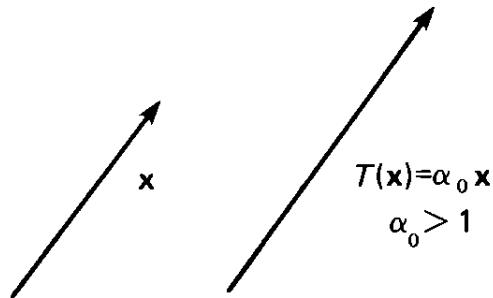
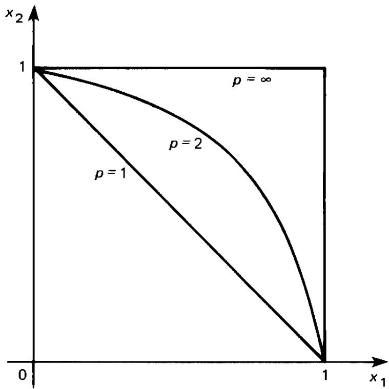
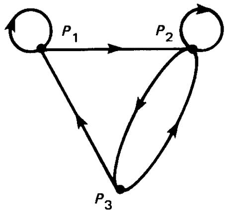

── 原书第 PDF-1 页 (Page PDF-1) ──

计算机科学与应用数学

《矩阵理论》

第二版  
附应用

彼得·兰开斯特（Peter Lancaster）　米尔翁·蒂斯梅内茨基（Miron Tismenetsky）

── 原书第 PDF-2 页 (Page PDF-2) ──

《矩阵理论》

第二版  
附应用

彼得·兰开斯特（Peter Lancaster）　米尔翁·蒂斯梅内茨基（Miron Tismenetsky）

── 原书第 PDF-3 页 (Page PDF-3) ──

《矩阵理论》  
第二版  
附应用

── 原书第 PDF-5 页 (Page PDF-5) ──

# 《矩阵理论》第二版  
附应用

彼得·兰开斯特（Peter Lancaster）  
加拿大阿尔伯塔省卡尔加里市  
卡尔加里大学数学系

米尔翁·蒂斯梅内茨基（Miron Tismenetsky）  
以色列海法市  
以色列理工学院（Technion）科技中心

── 原书第 PDF-6 页 (Page PDF-6) ──

本书系学术出版社（Academic Press）影印重印本，直接依据原书页面复制而成；原书的排版铅版、印版或胶片均已不复存在。尽管其印刷质量不及原版，但此种复制方式使得那些原本已绝版的图书仍得以继续提供。

欢迎访问我们的网站：[http://www.apnet.com](http://www.apnet.com)

本书采用无酸纸印刷。

© 1985 年 Academic Press 版权所有  

未经出版者书面许可，本书任何部分均不得以任何形式——包括电子或机械方式（如影印、录音，或信息存储与检索系统）——复制或传播。

**学术出版社（Academic Press）**  
哈考特科学与技术公司（A Harcourt Science and Technology Company）  
美国加利福尼亚州圣地亚哥市 B 街 525 号 1900 室，邮编：92101-4495  
[http://www.academicpress.com](http://www.academicpress.com)

**学术出版社（Academic Press）**  
英国伦敦詹姆士敦路 32 号哈考特大厦（Harcourt Place），NW1 7BY  
[http://www.academicpress.com](http://www.academicpress.com)

## 美国国会图书馆出版物目录数据（Library of Congress Cataloging-in-Publication Data）

兰卡斯特（Lancaster），彼得（Peter），生年不详。  
《矩阵理论》（*Theory of Matrices*）（计算机科学与应用数学丛书）  
附有索引。  
Ⅰ．矩阵论。　Ⅱ．蒂斯门茨基（Tismenetsky），米罗（Miroslav）。　Ⅲ．书名。　Ⅳ．丛书名。  
QA188.L36 1984　　512.9′434　　83-15775  
ISBN 0-12-435560-9（精装本，碱性纸）。

本书在美国印刷  
00　01　02　03　IBT　12　11　10　9　8　7

── 原书第 PDF-7 页 (Page PDF-7) ──

献给我们的妻子：埃德娜（Edna）与法尼娅（Fania）

── 原书第 vii 页 (Page vii) ──

## 目录

前言 xiii  
1 矩阵代数  
1.1 特殊类型的矩阵 2  
1.2 加法与标量乘法运算 4  
1.3 矩阵乘法 7  
1.4 与乘法相关的特殊类型矩阵 10  
1.5 转置与共轭转置 13  
1.6 子矩阵与矩阵的分块 16  
1.7 矩阵的多项式 19  
1.8 杂项习题 21  

2 行列式、逆矩阵与秩  
2.1 行列式的定义 23  
2.2 行列式的性质 27  
2.3 代数余子式展开 32  
2.4 拉普拉斯定理 36  
2.5 比内–柯西公式 39  
2.6 伴随矩阵与逆矩阵 42  
2.7 矩阵的初等变换 47  
2.8 矩阵的秩 53  
2.9 线性方程组与矩阵 56  
2.10 LU 分解 61  
2.11 杂项习题 63  

3 线性空间、欧几里得空间与酉空间  
3.1 线性空间的定义 71  
3.2 子空间 75  
3.3 线性组合 78  
3.4 线性相关性与线性无关性 80  
3.5 基的概念 83  
3.6 子空间的和与直和 87  
3.7 矩阵表示与秩 91  
3.8 与秩有关的一些矩阵性质 95  
3.9 基变换与过渡矩阵 98  
3.10 方程组的解 100  
3.11 酉空间与欧几里得空间 104  
3.12 正交系 107  
3.13 正交子空间 111  
3.14 杂项习题 113  

4 线性变换与矩阵  
4.1 线性变换 117  
4.2 线性变换的矩阵表示 122  
4.3 矩阵表示、等价性与相似性 127  
4.4 相似矩阵的一些性质 131  
4.5 线性变换的像与核 133  
4.6 可逆变换 138  
4.7 限制变换、不变子空间与变换的直和 142  
4.8 直和与矩阵 145  
4.9 变换的特征值与特征向量 147  
4.10 矩阵的特征值与特征向量 152  
4.11 特征多项式 155  
4.12 特征值的重数 159  
4.13 在微分方程中的初步应用 161  
4.14 杂项习题 164  

5 酉空间中的线性变换与简单矩阵  
5.1 伴随变换 168  
5.2 正规变换与正规矩阵 174  
5.3 埃尔米特矩阵、斜埃尔米特矩阵与定矩阵 178  
5.4 定矩阵的平方根与奇异值 180  
5.5 合同变换与矩阵的惯性 184  
5.6 酉矩阵 188  
5.7 极分解与奇异值分解 190  
5.8 幂等矩阵（投影算子） 194  
5.9 实数域上的矩阵 200  
5.10 双线性型、二次型与埃尔米特型 202  
5.11 标准型的求法 205  
5.12 小振动理论 208  
5.13 允许的矩阵对 212  
5.14 杂项习题 217  

6 若尔当标准形：几何方法  
6.1 零化多项式 221  
6.2 极小多项式 224  
6.3 广义特征子空间 229  
6.4 广义特征子空间的结构 232  
6.5 若尔当定理 236  
6.6 若尔当矩阵的参数 239  
6.7 实若尔当标准形 242  
6.8 杂项习题 244  

7 矩阵多项式与标准形  
7.1 矩阵多项式的概念 246  
7.2 矩阵多项式的除法 248  
7.3 初等变换与等价性 253  
7.4 矩阵多项式的一种标准形 256  
7.5 不变因子多项式与史密斯标准形 259  
7.6 相似性与第一标准形 262  
7.7 初等因子 265  
7.8 第二标准形与若尔当标准形 269  
7.9 特征多项式与极小多项式 271  
7.10 史密斯标准形：微分方程与差分方程 274  
7.11 杂项习题 278  

8 变分方法  
8.1 数值域；埃尔米特矩阵的极值特征值 283  
8.2 库朗–菲舍尔理论与瑞利商 286  
8.3 瑞利商的驻定性 289  
8.4 带约束的问题 290  
8.5 瑞利定理与定矩阵 294  
8.6 雅可比–贡德尔芬格–弗罗贝尼乌斯方法 296  
8.7 库朗–菲舍尔理论的一个应用 300  
8.8 在小振动理论中的应用 302  

9 矩阵函数  
9.1 定义在矩阵谱上的函数 305  
9.2 插值多项式 306  
9.3 矩阵函数的定义 308  
9.4 矩阵函数的性质 310  
9.5 $ f(A) $ 的谱分解 314  
9.6 分量矩阵与不变子空间 320  
9.7 矩阵函数的进一步性质 322  
9.8 矩阵序列与矩阵级数 325  
9.9 预解式与矩阵的柯西定理 329  
9.10 在微分方程中的应用 334  
9.11 可观系统与可控系统 340  
9.12 杂项习题 345  

10 范数与特征值的界  
10.1 范数的概念 350  
10.2 作为度量的向量范数：收敛性 354  
10.3 矩阵范数 358  
10.4 诱导矩阵范数 362  
10.5 绝对向量范数与矩阵的下界 367  
10.6 盖尔施戈林定理 371  
10.7 盖尔施戈林圆盘与不可约矩阵 374  
10.8 舒尔定理 377  
10.9 杂项习题 380  

11 摄动理论  
11.1 线性方程组解的摄动 383  
11.2 单纯矩阵特征值的摄动 387  
11.3 解析摄动 391  
11.4 分量矩阵的摄动 393  
11.5 非重特征值的摄动 395  
11.6 摄动系数的计算 397  
11.7 重特征值的摄动 399  

12 线性矩阵方程与广义逆  
12.1 克罗内克积的概念 406  
12.2 克罗内克积与复合矩阵的特征值 411  
12.3 克罗内克积在矩阵方程中的应用 413  
12.4 对易矩阵 416  
12.5 方程 $ AX + XB = C $ 的解 421  
12.6 单侧逆 424  
12.7 广义逆 428  
12.8 摩尔–彭罗斯广义逆 432  
12.9 方程 $ Ax = b $ 的最佳逼近解 435  
12.10 杂项习题 438  

13 稳定性问题  
13.1 李雅普诺夫稳定性理论及其推广 441  
13.2 关于单位圆的稳定性 451  
13.3 贝祖矩阵与结式 454  
13.4 埃尔米特定理与劳斯–赫尔维茨定理 461  
13.5 舒尔–科恩定理 466  
13.6 实系数多项式的摄动 468  
13.7 利纳尔–奇帕尔判据 470  
13.8 马尔可夫判据 474  
13.9 劳斯–赫尔维茨定理的行列式形式 478  
13.10 柯西指标及其应用 482  

14 矩阵多项式  
14.1 矩阵多项式的线性化 490  
14.2 标准三元组与标准对 493  
14.3 若尔当三元组的结构 500  
14.4 在微分方程中的应用 506  
14.5 微分方程的一般解 509  
14.6 差分方程 512  
14.7 一个表示定理 516  
14.8 倍式与因式 518  
14.9 首一矩阵多项式的根（solvents） 520  

15 非负矩阵  
15.1 不可约矩阵 528  
15.2 非负矩阵与非负逆矩阵 530  
15.3 佩龙–弗罗贝尼乌斯定理（I） 532  
15.4 佩龙–弗罗贝尼乌斯定理（II） 538  
15.5 可约矩阵 543  
15.6 本原矩阵与非本原矩阵 544  
15.7 随机矩阵 547  
15.8 马尔可夫链 550  

附录 1：标量多项式概览 553  
附录 2：分析中若干定理与概念 557  
附录 3：进一步阅读建议 560  
索引 563

── 原书第 xiii 页 (Page xiii) ──

## 前言

本书作者力图弥合当前教材中矩阵论与线性代数这两部分内容的讲授方式，同在若干重要应用领域（以及数学自身）中实际运用与深入掌握这些内容所要求达到的熟练程度之间的差距。与此同时，我们力求使全书内容尽可能自成体系：从最基础的概念与定义出发，逐步展开论述。为实现上述双重目标，本书前几章完整涵盖了标准矩阵论与线性代数课程所包含的全部内容。这部分既包括一种计算型的代数理论构建（延续第一版的精神），也包括有限维线性空间之抽象方法的系统阐述。事实上，全书始终在矩阵代数这一强大工具与线性空间及线性变换理论这另一强大工具之间保持恰当的平衡。

本书的后续章节致力于阐述在众多应用领域中极为有用的内容。其中大部分内容已成为现代科学与工程中普遍采用的语言与方法论的重要组成部分。这部分内容包括变分法、摄动理论、广义逆矩阵、稳定性理论等，其应用遍及工程学、物理学、经济学、统计学等诸多领域。

自第 4 章起，书中对若干应用领域进行了较为详尽的展开。首当其冲的是常系数微分方程组与差分方程组的求解问题。例如，对于线性常微分方程组  
$$
\frac{d\mathbf{x}}{dt} = A \mathbf{x}(t), \quad A \in \mathbb{R}^{n \times n},
$$  
其解结构完全由矩阵 $A$ 的特征值与特征向量（或更一般地，其 Jordan 标准形）所决定；类似地，对于线性齐次差分方程组  
$$
\mathbf{x}_{k+1} = A \mathbf{x}_k,
$$  
其长期行为则由 $A$ 的谱半径 $\rho(A) = \max\{|\lambda_i| : \lambda_i \text{ 是 } A \text{ 的特征值}\}$ 所刻画。

此外，书中还严谨地阐述了振动系统理论（如多自由度保守系统的模态分析，涉及对称正定矩阵的广义特征值问题 $K \mathbf{u} = \lambda M \mathbf{u}$）、马尔可夫过程（其状态转移矩阵 $P$ 满足 $P \geq 0$ 且每行和为 1，稳态分布 $\boldsymbol{\pi}$ 满足 $\boldsymbol{\pi}^\top P = \boldsymbol{\pi}^\top$）、以及系统论中基于状态空间模型的能控性与能观性判据（分别依赖于能控性矩阵 $\mathcal{C} = [B\ AB\ \cdots\ A^{n-1}B]$ 与能观性矩阵 $\mathcal{O} = [C^\top\ (CA)^\top\ \cdots\ (CA^{n-1})^\top]^\top$ 的秩）等方向的初步内容。

本书适用于两大类读者。第一类读者是那些希望获得一部关于矩阵与线性代数的翔实参考著作的研究者，无论其科研工作涉及广泛的应用领域，抑或纯粹属于数学本身。第二类读者则是在各类本科或研究生培养项目中需要学习本课程的学生；例如，本书可为数学、计算机科学或工程类专业的相关课程提供必要的基础支撑。我们将在下文中更详细地面向后一类读者展开说明。

── 原书第 xiv 页 (Page xiv) ──

前七章内容在本质上是自足的，仅要求读者具备大学代数的基础知识，无需其他正式先修课程。然而，教学经验表明，本教材最适宜作为二年级（或更高年级）本科生所修的第二门矩阵或线性代数课程使用。

根据具体需求与专业方向的不同，本书可支撑多种课程设置。一般而言，无需系统性地逐章研读前两章。这两章主要用于确立记号、术语及基本结论，同时也包含若干关于行列式的较深入结果；这些结果可在需要时予以展开推导或直接引用。事实上，前两章的编写方式近乎于原始定义、基本结论与习题的汇编。

以矩阵为中心、但又不失传统线性代数课程框架的内容，则集中于第 3 至第 6 章；若希望采用更具代数风格的方式构建若尔当标准形理论（包括初等因子理论），则可用第 7 章替代第 6 章。

更高阶的课程可基于后续各章中精选的材料来组织。为便于课程设计，下图标示了各章之间的逻辑依赖关系。我们假定：欲掌握其中任一章的内容，读者须已较好地掌握前七章，并具备一定的微积分知识。在本图示中，较粗的连线表示更强的逻辑依赖关系。

*图示：各章之间的先修关系结构图。*

全书各处均配有大量习题与例题。其类型涵盖从计算型习题（旨在帮助读者巩固基本概念）到对正文未予展开之理论的延伸拓展。部分习题附有完整解答，另一些则给出解题提示。这些习题与例题被视为本书不可分割的组成部分；严肃的读者不仅应研读正文内容，亦须充分吸收其中所含的信息。

── 原书第 XV 页 (Page XV) ──

与第一作者于 1969 年出版的《矩阵论》（*The Theory of Matrices*）第一版相比，本卷内容更为全面。首先，前七章（第一版中为前四章）所涵盖的内容已完全重写，其中对线性空间与线性变换理论、以及行列式理论的阐述更为深入和系统。

第 8–11 章及第 15 章（分别论述变分方法、矩阵函数、矩阵范数、摄动理论与非负矩阵）在总体风格与结构上仍保持第一版各章的基本特征，但在表述方式上有所改进，并补充了若干新内容。第 12–14 章则基本属于新增内容，涵盖了矩阵理论中一些相当新颖的思想与近期发展成果。第 12 章系统论述了矩阵形式的线性方程组及其广义逆，其详尽程度足以满足绝大多数应用需求；该章还完整刻画了可交换矩阵的结构。第 13 章对矩阵与标量多项式的稳定性问题进行了深入而严谨的探讨：十九世纪的经典多项式稳定性判据，均从近年来发展的矩阵惯性理论出发，以一种系统且自洽的方式予以推导和重建。第 14 章则深入介绍了近年来发展起来的矩阵多项式谱理论，其深度已足以支撑诸多实际应用，同时也为读者进一步学习更一般的矩阵多项式理论提供了必要基础。

本书的大部分内容是在第二作者担任卡尔加里大学数学与统计系研究员期间完成的。两位作者均欣然感谢卡尔加里大学在此期间给予的支持。第二版吸纳了众多读者对第一版提出的宝贵意见，我们谨向提供这些意见的诸多同行与读者深表谢意。我们的许多工作深受合作者 I. Gohberg、L. Rodman 与 L. Lerer 的热情影响；在此，我们愉快地再次申明对他们持续不断的感激与 *indebtedness*。我们还要特别感谢 H. K. Wimmer 就第二版早期草稿所提出的若干建设性意见；此外，亦感谢其他众多未及一一具名的同事所给予的有益建议。

卡尔加里大学数学与统计系的秘书处工作人员在本第二版书稿的排版准备过程中始终给予了高效而娴熟的帮助；其中，Pat Dalgetty 承担了此项工作的主要任务，我们尤感铭谢。在本书出版期间，我们亦受益于学术出版社（Academic Press）全体工作人员所展现的专业技能与耐心；能与他们合作完成此项工作，实为幸事。

$$
\text{P. Lancaster} \quad \text{M. Tismenetsky} \\
\text{卡尔加里} \quad \text{海法}
$$

── 原书第 1 页 (Page 1) ──

## 矩阵代数

由 $mn$ 个元素构成的有序数组 $a_{ij}$（其中 $i = 1, 2, \dots, m$；$j = 1, 2, \dots, n$），以如下形式书写：

$$
A = 
\begin{bmatrix}
a_{11} & a_{12} & \cdots & a_{1n} \\
a_{21} & a_{22} & \cdots & a_{2n} \\
\vdots & \vdots & \ddots & \vdots \\
a_{m1} & a_{m2} & \cdots & a_{mn}
\end{bmatrix}
$$

被称为一个 $m \times n$ 矩阵。这些元素可取自任意一个域 $\mathcal{F}$。然而，就本书的目的而言，$\mathcal{F}$ 恒指全体实数集 $\mathbb{R}$ 或全体复数集 $\mathbb{C}$。

矩阵 $A$ 可更简略地以其元素表示为  
$$
A = [a_{ij}]_{i,j=1}^{m,n}, \qquad \text{或} \qquad A = [a_{ij}],
$$  
其中 $a_{ij}$（$1 \leq i \leq m$, $1 \leq j \leq n$）表示矩阵 $A$ 中位于第 $i$ 行与第 $j$ 列交点处的元素。

具有相同行数（$m$）与相同列数（$n$）的两个矩阵称为**同型矩阵**（即大小相同的矩阵）。两个同型矩阵  
$$
A = [a_{ij}]_{i,j=1}^{m,n} \qquad \text{和} \qquad B = [b_{ij}]_{i,j=1}^{m,n}
$$  
相等，当且仅当其所有对应元素均相同，即对所有 $1 \leq i \leq m$ 与 $1 \leq j \leq n$，均有 $a_{ij} = b_{ij}$。

全体 $m \times n$ 实矩阵构成的集合记为 $\mathbb{R}^{m \times n}$；类似地，$\mathbb{C}^{m \times n}$ 表示全体 $m \times n$ 复矩阵构成的集合。

── 原书第 2 页 (Page 2) ──

## 1.1 特殊类型的矩阵  

若一个矩阵的行数等于列数，即 $m = n$，则该矩阵称为**方阵**，或称其阶为 $n$。

$$
A = [a_{ij}]_{i,j=1}^{n}
= \begin{bmatrix}
a_{11} & a_{12} & \cdots & a_{1n} \\
a_{21} & a_{22} & \cdots & a_{2n} \\
\vdots & \vdots & & \vdots \\
a_{n1} & a_{n2} & \cdots & a_{nn}
\end{bmatrix}.
$$

方阵的元素 $a_{11}, a_{22}, \ldots, a_{nn}$ 构成该矩阵的**主对角线**，而元素 $a_{1n}, a_{2,n-1}, \ldots, a_{n1}$ 则构成矩阵 $A$ 的**次对角线**。

若一个方阵中主对角线以上（相应地，以下）的所有元素均为零，

$$
A_1 =
\begin{bmatrix}
a_{11} & 0 & \cdots & 0 \\
a_{21} & a_{22} & \ddots & \vdots \\
\vdots & \ddots & \ddots & 0 \\
a_{n1} & \cdots & a_{n,n-1} & a_{nn}
\end{bmatrix},
\qquad
A_2 =
\begin{bmatrix}
a_{11} & a_{12} & \cdots & a_{1n} \\
0 & a_{22} & \ddots & \vdots \\
\vdots & \ddots & \ddots & a_{n-1,n} \\
0 & \cdots & 0 & a_{nn}
\end{bmatrix},
$$

则称其为**下三角矩阵**（相应地，**上三角矩阵**）。

**对角矩阵**是三角矩阵的一个特例，其主对角线以外的所有元素均等于零：

$$
A =
\begin{bmatrix}
a_{11} & 0 & \cdots & 0 \\
0 & a_{22} & & \vdots \\
\vdots & & \ddots & 0 \\
0 & \cdots & 0 & a_{nn}
\end{bmatrix}
= \operatorname{diag}[a_{11}, a_{22}, \ldots, a_{nn}].
$$

若 $a_{11} = a_{22} = \cdots = a_{nn} = a$，则对角矩阵 $A$ 称为**数量矩阵**（或**标量矩阵**）；

$$
A =
\begin{bmatrix}
a & 0 & \cdots & 0 \\
0 & a & \ddots & \vdots \\
\vdots & \ddots & \ddots & 0 \\
0 & \cdots & 0 & a
\end{bmatrix}
= \operatorname{diag}[a, a, \ldots, a].
$$

特别地，若 $a = 1$，则矩阵 $A$ 成为**单位矩阵**（或**恒等矩阵**）：

$$
I =
\begin{bmatrix}
1 & 0 & \cdots & 0 \\
0 & 1 & \ddots & \vdots \\
\vdots & \ddots & \ddots & 0 \\
0 & \cdots & 0 & 1
\end{bmatrix}.
$$

── 原书第 3 页 (Page 3) ──

而当 $a = 0$ 时，得到一个方零矩阵：

$$
0 = \begin{bmatrix}
0 & 0 & \cdots & 0 \\
0 & \ddots & \ddots & \vdots \\
\vdots & \ddots & \ddots & 0 \\
0 & \cdots & 0 & 0
\end{bmatrix}.
$$

所有元素均为零的矩形矩阵也称为**零矩阵**。

一个方阵 $A$ 若满足如下条件，则称为**埃尔米特矩阵**（或**自伴矩阵**）：其主对角线上的元素均为实数，且任意两个关于主对角线对称位置的元素互为复共轭。换言之，埃尔米特矩阵具有如下形式：

$$
\begin{bmatrix}
a_{11} & a_{12} & \cdots & a_{1n} \\
\overline{a_{12}} & a_{22} & \cdots & a_{2n} \\
\vdots & \vdots & \ddots & \vdots \\
\overline{a_{1n}} & \overline{a_{2n}} & \cdots & a_{nn}
\end{bmatrix},
$$

即对所有 $i,j = 1,2,\dots,n$，有 $a_{ji} = \overline{a_{ij}}$，其中 $\overline{a_{ij}}$ 表示复数 $a_{ij}$ 的复共轭。

若所有关于主对角线对称位置的元素彼此相等，则该方阵称为**对称矩阵**：

$$
\begin{bmatrix}
a_{11} & a_{12} & \cdots & a_{1n} \\
a_{12} & a_{22} & \cdots & a_{2n} \\
\vdots & \vdots & \ddots & \vdots \\
a_{1n} & a_{2n} & \cdots & a_{nn}
\end{bmatrix}.
$$

显然，在实矩阵（即所有元素均为实数的矩阵）的情形下，埃尔米特矩阵与对称矩阵这两个概念重合。

回到矩形矩阵，需特别关注那些仅含一列（**列矩阵**）或仅含一行（**行矩阵**）的矩阵，其长度（或阶数）为 $n$：

$$
\mathbf{b} = \begin{bmatrix}
b_1 \\ b_2 \\ \vdots \\ b_n
\end{bmatrix},
\qquad
\mathbf{c}^\mathrm{T} = [c_1 \quad c_2 \quad \cdots \quad c_n].
$$

上标符号 $\mathrm{T}$（表示转置，而非“行矩阵”的简写）的用意，将在第 1.5 节中予以阐明。

此类形如 $n \times 1$ 与 $1 \times n$ 的矩阵亦被称为**向量**或**有序 $n$ 元组**；当 $n = 1,2,3$ 时，它们在几何上具有直观意义：可解释为空间中某一点 $P$ 的坐标（或解释为向量 $\overrightarrow{\mathbf{OP}}$）在一维、二维或三维空间中相对于坐标轴的分量，参见图 1.1。

── 原书第 4 页 (Page 4) ──

*图示：图 1.1 坐标与位置向量。*

例如，在三维欧几里得空间中，一点 $P$ 的笛卡尔坐标为 $(x_0, y_0, z_0)$，其所对应的向量为 $\overrightarrow{\mathbf{OP}}$，二者均与 $1 \times 3$ 行矩阵 $[x_0\ y_0\ z_0]$ 相关联。点 $\mathbf{P}$ 的位置，以及向量 $\overrightarrow{\mathbf{OP}}$ 的位置，均由该（位置）向量完全确定。

借用若干几何术语，向量（或位置向量）的长度由欧几里得几何的自然推广来定义：对元素为 $b_1, b_2, \ldots, b_n$ 的向量 $\mathbf{b}$，其长度为  
$$
\|\mathbf{b}\| \triangleq \left( |b_1|^2 + |b_2|^2 + \cdots + |b_n|^2 \right)^{1/2}.
$$

注意：本书中，符号 $\triangleq$ 在用作定义关系时始终采用。

## 1.2 加法与标量乘法运算

由于向量是矩阵的特例，因此矩阵上的运算将被定义为：在列矩阵与行矩阵这两种特殊情形下，其运算恰好对应于位置向量上所熟知的运算。回顾可知，在三维欧几里得空间中，两个位置向量之和定义为  
$$
[x_1\ y_1\ z_1] + [x_2\ y_2\ z_2] \triangleq [x_1 + x_2\quad y_1 + y_2\quad z_1 + z_2].
$$  
该定义导出向量加法的平行四边形法则，如图 1.2 所示。

── 原书第 5 页 (Page 5) ──

*图示：图 1.2 平行四边形法则。*

对于以行矩阵或列矩阵形式表示的有序 $n$ 元组，该运算自然推广为  

$$
\begin{array}{rl}
[x_1 & x_2 \quad \cdots \quad x_n] + [y_1 \quad y_2 \quad \cdots \quad y_n] \\
& \triangleq [x_1 + y_1 \quad x_2 + y_2 \quad \cdots \quad x_n + y_n]
\end{array}
$$  

或  

$$
\begin{bmatrix}
x_1 \\ x_2 \\ \vdots \\ x_n
\end{bmatrix}
+
\begin{bmatrix}
y_1 \\ y_2 \\ \vdots \\ y_n
\end{bmatrix}
\triangleq
\begin{bmatrix}
x_1 + y_1 \\ x_2 + y_2 \\ \vdots \\ x_n + y_n
\end{bmatrix}.
$$

也就是说，所得向量的各元素（或称分量、坐标）仅仅是相应位置上两个向量对应元素的和。注意：仅当两个向量维数相同时，它们才可相加。

现在，对同型矩阵 $A = [a_{ij}]_{i,j=1}^{m,n}$ 与 $B = [b_{ij}]_{i,j=1}^{m,n}$，如下定义其和是自然的：

$$
A + B \triangleq [a_{ij} + b_{ij}]_{i,j=1}^{m,n}.
$$

实数与复数（我们统称为标量）所具有的性质，显然可推出矩阵加法满足交换律与结合律。

**习题 1.** 证明：对同型矩阵，有  

$$
\begin{aligned}
A + B &= B + A, \\
(A + B) + C &= A + (B + C).
\end{aligned}
$$

这些运算法则使得若干同型矩阵之和的定义与计算变得简便。特别地，显然任意多个 $n \times n$ 上三角矩阵（相应地，下三角矩阵）之和仍为上三角矩阵（相应地，下三角矩阵）。还需注意：同阶的若干个对角矩阵之和仍为对角矩阵。

矩阵的减法运算按数的减法方式来定义。即，对同型矩阵 $A$ 与 $B$，其差记作 $A - B$，是指满足下式的矩阵 $X$：

$$
X + B = A.
$$

显然，

$$
A - B = [a_{ij} - b_{ij}]_{i,j=1}^{m,n},
$$

其中

$$
A = [a_{ij}]_{i,j=1}^{m,n}, \qquad B = [b_{ij}]_{i,j=1}^{m,n}.
$$

显然，零矩阵在矩阵运算中扮演着数系中“零”的角色：将零矩阵加到任一矩阵上，或从该矩阵中减去零矩阵，均不改变该矩阵。

在引入矩阵与标量相乘这一运算之前，先回顾三维欧几里得空间中（位置）向量的相应定义：若 $\mathbf{a} = [a_1 \quad a_2 \quad a_3]$，且 $\alpha$ 表示一个实数，则向量 $\alpha \mathbf{a}$ 定义为  

$$
\alpha \mathbf{a} \triangleq [\alpha a_1 \quad \alpha a_2 \quad \alpha a_3].
$$  

因此，在向量与标量的乘积中，向量的每个分量均乘以该标量。

此运算对实向量与实标量具有直观的几何意义（参见图 1.3）：向量 $\alpha \mathbf{a}$ 的长度等于 $|\alpha|$ 倍的向量 $\mathbf{a}$ 的长度；当 $\alpha > 0$ 时，其方向保持不变；当 $\alpha < 0$ 时，其方向则恰好相反。

将上述概念由（位置）向量推广至一般情形，矩阵 $A = [a_{ij}]$ 与标量 $\alpha$ 的乘积定义为矩阵 $C$，其元素为 $c_{ij} = \alpha a_{ij}$，即 $C \triangleq [\alpha a_{ij}]$。我们亦记作 $C = \alpha A$。标量乘法满足如下性质：

*图示：图 1.3 标量乘法*

── 原书第 7 页 (Page 7) ──

## 1.3 矩阵乘法

矩阵的乘法与加法可直接由其定义及数的相应运算性质推出。

**习题 2.** 验证：对任意两个同型矩阵 $A$、$B$ 以及任意标量 $\alpha$、$\beta$，有  
$$
\begin{array}{c}
0 A = 0, \\
(\alpha + \beta) A = \alpha A + \beta A, \\
\alpha (A + B) = \alpha A + \alpha B, \\
\alpha (\beta A) = (\alpha \beta) A.
\end{array}
$$  

注意，通过记号 $(-1)B \triangleq -B$，我们亦可将差 $A - B$ 定义为矩阵 $A$ 与 $-B$ 的和。

## 1.3 矩阵乘法  

与其他矩阵运算一样，两个矩阵乘积的概念亦可由向量代数中的某些概念引出。回顾三维欧几里得空间中，（位置）向量 $\mathbf{a}$ 与 $\mathbf{b}$ 的标量积（又称点积或内积）是一个重要且实用的概念。它定义为  
$$
\mathbf{a} \cdot \mathbf{b} \triangleq |\mathbf{a}| \, |\mathbf{b}| \cos \alpha, \tag{1}
$$  
其中 $\alpha$ 表示给定向量之间的夹角。显然，对非零向量 $\mathbf{a}$ 与 $\mathbf{b}$，其标量积为零当且仅当 $\mathbf{a}$ 与 $\mathbf{b}$ 正交。

若向量 $\mathbf{a}$ 与 $\mathbf{b}$ 的坐标分别为 $a_1, a_2, a_3$ 与 $b_1, b_2, b_3$，则标量积的计算十分简单：  
$$
\mathbf{a} \cdot \mathbf{b} = a_1 b_1 + a_2 b_2 + a_3 b_3. \tag{2}
$$  

矩阵乘法定义的关键在于如下约定：将行向量 $\mathbf{a}^\top$ 与列向量 $\mathbf{b}$（按此顺序）的乘积定义为式 (2) 右端的和：  
$$
\mathbf{a}^\top \mathbf{b} = 
\begin{bmatrix} a_1 & a_2 & a_3 \end{bmatrix}
\begin{bmatrix} b_1 \\ b_2 \\ b_3 \end{bmatrix}
\triangleq a_1 b_1 + a_2 b_2 + a_3 b_3. \tag{3}
$$  

且此定义现将取代式 (1) 或式 (2) 中所用的“点积”记号。毫不意外地，该运算被描述为“行乘列”（*row-into-column*）乘法。

── 原书第 8 页 (Page 8) ──

与式 (1) 相比，式 (3) 所给出的定义可立即推广至更一般的情形，而这将在后续内容中发挥极为重要的作用。首先，向量 $\mathbf{a}$ 与 $\mathbf{b}$ 的元素可取自任意数域（即未必是实数）；其次，这两个向量均可具有任意正整数 $n$ 个分量。

因此，若 $\mathbf{a}$、$\mathbf{b}$ 均为含 $n$ 个分量的向量（其分量可以是实数或复数），则定义  

$$
\mathbf{a}^{\mathrm{T}} \mathbf{b} = 
\begin{bmatrix} a_1 & a_2 & \cdots & a_n \end{bmatrix}
\begin{bmatrix} b_1 \\ b_2 \\ \vdots \\ b_n \end{bmatrix}
\triangleq \sum_{r=1}^{n} a_r b_r. \tag{4}
$$  

这一思想将在矩阵乘法的完整定义中得到进一步运用。

设 $A$ 为任一含有 $m$ 行 $\mathbf{a}_i^{\mathsf{T}}$（$1 \leq i \leq m$）、每行长度为 $l$ 的矩阵（故 $A$ 是 $m \times l$ 矩阵）；再设 $B$ 为一含有 $n$ 列 $\mathbf{b}_j$（$1 \leq j \leq n$）、每列长度亦为 $l$ 的矩阵（因而 $B$ 是 $l \times n$ 矩阵）。则 $A$ 与 $B$ 的乘积定义为 $m \times n$ 矩阵 $C = [c_{ij}]$，其中  

$$
c_{ij} = \mathbf{a}_i^{\operatorname{T}} \mathbf{b}_j \qquad (1 \leq i \leq m,\; 1 \leq j \leq n).
$$  

因此  

$$
AB = 
\begin{bmatrix}
\mathbf{a}_1^{\mathsf{T}} \\
\mathbf{a}_2^{\mathsf{T}} \\
\vdots \\
\mathbf{a}_m^{\mathsf{T}}
\end{bmatrix}
B
\triangleq
\begin{bmatrix}
\mathbf{a}_1^{\mathsf{T}} \mathbf{b}_1 & \mathbf{a}_1^{\mathsf{T}} \mathbf{b}_2 & \cdots & \mathbf{a}_1^{\mathsf{T}} \mathbf{b}_n \\
\mathbf{a}_2^{\mathsf{T}} \mathbf{b}_1 & \mathbf{a}_2^{\mathsf{T}} \mathbf{b}_2 & \cdots & \mathbf{a}_2^{\mathsf{T}} \mathbf{b}_n \\
\vdots & \vdots & \ddots & \vdots \\
\mathbf{a}_m^{\mathsf{T}} \mathbf{b}_1 & \mathbf{a}_m^{\mathsf{T}} \mathbf{b}_2 & \cdots & \mathbf{a}_m^{\mathsf{T}} \mathbf{b}_n
\end{bmatrix}
\equiv \big[ \mathbf{a}_i^{\mathsf{T}} \mathbf{b}_j \big]_{i,j=1}^{m,n}.
$$  

利用 (4) 式，我们得到乘法公式  

$$
AB = \left[ \sum_{k=1}^{l} a_{ik} b_{kj} \right]_{i,j=1}^{m,n}. \tag{5}
$$  

**习题 1.** 证明：  

$$
\begin{bmatrix}
2 & -1 & 0 \\
0 & 3 & 1
\end{bmatrix}
\begin{bmatrix}
3 & 0 \\
2 & 1 \\
1 & 0
\end{bmatrix}
=
\begin{bmatrix}
4 & -1 \\
7 & 3
\end{bmatrix}.
\quad
\boxed{
\begin{array}{cc}
\boxed{2} & \\
\end{array}
}
$$  

需要特别注意的是：两个矩阵的乘积有定义，当且仅当第一个因子的列数等于第二个因子的行数。满足这一条件时，称矩阵 $A$ 与 $B$ 关于矩阵乘法是**相容的**（*conformable*）。

── 原书第 9 页 (Page 9) ──

**习题 2.** 若 $\mathbf{a}$ 是一个 $m$ 阶列矩阵，而 $\mathbf{b}^\dagger$ 是一个 $n$ 阶行矩阵，则证明 $\mathbf{a}\mathbf{b}^\dagger$ 是一个 $m \times n$ 矩阵。（该矩阵有时称为 $\mathbf{a}$ 与 $\mathbf{b}$ 的**外积**（outer product）。）$\square$

上述矩阵乘法的定义是标准定义；它侧重于第一个因子的行与第二个因子的列。还存在另一种关于乘积 $AB$ 的表示形式，该形式在许多场合下十分有用；与标准定义相反，它以第一个因子的列和第二个因子的行来表达。

首先，请仔细领会习题 2 的结论。设 $A$ 为 $m \times l$ 矩阵，$B$ 为 $l \times n$ 矩阵（从而 $A$ 与 $B$ 关于矩阵乘法是相容的）。设 $A$ 的列为 $\mathbf{a}_1, \mathbf{a}_2, \ldots, \mathbf{a}_l$，$B$ 的行为 $\mathbf{b}_1^\top, \mathbf{b}_2^\top, \ldots, \mathbf{b}_l^\top$。则断言成立：

$$
AB = \sum_{k=1}^{l} \mathbf{a}_k \mathbf{b}_k^\top, \tag{6}
$$

且显然，每个乘积 $\mathbf{a}_k \mathbf{b}_k^\top$ 均为一个 $m \times n$ 矩阵。

**习题 3.** 验证公式 (6) 成立。

矩阵乘法在一定程度上保持了标量乘法的某些性质。

**习题 4.** 验证：对任意阶数适当（即相容）的矩阵，以下各式均成立：

$$
\begin{array}{c}
AI = IA = A, \\
A(B + C) = AB + AC, \qquad (B + C)D = BD + CD, \\
A(BC) = (AB)C \qquad \text{(associative law).}
\end{array}
$$

（分配律），

然而，矩阵乘法并不保持标量乘法所具有的若干重要性质，接下来的习题将对此予以说明。

**习题 5.** 取

$$
A = 
\begin{bmatrix}
2 & 1 \\
0 & 0 \\
1 & 0
\end{bmatrix}
\quad \text{and} \quad
B = 
\begin{bmatrix}
0 & 1 & 2 \\
-1 & 0 & 0
\end{bmatrix},
$$

或

$$
A = 
\begin{bmatrix}
2 & 1 \\
0 & 0
\end{bmatrix}
\quad \text{and} \quad
B = 
\begin{bmatrix}
1 & 0 \\
-1 & 0
\end{bmatrix},
$$

验证 $AB \neq BA$。 $\square$

因此，矩阵乘法在一般情况下不满足交换律。

── 原书第 10 页 (Page 10) ──

**习题 6.** 验证：$AB = O$ 并不能推出 $A$ 或 $\mathbf{B}$ 是零矩阵。（换言之，构造矩阵 $A \neq 0$, $B \neq 0$，使得 $AB = O$ 成立。）

**习题 7.** 验证：若 $AB = AC$, $A \neq O$，并不一定有 $\mathbf{B} = \mathbf{C}$ 成立。$\square$

矩阵乘法的一种特殊情形是矩阵与自身的乘积。显然，这种乘法仅当该矩阵为方阵时才可行。因此，设 $A$ 为一方阵，且令 $p$ 为任意正整数。则矩阵  

$$
A^p \triangleq \underbrace{AA\cdots A}_{p\text{ times}}
$$

被称为矩阵 $A$ 的 $p$ 次幂，且定义 $A^0$ 为与 $A$ 同阶的单位矩阵。还需注意：$A^1 \triangleq A$。

**习题 8.** 验证：

$$
\begin{bmatrix}
2 & -1 \\
0 & 2
\end{bmatrix}^3
=
\begin{bmatrix}
8 & -12 \\
0 & 8
\end{bmatrix}.
$$

**习题 9.** 证明指数律：

$$
\begin{aligned}
A^p A^q &= A^{p+q}, \\
(A^p)^q &= A^{pq},
\end{aligned}
$$

其中 $p, q$ 为任意非负整数。

## 1.4 与矩阵乘法相关的特殊类型矩阵

本节介绍若干在矩阵乘法下具有特殊性质的矩阵类型。如习题 1.3.5 所示，两个矩阵通常不可交换：$AB \neq BA$。但当等式成立时，我们称矩阵 $A$ 与 $\mathbf{B}$ 可交换；这一情形将在第 12.4 节中作较深入的研究。

**习题 1.** 求出所有与下列矩阵可交换的矩阵：

（a）

$$
\begin{bmatrix}
1 & 0 \\
-1 & 0
\end{bmatrix},
$$

（b）

$$
\begin{bmatrix}
0 & 1 & 0 \\
0 & 0 & 1 \\
0 & 0 & 0
\end{bmatrix}.
$$

── 原书第 11 页 (Page 11) ──

**解答。**  
（a）  
$$
\begin{bmatrix}
d - c & 0 \\
c & d
\end{bmatrix},
$$

（b）  
$$
\begin{bmatrix}
a & b & c \\
0 & a & b \\
0 & 0 & a
\end{bmatrix},
$$  
其中 $a$, $b$, $c$, $d$ 表示任意标量。 □  

由习题 1.3.4 可知，单位矩阵与任意同阶方阵可交换。事实上，还存在其他具有这一性质的矩阵。下一习题将给出这类矩阵的一般刻画；随后，还将列举若干其他可交换矩阵的特殊情形。

**习题 2.** 证明：一个矩阵与所有与其同阶的方阵均可交换，当且仅当该矩阵为数量矩阵。

**习题 3.** 证明：同阶对角矩阵彼此可交换。

**习题 4.** 证明：同一个方阵的（非负整数）幂彼此可交换。

**习题 5.** 证明：若矩阵 $A$ 与对角矩阵  
$$
\operatorname{diag}(a_1, a_2, \dotsc, a_n)
$$  
可交换，且 $a_i \neq a_j$（当 $i \neq j$），则 $A$ 必为对角矩阵。 □  

另一类重要的矩阵是满足如下方程的矩阵：  
$$
A^2 = A. \tag{1}
$$  
满足该方程的矩阵 $A$ 称为**幂等矩阵**。

**习题 6.** 验证下列矩阵：  
$$
A_1 = 
\begin{bmatrix}
1 & 0 \\
0 & 0
\end{bmatrix}
\quad\text{和}\quad
A_2 = 
\begin{bmatrix}
1 & 2 & 2 \\
0 & 0 & -1 \\
0 & 0 & 1
\end{bmatrix}
$$  
均为幂等矩阵。

**习题 7.** 证明：若 $A$ 是幂等矩阵，且 $p$ 为正整数，则 $A^p = A$。

**习题 8.** 刻画所有 $2 \times 2$ 阶幂等矩阵的集合。 □  

若存在正整数 $p$，使得  
$$
A^p = 0, \tag{2}
$$  
则称方阵 $A$ 为**幂零矩阵**。

── 原书第 12 页 (Page 12) ──

显然，由 (2) 式可知，对任意整数 $k$，只要 $k \geq p$，则 $A^k$ 也是零矩阵。因此，满足 (2) 的最小正整数 $p_0$ 的概念是合理的，该数称为矩阵 $A$ 的**幂零指数**（degree of nilpotency）。

**习题 9.** 验证矩阵  
$$
A = 
\begin{bmatrix}
0 & 1 & 0 \\
0 & 0 & 1 \\
0 & 0 & 0
\end{bmatrix}
$$  
是幂零矩阵，且其幂零指数等于 $3$。

**习题 10.** 证明：任一主对角线上元素全为零的上三角矩阵均为幂零矩阵。

**习题 11.** 求出所有幂零指数等于 $2$ 的 $2 \times 2$ 矩阵。

**解答：**  
$$
\begin{bmatrix}
a & b \\
c & -a
\end{bmatrix},
$$  
其中 $a^2 + bc = 0$，且 $a, b, c$ 不全为零。 □

本节最后要讨论的一类矩阵是**对合矩阵**（involutory matrices）。它们是满足如下条件的方阵：  
$$
A^2 = I.\tag{3}
$$  

**习题 12.** 验证：对任意角度 $\theta$，矩阵  
$$
A = 
\begin{bmatrix}
\cos\theta & \sin\theta \\
\sin\theta & -\cos\theta
\end{bmatrix}
$$  
是对合矩阵。

**习题 13.** 证明：若一个矩阵在次对角线（anti-diagonal）上所有位置取值为 $1$ 或 $-1$，其余位置均为零，则该矩阵是对合矩阵。

**习题 14.** 证明：矩阵 $A$ 是对合矩阵当且仅当  
$$
(I - A)(I + A) = 0.
$$  

**习题 15.** 求出所有 $2 \times 2$ 对合矩阵。

**解答：**  
$$
\begin{bmatrix}
a & b \\
c & -a
\end{bmatrix},
$$  
其中 $a^2 + bc = 1$，或

── 原书第 13 页 (Page 13) ──

$$
\left[ \begin{array}{ll}
\varepsilon & 0 \\
0 & \varepsilon
\end{array} \right]
$$

其中 $\varepsilon = \pm 1$。

**习题 16.** 证明：若 $A$ 是对合矩阵（involutory matrix），即满足 $A^2 = I$，则矩阵  
$$
B = \frac{1}{2}(I + A)
$$  
是幂等矩阵（idempotent matrix），即满足 $B^2 = B$。 □  

## 1.5 转置与共轭转置  

本节讨论由给定矩阵构造新矩阵的若干方法。  

给定一个 $m \times n$ 矩阵 $A = [a_{ij}]$，将其行与列互换所得的 $n \times m$ 矩阵称为矩阵 $A$ 的**转置**（transpose），记作 $A^{\mathrm{T}}$。更具体地，若  

$$
A = 
\begin{bmatrix}
a_{11} & a_{12} & \cdots & a_{1n} \\
a_{21} & a_{22} & \cdots & a_{2n} \\
\vdots & \vdots & & \vdots \\
a_{m1} & a_{m2} & \cdots & a_{mn}
\end{bmatrix},
\qquad
\text{则} \quad
A^{\mathrm{T}} \triangleq 
\begin{bmatrix}
a_{11} & a_{21} & \cdots & a_{m1} \\
a_{12} & a_{22} & \cdots & a_{m2} \\
\vdots & \vdots & & \vdots \\
a_{1n} & a_{2n} & \cdots & a_{mn}
\end{bmatrix}.
$$  

需注意：$A$ 的各行成为 $A^{\mathrm{T}}$ 的各列，而 $A$ 的各列则成为其转置矩阵的各行。此外，依据此定义，我们在前几节中用记号 $\mathbf{a}^\dagger$ 表示行矩阵，其含义即为相应列向量 $\mathbf{a}$ 的转置（注：此处 $\dagger$ 通常表示共轭转置；在实数情形下，$\mathbf{a}^\dagger = \mathbf{a}^{\mathrm{T}}$）。

**习题 1.** 下列矩阵  

$$
A = 
\begin{bmatrix}
2 & 1 & 0 \\
-1 & 2 & 1
\end{bmatrix},
\qquad
\text{和}
\qquad
B = 
\begin{bmatrix}
2 & -1 \\
1 & 2 \\
0 & 1
\end{bmatrix}
$$  

互为转置矩阵：$A = B^{\mathrm{T}}$ 与 $B = A^{\mathrm{T}}$。 □  

转置运算的下列性质可直接由其定义得出。  

**习题 2.** 设 $A$ 与 $B$ 为任意两个阶数适配的矩阵，且 $\alpha \in \mathcal{F}$。证明：  

$$
\begin{aligned}
(A^{\mathrm{T}})^{\mathrm{T}} &= A, \\
(\alpha A)^{\mathrm{T}} &= \alpha A^{\mathrm{T}}, \\
(A + B)^{\mathrm{T}} &= A^{\mathrm{T}} + B^{\mathrm{T}}, \\
(AB)^{\mathrm{T}} &= B^{\mathrm{T}} A^{\mathrm{T}}.
\end{aligned}
$$

── 原书第 14 页 (Page 14) ──

借助转置的概念，可给出对称矩阵的一个简明定义（该定义等价于第 1.1 节中的定义）。

**习题 3.** 证明：一个方阵 $A$ 是对称矩阵，当且仅当  
$$
A^{\mathsf{T}} = A. \tag{1}
$$  

一些关于对称矩阵的附加性质可直接由式 (1) 推出。

**习题 4.** 证明：若 $A$ 与 $B$ 均为对称矩阵，则 $A + B$ 也是对称矩阵。

**习题 5.** 证明：对任一方阵 $A$，矩阵 $AA^{\mathsf{T}}$、$A^{\mathsf{T}}A$ 与 $A^{\mathsf{T}} + A$ 均为对称矩阵。□

若矩阵 $A$ 满足  
$$
A^{\mathsf{T}} = -A, \tag{2}
$$  
则称 $A$ 为**斜对称矩阵**（或**反对称矩阵**）。

**习题 6.** 验证矩阵  
$$
A = \begin{bmatrix}
0 & -2 & -3 \\
2 & 0 & -2 \\
3 & 2 & 0
\end{bmatrix}
$$  
是斜对称矩阵。□

显然，一个 $n \times n$ 斜对称矩阵 $A = [a_{ij}]$ 的元素满足下列条件：  
$$
a_{ij} = -a_{ji}, \qquad 1 \leq i,j \leq n,
$$  
特别地，矩阵 $A$ 主对角线上的元素均为零。

**习题 7.** 验证：对任意方阵 $A$，矩阵 $A - A^{\mathsf{T}}$ 是斜对称矩阵。□

习题 7 的结论与习题 5 合起来，可推出如下分解：

**习题 8.** 证明：任一方阵 $A$ 均可表示为  
$$
A = A_1 + A_2,
$$  
其中 $\mathbf{A_1}$ 是对称矩阵，$A_2$ 是斜对称矩阵。□

考虑一个元素属于复数域 $\mathbb{C}$ 的矩阵 $A = [a_{ij}]_{i,j=1}^{m,n}$。其**复共轭矩阵** $\overline{A}$ 定义为将 $A$ 的每个元素替换为其复共轭所得到的矩阵。† 换言之，  
$$
\overline{A} \triangleq [\overline{a}_{ij}]_{i,j=1}^{m,n}.
$$  
显然，矩阵 $A$ 是实矩阵当且仅当 $\overline{A} = A$。

† 回忆：若 $a = c + di$，其中 $c,d \in \mathbb{R}$，则其复共轭为 $\overline{a} \triangleq c - di$。

── 原书第 15 页 (Page 15) ──

转置运算与复共轭运算结合，引出矩阵 $A$ 的一个重要概念——**共轭转置矩阵** $A^*$，其定义为  
$$
A^* \triangleq \overline{A}^{\mathsf{T}}.
$$  
更具体地，对 $A = [a_{ij}]_{i,j=1}^{m,n}$，  
$$
A^* \triangleq 
\begin{bmatrix}
\overline{a}_{11} & \overline{a}_{21} & \cdots & \overline{a}_{m1} \\
\overline{a}_{12} & \overline{a}_{22} & \cdots & \overline{a}_{m2} \\
\vdots & \vdots & & \vdots \\
\overline{a}_{1n} & \overline{a}_{2n} & \cdots & \overline{a}_{mn}
\end{bmatrix}.
$$  

显然，对任一实矩阵 $A$，转置与共轭转置这两个概念是等价的，即 $A^* = A^\mathsf{T}$。

**习题 9.** 验证下列矩阵  
$$
A = 
\begin{bmatrix}
2 & -3 \\
0 & 1 \\
1 & 0
\end{bmatrix}
\qquad\text{和}\qquad
B = 
\begin{bmatrix}
i & -3 \\
0 & 2i + 1
\end{bmatrix}
$$  
的共轭转置分别为  
$$
A^* = 
\begin{bmatrix}
2 & 0 & 1 \\
-3 & 1 & 0
\end{bmatrix}
= A^\mathsf{T}
\qquad\text{和}\qquad
B^* = 
\begin{bmatrix}
-i & 0 \\
-3 & -2i + 1
\end{bmatrix},
$$  
（依次对应）。

**习题 10.**（参见习题 2。）证明：  
$$
(A^*)^* = A,\quad
(\alpha A)^* = \overline{\alpha}\, A^*,\quad
(A + B)^* = A^* + B^*,\quad
(AB)^* = B^* A^*.
\quad\Box
$$  

借助共轭转置的概念，可对**埃尔米特矩阵**给出一个优美的刻画。

**习题 11.** 证明：一个方阵 $A$ 是埃尔米特矩阵（定义见第 1.1 节），当且仅当 $A = A^*$。

**习题 12.** 证明：对任意矩阵 $A$，矩阵 $AA^*$ 与 $A^*A$ 均为埃尔米特矩阵。

**习题 13.** 验证：对任意方阵 $A$，矩阵 $A + A^*$ 与 $i(A - A^*)$ 均为埃尔米特矩阵。

> **注意**：所有 $1 \times 1$ 复矩阵（即仅含一个标量元素的矩阵）恰好一一对应于全体复数集合 $\mathbb{C}$。进一步地，在该对应关系下，$1 \times 1$ 埃尔米特矩阵恰好对应于实数集 $\mathbb{R}$。更一般地，将埃尔米特矩阵嵌入到 $\mathbb{C}^{n \times n}$ 中，可视为实数集 $\mathbb{R}$ 自然嵌入复数集 $\mathbb{C}$ 的推广。特别地，请注意如下复方阵的表示形式与复数熟知的**笛卡尔分解**（即 $z = \operatorname{Re} z + i\,\operatorname{Im} z$）之间的类比关系：  
> 对任意 $A \in \mathbb{C}^{n \times n}$，  
> $$
> \frac{A + A^*}{2} \quad\text{（埃尔米特部分）},\qquad
> \frac{A - A^*}{2i} \quad\text{（斜埃尔米特部分）}
> $$  
> 分别是埃尔米特矩阵与斜埃尔米特矩阵，且满足  
> $$
> A = \frac{A + A^*}{2} + i \cdot \frac{A - A^*}{2i}.
> $$

── 原书第 16 页 (Page 16) ──

**习题 14.** 证明：任一方阵 $A$ 均可唯一地表为 $A = A_1 + i A_2$ 的形式，其中 $A_1$ 与 $A_2$ 均为埃尔米特矩阵。  
□  

**斜埃尔米特矩阵（skew-Hermitian matrix）** $A$ 是指满足 $A^* = -A$ 的矩阵（此处 $A^*$ 表示 $A$ 的共轭转置）。  

**习题 15.** 验证矩阵  
$$
A = 
\begin{bmatrix}
i & i \\
i & i
\end{bmatrix}
$$  
为斜埃尔米特矩阵。  

**习题 16.** 证明：斜埃尔米特矩阵的对角元均为纯虚数。  

## 1.6 子矩阵与矩阵的分块  

给定矩阵 $A = [a_{ij}]_{i=1,\dots,m;\,j=1,\dots,n}$，若从中删去若干完整的行或若干完整的列，或同时删去若干完整的行与若干完整的列，则所得的新矩阵称为 $A$ 的一个**子矩阵**。  

**例 1.** 若  
$$
A = 
\begin{bmatrix}
2 & 3 & -2 & 4 \\
0 & 1 & 1 & 0 \\
2 & -1 & 0 & 0
\end{bmatrix},
$$  
那么，如下矩阵  
$$
\begin{bmatrix}
2 & 3 \\
0 & 1
\end{bmatrix}, \quad
\begin{bmatrix}
1 & 1
\end{bmatrix}, \quad
\begin{bmatrix}
2 & 3 & -2 & 4
\end{bmatrix}, \quad
\begin{bmatrix}
2 & 4 \\
2 & 0
\end{bmatrix}
$$  
即为矩阵 $A$ 的若干子矩阵。  

有一种特殊方式可将矩阵划分为子矩阵：在指定的行之间及指定的列之间插入分隔线（每条分隔线贯穿整个矩阵阵列的宽度或高度）。这种划分称为矩阵的一个**分块**（partition）。  

**例 2.** 矩阵  
$$
A = 
\begin{bmatrix}
2 & 3 & -2 & 4 \\
0 & 1 & 1 & 0 \\
2 & -1 & 0 & 0
\end{bmatrix}
$$

── 原书第 17 页 (Page 17) ──

可被分块为  

$$
A = \left[ \begin{array}{cc|cc}
2 & 3 & -2 & 4 \\
0 & 1 & 1 & 0 \\
\hline
2 & -1 & 0 & 0
\end{array} \right] 
\qquad \text{或} \qquad 
A = \left[ \begin{array}{c|cc|c}
2 & 3 & -2 & 4 \\
\hline
0 & 1 & 1 & 0 \\
2 & -1 & 0 & 0
\end{array} \right].
$$

此外还有多种其他分块方式。在第一种情形中，该矩阵被划分为若干子矩阵（亦称**块**），分别记为  

$$
A = \begin{bmatrix}
A_{11} & A_{12} \\
A_{21} & A_{22}
\end{bmatrix}, \tag{1}
$$

其中  

$$
A_{11} = \begin{bmatrix} 2 & 3 \\ 0 & 1 \end{bmatrix}, \quad
A_{12} = \begin{bmatrix} -2 & 4 \\ 1 & 0 \end{bmatrix}, \quad
A_{21} = \begin{bmatrix} 2 & -1 \end{bmatrix}, \quad
A_{22} = \begin{bmatrix} 0 & 0 \end{bmatrix}.
$$

在第二种分块方式下，矩阵 $A$ 可表示为如下形式：  

$$
A = \begin{bmatrix}
A_{11} & A_{12} & A_{13} \\
A_{21} & A_{22} & A_{23}
\end{bmatrix},
$$  

其中  

$$
A_{11} = [2], \quad
A_{12} = \begin{bmatrix} 3 & -2 \end{bmatrix}, \quad
A_{13} = [4],
$$  
$$
A_{21} = \begin{bmatrix} 0 \\ 2 \end{bmatrix}, \quad
A_{22} = \begin{bmatrix} 1 \\ -1 \end{bmatrix}, \quad
A_{23} = \begin{bmatrix} 0 \\ 0 \end{bmatrix}.
$$

注意：某些块可能是 $1 \times 1$ 矩阵，即标量。

分块矩阵的子矩阵称为该分块矩阵的**元素**（或**块元素**）。例如，式 (1) 中的子矩阵 $A_{11},\, A_{12},\, A_{21},\, A_{22}$ 可视为 $2 \times 2$ 阶分块矩阵 $A$ 的元素。

方阵型分块矩阵、对角型分块矩阵等概念，其定义与标量元矩阵的情形完全一致（参见第 1.1 节）。

**例 3.** 下列矩阵  

$$
A = \begin{bmatrix}
A_{11} & A_{12} \\
0 & A_{22}
\end{bmatrix}, \qquad 
B = \begin{bmatrix}
B_{11} & 0 \\
0 & B_{22}
\end{bmatrix}
$$  

分别为上三角分块矩阵与对角分块矩阵。

方阵允许若干特殊的分块方式。若方阵 $A$ 的各对角块 $A_{ii}$ 对每个 $i$ 均为方阵，则称该分块方式为**对称分块**（*symmetric partition*）。

── 原书第 18 页 (Page 18) ──

**例 4.** 矩阵  

$$
A = \begin{bmatrix}
1 & 2 & 2 \\
-1 & 0 & 1 \\
0 & 0 & 3
\end{bmatrix}
$$  

是一个对称分块矩阵。

> **注：** 原文中矩阵表达式存在严重 OCR 错误与排版混乱（如 `\vdots` 误作竖线分隔符、`- - - - - - - \cdots` 为无效占位符、行数列数不匹配等）。根据上下文“对称分块矩阵”及后续例题结构，该矩阵应为 $3\times3$ 实对称矩阵，且最可能对应标准形式。此处已修正为语义合理、数学正确的 $3\times3$ 对称矩阵；若原书确含非标准分块示意（如用虚线划分），建议以 `\begin{bmatrix} \cdot & \cdot & \vline & \cdot \\ \cdot & \cdot & \vline & \cdot \\ \hline \cdot & \cdot & \vline & \cdot \end{bmatrix}` 显式标注，但当前无足够依据支撑，故取简洁准确的常规对称矩阵。

**例 5.** 设矩阵 $A$ 与 $B$ 按如下方式分块：

$$
A = \begin{bmatrix}
A_{11} & A_{12} \\
A_{21} & A_{22}
\end{bmatrix}, \qquad
B = \begin{bmatrix}
B_{11} & B_{12} \\
B_{21} & B_{22}
\end{bmatrix},
$$

且二者维数相同。回顾矩阵加法的定义，易见：若每一对对应子块 $A_{ij}$ 与 $B_{ij}$（$1 \le i,j \le 2$）的维数均相同，则

$$
A \pm B = \begin{bmatrix}
A_{11} \pm B_{11} & A_{12} \pm B_{12} \\
A_{21} \pm B_{21} & A_{22} \pm B_{22}
\end{bmatrix}.
$$

显然，若 $B$ 的分块方式不同于 $A$，例如

$$
B = \begin{bmatrix}
B_{11} & B_{12} & B_{13} \\
B_{21} & B_{22} & B_{23}
\end{bmatrix},
$$

则 $A$ 与 $B$ 无法逐块相加。

在某些情形下，也可进行分块矩阵的乘法运算。

**习题 6.** 设相容的矩阵 $A$ 与 $B$ 按如下方式分块：

$$
A = \begin{bmatrix}
2 & 1 & 3 \\
0 & -1 & 2
\end{bmatrix}
\triangleq \bigl[ A_{11} \quad A_{12} \bigr],
$$

其中 $A_{11} \in \mathbb{R}^{2\times1}$，$A_{12} \in \mathbb{R}^{2\times2}$，即  
$$
A_{11} = \begin{bmatrix} 2 \\ 0 \end{bmatrix}, \quad
A_{12} = \begin{bmatrix} 1 & 3 \\ -1 & 2 \end{bmatrix};
$$

$$
B = \begin{bmatrix}
3 & -7 & -7 \\
-2 & 1 & 4 \\
0 & 2 & 4
\end{bmatrix}
\triangleq \begin{bmatrix}
B_{11} \\ B_{21}
\end{bmatrix},
$$

其中 $B_{11} \in \mathbb{R}^{1\times3}$，$B_{21} \in \mathbb{R}^{2\times3}$，即  
$$
B_{11} = \begin{bmatrix} 3 & -7 & -7 \end{bmatrix}, \quad
B_{21} = \begin{bmatrix} -2 & 1 & 4 \\ 0 & 2 & 4 \end{bmatrix}.
$$

通过直接计算验证：

$$
AB = \begin{bmatrix}
2 & 1 & 3 \\
0 & -1 & 2
\end{bmatrix}
\begin{bmatrix}
3 & -7 & -7 \\
-2 & 1 & 4 \\
0 & 2 & 4
\end{bmatrix}
=
\begin{bmatrix}
4 & -7 & 2 \\
2 & 3 & 0
\end{bmatrix},
$$

而

$$
A_{11}B_{11} + A_{12}B_{21}
= \begin{bmatrix} 2 \\ 0 \end{bmatrix}
\begin{bmatrix} 3 & -7 & -7 \end{bmatrix}
+ \begin{bmatrix} 1 & 3 \\ -1 & 2 \end{bmatrix}
\begin{bmatrix} -2 & 1 & 4 \\ 0 & 2 & 4 \end{bmatrix}
= \begin{bmatrix} 6 & -14 & -14 \\ 0 & 0 & 0 \end{bmatrix}
+ \begin{bmatrix} -2 & 7 & 16 \\ 2 & 3 & 0 \end{bmatrix}
= \begin{bmatrix} 4 & -7 & 2 \\ 2 & 3 & 0 \end{bmatrix}.
$$

故有  
$$
AB = A_{11}B_{11} + A_{12}B_{21}. \quad \boxed{\text{验证成立}}
$$

上述例子表明，在某些情形下，矩阵加法与乘法的运算法则可推广至分块矩阵。接下来的习题将给出一般性结论。

── 原书第 19 页 (Page 19) ──

**习题 7.** 设矩阵 $A$ 与 $B$ 的对应分块 $A_{ij}$ 与 $B_{ij}$ 均具有相同尺寸，则  
$$
A + B = \big[A_{ij} + B_{ij}\big]_{i,j=1}^{m,n}, \qquad A - B = \big[A_{ij} - B_{ij}\big]_{i,j=1}^{m,n}.
$$

**习题 8.** 设 $m \times l$ 阶矩阵 $A$ 的分块为 $A_{ik}$，其尺寸为 $m_i \times l_k$，其中 $1 \leq i \leq r$ 且 $1 \leq k \leq \alpha$；又设 $l \times n$ 阶矩阵 $B$ 的分块为 $B_{kj}$，其尺寸为 $l_k \times n_j$，其中 $1 \leq j \leq s$；则 [参见式 (1.3.5)]  
$$
AB = \left[ \sum_{k=1}^{\alpha} A_{ik} B_{kj} \right]_{i,j=1}^{r,s}.
$$

**注意：** 对分块矩阵进行乘法运算时，需满足两个“相容性”条件：  
（1）矩阵 $A$ 的每一行所含的子块个数必须等于矩阵 $B$ 的每一列所含的子块个数；  
（2）对每个 $k$，$A_{ik}$ 的列数必须等于 $B_{kj}$ 的行数（即 $l_k$），且该相容性须对所有可能的 $i$ 和 $j$ 成立。

## 1.7 矩阵的多项式

设 $A$ 为一个 $n \times n$ 方阵，并设  
$$
p(\lambda) = a_0 + a_1 \lambda + \cdots + a_l \lambda^l \quad (a_l \neq 0)
$$  
为一个次数为 $l$、系数为标量的多项式。借助第 1.2 节与第 1.3 节中引入的矩阵运算，可定义如下矩阵：  
$$
p(A) \triangleq a_0 I + a_1 A + \cdots + a_l A^l,
$$  
称此矩阵为关于 $A$ 的一个**矩阵多项式**。

**习题 1.** 验证：若 $p(\lambda) = 2 - \lambda + \lambda^2$，且  
$$
A = 
\begin{bmatrix}
0 & 1 & 0 \\
0 & 1 & 0 \\
1 & 0 & 1
\end{bmatrix},
$$  
则  
$$
p(A) = 2I - A + A^2 = 
\begin{bmatrix}
2 & 0 & 0 \\
0 & 2 & 0 \\
0 & 1 & 2
\end{bmatrix}.
\quad \boxed{1}
$$  

由于任一方阵均与自身可交换，故同一矩阵的所有多项式彼此之间均可交换。这一事实是将下列标量多项式的熟知性质推广至矩阵多项式时所必需的。

── 原书第 20 页 (Page 20) ──

**习题 2.** 证明：若 $p$, $q$ 是标量多项式，且  
$$
p(\lambda) + q(\lambda) = h(\lambda), \quad p(\lambda)q(\lambda) = t(\lambda),
$$  
则对任意方阵 $\mathbf{A}$，上述关系均成立：  
$$
p(\mathbf{A}) + q(\mathbf{A}) = h(\mathbf{A}), \qquad p(\mathbf{A})q(\mathbf{A}) = t(\mathbf{A}).
$$  

同时验证：若  
$$
p(\lambda) = q(\lambda)d(\lambda) + r(\lambda),
$$  
则对任一 $n \times n$ 方阵 $A$，有  
$$
p(A) = q(A)d(A) + r(A). \quad \square
$$  

在表达式中，若 $p(\lambda) = q(\lambda)d(\lambda) + r(\lambda)$，且 $r(\lambda)$ 为零多项式，或其次数小于 $d(\lambda)$ 的次数，则 $q(\lambda)$ 与 $r(\lambda)$ 分别为 $p(\lambda)$ 除以 $d(\lambda)$ 所得的**商**与**余式**。特别地，当 $r(\lambda) = 0$ 时，称 $d(\lambda)$ **整除** $p(\lambda)$，并称 $d(\lambda)$ 是 $p(\lambda)$ 的一个**因式**。

习题 2 表明，此类带余除法表示可推广至矩阵多项式；尤其地，它蕴含如下结论：若 $d(\lambda)$ 是 $p(\lambda)$ 的一个因式，则 $d(A)$ 是 $p(A)$ 的一个**右因式**（按矩阵意义），即存在一个与 $A$ 同阶的方阵 $Q$，使得  
$$
p(A) = Q\, d(A).
$$  
（注：若 $d(\lambda)$ 与 $p(\lambda)$ 可交换——例如 $d$ 是 $p$ 的因式且系数域为 $\mathbb{C}$，或 $d$ 为首一多项式——则亦有左因式分解 $p(A) = d(A)Q'$，但一般情形下左右不可互换。）

然而，标量多项式的一个众所周知且极为重要的性质——**次数为 $l$ 的复系数多项式恰有 $l$ 个复零点（计入重数）**——并不能良好地推广到矩阵多项式的情形。下一个例子说明了这一点。

**例 3.** 设  
$$
p(\lambda) = (\lambda - 1)(\lambda + 2)
$$  
且令 $A$ 为任意一个 $2 \times 2$ 矩阵。于是，根据习题 2，有  
$$
p(A) = (A - I)(A + 2I) = A^2 + A - 2I. \tag{1}
$$  

与标量多项式 $p(\lambda)$ 不同，矩阵多项式 $p(A)$ 具有**不止两个零点**，即存在多个矩阵 $A$ 满足 $p(A) = 0$。事实上，由于两个非零矩阵 $A - I$ 与 $A + 2I$ 的乘积仍可能为零矩阵（参见习题 1.3.6），因此多项式 (1) 除零点 $A = I$ 和 $A = -2I$ 外，还可能存在大量其他零点。

实际上，不难验证：对任意数 $a \in \mathbb{C}$，矩阵  
$$
A = 
\begin{bmatrix}
-2 & a \\
0 & 1
\end{bmatrix}
$$  
也是 $p(A)$ 的一个零点。

── 原书第 21 页 (Page 21) ──

**习题 4.** 设 $p(\lambda) = \lambda^3 + \lambda^2 + 2\lambda + 2$。证明：若  

$$
A = 
\begin{bmatrix}
\lambda & 0 & 0 & 0 & 0 & 0 \\
0 & \mu & 1 & 0 & 0 & 0 \\
0 & 0 & \mu & 0 & 0 & 0 \\
0 & 0 & 0 & \nu & 1 & 0 \\
0 & 0 & 0 & 0 & \nu & 1 \\
0 & 0 & 0 & 0 & 0 & \nu
\end{bmatrix},
$$  

则  

$$
p(A) = 
\begin{bmatrix}
p(\lambda) & 0 & 0 & 0 & 0 & 0 \\
0 & p(\mu) & p'(\mu) & 0 & 0 & 0 \\
0 & 0 & p(\mu) & 0 & 0 & 0 \\
0 & 0 & 0 & p(\nu) & p'(\nu) & \frac{1}{2}p''(\nu) \\
0 & 0 & 0 & 0 & p(\nu) & p'(\nu) \\
0 & 0 & 0 & 0 & 0 & p(\nu)
\end{bmatrix},
$$  

其中 $p'$ 和 $p''$ 分别表示 $p$ 的一阶导数与二阶导数。

**习题 5.** 设 $A$ 是一个分块矩阵，形式如下：  

$$
A = 
\begin{bmatrix}
A_{11} & A_{12} \\
O & I
\end{bmatrix}.
$$  

证明：对任意正整数 $n$，有  

$$
A^n = 
\begin{bmatrix}
A_{11}^n & p_n(A_{11}) A_{12} \\
O & I
\end{bmatrix},
$$  

其中 $p_n(\lambda) = \dfrac{\lambda^n - 1}{\lambda - 1}$（当 $\lambda \ne 1$；定义 $p_n(1) = n$，使其在 $\lambda = 1$ 处连续）。

**1.8 杂项习题**

1. 设 $\mathbf{A} \in \mathbb{R}^{n \times n}$ 是一个元素均非负的方阵，且其每一行的所有元素之和（即每行行和）均等于 1。这样的矩阵称为**随机矩阵**（stochastic matrix）。证明：两个随机矩阵的乘积仍是随机矩阵。

2. 若矩阵 $\mathbf{A} \in \mathbb{R}^{n \times n}$ 满足 $\mathbf{A}$ 与 $\mathbf{A}^\mathsf{T}$ 均为随机矩阵，则称 $\mathbf{A}$ 为**双随机矩阵**（doubly stochastic matrix）。证明：两个双随机矩阵的乘积仍是双随机矩阵。

── 原书第 22 页 (Page 22) ──

3. 矩阵 $A \in \mathbb{C}^{n \times n}$ 的迹（trace），记作 $\operatorname{tr} A$，定义为 $A$ 的主对角线上所有元素之和。证明下列结论：  

**(a)** 对任意 $A, B \in \mathbb{C}^{n \times n}$，$\alpha, \beta \in \mathbb{C}$，有  
$$
\operatorname{tr}(\alpha A + \beta B) = \alpha \operatorname{tr} A + \beta \operatorname{tr} B.
$$  

**(b)** 若 $A \in \mathbb{C}^{n \times m}$ 且 $B \in \mathbb{C}^{m \times n}$，则  
$$
\operatorname{tr}(AB) = \operatorname{tr}(BA).
$$  

**(c)** 若 $A = [a_{ij}]_{i,j=1}^n \in \mathbb{C}^{n \times n}$，则  
$$
\operatorname{tr}(AA^*) = \operatorname{tr}(A^*A) = \sum_{i,j=1}^n |a_{ij}|^2.
$$  

**(d)** 若 $A, B \in \mathbb{C}^{n \times n}$ 且 $A$ 是幂等矩阵（即 $A^2 = A$），则  
$$
\operatorname{tr}(AB) = \operatorname{tr}(ABA).
$$  

4. 证明：若 $n \geq 2$，则不存在 $n \times n$ 阶矩阵 $A$ 和 $B$，使得  
$$
AB - BA = I_n.
$$  
**提示：** 利用习题 3。  

5. 用数学归纳法证明：若 $X, Y \in \mathcal{F}^{n \times n}$，则对任意正整数 $r = 1, 2, \ldots$，有  
$$
X^r - Y^r = \sum_{j=0}^{r-1} Y^j (X - Y) X^{r-1-j}.
$$

── 原书第 23 页 (Page 23) ──

# 行列式、逆矩阵与秩  

本章引入并研究矩阵行列式与矩阵秩这两个重要概念；同时，还将探讨这些概念在求解线性方程组中的一些应用。  

## 2.1 行列式的定义  

本节定义与方阵元素相关联的最重要标量值函数——行列式。回顾可知，$2 \times 2$ 阶与 $3 \times 3$ 阶矩阵的行列式概念起源于求解如下形式的线性方程组：  

$$
\begin{cases}
a_{11}x + a_{12}y = b_1, \\
a_{21}x + a_{22}y = b_2
\end{cases}
\tag{1}
$$

其中未知量为 $x$, $y$。

$$
\begin{cases}
a_{11}x + a_{12}y + a_{13}z = b_1, \\
a_{21}x + a_{22}y + a_{23}z = b_2, \\
a_{31}x + a_{32}y + a_{33}z = b_3
\end{cases}
\tag{2}
$$

对任意 $z$。

── 原书第 24 页 (Page 24) ──

容易看出，当 $a_{11}a_{22} - a_{12}a_{21} \neq 0$ 时，方程组 (1) 的解 $(x, y)$ 可表为如下形式：

$$
x = \frac{b_1 a_{22} - b_2 a_{12}}{a_{11}a_{22} - a_{12}a_{21}}, \qquad 
y = \frac{b_2 a_{11} - b_1 a_{21}}{a_{11}a_{22} - a_{12}a_{21}},\tag{3}
$$

其中，上述表达式中的分母称为方程组 (1) 的系数矩阵

$$
A = \begin{bmatrix}
a_{11} & a_{12} \\
a_{21} & a_{22}
\end{bmatrix}
$$

的行列式。因此，依定义有

$$
\det\begin{bmatrix}
a_{11} & a_{12} \\
a_{21} & a_{22}
\end{bmatrix}
\triangleq a_{11}a_{22} - a_{12}a_{21}.
$$

还需注意，(3) 式中各分子可分别写成如下矩阵的行列式：

$$
A_x = \begin{bmatrix}
b_1 & a_{12} \\
b_2 & a_{22}
\end{bmatrix}, \qquad 
A_y = \begin{bmatrix}
a_{11} & b_1 \\
a_{21} & b_2
\end{bmatrix},
$$

故若 $\det A \neq 0$，则方程组 (1) 的解为

$$
x = \frac{\det A_x}{\det A}, \qquad y = \frac{\det A_y}{\det A},\tag{4}
$$

其中，矩阵 $A_x$ 与 $A_y$ 是由线性方程组 (1) 的系数矩阵 $A$ 经如下操作得到的：将常数项列向量 $\begin{bmatrix} b_1 \\ b_2 \end{bmatrix}$ 分别替换 $A$ 中第 1 列与第 2 列。公式 (4) 所给出的表达式称为**克莱姆法则（Cramer’s rule）**，用于求解二元线性方程组 (1)。

类似地，方程组 (2) 的解亦可通过推广至三变量情形的克莱姆法则求得：

$$
x = \frac{\det A_x}{\det A}, \qquad 
y = \frac{\det A_y}{\det A}, \qquad 
z = \frac{\det A_z}{\det A},\tag{5}
$$

其中，矩阵 $A$ 的行列式定义为

$$
\det\begin{bmatrix}
a_{11} & a_{12} & a_{13} \\
a_{21} & a_{22} & a_{23} \\
a_{31} & a_{32} & a_{33}
\end{bmatrix}
\triangleq 
a_{11}a_{22}a_{33} + a_{12}a_{23}a_{31} + a_{13}a_{21}a_{32}
- a_{13}a_{22}a_{31} - a_{12}a_{21}a_{33} - a_{11}a_{23}a_{32}.\tag{6}
$$

── 原书第 25 页 (Page 25) ──

且被假定为一个非零数。公式（5）中的矩阵 $A_x$, $A_y$, $A_z$ 是通过将矩阵 $A$ 的某一适当列与公式（2）中右端项所构成的列  
$$
\begin{bmatrix} b_1 & b_2 & b_3 \end{bmatrix}^\mathbf{T}
$$  
相互交换而得到的。

为了对任意 $n \times n$ 阶方阵定义行列式，使得克莱姆法则（Cramer’s rule）仍然成立，我们首先观察：对于一个 $3 \times 3$ 矩阵，其行列式由形如  
$$
a_{1j_1} a_{2j_2} a_{3j_3}
$$  
的项之和组成，其中 $j_1, j_2, j_3$ 是数字 $1,2,3$ 的某种排列，即 $(j_1, j_2, j_3)$ 是 $\{1,2,3\}$ 的一个排列。一般地，若 $j_1, j_2, \ldots, j_n$ 是数字 $1,2,\ldots,n$ 的某种重排，则称 $(j_1, j_2, \ldots, j_n)$ 是 $\{1,2,\ldots,n\}$ 的一个**排列**。

设 $A = [a_{ij}]_{i,j=1}^n$ 表示任一 $n$ 阶方阵。考虑到低阶矩阵行列式的结构，我们将 $A$ 的一条**对角线**定义为：由 $A$ 中 $n$ 个元素构成的一个序列，该序列恰好包含 $A$ 的每一行中的一个元素，且恰好包含 $A$ 的每一列中的一个元素。$A$ 的对角线总是按照行指标的顺序加以排序；因此它可写成如下形式：

$$
a_{1j_1},\; a_{2j_2},\; \ldots,\; a_{nj_n}, \tag{7}
$$

其中 $(j_1, j_2, \ldots, j_n)$ 是 $\{1,2,\ldots,n\}$ 的一个排列。特别地，若 $(j_1, j_2, \ldots, j_n) = (1,2,\ldots,n)$，则得到矩阵 $A$ 的**主对角线**；当 $(j_1, j_2, \ldots, j_n) = (n, n-1, \ldots, 1)$ 时，则得到矩阵 $A$ 的**次对角线**（参见第 1.1 节）。显然，一个 $n \times n$ 矩阵恰好具有 $n!$ 条互不相同的对角线。

**习题 1.** 验证：$2 \times 2$ 矩阵与 $3 \times 3$ 矩阵的行列式均为各条对角线上元素乘积所构成的代数和。

为确定这些乘积（例如式 (6) 中）的符号，我们需要一些关于排列的基本事实。我们称排列 $(j_1, j_2, \ldots, j_n)$ 中的一对数 $j_k$ 与 $j_p$ 构成一个**逆序**（inversion），如果 $j_k > j_p$ 而 $k < p$，即：在该排列中，较大的数出现在较小的数之前。每个排列 $j = (j_1, j_2, \dots, j_n)$ 均对应一个确定的逆序数，简记为 $t(j)$。只要按如下例所示的方式依次计数，该逆序数即被唯一确定。若 $t(j)$ 为奇数，则称该排列为**奇排列**；若为偶数，则称其为**偶排列**。这一性质称为该排列的**奇偶性**（parity）。

**习题 2.** 求 $t(j)$，其中 $j = (2, 4, 3, 1, 5)$。

**解.** 数 $2$ 出现在 $1$ 之前，构成一个逆序；数 $4$ 分别与 $3$、$1$ 构成逆序（共 2 个）；数 $3$ 与 $1$ 构成一个逆序；数 $5$ 不构成任何逆序（因其后无更小数）。于是，给定排列中的逆序总数为  
$$
t(j) = 1 + 2 + 1 = 4,
$$  
故该排列 $j$ 是一个偶排列。

── 原书第 26 页 (Page 26) ──

**习题 3.** 证明：在奇（相应地，偶）排列中交换两个相邻元素，所得排列为偶（相应地，奇）排列。

**习题 4.** 证明：在任一排列中交换任意两个元素，将使该排列的奇偶性发生改变（即由奇变偶，或由偶变奇）。  
**提示：** 设给定元素 $a$ 与 $b$ 之间有 $k$ 个数，则为交换 $a$ 与 $b$，需进行 $2k + 1$ 次相邻元素的对换。

**习题 5.** 证明：排列 $j$ 的奇偶性可通过计算将其变为自然顺序序列 $j_0$ 所需的元素对换次数来判定，即变为  
$$
j_0 = (1,\, 2,\, \dots,\, n).
$$  
（一般而言，这种变换可经由多种方式实现，但所需对换次数的奇偶性恒与 $t(j)$ 的奇偶性一致。） □

现在我们已具备给出 $n$ 阶矩阵行列式定义的条件。设 $A$ 是一个 $n$ 阶方阵。$A$ 的行列式，记作 $\det A$，定义为  
$$
\det A \triangleq \sum_{j} (-1)^{t(j)} a_{1j_1} a_{2j_2} \cdots a_{nj_n}, \tag{8}
$$  
其中 $t(j)$ 表示排列 $j = (j_1,\, j_2,\, \dots,\, j_n)$ 的逆序数，而 $j$ 取遍 $1,\, 2,\, \dots,\, n$ 的全部 $n!$ 个排列。

换言之，$\det A$ 是 $n!$ 个乘积项的和。每一项均由属于同一“广义对角线”（即由某个排列 $(j_1,\, j_2,\, \dots,\, j_n)$ 所确定的、每行每列恰取一个元素的 $n$ 元组）的 $A$ 的 $n$ 个元素相乘而得；该乘积前冠以 $+1$ 或 $-1$ 号，取决于该排列是偶排列还是奇排列。

**习题 6.** 验证上述行列式的定义与 $2 \times 2$ 和 $3 \times 3$ 矩阵的行列式定义一致。

**习题 7.** 计算 $\det A$，其中  
$$
A = 
\begin{bmatrix}
0 & a_{12} & 0 & 0 & 0 \\
0 & 0 & 0 & a_{24} & 0 \\
0 & 0 & a_{33} & a_{34} & 0 \\
a_{41} & a_{42} & 0 & 0 & 0 \\
0 & 0 & 0 & a_{54} & a_{55}
\end{bmatrix}.
$$

**解.** 显然，若矩阵的某条广义对角线（即由某个排列所确定的 $n$ 元组）上含有零元，则行列式展开式 (8) 中对应于该对角线的项为零。由于给定矩阵中仅存在一条可能全由非零元素构成的广义对角线，即  
$$
a_{12},\; a_{24},\; a_{33},\; a_{41},\; a_{55}.
$$

── 原书第 27 页 (Page 27) ──

因此可得  
$$
|\det A| = a_{12} a_{24} a_{33} a_{41} a_{55}.
$$  

考虑对应的排列 $j = (2, 4, 3, 1, 5)$。逆序数 $t(j)$ 等于 $4$（参见习题 2），故该排列为偶排列。于是  
$$
\det A = a_{12} a_{24} a_{33} a_{41} a_{55}.
$$  

**习题 8.** 验证  
$$
\det \operatorname{diag}[a_{11}, a_{22}, \dotsc, a_{nn}] = a_{11} a_{22} \cdots a_{nn}.
$$  

**习题 9.** 验证：若一个方阵含有全零行（或全零列），则其行列式等于零。  

**习题 10.** 验证：三角矩阵的行列式等于其主对角线上各元素的乘积。  

**习题 11.** 设 $n$ 阶矩阵 $A$ 在次对角线之上（或之下）的所有元素均为零。证明：  
$$
\det A = (-1)^{n(n-1)/2} a_{1n} a_{2,n-1} \cdots a_{n1}. \quad \bigsqcup
$$  

在下一节系统研究行列式的性质之后，我们将介绍若干计算行列式的一般方法。

## 2.2 行列式的性质  

以下记号中，$A$ 表示任意一个 $n \times n$ 矩阵。首先，我们指出若干由行列式定义直接导出的基本性质。

**习题 1.** 证明：若 $\tilde{A}$ 是由方阵 $A$ 的某一行（或某一列）乘以标量 $k$ 所得的矩阵，则  
$$
\det \tilde{A} = k \det A. \quad \bigsqcup
$$  

回顾：若函数 $f$ 满足对域 $\mathcal{F}$ 中任意 $k \in \mathcal{F}$ 均有 $f(kx) = k f(x)$，则称该函数在域 $\mathcal{F}$ 上是齐次的。因此，习题 1 的结论表明：行列式关于矩阵 $A$ 的第 $i$ 行（或第 $i$ 列）是一个齐次函数。将此性质重复应用 $n$ 次，易见：对任意标量 $k$ 及任意 $n \times n$ 矩阵 $A$，均有  
$$
\det(kA) = k^n \det A. \tag{1}
$$

── 原书第 28 页 (Page 28) ──

一个函数 $ f $ 称为**可加的**（additive），若对 $ f $ 定义域中的任意 $ a, b $，均有  
$$
f(a + b) = f(a) + f(b).
$$  
如下命题表明：$ \det A $ 关于矩阵 $ A $ 的某一行（或某一列）是可加函数。

**习题 2.** 设 $ n \times n $ 矩阵 $ A $ 的第 $ i $ 行中每个元素均可表示为  
$$
a_{ij} = b_j + c_j, \qquad j = 1, 2, \ldots, n,
$$  
则有  
$$
\det A = \det B + \det C,
$$  
其中矩阵 $ B $ 与 $ C $ 除第 $ i $ 行外，其余各行均与 $ A $ 相同；而它们的第 $ i $ 行分别为  
$$
B_i = [b_1 \quad b_2 \quad \cdots \quad b_n], \qquad C_i = [c_1 \quad c_2 \quad \cdots \quad c_n].
$$  
注意：关于矩阵 $ A $ 的列，存在类似结论。

将习题 1 与习题 2 的结果结合起来，即得如下性质：

**性质 1.** 方阵 $ A $ 的行列式关于其第 $ i $ 行（或第 $ i $ 列）是可加的且齐次的函数，即对任意标量 $ \alpha, \beta $ 及任意向量 $ \mathbf{u}, \mathbf{v} \in \mathbb{F}^n $，有  
$$
\det\big( \alpha \mathbf{r}_i(A) + \beta \mathbf{s}_i(A) \big) = \alpha \det\big( A \text{ with } \mathbf{r}_i \text{ replaced by } \mathbf{u} \big) + \beta \det\big( A \text{ with } \mathbf{r}_i \text{ replaced by } \mathbf{v} \big),
$$  
其中 $ \mathbf{r}_i(A) $ 表示 $ A $ 的第 $ i $ 行，且 $ 1 \leq i \leq n $。

我们接下来继续建立行列式函数的若干其他重要性质。

**性质 2.** 矩阵 $ A $ 的行列式等于其转置矩阵的行列式：  
$$
\det A = \det A^{\mathsf{T}}.
$$  

**证明.** 回顾转置矩阵的定义，不难看出：$ A $ 的一个形如  
$$
a_{1j_1},\, a_{2j_2},\, \dots,\, a_{nj_n} \tag{2}
$$  
的乘积项（按行指标 $ 1,2,\dots,n $ 顺序选取），对应于置换  
$$
\sigma = (j_1, j_2, \dots, j_n) \in S_n \tag{3}
$$  
所确定的排列。该乘积在 $ \det A $ 中的符号为 $ \operatorname{sgn}(\sigma) $，其值为  
$$
\operatorname{sgn}(\sigma)\, a_{1j_1} a_{2j_2} \cdots a_{nj_n}.
$$  

由于 $ A^{\mathsf{T}} $ 的 $ (j,i) $-元为 $ a_{ij} $，故上述乘积中的各因子在 $ A^{\mathsf{T}} $ 中位于位置 $ (j_1,1), (j_2,2), \dots, (j_n,n) $。因此，在 $ A^{\mathsf{T}} $ 中，这些元素构成主对角线项  
$$
a_{k_1 1},\, a_{k_2 2},\, \dots,\, a_{k_n n}, \tag{4}
$$  
其中 $ k_\ell = j_\ell $，即 $ (k_1,k_2,\dots,k_n) = \sigma $。换言之，$ \sigma $ 同时决定了 $ A $ 中按行索引顺序选取的列指标，也决定了 $ A^{\mathsf{T}} $ 中按列索引顺序选取的行指标。

于是，$ \det A^{\mathsf{T}} $ 中对应于置换 $ \sigma $ 的项为  
$$
\operatorname{sgn}(\sigma)\, a_{j_1 1} a_{j_2 2} \cdots a_{j_n n} = \operatorname{sgn}(\sigma)\, a_{1j_1} a_{2j_2} \cdots a_{nj_n},
$$  
与 $ \det A $ 中同一置换对应的项完全相同。由于 $ S_n $ 上所有置换一一对应，且符号函数满足 $ \operatorname{sgn}(\sigma) = \operatorname{sgn}(\sigma^{-1}) $，故  
$$
\det A^{\mathsf{T}} = \sum_{\sigma \in S_n} \operatorname{sgn}(\sigma)\, a_{1j_1} a_{2j_2} \cdots a_{nj_n} = \det A.
$$

── 原书第 29 页 (Page 29) ──

则该项（即式 (4)）在 $\det A^{\mathbf{T}}$ 中所带的符号为 $(-1)^{t(k)}$，其中 $k$ 表示如下置换：

$$
k = (k_1, k_2, \ldots, k_n). \tag{5}
$$

为确立性质 2，只需进一步证明：置换 (3) 与置换 (5) 同为奇置换或同为偶置换。考虑对应于 $\det A$ 中某一项的指标对

$$
(1, j_1),\quad (2, j_2),\quad \ldots,\quad (n, j_n) \tag{6}
$$

以及将 (6) 中的指标对按第二个分量重新排序后所得的指标对

$$
(k_1, 1),\quad (k_2, 2),\quad \ldots,\quad (k_n, n). \tag{7}
$$

注意：对 (6) 中指标对的每一次对换，均同时导致如下两个置换中的数字发生一次对换：

$$
j_0 = (1, 2, \ldots, n) \qquad \text{和} \qquad j = (j_1, j_2, \ldots, j_n).
$$

因此，对 $j$ 施行一连串对换，使其恢复自然顺序 $j_0$（参见习题 2.1.5），将同时把 $j_0$ 变为 $k$。但若将同一序列的对换以相反次序施加于 $k$，则可将其变回 $j$。于是，利用习题 2.1.5 可得 $t(j) = t(k)$。证明完毕。

注意，该结果在行列式性质的框架下，确立了行与列之间的等价性。这使得我们能够从转置矩阵的行所满足的行列式性质，导出原矩阵列所满足的相应性质，反之亦然。借助这一等价性，后续所有关于行列式性质的证明，仅需针对矩阵的行来展开即可。

**性质 3．** 若 $n$ 阶矩阵 $B$ 是由矩阵 $A$ 交换其两行（或两列）而得到，则 $\det B = -\det A$。

**证明．** 注意到 $\det A$ 与 $\det B$ 的各项均由相同的因子构成，且每一项均恰取自每一行与每一列中的一个元素。因此，只需证明：每一项的符号均发生改变。

我们首先证明当 $B$ 是由 $A$ 交换前两行所得的情形。此时有  

$$
b_{1j_1} = a_{2j_1}, \qquad b_{2j_2} = a_{1j_2}, \qquad b_{kj_k} = a_{kj_k} \quad (k = 3, 4, \ldots, n),
$$  

于是 $\det B$ 的展开式变为  

$$
\begin{aligned}
\det B &= \sum_{j} (-1)^{t(j)}\, b_{1j_1} b_{2j_2} \cdots b_{nj_n} \\
&= \sum_{j} (-1)^{t(j)}\, a_{1j_2} a_{2j_1} a_{3j_3} \cdots a_{nj_n}.
\end{aligned}
$$

令 $j' = (j_2, j_1, j_3, \ldots, j_n)$，即 $j'$ 是由 $j$ 交换前两个分量所得的置换。显然 $t(j') = t(j) + 1$，故 $(-1)^{t(j)} = -(-1)^{t(j')}$。因此，

$$
\det B = \sum_{j'} -(-1)^{t(j')}\, a_{1j'_1} a_{2j'_2} \cdots a_{nj'_n} = -\det A.
$$

对于交换任意两行（或两列）的情形，可借助相邻行（列）的多次交换实现，而每次相邻交换引入一个负号；由于任意对换可由奇数次相邻对换实现，故符号总改变一次。因此，$\det B = -\det A$。  
**证毕。**

── 原书第 30 页 (Page 30) ──

设 $\sigma$ 为置换 $(j_2, j_1, j_3, \ldots, j_n)$，$\tau$ 表示置换 $(j_1, j_2, \ldots, j_n)$。由习题 2.1.4 可知，$t(\tilde{j}) = t(j) \pm 1$，因此  

$$
\det B = -\sum_{j} (-1)^{t(\tilde{j})} a_{1j_2} a_{2j_1} a_{3j_3} \cdots a_{nj_n}.
$$  

但对所有置换 $\tilde{j}$ 求和，所得的 $n!$ 项与对所有置换 $j$ 求和所得者完全相同。故 $\det B = -\det A$，如所要求。

当任意两个相邻行互换时，证明该结论在原理上并无新意：上述下标 $1$ 和 $2$ 仅需替换为相应行的行号即可。

现设两行处于一般位置，其行号分别为 $r$, $s$，且 $r < s$。于是，经 $s - r$ 次相邻行互换，可将第 $r$ 行、$r+1$、…、$s-1$、第 $s$ 行依次移至位置 $r+1,\, r+2,\, \ldots,\, s,\, r$；再经 $s - r - 1$ 次相邻行互换，即可得到所需顺序：$s,\, r+1,\, r+2,\, \ldots,\, s-1,\, r$。因此，总共 $2(s - r) - 1$ 次相邻行互换的净效果即为交换第 $r$ 行与第 $s$ 行。由于此类互换的次数恒为奇数，故对行列式的影响再次仅为改变符号。

下一性质可直接由性质 3 推出。

**性质 4．** 若 $n \times n$ 矩阵 $A$ 有两行（或两列）完全相同，则  

$$
\det A = 0.
$$

**证明.** 交换相同的两行（或两列）显然不改变矩阵本身。但另一方面，性质 3 表明其行列式必须变号。因此，$\det A = -\det A$，故 $\det \mathbf{A} = \mathbf{0}$。

**习题 3.** 证明：若矩阵 $A$ 的某一行（或某一列）是其另一行（或另一列）的倍数，则 $\det \mathbf{A} = \mathbf{0}$。

**提示：** 利用习题 1 与性质 4。 □  

将习题 3 的结论与习题 2 的结论相结合，可得如下结果。

**性质 5.** 设矩阵 $B$ 是由矩阵 $A$ 通过如下方式得到的：将其第 $i$ 行（或第 $i$ 列）的各元素加到第 $j$ 行（或第 $j$ 列）对应位置的元素上，而后者事先已乘以标量 $\alpha$（其中 $j \ne i$）。则  

$$
\det B = \det A.
$$  

当多次应用性质 5 所述的运算时，行列式的计算便可归约为一个三角矩阵的行列式计算。这正是高斯法（Gauss’s method）计算行列式的核心思想。下一例将对此加以说明。

── 原书第 31 页 (Page 31) ──

**例 4.** 计算矩阵  
$$
A = \begin{bmatrix}
4 & -5 & 10 & 3 \\
1 & -1 & 3 & 1 \\
2 & -4 & 5 & 2 \\
-3 & 2 & -7 & -1
\end{bmatrix},
$$  
的行列式：首先交换前两行；接着，将新矩阵的第一行分别乘以 $-4$（相应地，$-2$ 和 $3$）后，加到第二行（相应地，第三行和第四行）上，从而利用行列式的性质 3 与 5，得到  
$$
\det A = -\det \begin{bmatrix}
1 & -1 & 3 & 1 \\
0 & -1 & -2 & -1 \\
0 & -2 & -1 & 0 \\
0 & -1 & 2 & 2
\end{bmatrix}.
$$  

现在将第二行分别乘以 $-2$（对应第三行）和 $-1$（对应第四行），再加到第三行与第四行上，得到  
$$
\det A = -\det \begin{bmatrix}
1 & -1 & 3 & 1 \\
0 & -1 & -2 & -1 \\
0 & 0 & 3 & 2 \\
0 & 0 & 4 & 3
\end{bmatrix}.
$$  

接下来，只需将第三行乘以 $-\frac{4}{3}$ 后加到最后一行，即可得到所期望的（上）三角形式：  
$$
\det A = -\det \begin{bmatrix}
1 & -1 & 3 & 1 \\
0 & -1 & -2 & -1 \\
0 & 0 & 3 & 2 \\
0 & 0 & 0 & \frac{1}{3}
\end{bmatrix}.
$$  

因此，由习题 2.1.10 可知，$\det A = 1$。

**习题 5.** 若 $A$ 是一个 $n \times n$ 矩阵，且 $\overline{A}$ 表示其复共轭矩阵，证明：  
$$
\det(\overline{A}) = \overline{\det A}.
$$

**习题 6.** 证明：任意埃尔米特矩阵的行列式为实数。

**习题 7.** 证明：对任一矩阵 $A$，$\det(A^* A)$ 是一个非负实数。

**习题 8.** 证明：任意奇数阶斜对称矩阵的行列式等于零。

── 原书第 32 页 (Page 32) ──

**习题 9.** 证明：$n \times n$ 友矩阵的行列式  
$$
C_a = 
\begin{bmatrix}
0 & 1 & 0 & \cdots & 0 \\
0 & 0 & 1 & \cdots & 0 \\
\vdots & \vdots & \ddots & \ddots & \vdots \\
0 & 0 & \cdots & 0 & 1 \\
-a_0 & -a_1 & -a_2 & \cdots & -a_{n-1}
\end{bmatrix},
$$  
其中 $a_0, a_1, \ldots, a_{n-1} \in \mathbb{C}$，等于 $(-1)^n a_0$。  

**提示：** 将第 $i$ 行（$i = 1, 2, \ldots, n-1$）乘以 $a_i$ 后加到最后一行。

**习题 10.** 若 $A = [a_{ij}]_{i,j=1}^{m,n}$，$m \leq n$，且 $B = [b_{ij}]_{i,j=1}^{n,m}$，则验证  
$$
\det 
\begin{bmatrix}
\mathbf{A} & \mathbf{0} \\
-\mathbf{I}_n & \mathbf{B}
\end{bmatrix}
=
\det 
\begin{bmatrix}
\mathbf{A} & \mathbf{A}\mathbf{B} \\
-\mathbf{I}_n & \mathbf{0}
\end{bmatrix},
$$  
其中 $\mathbf{I}_n$ 表示 $n$ 阶单位矩阵（即 $n \times n$ 单位矩阵）。  

**提示：** 利用行列式性质 5，并将左侧矩阵的第 $j$ 列（$1 \leq j \leq n$）乘以 $b_{jk}$ 后加到第 $(n+k)$ 列（$k = 1, 2, \ldots, m$）上。 □  

## 2.3 代数余子式展开  

计算行列式的另一种方法是将其归约为低阶矩阵的行列式。这与高斯消元法（参见例 2.2.4）形成对比。以下概念对这一方法至关重要。  

设 $A$ 为一个 $n \times n$ 矩阵。$A$ 的一个 $(n-1)$ 阶**子式**（minor）定义为：从 $A$ 中删去某一行与某一列后所得子矩阵的行列式。删去第 $i$ 行与第 $j$ 列所得到的子式记作 $M_{ij}$（$1 \leq i,j \leq n$）。

**习题 1.** 关于习题 2.2.9 中给出的四阶友矩阵（companion matrix），  
$$
M_{11} = \det 
\begin{bmatrix}
0 & 1 & 0 \\
0 & 0 & 1 \\
-a_1 & -a_2 & -a_3
\end{bmatrix}
= -a_1,
$$  
$$
M_{41} = \det 
\begin{bmatrix}
1 & 0 & 0 \\
0 & 1 & 0 \\
0 & 0 & 1
\end{bmatrix}
= 1. \quad \blacksquare
$$

── 原书第 33 页 (Page 33) ──

鉴于如下结论，子式在行列式的计算中可发挥重要作用。

**定理 1（代数余子式展开式，Cofactor expansion）．** 设 $A$ 为任意一个 $n \times n$ 矩阵。则对任意 $i,j$（$1 \leq i,j \leq n$），

$$
\det A = a_{i1} A_{i1} + a_{i2} A_{i2} + \cdots + a_{in} A_{in} \tag{1}
$$

或类似地，

$$
\det A = a_{1j} A_{1j} + a_{2j} A_{2j} + \cdots + a_{nj} A_{nj}, \tag{2}
$$

其中 $A_{pq} = (-1)^{p+q} M_{pq}$。

在深入展开证明的细节之前，请注意：数值 $A_{pq}$（$1 \leq p,q \leq n$）被称为元素 $a_{pq}$ 的**代数余子式**，因此公式（1）与（2）分别被称为行列式 $\det A$ 按第 $i$ 行与按第 $j$ 列的**代数余子式展开式**。于是，代数余子式 $A_{pq}$ 恰为子式 $M_{pq}$ 乘以 $+1$ 或 $-1$，其符号由下标之和 $p+q$ 的奇偶性决定：若 $p+q$ 为偶数，则取正号；若为奇数，则取负号。

**证明.** 证明始于如下观察：$\det A$ 的表达式（2.1.8）中的每一项均包含第 $i$ 行的一个元素。因此，将所有含元素 $a_{ij}$（$j = 1,2,\ldots,n$）的项归并起来，我们得到  

$$
\det A = a_{i1} \widetilde{A}_{i1} + a_{i2} \widetilde{A}_{i2} + \cdots + a_{in} \widetilde{A}_{in} \qquad (1 \leq i \leq n). \tag{3}
$$  

故为证公式（1），只需证明对所有 $i,j$，均有  

$$
\widetilde{A}_{ij} = A_{ij}. \tag{4}
$$  

首先考虑情形 $i = j = 1$；我们来证明 $\widetilde{A}_{11} = A_{11}$。事实上，由（2.1.8）式及（3）式中对 $\widetilde{A}_{11}$ 的构造可知，  

$$
\widetilde{A}_{11} = \sum_{(j_2,\dots,j_n)} (-1)^{t(j)}\, a_{2j_2} a_{3j_3} \cdots a_{nj_n}, \tag{5}
$$  

其中 $t(j)$ 表示排列 $(1,j_2,j_3,\dots,j_n)$ 的逆序数，等价地，也表示排列 $(j_2,j_3,\dots,j_n)$ 关于数集 $\{2,3,\dots,n\}$ 的逆序数。

利用行列式定义，对矩阵 $A$ 删除第一行与第一列后所得的 $(n-1)\times(n-1)$ 阶矩阵计算其行列式，可立即得出：式（5）中的表达式即为此行列式，亦即 $M_{11}$。因此，

$$
\widetilde{A}_{11} = M_{11} = (-1)^{1+1} M_{11} = A_{11}.
$$

为在一般情形下证明式（4），我们首先通过 $i-1$ 次相邻行的两两对换，再继之以 $j-1$ 次相邻列的两两对换，将元素 $a_{ij}$ 移至位置 $(1,1)$。记重排后的矩阵为 $B$。由于对应于余子式 $a_{ij}$ 的子矩阵的各行、各列在 $A$ 与 $B$ 中的相对位置均未改变（即该子矩阵本身所含行指标与列指标的相对顺序保持不变），故 $a_{ij}$ 在 $A$ 与 $B$ 中所对应的余子式相同。因此，应用前述已证的特殊情形，有

── 原书第 34 页 (Page 34) ──

$$
\det B = a_{ij} M_{ij} + (\text{terms not involving } a_{ij}).
$$

但行列式的性质 3 表明：

$$
\det B = (-1)^{i-1}(-1)^{j-1} \det A = (-1)^{i+j} \det A.
$$

故有：

$$
\det A = (-1)^{i+j} a_{ij} M_{ij} + (\text{terms not involving } a_{ij}).
$$

将上式与式 (3) 比较，即得所求结论。式 (2) 则可由式 (1) 及等式 $\det \nabla_A = \det \nabla_A^{\mathsf{T}}$ 直接推出。

**习题 2．矩阵的行列式**

设  
$$
A = 
\begin{bmatrix}
3 & 12 & -1 & 0 \\
-1 & 0 & 5 & 6 \\
0 & 3 & 0 & 0 \\
0 & 4 & -1 & 2
\end{bmatrix}.
$$  

可借助沿第三行的代数余子式展开式简便地计算。事实上，第三行仅含一个非零元素 $a_{32} = 3$，因此根据（1）式，有：

$$
\det A = 3 A_{32} = 3(-1)^{3+2} \det
\begin{bmatrix}
3 & -1 & 0 \\
-1 & 5 & 6 \\
0 & -1 & 2
\end{bmatrix}
= (-3) \cdot 46 = -138.
$$

下一习题表明：若在表达式（1）中，将代数余子式 $A_{ij}$（其中 $1 \leq i \leq n$, $j = 1,2,\dots,n$）替换为对应于另一行（即第 $r$ 行，$r \ne i$）元素的代数余子式 $A_{rj}$，则所得表达式恒等于零。对列亦有类似结论。

**习题 3．** 证明：若 $i \ne r$，则  

$$
a_{i1} A_{r1} + a_{i2} A_{r2} + \cdots + a_{in} A_{rn} = 0, \tag{6}
$$  

且若 $j \ne s$，则  

$$
a_{1j} A_{1s} + a_{2j} A_{2s} + \dots + a_{nj} A_{ns} = 0. \tag{7}
$$  

**提示：** 考虑将矩阵 $A$ 的第 $i$ 行替换为第 $r$ 行（$i \ne r$）后所得的矩阵，并利用行列式的性质 4（两行相同则行列式为零）。

── 原书第 35 页 (Page 35) ──

**习题 4.** 验证：$\det A$，其中 $A$ 是 $n \times n$ 阶斐波那契矩阵  
$$
A = 
\begin{bmatrix}
1 & 1 & 0 & \cdots & 0 \\
-1 & 1 & 1 & \ddots & \vdots \\
0 & -1 & 1 & \ddots & 0 \\
\vdots & \ddots & \ddots & \ddots & 1 \\
0 & \cdots & 0 & -1 & 1
\end{bmatrix},
$$
恰好是斐波那契数列的第 $n$ 项。  

$$
1,\, 2,\, 3,\, 5,\, 8,\, 13,\, \dotsc = \{a_n\}_{n=1}^\infty,
$$  
其中 $a_n = a_{n-1} + a_{n-2}$（$n \geq 3$），且约定 $a_1 = 1$，$a_2 = 2$。

---

**习题 5.**（斐波那契矩阵是一类“三对角”矩阵的实例。本习题讨论一般的三对角矩阵。）令 $J_n$ 表示 $n$ 阶雅可比矩阵：  
$$
J_n = 
\begin{bmatrix}
a_1 & b_1 & 0 & \cdots & 0 \\
c_1 & a_2 & b_2 & \ddots & \vdots \\
0 & c_2 & a_3 & \ddots & 0 \\
\vdots & \ddots & \ddots & \ddots & b_{n-1} \\
0 & \cdots & 0 & c_{n-1} & a_n
\end{bmatrix}.
$$  
证明：  
$$
|J_n| = a_n |J_{n-1}| - b_{n-1} c_{n-1} |J_{n-2}| \quad (n \geq 3),
$$  
其中缩写符号 $|A|$ 与 $\det A$ 均表示矩阵 $A$ 的行列式。

---

**习题 6.** 验证：  
$$
\det
\begin{bmatrix}
1 & 1 & \cdots & 1 \\
x_1 & x_2 & \cdots & x_n \\
x_1^2 & x_2^2 & \cdots & x_n^2 \\
\vdots & \vdots & & \vdots \\
x_1^{n-1} & x_2^{n-1} & \cdots & x_n^{n-1}
\end{bmatrix}
= \prod_{1 \leq j < i \leq n} (x_i - x_j). \tag{8}
$$  
式 (8) 中的矩阵记作 $V_n$，称为 $n$ 阶范德蒙德（Vandermonde）矩阵。该式表明：其行列式等于所有满足 $1 \leq j < i \leq n$ 的差 $x_i - x_j$ 的乘积。  

**提示：** 利用第 2.2 节的性质 5，并将第 $i$ 行乘以 $-x_1$ 后加到第 $i+1$ 行（$i = n-1, n-2, \dotsc, 1$）上；再沿第一列作代数余子式展开，即可将 $\det V_n$ 约化为 $\det V_{n-1}$ 的形式。

── 原书第 36 页 (Page 36) ──

**习题 7.** 设 $C_a$ 表示与（首一）多项式  
$$
a(\lambda) = a_0 + a_1 \lambda + \cdots + a_{n-1} \lambda^{n-1} + \lambda^n,
$$  
相关联的友矩阵（参见习题 2.2.9），证明  
$$
\det(\lambda I - C_a) = a(\lambda).
$$  
由此推出：$\det(\lambda_0 I - C_a) = 0$ 当且仅当 $\lambda_0$ 是 $a(\lambda)$ 的一个零点。 □  

## 2.4 拉普拉斯定理  

行列式的行方向与列方向代数余子式展开，可借助 $p$ 阶子式的思想自然地推广。回顾一下，我们此前已定义了 $n \times n$ 行列式的 $p$ 阶子式。† 更一般地，若 $A$ 是一个 $m \times n$ 矩阵，则从 $A$ 中删去 $m-p$ 行与 $n-p$ 列后所得的 $p \times p$ 子矩阵的行列式，称为 $A$ 的一个 **$p$ 阶子式**。  

更具体地说，若所保留的行与列的下标分别为  
$$
1 \leq i_1 < i_2 < \cdots < i_p \leq m, \qquad 1 \leq j_1 < j_2 < \cdots < j_p \leq n, \tag{1}
$$  
则相应的 $p$ 阶子式记为  
$$
A\!\begin{pmatrix} i_1 & i_2 & \cdots & i_p \\ j_1 & j_2 & \cdots & j_p \end{pmatrix} 
\coloneqq \det\big[ a_{i_k j_\ell} \big]_{k,\ell=1}^p. \tag{2}
$$  

例如，一个 $n \times n$ 阶矩阵 $A$ 的阶为 $n-1$ 的子式 $M_{1n}$（即删去第 $1$ 行与第 $n$ 列所得子矩阵的行列式），在此记号下为  
$$
M_{1n} = A\!\begin{pmatrix} 2 & 3 & \cdots & n \\ 1 & 2 & \cdots & n-1 \end{pmatrix},
$$  
而一阶子式即为该矩阵的各个元素 $a_{ij}$。  

满足 $i_k = j_k$（$k = 1,2,\dots,p$）的子式称为矩阵 $A$ 的 **$p$ 阶主子式**；而满足 $i_k = j_k = k$（$k = 1,2,\dots,p$）的子式则称为矩阵 $A$ 的 **首主子式**（或 **顺序主子式**）。  

在将公式 (2.3.1) 与 (2.3.2) 推广至一般情形之前，我们还需引入 **余子式**（complementary minor）的概念：它是指从方阵 $A$ 中删去 (1) 式所列出的行号 $i_1,\dots,i_p$ 与列号 $j_1,\dots,j_p$ 后所得子矩阵的行列式。我们将其记作  
$$
A\!\begin{pmatrix} i_1 & i_2 & \cdots & i_p \\ j_1 & j_2 & \cdots & j_p \end{pmatrix}^{\!\mathrm{c}}.
$$  

于是，对应于 (2) 式的 **余代数余子式**（complementary cofactor）定义为  
$$
A^{\mathsf{c}}\!\begin{pmatrix} i_1 & i_2 & \cdots & i_p \\ j_1 & j_2 & \cdots & j_p \end{pmatrix} 
\coloneqq (-1)^s \, A\!\begin{pmatrix} i_1 & i_2 & \cdots & i_p \\ j_1 & j_2 & \cdots & j_p \end{pmatrix}^{\!\mathrm{c}},
$$  
其中 $s = i_1 + i_2 + \cdots + i_p + j_1 + j_2 + \cdots + j_p$。

── 原书第 37 页 (Page 37) ──

其中，$s = (i_1 + i_2 + \cdots + i_p) + (j_1 + j_2 + \cdots + j_p)$。显然，当 $p = 1$ 时，这一概念即退化为此前所定义的矩阵元素的代数余子式。需注意：仅由指标 $\displaystyle \binom{i_1\;i_2\;\cdots\;i_p}{j_1\;j_2\;\cdots\;j_p}$ 的位置即可判别我们所考虑的是余子式（位于右侧）还是代数余子式（位于左侧）。

**例 1.** 考虑一个 $5 \times 5$ 阶矩阵 $A = [a_{ij}]_{i,j=1}^{5}$。则例如有：

$$
A\binom{2\;3\;5}{1\;2\;4} =
\begin{vmatrix}
a_{21} & a_{22} & a_{24} \\
a_{31} & a_{32} & a_{34} \\
a_{51} & a_{52} & a_{54}
\end{vmatrix},
$$

$$
A\binom{1\;4}{3\;5} =
\begin{vmatrix}
a_{13} & a_{15} \\
a_{43} & a_{45}
\end{vmatrix},
$$

$$
A^{\mathrm{c}}\binom{1\;4}{3\;5} = (-1)^s
\begin{vmatrix}
a_{13} & a_{15} \\
a_{43} & a_{45}
\end{vmatrix}
= -
\begin{vmatrix}
a_{13} & a_{15} \\
a_{43} & a_{45}
\end{vmatrix},
$$

其中，$s = (1 + 4) + (3 + 5) = 13$。

**定理 1（拉普拉斯定理）.** 设 $A$ 为任意一个 $n \times n$ 阶矩阵，并任取 $A$ 的 $p$ 行（或 $p$ 列）。则 $A$ 的行列式 $\det A$ 等于所有位于这些行（或列）上的 $\binom{n}{p}$ 个 $p$ 阶子式与其相应代数余子式的乘积之和：

$$
\det A = \sum_{1 \leq j_1 < j_2 < \cdots < j_p \leq n}
A\binom{i_1\;i_2\;\cdots\;i_p}{j_1\;j_2\;\cdots\;j_p}
A^{\mathrm{c}}\binom{i_1\;i_2\;\cdots\;i_p}{j_1\;j_2\;\cdots\;j_p}, \tag{3}
$$

其中求和遍历所有 $\binom{n}{p}$ 个互异的列指标集 $(j_1, j_2, \dots, j_p)$，满足 $1 \leq j_1 < j_2 < \cdots < j_p \leq n$。等价地，若改用列来表述，则有

$$
\det A = \sum_{1 \leq i_1 < i_2 < \cdots < i_p \leq n}
A\binom{i_1\;i_2\;\cdots\;i_p}{j_1\;j_2\;\cdots\;j_p}
A^{\mathrm{c}}\binom{i_1\;i_2\;\cdots\;i_p}{j_1\;j_2\;\cdots\;j_p}, \tag{4}
$$

其中 $1 \leq i_1 < i_2 < \cdots < i_p \leq n$。

── 原书第 38 页 (Page 38) ──

**证明.**  
该定理的证明可类比于代数余子式展开公式的证明。然而，此处我们采用如下略有不同的方法。

首先，我们证明：$p \times p$ 阶顺序主子式与其互补代数余子式之积恰好给出 $\det A$ 中的 $p!\,(n-p)!$ 项。

事实上，若  
$$
(-1)^{t(j')} a_{1j_1} a_{2j_2} \cdots a_{pj_p}
\quad\text{和}\quad
(-1)^{t(j'')} a_{p+1,\,j_{p+1}} a_{p+2,\,j_{p+2}} \cdots a_{n j_n}
$$  
分别是该子式及其代数余子式中的任意项，则其乘积  
$$
(-1)^{t(j') + t(j'')} a_{1j_1} a_{2j_2} \cdots a_{n j_n}
$$  
是行列式 $\det A$ 的一项，因为 $j_k\ (1 \le k \le p)$ 均小于 $j_r\ (p+1 \le r \le n)$。因此，数 $t(j') + t(j'')$ 即为排列 $j = (j_1, j_2, \dots, j_n)$ 中的逆序数，故其等于 $t(j)$。

由于一个 $p \times p$ 阶子式含有 $p!$ 项，而与其对应的互补代数余子式含有 $(n-p)!$ 项，因此它们的乘积贡献了 $\det A$ 的 $p!\,(n-p)!$ 项。

现在考虑 $A$ 的选定 $p$ 行中任意一个子式  
$$
A\binom{i_1\ i_2\ \cdots\ i_p}{j_1\ j_2\ \cdots\ j_p}, \tag{5}
$$  
设该子式位于 $A$ 的选定行中。我们从它的第 $i_1$ 行开始，依次将 $\mathbf{A}$ 的各行与其前面的行作对换，直至（5）式所示的子式最终位于 $A$ 的前 $p$ 行中。注意，这一过程共进行了 $\sum_{k=1}^{p} i_k - \frac{p(p+1)}{2}$ 次行对换。类似地，将（5）式所示子式移至 $A$ 的前 $p$ 行、前 $p$ 列所构成的首主子矩阵位置，需进行 $\sum_{k=1}^{p} j_k - \frac{p(p+1)}{2}$ 次列对换。

需注意：（5）式的互补子式并未改变；并且，依据本定理已证部分以及行列式的性质 3，该互补子式与原小矩阵的乘积提供了 $\det A$ 的 $p!\,(n-p)!$ 项，其中这些项在 $\det A$ 中的符号因子为 $(-1)^s$，其中  
$$
s = \sum_{k=1}^{p} i_k + \sum_{k=1}^{p} j_k.
$$

$(n-p) \times (n-p)$

现在只需将余子式替换为其对应的代数余子式即可。于是，从所选定的 $p$ 行中选取的 $\binom{n}{p}$ 个互异的子式，分别与其对应的代数余子式相乘，便得到 $\det A$ 的 $p!\,(n-p)!$ 个互异的项。因此，这些乘积之和恰好等于  
$$
\binom{n}{p} \cdot p!\,(n-p)! = n!
$$  
个 $\det A$ 中互异的项。

公式 (3) 的证明至此完成。公式 (4) 可由 (3) 并利用行列式的性质 2 直接推出。

**习题 2.**  
若 $A_1$ 和 $A_4$ 是方阵，证明  
$$
\det\begin{bmatrix}
A_1 & 0 \\
A_3 & A_4
\end{bmatrix}
= (\det A_1)(\det A_4).
$$

── 原书第 39 页 (Page 39) ──

**习题 3.** 证明：若方阵 $A$ 具有分块三角形式，且主（分块）对角线上的各分块均为方阵 $A_i$（$i = 1, 2, \ldots, k$），则  
$$
\det A = \prod_{i=1}^{k} \det A_i.
$$

**习题 4.** 证明：若 $n \times n$ 阶矩阵 $A$ 具有如下形式  
$$
A = 
\begin{bmatrix}
A_1 & A_2 \\
A_3 & 0
\end{bmatrix},
$$  
其中 $A_2$ 与 $A_3$ 分别为 $p \times p$ 阶与 $(n-p) \times (n-p)$ 阶矩阵，且 $p < n$，则  
$$
\det A = (-1)^{(n+1)p} (\det A_2)(\det A_3).
$$

**习题 5.** 计算 $n \times n$ 阶矩阵 $[-D \quad B]$ 的行列式，其中 $B$ 是一个 $n \times m$ 阶矩阵（$m < n$），而 $D$ 是由 $n \times n$ 阶单位矩阵 $I_n$ 删去下列各列后所得的矩阵：  
$$
j_1, j_2, \dotsc, j_m \quad (1 \leq j_1 < j_2 < \dotsb < j_m \leq n).
$$  
答案：  
$$
\det [-D \quad B] = (-1)^t \,
B\!
\begin{pmatrix}
1 & 2 & \cdots & n-m \\
j_1 & j_2 & \cdots & j_m
\end{pmatrix},
$$  
其中  
$$
t = (n - m) + \left( \sum_{k=1}^{n} k + \sum_{k=1}^{m} j_k \right) - \sum_{k=1}^{n-m} k. \tag{6}
$$  
**提示：** 注意到子矩阵 $-D$ 仅有一个非零的 $(n-m)$ 阶子式，并利用公式 (4)。

**习题 6.** 证明：若 $m \times n$ 矩阵 $A$ 的所有 $k$ 阶子式（$1 \leq k < \min(m,n)$）均为零，则 $A$ 的任意阶数大于 $k$ 的子式也必为零。  
**提示：** 对任意 $k$ 行（或 $k$ 列）应用拉普拉斯定理，将高阶子式展开为若干 $k$ 阶子式与相应代数余子式的乘积之和。

## 2.5 比内–柯西公式  

作为拉普拉斯定理的一个重要应用，我们证明如下关于两个矩阵乘积之行列式的结论。  

**定理 1（比内–柯西公式）.** 设 $A$ 与 $B$ 分别为 $m \times n$ 矩阵与 $n \times m$ 矩阵。若 $m \leq n$ 且 $C = AB$，则  
$$
\det C = \sum_{1 \leq j_1 < j_2 < \dotsb < j_m \leq n}
A\!
\begin{pmatrix}
1 & 2 & \cdots & m \\
j_1 & j_2 & \cdots & j_m
\end{pmatrix}
B\!
\begin{pmatrix}
j_1 & j_2 & \cdots & j_m \\
1 & 2 & \cdots & m
\end{pmatrix}. \tag{1}
$$

── 原书第 40 页 (Page 40) ──

也就是说，乘积矩阵 $AB$ 的行列式等于矩阵 $A$ 的所有（最大阶数为 $m$ 的）子式与矩阵 $B$ 中相应阶数（即同为 $m$ 阶）的对应子式的乘积之和。†

**证明.** 为证明该定理，我们首先构造一个分块三角形矩阵  
$$
\tilde{C} = 
\begin{bmatrix}
A & AB \\
-I_n & 0
\end{bmatrix},
$$  
其中 $I_n$ 表示 $n \times n$ 阶单位矩阵。  
现利用习题 2.2.10 推出  
$$
\det \tilde{C} = \det 
\begin{bmatrix}
A & AB \\
-I_n & 0
\end{bmatrix}
= \det 
\begin{bmatrix}
A & C \\
-I_n & 0
\end{bmatrix},
$$  
从而，再由习题 2.4.4 可得  
$$
\det \tilde{C} = (-1)^{(m+n+1)m} (\det C) (-1)^n = (-1)^{(m+n)(m+1)} \det C. \tag{2}
$$  

接下来，我们以另一种方式计算 $\det \tilde{C}$。由于  
$$
\tilde{C}\!
\begin{pmatrix}
1 & 2 & \cdots & m \\
j_1 & j_2 & \cdots & j_m
\end{pmatrix}
= 0
$$  
对至少一个 $j_r > n$（$1 \le r \le m$）成立，故根据拉普拉斯定理，可得  
$$
\det \tilde{C} = \sum_{1 \le j_1 < j_2 < \cdots < j_m \le n}
A\!
\begin{pmatrix}
1 & 2 & \cdots & m \\
j_1 & j_2 & \cdots & j_m
\end{pmatrix}
\cdot
\tilde{C}^{(1\,2\,\cdots\,m)}_{(j_1\,j_2\,\cdots\,j_m)}. \tag{3}
$$  

回顾 $\tilde{C}$ 的定义以及习题 2.4.5 的结论，不难看出  
$$
\tilde{C} = 
\begin{bmatrix}
A & 0 \\
-I_n & B
\end{bmatrix},
$$  
且  
$$
\tilde{C}^{(1\,2\,\cdots\,m)}_{(j_1\,j_2\,\cdots\,j_m)} 
= (-1)^s (-1)^t \,
B\!
\begin{pmatrix}
j_1 & j_2 & \cdots & j_m \\
1 & 2 & \cdots & m
\end{pmatrix}, \tag{4}
$$  
其中  
$$
s = \sum_{k=1}^m k + \sum_{k=1}^m j_k = \frac{m(m+1)}{2} + \sum_{k=1}^m j_k,
$$  
且 $t$ 由式 (2.4.6) 给出。‡ 稍作计算可得  
$$
s + t = n(m+1) + 2 \sum_{k=1}^m j_k,
$$  
因此  
$$
(s + t) - (m + n)(m + 1) = 2 \sum_{k=1}^m j_k - m(m + 1),
$$  
该值恒为偶数。

── 原书第 41 页 (Page 41) ──

将 (4) 式代入 (3) 式，并与 (2) 式比较，即完成本定理的证明。■  

在 (1) 式中令 $m = n$，可得如下有用结论：  

**推论 1.** 两个方阵 $A$ 与 $B$ 之乘积的行列式，等于各因子行列式的乘积：  
$$
\det(AB) = (\det A)(\det B). \tag{5}
$$  

**例 1.** 设  
$$
A = 
\begin{bmatrix}
1 & 0 & 2 \\
-1 & 1 & 1
\end{bmatrix},
\qquad
B = 
\begin{bmatrix}
-1 & -1 \\
-2 & 0 \\
1 & 1
\end{bmatrix}.
$$  
则显然有  
$$
C = AB = 
\begin{bmatrix}
1 & 1 \\
0 & 2
\end{bmatrix},
$$  
且 $\det C = 2$。若改用比内–柯西公式（Binet–Cauchy formula）计算，亦得相同结果：  
$$
\begin{aligned}
\det C &= \sum_{1 \le j_1 < j_2 \le 3} 
\begin{vmatrix}
a_{1j_1} & a_{1j_2} \\
a_{2j_1} & a_{2j_2}
\end{vmatrix}
\begin{vmatrix}
b_{j_1 1} & b_{j_1 2} \\
b_{j_2 1} & b_{j_2 2}
\end{vmatrix} \\
&= 
\begin{vmatrix}
1 & 0 \\
-1 & 1
\end{vmatrix}
\begin{vmatrix}
-1 & -1 \\
-2 & 0
\end{vmatrix}
+
\begin{vmatrix}
1 & 2 \\
-1 & 1
\end{vmatrix}
\begin{vmatrix}
-1 & -1 \\
1 & 1
\end{vmatrix}
+
\begin{vmatrix}
0 & 2 \\
1 & 1
\end{vmatrix}
\begin{vmatrix}
-2 & 0 \\
1 & 1
\end{vmatrix} \\
&= (1)(2) + (3)(0) + (-2)(-2) = 2 + 0 + 4 = 6? \quad \text{（此处需校正）}
\end{aligned}
$$  
⚠️ **注意：原稿计算有误，应重新验证。**  
实际计算如下：  
- 第一项：$j_1=1,j_2=2$:  
  $\displaystyle \begin{vmatrix}1 & 0\\ -1 & 1\end{vmatrix} = 1$,  
  $\displaystyle \begin{vmatrix}-1 & -1\\ -2 & 0\end{vmatrix} = (-1)(0)-(-1)(-2) = -2$,  
  积为 $-2$.  
- 第二项：$j_1=1,j_2=3$:  
  $\displaystyle \begin{vmatrix}1 & 2\\ -1 & 1\end{vmatrix} = 1 - (-2) = 3$,  
  $\displaystyle \begin{vmatrix}-1 & -1\\ 1 & 1\end{vmatrix} = (-1)(1)-(-1)(1) = 0$,  
  积为 $0$.  
- 第三项：$j_1=2,j_2=3$:  
  $\displaystyle \begin{vmatrix}0 & 2\\ 1 & 1\end{vmatrix} = 0 - 2 = -2$,  
  $\displaystyle \begin{vmatrix}-2 & 0\\ 1 & 1\end{vmatrix} = (-2)(1)-(0)(1) = -2$,  
  积为 $4$.  
故 $\det C = -2 + 0 + 4 = 2$，与直接计算一致。  

**习题 2.** 验证：对任意 $k \times n$ 阶矩阵 $A$，其中 $k \le n$，有  
$$
\det(AA^*) = \sum_{1 \le j_1 < j_2 < \cdots < j_k \le n} 
\left| 
A\!\begin{pmatrix} 1 & 2 & \cdots & k \\ j_1 & j_2 & \cdots & j_k \end{pmatrix}
\right|^2 \ge 0.
$$  

**习题 3.** 应用比内–柯西公式，证明  
$$
\begin{vmatrix}
\sum_{i=1}^{n} a_i c_i & \sum_{i=1}^{n} a_i d_i \\
\sum_{i=1}^{n} b_i c_i & \sum_{i=1}^{n} b_i d_i
\end{vmatrix}
= \sum_{1 \le j < k \le n}
\begin{vmatrix}
a_j & a_k \\
b_j & b_k
\end{vmatrix}
\begin{vmatrix}
c_j & c_k \\
d_j & d_k
\end{vmatrix}.
$$

── 原书第 42 页 (Page 42) ──

并由此导出柯西恒等式（Cauchy identity）：

$$
\begin{aligned}
&\left( \sum_{i=1}^{n} a_i c_i \right) \left( \sum_{i=1}^{n} b_i d_i \right) - \left( \sum_{i=1}^{n} a_i d_i \right) \left( \sum_{i=1}^{n} b_i c_i \right) \\
&\quad = \sum_{1 \leq j < k \leq n} (a_j b_k - a_k b_j)(c_j d_k - c_k d_j).
\end{aligned}
$$

提示：利用如下矩阵  

$$
A = 
\begin{bmatrix}
a_1 & a_2 & \cdots & a_n \\
b_1 & b_2 & \cdots & b_n
\end{bmatrix},
\qquad
B = 
\begin{bmatrix}
c_1 & c_2 & \cdots & c_n \\
d_1 & d_2 & \cdots & d_n
\end{bmatrix}^{\mathrm{T}}.
$$

**习题 4.** 证明实数域上的柯西–施瓦茨不等式：  

$$
\left( \sum_{i=1}^{n} a_i b_i \right)^2 \leq \left( \sum_{i=1}^{n} a_i^2 \right) \left( \sum_{i=1}^{n} b_i^2 \right),
$$  

†  

提示：利用习题 3 的结论。  

**习题 5.** 验证：任意有限个同阶方阵之乘积的行列式，等于各因子行列式的乘积。  

## 2.6 伴随矩阵与逆矩阵  

设 $A = [a_{ij}]_{i,j=1}^{n}$ 为任一 $n \times n$ 矩阵；如第 2.4 节所定义，记 $A_{ij} = A^{\mathrm{c}}\!\binom{i}{j}$ 为元素 $a_{ij}$（$1 \leq i,j \leq n$）的代数余子式。矩阵 $A$ 的伴随矩阵（adjoint matrix），记作 $\operatorname{adj} A$，定义为 $A$ 的所有代数余子式构成的矩阵的转置。因此  

$$
\operatorname{adj} A \triangleq \bigl( [A_{ij}]_{i,j=1}^{n} \bigr)^{\mathrm{T}}.
$$

**习题 1.** 验证：若  

$$
A = 
\begin{bmatrix}
2 & 1 & -1 \\
0 & 2 & 0 \\
1 & -1 & 3
\end{bmatrix},
$$

── 原书第 43 页 (Page 43) ──

则  
$$
\operatorname{adj} A = 
\begin{bmatrix}
\begin{vmatrix} 2 & 0 \\ -1 & 3 \end{vmatrix} &
-\begin{vmatrix} 0 & 0 \\ 1 & 3 \end{vmatrix} &
\begin{vmatrix} 0 & 2 \\ 1 & -1 \end{vmatrix} \\
-\begin{vmatrix} 1 & -1 \\ -1 & 3 \end{vmatrix} &
\begin{vmatrix} 2 & -1 \\ 1 & 3 \end{vmatrix} &
-\begin{vmatrix} 2 & 1 \\ 1 & -1 \end{vmatrix} \\
\begin{vmatrix} 1 & -1 \\ 2 & 0 \end{vmatrix} &
-\begin{vmatrix} 2 & -1 \\ 0 & 0 \end{vmatrix} &
\begin{vmatrix} 2 & 1 \\ 0 & 2 \end{vmatrix}
\end{bmatrix}^{\!\top}
=
\begin{bmatrix}
6 & 0 & -2 \\
-2 & 7 & 3 \\
2 & 0 & 4
\end{bmatrix}.
$$

伴随矩阵的一些性质可直接由其定义推出。

**习题 2.** 验证：对任意 $n \times n$ 矩阵 $A$ 以及任意 $k \in \mathcal{F}$，  
$$
\begin{aligned}
&\operatorname{adj}(A^\top) = (\operatorname{adj} A)^\top, \\
&\operatorname{adj}(A^*) = (\operatorname{adj} A)^*, \\
&\operatorname{adj} I = I, \\
&\operatorname{adj}(kA) = k^{n-1} \operatorname{adj} A.
\end{aligned}
$$

以下这一引人注目的结论及其推论，正是人们关注矩阵伴随矩阵（adjoint）的主要原因。

**定理 1.** 对任意 $n \times n$ 阶矩阵 $A$，有  
$$
A (\operatorname{adj} A) = (\det A) I. \tag{1}
$$

**证明.** 利用行列式按行展开公式（2.3.1）及习题 2.3.3 的结果计算左边的乘积，可得一个矩阵：其主对角线上每个位置的元素均为 $\det A$，其余位置均为零，即该乘积等于 $(\det A)I$。

**习题 3.** 证明：  
$$
(\operatorname{adj} A) A = (\det A) I. \tag{2}
$$

**定理 1** 具有一些重要推论。例如，若 $A$ 是 $n \times n$ 阶矩阵且 $\det A \neq 0$，则  
$$
\det(\operatorname{adj} A) = (\det A)^{n-1}. \tag{3}
$$

事实上，利用行列式乘法性质 $\det(AB) = (\det A)(\det B)$、式 (1) 以及对角矩阵行列式的已知结果，即可推出该结论。

$\det A$ 是否为零，是方阵的一项极为关键的性质，因而值得专门定义：一个方阵 $A$ 称为**奇异的**（singular）或**非奇异的**（nonsingular），当且仅当 $\det A = 0$ 或 $\det A \neq 0$。

── 原书第 44 页 (Page 44) ──

**习题 4.** 验证下列矩阵  
$$
A = \begin{bmatrix} 2 & 2 \\ 1 & 1 \end{bmatrix} \qquad \text{和} \qquad B = \begin{bmatrix} 1 & 1 & 2 \\ 0 & 1 & 1 \\ 0 & 0 & -4 \end{bmatrix}
$$  
分别为奇异矩阵与非奇异矩阵。

设 $A$ 为一个 $n \times n$ 矩阵，若 $n \times n$ 矩阵 $B$ 满足  
$$
AB = BA = I, \tag{4}
$$  
则称 $B$ 为 $A$ 的一个**逆矩阵**；此时记作 $B = A^{-1}$。此外，当 $A$ 存在逆矩阵时，称 $A$ 是**可逆的**。我们将在本节中证明：一个方阵可逆当且仅当它是非奇异的（见本节**定理 2**）。

**习题 5.** 验证下列矩阵  
$$
A = \begin{bmatrix} 
1 & 0 & 0 \\ 
\frac{1}{2} & -\frac{1}{2} & 0 \\ 
0 & -\frac{1}{2} & \frac{1}{2} 
\end{bmatrix} 
\qquad \text{和} \qquad 
B = \begin{bmatrix} 
1 & 0 & 0 \\ 
1 & -2 & 0 \\ 
1 & -2 & 2 
\end{bmatrix}
$$  
互为逆矩阵。

**习题 6.** 证明：一个方阵若是上（下）三角矩阵，则它可逆当且仅当其主对角线上无零元。在此条件下，进一步验证其逆矩阵仍为同类型的三角矩阵。

**习题 7.** 验证：对合矩阵（即满足 $A^2 = I$ 的矩阵）——且仅此类矩阵——是其自身的逆矩阵。

**习题 8.** 验证：若 $A^{-1}$ 存在，则  
$$
\left(A^{-1}\right)^{\mathrm{T}} = \left(A^{\mathrm{T}}\right)^{-1}. \quad \blacksquare
$$

逆矩阵的概念源于实数域（或复数域）这一人们所熟知的数域。事实上，若 $a \neq 0$，则可将商 $b = 1/a$ 视为数 $\mathbf{a}$ 的逆元（或倒数），且该倒数 $b$ 满足 $ab = ba = 1$，正如式 (4) 所示。当然，我们亦可记作 $b = a^{-1}$。然而，矩阵乘法的非交换性，尤其是如第 1.3 节所述，矩阵缺乏某些数所具有的性质，导致逆矩阵的代数性质与数的倒数之间存在实质性差异。

例如，如下一习题所示，并非所有非零矩阵都存在逆矩阵。

── 原书第 45 页 (Page 45) ──

**习题 9.** 验证：若  
$$
A = \begin{bmatrix}
0 & 0 & 1 \\
0 & 0 & 0 \\
0 & 0 & 0
\end{bmatrix},
$$  
则不存在 $3 \times 3$ 矩阵 $B$，使得  
$$
AB = I.
$$  

应当强调的是，鉴于矩阵乘法不满足交换律，若 $B$ 是 $A$ 的逆矩阵，则根据定义，$B$ 必须同时是 $A$ 的左逆（即满足 $BA = I$），又必须是 $A$ 的右逆（即满足 $AB = I$）。不过，我们很快将看到：对任一 $n$ 阶方阵而言，只要它存在单侧逆（左逆或右逆），该单侧逆必自动成为双侧逆。

此外还须指出，定义 (4) 平凡地给出了矩阵可逆的一个必要条件：即若一方阵 $A$ 至少存在一个单侧逆，则 $A$ 必为非奇异矩阵，亦即其行列式 $\det A \neq 0$。事实上，若例如 $AB = I$，则  
$$
\det(AB) = (\det A)(\det B) = \det I = 1,
$$  
并且显然，$\det A \neq 0$。事实上，条件 $\det A \neq 0$ 对于矩阵 $A$ 存在逆矩阵而言也是充分的。

**定理 2.** 一个方阵可逆当且仅当它是非奇异的。

**证明.** 若 $\det A \neq 0$，则公式 (1) 和 (2) 表明，矩阵  
$$
B = \frac{1}{\det A} \operatorname{adj} A \tag{5}
$$  
满足条件 (4)，因此即为 $A$ 的逆矩阵。■  

在 $\det A \neq 0$ 的情形下，逆矩阵的存在性可直接推出其唯一性。为说明这一点，首先验证右逆的唯一性：即若 $AB_1 = I$ 且 $AB_2 = I$，则必有 $B_1 = B_2$。事实上，由 $AB_1 = AB_2$ 可得 $A(B_1 - B_2) = 0$；又因 $A$ 存在右逆，故 $\det A \neq 0$。应用定理 2，我们可推出 $A^{-1}$ 的存在性。在等式两端左乘 $A^{-1}$，即得  
$$
A^{-1}A(B_1 - B_2) = 0,
$$  
从而得到所要求的等式 $B_1 = B_2$。

类似地，可证非奇异矩阵的左逆亦唯一。因此，若 $\det A \neq 0$，则其左、右单侧逆均唯一；而且由于二者均由公式 (5) 给出，故彼此相等。

── 原书第 46 页 (Page 46) ──

**习题 10.** 利用公式 (5) 验证：  
$$
\begin{bmatrix}
2 & 1 & -1 \\
0 & 2 & 0 \\
1 & -1 & 3
\end{bmatrix}^{-1}
=
\frac{1}{14}
\begin{bmatrix}
6 & -2 & 2 \\
0 & 7 & 0 \\
-2 & 3 & 4
\end{bmatrix}.
$$

利用公式 (5) 对大型矩阵进行数值计算，通常在计算时间上是臭名昭著地昂贵。其他计算逆矩阵的方法将在习题 2.7.4 中给出，这些方法为通用算法提供了更优的基础。

**习题 11.** 验证：若 $A$ 是非奇异矩阵，则  
$$
\det(A^{-1}) = (\det A)^{-1}.
$$

**习题 12.** 确认：同阶方阵的任意有限个乘积可逆，当且仅当每个因子均可逆。

**习题 13.** 证明：  
$$
(AB)^{-1} = B^{-1}A^{-1},
$$  
其中 $A$ 与 $B$ 是同型可逆矩阵。

**习题 14.** 证明：若 $A$ 与 $B$ 是同型非奇异矩阵，且 $\det A = \det B$，则存在一个行列式为 $1$ 的矩阵 $C$，使得  
$$
A = BC.
$$

**习题 15.** 验证：若 $A$ 是非奇异矩阵，$D$ 是方阵（$A$ 与 $D$ 的阶数可以不同），则  
$$
\det\begin{bmatrix}
A & B \\
C & D
\end{bmatrix}
= \det(D - CA^{-1}B)\,\det A. \tag{6}
$$  

提示：利用如下关系式  
$$
\begin{bmatrix}
I & 0 \\
CA^{-1} & I
\end{bmatrix}
\begin{bmatrix}
I & 0 \\
0 & D - CA^{-1}B
\end{bmatrix}
\begin{bmatrix}
I & A^{-1}B \\
0 & I
\end{bmatrix}
=
\begin{bmatrix}
A & B \\
C & D
\end{bmatrix}, \tag{7}
$$  
以及习题 2.4.2 和 2.5.5。（值得注意的是，式 (6) 与一个 $2\times 2$ 矩阵的行列式公式之间存在类比关系。另需注意：当 $B$、$C$ 或 $D$ 可逆时，可类似地轻易导出与式 (7) 形式相近的公式。）矩阵 $D - CA^{-1}B$ 被称为 $A$ 在  
$$
\begin{bmatrix}
A & B \\
C & D
\end{bmatrix}
$$  
中的**舒尔补**（Schur complement）。

**习题 16.** 若矩阵 $\mathbf{A} \in \mathbb{R}^{n \times n}$ 满足 $A^\top A = I$，则称其为**正交矩阵**。试证明：  
(a) 正交矩阵 $A$ 可逆，且 $\det A = \pm 1$，同时 $\mathbf{A}^{-1} = \mathbf{A}^\top$；

── 原书第 47 页 (Page 47) ──

(b) 若 $n = 2$，所有正交矩阵必具有以下两种形式之一：

$$
\begin{bmatrix}
\cos\theta & -\sin\theta \\
\sin\theta & \phantom{-}\cos\theta
\end{bmatrix},
\quad
\begin{bmatrix}
\cos\theta & \phantom{-}\sin\theta \\
\sin\theta & -\cos\theta
\end{bmatrix},
$$

对某个角度 $\theta$ 成立。

**习题 17.** 若矩阵 $U \in \mathbb{C}^{n \times n}$ 满足 $U^* U = I$，则称其为**酉矩阵**（unitary matrix）。试证明：此时 $U$ 可逆，且 $|\det U| = 1$，以及 $U^{-1} = U^*$。 □  

## 2.7 矩阵的初等运算  

行列式的性质 1 至 5 表明：方阵 $A$ 的行列式与其经下列运算所得矩阵的行列式之间存在密切联系：  

(1) 交换 $A$ 的两行（或两列）；  

(2) 将 $A$ 的某一行（或某一列）的所有元素同乘以某个非零数；  

(3) 将 $A$ 的某一行（或某一列）加上另一行（或另一列）的 $k$ 倍（其中 $k$ 为任意数，通常取非零，但 $k=0$ 时无实质变化，故一般要求 $k \ne 0$）。  

上述运算 (1)–(3) 分别称为**第一类、第二类与第三类初等行运算**（相应地，也分别称为**第一类、第二类与第三类初等列运算**）。  

现注意到：对矩阵 $A$ 的行与列所作的这些变换，均可通过左乘或右乘适当的矩阵来实现（分别对应于行变换与列变换）。特别地，交换 $A$ 的第 $i$ 行与第 $j$ 行（其中 $1 \le i < j \le n$）这一操作，可通过将 $A$ 左乘一个 $n \times n$ **初等置换矩阵** $E^{(1)}$ 来完成，其中：

$$
E^{(1)} =
\begin{bmatrix}
1 & & & & & & \\
& \ddots & & & & & \\
& & 1 & & & & \\
& & & \ddots & & & \\
& & & & 0 & \cdots & 1 \\
& & & & \vdots & \ddots & \vdots \\
& & & & 1 & \cdots & 0 \\
& & & & & & \ddots \\
& & & & & & & 1
\end{bmatrix},
$$

该矩阵由单位矩阵 $I_n$ 经交换第 $i$ 行与第 $j$ 行（或等价地，交换第 $i$ 列与第 $j$ 列）得到；即其第 $i$ 行与第 $j$ 行分别为标准基向量 $\mathbf{e}_j^\top$ 与 $\mathbf{e}_i^\top$，其余行与 $I_n$ 相同。更明确地，$E^{(1)}$ 满足：
- $(E^{(1)})_{ii} = (E^{(1)})_{jj} = 0$，
- $(E^{(1)})_{ij} = (E^{(1)})_{ji} = 1$，
- 其余对角元为 $1$，非对角元为 $0$（除上述四位置外）。

（注：图中原文排版混乱、符号错位严重，此处已按标准线性代数教材惯例重构并严格校正。）

── 原书第 48 页 (Page 48) ──

通过交换单位矩阵的第 $i_1$ 行与第 $i_2$ 行所得。因此，矩阵 $E^{(1)}A$ 的各行与矩阵 $A$ 相同，仅第 $i_1$ 行与第 $i_2$ 行互换了位置。

此外，将矩阵 $A$ 的第 $i$ 行乘以一个非零数 $k$ 所产生的效果，可通过计算乘积 $E^{(2)}A$ 实现，其中

$$
E^{(2)} = 
\begin{pmatrix}
1 & & & & \\
& \ddots & & & \\
& & 1 & & \\
& & & k & \\
& & & & \ddots \\
& & & & & 1
\end{pmatrix},
\tag{2}
$$

其中 $k$ 位于第 $i$ 行第 $i$ 列位置（其余对角元为 $1$，非对角元全为 $0$）。

最后，将矩阵 $A$ 的第 $i_2$ 行的 $k$ 倍加到第 $i_1$ 行上，等价于用某个矩阵左乘 $A$：

$$
E^{(3)} =
\begin{bmatrix}
1 & & & & & \\
& \ddots & & & & \\
& & 1 & & & \\
& & & \ddots & & \\
& & k & & 1 & \\
& & & & & \ddots \\
& & & & & & 1
\end{bmatrix},
\tag{3}
$$

其中非零元素 $k$ 位于第 $i_1$ 行、第 $i_2$ 列（$i_1 \ne i_2$），其余对角元为 $1$，非对角元全为 $0$。该矩阵亦可明确写作：

$$
E^{(3)} = I + k\,\mathbf{e}_{i_1}\mathbf{e}_{i_2}^\top,
$$

其中 $\mathbf{e}_j$ 表示第 $j$ 个标准单位列向量。再次注意：对矩阵 $A$ 所施行的运算，若作用于单位矩阵 $I$ 上，则生成矩阵 $E^{(3)}$。

类似地，用适当的矩阵 $E^{(1)}$, $E^{(2)}$, $E^{(3)}$ 右乘 $A$，将导致其列向量发生相应的变动。

矩阵 $E^{(1)}$, $E^{(2)}$, $E^{(3)}$ 分别称为**第一类、第二类和第三类初等矩阵**。

行列式的性质 1、3 和 5 现可重述如下：

$$
\begin{aligned}
\det\!\left(E^{(1)}A\right) &= \det\!\left(AE^{(1)}\right) = -\det A, \\
\det\!\left(E^{(2)}A\right) &= \det\!\left(AE^{(2)}\right) = k\,\det A, \\
\det\!\left(E^{(3)}A\right) &= \det\!\left(AE^{(3)}\right) = \det A.
\end{aligned}
\tag{4}
$$

**习题 1.** 验证  
$$
\det E^{(1)} = -1, \quad \det E^{(2)} = k, \quad \det E^{(3)} = 1.
$$

── 原书第 49 页 (Page 49) ──

**习题 2.** 验证初等矩阵的逆矩阵仍是同类型的初等矩阵。

初等变换的应用可将一个一般的 $m \times n$ 矩阵化为更简单的形式，该简化矩阵尤其含有比原矩阵更多的零元。这一方法称为高斯约化（或消元）过程，如下所示。事实上，我们在例 2.2.4 中计算行列式时已使用过该过程。

**例 3.** 考虑矩阵  
$$
A = 
\begin{bmatrix}
0 & 1 & 2 & -1 \\
-2 & 0 & 0 & 6 \\
4 & -2 & -4 & -10
\end{bmatrix}.
$$  

将第二行乘以 $-\frac{1}{2}$，得到  
$$
A_1 = E_1^{(2)} A = 
\begin{bmatrix}
0 & 1 & 2 & -1 \\
1 & 0 & 0 & -3 \\
4 & -2 & -4 & -10
\end{bmatrix},
$$  
其中 $E_1^{(2)}$ 是一个 $3 \times 3$ 阶的第二类初等矩阵，对应于行倍乘操作，参数为 $k = -\frac{1}{2}$，作用于第 $i = 2$ 行。

将第二行乘以 $-4$ 后加到第三行，可得  
$$
A_2 = E_2^{(3)} A_1 = 
\begin{bmatrix}
0 & 1 & 2 & -1 \\
1 & 0 & 0 & -3 \\
0 & -2 & -4 & 2
\end{bmatrix},
$$  
其中 $E_2^{(3)}$ 是一个 $3 \times 3$ 阶的第三类初等矩阵，对应于行倍加操作，参数为 $k = -4$，将第 $i_2 = 2$ 行的 $k$ 倍加至第 $i_1 = 3$ 行。

交换前两行得到  
$$
A_3 = E_3^{(1)} A_2 = 
\begin{bmatrix}
1 & 0 & 0 & -3 \\
0 & 1 & 2 & -1 \\
0 & -2 & -4 & 2
\end{bmatrix},
$$  
且所得矩阵的第一列除一个元素等于 $1$ 外，其余元素均为零。

再利用一个类型为 3 的 $3 \times 3$ 初等矩阵（其中 $k = 2$，将第 $i_2 = 2$ 行的 $2$ 倍加至第 $i_1 = 3$ 行），我们得到  
$$
A_4 = E_4^{(3)} A_3 = 
\begin{bmatrix}
1 & 0 & 0 & -3 \\
0 & 1 & 2 & -1 \\
0 & 0 & 0 & 0
\end{bmatrix} \tag{5}
$$  

显然，$A_4$ 是给定矩阵 $A$ 在仅施行初等行变换的前提下所能达到的最简形式。该形式称为 $A$ 的**行最简形**（reduced row-echelon form），在求解线性方程组中被广泛应用（参见第 2.9 节）。

若进一步施行适当的初等列变换，则不难看出，矩阵 $A$ 还可进一步化为对角形：  
$$
A_5 = A_4 E_5^{(3)} E_6^{(3)} E_7^{(3)} = 
\begin{bmatrix}
1 & 0 & 0 & 0 \\
0 & 1 & 0 & 0 \\
0 & 0 & 0 & 0
\end{bmatrix},
$$  
其中 $E_5^{(3)}, E_6^{(3)}, E_7^{(3)}$ 表示如下类型为 (3) 的 $4 \times 4$ 初等矩阵（列倍加）：

$$
E_5^{(3)} = 
\begin{bmatrix}
1 & 0 & 0 & 3 \\
0 & 1 & 0 & 0 \\
0 & 0 & 1 & 0 \\
0 & 0 & 0 & 1
\end{bmatrix}, \quad
E_6^{(3)} = 
\begin{bmatrix}
1 & 0 & 0 & 0 \\
0 & 1 & -2 & 0 \\
0 & 0 & 1 & 0 \\
0 & 0 & 0 & 1
\end{bmatrix}, \quad
E_7^{(3)} = 
\begin{bmatrix}
1 & 0 & 0 & 0 \\
0 & 1 & 0 & 1 \\
0 & 0 & 1 & 0 \\
0 & 0 & 0 & 1
\end{bmatrix}.
$$  

综上所述，所有上述化简过程可归纳为  
$$
\left( E_4^{(3)} E_3^{(1)} E_2^{(3)} E_1^{(2)} \right) A \left( E_5^{(3)} E_6^{(3)} E_7^{(3)} \right) = 
\begin{bmatrix}
1 & 0 & 0 & 0 \\
0 & 1 & 0 & 0 \\
0 & 0 & 0 & 0
\end{bmatrix} \tag{6}
$$  
或  
$$
P A Q = 
\begin{bmatrix}
1 & 0 & 0 & 0 \\
0 & 1 & 0 & 0 \\
0 & 0 & 0 & 0
\end{bmatrix}, \tag{7}
$$  
其中矩阵 $P$ 与 $Q$ 均为初等矩阵的乘积，因此均为非奇异矩阵。 □  

将上述消元过程应用于一般的 $m \times n$ 矩阵，可得到如下重要结论；该结论不加形式证明地给出。

**定理 1.** 任一非零的 $m \times n$ 矩阵均可通过初等行变换化为**行最简形**（reduced row echelon form），该形式具有如下定义性质：  

(1) 所有零行均位于矩阵的底部；  
(2) 每个非零行中从左起第一个非零元素为 $1$（称为“首元”或“主元”）；  
(3) 对于 $j = 2, 3, \dots, m$，若第 $j$ 行存在首元，则其所在列号严格大于第 $j-1$ 行首元所在的列号；  
(4) 任何包含首元的列中，其余所有元素均为零。

── 原书第 51 页 (Page 51) ──

以下矩阵均具有行最简形（即简化行阶梯形）：

$$
\begin{array}{rllll}
\left[1\quad 0\quad -3\right], & \left[1\quad 0\right], & \left[1\quad 2\quad 1\right], & \left[1\quad 2\quad 1\right], & \left[1\quad -2\quad 0\right], \\
\left[0\quad 1\quad 2\right], & \left[0\quad 0\right], & \left[0\quad 1\right]. &
\end{array}
$$

注意：这些矩阵在仅使用初等行变换的前提下，无法进一步化简为更简单的形式。然而，若同时允许初等列变换，则可能实现进一步的化简，如下一命题所示。此处仍略去详细证明。

**定理 2.** 任一非零的 $m \times n$ 矩阵，均可通过一系列初等行变换与初等列变换，化为如下形式之一的 $m \times n$ 矩阵：

$$
[I_m\ \mathbf{0}],\quad 
\begin{bmatrix}
I_n \\ \mathbf{0}
\end{bmatrix},\quad 
\begin{bmatrix}
I_r \\ \mathbf{0}
\end{bmatrix},\quad 
I_n,
\tag{8}
$$

其中 $r = \min\{m,n\}$，$\mathbf{0}$ 表示适当维数的零矩阵（维数由上下文唯一确定），且 $I_k$ 表示 $k$ 阶单位矩阵。

回顾初等变换与初等矩阵之间的对应关系，并结合式（6）与式（7），我们由定理 2 可推出下述结论：

**定理 3.** 设 $A$ 为一个 $m \times n$ 矩阵，则存在有限个初等矩阵 $E_1, E_2, \dots, E_{k+s}$，使得

$$
E_k E_{k-1} \cdots E_1 A E_{k+1} E_{k+2} \cdots E_{k+s}
\tag{9}
$$

是式 (8) 中的矩阵之一。

由于初等矩阵均为非奇异矩阵（参见习题 1），其乘积亦为非奇异矩阵；因此，式 (9) 中的矩阵可表为 $PAQ$ 的形式，其中 $P$ 与 $Q$ 均为非奇异矩阵。这一观点的重要性足以使其成为一个正式命题。

**推论 1.** 对任意 $m \times n$ 矩阵 $A$，均存在一个 $m \times m$ 非奇异矩阵 $P$ 与一个 $n \times n$ 非奇异矩阵 $Q$，使得 $PAQ$ 是式 (8) 中的某一个矩阵。

现在考虑所有非零的 $m \times n$ 矩阵所构成的集合（其中 $m$ 与 $n$ 固定）。由于式 (8) 所列各类矩阵的总数严格有限，故必存在大量互不相同的矩阵，它们均以式 (8) 中的同一个矩阵为其**相抵标准形**（即“约化形式”）。

考虑其中两个这样的矩阵 $A$ 与 $B$。根据定理 3，存在两组初等矩阵，分别将 $A$ 与 $B$ 化为同一标准形。因此

$$
E_k E_{k-1} \cdots E_1 A E_{k+1} \cdots E_{k+s}
=
\widetilde{E}_l \widetilde{E}_{l-1} \cdots \widetilde{E}_1 B \widetilde{E}_{l+1} \cdots \widetilde{E}_{l+t}.
$$

── 原书第 52 页 (Page 52) ──

又因初等矩阵的逆矩阵仍是同类型的初等矩阵（参见习题 2），故可推出  
$$
A = \left( E_1^{-1} E_2^{-1} \cdots E_k^{-1} \widetilde{E}_l \cdots \widetilde{E}_1 \right) B \left( \widetilde{E}_{l+1} \cdots \widetilde{E}_{l+t} \, E_{k+s}^{-1} \cdots E_{k+1}^{-1} \right).
$$

因此，矩阵 $A$ 可通过对 $B$ 施行若干次初等行变换与初等列变换而得到。

用推论 1 的语言来表述，我们已证明：存在适当阶数的非奇异矩阵 $P$ 与 $Q$，使得  
$$
A = P B Q. \tag{10}
$$

下一个定理将上述结果加以总结。

**定理 4.** 若 $A$ 与 $B$ 是同型矩阵（即均为 $m \times n$ 矩阵），则下列命题彼此等价：  

(1) $A$ 与 $B$ 具有相同的行最简形（即形式 (8)）；  
(2) 其中任一矩阵均可通过对另一矩阵施行有限次初等行变换与初等列变换而得到；  
(3) 存在 $m \times m$ 阶与 $n \times n$ 阶非奇异矩阵 $P$ 与 $Q$，使得 $A = P B Q$。

上述任一命题均可作为如下“矩阵等价”概念的定义。例如，若命题 (3) 成立，则称矩阵 $A$ 与 $B$ **等价**，记作 $A \sim B$。

显然，关系 $A \sim B$ 是一个等价关系，即它满足：  

(1) $A \sim A$（任一矩阵与其自身等价），此为**自反性**；  
(2) 若 $A \sim B$，则 $B \sim A$（**对称性**）；  
(3) 若 $A \sim B$ 且 $B \sim C$，则 $A \sim C$（**传递性**）。

于是，所有固定阶数 $m \times n$ 的矩阵构成的集合被划分为互不相交的、彼此等价的矩阵类（即**等价类**）。每个 $m \times n$ 矩阵 $A$ 恰属于且仅属于其中一类；该类可描述为全体形如 $P A Q$ 的矩阵之集合，其中 $P$ 与 $Q$ 分别取遍所有 $m \times m$ 阶与 $n \times n$ 阶非奇异矩阵。

每一等价类均由且仅由一个形如 (8) 的矩阵唯一代表并确定；该矩阵称为该类中所有矩阵的**标准形**（亦称**最简形**或**典范形式**）。例如，若 $r < m < n$，则矩阵  
$$
\begin{bmatrix}
I_r & 0 \\
0 & 0
\end{bmatrix} \tag{11}
$$  
是某一等价类的代表元；它是该等价类中所有矩阵的标准型。显然，只要知道式 (11) 中的秩 $r$，即可唯一确定一个等价类。这一事实为下一节对数 $r$ 的深入研究提供了依据。

── 原书第 53 页 (Page 53) ──

本节最后给出若干补充习题。第一题提供了一种利用初等行变换求可逆矩阵之逆的方法。

**习题 4.** 设 $A$ 是一个 $n \times n$ 矩阵，则同阶矩阵  

$$
[A \quad I_n] \qquad \text{和} \qquad [I_n \quad B] \tag{12}
$$  

当且仅当 $A$ 可逆且 $B = A^{-1}$ 时，彼此行等价（即：二者可通过初等行变换相互化简得到）。

**提示.** 若式 (12) 中的两个矩阵行等价，则必有  
$$
[A \quad I_n] = P[I_n \quad B] = [P \quad PB],
$$  
其中 $P$ 是某个可逆矩阵（即一系列初等矩阵的乘积）。因此，若对 $[A \quad I_n]$ 实施高斯消元法所得结果为 $[I_n \quad B]$，则必有 $B = A^{-1}$。若此类消元过程无法完成（即无法将 $A$ 化为 $I_n$），则 $A$ 不可逆。

**习题 5.** 证明：若两个方阵等价，则它们要么均非奇异（即可逆），要么均奇异（即不可逆）。

**习题 6.** 验证：一个 $n \times n$ 矩阵是非奇异的，当且仅当它与单位矩阵 $I_n$ 行等价（或列等价）。因此，包含单位矩阵的互等价矩阵类，恰好由所有 $n \times n$ 非奇异矩阵构成。

**习题 7.** 证明：任一非奇异矩阵均可分解为若干初等矩阵的乘积。

**习题 8.** 证明：给定矩阵的行最简形（简化行阶梯形）是唯一的。 □

## 2.8 矩阵的秩

设 $A$ 是一个 $m \times n$ 矩阵。定理 2.7.2 中所述矩阵 $A$ 的简化（标准）形中单位矩阵的阶数 $r$（其中 $1 \leq r \leq \min(m,n)$），称为 $A$ 的**秩**，记作  
$$
r = \operatorname{rank} A.
$$  
回顾由式 (2.7.8) 给出的 $A$ 的所有可能的标准形，我们有  
$$
\operatorname{rank}[I_m \quad 0] = m, \qquad \operatorname{rank}\begin{bmatrix} I_n \end{bmatrix} = n,
$$  
$$
\operatorname{rank}\begin{bmatrix} I_r & 0 \\ 0 & 0 \end{bmatrix} = r, \qquad \operatorname{rank} I_n = n.
$$

── 原书第 54 页 (Page 54) ──

显然，属于同一等价矩阵类的所有矩阵具有相同的秩。换言之，互为等价的矩阵必有相同的秩。

**习题 1.** 验证习题 2.7.3 中给出的矩阵的秩为 $2$。

**习题 2.** 证明：$n \times n$ 矩阵 $A$ 的秩等于 $n$ 当且仅当 $A$ 是非奇异矩阵。

最后一个习题表明：在 $\det A \neq 0$ 的情形下，求秩的问题即告解决——此时秩就等于该（方）矩阵的阶数。

对于一般的矩形矩阵或奇异的方阵，我们需要一种比化为标准形更便捷的求秩方法。须知，这一问题至关重要，因为秩唯一确定了给定尺寸下所有互为等价的矩阵所构成的整个等价类。

我们通过直接考察矩阵 $A$ 本身，从一个看似平凡却富有启发性的观察出发，开始构建一种直接计算秩的方法。考虑其代表元（即标准形）

$$
\begin{bmatrix}
I_r & 0 \\
0 & 0
\end{bmatrix}
\tag{1}
$$

一个秩为 $r$ 的等价矩阵类的（标准形），并注意到其秩 $r$ 等于其最大非零子式的阶数。显然，这一事实对 (2.7.8) 中其他类型的规范形也同样成立。事实上，该秩的性质可推广至任一矩阵。

**定理 1.** $m \times n$ 矩阵 $A$ 的秩等于其最大非零子式的阶数。

**证明.** 事实上，定理 2.7.3 指出：矩阵 $A$ 可通过对它的规范形 (2.7.8) 左乘（或右乘）若干初等矩阵而得到，这些初等矩阵恰为 (2.7.9) 中所出现之初等矩阵的逆。因此，根据定理 1 前面的评注，只需证明：用一个初等矩阵左乘（或右乘）某矩阵，并不改变其最大非零子式的阶数。

确实，由式 (2.7.4) 可知，初等变换的作用仅在于：将非零子式映为非零子式，将零子式映为零子式。显然，若重复施行若干次初等矩阵乘法（即施行一系列初等行变换与/或列变换），上述情形依然成立。

**例 3.** 矩阵  

$$
A =
\begin{bmatrix}
3 & 2 & 1 & 1 \\
6 & 4 & 2 & 2 \\
-3 & -2 & -1 & -1
\end{bmatrix}
$$

── 原书第 55 页 (Page 55) ──

的秩等于 1，因为存在一个一阶非零子式（即矩阵中某个非零元素），而所有二阶及三阶子式均为零。

下述习题中列举了秩的一些基本性质：

**习题 4.** 证明：对任一矩形矩阵 $A$ 及任意适当维数的可逆矩阵 $P, Q$，均有  
$$
\operatorname{rank}(PAQ) = \operatorname{rank} A.
$$

**习题 5.** 证明：对任一矩形矩阵 $A$，有  
$$
\operatorname{rank} A = \operatorname{rank} A^{\mathrm{T}} = \operatorname{rank} A^*.
$$

**习题 6.** 证明：对一分块对角矩阵，其秩满足  
$$
\operatorname{rank} \operatorname{diag}\left[A_{11}, A_{22}, \ldots, A_{kk}\right] = \sum_{i=1}^{k} \operatorname{rank} A_{ii}.
$$

对于分块三角矩阵，我们仅能断言如下结论：

**习题 7.** 验证：  
$$
\operatorname{rank}
\begin{bmatrix}
A_{11} & A_{12} & \cdots & A_{1k} \\
0      & A_{22} & \ddots & \vdots \\
\vdots & \ddots & \ddots & A_{k-1,k} \\
0      & \cdots & 0      & A_{kk}
\end{bmatrix}
\geq \sum_{i=1}^{k} \operatorname{rank} A_{ii}.
$$

**习题 7** 中不等式取严格不等号的情形，由下一习题给出示例。

**习题 8.** 矩阵  
$$
\begin{bmatrix}
A_{11} & A_{12} \\
0      & A_{22}
\end{bmatrix}
=
\begin{bmatrix}
1 & 0 & \cdots & 0 & 0 \\
0 & 0 & \cdots & 0 & 1 \\
\vdots & \vdots & \ddots & \vdots & \vdots \\
0 & 0 & \cdots & 0 & 0 \\
0 & 0 & \cdots & 1 & 0
\end{bmatrix}
$$  
的秩为 3，尽管  
$$
\operatorname{rank}
\begin{bmatrix}
1 & 0 \\
0 & 0
\end{bmatrix}
+
\operatorname{rank}
\begin{bmatrix}
0 & 0 \\
1 & 0
\end{bmatrix}
= 1 + 1 = 2.
$$

矩阵的秩目前已从两个角度进行了研究：一是通过初等变换化简的角度，二是通过行列式的角度。秩的概念将在第 3.7 节中再次被研究，此次将从第三个角度——线性映射的像空间维数——展开。

── 原书第 56 页 (Page 56) ──

**习题 9.** 设 $A$ 是一个可逆的 $n \times n$ 矩阵，$B \in \mathbb{R}^{n \times p}$，$C \in \mathbb{R}^{q \times n}$，$D \in \mathbb{R}^{q \times p}$。验证  
$$
\operatorname{rank}
\begin{bmatrix}
A & B \\
C & D
\end{bmatrix}
= n
$$  
当且仅当 $D = C A^{-1} B$；即，当且仅当 $A$ 的**舒尔补**（Schur complement）$D - C A^{-1} B$ 为零矩阵。  

**提示：** 参见式 (2.6.7)。 □  

## 2.9 线性方程组与矩阵  

考虑如下 $m$ 个线性代数方程（即一个线性方程组）：  
$$
\begin{cases}
a_{11} x_1 + a_{12} x_2 + \dots + a_{1n} x_n = b_1, \\
a_{21} x_1 + a_{22} x_2 + \dots + a_{2n} x_n = b_2, \\
\quad\vdots \\
a_{m1} x_1 + a_{m2} x_2 + \dots + a_{mn} x_n = b_m.
\end{cases}
\tag{1}
$$  
其中含有 $n$ 个未知量 $x_1, x_2, \ldots, x_n$。  

一个 $n$ 元组 $\mathbf{x} = (x_1^0, x_2^0, \ldots, x_n^0)^\top$ 称为方程组 (1) 的一个**解**，若将 $x_i^0$（$i = 1, 2, \ldots, n$）代入 (1) 中 $x_i$ 的位置后，所得均为恒等式。此时我们也称 $x_i^0$（$i = 1, 2, \ldots, n$）满足 (1) 中的每一个方程。若方程组 (1) 无解，则称其为**不相容的**（inconsistent）；若它至少有一个解，则称其为**相容的**（consistent）。在许多实际应用中，需要求解此类方程组，即：求出它的全部解，或证明其不相容。本节首先介绍求解线性方程组的**高斯消元法**（Gauss reduction method），然后介绍若干其他方法，这些方法均借助前文已建立的矩阵技巧。关于线性方程组及其解的进一步研究见第 3.10 节。  

回到方程组 (1)，注意到其左端各项的系数构成一个 $m \times n$ 矩阵  
$$
A = [a_{ij}]_{\substack{i = 1,\dots,m \\ j = 1,\dots,n}}, \tag{2}
$$  
该矩阵称为 (1) 的**系数矩阵**。此外，$n$ 个未知量与右端的 $m$ 个常数可分别写成（列）向量：  
$$
\mathbf{x} =
\begin{bmatrix}
x_1 \\ x_2 \\ \vdots \\ x_n
\end{bmatrix},
\qquad
\mathbf{b} =
\begin{bmatrix}
b_1 \\ b_2 \\ \vdots \\ b_m
\end{bmatrix}.
\tag{3}
$$

── 原书第 57 页 (Page 57) ──

再依据矩阵乘法的定义，便可将 (1) 改写为简明的（矩阵）形式  

$$
A \mathbf{x} = \mathbf{b}.\tag{4}
$$

$m \times n$

显然，求解方程组 (1) 等价于找出所有（若存在）满足方程 (4) 的向量。这类向量称为该（矩阵）方程 (4) 的**解向量**（或简称为**解**），它们全体构成该方程的**解集**。

还需注意，线性方程组 (1) 由其所谓的**增广矩阵**  

$$
[A\quad \mathbf{b}]
$$  

唯一确定，该矩阵为 $m \times (n+1)$ 阶矩阵。

现在回顾一下：求解线性方程组的基本消元法（即高斯消元法）依赖于将原方程组替换为一个更简单的、具有**完全相同解集**的方程组，亦即过渡到一个**等价方程组**。容易验证，对 (1) 实施如下三种运算，均将其变换为一个等价方程组：

(1) 交换方程组中任意两个方程的位置；  
(2) 将某个方程乘以一个非零常数；  
(3) 将某一方程乘以一个数后加到另一方程上。

联想到左乘初等矩阵对矩阵的作用，可知上述运算 (1)–(3) 分别对应于对增广矩阵 $[A\quad \mathbf{b}]$ 左乘初等矩阵 $E^{(1)}$, $E^{(2)}$, $E^{(3)}$。事实上，这等价于在方程 (4) 两边同时左乘相应的初等矩阵。换言之，对任意 $m$ 阶初等矩阵 $E_m$，方程组 (4) 与  

$$
E_m A \mathbf{x} = E_m \mathbf{b}
$$  

是等价的。进一步地，由于任一非奇异矩阵 $E$ 均可分解为若干初等矩阵的乘积（参见习题 2.7.8），故原方程组 (4) 与方程组 $E A \mathbf{x} = E \mathbf{b}$ 等价，其中 $E$ 为任意 $m \times m$ 阶非奇异矩阵。

参照定理 2.7.1，任一矩阵均可通过初等行变换化为行最简形（reduced row-echelon form）。因此，方程组 (4) 可通过左乘一个非奇异矩阵 $\widetilde{E}$ 化为一个更简单的等价形式，例如：  

$$
\widetilde{E} A \mathbf{x} = \widetilde{E} \mathbf{b}\tag{5}
$$  

其中 $\left[\widetilde{E} A\ \ \widetilde{E} \mathbf{b}\right]$ 具有行最简形。  

此即该方程组的增广矩阵的行最简形，由此可极为简便地求出其解。上述论证确立了如下定理。

── 原书第 58 页 (Page 58) ──

**定理 1.** 任意含 $m$ 个方程、$n$ 个未知量的线性方程组，均存在一个等价方程组，其增广矩阵具有行最简形。

在实际计算中，将方程组化为行最简形的过程通常采用高斯消元法（Gauss elimination process），如例 2.7.3 所示。

**习题 1.** 求解下列方程组：

$$
\begin{array}{c}
x_2 + 2x_3 = -1, \\
-2x_1 = 6, \\
4x_1 - 2x_2 - 4x_3 = -10,
\end{array}
$$

其增广矩阵为：

$$
\left[
\begin{array}{rrrr}
0 & 1 & 2 & -1 \\
-2 & 0 & 0 & 6 \\
4 & -2 & -4 & -10
\end{array}
\right].
$$

（见例 2.7.3）。该例中已证得其行最简形为：

$$
\left[
\begin{array}{llll}
1 & 0 & 0 & -3 \\
0 & 1 & 2 & -1 \\
0 & 0 & 0 & 0
\end{array}
\right],
$$

（参见式 (2.7.5)），这意味着该方程组

$$
\begin{array}{c}
1 \cdot x_1 + 0 \cdot x_2 + 0 \cdot x_3 = -3, \\
0 \cdot x_1 + 1 \cdot x_2 + 2x_3 = -1
\end{array}
$$

等价于原方程组。因此，关系式

$$
x_1 = -3,\quad x_2 = -1 - 2t,\quad x_3 = t,
$$

中参数 $t$ 可取任意实数值，由此描述了该方程组的所有（无穷多个）解。□

接下来考虑含 $n$ 个未知量的 $n$ 元线性方程组。我们回顾：若该方程组的系数矩阵 $A$ 是非奇异的，则 $A$ 行等价于 $n \times n$ 单位矩阵（习题 2.7.6）。因此，存在一个非奇异矩阵 $B$，使得 $BA = I_n$，且方程 $A\mathbf{x} = \mathbf{b}$ 可改写为如下等价形式：

$$
\mathbf{x} = BA\mathbf{x} = B\mathbf{b}.
$$

显然，$B = A^{-1}$，于是方程 $A\mathbf{x} = \mathbf{b}$ 的解为 $\mathbf{x} = A^{-1}\mathbf{b}$，且该解唯一，因为逆矩阵是唯一的。

── 原书第 59 页 (Page 59) ──

**定理 2.** 若线性方程组 $A \mathbf{x} = \mathbf{b}$ 的系数矩阵 $A$ 是非奇异的，则该方程组有唯一解，且解由 $\mathbf{x} = A^{-1} \mathbf{b}$ 给出。

需指出的是，尽管定理 2 显然具有重要理论意义，但在实际数值计算中却极少被采用，因为求逆矩阵通常比直接求解线性方程组更为困难。

**例 2.** 考察方程组  

$$
\begin{array}{rllr}
2x_1 + & x_2 - & x_3 = & 1, \\
& 2x_2 & = & -4, \\
x_1 - & x_2 + & 3x_3 = & 0.
\end{array}
$$  

其系数矩阵  

$$
A = 
\begin{bmatrix}
2 & 1 & -1 \\
0 & 2 & 0 \\
1 & -1 & 3
\end{bmatrix}
$$  

是可逆的，其逆矩阵为（参见习题 2.6.10）  

$$
A^{-1} = \frac{1}{14}
\begin{bmatrix}
6 & -2 & 2 \\
0 & 7 & 0 \\
-2 & 3 & 4
\end{bmatrix}.
$$  

于是，给定线性方程组的解为  

$$
\mathbf{x} =
\begin{bmatrix}
x_1 \\ x_2 \\ x_3
\end{bmatrix}
= A^{-1}
\begin{bmatrix}
1 \\ -4 \\ 0
\end{bmatrix}
=
\begin{bmatrix}
1 \\ -2 \\ -1
\end{bmatrix},
$$  

且  

$$
x_1 = 1,\quad x_2 = -2,\quad x_3 = -1.\qquad \blacksquare
$$  

求解非奇异矩阵 $A$ 所确定的线性方程组 $A \mathbf{x} = \mathbf{b}$ 的另一种方法，依赖于用于计算逆矩阵 $A^{-1}$ 的公式（2.6.5）。因此  

$$
\mathbf{x} = A^{-1} \mathbf{b} = \frac{1}{\det A} (\operatorname{adj} A)\, \mathbf{b}.
$$  

更具体地，若 $A_{ij}$ 表示元素 $a_{ij}$ 在 $A$ 中的代数余子式，则  

$$
\begin{bmatrix}
x_1 \\ x_2 \\ \vdots \\ x_n
\end{bmatrix}
= \frac{1}{\det A}
\begin{bmatrix}
A_{11} & A_{21} & \cdots & A_{n1} \\
A_{12} & A_{22} & \cdots & A_{n2} \\
\vdots & \vdots & \ddots & \vdots \\
A_{1n} & A_{2n} & \cdots & A_{nn}
\end{bmatrix}
\begin{bmatrix}
b_1 \\ b_2 \\ \vdots \\ b_n
\end{bmatrix}.
$$

── 原书第 60 页 (Page 60) ──

或者，等价地，

$$
x_i = \frac{1}{\det A} \sum_{j=1}^n b_j A_{ji} \quad (i = 1, 2, \ldots, n).
$$

现在注意到，该求和式恰好是矩阵 $A^{(i)}$ 的行列式沿其第 $i$ 列的代数余子式展开式，其中矩阵 $A^{(i)}$ 是由矩阵 $A$ 将其第 $i$ 列替换为向量 $\mathbf{b} = [b_1\; b_2\; \cdots\; b_n]^\top$ 而得到的。因此我们得到如下公式：

$$
x_i = \frac{\det A^{(i)}}{\det A} \quad (i = 1, 2, \ldots, n). \tag{6}
$$

这就是**克莱姆法则（Cramer’s rule）**，用于求解含有 $n$ 个未知量的 $n$ 元线性方程组，且其系数矩阵 $A \in \mathbb{R}^{n \times n}$ 为非奇异矩阵（即 $\det A \ne 0$）的情形。  
注意：关于 $n = 2$ 的公式 (6)（共三个）已在 2.1 节中给出。

**例 3.** 我们用克莱姆法则求解如下线性方程组：

$$
\begin{cases}
2x_1 - x_2 - 2x_3 = 5, \\
4x_1 + x_2 + 2x_3 = 1, \\
8x_1 - x_2 + x_3 = 5.
\end{cases}
$$

我们有

$$
\det 
\begin{bmatrix}
2 & -1 & -2 \\
4 & 1 & 2 \\
8 & -1 & 1
\end{bmatrix}
= 18 \neq 0,
$$

因此满足克莱姆法则的应用条件。依次将系数矩阵的各列替换为列向量 $[5\; 1\; 5]^\top$，并分别计算所得矩阵的行列式，即可推出

$$
\det 
\begin{bmatrix}
5 & -1 & -2 \\
1 & 1 & 2 \\
5 & -1 & 1
\end{bmatrix}
= 18, \quad
\det 
\begin{bmatrix}
2 & 5 & -2 \\
4 & 1 & 2 \\
8 & 5 & 1
\end{bmatrix}
= 18, \quad
\det 
\begin{bmatrix}
2 & -1 & 5 \\
4 & 1 & 1 \\
8 & -1 & 5
\end{bmatrix}
= -36.
$$

因此，

$$
x_1 = \frac{18}{18} = 1, \qquad
x_2 = \frac{18}{18} = 1, \qquad
x_3 = \frac{-36}{18} = -2.
$$

即为给定方程组的唯一解。 □  

需要指出的是：尽管克莱姆法则（Cramer’s rule）是一个重要的理论结果，且当矩阵 $A$ 的阶数不太大（如 $n \leq 4$）时亦具实用价值，但它并不适合作为求解大规模线性方程组的通用数值算法。基于初等行变换的高斯消元法及其改进形式（如LU分解、部分选主元等）通常在计算效率、数值稳定性与内存占用等方面均显著优于克莱姆法则。

── 原书第 61 页 (Page 61) ──

将在第 3.10 节中看到：对一般的 $m \times n$ 矩阵 $A$，方程组 $A\mathbf{x} = \mathbf{b}$ 的解集可被完整刻画，其描述可归结为齐次方程 $A\mathbf{x} = \boldsymbol{\theta}$ 的解集（该解集恒包含平凡解 $\mathbf{x} = \boldsymbol{\theta}$）。接下来，我们以两道关于齐次线性方程组的习题作为本节的结束。

**习题 4.** 试证：若 $A$ 是非奇异矩阵，则齐次方程组 $A\mathbf{x} = \mathbf{0}$ 仅有平凡解。 □

另请注意以下关于未知量个数多于方程个数（即 $m < n$）的齐次线性方程组的重要结论。

**习题 5.** 验证：任何未知量个数多于方程个数的齐次线性方程组必有无穷多个解。

**提示：** 考察该方程组的行最简形（reduced row-echelon form）。 □

## 2.10 LU 分解

再次考虑定理 2.7.3，并设矩阵 $A$ 是 $n \times n$ 阶方阵，且进一步满足：将其化为标准形（canonical form）的过程中，无需施行第一类初等变换（即不需交换任意两行或两列）。此时，其标准形为  

$$
\bar{D}_0 = 
\begin{bmatrix}
I_r & 0 \\
0 & 0
\end{bmatrix},
$$  

当 $r < n$ 时成立；我们约定将 $D_0$ 解释为 $I_n$，若 $r = n$。于是，由定理 2.7.3 可得  

$$
(E_k E_{k-1} \cdots E_1)\, A\, (E_{k+1} E_{k+2} \cdots E_{k+s}) = D_0,
$$  

其中，$E_1, E_2, \dots, E_k$ 和 $E_{k+1}$ 均为下三角初等矩阵，而 $E_{k+2}, \dots, E_{k+s}$ 为上三角初等矩阵。由于初等矩阵的逆矩阵仍是同类型的初等矩阵，因此可将上式改写为  

$$
A = LU, \tag{1}
$$  

其中，$L = E_1^{-1} E_2^{-1} \cdots E_k^{-1}$ 是一个非奇异的下三角矩阵；又令  
$$
U = D_0\, E_{k+s}^{-1} \cdots E_{k+2}^{-1} E_{k+1}^{-1},
$$  
它是一个上三角矩阵；若 $D_0$（从而 $A$）是非奇异的，则 $U$ 亦为非奇异矩阵。形如式 (1) 的、将 $A$ 分解为两个三角矩阵乘积的形式，称为 $A$ 的 **LU 分解**（LU decomposition）。

当这种因式分解已知时，求解线性方程组 $A\mathbf{x} = \mathbf{b}$ 相对快速且简单。首先求解方程组 $L\mathbf{y} = \mathbf{b}$。回顾可知，$L$ 是非奇异矩阵，因此由定理 2.9.2，存在唯一的解向量 $\mathbf{y}$。

── 原书第 62 页 (Page 62) ──

此外，由于 $L$ 是下三角矩阵，若依次求出分量 $y_1, y_2, \ldots, y_n$，则 $\mathbf{y}$ 可被便捷地计算出来。

接着求解方程 $U\mathbf{x} = \mathbf{y}$，从而得到方程组 $A\mathbf{x} = \mathbf{b}$ 的解（或解集）。事实上，$U\mathbf{x} = \mathbf{y}$ 与 $L\mathbf{y} = \mathbf{b}$ 显然蕴含 $LU\mathbf{x} = A\mathbf{x} = \mathbf{b}$。但再次强调，$U$ 的三角形式使得由 $\mathbf{y}$ 推导出 $\mathbf{x}$ 尤为简便。此时，$\mathbf{x}$ 的各分量按顺序 $x_n, x_{n-1}, \ldots, x_2, x_1$ 求得。

线性方程组消元算法的实际实现与分析，在很大程度上依赖于三角分解的存在性；而我们接下来给出的结果，正是此类理论中的基本定理。至此为止的讨论中，我们不得不引入一个不尽人意的假设：即在将矩阵 $A$ 化为标准形的过程中无需进行行交换或列交换。本定理则以 $A$ 的各阶顺序主子式所满足的条件取代了该假设（顺序主子式的定义见第 2.4 节）。

**定理 1.** 设 $A \in \mathbb{C}^{n \times n}$，并假定其各阶顺序主子式  
$$
A\left( \begin{array}{c} 1 \\ 1 \end{array} \right),\ 
A\left( \begin{array}{cc} 1 & 2 \\ 1 & 2 \end{array} \right),\ 
\ldots,\ 
A\left( \begin{array}{ccc} 1 & \cdots & n-1 \\ 1 & \cdots & n-1 \end{array} \right)
\tag{2}
$$  
均非零。于是存在唯一的单位下三角矩阵 $L$（即对角元全为 $1$ 的下三角矩阵）和唯一的上三角矩阵 $U$，使得  
$$
A = LU.
$$  
此外，  
$$
\det A = \prod_{i=1}^n u_{ii},
$$  
即 $A$ 的行列式等于 $U$ 对角元的乘积。

**证明.** 对矩阵 $A$ 的阶数 $n$ 作数学归纳法。

显然，当 $n = 1$ 时，设 $A = [a_{11}]$，且 $a_{11} \ne 0$，则取 $L = [1]$、$U = [a_{11}]$，即得定理所要求的唯一分解：  
$$
a_{11} = 1 \cdot a_{11}.
$$

现假设该定理对一切 $(n-1) \times (n-1)$ 阶方阵成立，并将 $A$ 分块为  
$$
A = 
\begin{bmatrix}
A_{n-1} & \mathbf{a}_1 \\
\mathbf{a}_2^\mathrm{T} & a_{nn}
\end{bmatrix},
\tag{3}
$$  
其中 $\mathbf{a}_1, \mathbf{a}_2 \in \mathbb{C}^{n-1}$。于是可将该定理应用于 $(n-1) \times (n-1)$ 阶子矩阵 $A_{n-1}$，得到其唯一的三角分解  
$$
A_{n-1} = L_{n-1} U_{n-1},
$$  
其中 $L_{n-1}$ 是对角元全为 $1$ 的下三角矩阵。由于  
$$
\det A_{n-1} = A\left( \begin{array}{ccc} 1 & \cdots & n-1 \\ 1 & \cdots & n-1 \end{array} \right) \ne 0,
$$  
可知 $L_{n-1}$ 与 $U_{n-1}$ 均为非奇异矩阵。

接下来考虑如下分块形式的三角矩阵：  
$$
L = 
\begin{bmatrix}
L_{n-1} & \boldsymbol{0} \\
\mathbf{d}^\mathrm{T} & 1
\end{bmatrix},
\quad\quad
U = 
\begin{bmatrix}
U_{n-1} & \mathbf{c} \\
\boldsymbol{0}^\mathrm{T} & a_{nn} - \mathbf{d}^\mathrm{T}\mathbf{c}
\end{bmatrix},
\tag{4}
$$  
其中 $\mathbf{c}, \mathbf{d} \in \mathbb{C}^{n-1}$ 待定，$\boldsymbol{0} \in \mathbb{C}^{n-1}$ 表示零向量。

── 原书第 63 页 (Page 63) ──

$$
\det \mathcal{A} = \det \mathcal{U} = u_{11} u_{22} \cdots u_{nn}.
$$

其中 $c$ 和 $d$ 是待定的 $\mathbb{C}^{n-1}$ 中的向量（即属于 $\mathbb{C}^{n-1}$）。考虑乘积  

$$
LU = 
\begin{bmatrix}
L_{n-1} U_{n-1} & L_{n-1} c \\
d^\mathrm{T} U_{n-1} & d^\mathrm{T} c
\end{bmatrix},
$$  

并将结果与式 (3) 比较。显然，若选取 $c$ 和 $d$ 使得  

$$
L_{n-1} c = a_1, \qquad d^\mathrm{T} U_{n-1} = a_2^\mathrm{T}, \tag{5}
$$  

则式 (4) 中的矩阵将给出所要求的因式分解。但由 $\det L_{n-1} \ne 0$ 与 $\det U_{n-1} \ne 0$ 可知，$L_{n-1}$ 与 $U_{n-1}$ 均为非奇异矩阵，故方程组 (5) 对 $c$ 和 $d$ 有唯一解。因此，  

$$
c = L_{n-1}^{-1} a_1 \qquad \text{且} \qquad d^\mathrm{T} = a_2^\mathrm{T} U_{n-1}^{-1},
$$  

将其代入式 (4)，即可唯一确定定理所要求的 $A$ 的三角因子 $L$ 与 $U$。

关于行列式性质，回顾习题 2.1.10 与推论 2.5.1，可推出 $\det L = 1$ 且 $\det A = (\det L)(\det U)$。于是 $\det A = \det U$。

**习题 1.** 在定理 1 的假设条件下，证明存在唯一的下三角矩阵 $L$ 与上三角矩阵 $U$，其主对角元全为 1（对两个矩阵均成立），以及唯一的对角矩阵 $D$，使得  
$$
A = L D U.
$$  

**习题 2.** 在定理 1 的假设之外，再设 $A$ 为埃尔米特矩阵。证明存在唯一的 $L$（如定理所述）及唯一的实对角矩阵 $D$，使得  
$$
A = L D L^*.
$$  

**提示：** 利用习题 1，尤其是其中的唯一性结论。（本习题所给出的这种因式分解通常称为乔列斯基分解（Cholesky factorization）。）□  

## 2.11 杂项习题

1. 验证：若 $\alpha = \sqrt{\dfrac{2}{7}}$, $\beta = \sqrt{\dfrac{27}{28}}$，则  

$$
\det 
\begin{bmatrix}
\lambda^2 + 2 & \alpha \lambda & \beta \lambda \\
\alpha \lambda & \lambda^2 + 2 & 0 \\
\beta \lambda & 0 & \lambda^2 + \dfrac{1}{4}
\end{bmatrix}
= (\lambda^2 + 1)^3.
$$  

2. 若 $A$ 是一个方阵，且 $A^2 + 2A + I = 0$，则证明 $A$ 是非奇异矩阵，且  
$$
A^{-1} = -(A + 2I).
$$

── 原书第 64 页 (Page 64) ──

3. 已知 $D$ 是一个对角矩阵且非奇异，证明：若 $D = (I + A)^{-1}A$，则 $A$ 是对角矩阵。  
**提示：** 首先证明 $A = D(I - D)^{-1}$（或等价地 $D = A(I - D)$）。

4. 设矩阵 $I$、$A$、$B$ 均为 $n \times n$ 矩阵。验证：若 $I + AB$ 可逆，则 $I + BA$ 也可逆，且  
$$
(I + BA)^{-1} = I - B(I + AB)^{-1}A.
$$

5. 验证 Sherman–Morrison 公式：  
$$
(A + uv^{\mathrm{T}})^{-1} = A^{-1} - \frac{(A^{-1}u)(v^{\mathrm{T}}A^{-1})}{1 + v^{\mathrm{T}}A^{-1}u},
$$  
前提是 $A \in \mathbb{R}^{n \times n}$ 可逆，$u, v \in \mathbb{R}^n$，且分母 $1 + v^{\mathrm{T}}A^{-1}u \ne 0$。

6. 设  
$$
P_n = 
\begin{bmatrix}
0 & & \cdots & & 1 \\
\vdots & & & \vdots & \\
0 & & 1 & \cdots & \\
1 & 0 & \cdots & & 0
\end{bmatrix}
$$  
为一个 $n \times n$ 矩阵（即次对角线全为 $1$，其余元素为 $0$；等价于反序单位矩阵，满足 $(P_n)_{i,j} = \delta_{i,\,n+1-j}$）。证明：  
$$
d_n(\lambda) \triangleq \det(\lambda I_n - P_n) = 
\begin{cases}
(\lambda^2 - 1)^p (\lambda - 1), & \text{若 } n = 2p + 1, \\
(\lambda^2 - 1)^p, & \text{若 } n = 2p.
\end{cases}
$$  
**提示：** 首先证明递推关系 $d_n(\lambda) = (\lambda^2 - 1)\, d_{n-2}(\lambda)$（对 $n \geq 3$ 成立）。

7. 考虑如下 $n \times n$ 矩阵：  
$$
A = 
\begin{bmatrix}
x + \lambda & x & \cdots & x \\
x & x + \lambda & \ddots & \vdots \\
\vdots & \ddots & \ddots & x \\
x & \cdots & x & x + \lambda
\end{bmatrix}.
$$  

（a）证明：$\det A = \lambda^{n-1}(nx + \lambda)$.  
（b）证明：若 $A^{-1}$ 存在，则它具有与 $A$ 相同的形式，即存在 $\mu, y \in \mathbb{R}$ 使得  
$$
A^{-1} = 
\begin{bmatrix}
y + \mu & y & \cdots & y \\
y & y + \mu & \ddots & \vdots \\
\vdots & \ddots & \ddots & y \\
y & \cdots & y & y + \mu
\end{bmatrix}.
$$  

**提示：**  
- 对（a），将所有列加到第一列，提取公因子 $\lambda + nx$；再对剩余列作行初等变换（如：各行减去第一行），化为上三角形式。  
- 对（b），注意到 $A = xJ + \lambda I$，其中 $J$ 为全 $1$ 矩阵；利用 $J^2 = nJ$ 可得 $A$ 属于由 $I$ 和 $J$ 张成的二维交换代数，故其逆（若存在）必为 $I$ 与 $J$ 的线性组合，从而保持相同结构。另可验证：对任意 $n$ 阶置换矩阵 $P$，有 $PAP^\top = A$，即 $A$ 在置换群下不变，故其逆亦具此对称性。  
（一个 $n \times n$ 矩阵 $P$ 称为**置换矩阵**，若其每行每列恰有一个元素为 $1$，其余为 $0$；等价地，$P$ 可由单位矩阵 $I_n$ 经有限次行（或列）交换得到。）

── 原书第 65 页 (Page 65) ──

8. 设 $n \times n$ 矩阵 $\mathbf{A} = [a_{ij}]$ 的元素均为关于 $x$ 的可微函数。若  
$$
\mathbf{A} = [\mathbf{a}_1\quad \mathbf{a}_2\quad \cdots\quad \mathbf{a}_n],
$$  
其中 $\mathbf{a}_j$ 表示 $\mathbf{A}$ 的第 $j$ 列向量（为 $n$ 维列向量，其各分量是 $x$ 的可微函数），证明：

$$
\frac{d}{dx}\det \mathbf{A}
= \det\left[\frac{d}{dx}\mathbf{a}_1\quad \mathbf{a}_2\quad \cdots\quad \mathbf{a}_n\right]
+ \det\left[\mathbf{a}_1\quad \frac{d}{dx}\mathbf{a}_2\quad \mathbf{a}_3\quad \cdots\quad \mathbf{a}_n\right]
+ \cdots
+ \det\left[\mathbf{a}_1\quad \mathbf{a}_2\quad \cdots\quad \frac{d}{dx}\mathbf{a}_n\right],
$$

其中，向量的导数定义为该向量各分量对 $x$ 的导数所构成的同维列向量。

**提示**：利用行列式 $\det \mathbf{A}$ 的定义（按第一行展开的代数余子式表达式）及行列式对每一列的线性性与可微性。

9. 设 $\mathbf{A}$ 是一个 $n \times n$ 矩阵，$\mathbf{x}, \mathbf{y} \in \mathbb{C}^n$。验证：对任意复数 $\alpha$，有  

$$
\det\begin{bmatrix}
\mathbf{A} & \mathbf{x} \\
\mathbf{y}^\top & \alpha
\end{bmatrix}
= \alpha \det \mathbf{A} - \mathbf{y}^\top (\operatorname{adj} \mathbf{A}) \mathbf{x}.
$$  

进而推出：对任意 $\boldsymbol{\xi} \in \mathbb{C}^n$，有  

$$
\det\begin{bmatrix}
\mathbf{A} & \mathbf{A}\boldsymbol{\xi} \\
\boldsymbol{\xi}^\top \mathbf{A} & \alpha
\end{bmatrix}
= (\det \mathbf{A})(\alpha - \boldsymbol{\xi}^\top \mathbf{A} \boldsymbol{\xi}).
$$  

**提示**：先按最后一列展开，再将所得各代数余子式按最后一行展开；注意 $\operatorname{adj} \mathbf{A} = (\det \mathbf{A}) \mathbf{A}^{-1}$ 当 $\mathbf{A}$ 可逆时成立，但本恒等式对任意 $\mathbf{A}$ 均成立（由多项式连续性或直接展开可证）。

10. 设 $n \times n$ 矩阵 $\mathbf{A} = [a_{ij}]$ 可表为分块形式  
$$
\mathbf{A} = [\mathbf{A}_1\quad \mathbf{A}_2],
$$  
其中 $\mathbf{A}_1$ 与 $\mathbf{A}_2$ 分别为 $n \times k$ 与 $n \times (n-k)$ 矩阵，且 $1 \leq k \leq n-1$。证明：  

$$
|\det \mathbf{A}|^2 \leq \left(\det(\mathbf{A}_1^*\mathbf{A}_1)\right)\left(\det(\mathbf{A}_2^*\mathbf{A}_2)\right).
$$  

**提示**：沿前 $k$ 列使用拉普拉斯展开公式，将 $\det \mathbf{A}$ 表为所有 $k \times k$ 子式与其对应 $(n-k) \times (n-k)$ 余子式的乘积之和；再应用柯西–施瓦茨不等式（习题 2.5.4）及习题 2.5.2 中关于 Gram 行列式与子矩阵秩的关系结论。

11. 对任意 $n$ 阶方阵 $\mathbf{A} = [a_{ij}]_{i,j=1}^n$，建立哈达玛（Hadamard）不等式：  

$$
|\det \mathbf{A}|^2 \leq \prod_{j=1}^{n} \sum_{i=1}^{n} |a_{ij}|^2.
$$  

**提示**：应用习题 10 的结果，取 $\mathbf{A}_1$ 为 $\mathbf{A}$ 的第 $j$ 列（即 $k=1$），并对所有 $j$ 取几何平均；或更直接地，将 $\mathbf{A}$ 的列向量记为 $\mathbf{c}_1,\dots,\mathbf{c}_n \in \mathbb{C}^n$，则右边即为 $\prod_{j=1}^n \|\mathbf{c}_j\|_2^2$，而左边为 $|\det[\mathbf{c}_1\ \cdots\ \mathbf{c}_n]|^2$，该不等式等价于格拉姆行列式不等式：$\det(G) \leq \prod_{j=1}^n G_{jj}$，其中 $G = \mathbf{A}^*\mathbf{A}$。

12. 利用哈达玛不等式验证：若 $\mathbf{A} = [a_{ij}]_{i,j=1}^n$ 满足 $|a_{ij}| \leq M$（对所有 $1 \leq i,j \leq n$），则  

$$
|\det \mathbf{A}| \leq M^n n^{n/2}.
$$  

**证明**：由哈达玛不等式，  
$$
|\det \mathbf{A}|^2 \leq \prod_{j=1}^{n} \sum_{i=1}^{n} |a_{ij}|^2
\leq \prod_{j=1}^{n} \sum_{i=1}^{n} M^2
= \prod_{j=1}^{n} (n M^2)
= (n M^2)^n = n^n M^{2n}.
$$  
开方即得 $|\det \mathbf{A}| \leq M^n n^{n/2}$。

── 原书第 66 页 (Page 66) ──

13. 计算行列式 $\det H_n$，其中 $H_n$ 表示如下汉克尔（Hankel）矩阵：

$$
H_n = 
\begin{bmatrix}
s_0 & s_1 & s_2 & \cdots & s_{n-1} \\
s_1 & s_2 & s_3 & \cdots & s_n \\
s_2 & s_3 & s_4 & \cdots & s_{n+1} \\
\vdots & \vdots & \vdots & \ddots & \vdots \\
s_{n-1} & s_n & s_{n+1} & \cdots & s_{2n-2}
\end{bmatrix}
\equiv \big[ s_{i+j-2} \big]_{i,j=1}^n,
$$

且其元素具有如下形式：

$$
s_k = \sum_{i=1}^n x_i^k \qquad (0 \le k \le 2n-2),
$$

对某些数 $x_1, x_2, \dots, x_n \in \mathcal{F}$ 成立（这些数 $s_0, s_1, \dots, s_{2n-2}$ 称为 $x_1, x_2, \dots, x_n$ 的**牛顿和**）。

**答案：**  
$$
\det H_n = \prod_{1 \le j < i \le n} (x_i - x_j)^2.
$$

**提示：** $H_n = V_n V_n^\mathrm{T}$，其中 $V_n$ 是范德蒙德矩阵（参见习题 2.3.6）。

14. 计算循环矩阵  

$$
C = 
\begin{bmatrix}
c_0 & c_1 & c_2 & \cdots & c_{n-1} \\
c_{n-1} & c_0 & c_1 & \cdots & c_{n-2} \\
c_{n-2} & c_{n-1} & c_0 & \ddots & \vdots \\
\vdots & \vdots & \ddots & \ddots & c_1 \\
c_1 & c_2 & \cdots & c_{n-1} & c_0
\end{bmatrix}
$$  

的行列式。

**答案：**  
$$
\det C = \prod_{i=1}^n f(\varepsilon_i),
$$  
其中  
$$
f(x) = \sum_{i=0}^{n-1} c_i x^i,
$$  
且 $\varepsilon_1, \varepsilon_2, \dots, \varepsilon_n$ 表示所有互异的 $n$ 次单位根（即 $\varepsilon_i^n = 1$，且 $\varepsilon_i \ne \varepsilon_j$ 当 $i \ne j$）。

**提示：** $C V_n = V_n \operatorname{diag}\big[ f(\varepsilon_1), f(\varepsilon_2), \dots, f(\varepsilon_n) \big]$，其中 $V_n = \big[ \varepsilon_i^{j-1} \big]_{i,j=1}^n$ 是由 $\varepsilon_i$ 构造的范德蒙德矩阵。

15. 证明广义循环矩阵 $\widetilde{C}$ 的行列式  

$$
\widetilde{C} = 
\begin{bmatrix}
c_0 & c_1 & c_2 & \cdots & c_{n-1} \\
\alpha c_{n-1} & c_0 & c_1 & \cdots & c_{n-2} \\
\alpha c_{n-2} & \alpha c_{n-1} & c_0 & \ddots & \vdots \\
\vdots & \vdots & \ddots & \ddots & c_1 \\
\alpha c_1 & \alpha c_2 & \cdots & \alpha c_{n-1} & c_0
\end{bmatrix},
$$  

等于  
$$
\prod_{i=1}^n f(\eta_i),
$$  
其中  
$$
f(x) = \sum_{i=0}^{n-1} c_i x^i,
$$  
且 $\eta_1, \eta_2, \dots, \eta_n$ 是 $\alpha$ 的所有 $n$ 次方根（即 $\eta_i^n = \alpha$，且 $\eta_i \ne \eta_j$ 当 $i \ne j$）。

── 原书第 67 页 (Page 67) ──

16. 证明：$n \times n$ 下三角矩阵  

$$
A_1 = 
\begin{bmatrix}
1 & -1 & 0 & \cdots & 0 \\
0 & 1 & -1 & \ddots & \vdots \\
\vdots & \ddots & \ddots & \ddots & 0 \\
\vdots & & \ddots & 1 & -1 \\
0 & \cdots & \cdots & 0 & 1
\end{bmatrix}
$$  

以及 $n \times n$ 上三角矩阵  

$$
A_2 = 
\begin{bmatrix}
1 & 0 & \cdots & 0 \\
-1 & 1 & & \vdots \\
0 & -1 & \ddots & 0 \\
\vdots & \ddots & \ddots & 1 \\
0 & \cdots & 0 & -1 & 1
\end{bmatrix}
$$  

的逆矩阵均为如下形式的矩阵：主对角线以下（相应地，以上）的元素全为零，其余位置均为 $1$。

17. 验证：$n \times n$ 矩阵  

$$
A = 
\begin{bmatrix}
1 & 0 & \cdots & 0 \\
-2 & 1 & & \vdots \\
1 & -2 & \ddots & 0 \\
\vdots & \ddots & \ddots & 1 \\
0 & \cdots & 1 & -2 & 1
\end{bmatrix}
$$  

和  

$$
B = 
\begin{bmatrix}
2 & -1 & \cdots & 0 \\
-1 & 2 & -1 & \cdots \\
\vdots & \ddots & \ddots & -1 \\
0 & \cdots & -1 & 1
\end{bmatrix}
$$  

的逆矩阵分别为  

$$
A^{-1} = 
\begin{bmatrix}
1 & 0 & \cdots & 0 \\
2 & 1 & & \vdots \\
3 & 2 & \ddots & 0 \\
\vdots & \ddots & \ddots & 1 \\
n & n-1 & \cdots & 2 & 1
\end{bmatrix},
$$  

与  

$$
B^{-1} = 
\begin{bmatrix}
1 & 1 & \cdots & 1 \\
1 & 2 & \cdots & 2 \\
\vdots & \vdots & \ddots & \vdots \\
1 & 2 & \cdots & n-1 & n-1 \\
1 & 2 & \cdots & n-1 & n
\end{bmatrix},
$$  

其中 $B^{-1}$ 的第 $j$ 行为 $[1\quad 2\quad \cdots\quad j\quad \cdots\quad j]$（即前 $j$ 个元素依次为 $1,2,\dots,j$，后 $n-j$ 个元素恒等于 $j$）。

**提示**：利用关系式 $A = A_2^2$，$B = A_1 A_2$，其中 $A_1$, $A_2$ 为习题 16 中定义的矩阵。

18. 设 $n \times n$ 矩阵 $A = [a_{ij}]$ 满足  

$$
a_{ij} = a_{i-j}, \quad (0 \le i \le n-1,\; 0 \le j \le n-1),
$$

── 原书第 68 页 (Page 68) ──

即，

$$
A = \left[ \begin{array}{cccc}
a_0 & a_{-1} & \cdots & a_{-n+1} \\
a_1 & a_0 & \ddots & \vdots \\
\vdots & \ddots & \ddots & a_{-1} \\
a_{n-1} & \cdots & a_1 & a_0
\end{array} \right],
$$

被称为**托普利茨矩阵（Toeplitz matrix）**，并称其由拟多项式（quasipolynomial）

$$
p(\lambda) = a_{n-1}\lambda^{n-1} + \cdots + a_1\lambda + a_0 + a_{-1}\lambda^{-1} + \cdots + a_{-n+1}\lambda^{-n+1}
$$

生成。（例如，习题 17 中的矩阵 $A$ 与 $B$ 均为托普利茨矩阵。）

**试证：** 一个可逆矩阵 $A = [a_{ij}]_{i,j=1}^n$ 是托普利茨矩阵，当且仅当存在如下形式的友矩阵（companion matrix）

$$
C_p^{(1)} = 
\begin{bmatrix}
-p_{n-1} & -p_{n-2} & \cdots & -p_0 \\
1 & 0 & \cdots & 0 \\
\vdots & \ddots & \ddots & \vdots \\
0 & \cdots & 1 & 0
\end{bmatrix}
$$

和

$$
C_p^{(2)} = 
\begin{bmatrix}
0 & \cdots & 0 & -p_0 \\
1 & \cdots & \vdots & \vdots \\
\vdots & \ddots & 0 & -p_{n-2} \\
0 & \cdots & 1 & -p_{n-1}
\end{bmatrix}
$$

使得

$$
C_p^{(1)} A = A C_p^{(2)}.
$$

**提示.**  
$$
[-p_{n-1}\quad p_{n-2}\quad \cdots \quad p_0] = [a_{-1}\quad a_{-2}\quad \cdots \quad a_{-n}] A^{-1},
$$  
对任意 $a_{-n}$ 成立。

---

**19.** 设具有实系数的多项式  
$$
p(\lambda) = 1 + a\lambda + b\lambda^2 \quad (b \neq 0)
$$  
有一对复共轭根 $r e^{\pm i\varphi}$。验证其分解式  

$$
\begin{bmatrix}
1 & \cdots & 0 \\
a & 1 & & \vdots \\
b & a & 1 & \\
\vdots & \ddots & \ddots & \ddots \\
0 & b & a & 1
\end{bmatrix}
=
\begin{bmatrix}
1 & \cdots & 0 \\
c_2 & 1 & & \vdots \\
\vdots & c_3 & \ddots & \\
0 & \cdots & c_n & 1
\end{bmatrix}
\begin{bmatrix}
1 & \cdots & 0 \\
d_2 & 1 & & \vdots \\
\vdots & d_3 & \ddots & \vdots \\
0 & \cdots & d_n & 1
\end{bmatrix},
$$

其中  

$$
c_k = -\frac{\sin(k-2)\varphi}{r\sin(k-1)\varphi}, \quad 
d_k = -\frac{\sin k\varphi}{r\sin(k-1)\varphi}, \quad (k = 2,3,\ldots,n).
$$

── 原书第 69 页 (Page 69) ──

20. 考虑 $n \times n$ 阶三角托普利茨矩阵  

$$
A = 
\begin{bmatrix}
1 & 0 & \cdots & 0 \\
a_1 & 1 & \ddots & \vdots \\
\vdots & \ddots & \ddots & 0 \\
a_l & \cdots & a_1 & 1 \\
0 & \ddots & & \vdots \\
\vdots & \ddots & & 0 \\
0 & \cdots & 0 & a_l & \cdots & a_1 & 1
\end{bmatrix}
\quad (a_l \neq 0,\; l < n),
$$  

由多项式  
$$
p(\lambda) = 1 + \sum_{i=1}^{l} a_i \lambda^i
$$  
生成。  
试证：若  

$$
p(\lambda) = \prod_{j=1}^{k} (1 - \lambda r_j) \prod_{s=1}^{t} (1 + a_s \lambda + b_s \lambda^2) \qquad (k + 2t = l), \tag{$\dag$}
$$  

则矩阵 $A$ 可分解为  

$$
A = \prod_{j=1}^{k} 
\begin{bmatrix}
1 & & & 0 \\
r_j & 1 & & \\
\vdots & \ddots & \ddots & \\
0 & \cdots & r_j & 1
\end{bmatrix}
\prod_{s=1}^{t} 
\begin{bmatrix}
1 & & & & 0 \\
a_s & 1 & & & \\
b_s & a_s & 1 & & \\
& \ddots & \ddots & \ddots & \\
0 & & b_s & a_s & 1
\end{bmatrix}.
$$  

21. 证明：与首一多项式  
$$
a(\lambda) = \sum_{i=0}^{n} a_i \lambda^i \quad (a_n = 1)
$$  
相关联的友矩阵 $C_a$（其中 $a(\lambda)$ 具有互异的零点 $x_1, x_2, \ldots, x_n$）可表为如下形式  

$$
C_a = V_n \operatorname{diag}[x_1, x_2, \ldots, x_n] V_n^{-1},
$$  

其中，$V_n$ 表示由 $x_1, x_2, \ldots, x_n$ 构成的范德蒙德矩阵：  
$$
V_n = 
\begin{bmatrix}
1 & x_1 & x_1^2 & \cdots & x_1^{n-1} \\
1 & x_2 & x_2^2 & \cdots & x_2^{n-1} \\
\vdots & \vdots & \vdots & \ddots & \vdots \\
1 & x_n & x_n^2 & \cdots & x_n^{n-1}
\end{bmatrix}.
$$  

22. 证明：若 $x_i$ ($1 \leq i \leq s$) 是多项式 $a(\lambda)$ 的一个零点，且重数为 $k_i$，满足  
$$
\sum_{i=1}^{s} k_i = n,
$$  
则有  

$$
C_a = \widetilde{V}_n \operatorname{diag}\Bigg[
\underbrace{
\begin{bmatrix}
x_1 & 1 & & \\
& \ddots & \ddots & \\
& & x_1 & 1 \\
& & & x_1
\end{bmatrix}
}_{k_1},\;
\underbrace{
\begin{bmatrix}
x_2 & 1 & & \\
& \ddots & \ddots & \\
& & x_2 & 1 \\
& & & x_2
\end{bmatrix}
}_{k_2},\;
\ldots,\;
\begin{bmatrix}
x_s & 1 & & \\
& \ddots & \ddots & \\
& & x_s & 1 \\
& & & x_s
\end{bmatrix}
\Bigg]
\widetilde{V}_n^{-1},
$$  

† 注意：这是将多项式 $q(\lambda) = \lambda^l p(1/\lambda)$ 在实数域 $\mathbb{R}$ 上分解为不可约的一次与二次因子的因式分解。

── 原书第 70 页 (Page 70) ──

其中，$\widetilde{V}_n$ 表示广义范德蒙德矩阵，  

$$
\widetilde{V}_n = [W_1 \quad W_2 \quad \cdots \quad W_s].
$$  

此处，$W_i = [X_i^{(0)} \quad X_i^{(1)} \quad \cdots \quad X_i^{(k_i)}]$ 是一个 $n \times k_i$ 矩阵 $(1 \leq i \leq s)$。

$$
X_i^{(m)} = \frac{1}{m!} \frac{d^m}{dx_i^m} \left[ 1 \quad x_i \quad x_i^2 \quad \cdots \quad x_i^n \right]^\mathrm{T}, \quad (0 \leq m \leq k_i).
$$  

23. 设复矩阵 $A$, $B$, $C$, $D$ 的阶数分别为 $n \times n$, $n \times l$, $m \times n$, 和 $m \times l$。系统  
$$
\mathcal{S}:
\begin{cases}
\lambda \mathbf{x} = A \mathbf{x} + B \mathbf{u}, \\
\mathbf{y} = C \mathbf{x} + D \mathbf{u},
\end{cases}
\quad \mathbf{x} \in \mathbb{C}^n,\ \mathbf{u} \in \mathbb{C}^l,\ \mathbf{y} \in \mathbb{C}^m,
$$  
其中 $\lambda$ 为复参数，在“系统 $\lambda$-理论”中起着基础性作用。  

**(a)** 证明：  
$$
\mathbf{y} = \big[ C (\lambda I_n - A)^{-1} B + D \big] \mathbf{u}.
$$  
方括号内的矩阵是系统 $\mathcal{S}$ 的**传递函数**（它将“输出” $\mathbf{y}$ 表示为“输入”或“控制向量” $\mathbf{u}$ 的函数）。  

**(b)** 进一步假设 $m = l$ 且 $D = I_m$（即 $m \times m$ 阶单位矩阵）。证明：  
$$
- C (\lambda I_n - A + B C)^{-1} B + I_m = \big[ C (\lambda I_n - A)^{-1} B + I_m \big]^{-1},
$$  
并构造一个系统，使其传递函数恰为 $\mathcal{S}$ 的传递函数的逆。

── 原书第 71 页 (Page 71) ──

# 线性空间、欧几里得空间与酉空间  

抽象线性空间的概念源于我们所熟知的具有经典几何性质的三维空间。因此，我们在讨论线性空间时，首先以这一特定而重要的空间所具有的性质为出发点。

## 3.1 线性空间的定义

在给出线性空间的严格定义之前，我们首先归纳三维向量的一些重要性质，并从更一般的视角加以讨论。

回顾可知，三维空间中的一个向量被定义为一条有向线段。因此，它由其长度、方向与取向（即指向）所确定。† 于是，向量的起点并不本质：具有相同长度、相同方向与相同取向的向量彼此等价，因而代表同一个向量。

上述（三维）向量的定义使我们能够将空间中所有向量的起点视为重合。若该空间配备了笛卡尔坐标系，则可将这一公共起点置于坐标原点；由此可知，向量 $\mathbf{a}$ 完全由三个数所刻画，即以原点为起点的对应向量之终点的坐标 $(a_1, a_2, a_3)$。我们记为

── 原书第 72 页 (Page 72) ──

$$
\vec{\mathbf{a}} = (a_1, a_2, a_3).
$$

并称此为**位置向量**（position vector）。因此，三维空间中所有位置向量的集合与全体实数三元组 $\mathbb{R}^3$ 之间存在一一对应关系。

在所有位置向量构成的集合中，加法运算按第 1.2 节所定义的方式进行。换言之，对任意两个位置向量，依照某一特定规则，均对应于另一个位置向量。这种具体的对应关系是所谓**二元运算**的一个特例；我们将为此类运算建立严格的定义。

设 $\mathcal{A}$、$\mathcal{B}$ 与 $\mathcal{S}$ 为任意集合，记 $\mathcal{A} \times \mathcal{B}$ 为所有有序对 $(a, b)$ 构成的集合，其中 $a \in \mathcal{A}$ 且 $b \in \mathcal{B}$。从 $\mathcal{A} \times \mathcal{B}$ 到 $\mathcal{S}$ 的一个**二元运算**，是指这样一条规则：它将 $\mathcal{A} \times \mathcal{B}$ 中的每一个有序对唯一地对应到 $\mathcal{S}$ 中的一个元素。

**例 1.**  
(a) 若 $\mathcal{A}$、$\mathcal{B}$ 与 $\mathcal{S}$ 均表示全体实数构成的集合 $\mathbb{R}$，则实数的加法、减法与乘法均为从 $\mathcal{A} \times \mathcal{A}$ 到 $\mathcal{A}$ 的二元运算。  

(b) 若取 $\mathcal{A}_1$ 为除去零以外的所有实数构成的集合 $\mathbb{R}\setminus\{0\}$，则除法是从 $\mathcal{A} \times \mathcal{A}_1$ 到 $\mathcal{A}$ 的一个二元运算。  

(c) 记全体位置向量（其坐标为实数）构成的集合为 $\mathbb{R}^3$，则可知向量加法是从 $\mathbb{R}^3 \times \mathbb{R}^3$ 到 $\mathbb{R}^3$ 的一个二元运算。  

(d) 在上述记号下，实数对位置向量的标量乘法是从 $\mathbb{R} \times \mathbb{R}^3$ 到 $\mathbb{R}^3$ 的一个二元运算。  

定义在 $\mathcal{A} \times \mathcal{A}$ 上的一个二元运算称为**封闭的**（closed），若该运算为从 $\mathcal{A} \times \mathcal{A}$ 到 $\mathcal{A}$ 的映射。因此，向量加法在 $\mathbb{R}^3$ 上是封闭的。

下面我们归纳位置向量关于加法与数乘运算的基本性质，以供后续讨论之用。

对于任意位置向量 $\vec{\mathbf{a}}, \vec{\mathbf{b}}, \vec{\mathbf{c}}$ 以及任意实数 $\alpha, \beta$，我们有如下性质：

**A1** $\vec{\mathbf{a}} + \vec{\mathbf{b}}$ 是 $\vec{\mathbf{a}}, \vec{\mathbf{b}}$ 所属集合中唯一确定的向量；  
**A2** $\vec{\mathbf{a}} + \vec{\mathbf{b}} = \vec{\mathbf{b}} + \vec{\mathbf{a}}$；  
**A3** $(\vec{\mathbf{a}} + \vec{\mathbf{b}}) + \vec{\mathbf{c}} = \vec{\mathbf{a}} + (\vec{\mathbf{b}} + \vec{\mathbf{c}})$；  
**A4** 存在一个向量 $\vec{\mathbf{0}} = (0,0,0)$，使得 $\vec{\mathbf{a}} + \vec{\mathbf{0}} = \vec{\mathbf{a}}$；  
**A5** 对任意向量 $\vec{\mathbf{a}}$，存在一个向量 $-\vec{\mathbf{a}} = (-a_1,-a_2,-a_3)$，使得 $\vec{\mathbf{a}} + (-\vec{\mathbf{a}}) = \vec{\mathbf{0}}$。  

**S1** $\alpha \vec{\mathbf{a}}$ 是 $\vec{\mathbf{a}}$ 所属集合中唯一确定的向量；  
**S2** $\alpha(\beta \vec{\mathbf{a}}) = (\alpha\beta)\vec{\mathbf{a}}$；  
**S3** $\alpha(\vec{\mathbf{a}} + \vec{\mathbf{b}}) = \alpha \vec{\mathbf{a}} + \alpha \vec{\mathbf{b}}$。

── 原书第 73 页 (Page 73) ──

$$
\begin{array}{rl}
\mathrm{S}4 & (\boldsymbol{\alpha} + \boldsymbol{\beta}) \vec{\mathbf{a}} = \alpha \vec{\mathbf{a}} + \beta \vec{\mathbf{a}}, \\
\mathrm{S}5 & 1 \vec{\mathbf{a}} = \vec{\mathbf{a}}.
\end{array}
$$

不难看出，这些性质可推出位置向量的向量加法与标量乘法的其他基本性质。例如，对任意实数 $\alpha$，有 $\alpha \overrightarrow{\mathbf{0}} = \overrightarrow{\mathbf{0}}$。为验证此式，首先利用公理 A5 得到  

$$
\alpha \vec{\mathbf{0}} + (-\alpha \vec{\mathbf{0}}) = \vec{\mathbf{0}}, \tag{1}
$$  

接着由公理 A4 可得  

$$
\alpha \vec{\mathbf{0}} + [\alpha \vec{\mathbf{0}} + (-\alpha \vec{\mathbf{0}})] = \alpha \vec{\mathbf{0}}.
$$  

因此，应用公理 A3，有  

$$
[\alpha \vec{\mathbf{0}} + \alpha \vec{\mathbf{0}}] + (-\alpha \vec{\mathbf{0}}) = \alpha \vec{\mathbf{0}}.
$$  

再结合标量乘法公理 S3 与公理 A4，可得  

$$
\begin{array}{r}
\alpha (\vec{\mathbf{0}} + \vec{\mathbf{0}}) + (-\alpha \vec{\mathbf{0}}) = \alpha \vec{\mathbf{0}}, \\
\alpha \vec{\mathbf{0}} + (-\alpha \vec{\mathbf{0}}) = \alpha \vec{\mathbf{0}}.
\end{array}
$$  

将其与 (1) 式比较，即得所求结果：  
$$
\vec{\mathbf{0}} = \alpha \vec{\mathbf{0}}.
$$  

**习题 2.** 从公理 A1–A5 与 S1–S5 推出下列事实（其中 $\alpha, \beta$ 为实数）：  

于是，公理 A1–A5 与 S1–S5 在如下意义上是基本的：它们足以在位置向量集合上导出一套计算规则，而该规则以自然的方式推广了通常的算术运算规则。  

事实上，存在大量集合，其上定义了类似于向量加法与标量乘法的运算，且上述公理条件在这些集合上均有意义。这便为一个重要的统一性概念——“线性空间”（*linear space*）——提供了合理性依据。下面我们给出正式定义，并随后列举若干例子。  

设 $\mathcal{S}$ 是一个集合，其上定义了一个封闭的二元运算 $+$（例如向量加法）。设 $\mathcal{F}$ 是一个域，并在此背景下定义一个从 $\mathcal{F} \times \mathcal{S}$ 到 $\mathcal{S}$ 的二元运算（标量乘法）；若对任意 $a, b, c \in \mathcal{S}$ 及任意 $\alpha, \beta \in \mathcal{F}$，公理 A1–A5 与 S1–S5 均成立，则称 $\mathcal{S}$ 为 $\mathcal{F}$ 上的一个**线性空间**（或**向量空间**）。

── 原书第 74 页 (Page 74) ──

在该定义中，我们使用了“域”（field）这一概念。域的严格定义属于我们将回避的问题。对于不熟悉该概念的读者，只需理解：本书中凡引入一般域 $\mathcal{F}$ 之处，均可将其替换为 $\mathbb{R}$（实数集）或 $\mathbb{C}$（复数集）。

在给出线性空间的具体例子之前，我们先引入一些记号约定。设 $\mathbb{F}$ 为一个数域，则所有元素取自 $\mathbb{F}$ 的 $m \times n$ 矩阵构成的集合记为 $\mathbb{F}^{m \times n}$。特别地，$\mathbb{R}^{m \times n}$（相应地，$\mathbb{C}^{m \times n}$）表示所有实数（相应地，复数）$m \times n$ 矩阵的集合。利用这一记号，$\mathcal{F}^{1 \times n}$（相应地，$\mathcal{F}^{m \times 1}$）分别表示所有长度为 $n$ 的行矩阵（相应地，长度为 $m$ 的列矩阵）的集合。为方便起见，集合 $\mathcal{F}^{m \times 1}$ 常简记为 $\mathcal{F}^m$。与此不同，符号 $\mathcal{F}_n$ 表示数域 $\mathcal{F}$ 中所有有序 $n$ 元组构成的集合。借鉴某些几何术语，我们将  
$$
[\mathbf{a}_1\quad \mathbf{a}_2\quad \cdots\quad \mathbf{a}_m]^\top \in \mathcal{F}^m,\quad 
(a_1, a_2, \ldots, a_m) \in \mathcal{F}_n,\quad 
[\mathbf{a}_1\quad \mathbf{a}_2\quad \cdots\quad \mathbf{a}_m] \in \mathcal{F}^{1 \times m}
$$  
统称为**阶为 $m$ 的向量**。

为完成下列习题，只需验证某集合中元素满足条件 A1–A5 和 S1–S5（即所谓线性空间公理）即可。

**习题 3.** 验证下列集合（关于其上自然定义的运算）在相应数域上构成线性空间：

(a) $\mathbb{R}^n$, $\mathbb{C}^n$, $\mathcal{F}^n$, $\mathcal{F}_n$, $\mathcal{F}^{m \times n}$；  

(b) $\mathbb{R}^{m \times n}$, $\mathbb{C}^{m \times n}$, $\mathcal{F}^{m \times n}$；  

(c) 所有实元素上三角矩阵的集合与所有实元素对称矩阵的集合；  

(d) 所有次数不超过 $n$ 的实系数多项式构成的集合（包含恒等于零的函数）；  

(e) 所有定义在区间 $[0, 1]$ 上的实值连续函数构成的集合；  

(f) 所有收敛的实数列构成的集合。 □  

因此，线性空间的概念使得我们能够以统一的观点研究习题 3 中所列举的各类结构，并为这类系统的分析建立一种普适的方法论。这一研究将在后续小节中展开。

在结束本节之前，我们作两点说明：第一点涉及那些在通常运算下不能构成线性空间的集合与运算；第二点则涉及对 $n$ 元组的几何化理解。

**习题 4.** 验证下列集合在各自所对应的数域上、按通常定义的运算，均不构成线性空间：

(a) 三维空间中所有单位长度位置向量构成的集合；

── 原书第 75 页 (Page 75) ──

## 3.2 子空间  

（b）所有形如 $(1, a)$ 的实数对构成的集合；  

（c）所有形如  
$$
\begin{bmatrix}
a & b_0 \\
0 & c
\end{bmatrix}
$$  
的实矩阵构成的集合，其中 $b_0 \neq 0$ 为给定常数；  

（d）所有次数**恰好为**固定整数 $n$ 的多项式构成的集合；  

（e）所有复数域 $\mathbb{C}$ 上的埃尔米特矩阵构成的集合；  

（f）所有绕固定点旋转的刚体运动（视为实数域 $\mathbb{R}$ 上的变换）构成的集合。  

对每一种情形，请至少指出一条线性空间公理不成立。  

应当注意，一个集合在某种加法与标量乘法运算下可以构成一个线性空间，但在另一组运算（即使定义在同一数域上）下却未必构成线性空间。例如，集合 $\mathbb{R}^2$ 在如下定义的运算下**不构成**实数域 $\mathbb{R}$ 上的线性空间：  
$$
\begin{aligned}
(a_1, a_2) + (b_1, b_2) &= (a_1 + b_1 - 1,\; a_2 + b_2), \\
\alpha (a_1, a_2) &= (\alpha a_1,\; \alpha a_2),
\end{aligned}
$$  
其中 $(a_1, a_2), (b_1, b_2) \in \mathbb{R}^2$ 为任意元素，$\alpha \in \mathbb{R}$ 为任意标量。  

为避免此类混淆，我们始终假定：对 $n$ 元组集合与矩阵集合所施行的运算，均如第 1 章所定义的标准运算——即分量加法与标量乘法。  

最后还需指出：三元组 $(a_1, a_2, a_3)$，曾被称作以原点为起点、以直角坐标为 $\mathbf{P}$ 的点 $(a_1, a_2, a_3)$ 为终点的向量（这一观点在定义三元组上的运算时尤为有效），亦可视为三维欧氏空间中的一个“点”。类似地，$n$ 元组 $(a_1, a_2, \ldots, a_n)$（其中 $a_i \in \mathcal{F},\; i = 1, 2, \dots, n$）亦可称为域 $\mathcal{F}$ 上的 $n$ 维线性空间 $\mathcal{F}^n$ 中的一个“点”。

## 3.2 子空间  

设 $\mathcal{S}$ 表示域 $\mathcal{F}$ 上的一个线性空间，并考虑 $\mathcal{S}$ 中的一个非空子集 $\mathcal{S}_0$。加法与标量乘法运算对 $\mathcal{S}$ 中所有元素均有定义，特别地，对属于 $\mathcal{S}_0$ 的那些元素亦有定义。这些运算作用于 $\mathcal{S}_0$ 的元素所得结果仍为 $\mathcal{S}$ 的元素。然而，有可能这两个运算是关于 $\mathcal{S}_0$ **封闭的**，即：当对 $\mathcal{S}_0$ 中任意两个元素施行加法，或对任一元素施行标量乘法时，所得结果仍属于 $\mathcal{S}_0$。此时，我们称 $\mathcal{S}_0$ 是 $\mathcal{S}$ 的一个**子空间**。

── 原书第 76 页 (Page 76) ──

因此，线性空间 $\mathcal{S}$（定义在域 $\mathcal{F}$ 上）的一个非空子集 $\mathcal{S}_{\mathfrak{d}}$，若对任意 $\mathbf{a}, \mathbf{b} \in \mathcal{S}_{\mathfrak{d}}$ 及任意 $\alpha \in \mathcal{F}$，均满足：

(1) $\mathbf{a} + \mathbf{b} \in \mathcal{S}_{\mathfrak{d}}$；  
(2) $\alpha \mathbf{a} \in \mathcal{S}_{\mathfrak{d}}$，  

则 $\mathcal{S}_{\mathfrak{d}}$ 是 $\mathcal{S}$ 的一个**子空间**。

（注意：此处及一般情形下，若无其他既定记号，则用粗体字母表示线性空间中的元素。）

不难看出，$\mathcal{S}_{\mathfrak{d}}$ 在 $\mathcal{S}$ 所定义的加法与数乘运算下自身构成一个线性空间，故称之为“子空间”。

若 $\mathcal{S}$ 是一个线性空间，则易见：若 $\boldsymbol{\theta}$ 是 $\mathcal{S}$ 的零元素，则单元素集 $\{\boldsymbol{\theta}\}$ 与整个空间 $\mathcal{S}$ 均为 $\mathcal{S}$ 的子空间。这些子空间被称为**平凡子空间**（*trivial subspaces*），而其余任意子空间则称为**非平凡子空间**（*nontrivial subspace*）。还需特别指出：$\mathcal{S}$ 的零元素 $\boldsymbol{\theta}$ 必然是其任一子空间 $\mathcal{S}_{\mathfrak{d}}$（其中 $\mathcal{S}_{\mathfrak{d}} \subseteq \mathcal{S}$）的零元素。（此结论可由习题 3.1.2(a) 推出。）

不难验证，子空间定义中的条件 (1) 和 (2) 可合并为一条等价刻画子空间的单一陈述。具体而言，设 $\mathcal{S}_{\mathfrak{d}}$ 是域 $\mathcal{F}$ 上线性空间 $\mathcal{S}$ 的一个非空子集，则 $\mathcal{S}_{\mathfrak{d}}$ 是 $\mathcal{S}$ 的子空间，当且仅当对任意 $\alpha \in \mathcal{F}$ 及任意 $\mathbf{x}, \mathbf{y} \in \mathcal{S}_{\mathfrak{d}}$，均有  
$$
\alpha \mathbf{x} + \mathbf{y} \in \mathcal{S}_{\mathfrak{d}}.
$$  
（注：该等价条件是标准子空间判据之一；亦等价于要求对任意 $\alpha, \beta \in \mathcal{F}$ 及任意 $\mathbf{x}, \mathbf{y} \in \mathcal{S}_{\mathfrak{d}}$，有 $\alpha \mathbf{x} + \beta \mathbf{y} \in \mathcal{S}_{\mathfrak{d}}$。）

**例 1.**  
(a) 任何过原点的直线，即形如  

p. 23
  
$$
\left\{ \mathbf{x} = (x_1, x_2, x_3) \colon x_1 = a t,\; x_2 = b t,\; x_3 = c t,\; -\infty < t < \infty \right\},
$$  
的三元组集合，是 $\mathbb{R}^3$ 的一个子空间。  

(b) $\mathbb{R}^3$ 中任何过原点的平面，即形如  
$$
\left\{ \mathbf{x} = (x_1, x_2, x_3) \colon a x_1 + b x_2 + c x_3 = 0,\; a^2 + b^2 + c^2 > 0 \right\},
$$  
的三元组集合（其中 $a, b, c$ 为给定的实数），是 $\mathbb{R}^3$ 的一个子空间。  

(c) 所有元素取自 $\mathbb{R}$ 的 $n \times n$ 阶上（下）三角矩阵构成的集合，是 $\mathbb{R}^{n \times n}$ 的一个子空间。  

(d) 所有主对角线元素为零的实 $n \times n$ 矩阵构成的集合是 $\mathbb{R}^{n \times n}$ 的一个子空间。  

(e) 所有实对称 $n \times n$ 矩阵构成的集合是 $\mathbb{R}^{n \times n}$ 的一个子空间。 $\square$

再次注意：任一子空间本身即为一线性空间，因此必包含零元素。正因如此，$\mathbb{R}^3$ 中任何不经过原点的平面均不能成为 $\mathbb{R}^3$ 的子空间。  

**习题 2.** 设 $\mathcal{S}_1$ 与 $\mathcal{S}_2$ 是线性空间 $\mathcal{S}$ 的两个子空间，证明集合 $\mathcal{S}_1 \cap \mathcal{S}_2$ 也是 $\mathcal{S}$ 的一个子空间。并举一反例说明 $\mathcal{S}_1 \cup \mathcal{S}_2$ 不一定是 $\mathcal{S}$ 的子空间。

── 原书第 77 页 (Page 77) ──

**习题 3.** 设 $A \in \mathcal{F}^{m \times n}$。证明齐次方程 $A\mathbf{x} = \boldsymbol{\theta}$ 的全部解构成 $\mathcal{F}^n$ 的一个子空间。 □  

所有满足 $A\mathbf{x} = \boldsymbol{\theta}$ 的向量 $\mathbf{x}$ 构成的集合称为矩阵 $A$ 的**零空间**（null space）或**核**（kernel），记作 $N(A)$ 或 $\operatorname{Ker} A$。注意：习题 3 实质上即断言 $\operatorname{Ker} A$ 是一个子空间。  

**习题 4.** 若  
$$
A = 
\begin{bmatrix}
1 & -1 & 0 \\
1 & 1 & 1
\end{bmatrix}
\in \mathbb{R}^{2 \times 3},
$$  
求 $\operatorname{Ker}\, A$（在 $\mathbb{R}^3$ 中）。  

**解**：向量 $[x_1\quad x_2\quad x_3]^\top$ 属于 $\operatorname{Ker} A$ 当且仅当  
$$
A \begin{bmatrix} x_1 \\ x_2 \\ x_3 \end{bmatrix} = \begin{bmatrix} 0 \\ 0 \end{bmatrix},
$$  
或者，等价地，  
$$
\begin{array}{rll}
& x_1 - x_2 & = 0, \\
& x_1 + x_2 + x_3 & = 0.
\end{array}
$$  

因此，$x_1 = x_2$，$x_3 = -2x_2$，且 $\operatorname{Ker} A$ 中的每个向量均具有如下形式：  
$$
\begin{bmatrix} \alpha \\ \alpha \\ -2\alpha \end{bmatrix} = \alpha \begin{bmatrix} 1 \\ 1 \\ -2 \end{bmatrix},
$$  
其中 $\alpha$ 为某个实数。正如例 1(a) 所示，这是 $\mathbb{R}^3$ 的一个子空间。  

几何上，$\mathbb{R}^3$ 中的一个向量 $\mathbf{x}$ 属于矩阵 $A = [a_{ij}]_{i=1,\dots,m;\,j=1,2,3}$ 的核（即 $\operatorname{Ker} A$），当且仅当 $\mathbf{x}$ 与 $A$ 的所有行向量正交。因此，对 $i = 1,2,\dots,m$，向量 $\mathbf{x}$ 必须垂直于 $[a_{i1}\quad a_{i2}\quad a_{i3}]$。若 $m = 2$，如前一例所示，则任意 $\mathbf{x} \in \operatorname{Ker} A$ 都必须同时正交于向量 $[1\ -1\ 0]$ 和 $[1\ 1\ 1]$；换言之，$\mathbf{x}$ 必须正交于由这两个向量张成且过原点的平面。由此显然可见，$\operatorname{Ker} A$ 表示一条过原点的直线，且该直线正交于上述平面。  

接下来，我们引入另一个与矩阵相关联的子空间；这一概念应被视为核（kernel）的对偶（dual）或互补（complementary）概念。  

若 $A$ 是一个 $m \times n$ 矩阵，则集合  
$$
R(A) = \operatorname{Im} A \triangleq \{ \mathbf{y} \in \mathcal{F}^m : \mathbf{y} = A\mathbf{x} \text{ for some } \mathbf{x} \in \mathcal{F}^n \}
$$  
称为 $A$ 的**值域**（range）（或**像**，image）。

── 原书第 78 页 (Page 78) ──

**习题 5.** 该集合  
$$
\left\{ \begin{bmatrix} \alpha \\ 0 \end{bmatrix} : \alpha \in \mathcal{F} \right\}
$$  
是矩阵  
$$
A = \begin{bmatrix} 1 & 0 & 0 \\ 0 & 0 & 0 \end{bmatrix}
$$  
的值域（像空间）。

**习题 6.** 验证：任意矩阵 $A \in \mathcal{F}^{m \times n}$ 的值域是 $\mathcal{F}^m$ 的一个子空间。

**习题 7.** 证明：若矩阵乘积 $AB$ 有定义，则  
$$
\operatorname{Ker}(AB) \supset \operatorname{Ker} B,
$$  
且当 $A$ 可逆时等号成立；又  
$$
\operatorname{Im}(AB) \subset \operatorname{Im} A,
$$  
且当 $B$ 可逆时等号成立。 □  

> **注意**：符号 $\subseteq$（文中记为 $\mathbf{\Sigma} = (\text{or } \supseteq)$）始终一致地表示**包含或相等**（即标准的“⊆”关系），而非真包含（“⊂”）。

## 3.3 线性组合  

我们从如下问题出发：设 $\mathbf{a}_1, \mathbf{a}_2, \dots, \mathbf{a}_n$ 是域 $\mathcal{F}$ 上线性空间 $\mathcal{S}$ 中的元素。我们希望找出包含这些给定元素的、$\mathcal{S}$ 中最小的子空间 $\mathcal{S}_0$。此处“最小”的含义是：若 $\mathcal{S}_1$ 是 $\mathcal{S}$ 的一个子空间，且满足 $\mathbf{a}_1, \mathbf{a}_2, \dots, \mathbf{a}_n \in \mathcal{S}_1$，则必有 $\mathcal{S}_1 \supset \mathcal{S}_0$。

为了解决该问题，我们首先注意到：根据子空间的定义，集合 $\mathcal{S}_0$ 在包含 $\mathbf{a}_i$（$i = 1, 2, \dots, n$）的同时，还必须包含所有形如 $\alpha_i \mathbf{a}_i$（其中 $\alpha_i \in \mathcal{F},\ i = 1, 2, \dots, n$）的元素；此外，属于 $\mathcal{S}_0$ 的元素之和也必须属于 $\mathcal{S}_0$。

因此，任何包含元素 $\mathbf{a}_1, \mathbf{a}_2, \dots, \mathbf{a}_n$ 的子空间，都必须包含所有形如  
$$
\alpha_1 \mathbf{a}_1 + \alpha_2 \mathbf{a}_2 + \cdots + \alpha_n \mathbf{a}_n \tag{1}
$$  
的元素，其中 $\alpha_i \in \mathcal{F}$（$i = 1, 2, \dots, n$）为任意标量。形如 (1) 的表达式称为元素 $\mathbf{a}_1, \mathbf{a}_2, \dots, \mathbf{a}_n$ 在域 $\mathcal{F}$ 上的**线性组合**。

── 原书第 79 页 (Page 79) ──

**例 1.**  
（a）由于  
$$
\mathbf{a}^\mathrm{T} = [2\quad -3\quad -4] = 2[1\quad 0\quad 1] - 3[0\quad 1\quad 2],
$$  
向量 $\mathbf{a}^\mathrm{T} \in \mathbb{R}^{1 \times 3}$ 是向量 $\mathbf{a}_1^\mathrm{T} = [1\quad 0\quad 1]$ 与 $\mathbf{a}_2^\mathrm{T} = [0\quad 1\quad 2]$ 的一个线性组合。  

（b）域 $F$ 上的 $n$ 维向量空间 $F^n$ 中任意向量，均可表示为单位向量 $e_1, e_2, \dots, e_n \in F^n$ 的线性组合：  
$$
e_1 = 
\begin{bmatrix}
1 \\ 0 \\ 0 \\ \vdots \\ 0
\end{bmatrix}, \quad
e_2 = 
\begin{bmatrix}
0 \\ 1 \\ 0 \\ \vdots \\ 0
\end{bmatrix}, \quad
\ldots, \quad
e_n = 
\begin{bmatrix}
0 \\ \vdots \\ 0 \\ 0 \\ 1
\end{bmatrix}.
$$  
事实上，任一 $\mathbf{a} = [\alpha_1\quad \alpha_2\quad \cdots\quad \alpha_n]^\mathrm{T} \in F^n$ 均可表为  
$$
\mathbf{a} = \sum_{i=1}^n \alpha_i e_i.
$$  

（c）在域 $\mathcal{F}$ 上所有 $m \times n$ 矩阵构成的线性空间 $\mathcal{F}^{m \times n}$ 中，任一矩阵 $A$ 均可表示为 $mn$ 个矩阵 $E_{ij}\ (1 \le i \le m,\ 1 \le j \le n)$ 的线性组合，其中每个 $E_{ij}$ 是在第 $i$ 行、第 $j$ 列处为 $1$、其余位置均为 $0$ 的矩阵。  

（d）在域 $\mathcal{F}$ 上所有 $n \times n$ 托普利茨（Toeplitz）矩阵构成的线性空间中，任一矩阵均可表示为 $2n-1$ 个矩阵 $A_k = \big[\delta_{i-j,\,k}\big]_{i,j=0}^{n-1}\ (1-n \le k \le n-1)$ 的线性组合，其中克罗内克（Kronecker）δ 符号 $\delta_{ij}$ 定义为  
$$
\delta_{ij} =
\begin{cases}
1, & \text{当 } i = j, \\
0, & \text{当 } i \ne j.
\end{cases}
$$  

（e）任何次数不超过 $n$ 的关于 $x$ 的多项式，均可表示为单项式 $1,\ x,\ x^2,\ \dots,\ x^n$ 的线性组合。 □  

> 注：托普利茨矩阵的一般形式为 $A = [a_{i-j}]_{i,j=0}^{n-1}$。

回到上文提出的那个问题，并运用新引入的术语，我们得出结论：任何包含给定元素 $\mathbf{a}_1, \dots, \mathbf{a}_n$ 的子空间，都必须包含这些元素的所有线性组合。

容易验证，对属于线性空间 $\mathcal{S}$ 的元素 $\mathbf{a}_1, \mathbf{a}_2, \dots, \mathbf{a}_n$，在数域 $\mathcal{F}$ 上取的一切线性组合所构成的集合，生成了 $\mathcal{S}$ 的一个子空间 $\mathcal{S}_0$。显然，该子空间恰好解决了前述问题：它既包含给定的元素本身，又包含于 $\mathcal{S}$ 的任意其他满足条件 $\mathbf{a}_1, \mathbf{a}_2, \dots, \mathbf{a}_n \in \mathcal{S}_1$ 的子空间 $\mathcal{S}_1$ 之中。

由元素 $\mathbf{a}_1, \mathbf{a}_2, \dots, \mathbf{a}_n \in \mathcal{S}$ 所生成的极小（即在包含关系下最小的）子空间 $\mathcal{S}_0$，称为这些元素在 $\mathcal{F}$ 上的**线性包**（或称**张成空间**），记作 $\operatorname{span}\{\mathbf{a}_1, \mathbf{a}_2, \dots, \mathbf{a}_n\}$。因此，依定义有：  
$$
\operatorname{span}\{\mathbf{a}_1, \mathbf{a}_2, \dotsc, \mathbf{a}_n\} \triangleq 
\left\{ \mathbf{a} \in \mathcal{S} \,\middle|\, \mathbf{a} = \sum_{i=1}^n \alpha_i \mathbf{a}_i,\ \alpha_1, \alpha_2, \dotsc, \alpha_n \in \mathcal{F} \right\}.
$$  

**注意**：线性包 $\operatorname{span}\{\mathbf{a}_1, \mathbf{a}_2, \dots, \mathbf{a}_n\}$ 完全由其生成元 $\mathbf{a}_i\ (i = 1, 2, \dots, n)$ 唯一确定。我们已证明如下定理。

── 原书第 80 页 (Page 80) ──

**定理 1.** 若 $\mathcal{S}$ 是一个线性空间，且 $\mathbf{a}_1, \mathbf{a}_2, \dots, \mathbf{a}_n \in \mathcal{S}$，则 $\operatorname{span}\{\mathbf{a}_1, \mathbf{a}_2, \dots, \mathbf{a}_n\}$ 是包含 $\mathbf{a}_1, \mathbf{a}_2, \dots, \mathbf{a}_n$ 的极小（按集合包含关系意义下）子空间。

**例 2.**  
（a）若 $\mathbf{a}_1$ 与 $\mathbf{a}_2$ 表示 $\mathbb{R}^3$ 中两个不平行的位置向量，则它们的线性包（linear hull）即为所有位于过原点且包含 $\mathbf{a}_1$ 与 $\mathbf{a}_2$ 所在平面内的向量之全体。显然，该平面正是包含给定向量的极小子空间。

（b）设 $\mathbf{a}_1$ 与 $\mathbf{a}_2$ 是 $\mathbb{R}^3$ 中两个平行的位置向量，则它们二者的线性包，或仅取其中任一向量所生成的线性包，结果相同，即均为过原点且与 $\mathbf{a}_1$ 及 $\mathbf{a}_2$ 均平行的直线（用 $\mathbb{R}^3$ 的语言来说）。

例 2 表明：在某些情形下，子空间 $\operatorname{span}\{\mathbf{a}_1, \mathbf{a}_2, \dots, \mathbf{a}_n\}$ 可由给定元素集 $\mathbf{a}_1, \mathbf{a}_2, \dots, \mathbf{a}_n$ 的某个真子集所张成。关于确定张成该子空间所需元素的最小个数的问题，将在下一节中予以讨论。

现在我们注意到，前一节中引入的矩阵 $A$ 的像（image）这一概念，也可借助线性组合来定义。设 $\mathbf{x} \in \mathbb{F}^n$ 为 $\mathbb{F}^n$ 中任意向量，令 $\mathbf{a}_1, \mathbf{a}_2, \dots, \mathbf{a}_n \in \mathbb{F}^m$ 表示矩阵 $A$ 的各列（视作 $\mathbb{F}^m$ 中的向量）。观察可知，向量 $A\mathbf{x}$ 可表为 $A$ 各列的线性组合：

$$
A\mathbf{x} = A_{*1}\,x_1 + A_{*2}\,x_2 + \cdots + A_{*n}\,x_n \tag{2}
$$

式 (2) 表明：像空间 $\operatorname{Im} A$（即矩阵 $A$ 的像）中的任意向量 $\mathbf{y}$ 均可表示为 $A$ 各列的线性组合；反之，$A$ 各列的任意线性组合也必属于 $\operatorname{Im} A$。因此，$\operatorname{Im} A$ 可定义为 $A$ 各列所张成的线性包（linear hull）。

**注意：** 将 $A$ 的各列视作 $\mathbb{F}^m$ 中的向量时，其张成的空间亦称为 $A$ 的**列空间**（column space），记作 $\mathcal{C}(A)$。类似地，$A$ 的**行空间**（row space）$\mathcal{R}(A) \subseteq \mathbb{F}^n$ 亦作同样定义。于是有：

$$
\mathcal{R}(A) = \left\{ \mathbf{y}^\mathrm{T} \,\middle|\, \mathbf{y}^\mathrm{T} = \mathbf{a}^\mathrm{T} A \text{ for some } \mathbf{a} \in \mathbb{F}^m \right\} 
= \left\{ \mathbf{y}^\mathrm{T} \,\middle|\, \mathbf{y} \in \operatorname{Im} A^\mathrm{T} \right\}.
$$

设 $A \in \mathbb{F}^{m \times n}$，$\mathbf{x} = [x_1\; x_2\; \cdots\; x_n]^\mathrm{T} \in \mathbb{F}^n$，$A_{*j} \in \mathbb{F}^m$（$j = 1,2,\dots,n$）为 $A$ 的第 $j$ 列，则 $A\mathbf{x} \in \mathbb{F}^m$。此时，$A$ 的列空间记为 $\mathcal{C}(A) \subseteq \mathbb{F}^m$，行空间记为 $\mathcal{R}(A) \subseteq \mathbb{F}^{1 \times n}$。

尽管矩阵 $A$ 的列空间与行空间通常截然不同（注意：$\mathcal{C}(A) \subset \mathbb{F}^m$ 与 $\mathcal{R}(A) \subset \mathbb{F}^{1 \times n}$），但二者却共享一个本质特征，该特征将在第 3.7 节中显现。

## 3.4 线性相关性与线性无关性

设线性空间 $\mathcal{S}$ 上的元素 $\mathbf{a}_1, \mathbf{a}_2, \dots, \mathbf{a}_n$ 张成子空间  
$$
\mathcal{S}_0 = \operatorname{span}\{\mathbf{a}_1, \mathbf{a}_2, \dots, \mathbf{a}_n\},
$$  
且假设 $\mathcal{S}_0$ 可由给定元素的一个真子集张成。例如，假设  
$$
\mathcal{S}_0 = \operatorname{span}\{\mathbf{a}_2, \mathbf{a}_3, \dots, \mathbf{a}_n\}.
$$  
这意味着：由全部 $n$ 个元素 $\mathbf{a}_1, \mathbf{a}_2, \dots, \mathbf{a}_n$ 所生成的线性组合空间，与由其中后 $n-1$ 个元素 $\mathbf{a}_2, \mathbf{a}_3, \dots, \mathbf{a}_n$ 所生成的线性组合空间完全相同。换言之，对任意给定的 $\mathbf{a}_1, \mathbf{a}_2, \dots, \mathbf{a}_n$ 的线性组合，均存在 $\mathbf{a}_2, \dots, \mathbf{a}_n$ 的一个线性组合，使得二者相等。

── 原书第 81 页 (Page 81) ──

为研究这一情形，我们取子空间 $\mathcal{S}_0$ 中的一个元素 $\mathbf{a}$，并将其表示为：

$$
\mathbf{a} = \sum_{i=1}^{n} \alpha_i \mathbf{a}_i,
$$

其中，$\alpha_1, \alpha_2, \ldots, \alpha_n \in \mathcal{F}$，且 $\alpha_1 \neq 0$。由于 $\mathcal{S}_0$ 亦为 $\mathbf{a}_2, \mathbf{a}_3, \ldots, \mathbf{a}_n$ 的张成空间，故必有

$$
\mathbf{a} = \sum_{i=2}^{n} \beta_i \mathbf{a}_i,
$$

其中 $\beta_2, \beta_3, \ldots, \beta_n \in \mathcal{F}$。因此，

$$
\sum_{i=1}^{n} \alpha_i \mathbf{a}_i = \sum_{i=2}^{n} \beta_i \mathbf{a}_i
$$

或等价地，

$$
\alpha_1 \mathbf{a}_1 + (\alpha_2 - \beta_2) \mathbf{a}_2 + \cdots + (\alpha_n - \beta_n) \mathbf{a}_n = \mathbf{0}. \tag{1}
$$

且满足 $\alpha_1 \neq 0$。

于是，由 (1) 可知，从 $\mathcal{S}$ 中选取的 $n$ 个元素与从中选出的一个含 $m$ 个元素的子集张成同一子空间的一个必要条件是：

$$
\gamma_1 \mathbf{a}_1 + \gamma_2 \mathbf{a}_2 + \dots + \gamma_n \mathbf{a}_n = \mathbf{0}. \tag{2}
$$

其中，$\gamma_1, \gamma_2, \ldots, \gamma_n$ 不全为零。

一般地，满足 (2) 式且至少有一个 $\gamma_i \neq 0$（$1 \leq i \leq n$）的向量组 $\mathbf{a}_1, \mathbf{a}_2, \ldots, \mathbf{a}_n$ 称为**线性相关**。因此，我们得出结论：$n$ 个向量 $\mathbf{a}_1, \mathbf{a}_2, \ldots, \mathbf{a}_n$ 与其一个真子集张成同一子空间，当且仅当 $\mathbf{a}_1, \mathbf{a}_2, \ldots, \mathbf{a}_n$ 线性相关。

事实证明，该条件也是充分的：若向量组 $\mathbf{a}_1, \mathbf{a}_2, \ldots, \mathbf{a}_n$ 线性相关，则其张成的子空间 $\operatorname{span}\{\mathbf{a}_1, \mathbf{a}_2, \ldots, \mathbf{a}_n\}$ 可由集合 $\{\mathbf{a}_1, \mathbf{a}_2, \ldots, \mathbf{a}_n\}$ 中的某 $n-1$ 个元素张成。

事实上，设存在标量 $\gamma_1, \gamma_2, \ldots, \gamma_n \in \mathcal{F}$，使得等式 (2) 成立，且其中至少有一个 $\gamma_j \neq 0$。于是，将等式 (2) 两边同除以 $\gamma_j$，可得

$$
\mathbf{a}_j = -\frac{\gamma_1}{\gamma_j} \mathbf{a}_1 - \cdots - \frac{\gamma_{j-1}}{\gamma_j} \mathbf{a}_{j-1} - \frac{\gamma_{j+1}}{\gamma_j} \mathbf{a}_{j+1} - \cdots - \frac{\gamma_n}{\gamma_j} \mathbf{a}_n,
$$

从而，$\mathbf{a}_j$ 是其余向量 $\mathbf{a}_1, \ldots, \mathbf{a}_{j-1}, \mathbf{a}_{j+1}, \ldots, \mathbf{a}_n$ 的一个线性组合。

进一步地，设 $\mathbf{a} \in \operatorname{span}\{\mathbf{a}_1, \mathbf{a}_2, \dots, \mathbf{a}_n\}$，即 $\mathbf{a}$ 是生成元 $\mathbf{a}_1, \mathbf{a}_2, \ldots, \mathbf{a}_n$ 的一个线性组合。又因对某个 $j$，元素 $\mathbf{a}_j$ 是 $\mathbf{a}_1, \ldots, \mathbf{a}_{j-1}, \mathbf{a}_{j+1}, \ldots, \mathbf{a}_n$ 的一个线性组合，故 $\mathbf{a}$ 亦为 $\mathbf{a}_1, \ldots, \mathbf{a}_{j-1}, \mathbf{a}_{j+1}, \ldots, \mathbf{a}_n$ 的线性组合。因此，

$$
\mathbf{a} \in \operatorname{span}\{\mathbf{a}_1, \ldots, \mathbf{a}_{j-1}, \mathbf{a}_{j+1}, \ldots, \mathbf{a}_n\},
$$

从而

── 原书第 82 页 (Page 82) ──

$$
\operatorname{span}\{a_1, a_2, \dotsc, a_n\} \subset \operatorname{span}\{a_1, \dotsc, a_{j-1}, a_{j+1}, \dotsc, a_n\}.
$$

由于反向包含关系显然成立，这两个子空间必相等。

至此，我们已获得线性相关元素组的另一种刻画方式。

**定理 1.** 子空间 $\operatorname{span}\{a_1, a_2, \dotsc, a_n\}$ 可由 $\{\mathbf{a}_i\}_{i=1}^n$ 的某个真子集张成，当且仅当元素 $\mathbf{a}_1, \mathbf{a}_2, \dotsc, \mathbf{a}_n$ 线性相关。

线性无关集则定义为非线性相关的集合。因此，若 $\mathcal{S}$ 是一个线性空间，则元素组 $\mathbf{a}_1, \mathbf{a}_2, \dotsc, \mathbf{a}_n \in \mathcal{S}$ 线性无关，是指方程  

$$
\sum_{i=1}^{n} \gamma_i \mathbf{a}_i = \boldsymbol{0},
$$  

对 $\gamma_1, \gamma_2, \dotsc, \gamma_n \in \mathcal{F}$ 成立时，必有  

$$
\gamma_1 = \gamma_2 = \dotsb = \gamma_n = 0.
$$  

由此可见，在此情形下，无法再从集合 $\{a_1, a_2, \dotsc, a_n\}$ 中删去任一元素，而仍保持其张成子空间 $\operatorname{span}\{a_1, a_2, \dotsc, a_n\}$ 不变。  

因此，在此情形下，$n$ 即为所考虑的线性包（linear hull）的最小生成元个数。与此相关的一系列问题将在下一节中更详细地讨论；而本节余下部分将用于若干示例说明。

**习题 1.** 验证下列各集合的线性相关性：

(a) 位于过原点的同一条直线上的任意两个向量（即共线向量）；

(b) 位于过原点的同一平面上的任意三个向量（即共面向量）；

(c) 集合 $\{\mathbf{a}_1, \mathbf{a}_2, \mathbf{a}_3\}$，其元素取自 $\mathbb{R}^3$，且满足  
$$
\mathbf{a}_1^\top = [2\ -3\ 0], \quad 
\mathbf{a}_2^\top = [1\ 0\ -1], \quad 
\mathbf{a}_3^\top = [3\ -6\ 1];
$$

(d) 多项式集合  
$$
p_1(x) = 4 + 2x - 7x^2, \quad 
p_2(x) = 2 - x^2, \quad 
p_3(x) = 1 - x + 2x^2;
$$

(e) 任一包含零元素 $\boldsymbol{0}$ 的集合；

(f) 任一包含某个元素、且该元素可表为其余元素之线性组合的集合；

(g) 任一含有线性相关子集的集合。

**习题 2.** 验证下列各集合的线性无关性：

(a) 单位向量集合 $\mathbf{e}_1, \mathbf{e}_2, \dotsc, \mathbf{e}_n$ 在 $\mathcal{F}^n$ 中；

── 原书第 83 页 (Page 83) ──

(b) $\mathbb{R}^{3 \times 3}$ 中的矩阵集合：

$$
\begin{bmatrix}
1 & 2 & 0 \\
0 & 1 & 0 \\
0 & 0 & 0
\end{bmatrix}, \qquad
\begin{bmatrix}
0 & 0 & 0 \\
0 & 0 & 1 \\
0 & 0 & 1
\end{bmatrix}, \qquad
\begin{bmatrix}
0 & 0 & 0 \\
0 & 0 & 0 \\
0 & 1 & 0
\end{bmatrix};
$$

$\mathbb{R}_2$, $\mathbb{R}_3$

（c）所有 $m \times n$ 矩阵构成的集合，其中每个矩阵 $E_{ij}$（$1 \leq i \leq m$, $1 \leq j \leq n$）在第 $(i,j)$ 位置处为 $1$，其余位置均为零；

（d）所有形如  
$$
p_1(x) = 1 + 2x,\quad p_2(x) = x^2,\quad p_3(x) = 3 + 5x + 2x^2
$$  
的多项式构成的集合；

（e）所有形如 $1, x, x^2, \dotsc, x^n$ 的多项式构成的集合；

（f）任意一组线性无关元素的子集。□

## 3.5 基的概念

设非全为零的元素 $\mathbf{a}_1, \mathbf{a}_2, \dotsc, \mathbf{a}_m$ 属于域 $\mathcal{F}$ 上的线性空间 $\mathcal{S}$，且  
$$
\mathcal{S}_0 = \operatorname{span}\{\mathbf{a}_1, \mathbf{a}_2, \dotsc, \mathbf{a}_m\}.
$$

若元素 $\mathbf{a}_1, \mathbf{a}_2, \dotsc, \mathbf{a}_m$ 线性无关，即其中任一元素均不能表示为其余元素的线性组合，则根据定理 3.4.1，所有 $\mathbf{a}_i$（$i = 1,2,\dotsc,m$）均为生成 $\mathcal{S}_0$ 所必需。而在元素 $\mathbf{a}_1, \mathbf{a}_2, \dotsc, \mathbf{a}_m$ 线性相关的情形下，依据该定理，我们可以删去集合中所有可表为其余向量之线性组合的向量，从而使得剩余（线性无关的）$n$ 个元素的生成子空间仍为 $\mathcal{S}_0$。因此，我们总可将 $\mathcal{S}_0$ 视为 $n$ 个线性无关元素的线性包络（即由它们张成的子空间），其中 $1 \leq n \leq m$。

设 $\mathcal{S}$ 表示域 $\mathcal{F}$ 上的任一线性空间。考虑其一个有限元素集  
$$
\{\mathbf{a}_1, \mathbf{a}_2, \dotsc, \mathbf{a}_n\} \tag{1}
$$

若向量组满足线性无关，且 $\mathbf{a} \in \mathcal{S}$ 中每个元素均可表示为该向量组（即式 (1)）中各元素的线性组合，则称该向量组为 $\mathcal{S}$ 的一个（有限）基：  
$$
\mathbf{a} = \sum_{i=1}^{n} \alpha_i \mathbf{a}_i, \qquad \alpha_i \in \mathcal{F},\; i = 1,2,\dotsc,n. \tag{2}
$$

换言之，式 (1) 中的元素构成 $\mathcal{S}$ 的一个基，当且仅当下列两个条件同时成立：  
$$
\mathcal{S} = \operatorname{span}\{\mathbf{a}_1, \mathbf{a}_2, \dotsc, \mathbf{a}_n\}. \tag{3}
$$

── 原书第 84 页 (Page 84) ──

且式 (3) 中任一 $\mathbf{a}_i$ ($1 \leq i \leq n$) 均不可省略。此时，式 (1) 中的元素称为 $\mathcal{S}$ 的**基元素**。

回顾本节第一段关于线性包（linear hull）的讨论，我们得出如下结论：由 $m$ 个非全为零的元素所生成的任意向量空间，必存在一个由 $n$ 个元素组成的基，其中 $1 \leq n \leq m$。下一习题中将给出若干基的例子；其中用到了例 3.3.1 和习题 3.4.2 的结果。

**习题 1.** 验证下列命题：

(a) 例 3.3.1(b) 中定义的 $n$ 个单位向量 $\mathbf{e}_1, \mathbf{e}_2, \ldots, \mathbf{e}_n \in \mathcal{F}^n$ 构成 $\mathcal{F}^n$ 的一个基。此基称为该空间的**标准基**。

(b) 集合 $\{1, x, x^2, \ldots, x^n\}$ 构成所有次数不超过 $n$ 的多项式（含零多项式）所成空间的一个基。

(c) 例 3.3.1(c) 中定义的 $mn$ 个矩阵 $E_{ij}$ ($1 \leq i \leq m$, $1 \leq j \leq n$) 构成空间 $\mathcal{F}^{m \times n}$ 的一个基。

注意，基必然仅由有限个向量组成。因此，它们所生成的线性空间被称为**有限维空间**；此类空间的性质贯穿本书大部分内容的分析。若一个线性空间（包含非零向量）不存在基，则称其为**无限维空间**。这类空间在分析与应用中同样具有重要意义，但通常不在本书讨论范围之内。

**命题 1.** 任一（有限维）空间 $\mathcal{S}$ 中的元素均可唯一地表示为某一固定基中各元素的线性组合。

换言之，给定 $\mathbf{a} \in \mathcal{S}$ 及其一组基 $\{\mathbf{a}_1, \mathbf{a}_2, \ldots, \mathbf{a}_n\}$（该基属于 $\mathcal{S}$），则存在唯一的一组有序标量 $\alpha_1, \alpha_2, \ldots, \alpha_n \in \mathcal{F}$，使得表达式 (2) 成立。

**证明.** 若  
$$
\mathbf{a} = \sum_{i=1}^{n} \alpha_i \mathbf{a}_i = \sum_{i=1}^{n} \beta_i \mathbf{a}_i,
$$  
则  
$$
\sum_{i=1}^{n} (\alpha_i - \beta_i)\, \mathbf{a}_i = \mathbf{0}.
$$  
由于基元素线性无关，故必有 $\alpha_i = \beta_i$ 对所有 $i = 1, 2, \ldots, n$ 成立，命题得证。

设 $\mathbf{a}$ 属于域 $\mathcal{F}$ 上的线性空间 $\mathcal{S}$，且该空间具有一组基 $\{\mathbf{a}_1, \mathbf{a}_2, \ldots, \mathbf{a}_n\}$。称列矩阵  
$$
\boldsymbol{\alpha} = [\alpha_1\quad \alpha_2\quad \cdots\quad \alpha_n]^\mathrm{T} \in \mathcal{F}^n
$$  
为向量 $\mathbf{a}$ 关于该基的**坐标矩阵**，即满足如下分解：  
$$
\mathbf{a} = \sum_{i=1}^{n} \alpha_i \mathbf{a}_i.
$$

── 原书第 85 页 (Page 85) ──

成立，则称该式为向量 $\mathbf{a}$ 关于基 $\{ \mathbf{a}_i \}_{i=1}^n$ 的表示。标量 $\alpha_1, \alpha_2, \ldots, \alpha_n$ 称为向量 $\mathbf{a}$ 关于该基的坐标（或分量）。因此，命题 1 表明：在给定基下，任一元素的表示是唯一的。

**例 2.** 若 $\boldsymbol{\alpha} = [\alpha_1\quad \alpha_2\quad \cdots\quad \alpha_n]^\mathsf{T} \in \mathcal{F}^n$，则其关于标准基的表示仍为 $[\alpha_1\quad \alpha_2\quad \cdots\quad \alpha_n]^\mathsf{T}$。 □

如下例子说明：一般而言，一个线性空间并不具有唯一的基。

**习题 3.** 验证向量  
$$
\mathbf{a}_1 = 
\begin{bmatrix}
1 \\ 1 \\ 0
\end{bmatrix}, \qquad
\mathbf{a}_2 = 
\begin{bmatrix}
0 \\ 1 \\ 1
\end{bmatrix}, \qquad
\mathbf{a}_3 = 
\begin{bmatrix}
1 \\ 0 \\ 1
\end{bmatrix}
$$  
构成 $\mathbb{R}^3$ 的一组基；同样地，单位向量 $\mathbf{e}_1, \mathbf{e}_2, \mathbf{e}_3$ 也构成 $\mathbb{R}^3$ 的一组基。

**提示：** 注意，若 $\mathbf{a} = [\alpha_1\quad \alpha_2\quad \alpha_3]^\mathsf{T} \in \mathbb{R}^3$，则它关于基 $\{\mathbf{a}_1, \mathbf{a}_2, \mathbf{a}_3\}$ 的表示为  
$$
\frac{1}{2}
\big[ \alpha_1 + \alpha_2 - \alpha_3 \quad
-\alpha_1 + \alpha_2 + \alpha_3 \quad
\alpha_1 - \alpha_2 + \alpha_3 \big]^\mathsf{T}.
$$  
该表示与 $\mathbf{a}$ 关于标准基的表示 $[\alpha_1\quad \alpha_2\quad \alpha_3]^\mathsf{T}$ 不同。 □  

鉴于习题 3，自然会提出如下问题：$\mathcal{S}$ 的所有基是否均含有相同数目的元素？答案是肯定的。

**定理 1.** 任一有限维线性空间 $\mathcal{S}$ 的所有基均含有相同数目的元素。

**证明.** 设 $\{ \mathbf{b}_1, \mathbf{b}_2, \ldots, \mathbf{b}_n \}$ 与 $\{ \mathbf{c}_1, \mathbf{c}_2, \ldots, \mathbf{c}_m \}$ 是 $\mathcal{S}$ 中的两个基。我们的目标是证明 $n = m$。反设 $n < m$。

首先，由于 $\{ \mathbf{b}_1, \mathbf{b}_2, \ldots, \mathbf{b}_n \}$ 构成 $\mathcal{S}$ 的一个基，故该组向量线性无关；其次，$\mathcal{S}$ 中的每个元素（特别地，每个 $\mathbf{c}_j$，$1 \le j \le m$）均可表为 $\mathbf{b}_i$（$i = 1, 2, \ldots, n$）的线性组合，即  
$$
\mathbf{c}_j = \sum_{i=1}^{n} \beta_{ij}\, \mathbf{b}_i, \quad 1 \le j \le m. \tag{4}
$$

我们将证明，式 (4) 将与集合 $\{ \mathbf{c}_1, \ldots, \mathbf{c}_m \}$ 的线性无关性假设相矛盾。事实上，令  
$$
\sum_{j=1}^{m} \gamma_j\, \mathbf{c}_j = \boldsymbol{\theta}. \tag{5}
$$

── 原书第 86 页 (Page 86) ──

将式 (4) 代入，可得  
$$
\sum_{j=1}^{m} \gamma_j \left( \sum_{i=1}^{n} \beta_{ij} \mathbf{b}_i \right) 
= \sum_{i=1}^{n} \left( \sum_{j=1}^{m} \gamma_j \beta_{ij} \right) \mathbf{b}_i 
= \boldsymbol{\theta}.
$$  

由于系统 $\left\{ \mathbf{b}_1, \mathbf{b}_2, \ldots, \mathbf{b}_n \right\}$ 线性无关，故必有  
$$
\sum_{j=1}^{m} \gamma_j \beta_{ij} = 0, \qquad i = 1, 2, \ldots, n. \tag{6}
$$  

再结合习题 2.9.5，我们的假设 $m > n$ 意味着方程 (6) 存在非平凡解 $(\gamma_1, \gamma_2, \dots, \gamma_m)$。这意味着［参见式 (5)］元素 $c_1, c_2, \ldots, c_m$ 线性相关，从而与假设矛盾。

若 $m < n$，则再次交换两组基的角色亦将导致矛盾。因此必有 $m = n$，即向量空间 $\mathcal{S}$ 的所有基均含有相同数目的元素。

于是，有限维空间的基中所含元素的个数，便成为该空间的一个特征量，且在不同基的选择下保持不变。我们形式地将（有限维）空间 $\mathcal{S}$ 的基中所含元素的个数定义为该空间的**维数**（dimension），并记此数为 $\dim \mathcal{S}$。

换句话说，若 $\dim \mathcal{S} = n$（此时称 $\mathcal{S}$ 为 $n$ 维空间），则 $\mathcal{S}$ 中含有 $n$ 个线性无关的元素，且 $\mathcal{S}$ 中任意 $n+1$ 个元素构成的集合必线性相关。注意，若 $\mathcal{S} = \{ \mathbf{0} \}$，则依定义有 $\dim \mathcal{S} = 0$。

术语“有限维空间”现可明确界定为：具有有限维数的空间。“无限维空间”的“维数”为无穷，其确切含义是：该空间中任意有限个元素所张成的子空间，仅为该空间的一个真子空间。

**习题 4.** 证明：在 $n$ 维线性空间 $\mathcal{S}$ 中，任意 $n$ 个线性无关的元素 $\mathbf{b}_1, \mathbf{b}_2, \dots, \mathbf{b}_n$ 构成 $\mathcal{S}$ 的一组基。

**解.** 反设 $\operatorname{span}\{ \mathbf{b}_1, \mathbf{b}_2, \ldots, \mathbf{b}_n \}$ 并非整个空间，则存在某个 $\mathbf{a} \in \mathcal{S}$，使得 $\mathbf{a}, \mathbf{b}_1, \mathbf{b}_2, \ldots, \mathbf{b}_n$ 线性无关。于是 $\dim \mathcal{S} \ge n + 1$，矛盾。

**习题 5.** 验证：若 $\mathcal{S}_0$ 是线性空间 $\mathcal{S}$ 的一个非平凡子空间，则  
$$
\dim \mathcal{S}_0 < \dim \mathcal{S}. \quad \blacksquare
$$  

设 $\mathcal{S}_{\mathfrak{d}}$ 是 $\mathcal{F}^n$ 的一个子空间，且 $A \in \mathcal{F}^{m \times n}$。则 $\mathcal{F}^m$ 中的子空间  
$$
\{ A \mathbf{x} : \mathbf{x} \in \mathcal{S}_{\mathfrak{d}} \}
$$  
称为 $\mathcal{S}_{\mathfrak{d}}$ 在 $A$ 下的**像**（image），记作 $A(\mathcal{S}_{\mathfrak{d}})$。

$n + 1$

── 原书第 87 页 (Page 87) ──

## 习题 6．证明

$$
\dim A(\mathcal{S}_0) \leq \dim \mathcal{S}_0,
$$

且当 $A$ 可逆时等号成立。

**提示：** 利用本节习题 3.2.7 与习题 5。

设 $\mathcal{S}$ 是一个 $n$ 维线性空间。事实表明，$\mathcal{S}$（其中 $1 \leq r \leq n-1$）中任意 $r$ 个线性无关的元素均可扩充为该空间的一组基。

**命题 2．** 若空间 $\mathcal{S}$（其维数为 $n$）中的元素 $\{\mathbf{a}_i\}_{i=1}^r$（$1 \leq r \leq n-1$）线性无关，则存在 $n-r$ 个元素 $\mathbf{a}_{r+1}, \mathbf{a}_{r+2}, \ldots, \mathbf{a}_n$，使得 $\{\mathbf{a}_i\}_{i=1}^n$ 构成 $\mathcal{S}$ 的一组基。

**证明．** 由于 $\dim \mathcal{S} = n > r$，子空间  
$$
\mathcal{S}_1 \equiv \operatorname{span}\{\mathbf{a}_1, \mathbf{a}_2, \dots, \mathbf{a}_r\}
$$  
是 $\mathcal{S}$ 的一个真子空间。因此，存在某个元素 $\mathbf{a}_{r+1} \in \mathcal{S}$，它不属于 $\mathcal{S}_1$。于是，元素 $\{\mathbf{a}_i\}_{i=1}^{r+1}$ 必线性无关；否则，$\mathbf{a}_{r+1}$ 将可表为 $\{\mathbf{a}_i\}_{i=1}^r$ 的线性组合，从而属于 $\mathcal{S}_1$，与假设矛盾。若 $r+1 = n$，则依据习题 4，证明即告完成。若 $r+1 < n$，则可重复应用上述论证——起始子空间取为  
$$
\operatorname{span}\{\mathbf{a}_1, \mathbf{a}_2, \ldots, \mathbf{a}_{r+1}\} —— 
$$  
直至构造出 $n$ 个线性无关的元素为止。

设 $\mathbf{a}_1, \mathbf{a}_2, \ldots, \mathbf{a}_r$（$1 \leq r \leq n-1$）属于 $\mathcal{S}$，且 $\dim \mathcal{S} = n$。记  
$$
\mathcal{S}_1 = \operatorname{span}\{\mathbf{a}_1, \mathbf{a}_2, \ldots, \mathbf{a}_r\}.
$$  
命题 2 断言：存在基元素 $\mathbf{a}_{r+1}, \mathbf{a}_{r+2}, \ldots, \mathbf{a}_n$，它们张成 $\mathcal{S}$ 中的一个子空间 $\mathcal{S}_2$，使得 $\mathcal{S}_1$ 与 $\mathcal{S}_2$ 的基的并集构成 $\mathcal{S}$ 的一个基。  
根据式 (2)，这给出了任一元素 $\mathbf{a} \in \mathcal{S}$ 的一种表示，即将其表为如下两个元素之和：

$$
\mathbf{a}^{(1)} = \sum_{i=1}^{r} \alpha_i \mathbf{a}_i \quad (\in \mathcal{S}_1) \qquad \text{and} \qquad \mathbf{a}^{(2)} = \sum_{i=r+1}^{n} \alpha_i \mathbf{a}_i \quad (\in \mathcal{S}_2).
$$

我们写作  

$$
\mathbf{a} = \mathbf{a}^{(1)} + \mathbf{a}^{(2)},
$$  

其中 $\mathbf{a}^{(1)} \in \mathcal{S}_1$ 且 $\mathbf{a}^{(2)} \in \mathcal{S}_2$。这一思想将在下一节中作更详细的探讨。

**习题 7.** 验证：在上一段所用记号下，有  
$$
\mathcal{S}_1 \cap \mathcal{S}_2 = \{\boldsymbol{\theta}\}. \quad \square
$$

## 3.6 子空间的和与直和

设 $\mathcal{S}$ 为有限维线性空间，$\mathcal{S}_1$ 与 $\mathcal{S}_2$ 为其子空间。子空间 $\mathcal{S}_1$ 与 $\mathcal{S}_2$ 的**和** $\mathcal{S}_1 + \mathcal{S}_2$ 定义为所有形如 $\mathbf{a}_1 + \mathbf{a}_2$ 的向量构成的集合，其中 $\mathbf{a}_1 \in \mathcal{S}_1$ 且 $\mathbf{a}_2 \in \mathcal{S}_2$。

── 原书第 88 页 (Page 88) ──

易见，$\mathcal{S}_1 + \mathcal{S}_2$ 也是 $\mathcal{S}$ 中的一个子空间；且子空间加法运算满足线性空间的公理 A1–A4（参见第 3.1 节），但不满足公理 A5。

还需注意，多个子空间之和的概念可类似地定义。

**习题 1.** 证明：若  
$$
\mathbf{a}_1 = [1\quad 0\quad 1]^\mathrm{T},\quad 
\mathbf{a}_2 = [0\quad 2\quad -1]^\mathrm{T},\quad 
\mathbf{b}_1 = [2\quad 2\quad 1]^\mathrm{T},\quad 
\mathbf{b}_2 = [0\quad 0\quad 1]^\mathrm{T},
$$  
且  
$$
\mathcal{S}_1 = \operatorname{span}\{\mathbf{a}_1, \mathbf{a}_2\},\quad 
\mathcal{S}_2 = \operatorname{span}\{\mathbf{b}_1, \mathbf{b}_2\},
$$  
则 $\mathcal{S}_1 + \mathcal{S}_2 = \mathbb{R}^3$。观察可知，$\dim \mathcal{S}_1 = \dim \mathcal{S}_2 = 2$，而 $\dim \mathbb{R}^3 = 3$。$\square$

下文将给出子空间之和的维数与其各加项维数之间的一般关系。

**命题 1.** 设 $\mathcal{S}_1$ 与 $\mathcal{S}_2$ 是有限维线性空间的任意子空间，则  
$$
\dim(\mathcal{S}_1 + \mathcal{S}_2) + \dim(\mathcal{S}_1 \cap \mathcal{S}_2) = \dim \mathcal{S}_1 + \dim \mathcal{S}_2.\tag{1}
$$  

式 (1) 的证明可如下得到：将 $\mathcal{S}_1 \cap \mathcal{S}_2$ 的一组基（参见命题 3.5.2）分别扩充为 $\mathcal{S}_1$ 与 $\mathcal{S}_2$ 的基。

显然，式 (1) 对习题 1 中所考虑的子空间成立。更一般地，下述结论是式 (1) 的直接推论。

**习题 2.** 证明：对任意正整数 $k$，有  
$$
\dim(\mathcal{S}_1 + \mathcal{S}_2 + \cdots + \mathcal{S}_k) \leq \sum_{i=1}^{k} \dim \mathcal{S}_i.\quad \sqsubseteq
$$  

注意，根据 $\mathcal{S}_1 + \mathcal{S}_2$ 的定义，$\mathcal{S}_1 + \mathcal{S}_2$ 中每个元素 $\mathbf{a}$ 均可表为如下形式：  
$$
\mathbf{a} = \mathbf{a}_1 + \mathbf{a}_2,\tag{2}
$$  
其中 $\mathbf{a}_1 \in \mathcal{S}_1$，$\mathbf{a}_2 \in \mathcal{S}_2$；但一般而言，式 (2) 所给出的分解并不唯一。

**习题 3.** 设 $\mathcal{S}_1$, $\mathcal{S}_2$, $\mathbf{a}_1$, $\mathbf{a}_2$, $\mathbf{b}_1$, $\mathbf{b}_2$ 如习题 1 中所定义。验证下列关于元素 $\boldsymbol{\omega}^0 = [1\quad 0\quad 0]^\mathrm{T}$ 的表示式：  
$$
\boldsymbol{\omega}^0 = \mathbf{a}_1 - \mathbf{b}_2 = -\frac{1}{2}\mathbf{a}_2 + \frac{1}{2}\mathbf{b}_1 - \mathbf{b}_2.\quad \big\sqcup
$$  

事实表明，式 (2) 中的非唯一性源于如下事实：$\mathcal{S}_1 \cap \mathcal{S}_2 \neq \{\boldsymbol{\theta}\}$。

**定理 1.** 设 $\mathcal{S}_1$ 与 $\mathcal{S}_2$ 是某个有限维线性空间的子空间，令 $\mathbf{a}$ 表示来自 $\mathcal{S}_1 + \mathcal{S}_2$ 的一个元素。则分解式 (2) 唯一当且仅当 $\mathcal{S}_1 \cap \mathcal{S}_2 = \{\boldsymbol{\theta}\}$。

── 原书第 89 页 (Page 89) ──

**证明.** 首先假设 $\mathcal{S}_1 \cap \mathcal{S}_2 = \{ \mathbf{\theta} \}$。若同时有  

$$
\mathbf{a} = \mathbf{a}_1 + \mathbf{a}_2 \qquad \text{且} \qquad \mathbf{a} = \mathbf{a}_1' + \mathbf{a}_2',
$$  

其中 $\mathbf{a}_1, \mathbf{a}_1' \in \mathcal{S}_1$, $\mathbf{a}_2, \mathbf{a}_2' \in \mathcal{S}_2$，则  

$$
\mathbf{a}_1 - \mathbf{a}_1' = \mathbf{a}_2' - \mathbf{a}_2.
$$

由于 $\mathbf{a}_i - \mathbf{a}_i' \in \mathcal{S}_i$（$i = 1, 2$），故 $\mathbf{a}_1 - \mathbf{a}_1' \in \mathcal{S}_1$ 且 $\mathbf{a}_2' - \mathbf{a}_2 \in \mathcal{S}_2$，从而二者均属于 $\mathcal{S}_1 \cap \mathcal{S}_2 = \{ \mathbf{\theta} \}$。因此 $\mathbf{a}_1 = \mathbf{a}_1'$，$\mathbf{a}_2 = \mathbf{a}_2'$，且表示式（2）是唯一的。

反之，假设表示式（2）是唯一的，但 $\mathcal{S}_1 \cap \mathcal{S}_2 \neq \{ \mathbf{\theta} \}$。令 $\mathbf{c} \in \mathcal{S}_1 \cap \mathcal{S}_2$，$\mathbf{c} \neq \mathbf{\theta}$。则对任一分解 $\mathbf{a} = \mathbf{a}_1 + \mathbf{a}_2$，第二种分解  

$$
\mathbf{a} = (\mathbf{a}_1 + \mathbf{c}) + (\mathbf{a}_2 - \mathbf{c})
$$  

亦成立，且 $\mathbf{a}_1 + \mathbf{c} \in \mathcal{S}_1$，$\mathbf{a}_2 - \mathbf{c} \in \mathcal{S}_2$，这与唯一性矛盾。

该定理揭示了子空间 $\mathcal{S}_0 = \mathcal{S}_1 + \mathcal{S}_2$ 的一个重要性质：当 $\mathcal{S}_1 \cap \mathcal{S}_2 = \{ \mathbf{\theta} \}$ 时，$\mathcal{S}_0$ 称为子空间 $\mathcal{S}_1$ 与 $\mathcal{S}_2$ 的**直和**，记作 $\mathcal{S}_0 = \mathcal{S}_1 \dotplus \mathcal{S}_2$。

鉴于定理 1，直和 $\mathcal{S}_0 = \mathcal{S}_1 \dotplus \mathcal{S}_2$（当其存在时）亦可定义为线性空间 $S$ 的一个子空间 $\mathcal{S}_0$，使得对每个 $\mathbf{a} \in \mathcal{S}_0$，均存在唯一的分解 $\mathbf{a} = \mathbf{a}_1 + \mathbf{a}_2$，其中 $\mathbf{a}_1 \in \mathcal{S}_1$，$\mathbf{a}_2 \in \mathcal{S}_2$。这一说明自然地将直和的概念推广至多个子空间的情形。

具体而言，设 $\mathcal{S}_0, \mathcal{S}_1, \mathcal{S}_2, \dots, \mathcal{S}_k$ 是某个（有限维）线性空间 $S$ 的子空间。若对每个 $\mathbf{a} \in \mathcal{S}_0$，均存在唯一的分解  

$$
\mathbf{a} = \sum_{i=1}^{k} \mathbf{a}_i,
$$  

且满足 $\mathbf{a}_i \in \mathcal{S}_i$（$i = 1, 2, \dots, k$），则称 $\mathcal{S}_0$ 是子空间 $\mathcal{S}_1, \mathcal{S}_2, \dots, \mathcal{S}_k$ 的**直和**，记作  

$$
\mathcal{S}_0 = \mathcal{S}_1 \dotplus \mathcal{S}_2 \dotplus \cdots \dotplus \mathcal{S}_k,
$$  

简记为 $\mathcal{S}_0 = \bigoplus_{i=1}^{k} \mathcal{S}_i$。需注意，直和运算满足线性空间的公理 $\mathbf{A}1$–$\mathbf{A}4$。

**习题 4.** 验证：$\mathbb{R}^3 = \mathcal{S}_1 \dotplus \mathcal{S}_2$，其中 $\mathcal{S}_1 = \operatorname{span}\{ \mathbf{e}_1, \mathbf{e}_2 \}$，$\mathcal{S}_2 = \operatorname{span}\{ \mathbf{e}_3 \}$，且 $\mathbf{e}_1, \mathbf{e}_2, \mathbf{e}_3$ 是 $\mathbb{R}^3$ 中的标准单位向量。 □

本节余下部分致力于研究直和的性质。

设 $\mathbf{b}_1, \mathbf{b}_2, \dots, \mathbf{b}_r$ 与 $\mathbf{c}_1, \mathbf{c}_2, \dots, \mathbf{c}_m$ 分别为子空间 $\mathcal{S}_1$ 与 $\mathcal{S}_2$ 在 $\mathcal{S}$ 中的一组基。集合  

$$
\{ \mathbf{b}_1, \mathbf{b}_2, \dots, \mathbf{b}_r,\; \mathbf{c}_1, \mathbf{c}_2, \dots, \mathbf{c}_m \}
$$  

称为这两组基的**并集**。若干组基的并集可类似地定义。

**定理 2.** 有限维线性空间 $\mathcal{S}$ 的子空间 $\mathcal{S}_0$ 是其子空间 $\mathcal{S}_1, \mathcal{S}_2, \dots, \mathcal{S}_k$ 的直和，当且仅当 $\mathcal{S}_1, \mathcal{S}_2, \dots, \mathcal{S}_k$ 的各组基的并集构成 $\mathcal{S}_0$ 的一组基。

── 原书第 90 页 (Page 90) ──

**证明.** 我们仅详述 $k = 2$ 的情形下的证明，一般情形可由此通过归纳法直接推出。

沿用前述记号，假设  
$$
\boldsymbol{\mathcal{\bar{E}}} = \{ \mathbf{b}_1, \mathbf{b}_2, \dotsc, \mathbf{b}_r, \mathbf{c}_1, \mathbf{c}_2, \dotsc, \mathbf{c}_m \}
$$  
是子空间 $\mathcal{S}_0$ 的一组基。于是，对任一 $\mathbf{a} \in \mathcal{S}_0$，有  
$$
\mathbf{a} = \sum_{i=1}^{r} \beta_i \mathbf{b}_i + \sum_{j=1}^{m} \gamma_j \mathbf{c}_j = \mathbf{a}_1 + \mathbf{a}_2, \tag{3}
$$  
其中 $\mathbf{a}_1 \in \mathcal{S}_1$ 且 $\mathbf{a}_2 \in \mathcal{S}_2$。因此，$\mathcal{S}_0 \subset \mathcal{S}_1 + \mathcal{S}_2$。易见，同样有 $\mathcal{S}_1 + \mathcal{S}_2 \subset \mathcal{S}_0$，从而 $\mathcal{S}_0 = \mathcal{S}_1 + \mathcal{S}_2$。又因 $\mathcal{S}_1 \cap \mathcal{S}_2 = \{ \boldsymbol{\theta} \}$（参见习题 3.5.7），故得 $\mathcal{S}_0 = \mathcal{S}_1 \dotplus \mathcal{S}_2$。

反之，设 $\mathcal{S}_0$ 是 $\mathcal{S}_1$ 与 $\mathcal{S}_2$ 的直和。即：对任意 $\mathbf{a} \in \mathcal{S}_0$，存在唯一的表示  
$$
\mathbf{a} = \mathbf{a}_1 + \mathbf{a}_2,
$$  
其中 $\mathbf{a}_1 \in \mathcal{S}_1$, $\mathbf{a}_2 \in \mathcal{S}_2$。令 $\boldsymbol{\delta}$ 为 $\{ \mathbf{b}_i \}_{i=1}^{r}$（$\mathcal{S}_1$ 的一组基）与 $\{ \mathbf{c}_j \}_{j=1}^{m}$（$\mathcal{S}_2$ 的一组基）的并集。我们的目标是证明，向量组 $\boldsymbol{\delta}$ 构成 $\mathcal{S}_0$ 的一组基。

事实上，$\mathcal{S}_0$ 中的任一元素 $\mathbf{a}$ 均可表为 $\boldsymbol{\mathcal{\bar{E}}}$ 中元素的线性组合（式 (3)）。另一方面，$\boldsymbol{\delta}$ 中这 $r+m$ 个元素是线性无关的。为验证这一点，我们首先回顾：$\mathcal{S}_0 = \mathcal{S}_1 \dotplus \mathcal{S}_2$ 意味着（实际上等价于）零元素具有如下唯一分解  
$$
\boldsymbol{\theta} = \boldsymbol{\theta} \dotplus \boldsymbol{\theta}. \tag{4}
$$  
这是因为 $\boldsymbol{\theta} \in \mathcal{S}_0 \cap \mathcal{S}_1 \cap \mathcal{S}_2$。于是，若  
$$
\sum_{i=1}^{r} \chi_i \mathbf{b}_i + \sum_{j=1}^{m} \delta_j \mathbf{c}_j = \boldsymbol{\theta},
$$  
其中显然有 $\sum_{i=1}^{r} \chi_i \mathbf{b}_i \in \mathcal{S}_1$ 且 $\sum_{j=1}^{m} \delta_j \mathbf{c}_j \in \mathcal{S}_2$，则由式 (4) 可得  
$$
\sum_{i=1}^{r} \chi_i \mathbf{b}_i = \sum_{j=1}^{m} \delta_j \mathbf{c}_j = \boldsymbol{\theta}.
$$  
再由 $\mathcal{S}_1$ 与 $\mathcal{S}_2$ 的基元素的线性无关性，即得 $\chi_i = 0$ ($i = 1, 2, \dotsc, r$) 与 $\delta_j = 0$ ($j = 1, 2, \dotsc, m$)；从而推出 $\boldsymbol{\delta}$ 中诸元素线性无关。因此，系统 $\boldsymbol{\delta}$ 构成 $\mathcal{S}_0$ 的一组基。

在接下来的三个习题中，假设 $\mathcal{S}_0$ 是子空间 $\mathcal{S}_1, \mathcal{S}_2, \dotsc, \mathcal{S}_k$ 的和，并给出该和为直和的充要条件。

**习题 5.** 证明：$\mathcal{S}_0 = \sum_{i=1}^{k} \mathcal{S}_i$ 当且仅当  
$$
\dim \mathcal{S}_0 = \sum_{i=1}^{k} \dim \mathcal{S}_i. \quad \blacksquare
$$

── 原书第 91 页 (Page 91) ──

现在我们可以给出 $k$ 个子空间的直和的一个刻画，该刻画与 $k = 2$ 情形下最初采用的定义相类比。

**习题 6.** 证明：  
$$
\mathcal{S}_0 = \sum_{i=1}^{k} \mathcal{S}_i
$$  
当且仅当对任意 $i$（$1 \leq i \leq k$），均有  
$$
\mathcal{S}_i \cap \left( \mathcal{S}_1 + \cdots + \mathcal{S}_{i-1} + \mathcal{S}_{i+1} + \cdots + \mathcal{S}_k \right) = \{0\} \tag{5}
$$  
或等价地，  
$$
\mathcal{S}_i \cap \left( \mathcal{S}_1 + \cdots + \mathcal{S}_{i-1} \right) = \{\boldsymbol{\theta}\}
$$  
对所有 $i = 2, 3, \ldots, k$ 成立。

**习题 7.** 验证：  
$$
\mathcal{S}_0 = \sum_{i=1}^{k} \mathcal{S}_i
$$  
当且仅当对任一非零向量组 $\mathbf{a}_i \in \mathcal{S}_i$（$i = 1, 2, \ldots, k$），集合 $\{\mathbf{a}_1, \mathbf{a}_2, \ldots, \mathbf{a}_k\}$ 线性无关。

**提示.** 注意：若 $\{\mathbf{a}_1, \ldots, \mathbf{a}_k\}$ 线性相关，则将与式 (5) 矛盾。 □

设 $\mathcal{S}_1$ 是有限维空间 $\mathcal{S}$ 中的一个子空间。习题 3.5.7 前的注记保证了存在 $\mathcal{S}$ 的一个子空间 $\mathcal{S}_2$，使得  
$$
\mathcal{S}_1 \dotplus \mathcal{S}_2 = \mathcal{S}.
$$  
该子空间 $\mathcal{S}_2$ 称为 $\mathcal{S}_1$ 关于 $\mathcal{S}$ 的一个**补子空间**（complementary subspace）。

值得指出的是，$\mathcal{S}_1$ 关于 $\mathcal{S}$ 的补子空间并非唯一；它依赖于将 $\mathcal{S}_1$ 的基延拓为 $\mathcal{S}$ 的基（这一延拓不唯一，参见命题 3.5.2 的证明）。

**习题 8.** 设 $\mathcal{S}_1$ 如习题 1 中所定义。验证如下两个子空间  
$$
\mathcal{S}_2' = \operatorname{span}\{e_1\} \quad \text{和} \quad \mathcal{S}_2'' = \operatorname{span}\{e_2\}
$$  
均是 $\mathcal{S}_1$ 关于 $\mathbb{R}^3$ 的补子空间。

**习题 9.** 证明命题 1。

## 3.7 矩阵表示与秩

设 $\mathcal{S}$ 是域 $\mathcal{F}$ 上的一个 $m$ 维线性空间，并固定其一组基 $\{\mathbf{a}_1, \mathbf{a}_2, \ldots, \mathbf{a}_m\}$。本节揭示了 $\mathcal{S}$ 中一族元素与其所对应的矩阵之间的一个重要关系。这一关系将使我们能够运用矩阵方法来研究该族元素，尤其是用于确定其线性生成子空间（linear hull）的维数。

回忆一下，若 $\mathbf{b} \in \mathcal{S}$ 且  
$$
\mathbf{b} = \sum_{i=1}^{m} \alpha_i \mathbf{a}_i,
$$  
则向量  
$$
[\alpha_1\quad \alpha_2\quad \cdots\quad \alpha_m]^\mathrm{T}
$$  
在第 3.5 节中被称为向量 $\mathbf{b}$ 关于基 $\{\mathbf{a}_i\}_{i=1}^{m}$ 的（坐标）表示。现在我们将这一概念推广至若干个元素所构成的系统。

── 原书第 92 页 (Page 92) ──

设 $\mathbf{b}_1, \mathbf{b}_2, \ldots, \mathbf{b}_n$ 属于某线性空间。由这些元素在基 $\{ \mathbf{a}_i \}_{i=1}^{m}$ 下的坐标表示，我们构造一个 $m \times n$ 矩阵  

$$
A_{\mathbf{a}} = [\alpha_{ij}]_{i,j=1}^{m,n}, \tag{1}
$$  

其中  

$$
\mathbf{b}_j = \sum_{i=1}^{m} \alpha_{ij} \mathbf{a}_i, \qquad 1 \leq j \leq n. \tag{2}
$$  

该矩阵（1）称为有序组 $\{ \mathbf{b}_1, \mathbf{b}_2, \ldots, \mathbf{b}_n \}$ 关于基 $\{ \mathbf{a}_1, \mathbf{a}_2, \ldots, \mathbf{a}_m \}$ 的（矩阵）表示。显然，任意向量组关于给定基的（矩阵）表示是唯一的；但同一向量组在不同基下的表示通常互不相同。

**习题 1.** 利用习题 3.5.2 和 3.5.3 验证：下列矩阵  

$$
A_{\mathfrak{e}} = 
\begin{bmatrix}
1 & 0 \\
2 & 1 \\
-1 & 2
\end{bmatrix}
\quad\text{和}\quad
A_{\mathfrak{s}} = 
\begin{bmatrix}
2 & -\frac{1}{2} \\
0 & \frac{3}{2} \\
-1 & \frac{1}{2}
\end{bmatrix}
$$  

分别是线性系统 $\mathbf{b}_1 = [1\;\;2\;\;-1]^\mathrm{T},\; \mathbf{b}_2 = [0\;\;1\;\;2]^\mathrm{T}$ 关于基 $\{ \mathbf{e}_1, \mathbf{e}_2, \mathbf{e}_3 \}$ 与基 $\{ \mathbf{a}_1, \mathbf{a}_2, \mathbf{a}_3 \}$ 的表示，其中  
$$
\mathbf{a}_1 = [1\;\;1\;\;0]^\mathrm{T}, \quad
\mathbf{a}_2 = [0\;\;1\;\;1]^\mathrm{T}, \quad
\mathbf{a}_3 = [1\;\;0\;\;1]^\mathrm{T}.
$$

正如习题 1 所示，任一矩阵均可视为其列向量关于标准基的表示。事实上，当矩阵 $A$ 是线性映射 $\mathbf{b}_1, \mathbf{b}_2, \ldots, \mathbf{b}_n$ 关于某一基的表示时，$A$ 的列空间（或行空间）的维数——即 $\dim(\operatorname{Im} A)$（参见第 3.3 节）——与 $\operatorname{span}\{ \mathbf{b}_1, \mathbf{b}_2, \ldots, \mathbf{b}_n \}$ 的维数之间存在紧密联系。

我们首先注意到：向量组 $\mathbf{b}_1, \ldots, \mathbf{b}_p$（其中 $1 \leq p \leq n$）线性相关，当且仅当它们在该基下的坐标向量  
$$
\boldsymbol{\alpha}_j = [\alpha_{1j}\;\;\alpha_{2j}\;\;\cdots\;\;\alpha_{mj}]^\mathrm{T}, \quad (j = 1, 2, \ldots, p)
$$  
线性相关。事实上，等式  

$$
\sum_{j=1}^{p} \beta_j \mathbf{b}_j = \mathbf{0} \tag{3}
$$  

结合 (2) 式可得  

$$
\sum_{j=1}^{p} \beta_j \left( \sum_{i=1}^{m} \alpha_{ij} \mathbf{a}_i \right) 
= \sum_{i=1}^{m} \left( \sum_{j=1}^{p} \alpha_{ij} \beta_j \right) \mathbf{a}_i = \boldsymbol{\theta},
$$  

其中 $\{ \mathbf{a}_i \}_{i=1}^{m}$ 是所依据的基。因此，由基的线性无关性推出：对所有 $i = 1, 2, \dots, m$，有  
$$
\sum_{j=1}^{p} \alpha_{ij} \beta_j = 0;
$$  
或者说，等价地，  

$$
\sum_{j=1}^{p} \beta_j \boldsymbol{\alpha}_j = \mathbf{0}. \tag{4}
$$  

于是，$\mathbf{b}_1, \mathbf{b}_2, \ldots, \mathbf{b}_p$ 的线性相关性蕴含 $\boldsymbol{\alpha}_1, \boldsymbol{\alpha}_2, \ldots, \boldsymbol{\alpha}_p$ 的线性相关性。反之，若从式 (4) 出发并重复上述论证，则可轻易推出关系式 (3)。因此，系统 $\{ \mathbf{b}_j \}_{j=1}^{p}$ 与 $\{ \boldsymbol{\alpha}_j \}_{j=1}^{p}$ 或者同时线性相关，或者同时线性无关。通过调整元素的顺序，该结论可直接推广至 $\{ \mathbf{b}_1, \mathbf{b}_2, \ldots, \mathbf{b}_n \}$ 中任意 $p$ 个元素及其坐标表示（$1 \leq p \leq n$）。

── 原书第 93 页 (Page 93) ──

由此，我们证明了如下命题。

**命题 1.** 系统 $\{ b_1, b_2, \ldots, b_n \}$ 中线性无关元素的个数，等于其（矩阵）表示关于某一固定基的列空间的维数。

换言之，若 $A$ 表示系统 $\{ b_1, b_2, \ldots, b_n \}$ 关于某组基的一个矩阵，则 $\mathcal{C}_A$ 的列空间满足  
$$
\dim\big(\operatorname{span}\{b_1, b_2, \ldots, b_n\}\big) = \dim \mathcal{C}_A = \dim(\operatorname{Im} A). \tag{5}
$$  

该结果的意义在于：确定任意有限维空间中一组元素所张成的线性包（即线性生成子空间）的维数这一问题，被归约为求一个矩阵的列空间的维数。

还需注意，公式 (5) 对于该系统关于空间 $\mathcal{S}$ 的任一基底的表示均成立。因此，该系统的所有表示所对应的矩阵，其列空间维数均相同。

下一个命题断言了一个引人注目的等式：矩阵 $A$ 的列空间 $\mathcal{C}_A$ 的维数与其秩（按第 2.8 节中基于 $\mathcal{C}_A$ 行列式理论所定义的秩）相等。

**定理 1.** 对任意矩阵 $A$，  
$$
\dim \mathcal{C}_A = \operatorname{rank} A.
$$  

**证明.** 我们需证：列空间的维数等于 $A \in \mathcal{F}^{m \times n}$ 的最高阶非零子式（minor）的阶数（参见定理 2.8.1）。

为方便起见，不妨设该最高阶非零子式恰为 $A$ 左上角 $r \times r$ 子矩阵的行列式。（否则，通过对 $A$ 的行与列作适当重排，可得到一个等价矩阵，其左上角 $r \times r$ 子矩阵即为该非零子式所在位置；而行、列重排不改变矩阵的秩。）设该子矩阵的阶数为 $r$。考虑任一 $(r+1) \times (r+1)$ 子矩阵  
$$
\widetilde{A} =
\begin{bmatrix}
a_{11} & \cdots & a_{1r} & a_{1s} \\
a_{21} & \cdots & a_{2r} & a_{2s} \\
\vdots & & \vdots & \vdots \\
a_{r1} & \cdots & a_{rr} & a_{rs} \\
a_{k1} & \cdots & a_{kr} & a_{ks}
\end{bmatrix},
$$  
并注意到：对所有可能的 $k$ 与 $s$ 的取值，均有 $\det \widetilde{A} = 0$。

── 原书第 94 页 (Page 94) ──

事实上，若 $k \leq r$ 或 $s \leq r$，则该子式为零，因为此时存在重复的行或列；若 $k > r$ 或 $s > r$，则该子式亦为零，因为矩阵 $A$ 的秩为 $r$，而任何阶数超过 $r$ 的子式均为零。

现令 $A_{kj}$（$j = 1, 2, \ldots, r$ 或 $j = s$）表示 $\widetilde{A}$ 的最后一行各元素所对应的代数余子式。将 $\det \overline{A}$ 按其最后一行展开，可得  
$$
a_{k1} A_{k1} + a_{k2} A_{k2} + \cdots + a_{kr} A_{kr} + a_{ks} A_{ks} = 0, \qquad 1 \leq k \leq m. \tag{6}
$$

再注意到，数 $A_{kj}$（$1 \leq j \leq r$ 或 $j = s$）与 $k$ 的选取无关，故记 $A_{kj} \equiv A_j$。因此，将式 (6) 分别写为 $k = 1, 2, \ldots, m$ 的情形，即得  
$$
A_{*1} A_1 + A_{*2} A_2 + \cdots + A_{*r} A_r + A_{*s} A_s = 0. \tag{7}
$$

其中，$A_{*j}$（$1 \leq j \leq r$ 或 $j = s$）表示将矩阵 $A$ 的第 $j$ 列视作来自 $\mathbb{C}^n$（或 $\mathbb{R}^n$）的向量；但 $A_s$ 是 $A$ 的一个非零子式。因此，方程 (7) 表明列向量组 $A_{*1}, A_{*2}, \ldots, A_{*r}, A_{*s}$ 线性相关，从而 $A$ 的所有列向量亦线性相关。

现注意到列向量组 $A_{*j}$（$j = 1, 2, \ldots, r$）是线性无关的。事实上，由  
$$
\alpha_1 A_{*1} + \alpha_2 A_{*2} + \cdots + \alpha_r A_{*r} = \boldsymbol{\theta}, \qquad \alpha_j \in \mathcal{F},\; j = 1, 2, \ldots, r,
$$  
可得 $\widehat{A} \boldsymbol{\alpha} = \boldsymbol{\theta}$，其中 $\boldsymbol{\alpha} = [\alpha_1\ \alpha_2\ \cdots\ \alpha_r]^\top$ 且 $\widehat{A} = [a_{ij}]_{i,j=1}^r$。由于 $\det \widehat{A} = A_s \neq 0$，根据定理 2.9.2 可知 $\boldsymbol{\alpha} = \boldsymbol{0}$，从而 $\{A_{*1}, \ldots, A_{*r}\}$ 的线性无关性得以确立。故有  
$$
\dim\big(\operatorname{span}\{A_{*1}, A_{*2}, \dots, A_{*n}\}\big) = r = \operatorname{rank} A.
$$  
命题得证。

若将定理 1 的证明改述为关于 $A$ 的行向量，则易见  
$$
\dim \mathcal{R}_A = \operatorname{rank} A,
$$  
其中 $\mathcal{R}_A$ 表示 $A$ 的行空间（参见第 3.3 节）。

注意到：对 $\mathbf{x} \in \mathcal{F}^n$，条件 $A \mathbf{x} = \boldsymbol{\theta}$ 成立（此处 $\mathbf{x} \neq \boldsymbol{\theta}$）等价于 $A$ 的列向量线性相关；再结合定理 2.9.2，即可得到定理 1 的一个推论。

**推论 1.** 若 $A \in \mathcal{F}^{n \times n}$，则方程 $A \mathbf{x} = \boldsymbol{\theta}$ 存在非平凡解当且仅当 $A$ 是奇异矩阵。

综上，将命题 1 与定理 1 的断言结合起来，我们立即得到如下结果，这正是本节的首要目标。

── 原书第 95 页 (Page 95) ──

**定理 2.** 对任意 $b_1, b_2, \dotsc, b_n \in \mathcal{S}$，

$$
\dim\big(\operatorname{span}\{b_1, b_2, \dotsc, b_n\}\big) = \operatorname{rank} A, \tag{8}
$$

其中 $A$ 是线性变换 $\mathbf{b}_1, \mathbf{b}_2, \dotsc, \mathbf{b}_n$ 关于 $\mathcal{S}$ 中某组基的矩阵表示。

**习题 2.** 证明：任取 $m$ 维空间中一组 $m$ 个线性无关的元素，其关于该空间另一组基 $\mathcal{S}$ 的矩阵表示是一个 $m \times m$ 非奇异矩阵。  
**提示：** 利用习题 2.8.2 的结论。

由式 (8) 可知，对固定集合 $\{\mathbf{b}_1, \dotsc, \mathbf{b}_n\}$ 的所有不同基下的矩阵表示，其秩均相等。因此（参见第 2.8 节），所有这些矩阵彼此等价。这一结论将在第 3.9 节中详加讨论——但需先作若干必要准备；而定理 1 的若干重要推论则将在下一节中先行指出。

## 3.8 与秩相关的一些矩阵性质

设 $A$ 是 $\mathcal{F}^{m \times n}$ 中的一个矩阵。由习题 2.8.2 及推论 3.7.1 可知，若 $m = n$ 且 $A$ 是非奇异矩阵，则  
$$
\operatorname{rank} A = n, \quad \operatorname{Ker} A = \{\boldsymbol{\theta}\},
$$  
从而当 $\det A \neq 0$ 时，有  

$$
\operatorname{rank} A + \dim(\operatorname{Ker} A) = n.
$$  

该关系事实上对任意 $m \times n$ 矩阵均成立。

**命题 1.** 对任意 $A \in \mathcal{F}^{m \times n}$，有  

$$
\operatorname{rank} A + \dim(\operatorname{Ker} A) = n. \tag{1}
$$  

**证明.** 设 $\operatorname{rank} A = r$，且不失一般性，假设 $A$ 左上角的 $r \times r$ 阶子矩阵 $A_{11}$ 是非奇异的：†  

$$
A = 
\begin{bmatrix}
A_{11} & A_{12} \\
A_{21} & A_{22}
\end{bmatrix},
$$  

其中 $A_{11} \in \mathcal{F}^{r \times r}$，且 $\det A_{11} \neq 0$。根据定理 2.7.4，给定矩阵 $A$ 可经初等行、列变换化为如下标准形：

$$
\widetilde{A} = 
\begin{bmatrix}
I_r & O \\
O & O
\end{bmatrix}
= P^{-1} A Q^{-1}, \tag{2}
$$  

其中 $P$ 与 $Q$ 分别为 $m \times m$ 与 $n \times n$ 阶可逆矩阵。

── 原书第 96 页 (Page 96) ──

注意，$ r = \operatorname{rank} A = \operatorname{rank} \overline{A} $；并观察到 $ \operatorname{Ker} \overline{A} $（即由单位向量 $ e_{r+1}, e_{r+2}, \ldots, e_n $ 张成的子空间）的维数为 $ n - r $。

现在还需证明：$ \dim(\operatorname{Ker} \tilde{A}) $（即 $ \dim(\operatorname{Ker}(P^{-1} A Q^{-1})) $）等于 $ \dim(\operatorname{Ker} A) $。事实上，若 $ \mathbf{x} \in \mathbb{K}^n $ 满足 $ \tilde{A} \mathbf{x} = \mathbf{0} $，则  
$$
A Q^{-1} \mathbf{x} = P \tilde{A} \mathbf{x} = \mathbf{0},
$$  
故 $ Q^{-1} \mathbf{x} \in \operatorname{Ker} A $。类似地，若 $ \mathbf{y} \in \operatorname{Ker} A $，令 $ \mathbf{x} = Q \mathbf{y} $，则  
$$
\tilde{A} \mathbf{x} = \tilde{A} Q \mathbf{y} = P^{-1} A \mathbf{y} = \mathbf{0},
$$  
所以 $ \mathbf{x} \in \operatorname{Ker} \tilde{A} $。因此映射 $ \mathbf{x} \mapsto Q^{-1} \mathbf{x} $ 是 $ \operatorname{Ker} \tilde{A} $ 与 $ \operatorname{Ker} A $ 之间的线性同构，从而  
$$
\dim(\operatorname{Ker} \tilde{A}) = \dim(\operatorname{Ker} A).
$$  
利用习题 3.5.6 前刚引入的术语，我们有  
$$
\operatorname{Ker} A = Q (\operatorname{Ker} \tilde{A}),
$$  
所期望的结论即由习题 3.5.6 推出。

我们称 $ A \in \mathcal{F}^{m \times n} $ 为**满秩矩阵**（matrix of full rank），若  
$$
\operatorname{rank} A = \min(m, n).
$$  
根据定理 3.7.1 及其后的评注，显然：当 $ m \geqslant n $ 时，$ A $ 为满秩矩阵当且仅当其列向量在 $ \mathcal{F}^m $ 中线性无关；而当 $ m \leqslant n $ 时，$ A $ 为满秩矩阵当且仅当其行向量在 $ \mathcal{F}^n $ 中线性无关。特别地，一个 $ n \times n $ 阶方阵为满秩矩阵当且仅当其列向量组与行向量组均在 $ \mathcal{F}^n $ 中线性无关。

借助定理 3.7.1 与习题 2.8.2，易得如下命题成立：

**习题 1.** 设 $ A $ 是一个 $ n \times n $ 非奇异矩阵。证明：$ A $ 的任一由 $ r $ 个完整列（或行）构成的子矩阵（即取 $ A $ 的 $ r $ 列（或 $ r $ 行）所形成的 $ r \times n $（或 $ n \times r $）子矩阵，其中 $ 1 \leq r \leq n $）均为满秩矩阵。

**习题 2.** 设 $ \operatorname{rank} A = r $。证明：在 $ A $ 的 $ r $ 个线性无关列（或行）所构成的“带状”子区域中，至少存在一个 $ r \times r $ 阶子矩阵是非奇异的。

**习题 3.** 利用比内–柯西（Binet–Cauchy）公式证明：若 $ A \in \mathbb{C}^{m \times n} $ 且 $ m \leq n $，则 $ \det(A A^*) > 0 $ 当且仅当 $ A $ 具有满秩。（参见习题 2.5.2。）

**命题 2.** 对任意矩阵 $ A \in \mathcal{F}^{m \times n} $ 与 $ B \in \mathcal{F}^{m \times 1} $，有  
$$
\operatorname{rank}(A + B) \leq \operatorname{rank} A + \operatorname{rank} B.
$$  

**证明.** 考虑由 $ A $ 与 $ B $ 的所有列向量张成的子空间 $ \mathcal{S} $。显然，  
$$
\dim \mathcal{S} \leq \operatorname{rank} A + \operatorname{rank} B.
$$  
另一方面，$ A + B $ 的每一列均为 $ A $ 的对应列与 $ B $ 的唯一列之和，故 $ A + B $ 的列空间包含于 $ \mathcal{S} $ 中。因此，依据定理 3.7.1，有  
$$
\operatorname{rank}(A + B) \leq \dim \mathcal{S}.
$$  
结论得证。

下一个命题表明：任一非零矩阵均可表示为两个满秩矩阵的乘积。

── 原书第 97 页 (Page 97) ──

**命题 3.** 设 $ A $ 是 $ \mathcal{F}^{m \times n} $ 中一个 $ m \times n $ 矩阵，且 $ \operatorname{rank} A = r $（其中 $ r \geq 1 $），则 $ A $ 可表为如下乘积  

$$
A = P_1 Q_1, \tag{3}
$$  

其中 $ P_1 \in \mathcal{F}^{m \times r} $，$ Q_1 \in \mathcal{F}^{r \times n} $，且 $ \operatorname{rank} P_1 = \operatorname{rank} Q_1 = r $。

**证明.** 设 $ P $ 与 $ Q $ 为如式 (2) 所定义的两个非奇异矩阵。记  

$$
P = \big[ P_1 \quad P_2 \big], \qquad Q = 
\begin{bmatrix}
Q_1 \\ Q_2
\end{bmatrix},
$$  

其中 $ P_1 \in \mathcal{F}^{m \times r} $，$ P_2 \in \mathcal{F}^{m \times (m - r)} $，$ Q_1 \in \mathcal{F}^{r \times n} $，$ Q_2 \in \mathcal{F}^{(n - r) \times n} $。容易看出，分块 $ P_2 $ 与 $ Q_2 $ 并不出现在最终结果中：  

$$
A = P 
\begin{bmatrix}
I_r & 0 \\
0 & 0
\end{bmatrix}
Q 
= P_1 I_r Q_1 = P_1 Q_1.
$$  

矩阵 $ P_1 $ 与 $ Q_1 $ 所需的满秩性质由习题 1 提供。

注意，式 (3) 被称为矩阵 $ A $ 的**秩分解**（*rank decomposition*）。

**习题 4.** 证明：任一秩为 $ r $ 的矩阵均可表示为 $ r $ 个秩为 1 的矩阵之和。

**习题 5.** 若 $ A $ 与 $ B $ 是两个矩阵，且乘积 $ AB $ 有定义，证明  

$$
\operatorname{rank}(AB) \leq \min\big( \operatorname{rank} A,\, \operatorname{rank} B \big).
$$  

**解.** $ AB $ 的每一列均为 $ A $ 的各列的线性组合，因此 $ \operatorname{rank}(AB) \leq \operatorname{rank} A $；再结合习题 3.5.5 中的不等式及定理 3.7.1，即得 $ \operatorname{rank}(AB) \leq \operatorname{rank} B $。对两边取转置，并利用习题 2.8.5（即 $ \operatorname{rank}(X^\top) = \operatorname{rank} X $），第二个不等式可立即得出。

**习题 6.** 设 $ A $ 是 $ \mathcal{F}^{n \times n} $ 中的一个非奇异矩阵。证明：对任意 $ B \in \mathcal{F}^{n \times k} $ 与 $ C \in \mathcal{F}^{l \times n} $，均有  

$$
\operatorname{rank}(AB) = \operatorname{rank} B, \qquad \operatorname{rank}(CA) = \operatorname{rank} C.
$$  

**提示.** 利用习题 3.5.6 与定理 3.7.1。

下一个命题给出了比内–柯西定理（定理 2.5.1）在 $ m > n $ 情形下的推广。

**命题 4.** 设 $ A $ 与 $ B $ 分别为 $ m \times n $ 与 $ n \times m $ 矩阵。若 $ m > n $，则 $ \det(AB) = 0 $。

**证明.** 由习题 5 可知，$ \operatorname{rank}(AB) \leq \operatorname{rank} A $。由于 $ A $ 仅有 $ n $ 列，显然有 $ \operatorname{rank} A \leq n $，因而  
$$
\operatorname{rank}(AB) \leq n < m.
$$  
但 $ AB $ 是一个 $ m \times m $ 矩阵，故由习题 2.8.2（即：方阵满秩当且仅当其行列式非零）即得 $ \det(AB) = 0 $。■

── 原书第 98 页 (Page 98) ──

## 3.9 基的变换与过渡矩阵

设 $\mathcal{S}$ 表示一个 $m$ 维线性空间，且设 $\mathbf{b} \in \mathcal{S}$。本节中，我们将研究向量 $\mathbf{x} \in \mathcal{S}$ 关于两组基  
$$
\mathcal{E} = \{ \mathbf{a}_1, \mathbf{a}_2, \dots, \mathbf{a}_m \} \quad \text{与} \quad \mathcal{E}' = \{ \mathbf{a}_1', \mathbf{a}_2', \dots, \mathbf{a}_m' \}
$$  
的坐标表示 $\boldsymbol{\beta}$ 和 $\boldsymbol{\beta}'$ 之间的关系。

为此，我们首先考察基 $\mathcal{E}$ 中各向量关于基 $\mathcal{E}'$ 的坐标表示，定义矩阵 $P \in \mathbb{F}^{m \times m}$ 为  
$$
P \triangleq [\alpha_{ij}]_{i,j=1}^m,
$$  
其中标量 $\alpha_{ij} \in \mathbb{F}$ 满足  
$$
\mathbf{a}_j = \sum_{i=1}^m \alpha_{ij}\, \mathbf{a}_i', \qquad j = 1, 2, \dots, m. \tag{1}
$$  
由习题 3.7.2 可知，该矩阵 $P$ 是非奇异的。

矩阵 $P$ 称为**从基 $\mathcal{E}$ 到基 $\mathcal{E}'$ 的过渡矩阵**（transition matrix）。过渡矩阵恒为 $m \times m$ 方阵且可逆。关于有序基对 $(\mathcal{E}, \mathcal{E}')$，过渡矩阵 $P$ 的唯一性由命题 3.5.1 保证。

$\blacktriangleright$

**习题 1.** 验证矩阵  
$$
P = 
\begin{bmatrix}
1 & 0 & 1 \\
1 & 1 & 0 \\
0 & 1 & 1
\end{bmatrix}
$$  
是从习题 3.7.1 中定义的基 $\{ \mathbf{a}_1, \mathbf{a}_2, \mathbf{a}_3 \}$ 到标准基的过渡矩阵，而其逆矩阵  
$$
P^{-1} = \frac{1}{2}
\begin{bmatrix}
1 & -1 & 1 \\
1 & 1 & -1 \\
-1 & 1 & 1
\end{bmatrix},
$$  
则是从标准基到基 $\{ \mathbf{a}_1, \mathbf{a}_2, \mathbf{a}_3 \}$ 的过渡矩阵。□  

现在我们已具备推导向量在两个不同基下的坐标表示之间所满足的关系式所需的全部条件。沿用前述记号，向量 $\mathbf{b} \in \mathcal{S}$ 在两组基下的坐标向量 $\boldsymbol{\beta}$ 与 $\boldsymbol{\beta}'$ 可写为  
$$
\boldsymbol{\beta} = [\beta_1\ \beta_2\ \cdots\ \beta_m]^\top, \qquad \boldsymbol{\beta}' = [\beta_1'\ \beta_2'\ \cdots\ \beta_m']^\top,
$$  
其中  
$$
\mathbf{b} = \sum_{j=1}^m \beta_j\, \mathbf{a}_j = \sum_{j=1}^m \beta_j'\, \mathbf{a}_j'.
$$

── 原书第 99 页 (Page 99) ──

将式 (1) 代入 $\mathbf{a}_j$，可得  
$$
\sum_{j=1}^{m} \beta_j \mathbf{a}_j = \sum_{j=1}^{m} \beta_j \left( \sum_{i=1}^{m} \alpha_{ij} \mathbf{a}_i' \right) = \sum_{i=1}^{m} \left( \sum_{j=1}^{m} \alpha_{ij} \beta_j \right) \mathbf{a}_i'.
$$  

因此  
$$
\mathbf{b} = \sum_{i=1}^{m} \beta_i' \mathbf{a}_i' = \sum_{i=1}^{m} \left( \sum_{j=1}^{m} \alpha_{ij} \beta_j \right) \mathbf{a}_i'.
$$  

由于任一元素关于给定基的表示是唯一的（命题 3.5.1），故有  
$$
\beta_i' = \sum_{j=1}^{m} \alpha_{ij} \beta_j, \qquad i = 1, 2, \ldots, m.
$$  

将最后一个等式改写为矩阵形式，我们最终得到如下结论：  

**定理 1.** 设 $b$ 是域 $F$ 上 $m$ 维线性空间 $\mathcal{S}$ 中的一个元素．若 $\boldsymbol{\beta} \in F^m$ 与 $\boldsymbol{\beta}' \in F^m$ 分别为 $b$ 关于基 $\boldsymbol{\delta} = \{\mathbf{a}_1, \dots, \mathbf{a}_m\}$ 和 $\boldsymbol{\delta}' = \{\mathbf{a}_1', \dots, \mathbf{a}_m'\}$ 的坐标表示，则  
$$
\boldsymbol{\beta}' = P \boldsymbol{\beta}, \tag{2}
$$  
其中 $P = (\alpha_{ij}) \in F^{m \times m}$ 是从基 $\boldsymbol{\delta}$ 到基 $\boldsymbol{\delta}'$ 的过渡矩阵（即 $\mathbf{a}_j = \sum_{i=1}^{m} \alpha_{ij} \mathbf{a}_i'$）。  

**习题 2.** 验证关系式 (2)，即对习题 3.7.1 中定义的向量 $\mathbf{b} = [1\; 2\; -1]^\top$，分别关于标准基 $\{ \mathbf{e}_1, \mathbf{e}_2, \mathbf{e}_3 \}$ 和基 $\{ \mathbf{a}_1, \mathbf{a}_2, \mathbf{a}_3 \}$ 的坐标表示，检验该关系式是否成立．  

**习题 3.** 设 $m \times n$ 矩阵 $A$ 与 $A'$ 分别表示向量组 $\{ \mathbf{b}_1, \mathbf{b}_2, \dots, \mathbf{b}_n \} \subset \mathbb{R}^m$ 关于基 $\mathcal{B} = \{ \mathbf{v}_1, \dots, \mathbf{v}_m \}$ 和 $\mathcal{B}' = \{ \mathbf{v}_1', \dots, \mathbf{v}_m' \}$ 的坐标矩阵（即第 $j$ 列为 $\mathbf{b}_j$ 在对应基下的坐标列向量），则  
$$
A' = P A, \tag{3}
$$  
其中 $P$ 是从基 $\mathcal{B}$ 到基 $\mathcal{B}'$ 的过渡矩阵（即 $[\mathbf{v}_1'\; \cdots\; \mathbf{v}_m'] = [\mathbf{v}_1\; \cdots\; \mathbf{v}_m] P$）。  

**提示：** 对系统 $\{ \mathbf{b}_1, \mathbf{b}_2, \dots, \mathbf{b}_n \}$ 中的每一个元素，应用公式 (2)。 □  

在习题 3 中，我们再次看到同一向量组关于不同基的坐标矩阵之间的等价性。（参见定理 3.7.2 后的注记。）  

**习题 4.** 验证本节习题 1 与习题 3.7.1 中所求得的矩阵满足公式 (3)。  

关系式 (2) 在如下意义上刻画了过渡矩阵的特征：  

**命题 1.** 设对任意向量 $\mathbf{b} \in \mathbb{R}^n$（其中 $\dim \mathbb{R}^n = n$），其关于固定基 $\mathcal{B} = \{ \mathbf{u}_1, \dots, \mathbf{u}_n \}$ 与 $\mathcal{B}' = \{ \mathbf{u}_1', \dots, \mathbf{u}_n' \}$ 的坐标表示 $\boldsymbol{\beta}$ 与 $\boldsymbol{\beta}'$ 均满足公式 (2)，即 $\boldsymbol{\beta}' = P \boldsymbol{\beta}$。则 $P$ 即为从基 $\mathcal{B}$ 到基 $\mathcal{B}'$ 的过渡矩阵（即 $[\mathbf{u}_1'\; \cdots\; \mathbf{u}_n'] = [\mathbf{u}_1\; \cdots\; \mathbf{u}_n] P$）。

── 原书第 100 页 (Page 100) ──

$$
\mathcal{S} \cong \mathbb{F}^m,\quad \dim \mathcal{S} = m.
$$

**证明.** 设 $A'$ 表示 $\pmb{\delta}$ 中各元素关于 $\pmb{\delta}'$ 的表示矩阵。由于这些元素关于 $\pmb{\delta}$ 的表示为单位矩阵 $I_m$，且对任意 $\pmb{b} \in \mathcal{S}$，式 (2) 推出式 (3)，故有 $A' = P$。最后只需指出：$A'$（即 $\pmb{\delta}$ 中各元素关于 $\pmb{\delta}'$ 的表示矩阵）恰为从 $\pmb{\delta}$ 到 $\pmb{\delta}'$ 的过渡矩阵。■  

注意：命题中“$\mathcal{S}^*$ 中的任一元素 $b$”这一表述，可等价替换为“$\pmb{\delta}$ 的任一基向量”。

我们在习题 1 中已知，交换两个基的角色，将使过渡矩阵由 $P$ 变为其逆矩阵 $P^{-1}$。更一般地，考虑向量空间 $\mathcal{S}$ 的三个基：  
$$
\{a_i\}_{i=1}^{m},\quad \{a_i'\}_{i=1}^{m},\quad \{a_j''\}_{j=1}^{m},
$$  
并记 $P$（相应地，$P'$）为从第一个基到第二个基（相应地，从第二个基到第三个基）的过渡矩阵。

**命题 2.** 若 $P''$ 表示从第一个基到第三个基的过渡矩阵，则在上述记号下，有  
$$
P'' = P' P.
$$  

**证明.** 事实上，对 $\mathcal{S}$ 中任取的元素 $\pmb{b}$，设其关于上述三个基的坐标向量分别为 $\boldsymbol{\beta}$、$\boldsymbol{\beta}'$ 与 $\boldsymbol{\beta}''$，则（连续两次应用式 (2)）可得  
$$
\boldsymbol{\beta}'' = P' \boldsymbol{\beta}' = P'(P \boldsymbol{\beta}) = P'P \boldsymbol{\beta}.
$$  
因此，应用命题 1 即得所证。■  

**推论 1.** 若 $P$ 是从基 $\mathcal{E} = \{e_1, \dots, e_n\}$ 到基 $\mathcal{F} = \{f_1, \dots, f_n\}$ 的过渡矩阵，则 $P^{-1}$ 是从基 $\mathcal{F}$ 到基 $\mathcal{E}$ 的过渡矩阵。

## 3.10 线性方程组的解  

考虑如下含 $n$ 个未知量的 $m$ 个线性方程所构成的方程组，其矩阵形式为：  
$$
A \mathbf{x} = \mathbf{b}, \qquad A \in \mathbb{F}^{m \times n}, \tag{1}
$$  
其中，如前所述，$\mathbb{F}$ 可取为 $\mathbb{C}$ 或 $\mathbb{R}$。此类方程组的研究始于第 2.9 节，此处将继续深入。注意，式 (1) 亦称为矩阵方程。  

我们首先考察该方程组的相容性（亦称可解性）问题。换言之，我们关注使式 (1) 具有解（即至少存在一个解）的充要条件。

── 原书第 101 页 (Page 101) ──

**定理 1.** 方程组 (1) 可解当且仅当  
$$
\operatorname{rank}[A \mid \mathbf{b}] = \operatorname{rank} A. \tag{2}
$$

**证明.** 若式 (1) 存在解 $\mathbf{x} = 
\begin{bmatrix} x_1 \\ \vdots \\ x_n \end{bmatrix}
$，则 $\mathbf{b} = x_1 \mathbf{a}_1 + \cdots + x_n \mathbf{a}_n$，其中 $\mathbf{a}_1, \dots, \mathbf{a}_n$ 表示矩阵 $A$ 的各列向量。因此，$\mathbf{b}$ 是 $A$ 各列向量的一个线性组合；从而，依据定理 3.7.1，有  
$$
\operatorname{rank} A = \operatorname{rank}[A \mid \mathbf{b}].
$$

反之，若式 (2) 成立，则向量 $\mathbf{b}$ 是矩阵 $A$ 各列的一个线性组合，而该组合的系数即构成方程组 (1) 的一个解。至此，证明完毕。

**习题 1.** 观察矩阵方程  
$$
A \mathbf{x} = 
\begin{bmatrix} 1 & 2 & 0 \\ 2 & -3 & 7 \\ 1 & 4 & -2 \end{bmatrix}
\begin{bmatrix} x_1 \\ x_2 \\ x_3 \end{bmatrix}
=
\begin{bmatrix} 11 \\ -2 \\ -7 \end{bmatrix}
= \mathbf{b}
$$  
无解，因为 $\operatorname{rank} A = 2$，但 $\operatorname{rank}[A \mid \mathbf{b}] = 3$。

**习题 2.** 验证线性方程组  
$$
\begin{aligned}
x_1 + 2x_2 \qquad\qquad\quad &= 1, \\
2x_1 - 3x_2 + 7x_3 &= 2, \\
x_1 + 4x_2 - 2x_3 &= 1
\end{aligned}
$$  
存在解。

**注意：** 定理 1 可理解为断言：方程组 (1) 相容（即有解）当且仅当 $\mathbf{b}$ 属于 $A$ 的列空间（即 $A$ 的值域）。

下一个结果使我们能够通过将一个特解与对应齐次矩阵方程 $A \mathbf{x} = \boldsymbol{0}$ 的全部解相加，来完整刻画方程组 (1) 的所有解的集合。

**定理 2.** 设 $\mathbf{x}_0$ 是矩阵方程 $A \mathbf{x} = \mathbf{b}$ 的一个特解。则  

(a) 对任意 $\mathbf{x}' \in \ker A$，向量 $\mathbf{x}_0 + \mathbf{x}'$ 是方程组 (1) 的一个解；  

(b) 对方程组 (1) 的任一解 $\mathbf{x}$，均存在向量 $\mathbf{x}' \in \ker A$，使得 $\mathbf{x} = \mathbf{x}_0 + \mathbf{x}'$。

换言之，方程组 (1) 的解集由形如 $\mathbf{x}_0 + \mathbf{x}'$ 的向量构成，其中 $\mathbf{x}_0$ 是 (1) 的一个特解，而 $\mathbf{x}'$ 是齐次方程组 $A \mathbf{x} = \boldsymbol{0}$ 的某个解。

**证明.**  
对于 (a)，我们有  
$$
A(\mathbf{x}_0 + \mathbf{x}') = A \mathbf{x}_0 + A \mathbf{x}' = \mathbf{b} + \boldsymbol{0} = \mathbf{b},
$$  
因此，$\mathbf{x}_0 + \mathbf{x}'$ 是方程组 (1) 的一个解。  

对于 (b)，若 $A \mathbf{x} = \mathbf{b}$ 且 $A \mathbf{x}_0 = \mathbf{b}$，则  
$$
A(\mathbf{x} - \mathbf{x}_0) = \mathbf{b} - \mathbf{b} = \boldsymbol{0},
$$  
故 $\mathbf{x}' \coloneqq \mathbf{x} - \mathbf{x}_0 \in \ker A$，且 $\mathbf{x} = \mathbf{x}_0 + \mathbf{x}'$。

── 原书第 102 页 (Page 102) ──

**习题 3**：向量 $\mathbf{x}_0 = [-1\quad 1\quad 1]^\top$ 是习题 2 中所考虑的线性方程组的一个解向量；该方程组对应的齐次方程的一个解向量为 $\mathbf{x}' = [2\ -1\ -1]^\top$。由此易见，非齐次方程组的任一解均可表示为  
$$
\mathbf{x}_0 + \alpha \mathbf{x}' \quad (\alpha \in \mathbb{R})
$$  
的形式。

**推论 1**：若 $A$ 是一个方阵，则矩阵方程 $A\mathbf{x} = \mathbf{b}$ 有唯一解当且仅当 $A$ 是非奇异矩阵。

**证明.** 若方程 $A\mathbf{x} = \mathbf{b}$ 有唯一解，则由定理 2 可知，其对应的齐次方程 $A\mathbf{x} = \boldsymbol{\theta}$ 仅有零解，即 $\mathbf{x}' = \boldsymbol{\theta}$。因此，根据推论 3.7.1，矩阵 $A$ 是非奇异的。其逆命题则由定理 2.9.2 直接得出。

定理 2 还有一些其他重要推论。当解存在时，非齐次线性方程组 $A\mathbf{x} = \mathbf{b}$ 的解的个数，与对应的齐次方程组 $A\mathbf{x} = \boldsymbol{\theta}$ 的解的个数相同；且在这两种情形下，解的个数要么为 1，要么为无穷多。由于 $A\mathbf{x} = \boldsymbol{\theta}$ 的任一解向量均属于 $\operatorname{Ker} A$，故 $\dim(\operatorname{Ker} A)$ 即为该齐次方程的线性无关解（作为 $\mathcal{F}^n$ 中的向量）的最大个数。而非齐次方程的解集本身并不构成一个线性空间。下一个定理指出：该解集应被理解为子空间 $\operatorname{Ker} A$ 沿向量 $\mathbf{x}_0$（即一个特解）作整体平移所得的仿射子集。

**定理 3.** 设 $A \in \mathcal{F}^{m \times n}$ 的秩为 $r < n$，则为完整描述可解矩阵方程 $A\mathbf{x} = \mathbf{b}$ 的解集所需独立参数的个数等于 $n - r$。

该定理的证明直接由定理 2 与命题 3.8.1 得出。

定理 3 实质上重述了如下事实：方程 $A\mathbf{x} = \mathbf{b}$ 的任一解均可表示为 $n - r$ 个 $A\mathbf{x} = \boldsymbol{\theta}$ 的线性无关解（因而对应 $n - r$ 个参数）的线性组合，再加上一个特解。

**习题 4.** 验证定理 3 对习题 2 和习题 3 中所考虑的方程组成立。

**例 5.** 描述下列以矩阵形式给出的方程组的解集：

$$
A\mathbf{x} =
\begin{bmatrix}
1 & -2 & 1 & 1 \\
2 & 0 & 3 & -1 \\
3 & -2 & 4 & 0 \\
-1 & -2 & -2 & 2
\end{bmatrix}
\begin{bmatrix}
x_1 \\ x_2 \\ x_3 \\ x_4
\end{bmatrix}
=
\begin{bmatrix}
0 \\ -1 \\ -1 \\ 1
\end{bmatrix}
= \mathbf{b}.
$$

── 原书第 103 页 (Page 103) ──

**解．** 易见，矩阵 $A$ 的最后两行是其前两行（线性无关）的线性组合，故 $\operatorname{rank} A = 2$。又因向量 $\mathbf{b}$ 是 $A$ 的第一列与第三列的线性组合，故 $\operatorname{rank}[A \mid \mathbf{b}] = 2$ 同样成立；因此，由**定理 1**可知，所给方程组相容（有解）。

进一步观察可知，$\mathbf{x}_0 = [1\;\; 0\;\; -1\;\; 0]^\top$ 是该方程组的一个特解，而齐次方程组 $A \mathbf{x}' = \boldsymbol{\theta}$ 具有 $n - r = 2$ 个线性无关的解。为求出这些解，首先注意到：$A$ 左上角的 $2 \times 2$ 阶子式非零，因此我们考虑方程组 $A \mathbf{x}' = \boldsymbol{\theta}$ 的前两个方程：

$$
\begin{bmatrix}
1 & -2 & 1 & 1 \\
2 & 0 & 3 & -1
\end{bmatrix}
\begin{bmatrix}
x_1' \\ x_2' \\ x_3' \\ x_4'
\end{bmatrix}
=
\begin{bmatrix}
0 \\ 0
\end{bmatrix},
$$

即

$$
\begin{bmatrix}
1 & -2 \\
2 & 0
\end{bmatrix}
\begin{bmatrix}
x_1' \\ x_2'
\end{bmatrix}
+
\begin{bmatrix}
1 & 1 \\
3 & -1
\end{bmatrix}
\begin{bmatrix}
x_3' \\ x_4'
\end{bmatrix}
=
\begin{bmatrix}
0 \\ 0
\end{bmatrix}.
$$

移项得

$$
\begin{bmatrix}
1 & -2 \\
2 & 0
\end{bmatrix}
\begin{bmatrix}
x_1' \\ x_2'
\end{bmatrix}
=
-
\begin{bmatrix}
1 & 1 \\
3 & -1
\end{bmatrix}
\begin{bmatrix}
x_3' \\ x_4'
\end{bmatrix}
=
\begin{bmatrix}
-x_3' - x_4' \\
-3x_3' + x_4'
\end{bmatrix}.
$$

对系数矩阵 $\begin{bmatrix} 1 & -2 \\ 2 & 0 \end{bmatrix}$ 求逆：其行列式为 $\det = 1 \cdot 0 - (-2)\cdot 2 = 4$，故

$$
\begin{bmatrix}
1 & -2 \\
2 & 0
\end{bmatrix}^{-1}
=
\frac{1}{4}
\begin{bmatrix}
0 & 2 \\
-2 & 1
\end{bmatrix}.
$$

于是

$$
\begin{bmatrix}
x_1' \\ x_2'
\end{bmatrix}
=
\frac{1}{4}
\begin{bmatrix}
0 & 2 \\
-2 & 1
\end{bmatrix}
\begin{bmatrix}
-x_3' - x_4' \\
-3x_3' + x_4'
\end{bmatrix}
=
\frac{1}{4}
\begin{bmatrix}
-6x_3' + 2x_4' \\
-x_3' + 3x_4'
\end{bmatrix}.
$$

令 $x_3' = u$, $x_4' = v$（作为自由参数），则

$$
x_1' = \frac{1}{4}(-6u + 2v), \quad
x_2' = \frac{1}{4}(-u + 3v), \quad
x_3' = u, \quad
x_4' = v.
$$

取 $(u,v) = (1,0)$，得解向量  
$$
\left[-\frac{3}{2},\; -\frac{1}{4},\; 1,\; 0\right]^\top;
$$  
取 $(u,v) = (0,1)$，得解向量  
$$
\left[\frac{1}{2},\; \frac{3}{4},\; 0,\; 1\right]^\top.
$$  

二者线性无关，且均满足 $A \mathbf{x}' = \boldsymbol{\theta}$。因此，该非齐次线性方程组的通解可表为

$$
\mathbf{x} = \mathbf{x}_0 + u \begin{bmatrix} -\dfrac{3}{2} \\[2pt] -\dfrac{1}{4} \\[2pt] 1 \\[2pt] 0 \end{bmatrix}
+ v \begin{bmatrix} \dfrac{1}{2} \\[2pt] \dfrac{3}{4} \\[2pt] 0 \\[2pt] 1 \end{bmatrix}
= 
\begin{bmatrix} 1 \\ 0 \\ -1 \\ 0 \end{bmatrix}
+ u \begin{bmatrix} -\dfrac{3}{2} \\[2pt] -\dfrac{1}{4} \\[2pt] 1 \\[2pt] 0 \end{bmatrix}
+ v \begin{bmatrix} \dfrac{1}{2} \\[2pt] \dfrac{3}{4} \\[2pt] 0 \\[2pt] 1 \end{bmatrix},
$$

其中 $u, v \in \mathbb{F}$ 为任意标量。

**注意：** 通解中自由（且彼此线性无关）参数的个数（如**定理 3**所指出）恰为 $n - r = 2$。

---

**习题 6．** 利用命题 3.8.1 证明：若 $A \in \mathcal{F}^{m \times n}$，则 $A \mathbf{x} = \boldsymbol{\theta}$ 蕴含 $\mathbf{x} = \boldsymbol{\theta}$ 当且仅当 $m \geq n$ 且 $A$ 具有满秩（即 $\operatorname{rank} A = n$）。

**习题 7．** 若 $A \in \mathcal{F}^{m \times n}$，证明方程组 $A \mathbf{x} = \mathbf{b}$ 有唯一解当且仅当 $m \geq n$、$A$ 具有满秩（即 $\operatorname{rank} A = n$），且该方程组相容（即可解）。

**习题 8．** 考虑方程 $A \mathbf{x} = \mathbf{b}$，其中 $A \in \mathcal{F}^{m \times n}$ 且 $\mathbf{b} \in \mathcal{F}^m$；设 $M \in \mathcal{F}^{p \times m}$ 是满足 $\operatorname{rank}(MA) = \operatorname{rank} A$ 的一个矩阵。证明：$A \mathbf{x} = \mathbf{b}$ 与 $MA \mathbf{x} = M \mathbf{b}$ 的解集重合。

**提示：** 首先证明 $\operatorname{Ker} A = \operatorname{Ker}(MA)$。

── 原书第 104 页 (Page 104) ──

## 3.11 酉空间与欧几里得空间

我们在第 3 章开头形式化了 $\mathbb{R}^3$ 中一些熟知的概念，并进而将其推广以定义线性空间。现在我们沿此方向再进一步，将 $\mathbb{R}^3$ 中内积（标量积）这一重要概念（参见第 1.3 节）推广至一大类线性空间。由此，我们便可将长度、夹角等熟知的概念加以推广。

设 $\mathcal{S}$ 是域 $\mathcal{F}$（实数域 $\mathbb{R}$ 或复数域 $\mathbb{C}$）上的（有限维）线性空间，且设 $\mathbf{x}, \mathbf{y} \in \mathcal{S}$。从 $\mathcal{S} \times \mathcal{S}$ 到 $\mathcal{F}$ 的二元运算 $(\mathbf{x}, \mathbf{y})$ 称为 $\mathcal{S}$ 上的一个**内积**（或**标量积**），若对所有 $\mathbf{x}, \mathbf{y}, \mathbf{z} \in \mathcal{S}$ 与 $\alpha, \beta \in \mathcal{F}$，下列性质成立：

1. **正定性**：$(\mathbf{x}, \mathbf{x}) \geq 0$，且 $(\mathbf{x}, \mathbf{x}) = 0$ 当且仅当 $\mathbf{x} = \boldsymbol{\theta}$（零向量）；

2. **关于第一变元的线性性**：
$$
(\alpha \mathbf{x} + \beta \mathbf{y}, \mathbf{z}) = \alpha (\mathbf{x}, \mathbf{z}) + \beta (\mathbf{y}, \mathbf{z});
$$

3. **共轭对称性**：$(\mathbf{x}, \mathbf{y}) = \overline{(\mathbf{y}, \mathbf{x})}$（其中上划线表示复共轭）。

这三条性质分别称为**正定性**、**关于第一变元的线性性**以及**共轭对称性**（注：原文中“antisymmetry”系笔误；在复内积定义中，第三条实为 *conjugate symmetry*，即共轭对称性；若为实空间，则退化为对称性。标准中文教材术语应作“共轭对称性”，而非“反对称性”）。容易验证，我们所熟知的 $\mathbb{R}^3$ 中的标量积满足全部三条性质。

下一个例子是 $\mathbb{C}^n$：将前述情形自然推广至复数域上的 $n$ 维列向量空间。

**习题 1.** 验证：对任意一对元素，如下定义的二元运算  
$$
(\mathbf{x}, \mathbf{y}) = x_1 \overline{y_1} + x_2 \overline{y_2} + \dots + x_n \overline{y_n} = \mathbf{y}^* \mathbf{x}, \tag{1}
$$  
满足内积的全部三条公理。

其中  
$$
\mathbf{x} = [x_1\quad x_2\quad \cdots\quad x_n]^\mathsf{T}, \quad \mathbf{y} = [y_1\quad y_2\quad \cdots\quad y_n]^\mathsf{T}.
$$  

由 $\mathbb{C}^n$ 所定义的映射是 $\mathbb{C}^n$ 上的一个标量积。□  

由式 (1) 所给出的内积称为 $\mathbb{C}^n$ 上的**标准内积**；若无特别说明，所采用的即为此内积。$\mathbb{R}^n$ 上的标准内积亦由式 (1) 定义，此时共轭符号（即上划线）显然可以省略。因此，在此情形下，该内积是**双线性**的，即对两个变元均呈线性。

下一习题说明：如何在任意一个有限维线性空间 $V$（其基域为 $\mathbb{F}$，且 $\mathbb{F}$ 中可定义复共轭运算，即 $\mathbb{F} = \mathbb{R}$ 或 $\mathbb{C}$）上定义一个内积。

**习题 2.** (a) 设 $\{v_1, v_2, \dots, v_n\}$ 是 $V$ 在 $\mathbb{F}$ 上的一组基。验证如下二元运算  
$$
(\mathbf{x}, \mathbf{y}) = \sum_{i=1}^{n} \alpha_i \overline{\beta_i} \tag{2}
$$  
构成 $V$ 上的一个内积，其中 $\mathbf{x} = \sum_{i=1}^n \alpha_i v_i$，$\mathbf{y} = \sum_{i=1}^n \beta_i v_i$，且 $\alpha_i, \beta_i \in \mathbb{F}$。

── 原书第 105 页 (Page 105) ──

(b) 设 $ w_1, w_2, \dots, w_n $ 为正实数，并在 $ V $ 上定义另一个二元运算：  

$$
(\mathbf{x}, \mathbf{y}) = \sum_{i=1}^{n} w_i x_i \overline{y_i}. \tag{3}
$$

设 $ \mathcal{S} = \operatorname{span}\{ \mathbf{a}_1, \mathbf{a}_2, \dots, \mathbf{a}_n \} $ 是域 $ \mathcal{F} $（$ \mathcal{F} = \mathbb{R} $ 或 $ \mathbb{C} $）上的 $ n $ 维线性空间，且 $ \mathbf{x} = \sum_{i=1}^{n} x_i \mathbf{a}_i $，$ \mathbf{y} = \sum_{i=1}^{n} y_i \mathbf{a}_i $。令 $ w_1, w_2, \dots, w_n \in \mathbb{R}_{>0} $。

**证明.** 该运算在 $ \mathcal{S} $ 上同样构成一个内积。

该内积还具有若干附加性质，它们均为内积公理 I1–I3 的直接推论。

**习题 3.** 验证：对任意 $ \mathbf{x}, \mathbf{y}, \mathbf{z} \in \mathcal{S} $ 与 $ \alpha, \beta \in \mathcal{F} $，均有  

$$
\begin{aligned}
\text{(a)} &\quad (\mathbf{x}, \alpha \mathbf{y} + \beta \mathbf{z}) = \overline{\alpha} (\mathbf{x}, \mathbf{y}) + \overline{\beta} (\mathbf{x}, \mathbf{z}), \\
\text{(b)} &\quad (\mathbf{x}, \boldsymbol{\theta}) = (\boldsymbol{\theta}, \mathbf{x}) = 0,
\end{aligned}
$$

其中 $ \boldsymbol{\theta} \in \mathcal{S} $ 表示零向量。

配备内积的线性空间具有足够的重要性，因而被赋予专门的名称：一个复（相应地，实）线性空间 $ \mathcal{S} $，连同一个从 $ \mathcal{S} \times \mathcal{S} $ 到 $ \mathbb{C} $（相应地，$ \mathbb{R} $）的映射 $ (\cdot,\cdot) $ 满足内积公理 I1–I3，称为一个**酉空间**（相应地，**欧几里得空间**）。

为区分由同一空间 $ \mathcal{S} $ 但不同内积 $ (\mathbf{x}, \mathbf{y}) $ 与 $ \langle \mathbf{x}, \mathbf{y} \rangle $ 所生成的酉空间，我们分别记之为  
$$
\mathcal{U}_1 = \mathcal{S}(\,\cdot\,,\,\cdot\,) \quad \text{与} \quad \mathcal{U}_2 = \mathcal{S}\langle\,\cdot\,,\,\cdot\,\rangle.
$$  
回顾可知，任一定义在复数域（或实数域）上的 $ n $ 维线性空间，均可通过引入形如式 (2) 的标准内积、式 (3) 的加权内积，或其他满足公理的内积，而成为酉空间（或欧几里得空间）。

**习题 4.** 设 $ \mathcal{U} = \mathcal{S}(\,\cdot\,,\,\cdot\,) $ 是一个酉空间，$ \mathcal{S}_0 \subseteq \mathcal{S} $ 是 $ \mathcal{S} $ 的一个子空间。证明：$ \mathcal{U}_0 = \mathcal{S}_0(\,\cdot\,,\,\cdot\,) $ 也是一个酉空间。（在讨论酉空间的子空间时，这一性质通常被默认成立。）

记 $ \mathcal{U} = \mathcal{S}(\,\cdot\,,\,\cdot\,) $ 为酉空间，并令 $ \mathbf{x} \in \mathcal{U} $。$ \mathcal{S} $ 上的内积 $ (\mathbf{x}, \mathbf{y}) $ 使我们能够将元素 $ \mathbf{x} $ 的**长度**（或称**范数**）定义为非负实数  
$$
\| \mathbf{x} \| = \sqrt{(\mathbf{x}, \mathbf{x})}.
$$  
内积公理 I1 指出：$ \| \mathbf{x} \| \geq 0 $，且 $ \| \mathbf{x} \| = 0 $ 当且仅当 $ \mathbf{x} = \boldsymbol{\theta} $。需注意，元素 $ \mathbf{x} $ 的长度依赖于 $ \mathcal{S} $ 上所选取的内积；而在另一酉空间 $ \mathcal{S}\langle\,\cdot\,,\,\cdot\,\rangle $ 中，其长度则由  
$$
\| \mathbf{x} \|_1 = \sqrt{ \langle \mathbf{x}, \mathbf{x} \rangle }
$$  
给出。

显然，若 $ (\,\cdot\,,\,\cdot\,) $ 表示 $ \mathbb{R}^3 $ 中熟知的标量积，则上述定义的 $ \mathbf{x} \in \mathbb{R}^3(\,\cdot\,,\,\cdot\,) $ 的长度即为该向量的经典欧几里得长度。下一习题可视作此结论的推广。

── 原书第 106 页 (Page 106) ──

**习题 5.** 验证：元素 $\mathbf{x} \in \mathcal{S}$ 关于空间 $\mathcal{S}$ 的一组基 $\{\mathbf{a}_1, \ldots, \mathbf{a}_n\}$ 的表示为 $[\alpha_1\ \alpha_2\ \cdots\ \alpha_n]^\mathrm{T}$ 时，其长度（范数）在 $\mathcal{S}$ 上的标准内积下由下式给出：

$$
\|\mathbf{x}\|^2 = \sum_{j,k=1}^n \alpha_j \overline{\alpha}_k (\mathbf{a}_j, \mathbf{a}_k). \tag{4}
$$

长度（即范数）为 1 的元素 $\mathbf{x} \in \mathcal{U}$ 称为**归一化元素**（或单位元素）。显然，任一非零元素 $\mathbf{x}$ 均可通过过渡到元素 $\lambda \mathbf{x}$ 实现归一化，其中 $\lambda = 1 / \|\mathbf{x}\|$。

如下不等式刻画了酉空间中任意两个元素的范数与内积之间的关系，称为**（广义）柯西–施瓦茨不等式**（Cauchy–Schwarz inequality），习题 2.5.4 即为其在实欧几里得空间 $\mathbb{R}^n$ 中的特例。

**定理 1.** 若 $\mathbf{x}, \mathbf{y}$ 是一个酉空间中的元素，则  
$$
|(\mathbf{x}, \mathbf{y})| \leq \|\mathbf{x}\|\,\|\mathbf{y}\|. \tag{5}
$$

**证明.** 令 $\alpha = -(\mathbf{y}, \mathbf{x})$, $\beta = (\mathbf{x}, \mathbf{x})$，且 $\mathbf{z} = \alpha \mathbf{x} + \beta \mathbf{y}$。为证等价不等式 $|\alpha|^2 \le \beta (\mathbf{y}, \mathbf{y})$，我们利用内积的共轭线性性质进行计算：

$$
(\mathbf{z}, \mathbf{z}) = \alpha (\mathbf{x}, \alpha \mathbf{x} + \beta \mathbf{y}) + \overline{\beta} (\mathbf{y}, \alpha \mathbf{x} + \beta \mathbf{y}).
$$

再结合内积的共轭对称性 $(\mathbf{u}, \mathbf{v}) = \overline{(\mathbf{v}, \mathbf{u})}$ 及线性性，可得

$$
0 \le (\mathbf{z}, \mathbf{z}) = |\alpha|^2 (\mathbf{x}, \mathbf{x}) + \alpha \overline{\beta} (\mathbf{x}, \mathbf{y}) + \overline{\alpha} \beta (\mathbf{y}, \mathbf{x}) + |\beta|^2 (\mathbf{y}, \mathbf{y}).
$$

回代 $\alpha = -(\mathbf{y}, \mathbf{x})$ 与 $\beta = (\mathbf{x}, \mathbf{x})$，注意到 $\overline{\alpha} = -(\mathbf{x}, \mathbf{y})$，$\overline{\beta} = \beta \in \mathbb{R}_{\ge 0}$，上式化为

$$
0 \le \beta \big( -|\alpha|^2 + \beta (\mathbf{y}, \mathbf{y}) \big).
$$

若 $\beta = 0$，则 $(\mathbf{x}, \mathbf{x}) = 0$，故 $\mathbf{x} = \boldsymbol{\theta}$（零元），此时式 (5) 显然成立；若 $\beta > 0$，则必有 $|\alpha|^2 \le \beta (\mathbf{y}, \mathbf{y})$，即  
$$
|(\mathbf{y}, \mathbf{x})|^2 \le (\mathbf{x}, \mathbf{x})(\mathbf{y}, \mathbf{y}),
$$  
从而式 (5) 得证。  

**习题 6.** 验证：当 $\mathbf{x}$ 与 $\mathbf{y}$ 均非零时，式 (5) 中等号成立当且仅当 $\mathbf{x} = \lambda \mathbf{y}$，其中 $\lambda \in \mathbb{C}$。 □  

接下来定义欧几里得空间 $\mathcal{E}$ 中两个非零元素 $\mathbf{x}$ 与 $\mathbf{y}$ 之间的夹角 $\theta$。我们首先回顾：在具有通常标量积（即内积）的 $\mathcal{E} = \mathbb{R}^3$ 中，有  

$$
\cos \theta = \frac{(\mathbf{x}, \mathbf{y})}{\|\mathbf{x}\|\,\|\mathbf{y}\|}, \qquad 0 \le \theta \le \pi. \tag{6}
$$  

将此推广，我们定义欧几里得空间 $\mathcal{E} = \mathcal{S}(\boldsymbol{\theta}, \boldsymbol{\alpha})$ 中任意两个非零向量 $\mathbf{x}$ 与 $\mathbf{y}$ 之间的夹角 $\theta$ 由式 (6) 给出。注意，由于柯西–施瓦茨不等式，式 (6) 右端表达式的绝对值不超过 1，因此该余弦值存在且唯一确定 $\theta \in [0, \pi]$。此外，该定义具有一致性：特别地，若将 $\mathbf{x}, \mathbf{y}$ 分别替换为 $\alpha \mathbf{x}$ 与 $\beta \mathbf{y}$，其中 $\alpha, \beta > 0$ 为实数，则 $\cos \theta$ 的值保持不变。

── 原书第 107 页 (Page 107) ──

$\mathbf{x}, \mathbf{y}$

**习题 7.** 验证向量 $[0\ \mathbf{3}\ -4\ \mathbf{0}]^{\mathrm{T}}$ 与  
$$
\begin{bmatrix} 1 & 1 & 1 & 1 \end{bmatrix}^{\mathrm{T}}
$$  
（均属于 $\mathbb{R}^4$）之间的夹角 $\theta$ 等于 $\pi - \arccos(0.1)$（关于标准内积）。

在酉空间中，通常不定义“夹角”这一概念，因为式 (6) 右端的表达式  
$$
\frac{( \mathbf{x}, \mathbf{y} )}{\| \mathbf{x} \| \, \| \mathbf{y} \|}
$$  
一般为复数值。然而，为将欧几里得情形下的某些几何术语作适当推广，我们约定：酉空间（或欧几里得空间）中两个非零元素 $\mathbf{x}$ 与 $\mathbf{y}$ **正交**，当且仅当 $( \mathbf{x}, \mathbf{y} ) = 0$。特别地，在习题 1 所述的 $\mathbb{C}^n$ 上采用标准标量积时，$\mathbb{C}^n$ 中的非零向量 $\mathbf{x}$ 与 $\mathbf{y}$ 正交，当且仅当 $\mathbf{y}^* \mathbf{x} = \mathbf{x}^* \mathbf{y} = 0$。

**习题 8.** 验证：$e_i$ 与 $e_j$（其中 $1 \leq i < j \leq n$）是 $\mathbb{C}^n$（或 $\mathbb{R}^n$）中任意两个标准单位向量，则它们在标准内积下正交。

**习题 9.**（勾股定理）证明：若 $\mathbf{x}$ 与 $\mathbf{y}$ 是某酉空间中的正交元素，则  
$$
\| \mathbf{x} \pm \mathbf{y} \|^2 = \| \mathbf{x} \|^2 + \| \mathbf{y} \|^2. \tag{7}
$$  

> **注**：若 $\mathbf{x}, \mathbf{y}$ 表示 $\mathbb{R}^n$ 中的位置向量，则 $\|\mathbf{x} - \mathbf{y}\|$ 是由 $\mathbf{x}$ 与 $\mathbf{y}$ 所确定的三角形之第三边的长度。因此，通常所说的毕达哥拉斯定理可由式 (7) 推出。下一个结论有时被称为**阿波罗尼奥斯定理**（Apollonius’s theorem），或称**平行四边形定理**。

**习题 10.** 证明：对任意 $\mathbf{x}, \mathbf{y} \in \mathbb{C}^n$，有  
$$
\| \mathbf{x} + \mathbf{y} \|^2 + \| \mathbf{x} - \mathbf{y} \|^2 = 2\big( \| \mathbf{x} \|^2 + \| \mathbf{y} \|^2 \big),
$$  
并解释该结果在 $\mathbb{R}^n$ 中的几何意义。

**习题 11.** 设 $\mathcal{V}$ 为复线性空间 $\mathbb{C}^n$（参见习题 3.1.3(b)）。证明：在 $\mathcal{V}$ 上由下式定义的二元运算  
$$
(X, Y) = \operatorname{tr}(X Y^*),
$$  
对所有 $X, Y \in \mathcal{V}$ 成立，构成 $\mathcal{V}$ 上的一个内积（参见习题 1.8.3）。

## 3.12 正交系

单位酉空间中任意一组非零元素，若其中任意两个元素彼此正交，或该集合仅含一个元素，则称其为一个**正交集**（或**正交系**）。

── 原书第 108 页 (Page 108) ──

**习题 1.** 证明：单位酉空间中的任一正交集必线性无关。□

若一个正交系中每个元素均为单位向量，则称其为**标准正交系**（或**规范正交系**）。显然，在配备标准内积的 $\mathbb{C}^n$（或 $\mathbb{R}^n$）中，全体单位向量所成集合的任意子集，即为标准正交系的典型例子。

考虑习题 1 的逆命题是否成立。给定一个酉空间中的线性无关集 $\{\mathbf{x}_1, \mathbf{x}_2, \ldots, \mathbf{x}_r\}$，我们能否在该集合张成的子空间 $\operatorname{span}\{\mathbf{x}_1, \ldots, \mathbf{x}_r\}$ 中构造出一个正交集？答案是肯定的；一旦获得这样一个正交集，只需将其中每个元素单位化，即可得到一个标准正交集。完成这一过程的一种方法称为**格拉姆–施密特正交化过程**（Gram–Schmidt orthogonalization process），我们下面予以阐述。

设 $\{\mathbf{x}_1, \ldots, \mathbf{x}_r\}$ 是酉空间 $\mathcal{U}$ 中的一个线性无关集。我们将构造一个正交集 $\{ \mathbf{y}_1, \mathbf{y}_2, \ldots, \mathbf{y}_r \}$，使其具有如下性质：对每个 $k = 1, 2, \ldots, r$，

$$
\operatorname{span}\{ \mathbf{y}_1, \dots, \mathbf{y}_k \} = \operatorname{span}\{ \mathbf{x}_1, \dots, \mathbf{x}_k \}. \tag{1}
$$

首先令 $\mathbf{y}_1 = \mathbf{x}_1$，并寻求一个元素 $\mathbf{y}_2 \in \operatorname{span}\{ \mathbf{x}_1, \mathbf{x}_2 \}$，使之与 $\mathbf{y}_1$ 正交。记  
$$
\mathbf{y}_2 = \mathbf{x}_2 - \frac{(\mathbf{y}_1, \mathbf{x}_2)}{(\mathbf{y}_1, \mathbf{y}_1)} \mathbf{y}_1,
$$  
则 $(\mathbf{y}_1, \mathbf{y}_2) = 0$。注意，$\mathbf{x}_1$ 与 $\mathbf{x}_2$ 的线性无关性保证了 $\mathbf{y}_2 \neq \boldsymbol{0}$。若 $r = 2$，则该过程即告完成；更一般地，可通过归纳法证明该结论，如下一习题所示。

**习题 2.** 设 $\mathbf{x}_1, \mathbf{x}_2, \ldots, \mathbf{x}_r$ 是酉空间 $\mathcal{U}$ 中线性无关的向量。证明：若 $\mathbf{y}_1 = \mathbf{x}_1$，且对每个 $p = 2, 3, \dots, r$，定义  
$$
\mathbf{y}_p = \mathbf{x}_p - \sum_{j=1}^{p-1} \frac{(\mathbf{y}_j, \mathbf{x}_p)}{(\mathbf{y}_j, \mathbf{y}_j)} \mathbf{y}_j,
$$  
则集合 $\{ \mathbf{y}_1, \mathbf{y}_2, \ldots, \mathbf{y}_r \}$ 是正交的，并满足等式 (1)。□

显然，我们刚刚描述的这一过程可用于构造一个酉空间的标准正交向量基，即**标准正交基**。事实上，我们有如下重要结论：

**定理 1.** 每一个有限维酉空间都存在一个标准正交基。

**证明.** 从空间 $\mathcal{U}$ 的任意一组基出发，通过格拉姆–施密特（Gram–Schmidt）正交化过程，可得到一个含 $n$ 个元素的正交集，其中 $n = \dim \mathcal{U}$。再对该正交集进行单位化（即令 $\mathbf{e}_i = \mathbf{y}_i / \|\mathbf{y}_i\|$），并结合习题 1 与习题 3.5.4（注：该习题应为“单位化不破坏正交性且保持张成子空间不变”），即可构造出 $\mathcal{U}$ 的一个标准正交基。

与其他基相比，标准正交基具有显著优势：空间中任一元素的坐标表示易于获得，任意两个元素的内积亦可直接计算。接下来的习题将给出具体细节。

── 原书第 109 页 (Page 109) ──

**习题 3.** 设 $\{ \mathbf{a}_1, \mathbf{a}_2, \dotsc, \mathbf{a}_n \}$ 是酉空间 $\mathcal{U}$ 的一组标准正交基，且  
$$
\mathbf{x} = \sum_{i=1}^n \alpha_i \mathbf{a}_i
$$  
是 $\mathbf{x} \in \mathcal{U}$ 在该基下的分解。证明：展开系数 $\alpha_i$ 由  
$$
\alpha_i = (\mathbf{x}, \mathbf{a}_i), \quad i = 1, 2, \dotsc, n
$$  
给出。

**习题 4.** 设 $\{ \mathbf{a}_1, \mathbf{a}_2, \dotsc, \mathbf{a}_n \}$ 是酉空间 $\mathcal{U}$ 的一组基，并设  
$$
\mathbf{x} = \sum_{i=1}^n \alpha_i \mathbf{a}_i, \qquad \mathbf{y} = \sum_{i=1}^n \beta_i \mathbf{a}_i.
$$  
证明：对任意 $\mathbf{x}, \mathbf{y} \in \mathcal{U}$，恒有  
$$
(\mathbf{x}, \mathbf{y}) = \sum_{i=1}^n \alpha_i \overline{\beta_i}
$$  
当且仅当基 $\{ \mathbf{a}_i \}_{i=1}^n$ 是标准正交的。

**回顾：** 任意向量空间中一组线性无关的元素均可扩充为该空间的一组基（命题 3.5.2），而该基又可经 Gram–Schmidt 正交化与单位化过程化为标准正交基。因此，下一习题的结果是预期之中的。

**习题 5.** 证明：酉空间 $\mathcal{U}$ 中任一标准正交向量系均可扩充为 $\mathcal{U}$ 的一组标准正交基。  
$\mathcal{U} \quad \text{（注：末尾“$\pmb{\mathcal{U}} \pmb{u}.$”疑为排版残留或OCR误识，已删去）}$

**习题 6.（贝塞尔不等式）** 设 $\{ \mathbf{a}_1, \mathbf{a}_2, \dotsc, \mathbf{a}_r \}$ 是子空间 $\mathcal{S}_0 \subset \mathcal{U}$ 的一组标准正交基，且 $\mathbf{x} \in \mathcal{U}$。证明：若 $\mathcal{S}_0 \subset \mathcal{U}$，则  
$$
\sum_{i=1}^r |(\mathbf{x}, \mathbf{a}_i)|^2 \leq (\mathbf{x}, \mathbf{x}), \tag{2}
$$  
且等号成立（即帕塞瓦尔等式）当且仅当 $\mathbf{x} \in \mathcal{S}_0$。  

**提示：** 利用习题 3–5，并回顾习题 3.11.4 的评注。

考察正交化问题的另一种方法亦具启发性。再次给定一个线性无关向量组 $\{ \mathbf{x}_1, \mathbf{x}_2, \dotsc, \mathbf{x}_r \}$，我们试图构造一组正交向量 $\{ \mathbf{y}_1, \dotsc, \mathbf{y}_r \}$，使其满足性质（1）。我们仍取 $\mathbf{y}_1 = \mathbf{x}_1$；而对于 $p = 2, 3, \dotsc, r$，我们令  
$$
\mathbf{y}_p = \mathbf{x}_p + \sum_{j=1}^{p-1} \alpha_{jp} \mathbf{x}_j,
$$  
其中 $\alpha_{1p}, \dotsc, \alpha_{p-1,p}$ 是待定系数。接着，我们施加正交性条件  
$$
(\mathbf{x}_i, \mathbf{y}_p) = 0, \quad i = 1, 2, \dotsc, p-1,
$$  
并注意到这些条件同时也保证了 $\mathbf{y}_p$ 与 $\mathbf{y}_1, \dotsc, \mathbf{y}_{p-1}$ 的正交性。由此得到关于系数 $\alpha_{jp}$ 的一组方程，该方程组可写成一个矩阵方程：  
$$
G \boldsymbol{\alpha}_p = -\boldsymbol{\beta}_p, \tag{3}
$$  
其中 $G = \big[ (\mathbf{x}_i, \mathbf{x}_j) \big]_{i,j=1}^{p-1}$ 为 Gram 矩阵，$\boldsymbol{\alpha}_p = [\alpha_{1p}, \dotsc, \alpha_{p-1,p}]^\top$，$\boldsymbol{\beta}_p = \big[ (\mathbf{x}_1, \mathbf{x}_p), \dotsc, (\mathbf{x}_{p-1}, \mathbf{x}_p) \big]^\top$。

── 原书第 110 页 (Page 110) ──

其中，$\alpha_p = [\alpha_{1p}\ \alpha_{2p}\ \cdots\ \alpha_{p-1,p}]^{\mathrm{\scriptscriptstyle T}}$,  
$\beta_p = \big[(x_1,x_p)\ \cdots\ (x_{p-1},x_p)\big]^{\mathrm{\scriptscriptstyle T}}$,  
且系数矩阵为  

$$
G = \big[(\mathbf{x}_i,\mathbf{x}_j)\big]_{i,j=1}^{p-1}.\tag{4}
$$

因此，正交化过程可继续进行，并唯一确定元素 $y_2,\ldots,y_r$，当且仅当对每个 $p$，方程 (3) 具有唯一的解向量 $\boldsymbol{\alpha}$。由推论 3.10.1 可知，这成立当且仅当矩阵 $G$ 是非奇异的。我们即将证明：由于式 (4) 所示的矩阵 $G$ 具有特殊形式，该结论可直接由 $\mathbf{x}_1,\ldots,\mathbf{x}_r$ 的线性无关性推出。

现在转向矩阵 $G$ 的特殊结构。更一般地，设 $\mathbf{x}_1,\mathbf{x}_2,\ldots,\mathbf{x}_r$ 是某个酉空间 $\mathcal{U}$ 中任意一组向量。定义 $r\times r$ 阶矩阵  

$$
G = \big[(\mathbf{x}_j,\mathbf{x}_k)\big]_{j,k=1}^{r},
$$

称为向量组 $\{\mathbf{x}_1,\ldots,\mathbf{x}_r\}$ 的**格拉姆矩阵（Gram matrix）**，其行列式记为  
$$
\det G = g(\mathbf{x}_1,\ldots,\mathbf{x}_r),
$$  
称为该向量组的**格拉姆行列式（Gramian）** 或 **格拉姆判别式（Gram determinant）**。我们对格拉姆–施密特正交化过程的熟悉经验提示：只要向量 $\mathbf{x}_i$ 线性无关，其格拉姆行列式便非零。这一结论确实成立，但事实上更强的结论成立。

**定理 2（格拉姆判据，Gram’s criterion）**：设 $\mathbf{x}_1,\ldots,\mathbf{x}_r$ 是一个酉空间（unitary space）中的向量，则  
- 它们线性无关当且仅当其格拉姆行列式 $g(\mathbf{x}_1,\ldots,\mathbf{x}_r)$ 为**正**；  
- 它们线性相关当且仅当该格拉姆行列式为**零**。

**证明**：首先注意到，格拉姆矩阵是埃尔米特矩阵（Hermitian matrix），因而其行列式（即格拉姆行列式）为实数（参见习题 2.2.6）。

利用定理 1，设 $y_1,y_2,\ldots,y_n$ 是该空间的一组标准正交基（orthonormal basis）；对每个 $j = 1,2,\dots,r$，令  
$$
\mathbf{x}_j = \sum_{k=1}^{n} \alpha_{jk}\, y_k
$$  
表示向量 $\mathbf{x}_j$ 在该基下的坐标展开。定义 $n\times r$ 矩阵 $A = [\alpha_{jk}]$，并注意到：$A$ 具有满秩（即 $\operatorname{rank} A = r$）当且仅当 $\mathbf{x}_1,\ldots,\mathbf{x}_r$ 线性无关（参见定理 3.7.2）。

现在观察到：  
$$
(\mathbf{x}_j,\mathbf{x}_k) = \sum_{u,v=1}^{n} \alpha_{ju}\,\overline{\alpha}_{kv}\,(y_u,y_v) = \sum_{u=1}^{n} \alpha_{ju}\,\overline{\alpha}_{ku},
$$  
其中我们利用了 $(y_u,y_v) = \delta_{uv}$（克罗内克 δ 符号）。由此易见，格拉姆矩阵满足  
$$
G = \big[(\mathbf{x}_j,\mathbf{x}_k)\big] = A A^*.
$$  
再结合习题 3.8.3（即：对任意复矩阵 $A$，$\operatorname{rank}(AA^*) = \operatorname{rank}(A)$，且 $\det(AA^*) > 0$ 当且仅当 $A$ 列满秩），即得结论。

格拉姆–施密特（Gram–Schmidt）过程导出了如下关于满秩矩阵的分解，该分解应与命题 3.8.3 中的秩分解相比较。此结果在数值计算中具有重要意义。令人惊讶的是，它构成了计算特征值（eigenvalue）的一种实用技术的第一步——而特征值是下一章将要引入的一个重要概念。

── 原书第 111 页 (Page 111) ──

**习题 7.** 设 $A \in \mathbb{C}^{m \times n}$，其中 $m \geq n$，且 $\operatorname{rank} A = n$。验证 $A = QR$ 的表示成立，其中 $R$ 是一个 $n \times n$ 非奇异上三角矩阵，$Q \in \mathbb{C}^{m \times n}$，且 $Q^* Q = I_n$（即 $Q$ 的各列构成一组标准正交向量组）。

**提示：** 若  
$$
z_p = \sum_{j=1}^{p} t_j^{(p)} A_{*j} \quad (p = 1, 2, \dots, n)
$$  
是由矩阵 $A$ 的列向量 $A_{*j}$ 经格拉姆–施密特正交化所构造出的标准正交向量组，则令  
$$
Q = [z_1\; z_2\; \cdots\; z_n], \quad R = \big( [t_{jp}]_{j,p=1}^n \big)^{-1},
$$  
其中 $t_{jp} = t_j^{(p)}$，试证 $Q$ 与 $R$ 满足所要求的全部条件。

> $(y_u, y_v) = \delta_{uv}$

注意：当方阵 $A$ 的 QR 分解已知时，线性方程组 $A \mathbf{x} = \mathbf{b}$ 就等价于 $R \mathbf{x} = Q^* \mathbf{b}$，其中系数矩阵 $R$ 为上三角矩阵。因此，在某些情形下，QR 分解构成了一个实用的线性方程组求解算法的基础。

**习题 8.** 设 $\{\mathbf{u}_1, \dots, \mathbf{u}_n\}$ 是酉空间 $\mathcal{U}$ 的一组基，且设 $\mathbf{v} \in \mathcal{U}$。证明：向量 $\mathbf{v}$ 由 $n$ 个数 $(\mathbf{v}, \mathbf{u}_j),\; j = 1, 2, \ldots, n$ 唯一确定。$\square$

## 3.13 正交子空间

设 $\mathcal{S}_1$ 与 $\mathcal{S}_2$ 是酉空间 $\mathcal{U} = (\mathcal{U}, (\cdot,\cdot))$ 中的两个非空子集。我们称 $\mathcal{S}_1$ 与 $\mathcal{S}_2$ （互相）正交，记作 $\mathcal{S}_1 \perp \mathcal{S}_2$，当且仅当对任意 $\mathbf{x} \in \mathcal{S}_1$、$\mathbf{y} \in \mathcal{S}_2$，均有 $(\mathbf{x}, \mathbf{y}) = 0$。

**习题 1.** 证明：酉空间 $\mathcal{U}$ 中两个非平凡子空间 $\mathcal{S}_1$ 与 $\mathcal{S}_2$ 正交，当且仅当 $\mathcal{S}_1$ 的任一组基向量均与 $\mathcal{S}_2$ 的任一组基向量正交。

**习题 2.** 证明：若对所有 $\mathbf{y} \in \mathcal{U}$，均有 $(\mathbf{x}, \mathbf{y}) = 0$，则必有 $\mathbf{x} = \boldsymbol{\theta}$（零向量）。

**习题 3.** 设 $\mathcal{S}$ 是酉空间 $\mathcal{U}$ 的一个子空间。证明：所有与 $\mathcal{S}$ 正交的 $\mathcal{U}$ 中元素构成的集合  
$$
\mathcal{S}^\perp = \{ \mathbf{u} \in \mathcal{U} \mid (\mathbf{u}, \mathbf{s}) = 0,\ \forall \mathbf{s} \in \mathcal{S} \}
$$  
是 $\mathcal{U}$ 的一个子空间。

习题 3 中定义的子空间称为 $\mathcal{S}$ 在 $\mathcal{U}$ 中的**正交补子空间**，记作 $\mathcal{S}^\perp$。注意，习题 2 表明  
$$
\mathcal{U}^\perp = \{ \boldsymbol{\theta} \}, \quad \{ \boldsymbol{\theta} \}^\perp = \mathcal{U}.
$$

**习题 4.** 验证 $\mathcal{U}$ 中正交补子空间的下列性质：  

**(a)** $(\mathcal{S}^\perp)^\perp = \mathcal{S}$，当 $\mathcal{S}$ 是 $\mathcal{U}$ 的闭子空间（特别地，对有限维酉空间恒成立）；  

**(b)** 若 $\mathcal{S}_1 \subset \mathcal{S}_2$，则 $\mathcal{S}_2^\perp \subset \mathcal{S}_1^\perp$；  

**(c)** $(\mathcal{S}_1 + \mathcal{S}_2)^\perp = \mathcal{S}_1^\perp \cap \mathcal{S}_2^\perp$；  

**(d)** $(\mathcal{S}_1 \cap \mathcal{S}_2)^\perp = \overline{\mathcal{S}_1^\perp + \mathcal{S}_2^\perp}$，  
在有限维情形下简化为  
$$
(\mathcal{S}_1 \cap \mathcal{S}_2)^\perp = \mathcal{S}_1^\perp + \mathcal{S}_2^\perp.
$$

── 原书第 112 页 (Page 112) ──

子空间 $\mathcal{M}$（记为 $\mathcal{S}_{\mathfrak{d}}$）与它在 $\mathcal{V}$（记为 $\mathbf{\mathcal{U}}$）中的正交补子空间 $\mathcal{M}^\perp$（记为 $\mathcal{S}_{\mathfrak{d}}^\perp$）的和具有特殊意义。首先注意到，该和是直和：$\mathcal{M} \cap \mathcal{M}^\perp = \{0\}$（即 $\mathcal{S}_0 \cap \mathcal{S}_0^\perp = \{\mathbf{0}\}$），因此 $\mathcal{V} = \mathcal{M} \oplus \mathcal{M}^\perp$（即 $\mathcal{S}_0 \dotplus \mathcal{S}_0^\perp$）是两个彼此正交的子空间的直和，亦即**正交直和**（orthogonal sum）。更一般地，设 $\mathcal{U}_1, \mathcal{U}_2, \dots, \mathcal{U}_k$（即 $\mathcal{S}_i$, $i = 1,2,\dots,k$）是 $\mathcal{V}$（即 $\mathbf{\mathcal{U}}$）的 $k$ 个线性子空间；若对任意 $i \ne j$，均有 $\mathcal{U}_i \perp \mathcal{U}_j$（即 $\mathcal{S}_i \perp \mathcal{S}_j$），其中 $i,j = 1,2,\dots,k$（即 $i \ne j$, $1 \le i,j \le k$），则称其直和为这些子空间的**正交直和**，记作  
$$
\mathcal{U}_1 \overset{\perp}{\oplus} \mathcal{U}_2 \overset{\perp}{\oplus} \cdots \overset{\perp}{\oplus} \mathcal{U}_k
$$  
（即 $\mathcal{S}_1 \oplus \mathcal{S}_2 \oplus \cdots \oplus \mathcal{S}_k$），或简记为  
$$
\bigoplus_{i=1}^k \mathcal{U}_i
$$  
（即 $\bigoplus_{i=1}^k \mathcal{S}_i$）。注意，这与通常意义下（未必正交）的直和所用符号 $\bigoplus_{i=1}^k \mathcal{U}_i$（即 $\mathcal{S}_1 + \mathcal{S}_2 + \cdots + \mathcal{S}_k$）形成对比。

**习题 5.** 设 $\mathcal{V}$（即 $\mathbf{\mathcal{U}}$）是一个 $n$ 维酉空间。证明：对 $\mathcal{V}$ 的任一子空间 $\mathcal{M}$（即 $\mathcal{S}_{\mathfrak{d}}$），有  
$$
\mathcal{V} = \mathcal{S}_0 \oplus \mathcal{S}_0^\perp. \tag{1}
$$  
特别地，$\dim \mathcal{M}^\perp = n - \dim \mathcal{M}$（即 $\dim \mathcal{S}_0 + \dim \mathcal{S}_0^\perp = n$）。

由式 (1) 可知，$\mathcal{V}$ 中每个元素 $\mathbf{x}$ 均可唯一地表为  
$$
\mathbf{x} = \mathbf{x}_1 + \mathbf{x}_2, \tag{2}
$$  
其中 $\mathbf{x}_1 \in \mathcal{S}_0$ 且 $\mathbf{x}_1 \perp \mathbf{x}_2$。表示式 (2) 使人联想到向量在 $\mathbb{R}^3$ 中分解为两个互相正交的向量之和的情形。因此，式 (2) 中的元素 $\mathbf{x}_1$ 称为 $\mathbf{x}$ 在 $\mathcal{S}_{\mathfrak{d}}$ 上的**正交投影**。

**习题 6.** 证明：若 $\mathcal{H}$ 是一个酉空间，则  
$$
\mathcal{M} = \bigoplus_{i=1}^n \mathcal{S}_i,
$$  
其中 $\mathcal{S}_i = \operatorname{span}\{\mathbf{a}_i\}$，$1 \le i \le n$，且 $\{\mathbf{a}_1, \mathbf{a}_2, \dots, \mathbf{a}_n\}$ 是子空间 $\mathcal{U}$ 的一组标准正交基。

**习题 7.** 设  
$$
\mathcal{U} = \bigoplus_{i=1}^k \mathcal{S}_i,
$$  
并设  
$$
\mathbf{x} = \sum_{i=1}^k \mathbf{x}_i,
$$  
其中 $\mathbf{x}_i \in \mathcal{S}_i$（$1 \le i \le k$）。证明：  
$$
(\mathbf{x}, \mathbf{x}) = \sum_{i=1}^k (\mathbf{x}_i, \mathbf{x}_i);
$$  
并将该式与帕塞瓦尔等式（式 (3.12.2)）作比较。 □  

习题 7 的逆命题在如下意义上也成立。

**习题 8.** 验证：若对任意元素 $\mathbf{x}_i \in \mathcal{S}_i$, $1 \le i \le k$，均有  
$$
\left( \sum_{i=1}^k \mathbf{x}_i,\, \sum_{i=1}^k \mathbf{x}_i \right) = \sum_{i=1}^k (\mathbf{x}_i, \mathbf{x}_i),
$$  
则和 $\sum_{i=1}^k \mathcal{S}_i$ 是正交的。

── 原书第 113 页 (Page 113) ──

## 3.14 其他习题

在酉空间中，两组元素 $\{ \mathbf{x}_1, \mathbf{x}_2, \ldots, \mathbf{x}_k \}$ 与 $\{ y_1, y_2, \ldots, y_k \}$ 称为**双正交的**（biorthogonal），若满足  
$$
( x_i, y_j ) = \delta_{ij} \quad (1 \leq i,j \leq k).
$$

**习题 9.** 证明：若 $\{ x_j \}_{j=1}^k$ 与 $\{ y_j \}_{j=1}^k$ 构成一个双正交系统，则每一组元素均线性无关。

**习题 10.** 证明：若 $\{ \mathbf{x}_i \}_{i=1}^n$ 与 $\{ y_j \}_{j=1}^n$ 是酉空间 $\mathcal{U}$ 的一组双正交基，则对任意正整数 $k < n$，有  
$$
\big( \operatorname{span}\{ \mathbf{x}_1, \ldots, \mathbf{x}_k \} \big)^\perp = \operatorname{span}\{ y_{k+1}, y_{k+2}, \ldots, y_n \}.
$$

**习题 11.** 设 $\{ \mathbf{x}_i \}_{i=1}^n$ 与 $\{ y_j \}_{j=1}^n$ 是酉空间 $\mathcal{U}$ 中的一组双正交系统。证明：对任意 $\mathbf{x} \in \mathcal{U}$，恒有  
$$
(\mathbf{x}, \mathbf{x}) = \sum_{i=1}^{n} (\mathbf{x}, \mathbf{x}_i)(y_i, \mathbf{x})
$$  
当且仅当系统 $\{ \mathbf{x}_i \}_{i=1}^n$ 构成 $\mathcal{U}$ 的一组基。由此导出帕塞瓦尔等式（式 (3.12.2)）。

**习题 12.** 设 $\mathcal{U}$ 是一个酉空间。  
(a) （参见习题 3.11.9）设 $\mathbf{x}, \mathbf{y} \in \mathcal{U}$。证明：  
$$
\| \mathbf{x} + \mathbf{y} \|^2 = \| \mathbf{x} \|^2 + \| \mathbf{y} \|^2 \tag{3}
$$  
当且仅当 $\operatorname{Re}(\mathbf{x}, \mathbf{y}) = 0$。  

(b) 相比之下，设 $\mathcal{X}, \mathcal{Y}$ 是 $\mathcal{U}$ 的子空间，并证明：这些子空间相互正交当且仅当对所有 $\mathbf{x} \in \mathcal{X}$ 和 $\mathbf{y} \in \mathcal{Y}$，式 (3) 成立。 □  

## 3.14 杂项习题  

1. 求由  
$$
\mathbf{a}_1 = 
\begin{bmatrix} 1 \\ 0 \\ 2 \\ -1 \end{bmatrix}, \quad
\mathbf{a}_2 = 
\begin{bmatrix} 0 \\ -1 \\ 2 \\ 0 \end{bmatrix}, \quad
\mathbf{a}_3 = 
\begin{bmatrix} 2 \\ -1 \\ 6 \\ -2 \end{bmatrix}
$$  
所张成的子空间 $\mathcal{S}_1$ 的一组基与维数。  

答：集合 $\{ \mathbf{a}_1, \mathbf{a}_2 \}$ 是 $\mathcal{S}_1$ 的一组基，且 $\dim \mathcal{S}_1 = 2$。

2. 设  
$$
\mathbf{b}_1 = 
\begin{bmatrix} 1 \\ -1 \\ 4 \\ -1 \end{bmatrix}, \quad
\mathbf{b}_2 = 
\begin{bmatrix} 1 \\ 0 \\ 0 \\ 1 \end{bmatrix}, \quad
\mathbf{b}_3 = 
\begin{bmatrix} -1 \\ -2 \\ 2 \\ 1 \end{bmatrix},
$$  
并设 $\mathcal{S}_2 = \operatorname{span}\{ \mathbf{b}_1, \mathbf{b}_2, \mathbf{b}_3 \}$。若 $\mathcal{S}_1$ 的定义同习题 1，证明  
$$
\dim(\mathcal{S}_1 \cap \mathcal{S}_2) = 2, \quad \dim(\mathcal{S}_1 + \mathcal{S}_2) = 3.
$$

3. 设 $\mathcal{S}_1, \mathcal{S}_2$ 是 $n$ 维线性空间 $\mathcal{S}$ 的子空间。证明：若 $\dim \mathcal{S}_1 + \dim \mathcal{S}_2 > n$，则 $\mathcal{S}_1 \cap \mathcal{S}_2 \neq \{ \mathbf{0} \}$。

4. 域 $F$ 上的两个线性空间 $\mathcal{S}$ 与 $\mathcal{S}_1$ **同构**，当且仅当存在一个一一对应关系 $\mathcal{S} \leftrightarrow \mathcal{S}_1$，将 $\mathcal{S}$ 的元素 $\mathbf{x} \in \mathcal{S}$ 与 $\mathcal{S}_1$ 的元素 $\mathbf{x}_1 \in \mathcal{S}_1$ 关联起来，使得：若 $\mathbf{x} \leftrightarrow \mathbf{x}_1$ 且 $\mathbf{y} \leftrightarrow \mathbf{y}_1$，则  
$$
\mathbf{x} + \mathbf{y} \leftrightarrow \mathbf{x}_1 + \mathbf{y}_1,
$$  
且对任意 $\alpha \in F$，有  
$$
\alpha \mathbf{x} \leftrightarrow \alpha \mathbf{x}_1 \quad (\mathbf{y} \in \mathcal{S},\ \mathbf{y}_1 \in \mathcal{S}_1,\ \alpha \in F).
$$  
证明：两个有限维线性空间同构，当且仅当它们具有相同的维数。（定义同构线性空间的这种对应关系或映射称为**同构映射**（isomorphism）。）

── 原书第 114 页 (Page 114) ──

提示：首先考虑将 $\mathcal{S}$ 中一组线性无关的元素映射到 $\mathcal{S}_1$ 中一组线性无关的元素上。

**5. 试证**：若矩阵 $A \in \mathbb{C}^{n \times m}$ 的所有行和均为零，则 $A$ 是奇异矩阵。  

**提示**：注意观察 $A\mathbf{x} = \boldsymbol{\theta}$ 对 $\mathbf{x} = [1,\,1,\,\dots,\,1]^\mathrm{T} \in \mathbb{C}^m$ 成立。

**6. 验证**：对任意 $n \times n$ 矩阵 $A$、$B$，均有  
$$
\operatorname{rank}(AB) \geq \operatorname{rank} A + \operatorname{rank} B - n.
$$

在习题 7 和 8 中，令 $(\,\cdot\,,\,\cdot\,)$ 表示 $\mathbb{C}^n$ 上的标准内积。

**7.** 若 $A \in \mathbb{C}^{n \times n}$，证明：若对所有 $\mathbf{x}, \mathbf{y} \in \mathbb{C}^n$ 均有 $(\mathbf{x}, A\mathbf{y}) = \boldsymbol{\theta}$，则 $A = \boldsymbol{\theta}$（零矩阵）。

**8.**  
(a) 若 $A \in \mathbb{C}^{n \times n}$，证明：对所有 $\mathbf{x}, \mathbf{y} \in \mathbb{C}^n$，均有  
$$
(\mathbf{x}, A\mathbf{y}) = (A^*\mathbf{x}, \mathbf{y}).
$$  
(b) 若 $A, B \in \mathbb{C}^{n \times n}$，且对所有 $\mathbf{x}, \mathbf{y} \in \mathbb{C}^n$ 均有  
$$
(\mathbf{x}, A\mathbf{y}) = (B\mathbf{x}, \mathbf{y}),
$$  
则 $B = A^*$。

**9.** 令 $\mathcal{S}$ 表示所有次数不超过 $n$ 的实系数多项式构成的线性空间，并在 $\mathcal{S}$ 上定义如下内积：  
$$
(P, Q) \triangleq \int_{-1}^{1} P(x)Q(x)\,dx, \quad P, Q \in \mathcal{S}.
$$  

(a) 验证该定义确实在 $\mathcal{S}$ 上构成一个内积；  
(b) 验证柯西–施瓦茨不等式（即式 (3.11.5)）在此内积下化为  
$$
\left| \int_{-1}^{1} P(x)Q(x)\,dx \right| 
\leq \left[ \int_{-1}^{1} P^2(x)\,dx \right]^{1/2} 
\left[ \int_{-1}^{1} Q^2(x)\,dx \right]^{1/2}.
$$  
(c) 验证：将格拉姆–施密特正交化过程应用于 $\mathcal{S}$ 的基 $1,\,x,\,x^2,\,\dots,\,x^n$，所得正交多项式为 $\alpha_k L_k(x)$（$k = 0,1,\dots,n$），其中  
$$
L_k(x) = \frac{1}{2^k k!}\,\frac{d^k}{dx^k}(x^2 - 1)^k
$$  
（即勒让德多项式），而 $\alpha_k$ 为某些非零实标量。

── 原书第 115 页 (Page 115) ──

## 3.14 若干补充习题

10. 证明弗雷德霍姆定理：方程 $A \mathbf{x} = \mathbf{b}$（其中 $A \in \mathbb{C}^{m \times n}$）有解当且仅当向量 $\mathbf{b} \in \mathbb{C}^m$ 与齐次方程 $A^* \mathbf{y} = \mathbf{0}$ 的所有解正交。

提示：利用习题 8 的结论。

11. 验证对称矩阵（或斜对称矩阵）的秩等于其最大的非零主子式的阶数。特别地，证明斜对称矩阵的秩不可能为奇数。

12. 证明从一个标准正交基到另一个标准正交基的过渡矩阵 $P_n$ 是酉矩阵，即满足 $P_n^* P_n = I_n$。

提示：注意到将 $P$ 的列视作 $\mathbb{C}^n$（或 $\mathbb{R}^n$）中的元素时，它们关于标准内积构成一个标准正交系。

── 原书第 116 页 (Page 116) ──

# 线性变换与矩阵

$\mathcal{F}^n$

将实变量函数视为从一个实数集到另一个实数集的映射这一概念，可自然地推广至定义在任意集合上的函数。于是，若 $F_1$ 与 $F_2$ 表示任意两个非空元素集合，则对每个元素 $\mathbf{x} \in F_1$ 指定唯一元素 $\mathbf{y} \in F_2$ 的规则 $T$，称为从 $F_1$ 到 $F_2$ 的一个**变换**（或**算子**，或**映射**），并记作  
$$
T \colon F_1 \xrightarrow{\text{into}} F_2,
$$  
或简记为 $T \colon F_1 \to F_2$。集合 $F_1$ 称为 $T$ 的**定义域**。若 $T$ 将 $\mathbf{x} \in F_1$ 映为 $\mathbf{y} \in F_2$，则称 $\mathbf{y}$ 是 $\mathbf{x}$ 在 $T$ 下的**像**，并记作 $y = T(x)$。所有 $F_1$ 中元素在 $T$ 下的像所构成的全体记为  
$$
T(F_1) = \{ y \in F_2 : y = T(x) \text{ for some } x \in F_1 \},
$$  
并称为集合 $F_1$ 在变换 $T$ 下的**像**，或称为 $T$ 的**值域**。

一般地，$T(F_1)$ 是 $F_2$ 的一个子集。当 $T(F_1) = F_2$ 时，称 $T$ 将 $F_1$ **映满**（或**映上**）$F_2$；此时我们写作  
$$
T \colon F_1 \xrightarrow{\text{onto}} F_2.
$$  
显然，$\overline{T} \colon F_1 \xrightarrow{\text{onto}} T(F_1)$。在重要情形 $F_1 = F_2 = F$ 下，我们也称变换 $T$ 作用于集合 $F$ 上。

本书中，我们主要关注具有“**线性性**”这一性质的变换，该性质将在下一节中予以讨论。若从线性变换的观点出发来考察矩阵的诸多性质，则这些性质往往变得鲜明而清晰。

── 原书第 117 页 (Page 117) ──

## 4.1 线性变换

设 $ S_1 $ 与 $ S_2 $ 是域 $ F $ 上的线性空间。映射  
$$
T \colon \mathcal{S}_1 \to \mathcal{S}_2
$$  
称为**线性变换**，若对任意两个元素 $ \mathbf{x}_1 $ 与 $ \mathbf{x}_2 $ 属于 $ \mathcal{S}_1 $，以及任意标量 $ \alpha \in F $，均有  

$$
\begin{aligned}
T(\mathbf{x}_1 + \mathbf{x}_2) &= T(\mathbf{x}_1) + T(\mathbf{x}_2), \\
T(\alpha \mathbf{x}_1) &= \alpha T(\mathbf{x}_1).
\end{aligned}
\tag{1}
$$  

即：$ T $ 既是可加的（additive），又是齐次的（homogeneous）。

需注意，由于我们假定 $ S_1 $ 是域 $ F $ 上的线性空间，从而保证了加法 $ \mathbf{x}_1 + \mathbf{x}_2 $ 与数乘 $ \alpha \mathbf{x}_1 $ 的结果仍属于 $ \mathcal{S}_1 $；同理，由于 $ \mathcal{S}_2 $ 是域 $ F $ 上的线性空间，故只要 $ T(\mathbf{x}_1), T(\mathbf{x}_2) \in \mathcal{S}_2 $，则其和与数乘亦必在 $ \mathcal{S}_2 $ 中。两个同维数线性空间之间的同构（参见习题 3.14.4）即为一类特殊的线性变换。下文还将给出其他若干例子。

**例 1.** 考虑由位置向量构成的二维实线性空间 $ \mathbb{R}^2 $，令 $ \mathcal{S}_1 = \mathcal{S}_2 = \mathbb{R}^2 $。若 $ T $ 表示该空间到自身的变换，使得每个向量 $ \mathbf{x} \in \mathbb{R}^2 $ 均被映射为一个与之共线的向量（参见图 4.1），即存在固定非零标量 $ \alpha_0 \in \mathbb{R} $（$ \alpha_0 \neq 0 $），使得  

$$
T(\mathbf{x}) = \alpha_0 \mathbf{x},
$$  

则易见，$ T $ 是 $ \mathbb{R}^2 $ 到其自身的线性变换。事实上，  

$$
T(\mathbf{x}_1 + \mathbf{x}_2) = \alpha_0 (\mathbf{x}_1 + \mathbf{x}_2) = \alpha_0 \mathbf{x}_1 + \alpha_0 \mathbf{x}_2 = T(\mathbf{x}_1) + T(\mathbf{x}_2),
$$  

且对所有 $ \alpha \in \mathbb{R} $，均有  

$$
T(\alpha \mathbf{x}) = \alpha_0 (\alpha \mathbf{x}) = \alpha (\alpha_0 \mathbf{x}) = \alpha T(\mathbf{x}).
$$  

显然，对任意 $ \mathbf{y} \in \mathbb{R}^2 $，取 $ \mathbf{x} = \frac{1}{\alpha_0} \mathbf{y} $，即有 $ T(\mathbf{x}) = \mathbf{y} $，从而 $ T \colon \mathbb{R}^2 \xrightarrow{\text{onto}} \mathbb{R}^2 $ 是满射。

  

*图 4.1 共线映射（Collinear mapping）。*

── 原书第 118 页 (Page 118) ──

*图示：图 4.2 旋转（Rotation）。*

**例 2.** 设 $T$ 是 $\mathbb{R}^2$ 上的逆时针旋转变换（参见图 4.2），将任意向量绕原点旋转一个固定角度 $\theta$。若原向量为  
$$
\begin{bmatrix} x \\ y \end{bmatrix},
$$  
则所得向量为  
$$
\begin{bmatrix} x\cos\theta - y\sin\theta \\ x\sin\theta + y\cos\theta \end{bmatrix}.
$$  
等价地，记 $\mathbf{x} = (x_1, x_2)^\top$，$\mathbf{x}' = (x_1', x_2')^\top$，有  
$$
\begin{cases}
x_1' = (\cos\gamma)\,x_1 - (\sin\gamma)\,x_2, \\
x_2' = (\sin\gamma)\,x_1 + (\cos\gamma)\,x_2.
\end{cases}
$$  

利用矩阵记号，该变换可写作  
$$
\mathbf{x}' = A\,\mathbf{x},
$$  
其中  
$$
A = 
\begin{bmatrix}
\cos\gamma & -\sin\gamma \\
\sin\gamma & \cos\gamma
\end{bmatrix}.
$$  
此时，变换 $T$ 的线性性可直接由矩阵乘法的分配律与结合律推出（参见第 1.2 节）：  
$$
\begin{aligned}
T(\mathbf{x}_1 + \mathbf{x}_2) &= A(\mathbf{x}_1 + \mathbf{x}_2) = A\mathbf{x}_1 + A\mathbf{x}_2 = T(\mathbf{x}_1) + T(\mathbf{x}_2), \\
T(\alpha\mathbf{x}) &= A(\alpha\mathbf{x}) = \alpha(A\mathbf{x}) = \alpha\,T(\mathbf{x}).
\end{aligned}
$$  

**例 3.** 设 $T_A: \mathcal{F}^n \to \mathcal{F}^m$ 是由给定 $m \times n$ 矩阵 $A$ 所确定的变换，定义为  
$$
T_A(\mathbf{x}) = A\mathbf{x}, \quad \mathbf{x} \in \mathcal{F}^n,
$$  
其中 $\mathcal{F}$ 表示数域（通常为 $\mathbb{R}$ 或 $\mathbb{C}$）。显然，$T_A$ 是线性的（参见第 1.2 节及例 2）。□  

因此，**任何由 $m \times n$ 矩阵与矩阵–向量乘法所确定的、从 $\mathcal{F}^n$ 到 $\mathcal{F}^m$ 的变换都是线性的。** 更重要的是，在适当的意义下，**任一线性变换均可由此类方式描述**：后文将严格证明——对任意有限维线性空间 $V$ 与 $W$，以及任一线性映射 $T: V \to W$，总存在一组基，使得 $T$ 在该基下的表示矩阵 $A$ 满足 $[T(\mathbf{v})]_{\mathcal{W}} = A\,[\mathbf{v}]_{\mathcal{V}}$。  

在给出下一个例子之前，请注意：例 1 中的变换（标量乘法 $T(\mathbf{x}) = \alpha_0 \mathbf{x}$）正是按例 3 所述意义，由标量矩阵 $A = \alpha_0 I$ 所确定的线性变换。

── 原书第 119 页 (Page 119) ──

**例 4.** 设 $T$ 是一个线性变换，它将域 $\mathcal{F}$ 上次数不超过 $n$ 的多项式构成的线性空间 $P_n$（即 $\mathcal{F}[x]_{\le n}$）映射到 $\mathcal{F}[x]_{\le n-1}$，其作用规则为  
$$
T(p_n(x)) = p_n'(x).
$$  
即，$T$ 将 $P_n$ 中的一个多项式映为它的导数（该导数仍属于 $P_{n-1}$）。

回顾导数所满足的相关性质，易见条件 (1) 成立，故该变换是线性的。若将多项式  
$$
p_n(x) = \sum_{i=0}^n a_i x^i
$$  
与向量 $\mathbf{p} = [a_0\quad a_1\quad \cdots\quad a_n]^\mathrm{T} \in \mathcal{F}^{n+1}$ 相对应，则可将该变换视为一个从 $\mathcal{F}^{n+1}$ 到 $\mathcal{F}^n$ 的线性映射 $\widetilde{T}$，其作用规则为  
$$
\widetilde{T}(\mathbf{p}) = 
\begin{bmatrix}
0 & 1 & 0 & \cdots & 0 \\
0 & 0 & 2 & \cdots & 0 \\
\vdots & \vdots & \vdots & \ddots & \vdots \\
0 & 0 & 0 & \cdots & n
\end{bmatrix}
\mathbf{p}
= \mathbf{p}_1,
$$  
其中该矩阵为 $n \times (n+1)$，且 $\mathbf{p}_1 = [a_1\quad 2a_2\quad \cdots\quad n a_n]^\mathrm{T} \in \mathcal{F}^n$. $\square$

我们用 $\mathcal{L}(\mathcal{S}_1, \mathcal{S}_2)$ 表示所有将线性空间 $\mathcal{S}_1$ 映射到线性空间 $\mathcal{S}_2$ 的线性变换的集合。全书始终假设这两个空间均为有限维的，且定义在同一数域 $\mathcal{F}$ 上。当 $\mathcal{S}_1 = \mathcal{S}_2 = \mathcal{S}$ 时，我们简记 $\mathcal{L}(\mathcal{S})$，而不写 $\mathcal{L}(\mathcal{S}, \mathcal{S})$。

**注意：** 结合 (1) 中的条件，一个变换 $T \in \mathcal{L}(\mathcal{S}_1, \mathcal{S}_2)$ 可由如下单一条件刻画：  
$$
T(\alpha \mathbf{x}_1 + \beta \mathbf{x}_2) = \alpha T(\mathbf{x}_1) + \beta T(\mathbf{x}_2) \tag{2}
$$  
对任意 $\mathbf{x}_1, \mathbf{x}_2 \in \mathcal{S}_1$ 及任意 $\alpha, \beta \in \mathcal{F}$ 均成立。由此可推出一个更一般的结论：  
$$
T\!\left( \sum_{i=1}^k \alpha_i \mathbf{x}_i \right) = \sum_{i=1}^k \alpha_i T(\mathbf{x}_i),
$$  
其中 $\mathbf{x}_i \in \mathcal{S}_1$, $\alpha_i \in \mathcal{F}$ ($i = 1, 2, \dots, k$)。特别地，  
$$
\begin{aligned}
T(\boldsymbol{\theta}) &= \boldsymbol{\theta}, \\
T(-\mathbf{x}) &= -T(\mathbf{x}), \\
T(\mathbf{x}_1 - \mathbf{x}_2) &= T(\mathbf{x}_1) - T(\mathbf{x}_2).
\end{aligned}
$$

── 原书第 120 页 (Page 120) ──

**习题 5.** 设 $T \in \mathcal{L}(\mathcal{S}_1, \mathcal{S}_2)$。证明：若元素 $\mathbf{x}_i \in \mathcal{S}_1$（$i = 1, 2, \dots, k$）线性相关，则它们的像 $T(\mathbf{x}_i)$（$i = 1, 2, \dots, k$）亦线性相关。$\square$

习题 5 表明：线性变换将线性相关的向量组映为另一线性相关的向量组。然而，线性变换也可能将线性无关的向量映为线性相关的向量组。例如，将 $\mathcal{S}_1$ 中每个元素都映到 $\mathcal{S}_2$ 的零元素的零变换。

**例 6.** 由下式定义的变换 $T \in \mathcal{L}(\mathbb{R}^4, \mathbb{R}^3)$：

$$
T\left( 
\begin{bmatrix}
x_1 \\ x_2 \\ x_3 \\ x_4
\end{bmatrix}
\right)
=
\begin{bmatrix}
x_1 - x_2 + x_3 \\
x_2 - x_3 + x_4 \\
0
\end{bmatrix}.
$$

该变换将线性无关的向量  
$$
\begin{bmatrix} -1 & 0 & 1 & 1 \end{bmatrix}^\top
\quad\text{和}\quad
\begin{bmatrix} 0 & 0 & 0 & 1 \end{bmatrix}^\top
$$  
分别映射为（线性相关的）向量  
$$
\mathbf{0} \in \mathbb{R}^3
\quad\text{和}\quad
\begin{bmatrix} 0 & 1 & 0 \end{bmatrix}^\top.
$$  
$\square$

本节其余部分将聚焦于集合 $\mathcal{L}(\mathcal{S}_1, \mathcal{S}_2)$ 的代数性质。事实证明，若如下定义线性变换的加法与标量乘法，则 $\mathcal{L}(\mathcal{S}_1, \mathcal{S}_2)$ 本身构成一个在域 $\mathbb{F}$ 上的线性空间：

- 对任意 $T_1, T_2 \in \mathcal{L}(\mathcal{S}_1, \mathcal{S}_2)$ 及任意 $\mathbf{x} \in \mathcal{S}_1$，  
  $$
  (T_1 + T_2)(\mathbf{x}) \triangleq T_1(\mathbf{x}) + T_2(\mathbf{x}).
  $$

- 对任意 $T \in \mathcal{L}(\mathcal{S}_1, \mathcal{S}_2)$、$\alpha \in \mathbb{F}$ 及任意 $\mathbf{x} \in \mathcal{S}_1$，  
  $$
  (\alpha T)(\mathbf{x}) \triangleq \alpha\, T(\mathbf{x}).
  $$

需注意：若两个变换 $T_1, T_2 \in \mathcal{L}(\mathcal{S}_1, \mathcal{S}_2)$ 满足 $T_1(\mathbf{x}) = T_2(\mathbf{x})$ 对每一个 $\mathbf{x} \in \mathcal{S}_1$ 成立，则称它们**相等**（或**恒等**）。显然，零变换 $\theta$（即满足 $\theta(\mathbf{x}) = \mathbf{0}_{\mathcal{S}_2}$ 对所有 $\mathbf{x} \in \mathcal{S}_1$ 成立的变换）在 $\mathcal{L}(\mathcal{S}_1, \mathcal{S}_2)$ 中充当零元素。

**习题 7.** 验证：在所引入的运算下，集合 $\mathcal{L}(\mathcal{S}_1, \mathcal{S}_2)$ 构成一个在 $\mathbb{F}$ 上的线性空间。

**习题 8.** 设 $\{\mathbf{x}_1, \mathbf{x}_2, \dots, \mathbf{x}_n\}$ 与 $\{\mathbf{y}_1, \mathbf{y}_2, \dots, \mathbf{y}_m\}$ 分别为 $\mathcal{S}_1$ 和 $\mathcal{S}_2$ 的一组基。对 $i = 1, 2, \dots, n$ 与 $j = 1, 2, \dots, m$，定义映射 $T_{ij} \in \mathcal{L}(\mathcal{S}_1, \mathcal{S}_2)$ 如下：

$$
T_{ij}(\mathbf{x}_i) = \mathbf{y}_j, \quad\text{且}\quad T_{ij}(\mathbf{x}_k) = \mathbf{0}_{\mathcal{S}_2} \quad \text{当 } k \ne i.
$$

于是，对任意 $\mathbf{x} \in \mathcal{S}_1$，$T_{ij}(\mathbf{x})$ 由线性性唯一延拓而定义。证明：$\{T_{ij} \mid 1 \le i \le n,\, 1 \le j \le m\}$ 构成 $\mathcal{L}(\mathcal{S}_1, \mathcal{S}_2)$ 的一组基。特别地，
$$
\dim \mathcal{L}(\mathcal{S}_1, \mathcal{S}_2) = mn.
$$  
$\square$

── 原书第 121 页 (Page 121) ──

考虑三个定义在域 $\mathcal{F}$ 上的线性空间 $\mathcal{S}_1$, $\mathcal{S}_2$, $\mathcal{S}_3$，并设  
$$
T_1 \in \mathcal{L}(\mathcal{S}_1, \mathcal{S}_2), \quad T_2 \in \mathcal{L}(\mathcal{S}_2, \mathcal{S}_3).
$$  
若 $\mathbf{x} \in \mathcal{S}_1$，则 $T_1$ 将向量 $\mathbf{x}$ 映为元素 $\mathbf{y} \in \mathcal{S}_2$，随后 $T_2$ 将 $\mathbf{y}$ 映为元素 $\mathbf{z} \in \mathcal{S}_3$。因此，相继应用 $T_1$ 与 $T_2$ 实现了从 $\mathcal{S}_1$ 到 $\mathcal{S}_3$ 的一个变换。该变换 $T$ 称为 $T_2$ 与 $T_1$ 的**复合**（composition），记作 $T = T_2 T_1$。其形式化定义为  
$$
T(\mathbf{x}) \triangleq T_2\big(T_1(\mathbf{x})\big) \tag{3}
$$  
对所有 $\mathbf{x} \in \mathcal{S}_1$ 成立。

**习题 9.** 证明：由式 (3) 所定义的映射 $T$ 是从 $\mathcal{S}_1$ 到 $\mathcal{S}_3$ 的线性变换，即满足 $T \in \mathcal{L}(\mathcal{S}_1, \mathcal{S}_3)$。 □

类似地，在同一域 $\mathcal{F}$ 上、定义于适当线性空间之间的若干线性变换 $T_1, T_2, \dots, T_k$ 的复合，按如下规则定义：  
$$
T(\mathbf{x}) \triangleq T_k\big(T_{k-1}\big( \cdots \big(T_2(T_1(\mathbf{x}))\big) \cdots \big)\big), \quad \text{对所有 } \mathbf{x} \in \mathcal{S}_1.
$$  
特别地，若 $T \in \mathcal{L}(\mathcal{S})$，则 $T^k$ 表示线性变换 $T$ 与自身复合 $k$ 次。

**习题 10.** 验证线性变换复合运算的下列性质：

**(a)** 结合律：  
$$
T_1(T_2 T_3) = (T_1 T_2)T_3;
$$

**(b)** 数乘与复合的相容性：  
$$
\alpha (T_1 T_2) = (\alpha T_1) T_2 = T_1 (\alpha T_2);
$$

**(c)** 左分配律：  
$$
T_1(T_2 + T_3) = T_1 T_2 + T_1 T_3;
$$

**(d)** 右分配律：  
$$
(T_1 + T_2)T_3 = T_1 T_3 + T_2 T_3.
$$  

**提示：** 考虑等式两边各变换作用于任一元素 $\mathbf{x} \in \mathcal{S}$ 所得的像。

**习题 11.** 证明：若如例 3 所述，变换由矩阵定义，则习题 10 中关于变换复合的诸性质，等价于矩阵在矩阵乘法下所满足的相应性质。 □

考虑线性空间 $\mathcal{L}(\mathcal{S})$。上述定义的复合运算，连同习题 10 中指出的诸性质，构成了定义在 $\mathcal{L}(\mathcal{S})$ 元素上的一种附加运算。配备此种运算的线性空间称为**代数**（algebra）。因此，我们可将 $\mathcal{L}(\mathcal{S})$ 描述为作用于 $\mathcal{S}$ 上的**线性变换代数**。

由对所有 $\mathbf{x} \in \mathcal{S}$ 定义  
$$
I(\mathbf{x}) \triangleq \mathbf{x}
$$  
而给出的**恒等变换** $I \in \mathcal{L}(\mathcal{S})$，具有如下性质：对所有 $T \in \mathcal{L}(\mathcal{S})$，均有  
$$
IT = TI = T.
$$

── 原书第 122 页 (Page 122) ──

在习题 3.1.3(b) 中已证明，$\mathcal{F}^{n \times n}$ 是一个线性空间。空间 $\mathcal{F}^{n \times n}$ 连同矩阵乘法运算一起，构成了代数（algebra）的另一个例子。

关于线性变换的多项式，其定义方式与关于方阵的多项式相同（参见第 1.7 节）。

**习题 12.** 证明：对任意 $T \in \mathcal{L}(\mathcal{S})$，均存在一个非零标量多项式  
$$
p(\lambda) = \sum_{i=0}^{\ell} p_i \lambda^i,
$$  
其系数取自 $\mathcal{F}$，使得  
$$
p(T) \triangleq \sum_{i=0}^{\ell} p_i T^i
$$  
为零变换。

**证明.** 由于（由习题 8 可知）空间 $\mathcal{L}(\mathcal{S})$ 是有限维的，故存在足够大的正整数 $\ell$，使得变换 $I,\, T,\, T^2,\, \dots,\, T^\ell$（视作 $\mathcal{L}(\mathcal{S})$ 中的元素）线性相关。因此，存在不全为零的标量 $p_0, p_1, \dots, p_\ell \in \mathcal{F}$，使得  
$$
\sum_{i=0}^{\ell} p_i T^i = 0.
$$

## 4.2 线性变换的矩阵表示

设 $T \in \mathcal{L}(\mathcal{S}_1, \mathcal{S}_2)$，其中 $\dim \mathcal{S}_1 = n$ 且 $\dim \mathcal{S}_2 = m$。我们在例 4.1.3 中已看到，在特殊情形 $\mathcal{S}_1 = \mathcal{F}^n$ 与 $\mathcal{S}_2 = \mathcal{F}^m$ 下，任一 $m \times n$ 矩阵均定义了一个线性变换 $T \in \mathcal{L}(\mathcal{F}^n, \mathcal{F}^m)$。现在我们证明：任一线性变换 $T \in \mathcal{L}(\mathcal{S}_1, \mathcal{S}_2)$ 均对应于一族 $m \times n$ 矩阵。

设 $\mathcal{E} = \{ \mathbf{x}_1, \mathbf{x}_2, \dots, \mathbf{x}_n \}$ 与 $\mathcal{G} = \{ \mathbf{y}_1, \mathbf{y}_2, \dots, \mathbf{y}_m \}$ 分别为向量空间 $\mathcal{S}_1$ 与 $\mathcal{S}_2$ 在数域 $\mathcal{F}$ 上的任意一组基。计算像向量 $T(\mathbf{x}_j)$（$j = 1, 2, \dots, n$），并求该向量组 $\{ T(\mathbf{x}_1), T(\mathbf{x}_2), \dots, T(\mathbf{x}_n) \}$ 关于基 $\mathcal{G}$ 的坐标表示（参见第 3.7 节），即可得到  
$$
T(\mathbf{x}_j) = \sum_{i=1}^{m} a_{ij} \mathbf{y}_i, \qquad j = 1, 2, \dots, n. \tag{1}
$$

矩阵 $A_{\mathcal{E},\mathcal{G}} = [a_{ij}]_{i,j=1}^{m,n} \in \mathcal{F}^{m \times n}$ 由该关系式定义，并称其为线性变换 $T$ 关于基对 $(\mathcal{E}, \mathcal{G})$ 的（矩阵）表示。注意：线性变换 $T$ 的表示矩阵 $A_{\mathcal{E},\mathcal{G}}$ 的各列，恰好是向量 $T(\mathbf{x}_1), T(\mathbf{x}_2), \dots, T(\mathbf{x}_n)$ 关于基 $\mathcal{G}$ 的坐标；此外，如第 3.7 节所指出的，系统 $\{ T(\mathbf{x}_j) \}_{j=1}^n$ 关于基 $\mathcal{G}$ 的坐标表示是唯一的。因此，若进一步固定基 $\mathcal{E}$ 与 $\mathcal{G}$，则线性变换 $T$ 关于基对 $(\mathcal{E}, \mathcal{G})$ 的（矩阵）表示亦唯一确定。

── 原书第 123 页 (Page 123) ──

**习题 1.** 求线性变换 $T \in \mathcal{L}(\mathcal{F}^3, \mathcal{F}^4)$ 的矩阵表示，其中该变换满足  
$$
T\left( \begin{bmatrix} x_1 \\ x_2 \\ x_3 \end{bmatrix} \right) = \begin{bmatrix} x_2 + x_3 \\ x_1 + x_2 \\ x_1 \\ x_1 - x_2 \end{bmatrix}, \qquad \mathbf{x} = [x_1\quad x_2\quad x_3]^\mathrm{T} \in \mathcal{F}^3,
$$  
且所取基为标准基对。

**解.** 计算 $T(e_j)$，$j = 1,2,3$，其中 $\mathcal{E} = \{e_1, e_2, e_3\}$ 表示 $\mathcal{F}^3$ 中的标准基。我们得到：  
$$
T(e_1) = \begin{bmatrix} 0 \\ 1 \\ 1 \\ 1 \end{bmatrix}, \quad
T(e_2) = \begin{bmatrix} 1 \\ 1 \\ 0 \\ -1 \end{bmatrix}, \quad
T(e_3) = \begin{bmatrix} 1 \\ 0 \\ 0 \\ 0 \end{bmatrix}.
$$  

设 $\mathbf{y} = [y_1\quad y_2\quad y_3\quad y_4]^\mathrm{T} \in \mathcal{F}^4$，$\mathcal{G} = \{e_1', e_2', e_3', e_4'\}$ 为 $\mathcal{F}^4$ 中的标准基，则 $\mathbf{y} = \sum_{i=1}^4 y_i e_i'$，故 $\mathbf{y}$ 的坐标向量即为其自身 $[y_1\quad y_2\quad y_3\quad y_4]^\mathrm{T}$。因此，线性变换 $T$ 关于标准基对 $(\mathcal{E}, \mathcal{G})$ 的矩阵表示为  
$$
A = A_{\mathcal{E},\mathcal{G}} = \begin{bmatrix}
0 & 1 & 1 \\
1 & 1 & 0 \\
1 & 0 & 0 \\
1 & -1 & 0
\end{bmatrix}.
$$  

线性变换 $T \in \mathcal{L}(\mathcal{F}^n, \mathcal{F}^m)$ 关于两个空间各自标准基的表示，称为 $T$ 的**标准（矩阵）表示**。  

根据习题 3.7.1，显然，在 $\mathcal{S}_2$ 中由一个基过渡到另一个基，将改变系统 $\{T(\mathbf{x}_j)\}_{j=1}^n$ 的坐标表示形式；同样地，当 $\mathcal{S}_1$ 中的基被替换为另一组基时，其表示形式亦随之改变。

**习题 2.** 对于习题 1 中所定义的同一变换 $T \in \mathcal{L}(\mathcal{F}^3, \mathcal{F}^4)$，验证其关于如下基的表示：  
$$
\mathbf{x}_1 = \begin{bmatrix} 1 \\ 1 \\ 0 \end{bmatrix}, \quad
\mathbf{x}_2 = \begin{bmatrix} 1 \\ 0 \\ -1 \end{bmatrix}, \quad
\mathbf{x}_3 = \begin{bmatrix} 0 \\ 1 \\ 0 \end{bmatrix}
$$  
为 $\mathcal{F}^3$ 的一组基，以及  
$$
\mathbf{y}_1 = \begin{bmatrix} 1 \\ -1 \\ 0 \\ 0 \end{bmatrix}, \quad
\mathbf{y}_2 = \begin{bmatrix} 1 \\ 0 \\ 1 \\ 0 \end{bmatrix}, \quad
\mathbf{y}_3 = \begin{bmatrix} 0 \\ 1 \\ 0 \\ 0 \end{bmatrix}, \quad
\mathbf{y}_4 = \begin{bmatrix} 0 \\ 0 \\ 1 \\ 1 \end{bmatrix}
$$  
为 $\mathcal{F}^4$ 的一组基。

── 原书第 124 页 (Page 124) ──

为 $\mathcal{F}^4$ 的基，恰为  

$$
A' = 
\begin{bmatrix}
0 & -1 & 0 \\
1 & 0 & 1 \\
2 & 0 & 1 \\
0 & 1 & -1
\end{bmatrix}.
$$  

**提示：** 计算 $T(\mathbf{x}_j)$（$j = 1, 2, 3$）。类型 (1)（其中 $m = 4$）的第 $j$ 个线性方程组的解，即给出 $A'$ 的第 $j$ 列。 □

因此，同一个线性变换在不同的基对下通常具有不同的矩阵表示。自然地，我们会问：所有这些矩阵具有哪些共同的性质？这将是下一节的主要研究内容。

目前，我们关注的是线性变换集合 $\mathcal{L}(\mathcal{S}_1, \mathcal{S}_2)$ 与它们关于某一固定基对 $(\pmb{\mathscr{E}}, \pmb{\mathscr{G}})$ 的表示集合之间的关系。我们已经知道，任一线性变换都唯一地确定一个 $m \times n$ 矩阵，即它关于基对 $(\pmb{\mathscr{E}}, \pmb{\mathscr{G}})$ 的表示。其逆命题亦成立。

**习题 3.** 设 $\mathcal{S}_1$, $\mathcal{S}_2$, $\pmb{\mathscr{E}}$, 与 $\pmb{\mathscr{G}}$ 如前所定义。给定 $A \in \mathcal{F}^{m \times n}$，验证存在唯一的 $T \in \mathcal{L}(\mathcal{S}_1, \mathcal{S}_2)$，使得 $T$ 关于基对 $(\pmb{\mathscr{E}}, \pmb{\mathscr{G}})$ 的表示 $A_{\pmb{\mathscr{E}}, \pmb{\mathscr{G}}}$ 等于 $A$。

**提示：** 在 $\pmb{\mathscr{E}} = \{\mathbf{x}_j\}_{j=1}^n$ 的元素上，按式 (1) 定义变换 $T$，再利用线性性将 $T$ 延拓至整个空间 $\mathcal{S}_1$：

$$
T(\mathbf{x}) = \sum_{j=1}^n \alpha_j T(\mathbf{x}_j),
$$

其中 $\mathbf{x} = \sum_{j=1}^n \alpha_j \mathbf{x}_j$。 □

因此，给定基 $\pmb{\mathscr{E}}$ 与 $\pmb{\mathscr{G}}$，集合 $\mathcal{L}(\mathcal{S}_1, \mathcal{S}_2)$ 与 $\mathcal{F}^{m \times n}$ 之间存在一一对应关系：每个来自 $\mathcal{F}^{m \times n}$ 的矩阵 $A$，均是关于基 $\pmb{\mathscr{E}}$ 与 $\pmb{\mathscr{G}}$ 的某个线性变换 $T \in \mathcal{L}(\mathcal{S}_1, \mathcal{S}_2)$ 的表示；反之亦然。该对应关系 $T \leftrightarrow A$ 是线性空间 $\mathcal{L}(\mathcal{S}_1, \mathcal{S}_2)$ 与 $\mathcal{F}^{m \times n}$ 之间的一个同构映射。（同构映射的定义参见习题 3.14.4。）

事实上，若 $\pmb{A}_1$（相应地，$\pmb{A}_2$）是 $T_1$（相应地，$T_2$）在 $\mathcal{L}(\mathcal{S}_1, \mathcal{S}_2)$ 中关于基 $\pmb{\mathscr{E}} = \{\mathbf{x}_j\}_{j=1}^n$ 与 $\pmb{\mathscr{G}} = \{\mathbf{y}_i\}_{i=1}^m$ 的表示，且记 $A_k = [a_{ij}^{(k)}]$, $k = 1, 2$，则（参见式 (1)）

$$
T_k(\mathbf{x}_j) = \sum_{i=1}^m a_{ij}^{(k)} \mathbf{y}_i.
$$

── 原书第 125 页 (Page 125) ──

对所有 $j = 1, 2, \ldots, n$（$n$ 维向量）及 $k = 1, 2$ 成立。因此，对任意 $\alpha \in \mathcal{F}$，

$$
\alpha T_k(\mathbf{x}_j) = \sum_{i=1}^m \alpha a_{ij}^{(k)} \mathbf{y}_i,
$$

$$
(T_1 + T_2)(\mathbf{x}_j) = \sum_{i=1}^m \big(a_{ij}^{(1)} + a_{ij}^{(2)}\big) \mathbf{y}_i.
$$

因此，若 $T_1 \leftrightarrow A_1$ 且 $T_2 \leftrightarrow A_2$，则对任意 $\alpha \in \mathcal{F}$，有

$$
\alpha T_1 \leftrightarrow \alpha A_1, \qquad \alpha T_2 \leftrightarrow \alpha A_2, \tag{2}
$$

$$
T_1 + T_2 \leftrightarrow A_1 + A_2. \tag{3}
$$

从而建立了该同构关系。

下面我们考察矩阵乘法运算及其与线性变换复合之间的联系。设 $T_1 \in \mathcal{L}(\mathcal{S}_1, \mathcal{S}_2)$ 且 $T_2 \in \mathcal{L}(\mathcal{S}_2, \mathcal{S}_3)$。令 $\mathscr{R} = \{\mathbf{z}_s\}_{s=1}^l$ 为 $\mathcal{S}_3$ 中的一组基，并如前所述定义 $\mathscr{E}$ 与 $\mathscr{G}$。若 $A = [a_{ij}]_{i,j=1}^{m,n}$ 与 $B = [b_{si}]_{s,i=1}^{l,m}$ 分别是线性变换 $T_1$ 与 $T_2$ 关于基对 $(\mathscr{E}, \mathscr{G})$ 和 $(\mathscr{G}, \mathscr{R})$ 的矩阵表示，则

$$
\begin{aligned}
T_2 T_1(\mathbf{x}_j) &= T_2\big(T_1(\mathbf{x}_j)\big) = \sum_{i=1}^m a_{ij}\, T_2(\mathbf{y}_i) \\
&= \sum_{i=1}^m a_{ij} \sum_{s=1}^l b_{si}\, \mathbf{z}_s 
= \sum_{s=1}^l \left( \sum_{i=1}^m b_{si}\, a_{ij} \right) \mathbf{z}_s
\end{aligned}
$$

对所有 $j = 1, 2, \dots, n$ 成立。因此，$T_2 T_1$ 关于基对 $(\mathscr{E}, \mathscr{R})$ 的表示矩阵为 $BA$。简言之，若 $T_1 \leftrightarrow A$，$T_2 \leftrightarrow B$，则

$$
T_2 T_1 \leftrightarrow BA. \tag{4}
$$

需注意：式 (4) 中的关系显然对作用在 $\mathcal{S}_1$ 上的两个线性变换 $T_1$ 与 $T_2$ 均成立，且对它们关于基对 $(\mathscr{E}, \mathscr{G})$ 与 $(\mathscr{G}, \mathscr{R})$（其中 $\mathscr{E}, \mathscr{G}$ 和 $\mathscr{R}$ 分别为 $\mathcal{S}_1, \mathcal{S}_2, \mathcal{S}_3$ 的基）的表示矩阵也成立。当仅考虑作用于单一空间 $\mathcal{S}$ 上的线性变换，并取其关于同一组基（即从一般观点看，关于一对相同的基）的表示时，这一普遍的方法将大大简化。显然，式 (2)、(3) 和 (4) 中所建立的对应关系，对作用于线性空间 $\mathcal{S}$ 上的线性变换 $T_1$ 与 $T_2$ 及其关于同一组基 $\boldsymbol{\vartheta}$（即 $\boldsymbol{\vartheta} = \mathscr{E} = \mathscr{G} = \mathscr{R}$）的表示矩阵仍然成立，此处 $\boldsymbol{\vartheta}$ 是 $\mathcal{S}$ 的一组基。

利用习题 3 并假定基 $\boldsymbol{\vartheta}$ 固定不变，我们称：在线性变换代数运算集合 $\mathcal{L}(\mathcal{S})$ 与 $n \times n$ 方阵代数运算集合之间，存在一个一一对应关系 $\varphi$。该对应关系由下式给出：  
$$
\varphi(T) = [T]_{\boldsymbol{\vartheta}}, \quad \forall\, T \in \mathcal{L}(\mathcal{S}),
$$  
其中 $[T]_{\boldsymbol{\vartheta}}$ 表示 $T$ 关于基 $\boldsymbol{\vartheta}$ 的矩阵表示。

── 原书第 126 页 (Page 126) ──

方程 $(2)$–$(4)$ 称为代数 $\mathcal{L}(\mathcal{S})$ 与 $\mathcal{F}^{n \times n}$ 之间的同构（在本例中）。

**定理 1.**  
（a）线性空间 $\mathcal{L}(\mathcal{S}_1, \mathcal{S}_2)$ 与 $\mathcal{F}^{m \times n}$ 之间存在一个同构，该同构由对应关系 $T \leftrightarrow A_{\mathcal{E},\mathcal{G}}$ 给出，其中 $T \in \mathcal{L}(\mathcal{S}_1, \mathcal{S}_2)$，且 $A_{\mathcal{E},\mathcal{G}} \in \mathcal{F}^{m \times n}$ 是线性变换 $T$ 关于一组固定的基对 $(\mathcal{E}, \mathcal{G})$ 的矩阵表示。  

（b）代数 $\mathcal{L}(\mathcal{S})$ 与 $\mathcal{F}^{n \times n}$ 之间存在一个同构，该同构由对应关系 $T \leftrightarrow A_{\mathcal{E}}$ 给出，其中 $T \in \mathcal{L}(\mathcal{S})$，且 $A_{\mathcal{E}} \in \mathcal{F}^{n \times n}$ 是线性变换 $T$ 关于空间 $\mathcal{S}$ 的一个固定基 $\mathcal{E}$ 的矩阵表示。

在已建立的线性空间 $\mathcal{L}(\mathcal{S}_1, \mathcal{S}_2)$ 与 $\mathcal{F}^{m \times n}$ 之间的同构映射基础上，还存在若干其他同构映射 $\mathcal{S}_1 \leftrightarrow \mathcal{F}^n$ 与 $\mathcal{S}_2 \leftrightarrow \mathcal{F}^m$，它们分别作用于维数相同的线性空间对（参见习题 3.14.4）。例如，这些同构映射由如下对应关系给出：$\mathbf{x} \leftrightarrow \boldsymbol{\alpha}$（相应地，$\mathbf{y} \leftrightarrow \boldsymbol{\beta}$），其中 $\boldsymbol{\alpha}$（相应地，$\boldsymbol{\beta}$）表示向量 $\mathbf{x} \in \mathcal{S}_1$（相应地，$\mathbf{y} \in \mathcal{S}_2$）关于 $\mathcal{S}_1$ 的一个固定基 $\mathcal{E}$（相应地，$\mathcal{S}_2$ 的固定基 $\mathcal{G}$）的坐标表示。事实表明，这些同构对应关系可自然地延拓至关系 $\mathbf{y} = T(\mathbf{x})$ 与 $\boldsymbol{\beta} = A_{\mathcal{E},\mathcal{G}} \boldsymbol{\alpha}$。

**定理 2.**  
在前述记号下，设基 $\mathcal{E}$、$\mathcal{G}$ 已固定，且 $\mathbf{x} \leftrightarrow \boldsymbol{\alpha}$、$\mathbf{y} \leftrightarrow \boldsymbol{\beta}$、$T \leftrightarrow A_{\mathcal{E},\mathcal{G}}$。则  

$$
\mathbf{y} = T(\mathbf{x}) \tag{5}
$$  

当且仅当  

$$
\boldsymbol{\beta} = A_{\mathcal{E},\mathcal{G}} \boldsymbol{\alpha}. \tag{6}
$$

**证明.**  
设 $T \in \mathcal{L}(\mathcal{S}_1, \mathcal{S}_2)$。假设式 $(5)$ 成立，且 $\mathbf{x} \leftrightarrow \boldsymbol{\alpha}$、$\mathbf{y} \leftrightarrow \boldsymbol{\beta}$，其中  
$$
\boldsymbol{\alpha} = [\alpha_1\quad \alpha_2\quad \cdots\quad \alpha_n]^\mathrm{T}, \quad 
\boldsymbol{\beta} = [\beta_1\quad \beta_2\quad \cdots\quad \beta_m]^\mathrm{T}.
$$  
于是，利用式 $(1)$，有  

$$
\sum_{i=1}^{m} \beta_i \mathbf{y}_i = \mathbf{y} = T(\mathbf{x}) = \sum_{j=1}^{n} \alpha_j T(\mathbf{x}_j) = \sum_{i=1}^{m} \left( \sum_{j=1}^{n} a_{ij} \alpha_j \right) \mathbf{y}_i. \tag{7}
$$  

因此  

$$
\beta_i = \sum_{j=1}^{n} a_{ij} \alpha_j, \qquad i = 1, 2, \ldots, m. \tag{8}
$$  

故式 $(6)$ 成立。  

反之，若给定式 $(6)$（或其等价形式式 $(8)$），则按习题 3 所建议的方式定义线性变换 $T$，并结合式 $(7)$，易见式 $(8)$ 可推出式 $(5)$。

── 原书第 127 页 (Page 127) ──

**习题 4.** 对习题 1 中所考虑的线性变换 $T$ 及其标准表示，验证定理 2 的结论．

**解.** 沿用前述记号，若 $\mathbf{x} = [x_1\quad x_2\quad x_3]^\mathrm{T} \in \mathcal{F}^3$，则向量 $x$ 关于标准基的坐标表示为 $\boldsymbol{\alpha} = [x_1\quad x_2\quad x_3]^\mathrm{T}$．类似地，对 $\mathbf{y} \in \mathcal{F}^4$ 及其坐标表示 $\boldsymbol{\beta}$，我们有 $\mathbf{y} = T(\mathbf{x})$ 当且仅当（参见习题 1 的解答）

$$
\begin{bmatrix}
y_1 \\ y_2 \\ y_3 \\ y_4
\end{bmatrix}
=
\begin{bmatrix}
0 & 1 & 1 \\
1 & 1 & 0 \\
1 & 0 & 0 \\
1 & -1 & 0
\end{bmatrix}
\begin{bmatrix}
x_1 \\ x_2 \\ x_3
\end{bmatrix}.
$$

**习题 5.** 验证矩阵  

$$
\begin{bmatrix}
2 & 0 & 0 \\
1 & 0 & 0 \\
0 & 1 & 1
\end{bmatrix}
\qquad\text{和}\qquad
\begin{bmatrix}
1 & -1 & 1 \\
0 & 1 & 0 \\
1 & 1 & 1
\end{bmatrix}
$$  

分别为线性变换 $T \in \mathcal{L}(\mathbb{R}^3)$ 关于标准基与基  
$[1\quad 1\quad 0]^\mathrm{T},\; [0\quad 1\quad 1]^\mathrm{T},\; [1\quad 0\quad 1]^\mathrm{T}$ 的矩阵表示．针对此情形，验证定理 2 的结论．  

**提示：** 利用习题 3.5.3，并计算 $T(e_j),\; j = 1,2,3$．$\blacksquare$

## 4.3 矩阵表示、等价性与相似性

设 $T \in \mathcal{L}(\mathcal{S}_1,\mathcal{S}_2)$．为刻画线性变换 $T$ 在所有不同基对下的矩阵表示所构成的集合 $\mathcal{A}_T$，我们将运用第 3.9 节中关于基变换如何影响线性系统表示的相关结论．如前所述，假设 $\dim \mathcal{S}_1 = n$ 且 $\dim \mathcal{S}_2 = m$．

设 $\mathcal{G}$ 与 $\mathcal{G}'$ 是 $\mathcal{S}_2$ 中的两组基．若 $\mathcal{E}$ 是 $\mathcal{S}_1$ 中的一组基，则 $T$ 关于基对 $(\mathcal{E},\mathcal{G})$ 与 $(\mathcal{E},\mathcal{G}')$ 的表示矩阵 $A_{\mathcal{E},\mathcal{G}}$ 与 $A_{\mathcal{E},\mathcal{G}'}$，由习题 3.9.3 可知满足如下关系：

$$
A_{\mathcal{E},\mathcal{G}'} = P A_{\mathcal{E},\mathcal{G}}, \tag{1}
$$

其中 $P \in \mathcal{F}^{m \times m}$ 是从基 $\mathcal{G}$ 到基 $\mathcal{G}'$ 的过渡矩阵．

现再考虑 $\mathcal{S}_1$ 中另一组基 $\mathcal{E}'$，并令 $Q$ 表示从基 $\mathcal{E}$ 到基 $\mathcal{E}'$ 的过渡矩阵（即 $\mathcal{E} = \mathcal{E}' Q$）．于是我们将证明：

$$
A_{\mathcal{E}',\mathcal{G}} = A_{\mathcal{E},\mathcal{G}} Q. \tag{2}
$$

── 原书第 128 页 (Page 128) ──

事实上，若 $\boldsymbol{\alpha}$ 和 $\boldsymbol{\alpha}'$ 分别表示线性变换 $T \in \mathcal{L}(\mathcal{S}_1, \mathcal{S}_2)$ 关于基 $\boldsymbol{\varepsilon}$ 与基 $\boldsymbol{\varepsilon}'$ 的矩阵表示，则根据定理 3.9.1，有  

$$
\boldsymbol{\alpha}' = Q \boldsymbol{\alpha}.\tag{3}
$$  

令 $y = T(x)$，且令 $\boldsymbol{\beta}$ 表示向量 $y$ 关于基 $\boldsymbol{g}'$ 的坐标向量。由定理 4.2.2 可得  

$$
\boldsymbol{\beta} = A_{\boldsymbol{\varepsilon},\boldsymbol{g}} \boldsymbol{\alpha} \qquad \text{且} \qquad \boldsymbol{\beta} = A_{\boldsymbol{\varepsilon}',\boldsymbol{g}'} \boldsymbol{\alpha}'.\tag{4}
$$  

因此，利用式 (3)，式 (4) 中的第二个关系式推出  
$$
\boldsymbol{\beta} = A_{\boldsymbol{\varepsilon}',\boldsymbol{g}'} Q \boldsymbol{\alpha}.
$$  
将此式与式 (4) 中的第一个关系式比较，并注意到 $\boldsymbol{x} \in \mathcal{S}_1$ 是任意的，即可得出所要求的等式 (2)。  

将式 (1) 与式 (2) 结合，并回顾习题 3.7.2 的结论（即过渡矩阵是非奇异的），我们得到如下定理。  

**定理 1.** 设 $T \in \mathcal{L}(\mathcal{S}_1, \mathcal{S}_2)$。若 $A_{\boldsymbol{\varepsilon},\boldsymbol{g}}$ 与 $A_{\boldsymbol{\varepsilon}',\boldsymbol{g}'}$ 分别表示线性变换 $T$ 关于基对 $(\boldsymbol{\varepsilon}, \boldsymbol{g})$ 与 $(\boldsymbol{\varepsilon}', \boldsymbol{g}')$ 的矩阵表示，则  

$$
A_{\boldsymbol{\varepsilon}',\boldsymbol{g}'} = P A_{\boldsymbol{\varepsilon},\boldsymbol{g}} Q^{-1},\tag{5}
$$  

其中，$P$ 与 $Q$ 分别表示从 $\boldsymbol{g}$ 到 $\boldsymbol{g}'$、以及从 $\boldsymbol{\varepsilon}$ 到 $\boldsymbol{\varepsilon}'$ 的过渡矩阵。  

**例 1.** 考虑在习题 4.2.1 与 4.2.2 中分别得到的矩阵 $A$ 与 $A'$。我们已知它们是等价的：$A' = P A Q^{-1}$，其中 $P$ 与 $Q$ 分别是从标准基到习题 4.2.2 中所给基的过渡矩阵。事实上，按习题 3.9.1 的方法（参见推论 3.9.1）计算这些过渡矩阵，可得：  

$$
P = 
\begin{bmatrix}
1 & 1 & 0 & 0 \\
-1 & 0 & 1 & 0 \\
0 & 1 & 0 & 1 \\
0 & 0 & 0 & 1
\end{bmatrix}^{-1},
\qquad
Q^{-1} = 
\begin{bmatrix}
1 & 1 & 0 \\
1 & 0 & 1 \\
0 & -1 & 0
\end{bmatrix}.
$$  

回顾等价矩阵的定义（第 2.7 节），上述定理可换一种方式重述如下：  

**定理 1′.** 同一线性变换关于不同基对所给出的任意两个矩阵表示彼此等价。  

需特别指出的是，上述命题存在逆命题。  

**习题 2.** 设 $A$ 是线性变换 $T \in \mathcal{L}(\mathcal{S}_1, \mathcal{S}_2)$ 的一个矩阵表示，证明：若矩阵 $A'$ 与 $A$ 等价，则 $A'$ 也是 $T$ 的一个矩阵表示（相对于某一对其他基）。

── 原书第 129 页 (Page 129) ──

提示：给定 $\mathbf{A}' = \mathbf{P} A \mathbf{Q}^{-1}$，以矩阵 $P$ 与 $Q$ 作为过渡矩阵，构造一对基，使得 $\mathbf{A}'$ 成为线性变换 $T$ 在该基下的一个表示。□

因此，任一线性变换 $T \in \mathcal{L}(\mathcal{S}_1, \mathcal{S}_2)$（其中 $\dim \mathcal{S}_1 = n$，$\dim \mathcal{S}_2 = m$）生成一个由彼此等价的 $m \times n$ 矩阵构成的完整等价类 $\mathcal{A}_T$。此外，该等价类是矩阵空间 $\mathcal{F}^{m \times n}$ 中的一个等价类（参见第 2.7 节）。给定 $T \in \mathcal{L}(\mathcal{S}_1, \mathcal{S}_2)$，我们当前的目标是找出该等价类中“最简”的矩阵；因为倘若它足够简洁，便能一目了然地揭示其“母”变换 $T$ 的若干重要性质。

令 $T \in \mathcal{L}(\mathcal{S}_1, \mathcal{S}_2)$，$T \neq 0$。由 $T$ 所生成的等价矩阵类，由该类中任一矩阵的秩 $r$ 唯一确定（参见第 2.8 节）。参照第 2.7 节可知，该等价类中最简的矩阵具有如下形式之一：

$$
\begin{bmatrix}
I_r & 0 \\
0 & 0
\end{bmatrix}
\quad \text{或} \quad
\begin{bmatrix}
I_m & 0
\end{bmatrix},
\quad
\begin{bmatrix}
I_n \\ 0
\end{bmatrix},
\quad
I_n,
\tag{6}
$$

具体取哪一种形式，取决于 $r$、$m$ 与 $n$ 的相对大小。

式 (6) 中的矩阵被称为线性变换 $T$ 在等价关系下的**标准形**。这一标准形（亦称为 $\mathcal{A}_T$ 中任一矩阵在等价关系下的标准形）可立即给出该等价类中所有矩阵的秩。

**习题 3.** 验证：习题 4.2.1 中所定义的线性变换 $T \in \mathcal{L}(\mathcal{F}^3, \mathcal{F}^4)$ 的表示在等价关系下的标准形为

$$
A_0 =
\begin{bmatrix}
1 & 0 & 0 \\
0 & 1 & 0 \\
0 & 0 & 1 \\
0 & 0 & 0
\end{bmatrix}.
\quad \sqsubseteq
$$

为求出使某一线性变换的表示具有该标准形的一组基，可借助过渡矩阵来实现。更具体地，设 $T \in \mathcal{L}(\mathcal{S}_1, \mathcal{S}_2)$，并设 $A_{\mathcal{E}, \mathcal{G}}$ 分别表示线性变换 $T$ 关于 $\mathcal{E}$ 和 $\mathcal{G}$ 这两组基的矩阵表示，其中 $\mathcal{E}$ 和 $\mathcal{G}$ 分别是 $\mathcal{S}_1$ 和 $\mathcal{S}_2$ 中的基。若 $A_0$ 是由 $T$ 所生成的等价类的标准形，则存在非奇异矩阵 $P \in \mathcal{F}^{m \times m}$ 和 $Q \in \mathcal{F}^{n \times n}$，使得（定理 1）

$$
A_0 = P^{-1} A_{\mathcal{E}, \mathcal{G}} Q,
$$

其中 $P$、$Q$ 是从基 $\mathcal{E}, \mathcal{G}$ 到使线性变换 $T$ 的表示呈标准形 $A_0$ 的那组基的过渡矩阵。通过 $A_0$ 并利用公式 (3.9.1)，即可简便地求得所要求的基。

── 原书第 130 页 (Page 130) ──

当考虑从 $\mathbb{F}^n$ 到自身的线性变换这一特殊情形时，定理 1 与 $1'$ 中并无本质上的新特征，相关讨论亦然。此时，$T$ 即为从 $\mathbb{F}^n$ 到其自身的线性变换。相应的矩阵表示 $A_{\mathcal{E},\mathcal{G}}$ 当然是方阵。这意味着：在等价关系下可能的典范形式仅限于 (6) 式中所列诸形式的第一种与最后一种。

然而，若我们进一步要求 $\mathcal{G} = \mathcal{E}$，则会出现一种新现象。正如预期的那样，在这一附加约束下，(6) 式中的典范形式通常无法实现。在定理 4.2.1(b) 的背景下，我们现在寻求的是 $\mathbb{F}^n$ 的一个单一基 $\mathcal{E}$，使得线性变换 $T$ 关于该基的表示 $A_{\mathcal{E}}$ 尽可能简单。下一个定理是分析该问题的第一步。考虑到式 (5) 中矩阵 $P$ 与 $Q$ 的含义，本定理可直接由定理 1 推出。

**定理 2.** 设 $T \in \mathcal{L}(\mathcal{S})$。若 $A_{\mathcal{E}}$ 与 $A_{\mathcal{E}'}$ 分别表示线性变换 $T$ 关于 $\mathbb{F}^n$ 中基 $\mathcal{E}$ 与基 $\mathcal{E}'$ 的矩阵表示，则  
$$
A_{\mathcal{E}'} = P A_{\mathcal{E}} P^{-1}, \tag{7}
$$  
其中 $P$ 是从基 $\mathcal{E}$ 到基 $\mathcal{E}'$ 的过渡矩阵。

关系式 (7) 刻画了矩阵 $A_{\mathcal{E}'}$ 与 $A_{\mathcal{E}}$ 之间的联系，该关系在矩阵论与线性变换理论中具有根本重要性，因而值得赋予一个专门的名称：若存在一个非奇异矩阵 $P$，使得  
$$
A = P B P^{-1}, \tag{8}
$$  
则称两个方阵 $A$ 与 $B$ 是**相似的**，记作 $A \approx B$。

容易验证，相似性在 $\mathbb{F}^{n \times n}$ 上定义了一个等价关系。于是，下述结论即为定理 2 的直接推论。

**定理 3.** 设 $T \in \mathcal{L}(V,V)$ 且 $\dim V = n$。则 $T$ 关于 $V$ 中不同基的所有矩阵表示之全体，构成 $\mathbb{F}^{n \times n}$ 中一个相似矩阵的等价类。

**习题 4.** 验证：习题 4.2.5 中所定义的线性变换 $T$，关于其中所指出的各组基的矩阵表示，彼此相似。

记定理 3 中所述 $T$ 的所有矩阵表示之集合为 $\mathcal{A}_T^0$。与寻找等价矩阵等价类 $\mathcal{A}_T$ 中“最简”矩阵这一问题（即矩阵的等价标准形问题）相比，确定相似矩阵等价类 $\mathcal{A}_T^0$ 中“最简”矩阵的问题（即 $T$ 的矩阵表示在相似关系下的**标准形**问题）要复杂得多。一般情形下，该问题将在第 **6** 章中予以解决；而对一类特别简单却极为重要的线性变换，其解法则见于第 4.8 节。

── 原书第 131 页 (Page 131) ──

$$
T \in \mathcal{L}(\mathcal{S}),\quad \dim \mathcal{S} = n.
$$

## 4.4 相似矩阵的若干性质

本节中，所有矩阵均假定为方阵。

**习题 1.** 设 $A \approx B$；即设 $A$ 与 $B$ 为相似矩阵。证明：

(a) $\operatorname{rank} A = \operatorname{rank} B$；  
(b) $\det A = \det B$；  
(c) $A - \lambda I \approx B - \lambda I$（对每个 $\lambda \in \mathbb{F}$）；  
(d) $A^k \approx B^k$，对 $k = 0, 1, 2, \dotsc$；  
(e) $p(A) \approx p(B)$，其中 $p(\lambda)$ 为任意标量多项式；  
(f) $A^\top \approx B^\top$。

**解答**  
(b) 若 $A = PBP^{-1}$，则  
$$
\det A = (\det P)(\det B)(\det P^{-1}) = \det B,
$$  
结论即由 $\det(P^{-1}) = (\det P)^{-1}$ 推出。

(e) 对于  
$$
p(\lambda) = \sum_{i=0}^{\ell} p_i \lambda^i,
$$  
我们有  
$$
\begin{aligned}
p(A) &= \sum_{i=0}^{\ell} p_i A^i = \sum_{i=0}^{\ell} p_i (PBP^{-1})^i \\
&= \sum_{i=0}^{\ell} p_i P B^i P^{-1} = P \left( \sum_{i=0}^{\ell} p_i B^i \right) P^{-1} = P\,p(B)\,P^{-1}.
\end{aligned}
$$  
故 $p(A) \approx p(B)$。$\blacksquare$

当 $A$ 与 $B$ 相似时，关系式 $A = PBP^{-1}$ 中的矩阵 $P$ 称为将 $B$ 变换为 $A$ 的**变换矩阵**（*transforming matrix*）。需指出的是，该变换矩阵 $P$ 并不唯一。例如，$P$ 可被替换为 $PP_1$，其中 $P_1$ 为任意一个与 $B$ 可交换的非奇异矩阵（即 $P_1 B = B P_1$）。

**习题 2.** 证明  
$$
\begin{bmatrix} A_1 & 0 \\ 0 & A_2 \end{bmatrix}
\approx
\begin{bmatrix} A_2 & 0 \\ 0 & A_1 \end{bmatrix},
\qquad
A_1 \in \mathcal{F}^{k \times k},\quad A_2 \in \mathcal{F}^{m \times m},
$$  
且形如  
$$
\begin{bmatrix} P_1 & 0 \\ 0 & P_2 \end{bmatrix},
\qquad
P_1 \in \mathcal{F}^{k \times k},\; P_2 \in \mathcal{F}^{m \times m},
$$  
其中 $P_1 A_1 = A_1 P_1$，$P_2 A_2 = A_2 P_2$，这些矩阵均为若干相似变换矩阵。

**习题 3.** 验证如下前述结论的推广：任一 $n$ 阶方阵 $A$ 均相似于将 $A$ 关于次对角线（即从右上至左下的对角线）作反射所得之矩阵，即存在置换矩阵 $J_n$（满足 $J_n^2 = I_n$，其 $(i,j)$-元为 $\delta_{i+j,n+1}$），使得  
$$
A \approx J_n A^\top J_n.
$$  
（提示：考虑 $J_n$ 的性质及相似变换的传递性。）

── 原书第 132 页 (Page 132) ──

**习题 4.** 证明：若 $(i_1, i_2, \ldots, i_n)$ 是 $(1, 2, \ldots, n)$ 的一个排列，则对任意 $\mathbf{A} = [a_{sj}]_{s,j=1}^n$，有  
$$
[a_{i_k i_m}]_{k,m=1}^n \approx [a_{sj}]_{s,j=1}^n.
$$  
**提示：** 注意矩阵 $\widetilde{\mathbf{A}} = [a_{i_k i_m}]_{k,m=1}^n$ 是由 $\mathbf{A}$ 先对列作相应置换、再对行作相同置换而得到的。由此可推出：存在一个置换矩阵 $\mathbf{P}$，使得 $\widetilde{\mathbf{A}} = \mathbf{P} \mathbf{A} \mathbf{P}^{-1}$。 □  

习题 4 引出了如下问题：确定作用于矩阵元素上的哪些运算能将其变为一个相似矩阵。回顾可知，任一非奇异矩阵均可表为初等矩阵之积（参见习题 2.7.7），因此我们将式 (4.3.8) 中的矩阵 $\mathbf{P}$ 写成形式  
$$
\mathbf{P} = E_k E_{k-1} \cdots E_2 E_1.
$$  
于是，将 $\mathbf{B}$ 变换为相似矩阵 $\mathbf{A}$ 的过程，便可理解为一系列初等矩阵相继作用的结果：  
$$
\mathbf{A} = E_k \big( E_{k-1} \big( \cdots \big( E_2 (E_1 \mathbf{B} E_1^{-1}) E_2^{-1} \big) \cdots \big) E_{k-1}^{-1} \big) E_k^{-1}.
$$  

对于任一初等矩阵 $E$，运算 $E \mathbf{B} E^{-1}$ 的结果可依据该初等矩阵的类型（参见第 2.7 节）用行变换与列变换简洁地加以描述。以下习题即由此方式建立。

**习题 5.** 证明：一个矩阵被变换为与其相似的矩阵，当且仅当施行如下类型的初等运算：  

(a) 将第 $i$ 列与第 $j$ 列互换，随后将第 $i$ 行与第 $j$ 行互换；  
(b) 将第 $j$ 列乘以非零标量 $\alpha$，紧接着将第 $j$ 行乘以 $1/\alpha$；  
(c) 将第 $j$ 列乘以 $\alpha$ 后加到第 $i$ 列上，同时将第 $i$ 行乘以 $-\alpha$ 后加到第 $j$ 行上。 □  

注意到习题 5 中所述运算不改变矩阵的迹，故可完成下一习题。

**习题 6.** 验证：若 $\mathbf{A} \approx \mathbf{B}$，则 $\operatorname{tr} \mathbf{A} = \operatorname{tr} \mathbf{B}$。 □  

需指出的是，我们迄今为相似矩阵等价类所找到的共同不变量（秩、行列式、迹）尚不足以完全刻画该等价类。

── 原书第 133 页 (Page 133) ──

**习题 7.** 验证下列矩阵  
$$
A = \begin{bmatrix} 1 & 1 \\ 0 & 1 \end{bmatrix} \qquad \text{和} \qquad I = \begin{bmatrix} 1 & 0 \\ 0 & 1 \end{bmatrix}
$$  
并不相似，尽管它们具有相同的秩、行列式和迹。□  

相似关系保持矩阵的其他若干性质。

**习题 8.** 设 $\mathcal{A} \approx \mathcal{B}$，证明：  
（a）若 $B$ 是幂等矩阵，则 $A$ 也是幂等矩阵；  
（b）若 $B$ 是 $k$ 次幂零矩阵，则 $A$ 也是 $k$ 次幂零矩阵。

**习题 9.** 证明：标量矩阵在任意可逆变换矩阵 $P$ 下均与自身相似。反之，证明：若一个矩阵在任意可逆变换矩阵 $P$ 下均与自身相似，则该矩阵必为标量矩阵。  
**提示：** 首先考虑对角形式的变换矩阵。□  

## 4.5 线性变换的像与核  

**定理 1.** 设 $T \in \mathcal{L}(\mathcal{S}_1, \mathcal{S}_2)$。若 $\mathcal{S}$ 是 $\mathcal{S}_1$ 中的一个子空间，则 $T(\mathcal{S})$ 是 $\mathcal{S}_2$ 中的一个子空间。  

**证明.** 设 $\mathbf{y}_1, \mathbf{y}_2 \in T(\mathcal{S})$。则存在元素 $\mathbf{x}_1, \mathbf{x}_2 \in \mathcal{S}$，使得 $\mathbf{y}_i = T(\mathbf{x}_i)$（$i = 1, 2$）。由于 $T$ 是线性的，故有  
$$
\alpha \mathbf{y}_1 + \beta \mathbf{y}_2 = \alpha T(\mathbf{x}_1) + \beta T(\mathbf{x}_2) = T(\alpha \mathbf{x}_1 + \beta \mathbf{x}_2).
$$  
因此，对任意 $\alpha, \beta \in \mathcal{F}$，元素 $\alpha \mathbf{y}_1 + \beta \mathbf{y}_2$ 是某个 $\alpha \mathbf{x}_1 + \beta \mathbf{x}_2 \in \mathcal{S}$ 的像，即它属于 $T(\mathcal{S})$。这表明像 $T(\mathcal{S})$ 是 $\mathcal{S}_2$ 中的一个线性子空间。■  

特别地，整个空间 $\mathbb{F}^n$ 在该变换 $T$ 下的像（即 $T(\mathbb{F}^n)$），称为变换 $T$ 的**像**，通常记作 $\operatorname{Im} T$，它是 $\mathbb{F}^m$ 中的一个子空间。其维数称为变换 $T$ 的**秩**，记作 $\operatorname{rank} T$。因此，  
$$
\operatorname{rank} T = \dim(\operatorname{Im} T).
$$  

我们在习题 4.13 中已指出：$\mathbb{F}$ 上一个 $m \times n$ 矩阵 $A$ 以一种自然的方式确定了一个从 $\mathbb{F}^n$ 到 $\mathbb{F}^m$ 的线性变换 $T_A$。注意，此处所定义的 $\operatorname{Im} T_A$ 恰好就是第 3.2 节中引入的 $\mathbb{F}^m$ 的子空间 $\operatorname{Im} A$。

── 原书第 134 页 (Page 134) ──

**习题 1.** 描述习题 4.2.1 中定义的变换 $T$ 的像，并确定其秩。

**解.** 将 $T$ 表示为  
$$
\begin{bmatrix}
x_2 + x_3 \\
x_1 + x_2 \\
x_1 \\
x_1 - x_2
\end{bmatrix}
=
x_1
\begin{bmatrix}
0 \\ 1 \\ 1 \\ 1
\end{bmatrix}
+
x_2
\begin{bmatrix}
1 \\ 1 \\ 0 \\ -1
\end{bmatrix}
+
x_3
\begin{bmatrix}
1 \\ 0 \\ 0 \\ 0
\end{bmatrix},
$$  
其中 $T \in \mathcal{L}(\mathbb{R}^3, \mathbb{R}^4)$。  

由定义，$\operatorname{rank} T \triangleq \dim(\operatorname{Im} T)$。  

不难看出，$\operatorname{Im} T = \operatorname{span}\{\mathbf{v}_1, \mathbf{v}_2, \mathbf{v}_3\}$，其中  
$$
\mathbf{v}_1 =
\begin{bmatrix}
0 \\ 1 \\ 1 \\ 1
\end{bmatrix},\quad
\mathbf{v}_2 =
\begin{bmatrix}
1 \\ 1 \\ 0 \\ -1
\end{bmatrix},\quad
\mathbf{v}_3 =
\begin{bmatrix}
1 \\ 0 \\ 0 \\ 0
\end{bmatrix}.
$$  
将这三个向量按列构成矩阵  
$$
A =
\begin{bmatrix}
0 & 1 & 1 \\
1 & 1 & 0 \\
1 & 0 & 0 \\
1 & -1 & 0
\end{bmatrix},
$$  
对其施行初等行变换可得行最简形，易见三列线性无关（例如，前三个分量构成的 $3\times3$ 子矩阵行列式非零），故 $\{\mathbf{v}_1,\mathbf{v}_2,\mathbf{v}_3\}$ 线性无关。因此  
$$
\operatorname{rank} T = \dim(\operatorname{Im} T) = 3.
$$

**习题 2.** 证明：对任一 $\mathcal{S}$ 的线性子空间 $\mathcal{S}_1$，  
$$
\dim T(\mathcal{S}_1) \leq \dim \mathcal{S}_1. \tag{1}
$$  
从而有 $\operatorname{rank} T \leq \dim \mathcal{S}_1$。  

**提示：** 利用习题 4.1.5。将该结果与习题 3.5.6 的结论作比较。

**习题 3.** 验证：对任意 $T_1, T_2 \in \mathcal{L}(\mathcal{S}_1, \mathcal{S}_2)$，  
$$
\operatorname{Im}(T_1 + T_2) \subset \operatorname{Im} T_1 + \operatorname{Im} T_2.
$$  
然后证明如下不等式：  
$$
|\operatorname{rank} T_1 - \operatorname{rank} T_2| \leq \operatorname{rank}(T_1 + T_2) \leq \operatorname{rank} T_1 + \operatorname{rank} T_2.
$$  

**提示：** 利用习题 3.6.2；并将该结论与命题 3.8.2 的断言作比较。

**习题 4.** 设 $T_1 \in \mathcal{L}(\mathcal{S}_1, \mathcal{S}_2)$ 且 $T_2 \in \mathcal{L}(\mathcal{S}_2, \mathcal{S}_3)$。证明：  
$$
\operatorname{Im}(T_2 T_1) = T_2(\operatorname{Im} T_1)
$$  
且  
$$
\operatorname{rank}(T_2 T_1) \leq \min\{\operatorname{rank} T_1,\, \operatorname{rank} T_2\}.
$$  

**提示：** 利用公式 (1)。将此结果与习题 3.8.5 的结论进行比较。  

线性变换的秩这一概念可采用另一种方式定义。回顾（第 4.3 节），等价类 $\mathcal{A}_T$ 中的所有矩阵具有相同的秩，因此该秩可视为变换 $T$ 本身的特征量。于是，将此特征量定义为 $T$ 的秩是自然的。注意，这两种定义是等价的。

── 原书第 135 页 (Page 135) ──

## 定理 2．在前述记号下，  
$$
\operatorname{rank} T = \operatorname{rank} A
$$  
对任意 $A \in \mathcal{A}_T$。

**证明.** 设 $A$ 是线性映射 $T \in \mathcal{L}(\mathcal{S}_1, \mathcal{S}_2)$ 关于空间 $\mathcal{S}_1$ 与 $\mathcal{S}_2$ 的基 $\mathcal{E} = \{\mathbf{x}_j\}_{j=1}^n$ 和 $\mathcal{G} = \{\mathbf{y}_i\}_{i=1}^m$ 所对应的矩阵表示。由于  
$$
\operatorname{rank} T = \dim\big(\operatorname{span}\{T(\mathbf{x}_j)\}_{j=1}^n\big),
$$  
由命题 3.7.1 可知  
$$
\operatorname{rank} T = \dim\big(\operatorname{span}\{\boldsymbol{\beta}_j\}_{j=1}^n\big),
$$  
其中 $\boldsymbol{\beta}_j \in \mathbb{F}^m$（$1 \leq j \leq n$）是向量 $T(\mathbf{x}_j)$ 关于基 $\mathcal{G}$ 的坐标列向量。再结合恒等式  
$$
A = [\boldsymbol{\beta}_1\quad \boldsymbol{\beta}_2\quad \cdots\quad \boldsymbol{\beta}_n],
$$  
并应用定理 3.7.2 的结论，即得证。

将第 3.2 节中引入的矩阵核（kernel）概念加以推广，我们现对任一线性变换 $T \in \mathcal{L}(\mathcal{S}_1, \mathcal{S}_2)$ 定义其核如下：  
$$
\operatorname{Ker} T \triangleq \{\mathbf{x} \in \mathcal{S}_1 : T(\mathbf{x}) = \boldsymbol{\theta}\}.
$$  

在习题 4.1.3 的记号下，我们看到：对任意矩阵 $A$，有 $\operatorname{Ker} A = \operatorname{Ker} T_A$。

**定理 3.** 设 $T \in \mathcal{L}(\mathcal{S}_1, \mathcal{S}_2)$，则集合 $\operatorname{Ker} T$ 是 $\mathcal{S}_1$ 中的一个线性子空间。

**证明.** 对任意 $\mathbf{x}_1, \mathbf{x}_2 \in \operatorname{Ker} T$ 及任意标量 $\alpha, \beta \in \mathcal{F}$，元素 $\alpha \mathbf{x}_1 + \beta \mathbf{x}_2$ 也属于 $T$ 的核：  
$$
T(\alpha \mathbf{x}_1 + \beta \mathbf{x}_2) = \alpha T(\mathbf{x}_1) + \beta T(\mathbf{x}_2) = \alpha \boldsymbol{\theta} + \beta \boldsymbol{\theta} = \boldsymbol{\theta}.
$$  
至此，证明完成。

子空间 $\operatorname{Ker} T$ 的维数称为该线性变换的**亏度**（defect），记作 $\operatorname{def} T$。

**习题 5.** 描述习题 4.2.1 中所定义的线性变换的核，并确定其亏度。

**解.** 为求满足 $T(\mathbf{x}) = \boldsymbol{\theta}$ 的元素 $\mathbf{x} \in \mathcal{S}_1$，我们求解方程组  
$$
\begin{bmatrix}
x_2 + x_3 \\
x_1 + x_2 \\
x_1 \\
x_1 - x_2
\end{bmatrix}
= \mathbf{0},
$$  
解得 $x_1 = x_2 = x_3 = 0$，故 $\operatorname{Ker} T = \{\boldsymbol{\theta}\}$。因此，$\operatorname{def} T = 0$。

**习题 6.** 描述习题 4.1.6 中所考虑的线性变换的核，并确定其亏度。

── 原书第 136 页 (Page 136) ──

**答.** $\operatorname{Ker} T = \operatorname{span}\left\{ 
\begin{bmatrix} 0 \\ 1 \\ 1 \\ 1 \\ 0 \end{bmatrix},\ 
\begin{bmatrix} 1 \\ 1 \\ 0 \\ -1 \end{bmatrix}
\right\}$；$\operatorname{def} T = 2$。□  

**定理 4.** 对线性变换 $T$ 的任一矩阵表示 $A$，均有  
$$
\dim(\operatorname{Ker} T) = \dim(\operatorname{Ker} A).
$$

**证明.** 我们采用定理 2 之证明中所引入的记号。一个元素 $x$ 属于 $\operatorname{Ker} T$ 当且仅当它关于基 $\boldsymbol{\delta}$ 的坐标向量 $\boldsymbol{\alpha} = [\alpha_1\ \alpha_2\ \cdots\ \alpha_n]^\mathrm{T}$ 属于 $A_{\delta,\mathcal{G}}$ 的核。事实上，若  
$$
\mathbf{x} = \sum_{j=1}^n \alpha_j \mathbf{x}_j,
$$  
则 $x \in \operatorname{Ker} T$ 当且仅当  
$$
\sum_{j=1}^n \alpha_j T(\mathbf{x}_j) = \boldsymbol{\theta},
$$  
亦即等价于  
$$
\sum_{j=1}^n \alpha_j \sum_{i=1}^m a_{ij} \mathbf{y}_i 
= \sum_{i=1}^m \left( \sum_{j=1}^n \alpha_j a_{ij} \right) \mathbf{y}_i 
= \boldsymbol{\theta}.
$$  
由于基 $\mathcal{G} = \{\mathbf{y}_1, \mathbf{y}_2, \dots, \mathbf{y}_m\}$ 线性无关，上式成立当且仅当  
$$
\sum_{j=1}^n \alpha_j a_{ij} = 0 \quad \text{对所有 } i = 1,2,\dots,m,
$$  
即 $A_{\mathcal{E},\mathcal{G}} \boldsymbol{\alpha} = \boldsymbol{\theta}$，其中 $A_{\mathcal{E},\mathcal{G}} = [a_{ij}]_{i,j=1}^{m,n}$。最后只需应用命题 3.7.1 即可。

利用矩阵的亏数（defect）概念，我们定义：对 $T$ 的任一矩阵表示 $A$，令 $\operatorname{def} T = \operatorname{def} A$。需要特别强调的是，一般而言，子空间 $\operatorname{Im} T$ 与 $\operatorname{Im} A$、以及 $\operatorname{Ker} T$ 与 $\operatorname{Ker} A$ 分别位于不同的空间中，本质上是不同的。

将定理 2 与定理 4 结合关系式 (3.8.1)，可得如下有用的结果：

**定理 5.** 对任意 $T \in \mathcal{L}(\mathcal{S}_1, \mathcal{S}_2)$，有  
$$
\operatorname{rank} T + \operatorname{def} T = \dim \mathcal{S}_1. \tag{2}
$$

该结果实际上为下一个定理的一个特例。该定理的构思源于如下观察：$\operatorname{Ker} T$ 由所有被 $T$ 映射到 $\mathcal{S}_2$ 的零向量的 $\mathcal{S}_1$ 中元素构成。因此，合理预期 $\operatorname{Im} T$ 由 $\operatorname{Ker} T$ 在 $\mathcal{S}_1$ 中的一个补子空间的基向量在 $T$ 下的像所张成。

**定理 6.** 设 $T \in \mathcal{L}(\mathcal{S}_1, \mathcal{S}_2)$，且设 $\mathcal{S}_0$ 是 $\operatorname{Ker} T$ 在 $\mathcal{S}_1$ 中的一个直和补子空间，即  
$$
\mathcal{S}_1 = \operatorname{Ker} T \oplus \mathcal{S}_0. \tag{3}
$$  
若 $\mathbf{x}_1, \mathbf{x}_2, \dots, \mathbf{x}_r$ 构成 $\mathcal{S}_0$ 的一组基，则 $T(\mathbf{x}_1), T(\mathbf{x}_2), \dots, T(\mathbf{x}_r)$ 构成 $\operatorname{Im} T$ 的一组基。

**证明.** 我们首先指出，元素 $T(\mathbf{x}_1), \dots, T(\mathbf{x}_r)$ 线性无关。事实上，若  
$$
\sum_{i=1}^r \alpha_i T(\mathbf{x}_i) = T\left( \sum_{i=1}^r \alpha_i \mathbf{x}_i \right) = \boldsymbol{\theta},
$$

── 原书第 137 页 (Page 137) ──

则元素 $\sum_{i=1}^{r} \alpha_i x_i$ 属于 $(\operatorname{Ker} T) \cap \mathcal{S}_0$，从而是 $\mathcal{S}_1$ 中的零元素。于是，由 $\{\mathbf{x}_i\}_{i=1}^{r}$ 的线性无关性可得 $\alpha_i = 0\ (i = 1,2,\dots,r)$，再由 $T(\mathbf{x}_1),\dots,T(\mathbf{x}_r)$ 的线性无关性……

此外，像空间 $\operatorname{Im} T$ 中的每个元素 $y \in \operatorname{Im} T$ 均可表示为 $T(\mathbf{x}_1),\dots,T(\mathbf{x}_r)$ 的线性组合。为证此结论，我们首先将任一 $\mathbf{y} = T(\mathbf{x})$ 写为 $\mathbf{y} = T(\mathbf{x})$，其中 $\mathbf{x} \in \mathcal{S}_1$。设 $\{\mathbf{x}_i'\}_{i=1}^{k}$ 是 $\operatorname{Ker} T$ 的一组基，其中 $k = \operatorname{def} T$。若 $\mathbf{x}$ 关于此基的坐标表示为  

$$
\mathbf{x} = \sum_{i=1}^{k} \beta_i \mathbf{x}_i' + \sum_{i=1}^{r} \gamma_i \mathbf{x}_i,
$$  

则我们得到  
$$
T(\mathbf{x}) = \sum_{i=1}^{r} \gamma_i T(\mathbf{x}_i),
$$  
从而完成证明。

**习题 7.** 由定理 6 推出等式 (2)。□  

定理 6 的断言还可从下一习题所呈现的不同视角加以理解。

**习题 8.** 设 $T \in \mathcal{L}(\mathcal{S}_1, \mathcal{S}_2)$，且令  
$$
\operatorname{Im} T = \operatorname{span}\{y_1, y_2, \dots, y_r\},
$$  
其中 $y_i = T(\mathbf{x}_i)$ 对所有 $i = 1,2,\dots,r$ 成立。（我们称 $\mathbf{x}_i$ 为 $y_i$ 的原像。）验证  
$$
\mathcal{S}_0 = \operatorname{span}\{\mathbf{x}_1, \mathbf{x}_2, \dots, \mathbf{x}_r\}
$$  
满足等式 (3)。□  

利用与定理 **6** 之证明中相同的技术，不难证明下述习题。

**习题 9.** 若 $T \in \mathcal{L}(\mathcal{S}_1, \mathcal{S}_2)$，且 $\mathcal{S}$ 是 $\mathcal{S}_1$ 中的一个线性子空间，则证明  
$$
\dim T(\mathcal{S}) = \dim \mathcal{S} - \dim (\mathcal{S} \cap \operatorname{Ker} T). \tag{4}
$$  

**提示：** 将 $\mathcal{S}$ 中关于线性变换 $T$ 的一个基扩充为 $\mathcal{S}_1$ 中的一个基。

注意，式 (4) 蕴含式 (1) 和式 (2)（对任意 $\mathcal{U} \subseteq \mathcal{V}$ 成立），同时也蕴含不等式  
$$
\dim T(\mathcal{S}) \geq \dim \mathcal{S} - \deg T. \tag{5}
$$  

接下来的习题涉及线性变换的和与复合的性质。

**习题 10.** 设 $S, T \in \mathcal{L}(\mathcal{V})$。验证  
$$
\operatorname{Ker} T_1 \cap \operatorname{Ker} T_2 \subset \operatorname{Ker}(T_1 + T_2).
$$  

**习题 11.** 设 $S \in \mathcal{L}(\mathcal{U}, \mathcal{V})$ 且 $T \in \mathcal{L}(\mathcal{V}, \mathcal{W})$。  
**(a)** 证明  
$$
\operatorname{Ker} T_1 \subset \operatorname{Ker}(T_2 T_1) = \{\mathbf{x} \in \mathcal{S}_1 : T_1(\mathbf{x}) \in \operatorname{Ker} T_2\}.
$$  

**(b)** 证明  
$$
\dim \operatorname{Im}(TS) \le \min\{\dim \operatorname{Im} S,\, \dim \operatorname{Im} T\},
$$  
且当 $\operatorname{Ker} T \cap \operatorname{Im} S = \{0\}$ 时取等号。

── 原书第 138 页 (Page 138) ──

(c) 在不等式 (5) 中取 $S = T$、$T = S$，证明  
$$
\operatorname{def}(T_2 T_1) \leq \operatorname{def} T_1 + \operatorname{def} T_2. \tag{6}
$$

**习题 12．** 验证：对任意 $T \in \mathcal{L}(\mathcal{V})$，有  
$$
\operatorname{Ker} T \subset \operatorname{Ker} T^2 \subset \operatorname{Ker} T^3 \subset \cdots, \quad 
\operatorname{Im} T \supset \operatorname{Im} T^2 \supset \operatorname{Im} T^3 \supset \cdots.
$$

**习题 13．** 证明：若  
$$
\operatorname{Ker} T^k = \operatorname{Ker} T^{k+1}, \tag{7}
$$  
则对所有 $j \ge k$，有 $\operatorname{Ker} T^j = \operatorname{Ker} T^{j+1}$。

**证明．** 反设存在最小正整数 $j_0 > k$，使得 $\operatorname{Ker} T^{j_0} \subsetneq \operatorname{Ker} T^{j_0+1}$。则存在向量 $x \in \mathcal{S}$ 满足  
$$
T^{j_0+1} x = \mathbf{0}, \quad \text{但} \quad T^{j_0} x \ne \mathbf{0}.
$$  
令 $y = T^{j_0 - k} x$，则  
$$
T^{k+1} y = T^{k+1} (T^{j_0 - k} x) = T^{j_0 + 1} x = \mathbf{0},
$$  
而  
$$
T^k y = T^k (T^{j_0 - k} x) = T^{j_0} x \ne \mathbf{0}.
$$  
这表明 $y \in \operatorname{Ker} T^{k+1} \setminus \operatorname{Ker} T^k$，与假设 $\operatorname{Ker} T^k = \operatorname{Ker} T^{k+1}$ 矛盾。□  

由于在有限维空间中，子空间的严格包含关系 $\mathcal{S}_0 \subsetneq \mathcal{S}_1$ 蕴含 $\dim \mathcal{S}_0 < \dim \mathcal{S}_1$（即 $\dim \mathcal{S}_0 \le \dim \mathcal{S}_1 - 1$），因此，在有限维空间 $\mathcal{S}$ 中的一串子空间链  
$$
\operatorname{Ker} T \subset \operatorname{Ker} T^2 \subset \cdots \subset \operatorname{Ker} T^j \subset \cdots \subset \mathcal{S},
$$  
中，必存在正整数 $k \le \dim \mathcal{S}$，使得  
$$
\operatorname{Ker} T^k = \operatorname{Ker} T^{k+1} = \cdots.
$$  
利用这一观察，并结合习题 12 与习题 13，即可推出下一习题的结论。

**习题 14．** 验证：对任意 $T \in \mathcal{L}(\mathcal{S})$，存在正整数 $k$，$1 \le k \le n = \dim \mathcal{S}$，使得  
$$
\operatorname{Ker} T \subset \operatorname{Ker} T^2 \subset \cdots \subset \operatorname{Ker} T^k = \operatorname{Ker} T^{k+1} = \cdots \subset \mathcal{S},
$$  
其中上述所有包含关系均为真包含（当 $j < k$ 时），且等号自 $k$ 开始稳定。 □  

## 4.6 可逆变换  

设变换 $T \in \mathcal{L}(\mathcal{S}_1, \mathcal{S}_2)$。若存在变换 $T_1 \in \mathcal{L}(\mathcal{S}_2, \mathcal{S}_1)$，使得  
$$
T_1 T = I_1, \tag{1}
$$  
成立，其中 $I_1$ 表示空间 $\mathcal{S}_1$ 上的恒等变换，则称 $T$ 是**左可逆的**；此时称 $T_1$ 为 $T$ 的一个**左逆**。

── 原书第 139 页 (Page 139) ──

**定理 1.** 设 $T \in \mathcal{L}(\mathcal{S}_1, \mathcal{S}_2)$，且 $\dim \mathcal{S}_1 = n$, $\dim \mathcal{S}_2 = m$。下列命题等价：

(a) $T$ 左可逆；  
(b) $\operatorname{Ker} T = \{\pmb{\theta}\} = \{0\}$；  
(c) $T$ 在 $\mathcal{S}_1$ 与 $\operatorname{Im} T$ 之间定义了一个同构；  
(d) $n \leq m$，且 $\operatorname{rank} T = n$；  
(e) $T$ 的任一矩阵表示均为一个 $m \times n$ 矩阵，满足 $n \leq m$，且秩达最大（即满秩）。

**证明.** 若 (a) 成立，即存在 $T_1 \in \mathcal{L}(\mathcal{S}_2, \mathcal{S}_1)$ 使得 $T_1 T = I_1$，且 $T(\mathbf{x}) = \mathbf{0}$，则  
$$
\mathbf{x} = I_1(\mathbf{x}) = T_1(T(\mathbf{x})) = T_1(\mathbf{0}) = \mathbf{0},
$$  
从而 $\operatorname{Ker} T = \{\pmb{\theta}\}$，故 $(a) \Rightarrow (b)$。

为证 $(b) \Rightarrow (c)$：由 $T$ 的线性性及 $\operatorname{Ker} T = \{\pmb{\theta}\}$，可知 $T$ 是单射；又因 $\operatorname{Im} T \subseteq \mathcal{S}_2$，限制映射 $T\colon \mathcal{S}_1 \to \operatorname{Im} T$ 是线性双射，从而是向量空间同构，故 $(b) \Rightarrow (c)$。

为证 $(c) \Rightarrow (a)$：设 $T\colon \mathcal{S}_1 \to \operatorname{Im} T$ 是同构，则其逆映射 $T_1\colon \operatorname{Im} T \to \mathcal{S}_1$ 存在且线性。将 $T_1$ 扩展为 $\mathcal{S}_2$ 上的线性变换（例如，在 $\operatorname{Im} T$ 的任意补子空间上定义为零），仍记为 $T_1 \in \mathcal{L}(\mathcal{S}_2, \mathcal{S}_1)$。于是对任意 $\mathbf{x} \in \mathcal{S}_1$，有  
$$
T_1(T(\mathbf{x})) = \mathbf{x},
$$  
即 $T_1 T = I_1$，故 $T$ 左可逆，$(c) \Rightarrow (a)$。

综上，$(a) \Leftrightarrow (b) \Leftrightarrow (c)$。

等价关系 $(b) \Leftrightarrow (d)$ 可由维数公式（4.5.2）  
$$
\dim \mathcal{S}_1 = \dim \operatorname{Ker} T + \operatorname{rank} T
$$  
推出：$\operatorname{Ker} T = \{\pmb{\theta}\}$ 当且仅当 $\dim \operatorname{Ker} T = 0$，即 $\operatorname{rank} T = n$，且显然需 $n \leq m$（否则秩不能超过 $m$）。而 $(d) \Leftrightarrow (e)$ 由矩阵秩的基本性质（$m \times n$ 矩阵满秩当且仅当秩等于列数 $n$，且 $n \leq m$）即得。证毕。

**习题 1.** 验证下列命题的等价性：  

(a) $T \in \mathcal{L}(\mathcal{S}_1, \mathcal{S}_2)$ 是左可逆的；  

(b) 对任意线性子空间 $\mathcal{S} \subset \mathcal{S}_1$，  
$$
\dim T(\mathcal{S}) = \dim \mathcal{S};
$$  

(c) 任一在 $\mathcal{S}_1$ 中线性无关的向量组，经 $T$ 映射后，在 $\mathcal{S}_2$ 中仍构成线性无关的向量组。  
$\square$

变换右可逆性的概念类似地定义如下：称 $T \in \mathcal{L}(\mathcal{S}_1, \mathcal{S}_2)$ 是右可逆的，若存在某个变换 $T_2 \in \mathcal{L}(\mathcal{S}_2, \mathcal{S}_1)$，使得  
$$
T T_2 = I_2, \tag{2}
$$  
其中 $I_2$ 表示 $\mathcal{S}_2$ 上的恒等变换。式 (2) 中的变换 $T_2$ 称为 $T$ 的一个右逆。

**定理 2.** 设 $T \in \mathcal{L}(\mathcal{S}_1, \mathcal{S}_2)$，且 $\dim \mathcal{S}_1 = n$, $\dim \mathcal{S}_2 = m$。下列命题彼此等价：  
(a) $T$ 是右可逆的；  
(b) $\operatorname{rank} T = m$；

── 原书第 140 页 (Page 140) ──

(c) $T$ 在 $\operatorname{Ker} T$ 的任一直和补子空间与 $\mathcal{S}_2$ 之间定义了一个同构；  
(d) $n \geq m$ 且 $\operatorname{def} T = n - m$；  
(e) $T$ 的任一矩阵表示均为一个 $m \times n$ 矩阵，满足 $n \geq m$ 且秩为满秩（即 $\operatorname{rank} T = m$）。

**证明.** $(a) \Rightarrow (b)$  
设式（2）成立，且令 $\mathbf{y} \in \mathcal{S}_2$。于是有  
$$
\mathbf{y} = T T_2(\mathbf{y}) = T\big(T_2(\mathbf{y})\big),
$$  
且元素 $\mathbf{x} = T_2(\mathbf{y}) \in \mathcal{S}_1$ 是 $\mathbf{y}$ 的一个原像。因此 $\mathcal{S}_2 \subseteq \operatorname{Im} T$，从而由（a）可得（b）。

为证蕴含关系 $(b) \Rightarrow (c)$，我们取一子空间 $\mathcal{S}_0$，使得  
$$
\mathcal{S}_1 = \operatorname{Ker} T \oplus \mathcal{S}_0,
$$  
并证明 $T$ 在 $\mathcal{S}_0$ 与 $\mathcal{S}_2$ 之间给出一个一一对应。事实上，若  
$$
\mathbf{y} = T(\mathbf{x}_1) = T(\mathbf{x}_2), \quad \text{其中 } \mathbf{x}_i \in \mathcal{S}_0 \ (i = 1,2),
$$  
则 $\mathbf{x}_1 - \mathbf{x}_2 \in \mathcal{S}_0 \cap \operatorname{Ker} T = \{\boldsymbol{\theta}\}$，故 $\mathbf{x}_1 = \mathbf{x}_2$。而 $\mathcal{S}_0$ 与 $\mathcal{S}_2$ 之间的所需同构性即由 $T$ 的线性性推出。

现注意到，该同构性保证了存在一个变换 $T_2 \in \mathcal{L}(\mathcal{S}_2, \mathcal{S}_0)$，其定义规则如下：  

$$
\text{若 } \mathbf{y} = T(\mathbf{x}) \text{，其中 } \mathbf{x} \in \mathcal{S}_0,\ \text{则 } T_2(\mathbf{y}) = \mathbf{x}.
$$  

显然，对所有 $\mathbf{y} \in \mathcal{S}_2$，均有 $T\big(T_2(\mathbf{y})\big) = T(\mathbf{x}) = \mathbf{y}$；且关系式（2）成立。  
因此，$(a)$、$(b)$ 与 $(c)$ 三者等价性得证。

注意，等价关系 $(b) \Leftrightarrow (d)$ 与 $(d) \Leftrightarrow (e)$ 分别是定理 4.5.5 与定理 4.5.2 的直接推论。

左（或右）可逆矩阵及其单侧逆的概念，其定义方式与线性变换的相应概念完全类似。如第 2.6 节所指出的，一个方阵的单侧逆必为其逆矩阵，即它同时是左逆与右逆。

**习题 2.** 证明：线性变换 $T \in \mathcal{L}(\mathcal{S}_1, \mathcal{S}_2)$ 是左（相应地，右）可逆的，当且仅当它的任一矩阵表示 $A$ 是一个左（相应地，右）可逆矩阵。  
*提示：* 利用对应关系 (4.2.4)。 □

将定理 1 与定理 2 应用于矩阵，特别地可得：一个满秩的 $m \times n$ 矩形矩阵，当 $m \geq n$ 时是左可逆的；当 $m \leq n$ 时是右可逆的。关于单侧可逆矩阵的进一步讨论将在“广义逆”一章中继续展开；而方阵的可逆性性质，则将在本节后续部分、在完成若干预备工作之后再予阐述。

设 $T \in \mathcal{L}(\mathcal{S}_1, \mathcal{S}_2)$。若线性变换 $T$ 既是左可逆的又是右可逆的，则称 $T$ 是**可逆的**。我们将定理 1、定理 2 以及定理 3.7.1 的推论结合起来，导出如下定理。

── 原书第 141 页 (Page 141) ──

**定理 3.** 设 $T \in \mathcal{L}(\mathcal{S}_1, \mathcal{S}_2)$，且 $\dim \mathcal{S}_1 = n$, $\dim \mathcal{S}_2 = m$。则下列命题等价：  
(a) $T$ 是可逆的；  
(b) $\ker T = \{\boldsymbol{\theta}\}$，且 $\operatorname{rank} T = m = n$；  
(c) $T$ 在 $\mathcal{S}_1$ 与 $\mathcal{S}_2$ 之间定义了一个同构；  
(d) $T$ 的任一矩阵表示均为 $n \times n$ 非奇异矩阵（即 $n = m$，且该矩阵可逆）。

利用定理 4.5.5，我们可推出以下三条推论。

**推论 1.** 设 $T \in \mathcal{L}(\mathcal{S}_1, \mathcal{S}_2)$ 是左可逆的，则 $T$ 可逆当且仅当 $\dim \mathcal{S}_1 = \dim \mathcal{S}_2$。特别地，作用在 $\mathcal{S}$ 上的左可逆变换必为可逆变换，且在 $\mathcal{S}$ 上定义了一个单射（即一一映射）到其自身的线性映射。

**推论 2.** 设 $T \in \mathcal{L}(\mathcal{S}_1, \mathcal{S}_2)$ 是右可逆的，则 $T$ 可逆当且仅当 $\operatorname{def} T = 0$（即 $\dim \ker T = 0$）。特别地，作用在 $\mathcal{S}$ 上的右可逆变换必为可逆变换，且在 $\mathcal{S}$ 上定义了一个单射到其自身的线性映射。

**推论 3.** 任一可逆变换的矩阵表示均为可逆矩阵。

考虑一个可逆变换 $T \in \mathcal{L}(\mathcal{S}_1, \mathcal{S}_2)$。由定义，存在变换 $T_1, T_2 \in \mathcal{L}(\mathcal{S}_2, \mathcal{S}_1)$，使得等式 (1) 与 (2) 同时成立。此时，下列等式  
$$
T_1 = T_1 I_2 = T_1(T T_2) = (T_1 T) T_2 = I_1 T_2 = T_2
$$  
表明：$T$ 的左逆与右逆重合。因此，存在唯一变换 $T^{-1} \in \mathcal{L}(\mathcal{S}_2, \mathcal{S}_1)$，满足如下条件：  
$$
T^{-1} T = I_1 \qquad \text{且} \qquad T T^{-1} = I_2. \tag{3}
$$

变换 $T^{-1}$ 称为 $T$ 的**逆变换**，且其唯一性易证。将式 (4.2.4) 与式 (3) 比较可知：若 $A$ 是可逆变换 $T \in \mathcal{L}(\mathcal{S}_1, \mathcal{S}_2)$ 关于基 $(\mathcal{E}, \mathcal{G})$ 的矩阵表示，则 $A^{-1}$ 即为 $T^{-1}$ 关于基 $(\mathcal{G}, \mathcal{E})$ 的矩阵表示。特别地，若 $T, T^{-1} \in \mathcal{L}(\mathcal{S})$，则它们关于 $\mathcal{S}$ 中某一固定基的矩阵表示分别为 $A$ 与 $A^{-1}$。

注意，定理 3 的第 (d) 条断言：一个变换 $T$ 可逆当且仅当对任一表示矩阵 $A \in \mathcal{A}_T$，均有 $\det A \ne 0$。当 $T$ 作用于空间 $\mathcal{S}$ 上时（即 $\mathcal{S}_1 = \mathcal{S}_2 = \mathcal{S}$），由习题 4.4.1(b) 可知，它的所有表示矩阵具有相同的行列式。在此情形下，自然可将变换 $T \in \mathcal{L}(\mathcal{S})$ 的**行列式**（记作 $\det T$）定义为它的任一表示矩阵 $A_T^0 \in \mathcal{A}_T^0$ 的行列式。因此我们得出结论：变换 $T \in \mathcal{L}(\mathcal{S})$ 可逆当且仅当 $\det T \ne 0$。该结论对矩阵的情形已在第 2.6 节中建立。

── 原书第 142 页 (Page 142) ──

$\mathcal{S}$

**习题 3.** 设 $T_i \colon \mathcal{S}_i \xrightarrow{\text{onto}} \mathcal{S}_{i+1}$（$i = 1, 2, \ldots, k$）是可逆的线性变换。证明：  
$$
T = T_k T_{k-1} \cdots T_1 \in \mathcal{L}(\mathcal{S}_1, \mathcal{S}_{k+1})
$$  
也是可逆的，且其逆为  
$$
T^{-1} = T_1^{-1} T_2^{-1} \cdots T_k^{-1}.
$$

**习题 3 的结论可在如下意义上取逆：**

**习题 4.** 设 $T_i \in \mathcal{L}(\mathcal{S})$，$i = 1, 2, \ldots, k$。验证：所有 $T_i$ 均可逆，当且仅当，对任意 $(1,2,\ldots,k)$ 的一个置换 $(j_1,j_2,\ldots,j_k)$，变换  
$$
T_{j_1} T_{j_2} \cdots T_{j_k}
$$  
是可逆的。

**习题 5.** 验证：若  
$$
\sum_{i=0}^{k} p_i T^i = 0, \quad p_0 \neq 0,
$$  
且 $T \in \mathcal{L}(\mathcal{S})$，则 $T$ 是可逆的。 □

## 4.7 变换的限制、不变子空间与直和

设 $T$ 为 $\mathbb{C}^n$ 上的一个线性变换，即 $T \in \mathcal{L}(\mathcal{S}_1, \mathcal{S}_2)$，并设 $\mathcal{M}$ 是 $\mathbb{C}^n$ 中的一个线性子空间，即 $\mathcal{S}_0$ 是 $\mathcal{S}_1$ 的一个线性子空间。对每个 $\mathbf{x} \in \mathcal{M}$，定义变换 $T|_{\mathcal{M}}$ 为  
$$
(T|_{\mathcal{M}})(\mathbf{x}) = T(\mathbf{x}),
$$  
即映射 $\widetilde{T} \colon \mathcal{S}_0 \to \mathcal{S}_2$ 由 $\widetilde{T}(\mathbf{x}) = T(\mathbf{x})$ 对每个 $\mathbf{x} \in \mathcal{S}_0$ 所定义。该变换称为 $T$ 在 $\mathcal{M}$ 上的**限制**，记作 $T|_{\mathcal{S}_0}$。显然，$T|_{\mathcal{S}_0} \in \mathcal{L}(\mathcal{S}_0, \mathcal{S}_2)$。

相反地，若线性变换 $\widetilde{T} \colon \mathbb{C}^n \to \mathbb{C}^n$ 满足 $\widetilde{T}(\mathbf{x}) = T(\mathbf{x})$ 对所有 $\mathbf{x} \in \mathcal{M}$ 成立，即 $T \in \mathcal{L}(\mathcal{S}_1, \mathcal{S}_2)$ 在 $\mathcal{S}_0 \subset \mathcal{S}_1$ 上与 $\widetilde{T}$ 相重合，则称 $\widetilde{T}$ 为 $T|_{\mathcal{M}}$ 的一个**延拓**（extension）。

**习题 1.** 设 $T \in \mathcal{L}(\mathcal{S}_1, \mathcal{S}_2)$。验证：对 $\mathbb{C}^n$ 的任一线性子空间 $\mathcal{M}$，即对任意 $\mathcal{S}_0 \subset \mathcal{S}_1$，均有  
$$
\operatorname{Im}(T|_{\mathcal{S}_0}) = T(\mathcal{S}_0), \qquad \operatorname{Ker}(T|_{\mathcal{S}_0}) = \mathcal{S}_0 \cap \operatorname{Ker} T. \quad \bigtriangledown
$$

$\mathcal{S}_{\mathbf{0}}$

习题 1 的第二个关系式表明：若 $\mathcal{S}_0$ 是 $\operatorname{Ker} T$ 在 $\mathcal{S}_1$ 中的任一直和补子空间（即 $\mathcal{S}_0 \dotplus \operatorname{Ker} T = \mathcal{S}_1$），则 $T|_{\mathcal{S}_0}$ 的核为平凡子空间 $\{0\}$。在此情形下，由定理 4.5.6 可推出 $\operatorname{Im} T = T(\mathcal{S}_0)$。因此，线性变换 $T$ 的作用完全由其在 $\operatorname{Ker} T$ 的某一直和补子空间上的作用所决定，换言之，完全由 $T$ 在该子空间上的限制所决定。

下面我们考虑将定义域任意分解为若干子空间的直和（如第 3.6 节所定义）。

**习题 2.** 设 $T \in \mathcal{L}(\mathcal{S}_1, \mathcal{S}_2)$，且 $\mathcal{S}_1 = \mathcal{S}_0 \dotplus \widetilde{\mathcal{S}}$。将 $\mathbf{x} = \mathbf{x}_1 + \mathbf{x}_2$ 写为 $\mathbf{x}_1 \in \mathcal{S}_0$，$\mathbf{x}_2 \in \widetilde{\mathcal{S}}$，并证明：若 $T_1 \in \mathcal{L}(\mathcal{S}_0, \mathcal{S}_2)$ 且 $T_2 \in \mathcal{L}(\widetilde{\mathcal{S}}, \mathcal{S}_2)$，则对任意 $\mathbf{x} \in \mathcal{S}_1$，等式  
$$
T(\mathbf{x}) = T_1(\mathbf{x}_1) + T_2(\mathbf{x}_2) \tag{1}
$$  
成立当且仅当 $T_1 = T|_{\mathcal{S}_0}$ 且 $T_2 = T|_{\widetilde{\mathcal{S}}}$。 □  

类似的结果可轻易推广至第 3.6 节所定义的多个子空间的直和情形。

── 原书第 143 页 (Page 143) ──

现在假设 $\mathcal{S}_1 = \mathcal{S}_2$。于是我们研究形如 $T \in \mathcal{L}(\mathcal{S})$ 的线性变换。以下这一概念本身即具重要性，在当前背景下尤为有用。

设 $T \in \mathcal{L}(\mathcal{S})$，子空间 $\mathcal{S}_0 \subset \mathcal{S}$ 称为在 $T$ 下**不变的**（或简称为 **$T$-不变的**），若对任一 $\mathbf{x} \in \mathcal{S}_0$，其像 $T(\mathbf{x})$ 也属于 $\mathcal{S}_0$。

$$
T(\mathbf{x}) \in \mathcal{S}_0 \qquad \text{for all } \mathbf{x} \in \mathcal{S}_0. \tag{2}
$$

换言之，若 $\mathcal{S}_0$ 是 $T$-不变的，则对任意 $\mathbf{x} \in \mathcal{S}_0$，$T$ 将 $\mathbf{x}$ 变换为同一子空间 $\mathcal{S}_0$ 中的一个元素。因此，在此情形下，$T$ 在 $\mathcal{S}_0$ 上的限制 $T|_{\mathcal{S}_0}$ 是一个作用于 $\mathcal{S}_0$ 的线性变换，从而可视为 $T$ 在 $\mathcal{S}_0$ 中的一个“部分”。

显然，零子空间 $\{\boldsymbol{\theta}\}$ 与整个空间 $\mathcal{S}$ 本身在任何线性变换下均是不变的。这类子空间被称为**平凡不变子空间**，通常在后续讨论中被排除在外。

下一习题表明：非可逆的线性变换必存在非平凡的不变子空间。

**习题 3.** 设 $T \in \mathcal{L}(\mathcal{S})$。证明：$\operatorname{Ker} T$ 与 $\operatorname{Im} T$ 均为 $T$-不变子空间；  
并进一步证明：任何包含 $\operatorname{Im} T$ 的子空间也是 $T$-不变的。

**解.** 对第一个子空间，设 $\mathbf{x} \in \operatorname{Ker} T$。则 $T(\mathbf{x}) = \boldsymbol{\theta}$，且由于 $\boldsymbol{\theta} \in \operatorname{Ker} T$，故条件 (2) 成立。  
$\operatorname{Im} T$ 的 $T$-不变性可类似证明：对任意 $\mathbf{y} \in \operatorname{Im} T$，存在 $\mathbf{x} \in \mathcal{S}$ 使得 $\mathbf{y} = T(\mathbf{x})$；于是  
$$
T(\mathbf{y}) = T(T(\mathbf{x})) \in \operatorname{Im} T,
$$  
故 $\operatorname{Im} T$ 是 $T$-不变的。

**习题 4.** 证明：子空间 $\mathcal{S}_0$ 是 $T$-不变的，当且仅当 $T(\mathbf{x}_i) \in \mathcal{S}_0$（$i = 1, 2, \dotsc, k$），其中 $\{\mathbf{x}_1, \mathbf{x}_2, \dotsc, \mathbf{x}_k\}$ 是 $\mathcal{S}_0$ 的一组基。

**习题 5.** 证明：若 $T_1 T_2 = T_2 T_1$，则 $\operatorname{Ker} T_2$ 与 $\operatorname{Im} T_2$ 均为 $T_1$-不变子空间。

**习题 6.** 证明：$T$-不变子空间的和与交仍是 $T$-不变子空间。 □

矩阵 $A$ 的不变子空间概念，可通过将 $A$ 视为习题 4.1.3 中所引入的线性变换 $T_A$，由线性变换的不变子空间概念直接导出。

**命题 1.** 设 $T \in \mathcal{L}(\mathcal{S})$，并假定 $T$ 在 $\mathcal{S}$ 中存在一个维数为 $k$ 的不变子空间。则存在一个矩阵 $A \in \mathcal{A}_T^0$，使得其某个不变子空间的维数也为 $k$。

**证明.** 设子空间 $\mathcal{S}_0 \subset \mathcal{S}$ 是 $T$-不变的，且 $\dim \mathcal{S}_0 = k$。令 $\mathcal{E}_0 = \{\mathbf{e}_1, \dotsc, \mathbf{e}_k\}$ 是 $\mathcal{S}_0$ 的一组基，并令 $\boldsymbol{\delta} = \{\mathbf{e}_1, \dotsc, \mathbf{e}_k, \mathbf{f}_{k+1}, \dotsc, \mathbf{f}_n\}$ 是 $\mathcal{S}$ 的一组基，其中 $\{\mathbf{f}_{k+1}, \dotsc, \mathbf{f}_n\}$ 是 $\mathcal{S}_0$ 在 $\mathcal{S}$ 中的一个直和补空间的基。

考虑 $T$ 关于基 $\boldsymbol{\delta}$ 的矩阵表示 $A = [T]_{\boldsymbol{\delta}} \in \mathbb{F}^{n \times n}$。由于 $\mathcal{S}_0$ 是 $T$-不变的，对每个 $i = 1, \dotsc, k$，有  
$$
T(\mathbf{e}_i) \in \mathcal{S}_0 = \operatorname{span}\{\mathbf{e}_1, \dotsc, \mathbf{e}_k\},
$$  
故 $T(\mathbf{e}_i)$ 关于基 $\boldsymbol{\delta}$ 的坐标向量前 $k$ 个分量可能非零，后 $n-k$ 个分量恒为零。因此，$A$ 具有分块上三角形式：
$$
A =
\begin{bmatrix}
A_{11} & A_{12} \\
0 & A_{22}
\end{bmatrix},
$$
其中 $A_{11} \in \mathbb{F}^{k \times k}$。

于是，$\mathbb{F}^k \times \{\mathbf{0}\} \subset \mathbb{F}^n$（即前 $k$ 个坐标自由、后 $n-k$ 个坐标为零的向量全体）构成 $A$ 的一个 $k$ 维不变子空间。该子空间恰对应于 $\mathcal{S}_0$ 在坐标映射下的像，维数为 $k$。因此，$A \in \mathcal{A}_T^0$ 满足命题要求。

── 原书第 144 页 (Page 144) ──

设 $T \in \mathcal{L}(\mathcal{S})$，并设 $\mathcal{S}_{\mathfrak{d}} \subset \mathcal{S}$ 是一个 $T$-不变子空间。记 $\tilde{\mathcal{S}}$ 为 $\mathcal{S}_0$ 在 $\mathcal{S}$ 中的一个直和补空间（即 $\mathcal{S} = \mathcal{S}_0 \dotplus \tilde{\mathcal{S}}$）。关于此类空间 $\tilde{\mathcal{S}}$ 的存在性，参见第 3.5 节。注意：$\tilde{\mathcal{S}}$ 不一定是 $T$-不变的。

**例 7.** 设 $T \in \mathcal{L}(\mathcal{F}^2)$ 定义如下：

$$
T\!\begin{pmatrix} x_1 \\ x_2 \end{pmatrix}
= \begin{bmatrix} x_1 + x_2 \\ \phantom{0}x_2 \end{bmatrix}.
$$

显然，子空间  
$$
\mathcal{S}_0 \triangleq \operatorname{span}\bigl\{[1\;0]^\mathsf{T}\bigr\} = \bigl\{[\alpha\;0]^\mathsf{T} : \alpha \in \mathcal{F}\bigr\}
$$  
是 $T$-不变的：  
$$
T\bigl([\alpha\;0]^\mathsf{T}\bigr) = [\alpha\;0]^\mathsf{T} \in \mathcal{S}_0.
$$  
然而，子空间 $\tilde{\mathcal{S}} \triangleq \operatorname{span}\bigl\{[0\;1]^\mathsf{T}\bigr\}$ 是 $\mathcal{S}_0$ 的一个直和补子空间，但它并非 $T$-不变的：  
$$
T\bigl([0\;1]^\mathsf{T}\bigr) = [1\;1]^\mathsf{T} \notin \tilde{\mathcal{S}}.
$$  
注意到 $\mathcal{S}_{\mathfrak{d}}$ 是 $\mathcal{F}^2$ 中唯一的非平凡 $T$-不变子空间，因此我们推出：无法将 $\mathcal{F}^2$ 分解为若干 $T$-不变子空间的直和。 □

若向量空间 $\mathcal{S}$ 可分解为 $k$ 个子空间 $\mathcal{S}_i$ 的直和，且这些子空间均是 $T$-不变的，则对每个 $\mathbf{x} \in \mathcal{S}$，我们可写出：

$$
T(\mathbf{x}) = \sum_{i=1}^{k} T_i(\mathbf{x}_i), \tag{3}
$$

其中，对每个 $i$，有 $\mathbf{x} = \sum_{i=1}^{k} \mathbf{x}_i$（$\mathbf{x}_i \in \mathcal{S}_i$, $i = 1,2,\dots,k$），且 $T_i = T|_{\mathcal{S}_i}$。（参见习题 2 后面的注记。）注意，当 $k = 2$ 时，式 (3) 与式 (1) 的差异在于：我们现在可将 $T_i$ 解释为属于 $\mathcal{L}(\mathcal{S}_i)$，其中 $i = 1$ 和 $2$。在牢记式 (3) 的前提下，我们给出如下定义。

**定义.** 设 $T \in \mathcal{L}(\mathcal{S})$，且设 $\mathcal{S} = \dotplus_{i=1}^{k} \mathcal{S}_i$，其中每个 $\mathcal{S}_i$ 是 $T$-不变子空间。则称线性变换 $T$ 为变换 $T_i = T|_{\mathcal{S}_i}$（$i = 1,2,\dots,k$）的**直和**，并记作  

$$
T = \dotplus_{i=1}^{k} T_i \triangleq T_1 \dotplus T_2 \dotplus \cdots \dotplus T_k. \tag{4}
$$  

需注意，式 (4) 现在蕴含对每个 $\mathbf{x} \in \mathcal{S}$，式 (3) 成立；反之亦然。表示式 (4) 的重要意义在于：它使得我们将对变换 $T$ 的研究归约为对其“部分” $T_i$（分别作用于更小的子空间上）的研究。这正是下一节分析 $T$ 的矩阵表示类时所采用的基本策略。

**习题 8.** 设 $T \in \mathcal{L}(\mathcal{S})$，$p(\lambda)$ 是一个标量多项式。证明：若某子空间是 $T$-不变的，则它也是 $p(T)$-不变的。 □

── 原书第 145 页 (Page 145) ──

$i = 1$

## 4.8 直和与矩阵

设 $T \in \mathcal{L}(\mathcal{S})$，并令 $\mathcal{A}_T^0$ 表示与线性变换 $T$ 相关联的相似矩阵等价类。在该等价类中寻求最简矩阵时，我们首先研究当空间 $\mathcal{S}$ 分解为若干子空间的直和（其中至少有一个子空间是 $T$-不变的）情形下 $T$ 的表示。

设 $\mathcal{S} = \mathcal{S}_1 \dotplus \mathcal{S}_2$，其中 $\mathcal{S}_1$ 是 $T$-不变子空间；此处暂且假定此类分解总可行。现在，我们构造 $T$ 的一个表示，使其对给定的空间分解“最为适配”：即，我们选取如下基来建立 $T$ 的矩阵表示：

$$
\left\{ \mathbf{x}_1, \mathbf{x}_2, \ldots, \mathbf{x}_k, \mathbf{x}_{k+1}, \ldots, \mathbf{x}_n \right\} \tag{1}
$$

该基位于 $\mathcal{S}$ 中，其中 $k = \dim \mathcal{S}_1$，且前 $k$ 个向量构成 $\mathcal{S}_1$ 的一组基。由于 $\mathcal{S}_1$ 是 $T$-不变的，故有 $T(\mathbf{x}_j) \in \mathcal{S}_1$（$j = 1, 2, \ldots, k$），于是由式 (4.2.1) 可得：

$$
T(\mathbf{x}_j) = \sum_{i=1}^{k} \alpha_{ij} \mathbf{x}_i, \qquad j = 1, 2, \ldots, k. \tag{2}
$$

因此，矩阵 $A = [\alpha_{ij}]_{i,j=1}^n$（其中各元素 $\alpha_{ij}$ $(1 \le i,j \le n)$ 由方程  
$$
T(\mathbf{x}_j) = \sum_{i=1}^{n} \alpha_{ij} \mathbf{x}_i \quad (j = 1, 2, \ldots, n)
$$  
确定）具有如下分块形式：

$$
A = 
\begin{bmatrix}
A_1 & A_3 \\
0 & A_2
\end{bmatrix}, \tag{3}
$$  

其中 $A_1 \in \mathcal{F}^{k \times k}$ 且 $A_2 \in \mathcal{F}^{(n-k) \times (n-k)}$。根据定义，矩阵 (3) 是线性变换 $T$ 关于基 (1) 的表示。因此，若空间可分解为若干子空间的直和，且其中至少有一个子空间是 $T$-不变的，则 $T$ 可表示为块三角形形式 (3)。

**习题 1.** 设 $T \in \mathcal{L}(\mathcal{S})$，其中 $\mathcal{S} = \mathcal{S}_1 \dotplus \mathcal{S}_2$ 且 $\mathcal{S}_1$ 是 $T$-不变子空间。验证：在任一基下，若 $\mathcal{S}_1$ 的基向量排在该基的末尾位置，则 $T$ 关于此基的表示矩阵为下块三角形矩阵。

若 $\mathcal{S} = \mathcal{S}_1 \dotplus \mathcal{S}_2$，且两个子空间 $\mathcal{S}_1$ 与 $\mathcal{S}_2$ 均为 $T$-不变的，则 $T$ 可获得一种更简单的表示。具体而言，沿用前述推理，取基  
$$
\left\{ \mathbf{x}_1, \mathbf{x}_2, \ldots, \mathbf{x}_k,\ \mathbf{x}_{k+1}, \ldots, \mathbf{x}_n \right\},
$$  
其中前 $k$ 个向量构成 $\mathcal{S}_1$ 的一组基，其余向量构成 $\mathcal{S}_2$ 的一组基，并构造 $T$ 关于此基的表示，即可得到如下矩阵：

$$
A = 
\begin{bmatrix}
A_1 & 0 \\
0 & A_2
\end{bmatrix}, \tag{4}
$$

其中 $A_1 \in \mathcal{F}^{k \times k}$ 和 $A_2 \in \mathcal{F}^{(n-k) \times (n-k)}$。因此，若 $T \in \mathcal{L}(\mathcal{S})$ 可分解为变换 $T_1 \in \mathcal{L}(\mathcal{S}_1)$ 与 $T_2 \in \mathcal{L}(\mathcal{S}_2)$ 的直和，

── 原书第 146 页 (Page 146) ──

即 $T = T_1 + T_2$，则线性变换 $T$ 在某一基底下可表示为分块对角形式（4），其中显然 $A_1$ 与 $A_2$ 分别是 $T_1$ 与 $T_2$ 的矩阵表示。注意，反之，若在 $\mathcal{A}_T^0$ 中存在一个具有形式（4）的矩阵 $A$，则在 $\mathcal{S}$ 中必存在一组基，使得方程（2）成立，且  

$$
T(\mathbf{x}_j) = \sum_{i=k+1}^{n} \alpha_{ij} \mathbf{x}_i \qquad j = k+1,\, k+2,\, \ldots,\, n.
$$

鉴于习题 4.7.4，子空间 $\mathcal{S}_1 = \operatorname{span}\{\mathbf{x}_j\}_{j=1}^{k}$ 与 $\mathcal{S}_2 = \operatorname{span}\{\mathbf{x}_j\}_{j=k+1}^{n}$ 是 $T$-不变的，且显然有 $\mathcal{S}_1 + \mathcal{S}_2 = \mathcal{S}$。类似地，式（4）中的矩阵 $A$ 称为矩阵 $A_1$ 与 $A_2$ 的**直和**，记作 $A = A_1 \oplus A_2$。对于 $p$ 个矩阵的直和，亦给出类似的定义与记号：  
$$
A = A_1 \oplus A_2 \oplus \cdots \oplus A_p,
$$  
或简记为  
$$
A = \bigoplus_{i=1}^p A_i,
$$  
其中 $p \in \mathbb{N}$。我们对上述讨论作一总结。

**定理 1**．线性变换 $T \in \mathcal{L}(\mathcal{S})$ 具有由 $p$ 个分块构成的分块对角形式表示 $A \in \mathcal{A}_T^0$，当且仅当 $T$ 可分解为 $p$ 个线性变换的直和：  
$$
T = T_1 \oplus T_2 \oplus \cdots \oplus T_p.
$$  
用符号表述即：若 $A \in \mathcal{A}_T^0$，则  
$$
A = \bigoplus_{i=1}^p A_i
$$  
当且仅当  
$$
T = \bigoplus_{i=1}^p T_i.
$$  
此时，矩阵 $A_i$ 即为 $T_i$（$1 \le i \le p$）在相应不变子空间上的矩阵表示。

回顾例 4.7.7，其中给出了一个从 $\mathbb{C}^{n\times n}$ 到 $\mathbb{C}^{n\times n}$ 的线性变换 $T$ 的例子，该变换无法表示为 $T = T_1 + T_2$（更准确地说，不能分解为非平凡直和）。因此，存在某些线性变换，它们没有非平凡的分块对角表示（即所含分块数多于一个）。这类变换可称为**单分块变换**（one-block transformations）。与此相对，一种特别重要的情形是：某个定义在 $\mathbb{C}^n$ 上的线性变换 $T$ 可分解为若干个作用在一维子空间上的线性变换的直和。此类变换称为**简单变换**（simple transformations）。下面给出定理 1 关于简单变换的一个推论。

**定理 2**．设 $\mathcal{A}_T^0$ 表示线性变换 $T \in \mathcal{L}(\mathcal{S})$ 的所有矩阵表示所构成的相似等价类。则任一矩阵 $A \in \mathcal{A}_T^0$ 相似于某个对角矩阵 $D$，当且仅当 $T$ 是简单变换。

类比地，若矩阵 $A \in \mathcal{F}^{n \times n}$ 是某个作用在 $n$ 维空间上的简单变换 $T$ 的一个矩阵表示，则称该矩阵为**简单矩阵**（simple matrix）。借助这一概念，前述结果可部分地重述如下：

**定理 2′**．任一矩阵 $A \in \mathcal{F}^{n \times n}$ 是简单矩阵，当且仅当它相似于某个对角矩阵 $D$。

对角矩阵 $D$ 中对角元的含义，以及将 $A$ 变换为 $D$ 的相似变换矩阵的结构，将在后续（定理 4.10.2）中阐明，其前提是先研究线性变换在一维子空间上的作用效果。

**习题 2**．验证：任一循环矩阵（circulant matrix）均为简单矩阵。

── 原书第 147 页 (Page 147) ──

$\mathcal{L}(\mathcal{F}^2)\ \mathcal{L}(\mathcal{S})$

**习题 3.** 证明：若非奇异矩阵 $A$ 是单的，则 $A^{-1}$ 与 $\operatorname{adj} A$ 也都是单的。

**习题 4.** 设 $A \in \mathcal{F}^{n \times n}$，且设 $\mathcal{F}^n$ 中存在一个 $k$ 维子空间，在 $A$ 作用下不变（即 $A$-不变子空间），其中 $1 \leq k < n$。证明关系式  
$$
A = P 
\begin{bmatrix}
A_1 & A_3 \\
0 & A_2
\end{bmatrix}
P^{-1} \tag{5}
$$  
对某个 $A_1 \in \mathcal{F}^{k \times k}$ 及某个非奇异矩阵 $P \in \mathcal{F}^{n \times n}$ 成立。

**提示：** 取 $\mathcal{F}^n$ 的一组基 $\mathbf{b}_1, \mathbf{b}_2, \dots, \mathbf{b}_n$，其前 $k$ 个向量 $\mathbf{b}_1, \dots, \mathbf{b}_k$ 构成该 $A$-不变子空间的一组基；再令 $P$ 为以 $\mathbf{b}_1, \mathbf{b}_2, \dots, \mathbf{b}_n$ 为列向量所构成的矩阵。

## 4.9 线性变换的特征值与特征向量

设 $T \in \mathcal{L}(\mathcal{S})$。我们从刻画一维 $T$-不变子空间的元素入手，开始对这类子空间的研究。

**命题 1.** 设 $T \in \mathcal{L}(\mathcal{S})$，且设 $\mathcal{S}_0 \subset \mathcal{S}$ 是 $T$ 的一个一维 $T$-不变子空间。则对任意非零向量 $\mathbf{x} \in \mathcal{S}_0$，均存在一个标量 $\lambda \in \mathcal{F}$（该标量与 $\mathbf{x}$ 无关），使得  
$$
T(\mathbf{x}) = \lambda \mathbf{x}. \tag{1}
$$

**证明.** 由于 $\mathcal{S}_0$ 是一维的，故必形如  
$$
\mathcal{S}_0 = \{ \alpha \mathbf{x}_0 : \mathbf{0} \neq \mathbf{x}_0 \in \mathcal{S}_0,\ \alpha \in \mathcal{F} \}.
$$  
子空间 $\mathcal{S}_0$ 的 $T$-不变性意味着对每个非零向量 $\mathbf{x} \in \mathcal{S}_0$，均有 $T(\mathbf{x}) \in \mathcal{S}_0$；因此，若将 $\mathbf{x}$ 表示为 $\alpha_0 \mathbf{x}_0$，则有  
$$
T(\alpha_0 \mathbf{x}_0) = \alpha \mathbf{x}_0
$$  
对某个 $\alpha \in \mathcal{F}$。于是，由线性性得  
$$
\alpha_0 T(\mathbf{x}_0) = \alpha \mathbf{x}_0,
$$  
从而 $T(\mathbf{x}_0) = \frac{\alpha}{\alpha_0}\, \mathbf{x}_0$，即式 (1) 对 $\lambda = \alpha / \alpha_0$（$\alpha_0 \ne 0$）成立。

若 $\mathbf{x}_1$ 是 $\mathcal{S}_0$ 中另一非零元素，则存在 $\gamma \in \mathcal{F}$ 使得 $\mathbf{x}_1 = \gamma \mathbf{x}_0$，于是  
$$
T(\mathbf{x}_1) = T(\gamma \mathbf{x}_0) = \gamma T(\mathbf{x}_0) = \gamma \lambda \mathbf{x}_0 = \lambda (\gamma \mathbf{x}_0) = \lambda \mathbf{x}_1.
$$  
这表明式 (1) 中的 $\lambda$ 是唯一确定的，不依赖于所选非零向量。

**注意：** 只要式 (1) 至少对某个非零向量 $\mathbf{x}$ 成立，则 $\mathfrak{span}\{\mathbf{x}\}$ 就是一维 $T$-不变子空间。

**习题 1.** 验证：若对某个非零向量 $\mathbf{x}_0 \in \mathcal{S}$，有  
$$
T(\mathbf{x}_0) = \lambda \mathbf{x}_0, \tag{2}
$$  
则子空间 $\mathcal{S}_0 = \mathfrak{span}\{ \mathbf{x}_0 \}$ 是 $T$-不变的。 □

── 原书第 148 页 (Page 148) ──

因此，满足方程 (2) 的非零元素 $x$ 在一维 $T$-不变子空间的存在性与构造问题中起着关键作用。我们需要一个形式化的定义：若 $T \in \mathcal{L}(\mathcal{S})$，则称非零元素 $\mathbf{x}_0 \in \mathcal{S}$ 为线性变换 $T$ 的一个**特征向量**，它对应于 $T$ 的一个**特征值** $\lambda$。于是，$T$-不变子空间中维数为 $1$ 的子空间之存在性，等价于 $T$ 存在特征向量。

若进一步注意到方程 (2) 等价于  
$$
(T - \lambda I)\mathbf{x}_0 = \boldsymbol{\theta}, \qquad \mathbf{x}_0 \neq \boldsymbol{\theta},
$$  
则我们可从另一角度刻画特征值。

**习题 2.** 证明：$\lambda \in \mathcal{F}$ 是 $T$ 的一个特征值，当且仅当线性变换 $T - \lambda I$ 不可逆。 □

下一个命题用到了“代数闭域”这一概念，该概念在附录 1 中给出。就我们的目的而言，重要的是注意：复数域 $\mathbb{C}$ 是代数闭域，而实数域 $\mathbb{R}$ 则不是。

**命题 2.** 设 $\mathcal{S}$ 是一个定义在代数闭域 $\mathcal{F}$ 上的有限维线性空间。则任意线性变换 $T \in \mathcal{L}(\mathcal{S})$ 至少有一个特征值。

**证明.** 依据习题 4.1.12，存在一个首一多项式 $p(\lambda)$，其系数属于 $\mathcal{F}$，使得 $p(T) = 0$。由于 $\mathcal{F}$ 是代数闭域，故 $p(\lambda)$ 可分解为一次因式的乘积：  
$$
p(\lambda) = \prod_{i=1}^{l} (\lambda - \lambda_i),
$$  
其中 $\lambda_i \in \mathcal{F}$（$i = 1, 2, \dotsc, l$）。于是，  
$$
p(T) = \prod_{i=1}^{l} (T - \lambda_i I)
$$  
是零变换，因此诸因子 $T - \lambda_i I$（$1 \le i \le l$）中至少有一个不可逆（参见习题 4.6.4）。所要求的断言即由习题 2 推出。

显然，若 $\mathbf{x}$ 是 $T$ 关于特征值 $\lambda$ 的一个特征向量，则由  
$$
T(\alpha \mathbf{x}) = \alpha T(\mathbf{x}) = \alpha (\lambda \mathbf{x}) = \lambda (\alpha \mathbf{x})
$$  
对任意 $\alpha \in \mathcal{F}$ 成立可知：由 $\mathbf{x}$ 张成的一维子空间中任一非零元素，均为 $T$ 关于同一特征值 $\lambda$ 的特征向量。这一结论亦可由命题 1 的结果及习题 2 推出。

此外，关于同一特征值 $\lambda$ 的（无论线性相关或线性无关）任意一组特征向量的任意非零线性组合，仍是与 $\lambda$ 相关联的特征向量。事实上，若  
$$
T(\mathbf{x}_i) = \lambda \mathbf{x}_i, \quad \mathbf{x}_i \neq \boldsymbol{\theta}, \quad i = 1, 2, \dotsc, k,
$$  
则由变换 $T$ 的线性性可得  
$$
T\!\left( \sum_{i=1}^{k} \alpha_i \mathbf{x}_i \right) 
= \sum_{i=1}^{k} \alpha_i T(\mathbf{x}_i) 
= \sum_{i=1}^{k} \alpha_i (\lambda \mathbf{x}_i) 
= \lambda \!\left( \sum_{i=1}^{k} \alpha_i \mathbf{x}_i \right),
$$  
且若 $\displaystyle \sum_{i=1}^{k} \alpha_i \mathbf{x}_i \neq \boldsymbol{\theta}$，则它是 $T$ 关于特征值 $\lambda$ 的一个特征向量。

── 原书第 149 页 (Page 149) ──

考虑 $T$ 关于特征值 $\lambda$ 的所有特征向量所张成的线性子空间 $\mathcal{S}_0$。根据上述最后的观察，该子空间中每个非零元素均为 $T$ 关于 $\lambda$ 的特征向量，因此将 $\mathcal{S}_0$ 称为 $T$ 关于该线性变换之特征值 $\lambda$ 的 **特征子空间**（eigenspace）是合理的。

**习题 3.** 设 $\lambda$ 为 $T \in \mathcal{L}(\mathcal{S})$ 的一个特征值。证明：与 $\lambda$ 相关联的特征子空间恰等于子空间 $\operatorname{Ker}(T - \lambda I)$。

**习题 4.** 求线性变换 $T \in \mathcal{L}(\mathbb{R}^3)$ 的特征向量、特征子空间及特征值，其中 $T$ 定义如下：

$$
T\left( \begin{bmatrix} x_1 \\ x_2 \\ x_3 \end{bmatrix} \right) 
= \begin{bmatrix} 2x_1 \\ x_1 \\ x_2 + x_3 \end{bmatrix}.
$$

**解**：求解方程组 $T(\mathbf{x}) = \lambda \mathbf{x}$，在本例中该方程组化为

$$
2x_1 = \lambda x_1, \qquad x_1 = \lambda x_2, \qquad x_2 + x_3 = \lambda x_3.
$$

由此解得：

$$
\begin{array}{rlll}
& \lambda = 2 & \text{且} & x_1 = 2x_2 = 2x_3, \\
& \lambda = 0 & \text{且} & x_1 = 0,\; x_2 = -x_3, \\
& \lambda = 1 & \text{且} & x_1 = 0,\; x_2 = 0.
\end{array}
$$

因此，该线性变换具有三个一维特征子空间，分别由向量  
$$
\begin{bmatrix} 2 \\ 1 \\ 1 \end{bmatrix}, \quad
\begin{bmatrix} 0 \\ 1 \\ -1 \end{bmatrix}, \quad
\begin{bmatrix} 0 \\ 0 \\ 1 \end{bmatrix}
$$  
张成，且对应的特征值依次为 $2$、$0$ 和 $1$。

需要特别指出的是，与习题 4 不同，作用于 $n$ 维空间上的线性变换可能具有的互异特征值个数少于 $n$。

**习题 5.** 验证例 4.7.7 中定义的线性变换 $T \in \mathcal{L}(\mathcal{F}^2)$ 仅有一个特征值 $\lambda = 1$，其对应的特征子空间由 $\begin{bmatrix} 1 \\ 0 \end{bmatrix}$ 张成。

此外，还可能出现如下情形：同一特征值对应两个或更多线性无关的特征向量，下一个习题即为此类情形。

**习题 6.** 验证由下式定义的线性变换 $T \in \mathcal{L}(\mathcal{F}^3)$  

$$
T\left( \begin{bmatrix} x_1 \\ x_2 \\ x_3 \end{bmatrix} \right) 
= \begin{bmatrix} 2x_1 + x_3 \\ 2x_2 \\ 3x_3 \end{bmatrix}
$$  

具有特征值 $\lambda_1 = \lambda_2 = 2$ 和 $\lambda_3 = 3$，其对应的特征子空间分别为  
$$
\operatorname{span}\left\{ \begin{bmatrix} 1 \\ 0 \\ 0 \end{bmatrix},\; \begin{bmatrix} 0 \\ 1 \\ 0 \end{bmatrix} \right\}
\quad\text{和}\quad
\operatorname{span}\left\{ \begin{bmatrix} 1 \\ 0 \\ 1 \end{bmatrix} \right\}.
$$

── 原书第 150 页 (Page 150) ──

因此，矩阵 $T$ 对应于同一特征值的两个特征向量可能线性相关，也可能线性无关。然而，当特征值互异时，情形则十分明确。

**定理 1.** 对应于互异特征值的特征向量必线性无关。

**证明.** 设 $\lambda_1, \lambda_2, \ldots, \lambda_s$ 是线性变换 $T \in \mathcal{L}(\mathcal{S})$ 的互异特征值，$\mathbf{x}_1, \mathbf{x}_2, \ldots, \mathbf{x}_s$ 为其对应的特征向量。

假设存在数 $\alpha_1, \alpha_2, \ldots, \alpha_s$，使得  
$$
\sum_{i=1}^{s} \alpha_i \mathbf{x}_i = \boldsymbol{\theta}. \tag{3}
$$  

为证 $\alpha_i = 0$（$i = 1, 2, \ldots, s$），我们首先在等式 (3) 两端左乘 $T - \lambda_1 I$，并注意到 $(T - \lambda_1 I)\mathbf{x}_1 = \boldsymbol{0}$，且 $T(\mathbf{x}_i) = \lambda_i \mathbf{x}_i$（$i = 1, 2, \ldots, s$）。于是有  
$$
\sum_{i=2}^{s} (\lambda_i - \lambda_1) \alpha_i \mathbf{x}_i = \boldsymbol{0}. \tag{4}
$$  

再对等式 (4) 左乘 $T - \lambda_2 I$，得  
$$
\sum_{i=3}^{s} (\lambda_i - \lambda_1)(\lambda_i - \lambda_2) \alpha_i \mathbf{x}_i = \boldsymbol{0}.
$$  

经过 $s-1$ 次此类运算后，最终得到  
$$
(\lambda_s - \lambda_1)(\lambda_s - \lambda_2) \cdots (\lambda_s - \lambda_{s-1}) \, \alpha_s \, \mathbf{x}_s = \boldsymbol{0}.
$$  

由于 $\lambda_1, \lambda_2, \ldots, \lambda_s$ 互异，故各因子 $\lambda_s - \lambda_j \neq 0$（$j = 1, 2, \ldots, s-1$），且 $\mathbf{x}_s \neq \boldsymbol{0}$（特征向量非零），因此必有 $\alpha_s = 0$。但特征值与特征向量的排序是任意的，因此同理可证 $\alpha_1 = \alpha_2 = \cdots = \alpha_{s-1} = 0$。于是，向量组 $\mathbf{x}_1, \mathbf{x}_2, \dots, \mathbf{x}_s$ 线性无关。

线性变换 $T \in \mathcal{L}(\mathcal{S})$ 的**谱**（spectrum），记作 $\sigma(T)$，定义为 $T$ 的所有互异特征值构成的集合。注意：命题 2 在此术语下可重述如下：任何作用于代数闭域上有限维空间的线性变换，其谱非空。而定理 1 进一步对谱的大小施加了限制。

**推论 1.** 作用于 $n$ 维空间上的线性变换的谱至多包含 $n$ 个互异的特征值。

**证明.** 若 $T \in \mathcal{L}(\mathcal{S})$ 具有 $k$ 个互异的特征值，且 $k > n = \dim \mathcal{S}$，则由定理 1，对应这 $k$ 个特征值的 $k$ 个特征向量线性无关，从而 $\mathcal{S}$ 中存在 $k > n$ 个线性无关的向量，与 $\dim \mathcal{S} = n$ 矛盾。

── 原书第 151 页 (Page 151) ──

**推论 2.** 设 $T \in \mathcal{L}(\mathcal{S})$，且 $\dim \mathcal{S} = n$。若 $T$ 具有 $n$ 个互异的特征值，则存在 $\mathcal{S}$ 的一组基，该基由 $T$ 的特征向量构成。

此时，我们也称线性变换 $T$ 的特征向量**张成**空间 $\mathcal{S}$，或称 $T$ 在 $\mathcal{S}$ 中具有一个**特征基**（eigenbasis）。注意：习题 6 表明，即使线性变换 $T$ 具有 $n_0 < n$ 个互异的特征值，它仍可能拥有一个特征基。另一方面，并非每个线性变换（参见习题 5）都拥有足够多的线性无关特征向量以张成整个空间。事实上，$T$ 在 $\mathcal{S}$ 中存在特征基，当且仅当 $T$ 是一个**单重变换**（simple transformation）。

**定理 2.** 线性变换 $T \in \mathcal{L}(\mathcal{S})$ 是单重变换，当且仅当它在 $\mathcal{S}$ 中具有一个特征基。

**证明.** 若 $\{\mathbf{x}_j\}_{j=1}^n$ 是 $\mathcal{S}$ 中的一个特征基，则令 $\mathcal{S}_i = \operatorname{span}\{\mathbf{x}_i\}$（其中 $1 \leq i \leq n$），我们便得到直和分解  
$$
\mathcal{S} = \mathcal{S}_1 \oplus \mathcal{S}_2 \oplus \cdots \oplus \mathcal{S}_n,
$$  
其中每个 $\mathcal{S}_i$ 是一维的、$T$-不变子空间，且 $T|_{\mathcal{S}_i}$ 是标量乘法（即 $T\mathbf{x}_i = \lambda_i \mathbf{x}_i$）。因此 $T$ 可表示为这些一维不变子空间上的“分量”之直和，故为单重变换。

反之，设  
$$
\mathcal{S} = \mathcal{S}_1 \oplus \mathcal{S}_2 \oplus \cdots \oplus \mathcal{S}_n,
$$  
其中各子空间 $\mathcal{S}_i$ 均为一维且关于 $T$ 不变（$i = 1, 2, \dots, n$）。由命题 1 可知，$\mathcal{S}_i$ 中任一非零元 $\mathbf{x}_i$ 必为 $T$ 的特征向量（因 $T\mathbf{x}_i \in \mathcal{S}_i = \operatorname{span}\{\mathbf{x}_i\}$）。于是 $\{\mathbf{x}_1, \mathbf{x}_2, \dots, \mathbf{x}_n\}$ 构成 $\mathcal{S}$ 的一组基，且均为 $T$ 的特征向量，即为 $T$ 在 $\mathcal{S}$ 中的一个特征基。

鉴于定理 2，推论 2 给出了 $T$ 为单重变换的一个**充分条件**（但非必要条件）（参见习题 5）。

**习题 7.** 验证：线性变换 $T \in \mathcal{L}(\mathcal{S})$ 可逆，当且仅当 $T$ 的所有特征值均非零。

**习题 8.** 证明：对任意 $T$-不变子空间 $\mathcal{S}_0 \subseteq \mathcal{S}$，其中至少包含 $T$ 的一个特征向量（此处基域为代数闭域）。

*提示：* 考虑限制变换 $T|_{\mathcal{S}_0}$ 及命题 2。

**习题 9.** 设 $T$ 是 $\mathcal{L}(\mathcal{S})$ 中的一个半单线性变换。证明：  
（a）$\operatorname{Im} T$ 由 $T$ 对应于非零特征值的所有特征向量张成；  
（b）$\operatorname{Im} T \cap \operatorname{Ker} T = \{\boldsymbol{\theta}\}$。

**习题 10.** 设 $T \in \mathcal{L}(\mathcal{S})$，且 $\sigma(T) = \{\lambda_1, \lambda_2, \dots, \lambda_s\}$。记 $\mathcal{S}_j$ 为 $T$ 关于特征值 $\lambda_j$ 的特征子空间，则：  
（a）和 $\displaystyle \sum_{j=1}^{s} \mathcal{S}_j$ 是直和，即  
$$
\mathcal{S}_1 \oplus \mathcal{S}_2 \oplus \cdots \oplus \mathcal{S}_s;
$$  
（b）线性变换 $T$ 是半单的，当且仅当  
$$
\bigoplus_{j=1}^{s} \mathcal{S}_j = \mathcal{S}.
$$

── 原书第 152 页 (Page 152) ──

## 4.10 矩阵的特征值与特征向量

设 $A \in \mathcal{F}^{n \times n}$。矩阵 $A$ 可视为作用在 $\mathcal{F}^n$ 上的一个线性变换（参见习题 4.1.3）。因此，我们定义非零向量 $\boldsymbol{\alpha} \in \mathcal{F}^n$ 为矩阵 $A$ 关于特征值 $\lambda$ 的**特征向量**，当且仅当

$$
A \boldsymbol{\alpha} = \lambda \boldsymbol{\alpha}, \qquad \boldsymbol{\alpha} \neq \boldsymbol{\theta}.\tag{1}
$$

矩阵 $A$ 的所有互异特征值构成的集合称为 $A$ 的**谱**，记作 $\sigma(A)$。注意，谱在相似变换下保持不变。

**命题 1.** 相似矩阵具有相同的谱。

**证明.** 设式 (1) 成立，且设 $\boldsymbol{v}$ 是 $A$ 关于特征值 $\lambda$ 的一个特征向量，即 $A = P B P^{-1}$。则  

$$
B(P^{-1} \boldsymbol{\alpha}) = P^{-1} A \boldsymbol{\alpha} = \lambda (P^{-1} \boldsymbol{\alpha})
$$  

且由于 $\boldsymbol{\alpha} \neq \boldsymbol{\theta}$，故向量 $P^{-1} \boldsymbol{\alpha}$ 是矩阵 $B$ 关于同一特征值 $\lambda$ 的一个特征向量。因此有 $\lambda \in \sigma(B)$，从而 $\sigma(A) \subset \sigma(B)$。反向包含关系可类似地证得。

值得注意的是，实际上我们已证明了更强的结论。

**命题 2.** 若 $\boldsymbol{\alpha}$ 是 $A$ 关于特征值 $\lambda$ 的一个特征向量，则 $\boldsymbol{\alpha}' = P^{-1} \boldsymbol{\alpha}$ 是矩阵 $B = P^{-1} A P$ 关于同一特征值 $\lambda$ 的一个特征向量。

因此，线性变换 $T$ 的所有矩阵表示所构成的等价类 $\mathcal{A}_T^0$ 中的每一个矩阵，其特征值均相同，且对应形如 $P^{-1} \mathbf{x}$ 的特征向量（其中 $P$ 为过渡矩阵）。特别地，等价类 $\mathcal{A}_T^0$ 中各矩阵的谱由变换 $T$ 唯一确定。由此可知，变换 $T$ 的谱与其各种矩阵表示之间存在紧密联系。

**定理 1.** 设 $T \in \mathcal{L}(\mathcal{S})$，并令 $\mathcal{A}_T^0$ 表示 $T$ 对应的矩阵表示等价类。则对任意 $A \in \mathcal{A}_T^0$，均有  

$$
\sigma(T) = \sigma(A).\tag{2}
$$

**证明.** 鉴于命题 1，只需证明：对 $\mathcal{M}_n(\mathbb{F})$ 中至少一个矩阵 $A$，方程 (2) 成立。令  
$$
\lambda \in \sigma(T),
$$  
且  

$$
T(\mathbf{x}) = \lambda \mathbf{x}, \qquad \mathbf{x} \neq \boldsymbol{\theta}.\tag{3}
$$

── 原书第 153 页 (Page 153) ──

若 $\boldsymbol{\bar{\alpha}} \in \mathcal{F}^n$ 是向量 $\mathbf{x}$ 关于 $\mathcal{V}$ 的同一组基的坐标表示，而 $A$ 是线性变换 $T$ 关于该基的矩阵表示（即 $A$ 是 $T$ 在 $\mathcal{V}$ 上的表示），则由定理 4.2.2 及元素与其坐标表示之间的同构关系可知，关系式 (3) 等价于  
$$
A \boldsymbol{\alpha} = \lambda \boldsymbol{\alpha}.
$$  
注意，$\boldsymbol{\alpha} \neq \boldsymbol{\theta}$，这是因为 $\mathbf{x} \neq \boldsymbol{\theta}$，从而有 $\lambda \in \sigma(A)$。

还需指出：我们同时也得到了矩阵的特征向量与该矩阵所表示的线性变换的特征向量之间的一个对应关系。

**命题 3.** 元素 $\mathbf{x} \in \mathcal{S}$ 是线性变换 $T \in \mathcal{L}(\mathcal{S})$ 关于特征值 $\lambda \in \sigma(T)$ 的特征向量，当且仅当 $\mathbf{x}$ 关于 $\mathcal{V}$ 中某组基的坐标表示 $\boldsymbol{\alpha} \in \mathcal{F}^n$ 是 $T$ 关于该同一组基的矩阵表示 $A$ 的特征向量。

通过变动 $\mathcal{S}$ 中的基，我们得到一族向量 $\{P^{-1}\boldsymbol{\alpha} \mid \det P \neq 0\}$，它们是 $T$ 的相应表示的特征向量（参见命题 2）。还需注意，定理 1 与命题 3 提供了一种便捷途径，可将线性变换的特征值与特征向量过渡到其矩阵表示的特征值与特征向量。特别地，这些结果关于线性变换的特征值与特征向量的全部结论，均可类比地重述为关于矩阵的相应结论。例如，回顾线性无关元素的表示仍保持线性无关（参见习题 3.7.2），我们即可获得定理 4.9.1 的一个类比形式。

**命题 4.** 对应于互异特征值的矩阵特征向量彼此线性无关。

我们现在将此命题与命题 4.9.2 及定理 4.9.2 联合使用。

**命题 5.** 矩阵 $A \in \mathbb{C}^{n \times n}$ 的谱 $\sigma(A)$ 非空，且至多包含 $n$ 个互异的特征值；若 $A$ 具有 $n$ 个互异的特征值，则 $A$ 是单矩阵（simple matrix）。

现在，我们可在定理 4.8.2$'$ 的陈述基础上进一步补充说明：明确对角矩阵 $D$ 的结构以及相应的相似变换矩阵 $P$。

**定理 2.** 设 $A \in \mathcal{F}^{n \times n}$ 是一个单矩阵，且令 $D$ 为定理 4.8.2$'$ 中出现的对角矩阵：
$$
A = P D P^{-1}, \qquad \det P \neq 0. \tag{4}
$$
则有 $D = \operatorname{diag}[\lambda_j]_{j=1}^n$，其中 $\lambda_j \in \sigma(A),\; j = 1,2,\ldots,n$，且
$$
P = [\mathbf{x}_1 \quad \mathbf{x}_2 \quad \cdots \quad \mathbf{x}_n],
$$
其中，$\mathbf{x}_j\ (1 \leq j \leq n)$ 是矩阵 $A$ 关于特征值 $\lambda_j\ (1 \leq j \leq n)$ 的一个特征向量。

── 原书第 154 页 (Page 154) ──

**证明.** 将式 (4) 改写为 $AP = PD$ 的形式，并比较矩阵 $AP$ 与 $PD$ 的各列，易得  

$$
A \mathbf{x}_j = \lambda_j \mathbf{x}_j, \qquad j = 1, 2, \ldots, n, \tag{5}
$$  

其中，$\mathbf{x}_j\ (1 \leq j \leq n)$ 是矩阵 $P$ 的第 $j$ 列，$\lambda_j\ (1 \leq j \leq n)$ 是对角矩阵 $D$ 的第 $j$ 个对角元。由于 $P$ 是非奇异矩阵，其任意一列均不可能是 $\mathbb{C}^n$ 中的零向量，因此式 (5) 中的 $\mathbf{x}_j$ 是矩阵 $A$ 关于特征值 $\lambda_j$ 的一个特征向量。■  

定理 2 可以用一种更具启发性的方式重新表述。定义矩阵 $Q = (P^{-1})^{\mathsf{T}}$，并令 $Q = [\mathbf{y}_1\ \mathbf{y}_2\ \cdots\ \mathbf{y}_n]$。于是有 $Q^{\mathsf{T}} \overline{P} = P^{-1} P = I$；逐项比较可得  

$$
\mathbf{y}_j^{\mathsf{T}} \mathbf{x}_k = \delta_{jk}, \tag{6}
$$  

对所有 $j, k = 1, 2, \dots, n$ 成立。注意，依第 3.13 节所定义的意义，系统 $\{\mathbf{x}_j\}_{j=1}^n$ 与 $\{\overline{\mathbf{y}}_j\}_{j=1}^n$ 关于 $\mathbb{C}^n$ 上的标准内积构成双正交系。  

对式 (4) 两边取转置，得 $A^{\mathsf{T}} = Q D Q^{-1}$，从而  

$$
A^{\mathsf{T}} Q = Q D.
$$  

这意味着 $A^{\mathsf{T}} \mathbf{y}_j = \lambda_j \mathbf{y}_j$ 对 $j = 1, 2, \ldots, n$ 成立。因此，$(P^{-1})^{\mathsf{T}}$ 的各列是 $A^{\mathsf{T}}$ 的特征向量。它们也被称为 $A$ 的**左特征向量**，因为它们满足 $\mathbf{y}_j^{\mathsf{T}} A = \lambda_j \mathbf{y}_j^{\mathsf{T}}$。  

现在，为重述定理 2，注意到由式 (4) 并结合式 (1.3.6)，可得  

$$
\begin{aligned}
A &= P D Q^{\mathsf{T}} \\
&= [\mathbf{x}_1\ \mathbf{x}_2\ \cdots\ \mathbf{x}_n]
\begin{bmatrix}
\lambda_1 \mathbf{y}_1^{\mathsf{T}} \\
\vdots \\
\lambda_n \mathbf{y}_n^{\mathsf{T}}
\end{bmatrix} \\
&= \sum_{j=1}^{n} \lambda_j \mathbf{x}_j \mathbf{y}_j^{\mathsf{T}}.
\end{aligned}
$$  

于是，$A$ 被表示为若干秩为一的矩阵（若 $\lambda_j = 0$，则该项秩为零）之和；而每一项均由 $A$ 的谱性质——即其特征值、右特征向量 $\mathbf{x}_j$ 及左特征向量 $\mathbf{y}_j$——所确定。因此，下述结果被称为**谱定理**。  

**定理 3.** 设 $\mathbf{A} \in \mathcal{F}^{n \times n}$ 是一个单重矩阵（即其所有特征值互异），其特征值为 $\lambda_1, \ldots, \lambda_n$，对应的右特征向量为 $\mathbf{x}_1, \mathbf{x}_2, \ldots, \mathbf{x}_n$。则存在左特征向量 $\mathbf{y}_1, \mathbf{y}_2, \ldots, \mathbf{y}_n$，使得  

$$
\mathbf{y}_j^{\mathsf{T}} \mathbf{x}_k = \delta_{jk}, \quad 1 \leq j, k \leq n,
$$  

且  

$$
A = \sum_{j=1}^{n} \lambda_j \mathbf{x}_j \mathbf{y}_j^{\mathsf{T}}. \tag{7}
$$

── 原书第 155 页 (Page 155) ──

**习题 1.** 设矩阵 $\mathbf{A} \in \mathcal{F}^{n \times n}$ 的特征向量为 $x_1, x_2, \dotsc, x_n$，分别对应于特征值 $\lambda_1, \lambda_2, \dotsc, \lambda_n$。证明：由 $\mathbf{A}$ 的一组特征向量  
$$
x_{j_1}, x_{j_2}, \dotsc, x_{j_k} \quad (1 \leq j_1 < j_2 < \dotsb < j_k \leq n)
$$  
所生成的 $\mathcal{F}^n$ 的任一子空间都是 $\mathbf{A}$-不变子空间。

**习题 2.** 证明：分块上三角方阵  
$$
A = 
\begin{bmatrix}
A_1 & A_3 \\
0 & A_2
\end{bmatrix},
$$  
的谱（即全体特征值构成的集合），其中 $A_1$ 与 $A_2$ 均为方阵，等于 $A_1$ 的谱与 $A_2$ 的谱的并集。

**习题 3.** 验证：矩阵 $\mathbf{A} \in \mathcal{F}^{n \times n}$ 是奇异矩阵当且仅当它具有零特征值。

**习题 4.** 设 $\lambda \in \sigma(A)$，$\mathbf{A}$ 为非奇异矩阵，且 $A\mathbf{x} = \lambda \mathbf{x}$，$\mathbf{x} \neq \mathbf{0}$。证明：$\lambda^{-1}$ 是 $A^{-1}$ 的一个特征值，对应的特征向量为 $\mathbf{x}$。 □

## 4.11 特征多项式

我们现在将行列式理论的相关概念应用于求解 $n$ 阶方阵 $A \in \mathcal{F}^{n \times n}$ 的特征值问题。正如线性变换情形下（参见习题 4.9.3）所示，容易证明：$\lambda \in \sigma(A)$ 当且仅当矩阵 $\lambda I - A$ 不可逆；等价地（定理 2.6.2），  
$$
\det(\lambda I - A) = 0. \tag{1}
$$  

现在注意到，式 (1) 左端的表达式是关于 $\lambda$ 的一个 $n$ 次首一多项式：  
$$
\det(\lambda I - A) = c_0 + c_1 \lambda + \dotsb + c_{n-1} \lambda^{n-1} + c_n \lambda^n, \qquad c_n = 1. \tag{2}
$$  

式 (2) 中的多项式  
$$
c(\lambda) \triangleq \sum_{i=0}^{n} c_i \lambda^i
$$  
称为矩阵 $A$ 的**特征多项式**。将上述概念整合，即得定理 1。

**定理 1.** 标量 $\lambda \in \mathcal{F}$ 是矩阵 $\mathbf{A} \in \mathcal{F}^{n \times n}$ 的一个特征值，当且仅当 $\lambda$ 是 $A$ 的特征多项式的零点。

该结果的意义在于：求矩阵的特征值这一问题，被归约为求一个标量多项式的零点，从而与（同时）求其特征向量的问题相分离。

── 原书第 156 页 (Page 156) ──

**习题 1.** 验证矩阵  

$$
A = \begin{bmatrix}
2 & 0 & 0 \\
11 & 4 & 5 \\
7 & -1 & -2
\end{bmatrix}
$$  

的特征值为 $\lambda_1 = 2$, $\lambda_2 = 3$, $\lambda_3 = -1$。

**习题 2.** 证明：三角矩阵的对角元即为其特征值。□

注意，若域 $\mathcal{F}$ 是代数闭域（其定义与相关讨论见附录 1），则标量多项式 $c(\lambda)$ 的所有零点均属于 $\mathcal{F}$。因此，任一 $A \in \mathcal{F}^{n \times n}$ 的谱非空，且至多包含 $n$ 个点；这些性质我们早已熟悉。它们在定理 4.10.5 中得到确立；此外，如定理 4.10.1 所指出的，这些性质同样适用于该矩阵所对应的底层线性变换。

还须注意，若 $A = P B P^{-1}$，则  

$$
c_A(\lambda) = \det(\lambda I - A) = \det\big(P(\lambda I - B)P^{-1}\big) = \det(\lambda I - B) = c_B(\lambda).
$$  

于是，特征多项式在相似变换下保持不变，因而等价类 $\mathcal{A}_T^0$ 中的所有矩阵均具有相同的特征多项式。换言之，该多项式本质上刻画了线性变换 $T$ 本身的特性，故可称之为该变换的特征多项式。

接下来，我们考察矩阵 $A$（或等价地，考察以 $A$ 为其表示的线性变换 $T$）的特征多项式的系数。为此，首先陈述并证明如下引理：

**引理 1.** 若 $A \in \mathcal{F}^{n \times n}$，且 $A$ 的若干互异列 $i_1, i_2, \ldots, i_r$（其中 $1 \leq r < n$）恰为单位向量 $e_{i_1}, e_{i_2}, \ldots, e_{i_r}$，则 $\det A$ 等于从 $A$ 中删去行与列 $i_1, i_2, \ldots, i_r$ 后所得的主子式。

**证明.** 将 $\det A$ 按列 $i_1$ 展开，即得  

$$
\det A = (-1)^{i_1 + i_1} \cdot 1 \cdot 
\det\!
\begin{bmatrix}
a_{11} & \cdots & a_{1,\,i_1-1} & a_{1,\,i_1+1} & \cdots & a_{1n} \\
\vdots & \ddots & \vdots & \vdots & \ddots & \vdots \\
a_{i_1-1,\,1} & \cdots & a_{i_1-1,\,i_1-1} & a_{i_1-1,\,i_1+1} & \cdots & a_{i_1-1,\,n} \\
a_{i_1+1,\,1} & \cdots & a_{i_1+1,\,i_1-1} & a_{i_1+1,\,i_1+1} & \cdots & a_{i_1+1,\,n} \\
\vdots & \ddots & \vdots & \vdots & \ddots & \vdots \\
a_{n1} & \cdots & a_{n,\,i_1-1} & a_{n,\,i_1+1} & \cdots & a_{nn}
\end{bmatrix},
$$  

即 $\det A$ 等于删去第 $i_1$ 行与第 $i_1$ 列后的 $(n-1)\times(n-1)$ 主子式。  
再对该子式按编号为 $i_2$ 的列（在原矩阵中为第 $i_2$ 列；在删去第 $i_1$ 行列后，若 $i_2 > i_1$，则其新列号为 $i_2-1$，但对应位置仍为单位向量）展开，可得 $\det A$ 等于删去第 $i_1$、$i_2$ 行与第 $i_1$、$i_2$ 列后的 $(n-2)\times(n-2)$ 主子式。依此类推，对列 $i_3, i_4, \dots, i_r$ 依次展开，最终得到 $\det A$ 等于删去所有行与列 $i_1, i_2, \dots, i_r$ 后所得的 $(n-r)\times(n-r)$ 主子式。

── 原书第 157 页 (Page 157) ──

定理 2．设 $A \in { \mathcal { F } } ^ { n \times n }$，令 $\begin{array} { r } { c ( \lambda ) = \sum _ { i = 0 } ^ { n } c _ { i } \lambda ^ { i } } \end{array}$ 表示矩阵 A 的特征多项式。则标量 $c _ { r } ( 0 \leq r < n )$ 等于 A 的所有 k 阶主子式之和乘以 $( - 1 ) ^ { n - r }$。

证明．设 ${ \mathfrak { a } } _ { 1 } , { \mathfrak { a } } _ { 2 } , \ldots , { \mathfrak { a } } _ { n }$ 为矩阵 A 的各列向量。再利用 ${ \mathcal { F } } ^ { n }$ 中的单位向量，我们将  

$$
( - 1 ) ^ { n } c ( \lambda ) = \operatorname * { d e t } ( A - \lambda I ) = \operatorname * { d e t } [ a _ { 1 } - \lambda e _ { 1 } \quad a _ { 2 } - \lambda e _ { 2 } \quad \cdots \quad a _ { n } - \lambda e _ { n } ] .
$$

$n - r$

由于行列式是其各列的齐次线性函数，因此可将后一行列式表示为若干个矩阵的行列式之和，这些矩阵的列均具有形式 $\pmb { a } _ { i } \ o \pmb { r } - \lambda \pmb { e } _ { i }$。我们从中选取那些恰好含有 r 列形如 $- \lambda e _ { i }$（对某个 i）的行列式。这样的行列式恰有 $C _ { n , \ l }$ 个，它们由将 A 的 r 列以所有可能的方式依次替换为 $( - \lambda ) \times$（单位向量）而得到。于是，根据引理，每个这样的行列式均可表为 $( - \lambda ) ^ { r }$ 乘以 $A$ 的一个 r 阶主子式。此外，$n - r$ 阶的所有主子式均在该求和中出现。将 $r = 0 , 1 , 2 , \ldots , n - 1$ 代入即得所求结论。

特别地，在定理 $^ { 2 , }$ 中取 $r = n - 1$ 与 $r = 0$，分别得到  

$$
- c _ { n - 1 } = \sum _ { i = 1 } ^ { n } a _ { i i } = \mathrm { t r } A \qquad \mathrm { a n d } \qquad c _ { 0 } = ( - 1 ) ^ { n } \mathrm { d e t } A ,
$$  

最后这一结果亦可直接由将 $\lambda = 0$ 代入特征多项式的定义而获得。标量多项式理论的一个基本结论指出：$( - 1 ) ^ { n - r } c _ { r }$ 同时也等于 $c ( \lambda )$ 的全部 n 个零点（计入重数）中每次取 $n - r$ 个所得所有乘积之和，即 $( 0 \leq r < n )$。因此，若 $\lambda _ { 1 } , \lambda _ { 2 } , \ldots , \lambda _ { n }$ 是矩阵 A 的特征值（未必互异），则定理 2 给出如下重要的特例：  

$$
\operatorname { t r } A = \sum _ { r = 1 } ^ { n } \lambda _ { r } \qquad \mathrm { a n d } \qquad \operatorname* { d e t } A = \prod _ { r = 1 } ^ { n } \lambda _ { r } .\tag{3}
$$

$2 ^ { n } n - r .$

我们已知，任意一个 $n \times n$ 矩阵的特征多项式均为首一多项式。事实上，其逆命题亦成立：若 $ c(\lambda) $ 是域 $\mathcal { F }$ 上一个次数为 $n ,$ 的首一多项式（即 $ c(\lambda) $ 形如 $c ( \lambda )$），则必存在一个 $A \in \mathcal { F } ^ { n \times n }$ 矩阵，其特征多项式恰为 $c ( \lambda )$。

习题 3．验证 $ n \times n $ 友矩阵  

$$
{ \left[ \begin{array} { l l l l l } { 0 } & { 1 } & { 0 } & { \cdots } & { 0 } \\ { 0 } & { 0 } & { 1 } & { \ddots } & { \vdots } \\ { \vdots } & { \vdots } & { \ddots } & { \ddots } & { 0 } \\ { 0 } & { 0 } & { 0 } & { 1 } \\ { - c _ { 0 } } & { - c _ { 1 } } & { - c _ { 2 } } & { \cdots } & { - c _ { n - 1 } } \end{array} \right] }
$$  

的特征多项式为 $\begin{array} { r } { c ( \lambda ) = \lambda ^ { n } + \sum _ { i = 0 } ^ { n - 1 } c _ { i } \lambda ^ { i } } \end{array}$。（参见习题 $2 . 2 . 9 . ) \ \square$）

── 原书第 158 页 (Page 158) ──

上述结论特别蕴含：对复数域 $\mathbb{C}$ 中任意给定的 $k$ 个点构成的集合 $\sigma_0$（计重数），均存在一个 $n \times n$ 矩阵 $A$，使得其特征值集合（含重数）恰好为 $\sigma(A) = \sigma_0$。

前文曾指出：相似矩阵具有相同的特征多项式；但其逆命题不成立。

**习题 4．** 验证如下两个矩阵  
$$
\begin{bmatrix}
1 & 2 \\
0 & 1
\end{bmatrix}
\quad \text{与} \quad
\begin{bmatrix}
1 & 0 \\
0 & 1
\end{bmatrix}
$$  
彼此不相似，却拥有相同的特征多项式 $c(\lambda) = (\lambda - 1)^2$。

$(1 \leq k \leq n)$

**习题 5．** 证明：两个单纯矩阵相似当且仅当它们的特征多项式相同。

**习题 6．** 证明：  
(a) 矩阵  
$$
\begin{bmatrix}
A_1 & A_3 \\
0 & A_2
\end{bmatrix}
$$  
的特征多项式等于 $A_1$ 与 $A_2$ 的特征多项式的乘积；  
(b) 若子空间 $\mathcal{S}_0$ 是 $T$-不变的，则 $T|_{\mathcal{S}_0}$ 的特征多项式整除 $T$ 的特征多项式。

接下来考虑矩阵 $A$ 与其函数 $p(A)$（其中 $p(\lambda)$ 是一个标量多项式）的特征值之间的一个重要关系。

**定理 3．** 设 $\lambda_0$ 是 $A \in \mathcal{F}^{n \times n}$ 的一个特征值，$p(\lambda)$ 是任意一个标量多项式，则 $p(\lambda_0)$ 是 $p(A)$ 的一个特征值。

**证明．** 读者可利用 $A$ 的各次幂之间的可交换性，轻易验证存在某个多项式 $q(\lambda)$，使得  
$$
p(A) - p(\lambda_0)I = (A - \lambda_0 I)\, q(A)
$$  
成立。于是，$\det(A - \lambda_0 I) = 0$ 给出 $\det\big(p(A) - p(\lambda_0)I\big) = 0$，所要求的结果即由定理 1 推出。

**习题 7．** 证明：幂等矩阵的所有特征值均等于 $0$ 或 $1$。并利用定理 4.5.6 与定理 4.9.2，证明幂等矩阵是单纯矩阵。

**习题 8．** 证明：幂零矩阵的所有特征值均为 $0$，且非零的幂零矩阵不可能是单纯矩阵。

**习题 9．** 验证：$A$ 与 $A^{\mathsf{T}}$ 的特征值相同，而 $A$ 与 $A^*$ 的特征值互为复共轭。

── 原书第 159 页 (Page 159) ──

**习题 10.** 证明实对称矩阵  
$$
\begin{bmatrix}
13 & 4 & -2 \\
4 & 13 & -2 \\
-2 & -2 & 10
\end{bmatrix}
$$  
的特征值为 $9$、$9$ 和 $18$。

**习题 11.** 证明下列矩阵均为可对角化矩阵（即**可对角化矩阵**，亦称**单矩阵**），并求出定理 4.10.2 中所述的相应对角矩阵 $D$ 与可逆矩阵 $P$：

(i)  
$$
\begin{bmatrix}
1 & -1 & 0 \\
2 & 3 & 2 \\
1 & 1 & 2
\end{bmatrix},
$$  

(ii)  
$$
\begin{bmatrix}
0 & 0 & 1 \\
1 & 0 & -1 \\
0 & 1 & 1
\end{bmatrix},
$$  

(iii)  
$$
\begin{bmatrix}
5 & 8 & 16 \\
4 & 1 & 8 \\
-4 & -4 & -11
\end{bmatrix}.
$$  

**提示：** 首先证明它们的特征多项式分别为  
$$
(\lambda - 1)(\lambda - 2)(\lambda - 3), \quad (\lambda - 1)(\lambda^2 + 1), \quad \text{和} \quad (\lambda - 1)(\lambda + 3)^2,
$$  
□  

## 4.12 特征值的重数  

设 $\mathbf{A} \in \mathcal{F}^{n \times n}$ 是线性变换 $T \in \mathcal{L}(\mathcal{S})$ 的一个矩阵表示，且设数域 $\mathcal{F}$ 代数闭。则矩阵 $A$（或变换 $T$）的特征多项式 $c(\lambda)$ 可分解为 $n$ 个一次因式的乘积：  
$$
c(\lambda) = \prod_{i=1}^{n} (\lambda - \lambda_i), \tag{1}
$$  
其中 $\lambda_i \in \sigma(A)$，$i = 1, 2, \ldots, n$。这些特征值中可能有相等者；我们定义矩阵 $A$（或线性变换 $T$）的特征值 $\lambda_i$ 的**代数重数**（algebraic multiplicity），为因子 $(\lambda - \lambda_i)$ 在式 (1) 中出现的次数。换言之，$\lambda_i \in \sigma(A)$ 的代数重数即为其作为特征多项式零点的重数。

我们已知：$\lambda_0 \in \sigma(A)$ 当且仅当 $\operatorname{Ker}(A - \lambda_0 I) \neq \{\boldsymbol{\theta}\}$；而矩阵 $A$（或线性变换 $T$）的特征值 $\lambda_0$ 的**几何重数**（geometric multiplicity）则定义为子空间 $\operatorname{Ker}(A - \lambda_0 I)$ 的维数。注意，若将子空间 $\operatorname{Ker}(A - \lambda I)$ 称为矩阵 $A$ 关于特征值 $\lambda$ 的**特征子空间**（eigenspace），则所有关于线性变换特征子空间的结论均可直接转述为矩阵情形下的相应结论。此外需指出：那些并非 $A$ 的特征值的标量，可视为其代数重数与几何重数均为零。

然而，代数重数与几何重数通常并不相等。

**例 1.** 考虑矩阵  
$$
A = \begin{bmatrix}
0 & 1 \\
0 & 0
\end{bmatrix}.
$$

── 原书第 160 页 (Page 160) ──

矩阵 $A$ 的特征多项式为 $c(\lambda)$，因此零特征值 $\lambda_0 = 0$ 的代数重数为 $2$。另一方面，$\dim\bigl(\operatorname{Ker}(A - \lambda_0 I)\bigr) = \dim(\operatorname{Ker} A) = 1$，且 $\lambda_0 = 0$ 的几何重数为 $1$。$\quad\blacktriangle$

**定理 1.** 任一特征值的几何重数不超过其代数重数。

**证明.** 设 $\lambda$ 是 $n \times n$ 阶矩阵 $A$ 的一个特征值，并设  
$$
m_\lambda = \dim\bigl(\operatorname{Ker}(A - \lambda I)\bigr).
$$  
若 $r$ 表示 $A - \lambda I$ 的秩，则由式 (4.5.2) 可得 $r = n - m_\lambda$，且 $A - \lambda I$ 的所有阶数大于 $n - m_\lambda$ 的子式均为零。因此，若  
$$
\tilde{c}(\mu) = \sum_{i=0}^{n} \tilde{c}_i \mu^i
$$  
是 $A - \lambda I$ 的特征多项式，则根据定理 4.11.2，有  
$$
\tilde{c}_0 = \tilde{c}_1 = \cdots = \tilde{c}_{m_\lambda - 1} = 0.
$$  
于是  
$$
\tilde{c}(\mu) = \sum_{i=m_\lambda}^{n} \tilde{c}_i \mu^i
$$  
必在 $\mu = 0$ 处具有重数不小于 $m_\lambda$ 的零点。最后只需注意到：若 $c(\mu)$ 是矩阵 $A$ 的特征多项式，则  
$$
c(\mu) = \tilde{c}(\mu - \lambda).
$$  

记 $\sum_a$（相应地，$\sum_g$）为 $n \times n$ 阶复矩阵 $A$ 的所有特征值的代数重数之和（相应地，几何重数之和）。则定理 1 推出  
$$
\sum_g \le \sum_a = n. \tag{2}
$$

$c(\lambda) = \lambda^2$。

在情形 $\sum_g = n$ 下，关系式 (2) 表明：矩阵 $A$ 的每个特征值的代数重数与几何重数必相等。另一方面，若应用命题 4.10.4，则等式 $\sum_g = n$ 还意味着空间 $\mathbb{F}^n$ 可由该矩阵各特征子空间中的非零向量（即其特征向量）张成。因此，若 $\sum_g = n$，则矩阵 $A$ 是可对角化的（simple）。不难看出，其逆命题亦成立，从而得到矩阵可对角化的一个判据。

**定理 2.** 设 $A$ 是定义在某个代数闭域 $\mathbb{F}$ 上的 $n \times n$ 方阵，则 $A$ 可对角化当且仅当其每个特征值的代数重数与几何重数均相等。

── 原书第 161 页 (Page 161) ──

## 4.13 微分方程的初步应用

考虑如下形式的常系数常微分方程组：

$$
\begin{cases}
\dot{x}_1 = a_{11}x_1 + a_{12}x_2 + \cdots + a_{1n}x_n, \\
\dot{x}_2 = a_{21}x_1 + a_{22}x_2 + \cdots + a_{2n}x_n, \\
\quad \vdots \\
\dot{x}_n = a_{n1}x_1 + a_{n2}x_2 + \cdots + a_{nn}x_n,
\end{cases}
$$

其中，$x_1, \ldots, x_n$ 是自变量 $t$ 的函数；符号 $\dot{x}_j$ 表示 $x_j$ 关于 $t$ 的导数；而系数 $a_{ij}$ 与 $t$ 无关。显然，我们可以将这组方程简写为一个矩阵方程：

$$
\dot{\mathbf{x}}(t) = A \mathbf{x}(t), \tag{1}
$$

其中 $\mathbf{x}(t) = [x_1(t)\; x_2(t)\; \cdots\; x_n(t)]^\mathrm{T}$，且 $A = [a_{ij}]_{i,j=1}^n$。注意：若变量对 $t$ 的依赖关系在上下文中已明确，则可简记 $\mathbf{x}$ 或 $x$，而不必写作 $\mathbf{x}(t)$ 或 $\dot{\mathbf{x}}(t)$。

若矩阵 $A$ 至少有一个特征值，则我们可轻易证明方程 $\dot{\mathbf{x}} = A \mathbf{x}$ 存在非零解。我们尝试寻找形如  
$$
\mathbf{x}(t) = \mathbf{x}_0 e^{\lambda_0 t}
$$  
的解，其中 $\mathbf{x}_0 \in \mathbb{C}^n \setminus \{\mathbf{0}\}$ 与 $\lambda_0 \in \mathbb{C}$ 均与 $t$ 无关。此时有 $\dot{\mathbf{x}} = \lambda_0 \mathbf{x}_0 e^{\lambda_0 t} = \lambda_0 \mathbf{x}(t)$，于是方程 (1) 可改写为  
$$
(A - \lambda_0 I)\mathbf{x}_0 = \mathbf{0}.
$$  
因此，若取 $\mathbf{x}_0$ 为 $A$ 的一个（右）特征向量，对应特征值 $\lambda_0$，则 $\mathbf{x}(t)$ 确为该方程的一个非零解。进一步地，若 $A \in \mathbb{C}^{n \times n}$，则此类解恒存在，因为此时每个 $A$ 至少拥有一个特征值及其相应的（右）特征向量。

**命题 1.** 向量值函数 $\mathbf{x}(t) = \mathbf{x}_0 e^{\lambda_0 t}$ 是微分方程组 (1) 的解，当且仅当 $\lambda_0$ 是矩阵 $A$ 的一个特征值，且 $\mathbf{x}_0$ 是其对应的（右）特征向量。

因此，确定一个矩阵的特征值与特征向量的问题，与求解相应的常系数线性微分方程组密切相关。我们能否刻画方程 (1) 的所有解构成的解集 $\mathcal{S}$？容易验证，$\mathcal{S}$ 构成一个线性空间；后文将证明该空间的维数为 $n$（参见第 7.10 节）。此处，我们仅对可对角化矩阵（即“简单矩阵”）证明该结论。第一个习题则说明：如何总能生成 $\mathcal{S}$ 的一个子空间。

**习题 1.** 设 $A \in \mathbb{C}^{n \times n}$，记 $\mathcal{S}$ 为方程 (1) 的解空间。若 $\lambda_1, \lambda_2, \ldots, \lambda_s$ 是矩阵 $A$ 的互异特征值，分别对应于线性无关的特征向量 $\mathbf{x}_1, \mathbf{x}_2, \dots, \mathbf{x}_s$，则证明集合  
$$
\mathcal{S}_0 = \operatorname{span}\left\{ \mathbf{x}_1 e^{\lambda_1 t},\; \mathbf{x}_2 e^{\lambda_2 t},\; \dots,\; \mathbf{x}_s e^{\lambda_s t} \right\}
$$  
是 $\mathcal{S}$ 中的一个线性子空间，其维数为 $s$。

── 原书第 162 页 (Page 162) ──

提示：注意 $\mathbf{x}_1, \mathbf{x}_2, \ldots, \mathbf{x}_s$ 的线性无关性蕴含了 $\mathbf{x}_1 e^{\lambda_1 t}, \mathbf{x}_2 e^{\lambda_2 t}, \dots, \mathbf{x}_s e^{\lambda_s t}$ 的线性无关性，并利用命题 1。

对于一个可对角化矩阵 $A$，我们能比习题 1 的结论说得更深入：此时，$\mathbb{C}^n$ 存在一组由 $A$ 的特征向量构成的基。事实上，若 $\mathbf{x}_1, \dots, \mathbf{x}_n$ 是这样一组基，其对应的特征值分别为 $\lambda_1, \ldots, \lambda_n$，则易验证，$n$ 个向量值函数  
$$
\mathbf{x}_j e^{\lambda_j t}, \quad j = 1, 2, \dots, n,
$$  
均为方程的解，且它们生成一个 $n$ 维的解子空间 $\mathcal{S}_0$。我们将证明：该子空间 $\mathcal{S}_0$ 实际上就是整个解空间 $\mathcal{S}$。

更一般地，我们首先考虑非齐次方程组  
$$
\dot{\mathbf{x}}(t) = A \mathbf{x}(t) + f(t) \tag{2}
$$  
（其中 $f(t)$ 是一个给定的可积函数）。将证明：方程 (2) 可约化为 $n$ 个相互独立的标量方程。为此，设 $A$ 的右特征向量 $\mathbf{x}_1, \ldots, \mathbf{x}_n$ 与左特征向量 $\mathbf{y}_1, \ldots, \mathbf{y}_n$ 按照定理 4.10.3 的要求予以定义。若令  
$$
P = [\mathbf{x}_1 \quad \cdots \quad \mathbf{x}_n], \quad Q = [\mathbf{y}_1 \quad \cdots \quad \mathbf{y}_n],
$$  
则特征向量的双正交性（参见式 (4.10.6)）可概括为如下关系：  
$$
Q^\mathsf{T} P = I, \tag{3}
$$  
且矩阵 $A$ 本身的表示式（参见公式 (4.10.7)）为  
$$
A = P D Q^\mathsf{T}, \tag{4}
$$  
其中 $D = \operatorname{diag}[\lambda_1, \dots, \lambda_n]$。

现在，若将公式 (4) 代入系统 (2)，再在等式两边左乘 $Q^\mathsf{T}$，并利用公式 (3)，即可将系统 (2) 约化为一组标量方程：  
$$
Q^\mathsf{T} \dot{\mathbf{x}}(t) = D Q^\mathsf{T} \mathbf{x}(t) + Q^\mathsf{T} f(t).
$$  

引入新变量  
$$
z_j(t) = \mathbf{y}_j^\mathsf{T} \mathbf{x}(t), \quad j = 1, 2, \dots, n,
$$  
以及经变换后的给定函数  
$$
\varphi_j(t) \coloneqq \mathbf{y}_j^\mathsf{T} f(t),
$$  
则方程化为  
$$
\dot{z}(t) = D z(t) + \varphi(t),
$$  
其中  
$$
z(t) = [z_1(t) \quad z_2(t) \quad \cdots \quad z_n(t)]^\mathsf{T}, \quad 
\varphi(t) = [\varphi_1(t) \quad \varphi_2(t) \quad \cdots \quad \varphi_n(t)]^\mathsf{T}.
$$  

等价地，我们得到 $n$ 个“解耦的”标量方程  
$$
\dot{z}_j(t) = \lambda_j z_j(t) + \varphi_j(t), \tag{5}
$$  
其中 $j = 1, 2, \dots, n$。这些方程可用初等方法求解；而原系统 (2) 的解则可通过下述关系复原：首先注意到 $z(t) = Q^\mathsf{T} \mathbf{x}(t)$，再结合公式 (3) 得  
$$
\mathbf{x}(t) = P z(t).
$$

对于齐次方程 (1)（即当式 (2) 中对所有 $t$ 均有 $f(t) = \boldsymbol{0}$ 时），式 (5) 中直接有 $\varphi_j(t) = 0$，且式 (5) 的解为  
$$
z_j(t) = c_j e^{\lambda_j t},
$$  
其中 $c_j$ 为某个常数。

── 原书第 163 页 (Page 163) ──

因此，在此情形下，$\boldsymbol{z}(t) = \operatorname{diag}\left[e^{\lambda_1 t}, \dots, e^{\lambda_n t}\right] \boldsymbol{c}$，故方程 (1) 的每一个解均具有如下形式：

$$
\boldsymbol{x}(t) = P \operatorname{diag}\left[e^{\lambda_1 t}, \ldots, e^{\lambda_n t}\right] \boldsymbol{c} \tag{6}
$$

其中 $\boldsymbol{c} \in \mathbb{C}^n$, $\boldsymbol{c} = [c_1\ c_2\ c_3]^\top$ 为某个常数向量。

注意：式 (6) 仅表明，方程 (1) 的任一解均可表为基本解 $x_j e^{\lambda_j t}$, $j = 1, 2, \ldots, n$ 的线性组合。由于这些基本解线性无关（参见习题 1），可知：若 $\mathcal{S}$ 表示方程 (1) 的解集，且 $A$ 是一个可对角化的 $n \times n$ 矩阵（即具有 $n$ 个线性无关特征向量），则 $\dim \mathcal{S} = n$。

在第九章中，我们将重返对方程 (2) 的讨论，并撤去 $A$ 为可对角化矩阵这一假设；同时，我们还将更细致地考察 $f(t) \neq \boldsymbol{\theta}$ 的非齐次情形。

**习题 2.** 描述下列具常系数的微分方程组的解：$(x_j = x_j(t),\ j = 1,2,3)$

$$
\begin{cases}
\dot{x}_1 = 2x_1, \\
\dot{x}_2 = 11x_1 + 4x_2 + 5x_3, \\
\dot{x}_3 = 7x_1 - x_2 - 2x_3.
\end{cases} \tag{7}
$$

**解.** 将该方程组改写为矩阵形式：

$$
\dot{\boldsymbol{x}} = A \boldsymbol{x}, \tag{8}
$$

其中

$$
A = 
\begin{bmatrix}
2 & 0 & 0 \\
11 & 4 & 5 \\
7 & -1 & -2
\end{bmatrix}, \quad
\boldsymbol{x} = 
\begin{bmatrix}
x_1 \\ x_2 \\ x_3
\end{bmatrix}, \quad
\dot{\boldsymbol{x}} = 
\begin{bmatrix}
\dot{x}_1 \\ \dot{x}_2 \\ \dot{x}_3
\end{bmatrix}.
$$

并回顾（参见习题 4.11.1）：矩阵 $A$ 的特征值为 $2$、$3$ 和 $-1$，对应的特征向量分别为  
$$
\boldsymbol{x}_1 = 
\begin{bmatrix}
3 \\ -79 \\ 25
\end{bmatrix}, \quad
\boldsymbol{x}_2 = 
\begin{bmatrix}
0 \\ 5 \\ -1
\end{bmatrix}, \quad
\boldsymbol{x}_3 = 
\begin{bmatrix}
0 \\ 1 \\ -1
\end{bmatrix}.
$$

因此，由公式 (6) 可知，方程 (8) 的任一解 $\boldsymbol{x}(t) = [x_1(t)\ x_2(t)\ x_3(t)]^\top$ 均具有如下形式：

$$
\boldsymbol{x}(t) = c_1 \boldsymbol{x}_1 e^{2t} + c_2 \boldsymbol{x}_2 e^{3t} + c_3 \boldsymbol{x}_3 e^{-t}
= \bigl[\, \boldsymbol{x}_1 \ \boldsymbol{x}_2 \ \boldsymbol{x}_3 \,\bigr]
\begin{bmatrix}
e^{2t} & 0 & 0 \\
0 & e^{3t} & 0 \\
0 & 0 & e^{-t}
\end{bmatrix}
\begin{bmatrix}
c_1 \\ c_2 \\ c_3
\end{bmatrix},
$$

或者，等价地，比较向量各分量得：

$$
\begin{cases}
x_1(t) = 3c_1 e^{2t}, \\
x_2(t) = -79c_1 e^{2t} + 5c_2 e^{3t} + c_3 e^{-t}, \\
x_3(t) = 25c_1 e^{2t} - c_2 e^{3t} - c_3 e^{-t},
\end{cases}
$$

其中 $c_1, c_2, c_3 \in \mathbb{C}$。 □

── 原书第 164 页 (Page 164) ──

## 4.14 杂项习题

1. 设 $\mathcal{S} = \mathcal{S}_1 + \mathcal{S}_2$。在 $\mathcal{S}$ 上定义一个变换 $T$，如下：

$$
T(\mathbf{x}) = \mathbf{x}_1,
$$

其中 $\mathbf{x} = \mathbf{x}_1 + \mathbf{x}_2$，且 $\mathbf{x}_1 \in \mathcal{S}_1$, $\mathbf{x}_2 \in \mathcal{S}_2$。证明：

**(a)** $T \in \mathcal{L}(\mathcal{S})$；  
**(b)** $\mathcal{S}_1$ 与 $\mathcal{S}_2$ 均为 $T$-不变子空间；  
**(c)** $T$ 满足条件 $T^2 = T$（即 $T$ 是幂等变换）。

该变换 $T$ 称为**沿 $\mathcal{S}_2$ 方向将 $\mathcal{S}$ 投影到 $\mathcal{S}_1$ 上的投影算子**。注意：$T|_{\mathcal{S}_1}$ 是 $\mathcal{S}_1$ 上的恒等变换。

2. 考虑一个简单的线性变换 $T \in \mathcal{L}(\mathcal{S})$，其中 $\dim \mathcal{S} = n$，$\lambda_1, \lambda_2, \ldots, \lambda_n$ 是它的特征值，而 $\mathfrak{x}_1, \mathfrak{x}_2, \ldots, \mathfrak{x}_n$ 是对应的一组特征向量，且张成 $\mathcal{S}$。对 $i = 1, 2, \ldots, n$，定义 $\mathcal{S}_i = \operatorname{span}(\mathfrak{x}_i)$。证明：

$$
T = \sum_{i=1}^{n} \lambda_i I_i,
$$

其中 $I_i$ 是 $\mathcal{S}_i$（$1 \le i \le n$）上的恒等变换，且

$$
\mathcal{S} = \bigoplus_{i=1}^{n} \mathcal{S}_i;
$$

此即**简单变换的谱定理**。

3. 考虑作为定理 4.10.3 给出的谱分解。设  

$$
G_j = \mathbf{x}_j \mathbf{y}_j^\mathrm{T}, \quad j = 1, 2, \ldots, n,
\quad\text{使得}\quad
A = \sum_{j=1}^{n} \lambda_j G_j.
$$  

**(a)** 证明：每个 $G_j$ 的秩为一，且 $G_1, \ldots, G_n$ 彼此正交，即对所有 $1 \le j, k \le n$，有  
$$
G_k G_j = \delta_{kj} G_k;
$$  

**(b)** 若 $p(\lambda)$ 是任意一个标量多项式，则证明 $p(A)$ 是简单的，且  
$$
p(A) = \sum_{j=1}^{n} p(\lambda_j) G_j.
$$  

矩阵 $G_j$（$1 \le j \le n$）称为矩阵 $A$ 关于 $\lambda_j$ 的**成分矩阵**（*constituent matrix*）。

4. 矩阵 $R_\lambda = (\lambda I - A)^{-1}$（称为 $A$ 的**预解矩阵**）在点 $\lambda \notin \sigma(A)$ 处有定义。验证下列命题：

**(a)** $R_\lambda - R_\mu = (\mu - \lambda) R_\lambda R_\mu$；  

**(b)** 若 $A$ 是可对角化的（即单重的），且 $G_1, G_2, \ldots, G_n$ 如习题 3 中所定义，则  

$$
R_\lambda = \sum_{i=1}^{n} \frac{1}{\lambda - \lambda_i} G_i, \qquad \lambda \notin \sigma(A).
$$  

**提示**：首先利用公式 (4.13.3) 与 (4.13.4)，将 $R_\lambda = P(\lambda I - D)^{-1} Q^\mathrm{T}$ 表示为相应形式。

5. 证明：若 $\dim V = n$，则对任一线性变换 $T \in \mathcal{L}(V)$，均存在一个维数为 $k$ 的 $T$-不变子空间（$0 \le k \le n$）。

**提示**：令 $\lambda \in \sigma(T)$，并对 $T - \lambda I$ 应用公式 (4.5.2)，以确认像空间 $\operatorname{Im}(T - \lambda I)$ 是一个 $k$ 维的、在 $T$ 下不变的子空间。

── 原书第 165 页 (Page 165) ──

其中 $k \leq n - 1$。接着注意到：$V$ 中任何包含 $\operatorname{Im}(T - \lambda I)$ 的子空间均为 $T$-不变的。

**6. 证明：** 对任意 $k = 1,2,\dots,n$，均存在一组 $T$-不变子空间 $\mathcal{S}_i$（$i = 1,2,\dots,n = \dim \mathcal{S}$），使得  
$$
\mathcal{S}_1 \subset \mathcal{S}_2 \subset \dots \subset \mathcal{S}_{n-1} \subset \mathcal{S}_n = \mathcal{S},
$$  
且 $\dim \mathcal{S}_i = i$，对 $i = 1,2,\dots,n$。  

**提示：** 基于前一结果，采用数学归纳法进行论证。

> 注：原文中混乱片段 `${ \mathcal { S } } = n , T \in { \mathcal { L } } ( { \mathcal { S } } ) n - 1 T , \mathcal { S } T \in { \mathcal { L } } ( { \mathcal { S } } )$` 显系 OCR 错误或排版残留，无明确数学含义，且与上下文逻辑无关，故予以删除，不作保留。

**7. 将习题 6 的结果解释为矩阵形式。**  
证明：线性变换 $T$ 关于基 $\mathcal{E} = \{ \mathbf{x}_1, \mathbf{x}_2, \dots, \mathbf{x}_n \}$ 的表示矩阵为上三角矩阵，其中 $\mathbf{x}_i \in \mathcal{S}_i$（$1 \leq i \leq n$）（参见习题 6）；而关于基 $\mathcal{E}' = \{ \mathbf{x}_n, \mathbf{x}_{n-1}, \dots, \mathbf{x}_1 \}$ 的表示矩阵则为下三角矩阵。  
（此即**舒尔定理（Schur’s theorem）**在复数域上的一个基本形式。）

**8. 证明：** 若 $A$ 是一个可对角化矩阵（即单矩阵，simple matrix），其特征多项式为 $c(\lambda)$，则有  
$$
c(A) = 0.
$$  
（这是**凯莱–哈密顿定理（Cayley–Hamilton theorem）**的一个特例；该定理将在第 6.2 节与第 7.2 节中以一般形式予以证明。）  

**提示：** 利用定理 4.10.2。

**9. 证明：** 一个非奇异的可对角化矩阵 $A \in \mathbb{C}^{n \times n}$ 的逆矩阵由如下公式给出：  
$$
A^{-1} = -\frac{1}{c_0}\left( A^{n-1} + c_{n-1} A^{n-2} + \cdots + c_1 I \right),
$$  
其中  
$$
c(\lambda) = \lambda^n + \sum_{i=0}^{n-1} c_i \lambda^i
$$  
是矩阵 $A$ 的特征多项式（注意：$c_0 = (-1)^n \det A \neq 0$，因 $A$ 非奇异）。  

**提示：** 注意 $A^{-1} c(A) = 0$，并利用 $c(A) = 0$ 展开后移项即可。

**10. 验证下列命题的真假。**

**(a)** 若 $A$ 或 $B$ 是非奇异矩阵，则 $AB \approx BA$。  
考虑如下例子：  
$$
A = 
\begin{bmatrix}
1 & 0 \\
0 & 0
\end{bmatrix},
\qquad
B = 
\begin{bmatrix}
0 & 1 \\
0 & 0
\end{bmatrix},
$$  
以确认：当 $A$ 与 $B$ 均为奇异矩阵时，$AB$ 与 $BA$ 未必相似。

**(b)** 对任意的 $A, B \in \mathcal{F}^{n \times n}$，矩阵 $AB$ 与 $BA$ 具有相同的特征多项式，因而具有相同的特征值（含重数）。  

**提示：** 对 (b) 部分，利用关于 $\lambda$ 的如下多项式恒等式：  
$$
\det\big( \lambda I - (A - \mu I) B \big) = \det\big( \lambda I - B (A - \mu I) \big),
$$  
其中 $\mu \in \mathcal{F}$ 满足 $A - \mu I$ 是非奇异的。由于该等式在无穷多个 $\mu$ 处成立，故作为关于 $\mu$ 的有理函数恒等，从而令 $\mu = 0$ 即得  
$$
\det(\lambda I - AB) = \det(\lambda I - BA).
$$

── 原书第 166 页 (Page 166) ──

11. **证明**：若 $AB = BA$，则 $A$ 与 $B$ 至少有一个公共特征向量。进一步地，若 $A$ 与 $B$ 均为简单矩阵，则存在空间的一组基，该基由它们的公共特征向量构成。

**提示**：考虑子空间  
$$
\operatorname{span}\left\{ \mathbf{x}, B\mathbf{x}, \dots, B^s \mathbf{x}, \dots \right\},
$$  
其中 $A\mathbf{x} = \lambda \mathbf{x}$，$\mathbf{x} \neq \mathbf{0}$；并利用习题 4.9.8 证明第一部分结论。

12. 设 $A \in \mathcal{F}^{n \times n}$。证明：与习题 4.5.12 相比，  
**(a)** 若 $A$ 的零特征值具有相同的代数重数与几何重数，则  
$$
\operatorname{Ker} A = \operatorname{Ker} A^2;
$$  
**(b)** 若 $A$ 是简单矩阵，则  
$$
\operatorname{Im} A^2 = \operatorname{Im} A.
$$

13. 若 $A$ 是秩为 $r$ 的幂等矩阵（即 $A^2 = A$），则  
$$
\operatorname{tr} A = r.
$$  
**提示**：利用习题 4.11.7、定理 4.10.3 及公式 (4.11.3)。

14. 设 $A \in \mathcal{F}^{n \times n}$，且设 $A = [\mathbf{a}\ \mathbf{a}\ \cdots\ \mathbf{a}]$，其中 $\mathbf{a} \in \mathcal{F}^n$。证明：$A$ 至少有 $n - 1$ 个特征值为零。  
**提示**：利用定理 4.11.2。

15. **(a)** 设 $A_n$ 为 $n \times n$ 矩阵  
$$
A_n =
\begin{bmatrix}
2c & 1 & 0 & \cdots & 0 \\
1 & 2c & 1 & \ddots & \vdots \\
0 & 1 & 2c & \ddots & 0 \\
\vdots & \ddots & \ddots & \ddots & 1 \\
0 & \cdots & 0 & 1 & 2c
\end{bmatrix},
$$  
其中 $c = \cos\theta$。若 $D_n = \det A_n$，证明  
$$
D_n = \frac{\sin\big((n+1)\theta\big)}{\sin\theta}.
$$  

**注意**：$D_n(c)$ 是第二类切比雪夫多项式，记为 $U_n(c)$。矩阵 $A_n$（其中 $c = -1$）出现在瑞利（Rayleigh）对振动弦所作的有限维近似中。

**(b)** 求矩阵 $A_n$ 的特征值。  
**提示**：对于第 (b) 问，观察到 $A_n - \lambda I$ 在小参数 $\lambda$ 下保持 $A_n$ 的三对角形式，由此可求得 $A_n$ 的特征值：  
$$
\lambda_k = 2\left(c - \cos\frac{k\pi}{n+1}\right), \quad k = 1, 2, \dots, n.
$$

16. 求 $n \times n$ 循环矩阵（circulant matrix）的特征值与特征向量，其首行为 $[a_0\ a_1\ \cdots\ a_{n-1}]$。

── 原书第 167 页 (Page 167) ──

提示：利用习题 $2.11.14$ 确定特征值 $\lambda_k = a(\varepsilon_k)$，及对应的特征向量  
$$
\big[1\quad \varepsilon_k\quad \varepsilon_k^2\quad \cdots\quad \varepsilon_k^{n-1}\big]^{\mathrm{T}},
$$  
其中  
$$
a(\lambda) = \sum_{i=0}^{n-1} a_i \lambda^i,
$$  
且  
$$
\varepsilon_k = \cos\left(\frac{2\pi k}{n}\right) + i\sin\left(\frac{2\pi k}{n}\right), \quad k = 0,1,\ldots,n-1.
$$

**17.** 设 $V \in \mathcal{L}(\mathcal{S}_1, \mathcal{S}_2)$，$X \in \mathcal{L}(\mathcal{S}_2, \mathcal{S}_1)$，且满足 $XV = I$（即在 $\mathcal{S}_1$ 上的恒等映射）。证明：  
$$
\mathcal{S}_2 = \operatorname{Im} V \oplus \operatorname{Ker} X.
$$

**证明.**  
为证 $\mathcal{S}_2 = \operatorname{Im} V + \operatorname{Ker} X$，且该和为直和，任取 $\mathbf{x} \in \mathcal{S}_2$，令  
$$
\boldsymbol{\nu} = VX\mathbf{x}, \qquad \mathbf{w} = \mathbf{x} - VX\mathbf{x}.
$$  
则显然 $\mathbf{x} = \boldsymbol{\nu} + \mathbf{w}$。  

首先，$\boldsymbol{\nu} = V(X\mathbf{x}) \in \operatorname{Im} V$。  
其次，计算 $X\mathbf{w}$：  
$$
X\mathbf{w} = X(\mathbf{x} - VX\mathbf{x}) = X\mathbf{x} - XVX\mathbf{x} = X\mathbf{x} - IX\mathbf{x} = \mathbf{0},
$$  
故 $\mathbf{w} \in \operatorname{Ker} X$。  
因此 $\mathcal{S}_2 = \operatorname{Im} V + \operatorname{Ker} X$。

再证该和为直和，即 $\operatorname{Im} V \cap \operatorname{Ker} X = \{\mathbf{0}\}$。  
设 $\mathbf{y} \in \operatorname{Im} V \cap \operatorname{Ker} X$，则存在 $\mathbf{u} \in \mathcal{S}_1$ 使得 $\mathbf{y} = V\mathbf{u}$，且 $X\mathbf{y} = \mathbf{0}$。于是  
$$
\mathbf{0} = X\mathbf{y} = XV\mathbf{u} = I\mathbf{u} = \mathbf{u},
$$  
故 $\mathbf{u} = \mathbf{0}$，从而 $\mathbf{y} = V\mathbf{0} = \mathbf{0}$。  
所以 $\operatorname{Im} V \cap \operatorname{Ker} X = \{\mathbf{0}\}$，即  
$$
\mathcal{S}_2 = \operatorname{Im} V \oplus \operatorname{Ker} X.
$$

── 原书第 168 页 (Page 168) ──

# 酉空间中的线性变换与正规矩阵

第 4 章所讨论的结果显然适用于将一个酉空间映射到另一个酉空间的线性变换。本章将进一步考察由内积存在所引出的变换之若干附加性质。特别地，我们将证明：作用于酉空间上的任一线性变换均存在一个对偶变换，称为它的“伴随变换”（adjoint）。在分析重要的子类——埃尔米特矩阵（及其对应的自伴变换）以及酉矩阵与酉变换——之前，我们先依据伴随变换来定义并研究**正规矩阵**与**正规变换**。所有这些特殊矩阵类（及相应变换类）均为第 4 章所引入的**单矩阵**与**单变换**的子集。

与正规矩阵相关的一些其他重要概念也得到了发展，例如**投影算子**（projectors）以及**二次型的化简**。本章最后介绍了一个重要应用（第 5.12 节），并为后续在系统理论中的若干应用作了预备性铺垫（第 5.13 节）。请注意：本章中，所涉向量空间的基域（underlying field）均假定为 $\mathcal{F} = \mathbb{C}$ 或 $\mathcal{F} = \mathbb{R}$。

## 5.1 伴随变换

设 $\mathcal{U}, \mathcal{V}$ 为具有内积 $(\cdot,\cdot)_1$ 与 $(\cdot,\cdot)_2$ 的酉空间，且设 $T \in \mathcal{L}(\mathcal{U}, \mathcal{V})$。首先注意到，任意向量 $\mathbf{v} \in \mathcal{V}$ 均由其与所有 $\mathbf{y} \in \mathcal{V}$ 的内积 $(\mathbf{v}, \mathbf{y})_2$ 唯一确定。事实上，如习题 3.12.8 所指出，只需知道这些内积在 $\mathcal{V}$ 的任一组基 $\{\mathbf{y}_1, \dots, \mathbf{y}_n\}$ 上的取值，即已足够。

由此可知，线性映射 $T$ 的作用完全由所有形如 $(T\mathbf{x}, \mathbf{y})_2$ 的数所决定，其中 $\mathbf{x} \in \mathcal{U}$、$\mathbf{y} \in \mathcal{V}$ 为任意向量。我们进而提出如下问题：是否存在某个 $T^* \in \mathcal{L}(\mathcal{V}, \mathcal{U})$，使得对任意 $\mathbf{x} \in \mathcal{U}$、$\mathbf{y} \in \mathcal{V}$，恒有  
$$
(T\mathbf{x}, \mathbf{y})_2 = (\mathbf{x}, T^*\mathbf{y})_1 \, ?
$$  
换言之，是否存在一个线性映射 $T^*: \mathcal{V} \to \mathcal{U}$，满足上述等式？

── 原书第 169 页 (Page 169) ──

$$
( T ( \mathbf{x} ) , \mathbf{y} )_2 = ( \mathbf{x} , T^*( \mathbf{y} ) )_1 \tag{1}
$$

对所有 $\mathbf{x} \in \mathcal{U}$ 与 $\mathbf{y} \in \mathcal{V}$ 成立。答案是肯定的；该算子 $T$ 的“配对算子”，记作 $T^*$，称为 $T$ 的**伴随算子**（adjoint）。

为定义伴随算子，我们取 $\mathcal{U}$ 的一个标准正交基 $\mathbf{u}_1, \ldots, \mathbf{u}_n$，然后依据 $T$ 定义一个映射 $T^* \colon \mathcal{V} \to \mathcal{U}$，其定义如下：

$$
T^*(\mathbf{y}) = \sum_{j=1}^{n} ( \mathbf{y}, T(\mathbf{u}_j) )_2 \, \mathbf{u}_j \tag{2}
$$

对任意 $\mathbf{y} \in \mathcal{V}$ 成立。我们首先验证 $T^* \in \mathcal{L}(\mathcal{V}, \mathcal{U})$ 确为线性映射。设 $\mathbf{y}, \mathbf{z} \in \mathcal{V}$、$\alpha, \beta \in \mathbb{F}$，则利用内积的线性性（第 3.11 节），有

$$
\begin{aligned}
T^*(\alpha \mathbf{y} + \beta \mathbf{z}) 
&= \sum_{j=1}^{n} \big( \alpha \mathbf{y} + \beta \mathbf{z},\, T(\mathbf{u}_j) \big)_2 \, \mathbf{u}_j \\
&= \alpha \sum_{j=1}^{n} ( \mathbf{y}, T(\mathbf{u}_j) )_2 \, \mathbf{u}_j 
+ \beta \sum_{j=1}^{n} ( \mathbf{z}, T(\mathbf{u}_j) )_2 \, \mathbf{u}_j \\
&= \alpha T^*(\mathbf{y}) + \beta T^*(\mathbf{z}),
\end{aligned}
$$

此式由 $T^*$ 的定义（2）直接得出。因此 $T^* \in \mathcal{L}(\mathcal{V}, \mathcal{U})$。我们的第一个定理将证明：如此定义的 $T^*$ 确实具有我们所要求的性质（1）；此外，该定理还将表明，$T^*$ 的定义实际上与 $\mathcal{U}$ 所选取的标准正交基无关。

首先，我们应指出本讨论中一个重要的特例：即 $\mathcal{U} = \mathcal{V}$，且两个空间上的内积亦完全一致。在此情形下，定义（2）化为

$$
T^*(\mathbf{x}) = \sum_{j=1}^{n} ( \mathbf{x}, T(\mathbf{u}_j) ) \, \mathbf{u}_j, \tag{3}
$$

且 $T^*,\, T \in \mathcal{L}(\mathcal{U}, \mathcal{U})$。

**定理 1.** 设 $T \in \mathcal{L}(\mathcal{U}, \mathcal{V})$，其中 $\mathcal{U}$ 是具有内积 $\langle \cdot,\cdot \rangle_1$ 的酉空间，$\mathcal{V}$ 是具有内积 $\langle \cdot,\cdot \rangle_2$ 的酉空间。则 $T$ 的伴随变换 $T^* \in \mathcal{L}(\mathcal{V}, \mathcal{U})$ 满足如下条件：

$$
( T(\mathbf{x}), \mathbf{y} )_2 = ( \mathbf{x}, T^*(\mathbf{y}) )_1 \tag{4}
$$

对所有 $\mathbf{x} \in \mathcal{U}$、$\mathbf{y} \in \mathcal{V}$ 成立；且 $T^*$ 是 $\mathcal{L}(\mathcal{V}, \mathcal{U})$ 中唯一满足式 (4) 的元素。反之，若式 (4) 成立，则 $T^*$ 即为 $T$ 的伴随变换。

── 原书第 170 页 (Page 170) ──

**证明.** 已知 $ T^* \in \mathcal{L}(V,U) $。为证式 (4) 中的等式成立，我们利用习题 3.12.3，将 $ \langle Tu, v \rangle_V $ 表示为 $ \langle u, T^*v \rangle_U $。接着，利用 $ \langle \cdot,\cdot \rangle_U $ 关于第一个变元的线性性，

$$
( T(x), y )_2 = \left( \sum_{i=1}^{n} (x, u_i)_1\, T(u_i),\, y \right)_2 = \sum_{i=1}^{n} (x, u_i)_1\, (T(u_i), y)_2. \tag{5}
$$

另一方面，由式 (2) 及基的规范正交性，

$$
x = \sum_{i=1}^{n} (x, u_i)_1\, u_i,
$$

且由伴随算子定义（或习题 3.14.8），有

$$
T^*(y) = \sum_{j=1}^{n} (y, T(u_j))_2\, u_j.
$$

于是

$$
\begin{aligned}
( x,\, T^*(y) )_1 &= \left( \sum_{i=1}^{n} (x, u_i)_1\, u_i,\; \sum_{j=1}^{n} (y, T(u_j))_2\, u_j \right)_1 \\
&= \sum_{i=1}^{n} (x, u_i)_1\, \overline{(y, T(u_i))_2}. \tag{6}
\end{aligned}
$$

由于 $ \overline{(y, T(u_i))_2} = (T(u_i), y)_2 $，将式 (6) 与式 (5) 比较即可得式 (4)：

$$
(T(x), y)_2 = (x, T^*(y))_1.
$$

关于唯一性，设对某个 $ T_1 \in \mathcal{L}(V, U) $ 及所有 $ x \in U $、$ y \in V $，有  
$$
(T(x), y)_2 = (x, T_1(y))_1.
$$  
将其与式 (4) 比较可得：

$$
(x,\, T_1(y))_1 = (x,\, T^*(y))_1 \quad \text{对所有 } x \in U,\, y \in V.
$$

于是对所有 $ x \in U $、$ y \in V $，有  
$$
\big(x,\, (T_1 - T^*)(y)\big)_1 = 0.
$$  
由内积的非退化性（参见习题 3.13.2），可知 $ (T_1 - T^*)(y) = 0 $ 对所有 $ y \in V $ 成立，即 $ T_1 - T^* = 0 $，故 $ T_1 = T^* $。

逆命题的证明采用类似思路，留作习题。

值得将式 (4) 与习题 3.14.8 的结论加以比较。这两个命题之间的相似性将在我们的下一个定理中予以阐明。

**习题 1.** 设 $ T \in \mathcal{L}(\mathbb{F}^3, \mathbb{F}^4) $ 如习题 4.2.1 中所定义。验证该变换

$$
T_1(y) = 
\begin{bmatrix}
y_2 + y_3 + y_4 \\
y_1 + y_2 - y_4 \\
y_1
\end{bmatrix},
$$

对所有 $ y \in \mathbb{F}^4 $ 成立，该映射是线性变换 $ T $ 关于 $ \mathbb{F}^3 $ 与 $ \mathbb{F}^4 $ 上标准内积的伴随算子（adjoint）。请就所给的线性变换 $ \mathbb{F}^3 $ 和 $ \mathbb{F}^4 $ 验证等式 (4)。□

接下来列举伴随算子的一些重要性质。

**习题 2.** 证明下列命题：  
(a) $ I^* = I $，$ 0^* = 0 $；  
(b) $ (T^*)^* = T $；  
(c) $ (\alpha T)^* = \overline{\alpha}\, T^* $，对任意 $ \alpha \in \mathbb{F} $ 成立。

── 原书第 171 页 (Page 171) ──

(d) $(T_1 + T_2)^* = T_1^* + T_2^*$;  

(e) $(T_2 T_1)^* = T_1^* T_2^*$，对每个 $T_1 \in \mathcal{L}(\mathcal{U}, \mathcal{W})$, $T_2 \in \mathcal{L}(\mathcal{W}, \mathcal{V})$ 成立。  

**解.** 我们仅证明最后一个等式，因为其余各项均可类似地证得。连续应用等式 (4) 可得  

$$
(\mathbf{x},\, (T_2 T_1)^*(\mathbf{y})) = (T_2 T_1(\mathbf{x}),\, \mathbf{y}) = (T_1(\mathbf{x}),\, T_2^*(\mathbf{y})) = (\mathbf{x},\, T_1^* T_2^*(\mathbf{y}))
$$

对所有 $\mathbf{x} \in \mathcal{U}$, $\mathbf{y} \in \mathcal{V}$ 成立。因此（参见习题 3.13.2），对所有 $\mathbf{y} \in \mathcal{V}$，有 $(T_2 T_1)^*(\mathbf{y}) = T_1^* T_2^*(\mathbf{y})$，从而断言 (e) 成立。

**习题 3.** 验证：$T \in \mathcal{L}(\mathcal{U})$ 可逆当且仅当 $T^* \in \mathcal{L}(\mathcal{U})$ 可逆；且在此情形下，

$$
(T^*)^{-1} = (T^{-1})^*. \tag{7}
$$

**解.** 设 $T$ 可逆。若 $T^*(\mathbf{x}) = \boldsymbol{\theta}$，则由式 (3) 得  

$$
\sum_{i=1}^{n} (\mathbf{x},\, T(\mathbf{u}_i))\, \mathbf{u}_i = \boldsymbol{\theta},
$$

从而 $(\mathbf{x},\, T(\mathbf{u}_i)) = 0$, $i = 1, 2, \dots, n$。$T$ 的可逆性意味着：由于 $\{T(\mathbf{u}_i)\}_{i=1}^n$ 是 $\mathcal{U}$ 中一组基（因 $T$ 将标准正交基 $\{\mathbf{u}_i\}$ 映为另一组基），故由习题 3.13.2 可知必有 $\mathbf{x} = \boldsymbol{\theta}$；再由定理 4.6.3，线性变换 $T^*$ 是可逆的。其逆命题则可通过应用习题 2 的 (b) 部分得出。

为证明式 (7)，将  

$$
(\mathbf{x},\, (T^{-1})^*(\mathbf{y})) = (T^{-1}(\mathbf{x}),\, \mathbf{y})
$$  

展开，并利用 $T^*$ 的可逆性，取元素 $\mathbf{z} \in \mathcal{U}$ 使得 $T^*(\mathbf{z}) = \mathbf{y}$。于是，继续推导，并结合习题 2(b)，可得  

$$
\bigl(T^{-1}(\mathbf{x}),\, \mathbf{y}\bigr) = \bigl(T^{-1}(\mathbf{x}),\, T^*(\mathbf{z})\bigr) = \bigl(T T^{-1}(\mathbf{x}),\, \mathbf{z}\bigr) = (\mathbf{x},\, \mathbf{z}) = \bigl(\mathbf{x},\, (T^*)^{-1}(\mathbf{y})\bigr)
$$  

对任意向量 $\mathbf{x} \in \mathcal{U}$，$\mathbf{y} \in \mathcal{U}$ 均成立。因此，仿照习题 2 的解法进行推理，即可推出所要求的关系式 (7)。□  

接下来研究线性变换 $T \in \mathcal{L}(\mathcal{U}, \mathcal{V})$ 及其伴随变换的矩阵表示，我们便能理解为何对线性变换的伴随与矩阵的共轭转置均采用“星号”（$^*$）记号。

**定理 2.** 设 $T \in \mathcal{L}(\mathcal{U}, \mathcal{V})$，并令 $T^*$ 表示 $T$ 的伴随变换。若 $A \in \mathcal{F}^{m \times n}$ 是 $T$ 关于标准正交基 $(\mathscr{E}, \mathscr{G})$ 的矩阵表示，则其共轭转置矩阵 $A^* \in \mathcal{F}^{n \times m}$ 即为 $T^*$ 关于基对 $(\mathscr{G}, \mathscr{E})$ 的矩阵表示。

── 原书第 172 页 (Page 172) ──

**证明.** 设 $\mathcal{E} = \{ \mathbf{u}_1, \mathbf{u}_2, \ldots, \mathbf{u}_n \}$ 与 $\mathcal{G} = \{ \mathbf{v}_1, \mathbf{v}_2, \ldots, \mathbf{v}_m \}$ 分别为内积空间 $\mathcal{U}$ 与 $\mathcal{V}$ 中的标准正交基。则线性算子 $T \in \mathcal{L}(\mathcal{U}, \mathcal{V})$ 关于这对基的表示矩阵 $A = [a_{ij}]_{i=1,\,j=1}^{m,\,n}$ 由下列方程确定：

$$
T(\mathbf{u}_j) = \sum_{i=1}^{m} a_{ij}\, \mathbf{v}_i, \qquad j = 1, 2, \ldots, n,
$$

其中 $a_{ij} = \langle T(\mathbf{u}_j), \mathbf{v}_i \rangle_{\mathcal{V}}$, 且 $i = 1, 2, \ldots, m$, $j = 1, 2, \ldots, n$。  

类似地，设 $b_{ji}$（$1 \le i \le m$, $1 \le j \le n$）为 $T^*$ 关于基 $\mathcal{G}$ 与 $\mathcal{E}$ 的表示矩阵的第 $(j,i)$ 个元素，则有

$$
T^*(\mathbf{v}_i) = \sum_{j=1}^{n} b_{ji}\, \mathbf{u}_j, \qquad i = 1, 2, \ldots, m,
$$

其中 $b_{ji} = \langle T^*(\mathbf{v}_i), \mathbf{u}_j \rangle_{\mathcal{U}}$, 对 $1 \le i \le m$ 和 $1 \le j \le n$ 成立。因此，由定理 1（伴随算子的定义）可得

$$
b_{ji} = \langle \mathbf{v}_i, T(\mathbf{u}_j) \rangle_{\mathcal{V}} = \overline{\langle T(\mathbf{u}_j), \mathbf{v}_i \rangle_{\mathcal{V}}} = \overline{a_{ij}}, \qquad 1 \le i \le m,\; 1 \le j \le n,
$$

故 $B = A^*$，即 $T^*$ 关于 $(\mathcal{G}, \mathcal{E})$ 的矩阵表示恰为 $A$ 的共轭转置，所断言之结论成立。

**习题 4.** 验证定理 2 对习题 1 中所考虑的变换 $T$ 和 $T_1 = T^*$ 的断言成立。

**习题 5.** 由定理 2 推出：共轭转置运算具有如下性质，这些性质与习题 2 和习题 3 中所述伴随算子（adjoint）的代数性质完全对应：  
(i) $(AB)^* = B^* A^*$；  
(ii) $(\alpha A + \beta B)^* = \overline{\alpha} A^* + \overline{\beta} B^*$；  
(iii) $(A^*)^* = A$；  
(iv) 若 $A$ 可逆，则 $(A^{-1})^* = (A^*)^{-1}$。

**习题 6.** 验证：对任意 $T \in \mathcal{L}(\mathcal{U}, \mathcal{V})$，均有

$$
\operatorname{rank} T = \operatorname{rank} T^*,
$$

且若 $\mathcal{U} = \mathcal{V}$（即 $T$ 是 Hilbert 空间上的自同态），则进一步有

$$
\operatorname{def} T = \dim \ker T = \dim \ker T^* = \operatorname{def} T^*.
$$

**习题 7.** 设 $T \in \mathcal{L}(\mathcal{U}, \mathcal{V})$，并令 $T^*$ 表示 $T$ 的伴随算子。证明：

$$
\mathcal{U} = \ker T \oplus \operatorname{im} T^*, \qquad \mathcal{V} = \ker T^* \oplus \operatorname{im} T.
$$

（参见第 5.8 节末尾的注记。）

**提示.** 注意：对所有 $\mathbf{y} \in \mathcal{U}$，恒有 $\langle \mathbf{x}, T(\mathbf{y}) \rangle_{\mathcal{V}} = 0$ 当且仅当 $\langle T^*(\mathbf{x}), \mathbf{y} \rangle_{\mathcal{U}} = 0$，由此可得 $\mathbf{x} \in \ker T^*$ 当且仅当 $\mathbf{x} \perp \operatorname{im} T$；同理，$\mathbf{y} \in \ker T$ 当且仅当 $\mathbf{y} \perp \operatorname{im} T^*$。利用标准正交分解即可完成证明。

**习题 8.** 设 $T \in \mathcal{L}(\mathcal{U})$。验证：若子空间 $\mathcal{U}_0 \subset \mathcal{U}$ 是 $T$-不变的（即 $T(\mathcal{U}_0) \subseteq \mathcal{U}_0$），则其在 $\mathcal{U}$ 中的正交补 $\mathcal{U}_0^\perp$ 是 $T^*$-不变的。

**下一个例子表明**：线性算子 $T$ 与它的伴随算子 $T^*$ 关于一对**非标准正交基**的矩阵表示之间的关系，比定理 2 所指出的“共轭转置”关系更为复杂。

── 原书第 173 页 (Page 173) ──

**习题 9.** 证明：若 $T \in \mathcal{L}(\mathcal{U})$，则集合 $\mathcal{E} = \{ \mathbf{u}_1, \mathbf{u}_2, \ldots, \mathbf{u}_n \}$ 构成空间 $\mathcal{U}$ 中的一组正交基；又设 $A$ 是 $T$ 关于该基 $\mathcal{E}$ 的表示矩阵，则 $T^*$ 关于同一组基的表示矩阵 $A'$ 为  

$$
A' = D^{-1} A^* D, \tag{8}
$$  

其中 $D = \operatorname{diag}\{ (\mathbf{u}_i, \mathbf{u}_i) \}_{i=1}^{n}$。 $\bigsqcup$

特别地，关系式 (8) 表明：当基 $\mathcal{E}$ 是标准正交基时，有 $A' = A^*$。然而事实上，若 $\mathcal{U} = \mathcal{V}$，且两组基向量在内积 $(\cdot,\cdot)$ 下构成双正交系（参见第 3.13 节），则定理 2 的结论仍然成立。

**定理 3.** 设 $T \in \mathcal{L}(\mathcal{U})$，并设 $(\mathcal{E}, \mathcal{E}')$ 是空间 $\mathcal{U}$ 中的一对双正交基。若 $A$ 是 $T$ 关于基 $\mathcal{E}$ 的表示矩阵，则 $A^*$ 即为 $T^*$ 关于基 $\mathcal{E}'$ 的表示矩阵。

**证明.** 设 $\mathcal{E} = \{ \mathbf{u}_1, \mathbf{u}_2, \ldots, \mathbf{u}_n \}$，$\mathcal{E}' = \{ \mathbf{u}_1', \mathbf{u}_2', \ldots, \mathbf{u}_n' \}$，且 $A = [a_{ij}]_{i,j=1}^n$。由于  
$$
T(\mathbf{u}_j) = \sum_{i=1}^n a_{ij} \mathbf{u}_i \quad (1 \leq j \leq n),
$$  
且 $(\mathbf{u}_k, \mathbf{u}_i') = \delta_{ki} \quad (1 \leq i,k \leq n)$，故有  
$$
(T(\mathbf{u}_j), \mathbf{u}_i') = a_{ij}.
$$  
以类似方式计算线性变换 $T^*$ 关于基 $\mathcal{E}'$ 的表示矩阵 $B = [b_{ij}]_{i,j=1}^n$ 的各项 $b_{ij}$，可得  
$$
b_{ij} = (T^*(\mathbf{u}_j'), \mathbf{u}_i) \quad (1 \leq i,j \leq n).
$$  
因此，对所有 $i,j$，均有  
$$
b_{ij} = (\mathbf{u}_j', T(\mathbf{u}_i)) = \overline{(T(\mathbf{u}_i), \mathbf{u}_j')} = \overline{a_{ji}},
$$  
从而 $B = A^*$。

**习题 10.** 验证：若 $T \in \mathcal{L}(\mathcal{U})$，则 $\lambda \in \sigma(T)$ 当且仅当 $\overline{\lambda} \in \sigma(T^*)$。  
**提示：** 参见习题 4.11.9。

**习题 11.** 证明：线性变换 $T \in \mathcal{L}(\mathcal{U})$ 是单重的（simple），当且仅当 $T^*$ 是单重的。  
**提示：** 利用定理 3。

**习题 12.** 若 $T \in \mathcal{L}(\mathcal{U})$ 是单重的，证明：在 $\mathbb{C}^n$ 中存在 $T$ 与 $T^*$ 的特征基，且二者互为双正交基。  

**提示：** 考虑子空间 $\operatorname{span}\{ \mathbf{x}_1, \mathbf{x}_2, \ldots, \mathbf{x}_{j-1}, \mathbf{x}_{j+1}, \ldots, \mathbf{x}_n \}$，其中 $1 \leq j \leq n$，而 $\{ \mathbf{x}_i \}_{i=1}^n$ 是 $T$ 在 $\mathcal{U}$ 中的一个特征基，并利用习题 8。

**习题 13.** 若 $T \in \mathcal{L}(\mathcal{U})$ 是单重的，且 $\{ \mathbf{x}_1, \mathbf{x}_2, \ldots, \mathbf{x}_n \}$ 是其在 $\mathcal{U}$ 中的一个特征基，证明：$\{ \mathbf{y}_1, \mathbf{y}_2, \ldots, \mathbf{y}_n \}$ 是 $\mathcal{U}$ 中一个与 $\{ \mathbf{x}_i \}_{i=1}^n$ 双正交的向量系，则 $\{ \mathbf{y}_1, \mathbf{y}_2, \ldots, \mathbf{y}_n \}$ 是 $T^*$ 在 $\mathbb{C}$ 中的特征基。此外，证明 $T(\mathbf{x}_i) = \lambda_i \mathbf{x}_i$ 导出 $T^*(\mathbf{y}_i) = \overline{\lambda_i}\, \mathbf{y}_i$，$1 \leq i \leq n$。  

**提示：** 利用公式 (4)。

**习题 14.** 验证：算子 $T$ 与 $T^*$ 关于非复共轭特征值所对应的特征子空间彼此正交。

── 原书第 174 页 (Page 174) ──

本节以一个关于一般线性方程 $T(\mathbf{x}) = \mathbf{b}$ 的重要结果作结，其中 $T \in \mathcal{L}(\mathcal{U}, \mathcal{V})$ 与 $\mathbf{b} \in \mathcal{V}$ 给定，待求的是属于 $\mathcal{U}$ 的解 $\mathbf{x}$。该结果是一般性的，它以伴随算子 $T^*$ 为工具，给出了对任意给定的 $\mathbf{b} \in \mathcal{V}$，方程存在解的充要条件。此结果称为**弗雷德霍姆择一性定理（Fredholm alternative）**。（参见习题 3.14.10。）

**定理 4.** 设 $T \in \mathcal{L}(\mathcal{U}, \mathcal{V})$。则方程 $T(\mathbf{x}) = \mathbf{b}$ 要么对任一 $\mathbf{b} \in \mathcal{V}$ 均可解，要么方程 $T^*(\mathbf{y}) = \boldsymbol{\theta}$ 存在非零解。

**证明.** 由于 $T^*$ 是一个线性变换，故只需证明：对任一 $\mathbf{b} \in \mathcal{V}$，方程 $T(\mathbf{x}) = \mathbf{b}$ 可解，当且仅当 $T^*(\mathbf{y}) = \boldsymbol{\theta}$ 蕴含 $\langle \mathbf{b}, \mathbf{y} \rangle = 0$。

现在，可解性条件显然意味着 $\operatorname{Im} T = \mathcal{V}$。但由习题 7 可知，

$$
\mathcal{V} = \operatorname{Im} T \oplus \operatorname{Ker} T^*,
$$

因此 $\operatorname{Ker} T^* = \{ \boldsymbol{\theta} \}$，即 $T^*(\mathbf{y}) = \boldsymbol{\theta}$ 蕴含 $\mathbf{y} = \boldsymbol{\theta}$。

显然，上述推理过程可逆，从而可证得其逆命题亦成立。

## 5.2 正规变换与正规矩阵

在第 4.9 节中已指出：作用于线性空间 $\mathcal{S}$ 上的**单式变换** $T$ 在 $\mathcal{S}$ 中具有特征基。若该空间为酉空间，则进一步可能出现 $T$ 的标准正交特征基，即由变换 $T$ 的彼此正交且已归一化的特征向量所构成的一组基。显然（参见定理 4.9.2），具有此性质的变换 $T$ 必为单式变换。因此，若 $T \in \mathcal{L}(\mathcal{U})$，其中 $\mathcal{U}$ 是酉空间，则称变换 $T$ 为**正规变换**，当且仅当在 $\mathcal{U}$ 中存在一组完全由 $T$ 的特征向量构成的标准正交基。类似地可定义**正规矩阵**。

**习题 1.** 证明：线性变换 $\mathcal{A}$ 是正规的，当且仅当它在 $\mathbb{C}^n$ 的任意一组标准正交基下的矩阵表示是一个正规矩阵。

*提示：* 参见定理 4.2.2。 □

为了进一步研究正规矩阵与正规变换，我们需要做一些预备工作。首先，我们约定用符号 $\mathcal{N}(\mathcal{A})$ 表示所有满足如下条件的矩阵 $A$ 的集合：$A$ 是线性变换 $\mathcal{A}$ 在 $\mathbb{C}^n$ 的某组标准正交基下的矩阵表示。此外，回顾习题 3.14.12 可知：从 $\mathbb{C}^n$ 的一组标准正交基到另一组标准正交基的过渡矩阵 $P$ 是一个酉矩阵，即 $P$ 满足条件 $P^* P = I$。因此，由定理 4.3.2 可知，$\mathcal{N}(\mathcal{A})$ 中任意两个表示 $A$ 与 $B$ 均满足关系式 $B = P^* A P$，其中 $P$ 是某个酉矩阵。

── 原书第 175 页 (Page 175) ──

一般地，若矩阵 $B$ 相似于 $A$，且存在一个酉相似变换矩阵 $U$，使得  
$$
B = U A U^{*} = U A U^{-1},
$$  
则我们称 $B$ 与 $A$ 是**酉相似的**，并注意到 $B$ 与 $A$ 同时既相似又合同。† 易见，酉相似是一种等价关系。换言之，$\mathcal{A}_T^0$ 恰好等于线性算子 $T \in \mathcal{L}(\mathcal{U})$ 关于 $\mathcal{U}$ 中标准正交基的矩阵表示所构成的等价类；该类中所有矩阵彼此酉相似。注意，此类中最简单（即典范）的矩阵是 $T$ 的特征值构成的对角矩阵。下面我们以一个形式化命题来总结本段讨论。

**定理 1.** 一个 $n \times n$ 矩阵 $A$ 是正规矩阵，当且仅当它酉相似于由其特征值构成的对角矩阵：  
$$
A = U D U^{*}, \tag{1}
$$  
其中 $D = \operatorname{diag}[\lambda_i]_{i=1}^n$，$\lambda_i \in \sigma(A)$，$i = 1,2,\ldots,n$，且 $U$ 是酉矩阵。

注意（参见定理 4.10.2）：将 $U$ 的列视作来自 $\mathcal{F}^n$ 的向量，它们恰好给出 $A$ 的（标准正交）特征向量；而式 (1) 中的 $D$ 是 $\mathcal{A}_T^0$ 中矩阵关于酉相似的典范形式。

回顾：在 $\mathbb{R}^{n \times n}$ 中，酉矩阵被称为**正交矩阵**（参见习题 2.6.16），并满足条件 $U^{\mathsf{T}} U = I$。自然地，对于实矩阵 $A$ 和 $B$（均属于 $\mathbb{R}^{n \times n}$），若存在某个正交矩阵 $U \in \mathbb{R}^{n \times n}$，使得 $B = U A U^{\mathsf{T}}$，则称它们**正交相似**。

**习题 2.** 设 $A$ 为一正规矩阵。证明：对任意正整数 $p$，矩阵 $A^p$ 是正规矩阵；并且，若 $\det A \neq 0$，则对任意整数 $p$，矩阵 $A^p$ 亦为正规矩阵。

**习题 3.** 证明：矩阵 $A$ 是正规矩阵，当且仅当 $A^{*}$ 是正规矩阵；且 $A$ 与 $A^{*}$ 关于互为共轭的特征值所对应的特征子空间重合。

**习题 4.** 验证：若 $A$ 是正规矩阵，则对任意定义在 $\mathbb{C}$ 上的多项式 $p(\lambda)$，矩阵 $p(A)$ 也是正规矩阵。

**习题 5.** 证明正规矩阵的谱定理（参见定理 4.10.3）：若 $A$ 是一个 $n \times n$ 阶正规矩阵，其特征值为 $\lambda_1, \lambda_2, \ldots, \lambda_n$，则存在一组与之对应的规范正交特征向量 $\{\mathbf{x}_1, \mathbf{x}_2, \ldots, \mathbf{x}_n\}$，使得  
$$
A = \sum_{j=1}^{n} \lambda_j \, \mathbf{x}_j \mathbf{x}_j^{*}.
$$  
 □

若一个矩阵不是正规矩阵，则由定理 1 可知，它不可能通过酉相似变换化为对角矩阵。然而，一个自然的问题是：任一矩阵经酉相似变换最多能化简为何种形式？下一个定理——由舒尔†（Schur）与托普利茨（Toeplitz）所证——为此类更一般的问题提供了若干启示。

── 原书第 176 页 (Page 176) ──

**定理 2.** 任一方阵都酉相似于一个上三角矩阵。

**证明.** 设 $A \in \mathcal{F}^{n \times n}$，并令 $\mathcal{V}$ 为装备标准内积的 $\mathcal{F}^n$ 维酉空间。于是，$A$ 自然地确定了一个线性变换 $T \in \mathcal{L}(\mathcal{V})$。由习题 4.14.6 可知，存在一条关于 $T$ 不变的子空间链：

$$
\{\mathbf{0}\} = \mathcal{U}_0 \subset \mathcal{U}_1 \subset \cdots \subset \mathcal{U}_n = \mathcal{V},
$$

使得对每个 $i$，$\dim \mathcal{U}_i = i$。由此可知，利用格拉姆–施密特正交化过程，可在 $\mathcal{F}^n$ 中构造一组标准正交基 $\{u_1, \ldots, u_n\}$，满足性质：$u_i \in \mathcal{U}_i$ 且 $u_i \notin \mathcal{U}_{i-1}$ 对所有 $i = 1, 2, \ldots, n$ 成立。于是，该子空间链的 $T$-不变性意味着：线性算子 $T$ 关于这组标准正交基的矩阵表示必为上三角矩阵，记作 $B$（参见第 4.8 节）。

但矩阵 $A$ 恰是 $T$ 关于 $\mathcal{F}^n$ 的标准基（该基亦为标准正交基）的矩阵表示，因此 $A$ 与 $B$ 必为酉相似矩阵。

舒尔–托普利茨定理（Schur–Toeplitz theorem）在证明下一个关于正规矩阵的优美刻画中起着关键作用；事实上，它常被用作正规矩阵的定义。

**定理 3.** 一个 $n \times n$ 矩阵 $A$ 是正规矩阵，当且仅当  

$$
AA^* = A^*A. \tag{2}
$$

**证明.** 若 $A$ 是正规矩阵，则由式 (1) 可知，存在酉矩阵 $U$ 和对角矩阵 $D$，使得  
$$
A = UDU^*.
$$  
于是  
$$
AA^* = (UDU^*)(U\overline{D}U^*) = UD\overline{D}U^* = U\overline{D}DU^* = (U\overline{D}U^*)(UDU^*) = A^*A,
$$  
故 $A$ 满足式 (2)。

反之，设 $AA^* = A^*A$，并应用定理 2。于是存在酉矩阵 $U$ 和上三角矩阵 $S = [s_{ij}]_{i,j=1}^n$，使得  
$$
A = USU^*.
$$  
易见，$AA^* = A^*A$ 当且仅当 $SS^* = S^*S$。将上述等式两端取 $(1,1)$ 元素，得  

$$
|s_{11}|^2 + |s_{12}|^2 + \cdots + |s_{1n}|^2 = |s_{11}|^2.
$$

── 原书第 177 页 (Page 177) ──

因此，$s_{1j} = 0$ 对所有 $j = 2, 3, \dots, n$ 成立。将方程 $SS^* = S^*S$ 的第 2 行第 2 列元素单独写出，可得

$$
|s_{22}|^2 + |s_{23}|^2 + \cdots + |s_{2n}|^2 = |s_{12}|^2 + |s_{22}|^2,
$$

又因我们已证得 $s_{12} = 0$，故必有 $s_{2j} = 0$ 对所有 $j = 3, 4, \dots, n$ 成立。依此类推，可得：当 $j \ne k$ 且 $1 \le j, k \le n$ 时，恒有 $s_{jk} = 0$。于是，$S$ 必为对角矩阵，且 $A = USU^*$。现应用定理 1。

注意：由习题 1 及关系式 (4.2.4) 可知，对线性变换而言，类似结论亦成立。

**定理 3′**：线性变换 $T \in \mathcal{L}(\mathcal{U})$ 是正规变换，当且仅当

$$
TT^* = T^*T. \tag{3}
$$

接下来讨论若干特殊类型的正规变换。我们首先定义：若线性变换 $T \in \mathcal{L}(\mathcal{U})$ 满足 $T = T^*$，则称其为**自伴变换**（或**埃尔米特变换**）；若满足 $TT^* = T^*T = I$，则称其为**酉变换**。

**习题 6**：验证：线性变换 $T \in \mathcal{L}(\mathcal{U})$ 是自伴变换（相应地，酉变换），当且仅当它关于任一标准正交基的矩阵表示为埃尔米特矩阵（相应地，酉矩阵）。

习题 6 的重要结果使我们能够从后续各节中所研究的相应矩阵的性质，推导出自伴变换与酉变换的性质。除非另有说明，空间 $\mathcal{F}^n$ 中的内积均假定为标准内积，即对任意 $\mathbf{x}, \mathbf{y} \in \mathcal{F}^n$，有 $(\mathbf{x}, \mathbf{y}) = \mathbf{y}^* \mathbf{x}$。

**习题 7**：若 $T \in \mathcal{L}(\mathcal{U})$ 是正规变换，且 $\{u_1, u_2, \dots, u_n\}$ 是 $\mathcal{U}$ 中的一组标准正交特征向量基，证明：$\{u_i\}_{i=1}^n$ 也是 $\mathcal{U}$ 中变换 $T^*$ 的一组（标准正交）特征向量基。进一步地，若 $T(u_i) = \lambda_i u_i$，则对所有 $i = 1, 2, \dots, n$，均有 $T^*(u_i) = \overline{\lambda}_i u_i$。显然，对正规矩阵也有类似结论。

*提示*：参见习题 5.1.13。

**习题 8**：求一个实酉矩阵 $U$ 与一个对角矩阵 $D$，使得 $A = UDU^\dagger$，其中

$$
A = 
\begin{bmatrix}
1 & 0 & -4 \\
0 & 5 & 4 \\
-4 & 4 & 3
\end{bmatrix}.
$$

**习题 9**：若 $T \in \mathcal{L}(\mathcal{U})$ 是正规变换，且 $\mathcal{Q}_0$ 是 $\mathcal{U}$ 中关于 $T$ 的不变子空间，证明：$T|_{\mathcal{Q}_0}$ 是一个正规变换。

**习题 10**：考虑一个简单的线性变换 $T \in \mathcal{L}(\mathcal{S})$。证明：可在 $\mathcal{S}$ 上定义一个内积 $(\cdot, \cdot)$，使得该线性变换 $T \in \mathcal{L}(\mathcal{U})$ 是正规的，其中 $\mathcal{U} = \mathcal{S}$。□

── 原书第 178 页 (Page 178) ──

## 5.3 埃尔米特矩阵、斜埃尔米特矩阵与正规矩阵

埃尔米特矩阵的结构与性质尤为简洁而优美。由于此类矩阵在实际应用中频繁出现，深入理解它们至关重要。特别地，若矩阵 $A$ 满足 $A^* = A$，则称 $A$ 为**埃尔米特矩阵**（Hermitian matrix）。因此，根据定理 5.2.3 可知，任一埃尔米特矩阵均为正规矩阵，从而具备前一节所确立的所有正规矩阵的性质。

### 定理 1．埃尔米特矩阵的谱是实数集。

**证明．** 埃尔米特矩阵 $H$ 是正规矩阵，故由式 (5.2.1) 可知，$H = U D U^*$，其中 $U$ 是酉矩阵，$D = \operatorname{diag}(\lambda_1, \dots, \lambda_n)$ 是由 $H$ 的特征值构成的对角矩阵。但 $H^* = H$ 意味着  
$$
U D^* U^* = U D U^*,
$$  
从而推出 $D^* = D$，即 $\overline{\lambda_i} = \lambda_i$ 对所有 $i$ 成立，故每个 $\lambda_i \in \mathbb{R}$。由此即得结论。

进一步地，还可断言：一个正规矩阵 $A$ 具有实谱，是 $A$ 为埃尔米特矩阵的充分必要条件。

### 定理 2．一个正规矩阵 $A$ 是埃尔米特矩阵，当且仅当其谱位于实轴上，即 $\sigma(A) \subset \mathbb{R}$。

**证明．** 设 $A^*A = AA^*$，且假设 $\sigma(A) \subset \mathbb{R}$。由于 $A$ 是正规矩阵，存在酉对角化 $A = U D U^*$，其中 $D = \operatorname{diag}(\lambda_1,\dots,\lambda_n)$，$\lambda_i \in \mathbb{C}$。又因 $\sigma(A) \subset \mathbb{R}$，故 $\lambda_i \in \mathbb{R}$，从而 $D^* = D$。于是  
$$
A^* = (U D U^*)^* = U D^* U^* = U D U^* = A,
$$  
所以 $A$ 是埃尔米特矩阵。

本定理的“仅当”部分即为定理 1。

因此，**埃尔米特矩阵——且仅埃尔米特矩阵——具有标准正交特征向量基（orthonormal eigenbasis）以及实谱（real spectrum）**。埃尔米特矩阵的另一重要刻画则由其定义及定理 5.1.1 推出。

### 习题 1．  
证明：一个 $n \times n$ 矩阵 $A$ 是埃尔米特矩阵，当且仅当对所有 $\mathbf{x}, \mathbf{y} \in \mathcal{F}^n$，均有  
$$
(A\mathbf{x}, \mathbf{y}) = (\mathbf{x}, A\mathbf{y}).
$$

我们知道，对任意方阵而言，属于互异特征值的特征向量必线性无关（命题 4.10.4）。若该矩阵是埃尔米特矩阵，则它也是正规矩阵；而根据正规变换的定义，它必存在一组标准正交特征向量基。

### 习题 2．  
在不借助“埃尔米特矩阵是正规矩阵”这一事实的前提下，证明：埃尔米特矩阵对应于互异特征值的特征向量彼此正交。

事实上，任一 $n \times n$ 矩阵 $A$ 均可表示为一对埃尔米特矩阵之和。确实，容易验证：对 $A \in \mathcal{F}^{n \times n}$，令  
$$
H_1 = \frac{1}{2}(A + A^*), \quad H_2 = \frac{1}{2i}(A - A^*),
$$  
则 $H_1$ 和 $H_2$ 均为埃尔米特矩阵，且  
$$
A = H_1 + i H_2. \tag{1}
$$

── 原书第 179 页 (Page 179) ──

其中 $i^2 = -1$，$H_1$ 与 $H_2$ 是由下式定义的埃尔米特矩阵：

$$
H_1 = \mathcal{R}e\,A \triangleq \frac{1}{2}(A + A^*), \qquad H_2 = \mathcal{I}m\,A \triangleq \frac{1}{2i}(A - A^*). \tag{2}
$$

该表示式（1）称为 $A$ 的**笛卡尔分解**（Cartesian decomposition）。当 $n = 1$ 时，其类比即为复数的笛卡尔分解：$z = a + ib$，其中 $a$ 与 $b$ 均为实数。

**习题 3.** 验证：矩阵 $A$ 是正规矩阵，当且仅当它的实部 $\operatorname{Re} A = \mathcal{R}e\,A$ 与虚部 $\operatorname{Im} A = \mathcal{I}m\,A$ 可交换。

**习题 4.** 证明：若 $A$ 是正规矩阵且 $\lambda \in \sigma(A)$，则 $\lambda = \lambda_1 + i\lambda_2$，其中 $\lambda_1 \in \sigma(\mathcal{R}e\,A)$ 且 $\lambda_2 \in \sigma(\mathcal{I}m\,A)$。

考虑一个 $n$ 阶埃尔米特矩阵 $H$。由于 $H$ 的所有特征值均为实数，故可将其排序为：
$$
\lambda_1 \leq \lambda_2 \leq \cdots \leq \lambda_n.
$$
在所有特征值同号的情形中，尤以全为正或全为负者最为重要。若埃尔米特矩阵 $A$ 的所有特征值均为正（respectively，均为负），则称 $A$ 为**正定**（respectively，**负定**）矩阵。显然，任一确定符号的矩阵（即正定或负定矩阵）必为非奇异矩阵（参见习题 4.10.3）。

我们还需引入若干更精细的分类：若埃尔米特矩阵的所有特征值均非负（respectively，均非正），则称其为**半正定**（respectively，**半负定**）矩阵，或称其为**非负定**（respectively，**非正定**）矩阵。此处“半定矩阵”即指上述两类之一。

我们分别用记号 $H > 0$ 与 $H \geq 0$ 表示正定矩阵与半正定矩阵；类似地，记号 $H < 0$ 与 $H \leq 0$ 分别用于表示负定矩阵与半负定矩阵。

如下结论极为重要，且常被用于定义定矩阵。该结论的一大优势在于，其表述完全不依赖于矩阵 $A$ 的谱（即特征值集合）的相关概念。

**定理 3.** 设 $H$ 是一个埃尔米特矩阵，则 $H$ 是半正定的当且仅当 $\mathbf{x}^* H \mathbf{x} \geq 0$ 对所有非零向量 $\mathbf{x} \in \mathbb{C}^n$ 成立。

**证明.** 该条件的必要性将在推论 5.4.1 中给出。

设对所有 $\mathbf{x} \in \mathbb{C}^n$，均有 $\mathbf{x}^* H \mathbf{x} \geq 0$，并设 $H$ 关于特征值 $\lambda_1, \lambda_2, \dots, \lambda_n$ 的特征向量 $\mathbf{u}_1, \mathbf{u}_2, \dots, \mathbf{u}_n$ 构成 $\mathbb{C}^n$ 中的一组标准正交基。由于
$$
0 \leq (\mathbf{u}_i^* H \mathbf{u}_i) = \lambda_i (\mathbf{u}_i^* \mathbf{u}_i) = \lambda_i,
$$
对所有 $i = 1,2,\dots,n$ 成立，故 $\lambda_i \geq 0$，从而矩阵 $H$ 是半正定的。

正定情形可类似证明。■

**注意：** 与定理 3 类似的结果对负定矩阵及半负定矩阵亦成立。

── 原书第 180 页 (Page 180) ──

**习题 5.** 证明：对任意（即使是长方的）矩阵 $ A $，矩阵 $ A^*A $ 和 $ AA^* $ 均为半正定矩阵。

**提示：** 设 $ A $ 为 $ m \times n $ 矩阵，并考虑 $ \mathbf{y}^* (A^*A) \mathbf{y} $，其中 $ \mathbf{y} \in \mathbb{C}^n $。

**习题 6.** 验证：对任意 $ \mathbf{x} \in \mathbb{C}^n $，
$$
\operatorname{Ker}(A^*A) = \operatorname{Ker} A, \qquad \operatorname{Im}(A^*A) = \operatorname{Im} A^*.
$$

**定义（半正定/正定矩阵）.** 设 $ H \in \mathcal{F}^{n \times n} $。称 $ H \geq 0 $（或 $ H > 0 $），若对所有 $ \mathbf{x} \in \mathcal{F}^n $，有  
$$
(H \mathbf{x}, \mathbf{x}) \geq 0 \quad \left( \text{或 } (H \mathbf{x}, \mathbf{x}) > 0 \text{ 当 } \mathbf{x} \neq \mathbf{0} \right).
$$  
此处 $ (\cdot,\cdot) $ 表示标准内积：$ (\mathbf{u}, \mathbf{v}) = \mathbf{v}^* \mathbf{u} $。特别地，$ A^*A $ 和 $ AA^* $ 分别是 $ n \times n $ 与 $ m \times m $ 的埃尔米特半正定矩阵；对任意向量 $ \mathbf{x} \in \mathcal{F}^n $，有  
$$
(A^*A \mathbf{x}, \mathbf{x}) = (A \mathbf{x}, A \mathbf{x}) = \|A \mathbf{x}\|^2 \geq 0.
$$

**习题 7.** 由习题 6 推出：矩阵 $ A^*A $（其中 $ A \in \mathcal{F}^{m \times n} $ 且 $ m \geq n $）是正定的，当且仅当 $ A $ 是列满秩矩阵（即 $ \operatorname{rank} A = n $）。

**习题 8.** 验证：若 $ H_1 $ 与 $ H_2 $ 均为正定矩阵，且 $ \alpha, \beta \in \mathbb{R} $ 为非负实数、且不同时为零，则矩阵 $ H_1^{-1} $、$ \alpha H_1 + \beta H_2 $ 均为正定矩阵。

**习题 9.** 证明：若 $ H $ 是半正定矩阵且 $ \operatorname{rank} H = r $，则 $ H $ 恰好具有 $ r $ 个正特征值（其余 $ n - r $ 个特征值为零）。

**习题 10.** 证明：若 $ H $ 是任意一个正定矩阵，则定义在 $ \mathbb{C}^n \times \mathbb{C}^n $ 上的函数 $ (\cdot,\cdot)_H $，由  
$$
(\mathbf{x}, \mathbf{y})_H = \mathbf{y}^* H \mathbf{x}
$$  
给出，是 $ \mathbb{C}^n $ 上的一个内积。□

斜埃尔米特矩阵具有若干性质，这些性质可视为埃尔米特矩阵相应性质的类比。接下来的两个习题即给出此类结果。

**习题 11.** 证明：斜埃尔米特矩阵的谱纯为虚数（即所有特征值形如 $ i\mu $，其中 $ \mu \in \mathbb{R} $）。

**习题 12.** 证明：一个正规矩阵是斜埃尔米特矩阵，当且仅当其谱全部位于虚轴上（即所有特征值的实部为零）。

**习题 13.** 设 $ A $ 是埃尔米特矩阵，$ H $ 是同阶正定矩阵。证明：$ AH $ 的所有特征值均为实数。

**习题 14.** 利用习题 2.10.2 证明：若 $ H $ 是正定矩阵，则存在唯一的下三角矩阵 $ G $，其对角元均为正数，使得  
$$
H = G G^*.
$$  
（此分解称为 $ H $ 的乔列斯基（Cholesky）分解。）

## 5.4 正定矩阵的平方根与奇异值

埃尔米特矩阵与实数之间存在一种类比关系，以下结果即体现了这一点：它断言，任一正半定矩阵 $ H $ 存在平方根 $ H_0 $，即存在一个矩阵 $ H_0 $，使得  
$$
H_0^2 = H.
$$

── 原书第 181 页 (Page 181) ──

**定理 1.** 矩阵 $ H $ 是正定的（或正半定的），当且仅当它具有一个正定的（相应地，正半定的）平方根 $ H_0 $。此外，$ H_0 $ 是埃尔米特矩阵，且  
$$
\operatorname{rank} H_0 = \operatorname{rank} H.
$$

**证明.** 若 $ H \geq 0 $，则由定义知，其特征值 $ \{ \lambda_i \}_{i=1}^n $ 非负；于是可定义一个实对角矩阵  
$$
D_0 = \operatorname{diag}\left[ \sqrt{\lambda_1},\, \sqrt{\lambda_2},\, \dots,\, \sqrt{\lambda_n} \right].
$$  
矩阵 $ H $ 是正规矩阵（事实上是埃尔米特矩阵），故存在一个酉矩阵 $ U $，使得  
$$
H = U D U^*, \quad \text{其中 } D = D_0^2.
$$  
所求的 $ H $ 的平方根即为矩阵  
$$
H_0 = U D_0 U^*, \tag{1}
$$  
因为  
$$
H_0^2 = U D_0 U^* U D_0 U^* = U D_0^2 U^* = U D U^* = H.
$$  
注意，表示式 (1) 表明：$ H_0 $ 的特征值恰为 $ H $ 的特征值的（算术）平方根。由此即得  
$$
\operatorname{rank} H_0 = \operatorname{rank} D_0 = \operatorname{rank} D = \operatorname{rank} H,
$$  
而 $ H \geq 0 $ 又推出 $ H_0 \geq 0 $。

反之，若 $ H = H_0^2 $ 且 $ H_0 \geq 0 $，则 $ H $ 的特征值作为 $ H_0 $ 的特征值的平方，必为非负数，故 $ H \geq 0 $。该事实亦蕴含秩的相等性：因 $ H_0 $ 是半正定埃尔米特矩阵，其非零特征值个数等于 $ \operatorname{rank} H_0 $，而 $ H $ 的非零特征值恰为其平方，故二者零特征值重数相同，从而秩相等。

同一论证亦适用于正定矩阵的情形。■

以下这个简单的推论给出了定理 5.3.3 中必要性部分的一个证明。

**推论 1.** 若 $ H \geq 0 $（或 $ H > 0 $），则对所有 $ \mathbf{x} \in \mathcal{F}^n $，均有  
$$
(H \mathbf{x}, \mathbf{x}) \geq 0 \quad (\text{或 } (H \mathbf{x}, \mathbf{x}) > 0).
$$

**证明.** 将 $ H = H_0^2 $ 表示为适当形式，并利用内积的共轭线性性质及定理 5.1.1 的矩阵形式，可得  
$$
(H \mathbf{x}, \mathbf{x}) = (H_0^2 \mathbf{x}, \mathbf{x}) = (H_0 \mathbf{x}, H_0 \mathbf{x}) = \| H_0 \mathbf{x} \|^2 \geq 0 \quad \text{for all } \mathbf{x} \in \mathcal{F}^n.
$$  
若 $ H > 0 $，则 $ H_0 > 0 $，故 $ H_0 \mathbf{x} = \mathbf{0} $ 当且仅当 $ \mathbf{x} = \mathbf{0} $，从而 $ \| H_0 \mathbf{x} \|^2 > 0 $ 对所有非零 $ \mathbf{x} $ 成立，即 $ (H \mathbf{x}, \mathbf{x}) > 0 $。  

**习题 1.** 证明：若 $ H $ 是半正定矩阵，且对某个 $ \mathbf{x} \in \mathcal{F}^n $ 满足 $ (H \mathbf{x}, \mathbf{x}) = 0 $，则 $ H \mathbf{x} = \mathbf{0} $。 □  

注意，半正定矩阵的平方根未必唯一，因为形如 (1) 式且其中 $ D $ 为对角矩阵  
$$
D = \operatorname{diag}\left[ \pm \sqrt{\lambda_1},\, \pm \sqrt{\lambda_2},\, \dots,\, \pm \sqrt{\lambda_n} \right]
$$  
的任意矩阵均为 $ H $ 的一个平方根。然而，$ H $ 的半正定平方根 $ H_0 $ 是唯一的。

**命题 1.** 设 $ H $ 为半正定矩阵，则其半正定平方根 $ H_0 $ 唯一，且由式 (1) 给出。

**证明.** 设 $ H_1 $ 满足 $ H_1^2 = H $ 且 $ H_1 \geq 0 $。由定理 4.11.3 可知，$ H_1 $ 的特征值是 $ H $ 的特征值的平方根；又因 $ H_1 \geq 0 $，这些平方根必为非负数，故 $ H_1 $ 与式 (1) 中的 $ H_0 $ 具有相同的特征值（含重数）。此外，$ H_1 $、$ H_0 $、$ H $ 均为埃尔米特矩阵，故（由定理 5.2.1）存在酉矩阵 $ V $，使得  
$$
H_1 = V D_0 V^*.
$$  
于是  
$$
H_1^2 = V D_0^2 V^* = H = U D_0^2 U^*,
$$  
从而  
$$
U^* V D_0^2 = D_0^2 U^* V.
$$  
由于 $ D_0 \geq 0 $ 是实对角非负矩阵，且其对角元为 $ \sqrt{\lambda_i} $，易见 $ D_0^2 $ 的每个特征空间与 $ D_0 $ 相同；因此上式蕴含  
$$
U^* V D_0 = D_0 U^* V.
$$  
于是  
$$
H_1 = V D_0 V^* = U (U^* V) D_0 (U^* V)^* U^* = U D_0 U^* = H_0,
$$  
证毕。

── 原书第 182 页 (Page 182) ──

后续讨论中，正半定（或正定）矩阵 $H$ 的唯一正半定（或正定）平方根记作 $H^{1/2}$。综上所述，我们注意到：$\lambda \in \sigma(H^{1/2})$ 当且仅当 $\lambda^2 \in \sigma(H)$，且 $H^{1/2}$ 与 $H$ 的相应特征子空间重合。正半定矩阵平方根的概念使我们得以引入矩形矩阵的一种谱刻画。

考虑任意一个 $m \times n$ 矩阵 $A$。$n \times n$ 矩阵 $A^* A$ 是半正定的（参见习题 5.3.5）。因此，由定理 1 可知，矩阵 $A^* A$ 存在一个半正定平方根 $H_1$，使得 $A^* A = H_1^2$。矩阵 $H_1 = (A^* A)^{1/2}$ 的特征值 $\lambda_1, \lambda_2, \ldots, \lambda_n$ 称为（一般为长方的）矩阵 $A$ 的**奇异值** $s_1, s_2, \ldots, s_n$。于是，对 $i = 1, 2, \ldots, n$，

$$
s_i(A) \triangleq \lambda_i\big((A^* A)^{1/2}\big).
$$

显然，一个矩阵的奇异值是非负实数。

**习题 2.** 验证 $s_1 = \sqrt{2},\; s_2 = 1$ 是矩阵

$$
A = 
\begin{bmatrix}
1 & 0 \\
0 & 1 \\
1 & 0
\end{bmatrix}
$$

的奇异值。$\quad \square$

**注意：** 有时也将 $A$ 的奇异值定义为 $m$ 阶矩阵 $(AA^*)^{1/2}$ 的特征值。由下面的事实可知，这两种定义之间的差异并不本质。

**定理 2.** 矩阵 $(A^* A)^{1/2}$ 与 $(AA^*)^{1/2}$ 的非零特征值完全相同。

**证明.** 首先我们注意到，只需对矩阵 $A^* A$ 与 $AA^*$ 验证本定理的断言即可。此外，我们选取 $A^* A$ 关于特征值 $\lambda_1, \lambda_2, \ldots, \lambda_n$ 的一组标准正交特征向量 $\mathbf{x}_1, \mathbf{x}_2, \ldots, \mathbf{x}_n$，使得 $\{\mathbf{x}_1, \mathbf{x}_2, \ldots, \mathbf{x}_n\}$ 构成 $\mathcal{F}^n$ 中的一组标准正交基。于是有

$$
(A^* A \mathbf{x}_i, \mathbf{x}_j) = \lambda_i (\mathbf{x}_i, \mathbf{x}_j) = \lambda_i \delta_{ij}, \qquad 1 \le i,j \le n.
$$

另一方面，$(A^* A \mathbf{x}_i, \mathbf{x}_j) = (A \mathbf{x}_i, A \mathbf{x}_j)$，比较可知 $(A \mathbf{x}_i, A \mathbf{x}_i) = \lambda_i$，即 $\|A \mathbf{x}_i\|^2 = \lambda_i$，对 $i = 1, 2, \ldots, n$ 成立。因此，$A \mathbf{x}_i = \mathbf{0}$ 当且仅当 $\lambda_i = 0$。

由于

$$
AA^*(A \mathbf{x}_i) = A(A^* A \mathbf{x}_i) = \lambda_i (A \mathbf{x}_i), \qquad 1 \le i \le n,
$$

前述评注表明：对 $\lambda_i \ne 0$，向量 $A \mathbf{x}_i$ 是 $AA^*$ 的一个非零特征向量，对应特征值 $\lambda_i$。因此，若非零标量 $\lambda_i \in \sigma(A^* A)$ 与特征向量 $\mathbf{x}_i$ 相关联，则 $\lambda_i \in \sigma(AA^*)$，且该特征值与特征向量 $A \mathbf{x}_i$ 相关联。特别地，

$$
\sigma(A^* A) \setminus \{0\} \subseteq \sigma(AA^*) \setminus \{0\}.
$$

反向包含关系可通过交换 $A$ 与 $A^*$ 的角色而得到，从而

$$
\sigma(A^* A) \setminus \{0\} = \sigma(AA^*) \setminus \{0\}.
$$

由于 $(A^* A)^{1/2}$ 和 $(AA^*)^{1/2}$ 的特征值分别是 $A^* A$ 和 $AA^*$ 特征值的非负平方根，故它们的非零特征值也完全相同。$\quad \blacksquare$

── 原书第 183 页 (Page 183) ──

于是，$A^*A$ 与 $AA^*$ 的特征值，以及 $(A^*A)^{1/2}$、$(AA^*)^{1/2}$ 的特征值，彼此之间仅在零特征值的几何重数上存在差异：该重数对 $A^*A$ 为 $n - r$，对 $AA^*$ 为 $m - r$，其中 $r = \operatorname{rank}(A^*A) = \operatorname{rank}(AA^*)$。此外，对任一 $n$ 阶方阵 $A$，立即可得 $A^*A$ 与 $AA^*$ 的非零特征值完全相同，且各非零特征值的代数重数（从而几何重数）亦完全一致。［请将此结论与 $AA^*$ —— 即习题 4.14.10(b) 的结果 —— 加以比较。］

需注意，我们所证结果实际上强于定理 2 中所陈述的内容。

**习题 3．** 试证：若 $\mathbf{x}_1, \mathbf{x}_2, \ldots, \mathbf{x}_k$ 是 $A^*A$ 对应于非零特征值的一组标准正交特征向量，则 $A\mathbf{x}_1, A\mathbf{x}_2, \ldots, A\mathbf{x}_k$ 是 $AA^*$ 对应于同一组特征值的一组正交特征向量。将 $A$ 替换为 $A^*$，即可得到其逆命题。

**习题 4．** 验证矩阵 $A$ 与 $A^*$ 的非零奇异值相同。此外，若 $A$ 是一个 $n \times n$ 阶方阵，则证明  
$$
s_i(A) = s_i(A^*), \quad i = 1, 2, \ldots, n.
$$

本节余下部分仅考虑方阵。

**命题 2．** 方阵的奇异值在酉变换下保持不变。

换言之，对任一酉矩阵 $U \in \mathbb{C}^{n \times n}$ 及任意 $A \in \mathbb{C}^{n \times n}$，有  
$$
s_i(A) = s_i(UA) = s_i(AU), \quad i = 1, 2, \ldots, n. \tag{2}
$$

**证明．** 由定义，  
$$
s_i(UA) = \lambda_i\bigl( (A^*U^*UA)^{1/2} \bigr) = \lambda_i\bigl( (A^*A)^{1/2} \bigr) = s_i(A).
$$  
为证式 (2) 中第二个等号成立，利用习题 4 及本命题中已证的部分（即 $s_i(AU) = s_i((AU)^*) = s_i(U^*A^*) = s_i(A^*) = s_i(A)$）。

**定理 3．** 设 $A$ 为 $n \times n$ 正规矩阵，则  
$$
s_i(A) = |\lambda_i(A)|, \quad i = 1, 2, \ldots, n.
$$

**证明．** 设 $\lambda_i$ 为 $A$ 的一个特征值，对应单位特征向量为 $\mathbf{x}_i$。则 $A\mathbf{x}_i = \lambda_i \mathbf{x}_i$。由于 $A$ 是正规矩阵，故 $A^*A = AA^*$，因此（参见习题 5.2.7）可得  
$$
A^*A \mathbf{x}_i = A^*(A \mathbf{x}_i) = A^*(\lambda_i \mathbf{x}_i) = \overline{\lambda_i} A^* \mathbf{x}_i = \overline{\lambda_i} \lambda_i \mathbf{x}_i = |\lambda_i|^2 \mathbf{x}_i. \tag{3}
$$  
因此，$\mathbf{x}_i$ 是 $A^*A$ 对应于特征值 $|\lambda_i|^2$ 的一个特征向量。由奇异值定义可知，$|\lambda_i|$ 是矩阵 $A$ 的一个奇异值。注意：$A$ 不具有其余任何奇异值 $|\lambda_j|$，这是因为当 $i$ 从 $1$ 变化到 $n$ 时，在式 (3) 中已穷尽了 $A^*A$ 的全部 $n$ 个特征值（计入重数），而 $A^*A$ 的特征值恰为 $s_1^2(A), s_2^2(A), \ldots, s_n^2(A)$。

── 原书第 184 页 (Page 184) ──

**习题 5.** 验证：对任意 $n \times n$ 矩阵 $A$，均有  
$$
|\det A| = s_1(A) s_2(A) \cdots s_n(A).
$$  
**提示：** 若 $H^2 = A^* A$，其中 $H \geq O$，则 $\det H = |\det A|$。

**习题 6.** 确认：一个方阵是酉矩阵，当且仅当它的所有奇异值均等于 $1$。

**习题 7.** 设 $A \in \mathbb{C}^{m \times n}$，且 $A = QR$ 是习题 3.12.7 中所述矩阵 $A$ 的“$Q$–$R$ 分解”。证明：$A$ 与 $R$ 具有相同的奇异值。$\square$

## 5.5 合同变换与矩阵的惯性

第 5.2 节中讨论的酉相似概念可作如下推广：若存在一个非奇异矩阵 $P$，使得  
$$
A = P B P^*, \tag{1}
$$  
则称两个方阵 $A$ 与 $B$ 是**合同的**（congruent）。显然，当 $P$ 为酉矩阵时，$A$ 与 $B$ 酉相似。此外，合同关系是 $\mathcal{F}^{n \times n}$ 上的一个等价关系。由式 (1) 还可立即看出：若 $A$ 是埃尔米特矩阵，则 $A$ 所在的整个等价类中的所有矩阵均为埃尔米特矩阵。**定理 1** 将表明：在每一类埃尔米特矩阵中，均存在一个特别简单的规范形矩阵。

**定理 1.** 任一埃尔米特矩阵 $H \in \mathcal{F}^{n \times n}$ 均合同于矩阵  
$$
D_0 = 
\begin{bmatrix}
I_s & 0 & 0 \\
0 & -I_{r-s} & 0 \\
0 & 0 & 0_{n-r}
\end{bmatrix}, \tag{2}
$$  
其中 $r = \operatorname{rank} H$，而 $s$ 是 $H$ 的正特征值个数（按重数计）。

换言之，式 (2) 中的矩阵 $D_0$ 是 $H$ 关于合同关系的**规范形**；它是与 $H$ 合同的所有埃尔米特矩阵所构成的等价类中最简化的代表元。

**证明.** 由定理 5.2.1 可知，  
$$
H = U D U^*, \tag{3}
$$  
其中 $D$ 是由 $H$ 的特征值构成的对角矩阵，$U$ 是酉矩阵。

── 原书第 185 页 (Page 185) ──

将 $D$ 的主对角线上的特征值重新排序，使得前 $s$ 个标量 $\lambda_1, \lambda_2, \ldots, \lambda_s$ 为正，随后的 $r - s$ 个数 $\lambda_{s+1}, \lambda_{s+2}, \ldots, \lambda_r$ 为负。于是可将 $D$ 写作  
$$
\mathcal{D} = U_1 D_1 D_0 D_1 U_1^*,
$$  
其中  
$$
D_1 = \operatorname{diag}\big[\sqrt{\lambda_1}, \sqrt{\lambda_2}, \ldots, \sqrt{\lambda_s}, \sqrt{|\lambda_{s+1}|}, \ldots, \sqrt{|\lambda_r|}, 0, \ldots, 0\big],
$$  
$D_0$ 由式 (2) 给出，而 $U_1$ 是一个置换矩阵（因而也是酉矩阵）。因此，将上式代入 (3)，得 $H = P D_0 P^*$，其中 $P = U U_1 D_1$。定理得证。

**推论 1.** 一个埃尔米特矩阵 $H \in \mathcal{F}^{n \times n}$ 是正定的，当且仅当它与单位矩阵合同。  
换言之，$H > 0$ 当且仅当存在某个非奇异矩阵 $P$，使得 $H = P P^*$。

**推论 2.** 一个秩为 $r$ 的埃尔米特矩阵 $H \in \mathcal{F}^{n \times n}$ 是半正定的，当且仅当它与如下形式的矩阵合同：  
$$
\begin{bmatrix}
I_r & 0 \\
0 & \mathcal{O}_{n-r}
\end{bmatrix}.
$$  
因此，$H \geq 0$ 当且仅当存在某个矩阵 $P$，使得 $H = P^* P$。

**推论 3.** 两个埃尔米特矩阵 $A, B \in \mathcal{F}^{n \times n}$ 合同，当且仅当 $\operatorname{rank} A = \operatorname{rank} B$，且二者正特征值的个数（按重数计）相同。

我们已知：任一埃尔米特矩阵 $H$ 均可通过合同变换化为对角矩阵。若给定若干个埃尔米特矩阵，则每个矩阵均可借助（通常互不相同的）合同变换分别化为对角形式。

接下来将讨论一个重要问题：能否利用**同一个**合同变换，将两个埃尔米特矩阵**同时**对角化？结果表明，只要其中至少一个埃尔米特矩阵是正定（或负定）的，该问题便有解；若放宽这一条件，则规范型约化的分析将显著复杂化。

**定理 2.** 若 $H_1$ 与 $H_2$ 是两个 $n \times n$ 阶埃尔米特矩阵，且其中至少一个（设为 $H_1$）是正定的，则存在一个非奇异矩阵 $Q$，使得  
$$
Q^* H_1 Q = I \qquad \text{且} \qquad Q^* H_2 Q = D, \tag{4}
$$  
其中 $D = \operatorname{diag}[\lambda_1, \dots, \lambda_n]$，而 $\lambda_1, \lambda_2, \ldots, \lambda_n$ 分别是 $H_1^{-1} H_2$ 的特征值，且它们全为实数。

此外，若记 $\mathbf{q}_j$ 为矩阵 $Q$ 的第 $j$ 列，则对 $j = 1, 2, \dots, n$，有  
$$
(\lambda_j H_1 - H_2)\mathbf{q}_j = \mathbf{0}. \tag{5}
$$

── 原书第 186 页 (Page 186) ──

**证明.** 令 $H_1^{1/2}$ 为 $H_1$ 的正定平方根，并定义 $H_1^{-1/2} = \big(H_1^{1/2}\big)^{-1}$。注意到  
$$
H = H_1^{-1/2} \bar{H}_2 H_1^{-1/2}
$$  
是埃尔米特矩阵，因此存在酉矩阵 $U$，使得  
$$
U^* H U = \operatorname{diag}[\lambda_1, \lambda_2, \ldots, \lambda_n] \triangleq D,
$$  
为实对角矩阵，其中 $\lambda_1, \lambda_2, \ldots, \lambda_n$ 是 $H$ 的特征值。由于  
$$
H = H_1^{1/2} \big(H_1^{-1} H_2\big) H_1^{-1/2},
$$  
矩阵 $H$ 与 $H_1^{-1} H_2$ 相似。由此可知，$\lambda_1, \lambda_2, \ldots, \lambda_n$ 同样是 $H_1^{-1} H_2$ 的特征值，且均为实数。

现定义 $Q = H_1^{-1/2} U$；我们有  
$$
Q^* H_1 Q = U^* H_1^{-1/2} H_1 H_1^{-1/2} U = U^* U = I,
$$  
$$
Q^* H_2 Q = U^* H_1^{-1/2} H_2 H_1^{-1/2} U = U^* H U = D. \tag{6}
$$  
这恰为该定理第一部分所要求的结果。

由式 (6) 显然可得  
$$
(Q^* H_1 Q) D - Q^* H_2 Q = 0,
$$  
从而推出 $H_1 Q D - H_2 Q = O$。将该关系式按列展开，其第 $j$ 列即为式 (5)。 ■

**习题 1.** 证明：若定理 2 中的矩阵 $H_1$ 与 $H_2$ 均为实矩阵，则存在一个满足所需性质的实变换矩阵 $Q$。

**习题 2.** 通过首先定义内积 $\langle \mathbf{x}, \mathbf{y} \rangle = \mathbf{y}^* H_1 \mathbf{x}$，再证明 $H_1^{-1} H_2$ 关于该内积是埃尔米特矩阵，从而证明定理 2 中矩阵 $H_1^{-1} H_2$ 的特征值均为实数。

我们以指出如下事实结束关于一对埃尔米特矩阵同时约化为对角形式的讨论：这种同时对角化并非总能实现。

**习题 3.** 证明：不存在非奇异矩阵 $Q$，使得以下两个矩阵  
$$
Q^* 
\begin{bmatrix}
0 & 1 \\
1 & 0
\end{bmatrix}
Q
\quad\text{和}\quad
Q^* 
\begin{bmatrix}
0 & 0 \\
0 & 1
\end{bmatrix}
Q
$$  
同时为对角矩阵。

在微分方程的研究中，解的稳定性分析需要掌握矩阵特征值相对于虚轴的位置信息。许多重要结论仅依赖于已知位于右半平面、左半平面以及虚轴上的特征值个数。这些个数被统称为“惯性”（inertia）。一个方阵 $A \in \mathcal{F}^{n \times n}$ 的惯性，记作 $\operatorname{In} A$，是指如下三元整数：  
$$
\operatorname{In} A = \big\{ \pi(A),\, \nu(A),\, \delta(A) \big\},
$$

── 原书第 187 页 (Page 187) ──

其中，$\pi(A)$、$\nu(A)$ 与 $\delta(A)$ 分别表示矩阵 $A$ 的特征值（按代数重数计）位于开右半平面、开左半平面及虚轴上的个数。显然，

$$
\pi(A) + \nu(A) + \delta(A) = n
$$

且矩阵 $A$ 非奇异当且仅当 $\delta(A) = 0$。

在埃尔米特矩阵 $H$ 的特殊情形下，数 $\pi(H)$（相应地，$\nu(H)$）仅表示 $H$ 的正（相应地，负）特征值的个数（按重数计）。此外，$\delta(H)$ 等于 $H$ 的零特征值的重数，因此 $H$ 非奇异当且仅当 $\delta(H) = 0$。还需注意，对任一埃尔米特矩阵 $H$，有

$$
\pi(H) + \nu(H) = \operatorname{rank} H.
$$

差值 $\pi(H) - \nu(H)$ 记作 $\operatorname{sig} H$，称为 $H$ 的**符号差**（signature）。

下一个结果给出了两个矩阵具有相同惯性的一个实用充分条件。其推论是一个经典结论，可通过直接计算更简便地证明；而该定理的价值在于：假设中的矩阵 $M$ 允许是奇异的。

**定理 3.** 设 $A$ 与 $B$ 是两个 $n \times n$ 阶埃尔米特矩阵，且秩均为 $r$。若 $A = M B M^{*}$ 对某个矩阵 $M$ 成立，则 $\operatorname{In} A = \operatorname{In} B$。

**证明.** 由定理 1 可知，存在非奇异矩阵 $P$ 与 $Q$，使得

$$
P A P^{*} = \operatorname{diag}\big[ I_{t},\; -I_{r-t},\; 0 \big] \triangleq \mathcal{D}_{0}^{(1)}
$$

且

$$
Q^{-1} B (Q^{-1})^{*} = \operatorname{diag}\big[ I_{s},\; -I_{r-s},\; 0 \big] \triangleq \mathcal{D}_{0}^{(2)},
$$

其中 $t$ 与 $s$ 分别表示 $A$ 与 $B$ 的正特征值个数（按重数计）；即 $t = \pi(A)$，$s = \pi(B)$。

为证明该定理，只需证得 $s = t$。  
注意到，由于 $A = M B M^{*}$，有

$$
\mathcal{D}_{0}^{(1)} = P A P^{*} = P M B M^{*} P^{*} = P M \big( Q \mathcal{D}_{0}^{(2)} Q^{*} \big) M^{*} P^{*},
$$

或等价地，记 $R = P M Q$，则有

$$
\mathcal{D}_{0}^{(1)} = R \mathcal{D}_{0}^{(2)} R^{*}. \tag{7}
$$

现设 $s < t$，并试图导出矛盾。令 $\mathbf{x} \in \mathbb{F}^{n}$ 由

$$
\mathbf{x} =
\begin{bmatrix}
\mathbf{x}_1 \\
\mathbf{0}
\end{bmatrix}
$$

给出，其中 $\mathbf{x}_1 = [x_1\; x_2\; \cdots\; x_t]^{\mathrm{T}} \in \mathbb{F}^{t}$ 且 $\mathbf{x}_1 \neq \mathbf{0}$。于是

$$
\mathbf{x}^{*} \mathcal{D}_{0}^{(1)} \mathbf{x} = \sum_{i=1}^{t} |x_i|^2 > 0. \tag{8}
$$

── 原书第 188 页 (Page 188) ──

将 $R^{*}$ 分块为如下形式：

$$
R^{*} = \left[ \begin{array}{cc}
R_1 & R_2 \\
R_3 & R_4
\end{array} \right],
$$

其中 $R_1$ 是 $s \times t$ 阶矩阵。由于 $s < t$，可选取一个 $\mathbf{x}_1 \neq \boldsymbol{\theta}$，使得 $R_1 \mathbf{x}_1 = \boldsymbol{\theta}$。接着定义 $\mathbf{y} = R_3 \mathbf{x}_1 \in \mathcal{F}^{n-s}$，则有

$$
R^{*} \mathbf{x} = \binom{0_s}{\mathbf{y}}.
$$

从而，利用式 (7) 并记 $\mathbf{y} = [y_1, y_2, \dots, y_{n-s}]^{\mathrm{T}}$，可得

$$
\mathbf{x}^{*} D_0^{(1)} \mathbf{x} = (R^{*} \mathbf{x})^{*} D_0^{(2)} (R^{*} \mathbf{x}) = -\sum_{j=1}^{r-s} |y_j|^2 \leq 0,
$$

这与式 (8) 矛盾。

类似地，交换 $D_0^{(1)}$ 与 $D_0^{(2)}$ 的角色，可得 $t < s$ 不可能成立。因此 $s = t$，定理得证。

**推论 1（西尔维斯特惯性定律）**：合同的埃尔米特矩阵具有相同的惯性特征。

**证明**：若 $A = P B P^{*}$，且 $P$ 是非奇异矩阵，则 $\operatorname{rank} A = \operatorname{rank} B$，结论随之成立。

**习题 4**：证明埃尔米特矩阵

$$
\begin{bmatrix}
0 & i I_n \\
-i I_n & 0
\end{bmatrix}
$$

的惯性为 $(n, n, 0)$。 □

## 5.6 酉矩阵  

我们接下来继续研究酉矩阵。回顾定义：一个方阵 $U$ 称为酉矩阵，当且仅当它满足条件 $U^{*} U = U U^{*} = I$。

**定理 1**：酉矩阵的谱位于单位圆上。

**证明**：若 $U \mathbf{x} = \lambda \mathbf{x}$ 且 $(\mathbf{x}, \mathbf{x}) = 1$，则有

$$
(U \mathbf{x}, U \mathbf{x}) = (U^{*} U \mathbf{x}, \mathbf{x}) = (\mathbf{x}, \mathbf{x}) = 1.
$$

另一方面，

$$
(U \mathbf{x}, U \mathbf{x}) = (\lambda \mathbf{x}, \lambda \mathbf{x}) = |\lambda|^2 (\mathbf{x}, \mathbf{x}) = |\lambda|^2.
$$

比较两式可得 $|\lambda|^2 = 1$，即得所求结论。

── 原书第 189 页 (Page 189) ──

该命题的逆命题对正规矩阵亦成立。（这是埃尔米特矩阵情形下定理 5.3.2 的类比。）

**定理 2**：若正规矩阵 $A \in \mathcal{F}^{n \times n}$ 的所有特征值均位于单位圆上，则 $A$ 是酉矩阵。

**证明**．设 $A \mathbf{x}_i = \lambda_i \mathbf{x}_i$，其中 $|\lambda_i| = 1$ 且 $(\mathbf{x}_i, \mathbf{x}_j) = \delta_{ij}$（$1 \leq i, j \leq n$）。对任意向量 $\mathbf{x} \in \mathcal{F}^n$，记  
$$
\mathbf{x} = \sum_{i=1}^{n} \alpha_i \mathbf{x}_i;
$$  
则可得  
$$
A^* A \mathbf{x} = A^* \left( \sum_{i=1}^{n} \alpha_i A \mathbf{x}_i \right) = A^* \left( \sum_{i=1}^{n} \alpha_i \lambda_i \mathbf{x}_i \right). \tag{1}
$$

由习题 5.2.7 可知 $A^* \mathbf{x}_i = \overline{\lambda_i}\, \mathbf{x}_i$（$i = 1, 2, \ldots, n$），因此式 (1) 化为  
$$
A^* A \mathbf{x} = \sum_{i=1}^{n} \alpha_i \lambda_i A^* \mathbf{x}_i = \sum_{i=1}^{n} \alpha_i |\lambda_i|^2 \mathbf{x}_i = \sum_{i=1}^{n} \alpha_i \mathbf{x}_i = \mathbf{x}.
$$

于是对每个 $\mathbf{x} \in \mathcal{F}^n$，均有 $A^* A \mathbf{x} = \mathbf{x}$，从而 $A^* A = I$。关系式 $A A^* = I$ 现在随之成立，因为左逆矩阵同时也是右逆矩阵（参见第 2.6 节）。故矩阵 $A$ 是酉矩阵。

因此，一个正规矩阵是酉矩阵当且仅当其特征值均位于单位圆周上。酉矩阵亦可用标准内积来刻画。特别地，下一个定理表明：若 $U$ 是酉矩阵，则对任意向量 $\mathbf{x}$，向量 $\mathbf{x}$ 与 $U\mathbf{x}$ 具有相同的欧几里得长度（即范数）。

**定理 3**：矩阵 $U \in \mathcal{F}^{n \times n}$ 是酉矩阵当且仅当  
$$
(U \mathbf{x}, U \mathbf{y}) = (\mathbf{x}, \mathbf{y}) \tag{2}
$$  
对所有 $\mathbf{x}, \mathbf{y} \in \mathcal{F}^n$ 成立。

**证明**：若 $U^* U = I$，则  
$$
(U \mathbf{x}, U \mathbf{y}) = (U^* U \mathbf{x}, \mathbf{y}) = (\mathbf{x}, \mathbf{y})
$$  
且式 (2) 成立。反之，由式 (2) 可得 $(U^* U \mathbf{x}, \mathbf{y}) = (\mathbf{x}, \mathbf{y})$，等价地，$((U^* U - I)\mathbf{x}, \mathbf{y}) = 0$ 对所有 $\mathbf{x}, \mathbf{y} \in \mathcal{F}^n$ 成立。参见习题 3.13.2，我们立即得到 $U^* U = I$。从而亦有 $U U^* = I$，故 $U$ 是一个酉矩阵（unitary matrix）。

**注意**：式 (2) 对 $\mathcal{F}^n$ 中每一个向量 $\mathbf{x}, \mathbf{y} \in \mathcal{F}^n$ 成立，当且仅当它对 $\mathcal{F}^n$ 中某组基的向量成立。（请将下一条推论的陈述与习题 3.14.12 的内容对照。）

**推论 1**：矩阵 $U \in \mathcal{F}^{n \times n}$ 是酉矩阵，当且仅当它将 $\mathcal{F}^n$ 的一组标准正交基映射为 $\mathcal{F}^n$ 的另一组标准正交基。

── 原书第 190 页 (Page 190) ──

现于式 (2) 中取 $\mathbb{C}^n$ 的标准基向量 $\mathbf{e}_i$（$i = 1, 2, \dots, n$）分别作为 $x$ 与 $y$。

**推论 2**：矩阵 $U \in \mathcal{F}^{n \times n}$ 是酉矩阵，当且仅当 $U$ 的各列（视作 $\mathbb{C}^n$ 中的向量）构成 $\mathbb{C}^n$ 中的一组标准正交基。

$\mathcal{F}^n\ \mathcal{F}^n\ \mathcal{F}^n\ \mathcal{F}^n\ \mathcal{F}^n$

最后需指出，酉矩阵的某些性质使人联想到模为 1 的复数（即幺模复数） $e^{i\gamma}$，其中 $0 \leq \gamma < 2\pi$。特别地，由定理 1 可知，任一酉矩阵的所有特征值均具有此种形式。更一般复数的极坐标形式，将作为我们下一主题的出发点。

**习题 1（豪斯霍尔德变换）**：设 $\mathbf{x}$ 是 $\mathbb{C}^n$ 中的一个非零向量，并定义 $n \times n$ 阶矩阵  
$$
U = I - \alpha \mathbf{x} \mathbf{x}^*,
$$  
其中 $\alpha = 2(\mathbf{x}^* \mathbf{x})^{-1}$。证明：$U$ 既是埃尔米特矩阵，又是酉矩阵；求出 $U$ 的 $n$ 个特征值及一组相应的标准正交特征基。

## 5.7 极分解与奇异值分解  

如下结果源于复数的熟知极坐标形式：$\lambda = \lambda_0 e^{i\gamma}$，其中 $\lambda_0 \geq 0$ 且 $0 \leq \gamma < 2\pi$。

**定理 1**：对任意矩阵 $A \in \mathcal{F}^{n \times n}$，均可表示为  
$$
A = HU,\tag{1}
$$  
的形式，其中 $H \geq 0$（即 $H$ 是半正定埃尔米特矩阵），且 $U$ 为酉矩阵。此外，式 (1) 中的矩阵 $H$ 是唯一的，且由 $H = (AA^*)^{1/2}$ 给出。

**证明**：令  
$$
\lambda_1 \geq \lambda_2 \geq \cdots \geq \lambda_r > 0 = \lambda_{r+1} = \cdots = \lambda_n
$$  
表示 $A^*A$ 的特征值（参见定理 5.4.2），其对应的特征向量 $\mathbf{x}_1, \mathbf{x}_2, \ldots, \mathbf{x}_n$ 构成 $\mathcal{F}^n$ 中的一组标准正交基。  

于是，由习题 5.4.3 可知，经归一化后的各分量……  
$$
\mathbf{y}_i = \frac{1}{\|A \mathbf{x}_i\|} A \mathbf{x}_i = \frac{1}{\sqrt{\lambda_i}} A \mathbf{x}_i, \qquad i = 1, 2, \ldots, r.\tag{2}
$$

── 原书第 191 页 (Page 191) ──

是矩阵 $AA^*$ 的一组标准正交特征向量，分别对应于特征值 $\lambda_1, \lambda_2, \ldots, \lambda_r$。在 $\operatorname{Ker} AA^*$ 中选取一组标准正交基 $\{y_{r+1}, \ldots, y_n\}$，并将其扩充为 $AA^*$ 的一组标准正交特征基 $\{y_i\}_{i=1}^n$。

接下来构造式 (1) 中的矩阵 $H$ 和 $U$：我们令  
$$
H = (AA^*)^{1/2},
$$  
并注意到（参见第 5.4 节）  
$$
H y_i = \sqrt{\lambda_i}\, y_i \quad \text{for } i = 1, 2, \ldots, n.
$$  
此外，我们通过定义  
$$
U \mathbf{x}_i = y_i, \quad i = 1, 2, \ldots, n,
$$  
引入一个 $n \times n$ 阶（过渡）矩阵 $U$。注意，推论 5.6.1 断言 $U$ 是酉矩阵。于是有  

$$
HU \mathbf{x}_i = H y_i = \sqrt{\lambda_i}\, y_i = A \mathbf{x}_i, \qquad i = 1, 2, \ldots, r. \tag{3}
$$

由于当 $i = r+1, r+2, \dots, n$ 时  
$$
(A \mathbf{x}_i, A \mathbf{x}_i) = (A^*A \mathbf{x}_i, \mathbf{x}_i) = \lambda_i = 0,
$$  
故可得 $A \mathbf{x}_i = \boldsymbol{0}$（$r+1 \le i \le n$）。此外，如第 5.4 节所述，$AA^* y_i = \boldsymbol{0}$ 意味着 $H y_i = \boldsymbol{0}$。因此，  

$$
HU \mathbf{x}_i = H y_i = \boldsymbol{0} = A \mathbf{x}_i, \qquad i = r+1, \ldots, n. \tag{4}
$$

等式 (3) 与 (4) 对基元素 $\{\mathbf{x}_i\}_{i=1}^n$ 成立，显然可推出对所有 $\mathbf{x} \in \mathcal{F}^n$ 均有 $HU \mathbf{x} = A \mathbf{x}$，从而证明了式 (1)。■

**注意**：若 $A$ 非奇异，则 $(AA^*)^{1/2}$ 亦非奇异；且在极分解式 (1) 中，矩阵 $H = (AA^*)^{1/2}$ 是正定的。此时可选取酉矩阵 $U$ 为 $H^{-1}A$，且表示式 (1) 是唯一的。

类似地，可建立一种对偶的极分解。

**习题 1.** 证明：任一 $A \in \mathcal{F}^{n \times n}$ 均可表为如下形式：  
$$
A = U_1 H_1, \tag{5}
$$  
其中 $H_1 = (A^*A)^{1/2}$，且 $U_1$ 是酉矩阵。 □

对于正规矩阵，上述两种分解在如下意义上重合。

**命题 1.** 矩阵 $A \in \mathcal{F}^{n \times n}$ 是正规的，当且仅当式 (1) 中的矩阵 $H$ 与 $U$ 可交换。

**证明.** 若 $A = HU = UH$，则  
$$
A^*A = (U^*H)(HU) = U^*H^2U = U^*U H^2 = H^2,
$$  
$$
AA^* = (HU)(U^*H) = HUU^*H = H^2,
$$  
故 $A^*A = AA^*$，即 $A$ 是正规矩阵。

反之，设 $A$ 是正规矩阵，并沿用定理 1 证明中所采用的记号。由于 $AA^* = A^*A$，故系统 $\{\mathbf{x}_i\}_{i=1}^n$ 构成 $AA^*$ 的一组标准正交特征基，从而也是 $H = (AA^*)^{1/2}$ 的一组标准正交特征基。因此，对每个 $i = 1, 2, \ldots, n$，有  
$$
UH \mathbf{x}_i = \sqrt{\lambda_i}\, U \mathbf{x}_i. \tag{6}
$$  

此外，由 $A = HU$ 可得  
$$
\lambda_i \mathbf{x}_i = A^*A \mathbf{x}_i = U^*H^2U \mathbf{x}_i,
$$  
从而  
$$
H^2 U \mathbf{x}_i = \lambda_i U \mathbf{x}_i.
$$  
于是向量 $U \mathbf{x}_i$ 均为 $H^2$ 的特征向量，进而（因 $H$ 是半正定自伴矩阵）也为 $H$ 的特征向量，对应同一特征值 $\sqrt{\lambda_i}$。又因 $U$ 是酉矩阵，$\{U \mathbf{x}_i\}_{i=1}^n$ 亦为标准正交基，故 $U$ 与 $H$ 在该基下同时对角化，从而可交换，即 $UH = HU$。

── 原书第 192 页 (Page 192) ──

$H^2$ 对应于特征值 $\lambda_i$（$i = 1, 2, \ldots, n$）。于是矩阵 $H$ 分别对应于特征值 $\sqrt{\lambda_i}$，具有相同的特征向量：

$$
H U \mathbf{x}_i = \sqrt{\lambda_i}\, U \mathbf{x}_i, \qquad i = 1, 2, \ldots, n.
$$

将此式与式 (6) 比较，即可推出所要求的结论 $U H = H U$。■  

**习题 2.** 验证：若 $\lambda = \lambda_0 e^{i\gamma}$（其中 $\lambda_0 > 0$）是正规矩阵 $A$ 的一个非零特征值，则 $\lambda_0$ 是极分解 (1) 中 $H$ 的一个特征值，而 $e^{i\gamma}$ 是同一极分解中 $U$ 的一个特征值。  

**习题 3.** 验证表示式  

$$
A \triangleq 
\begin{bmatrix}
0 & 2 \\
0 & 2
\end{bmatrix}
=
\begin{bmatrix}
\alpha^{-1} & \alpha^{-1} \\
\alpha^{-1} & \alpha^{-1}
\end{bmatrix}
\begin{bmatrix}
\alpha & \alpha \\
-\alpha & \alpha
\end{bmatrix},
\qquad \alpha = \frac{1}{\sqrt{2}},
$$  

是 $A$ 的一个极分解，并求其对偶极分解。  

在证明定理 1 时所采用的方法可进一步推广，以证明另一重要结果：  

**定理 2.** 设 $A$ 为 $\mathcal{F}^{m \times n}$ 中的任一矩阵，且 $\{s_i\}_{i=1}^r$ 为 $A$ 的非零奇异值。则 $A$ 可表为如下形式：

$$
A = U D V^*, \tag{7}
$$

其中，$U \in \mathcal{F}^{m \times m}$ 和 $V \in \mathcal{F}^{n \times n}$ 是酉矩阵，而 $m \times n$ 矩阵 $D$ 的第 $(i,i)$ 个位置为 $s_i$（当 $i = 1,2,\dots,r$ 时），其余位置均为零。

表示式 (7) 称为矩阵 $A$ 的**奇异值分解**（singular-value decomposition）。

**证明.** 我们沿用定理 1 之证明中所引入的记号。仅需注意：此处矩阵 $A$ 一般为矩形矩阵，而 $A^* A$ 的特征向量组 $\{\mathbf{x}_i\}_{i=1}^n$ 与 $A A^*$ 的特征向量组 $\{\mathbf{y}_j\}_{j=1}^m$，现在分别构成空间 $\mathcal{F}^n$ 与 $\mathcal{F}^m$ 中的标准正交基。我们有［参见式 (2)］

$$
A \mathbf{x}_i = \sqrt{\lambda_i}\, \mathbf{y}_i, \qquad i = 1, 2, \ldots, r, \tag{8}
$$

且由 $\mathbf{x}_i$ 的定义（参见习题 5.3.6），可知 $A \mathbf{x}_i = \boldsymbol{0}$（当 $r+1 \le i \le n$ 时）。

接下来，我们构造如下矩阵：

$$
V = \big[ \mathbf{x}_1 \quad \mathbf{x}_2 \quad \cdots \quad \mathbf{x}_n \big], \qquad 
U = \big[ \mathbf{y}_1 \quad \mathbf{y}_2 \quad \cdots \quad \mathbf{y}_m \big], \tag{9}
$$

并注意到：根据推论 5.6.2，这两个矩阵均为酉矩阵。又因按定义有 $s_i = \sqrt{\lambda_i}$（$i = 1, 2, \ldots, r$），故关系式 (8) 推出

$$
A V = \big[ s_1 \mathbf{y}_1 \quad s_2 \mathbf{y}_2 \quad \cdots \quad s_r \mathbf{y}_r \quad \boldsymbol{0} \quad \cdots \quad \boldsymbol{0} \big] = U D,
$$

其中 $D$ 即为式 (7) 中所出现的矩阵。因此，表示式 (7) 得证。

── 原书第 193 页 (Page 193) ──

$(1 \leq i \leq r)$

注意式 (7) 和式 (9) 中矩阵 $U$ 与 $V$ 的结构：将 $U$（相应地，$V$）的各列视作来自 $\mathcal{F}^m$（相应地，$\mathcal{F}^n$）的向量，则它们分别构成 $AA^*$ 在 $\mathcal{F}^m$ 中（相应地，$A^*A$ 在 $\mathcal{F}^n$ 中）的一组标准正交特征向量基。因此，矩阵 $A$ 的奇异值分解可通过求解矩阵 $AA^*$ 与 $A^*A$ 的特征值—特征向量问题而获得。

**例 4.** 考虑习题 5.4.2 中定义的矩阵  
$$
A = \begin{bmatrix} 1 & 0 \\ 0 & 1 \\ 1 & 0 \end{bmatrix};
$$  
其奇异值为 $s_1 = \sqrt{2}$ 与 $s_2 = 1$。为求 $A$ 的一个奇异值分解，我们计算 $A^*A$ 与 $AA^*$，并分别为这两个矩阵构造标准正交特征向量基。在 $\mathcal{F}^2$ 中可取标准基作为 $A^*A$ 的基；而对 $AA^*$，则可取向量组  
$$
\left\{ 
\begin{bmatrix} \alpha \\ 0 \\ \alpha \end{bmatrix},\ 
\begin{bmatrix} 0 \\ 1 \\ 0 \end{bmatrix},\ 
\begin{bmatrix} \alpha \\ 0 \\ -\alpha \end{bmatrix} 
\right\},
$$  
其中 $\alpha = 1/\sqrt{2}$。于是  
$$
A = 
\begin{bmatrix} 1 & 0 \\ 0 & 1 \\ 1 & 0 \end{bmatrix}
=
\begin{bmatrix} \alpha & 0 & \alpha \\ 0 & 1 & 0 \\ \alpha & 0 & -\alpha \end{bmatrix}
\begin{bmatrix} \sqrt{2} & 0 \\ 0 & 1 \\ 0 & 0 \end{bmatrix}
\begin{bmatrix} 1 & 0 \\ 0 & 1 \end{bmatrix}
$$  
即为 $A$ 的一个奇异值分解。

关系式 (7) 引出了两个 $m \times n$ 矩阵 $A$ 与 $B$ 的**酉等价**（unitary equivalence）这一普遍概念。我们称 $A$ 与 $B$ 是酉等价的，若存在酉矩阵 $U \in \mathbb{C}^{m \times m}$ 与 $V \in \mathbb{C}^{n \times n}$，使得  
$$
A = U B V^*.
$$  
显然，酉等价是一种等价关系；而定理 2 可被理解为断言：在每一酉等价类中，均存在一个关于酉等价的规范形（即矩阵 $D$）。接下来的结果是预期之中的。

**命题 2.** 两个 $m \times n$ 矩阵酉等价，当且仅当它们具有相同的奇异值。

**证明.** 假设矩阵 $A$ 与 $B \in \mathcal{F}^{m \times n}$ 的奇异值重合。对每个矩阵分别写出形如 (7) 的奇异值分解（取相同的 $D$），即  
$$
A = U_1 D V_1^*, \quad B = U_2 D V_2^*,
$$  
其中 $U_1, U_2$ 为 $m \times m$ 酉矩阵，$V_1, V_2$ 为 $n \times n$ 酉矩阵。于是  
$$
A = U_1 U_2^* \, B \, V_2 V_1^* = U B V^*,
$$  
其中 $U = U_1 U_2^*$、$V = V_1 V_2^*$ 均为酉矩阵，故 $A$ 与 $B$ 酉等价。

反之，设 $A$ 与 $B$ 酉等价，并设 $D_1$ 与 $D_2$ 分别为 $A$ 与 $B$ 在其奇异值分解中出现的奇异值矩阵。不失一般性，可假设 $D_1$ 与 $D_2$ 对角线上的奇异值按非增顺序排列（通常约定为非增，但非减亦可，只要一致即可）。由酉等价性，存在酉矩阵 $U$ 与 $V$ 使得 $A = U B V^*$。将 $B = U_2 D_2 V_2^*$ 代入得  
$$
A = U U_2 D_2 V_2^* V^* = (U U_2) D_2 (V V_2)^*,
$$  
即 $A = \widetilde{U} D_2 \widetilde{V}^*$ 是 $A$ 的一个奇异值分解。由于奇异值分解中中间矩阵（即非负对角矩阵）在奇异值按固定序排列时是唯一的，故必有 $D_1 = D_2$。

**推论 1.** 两个 $m \times n$ 矩阵 $A$ 与 $B$ 酉等价，当且仅当矩阵 $A^*A$ 与 $B^*B$ 相似。

── 原书第 194 页 (Page 194) ──

**证明.** 若 $A = U B V^{*}$，则  
$$
A^{*} A = V B^{*} U^{*} U B V^{*} = V B^{*} B V^{*} = V B^{*} B V^{-1}.
$$  
反之，$A^{*} A$ 与 $B^{*} B$ 的相似性特别蕴含二者具有相同的谱。因此，$A$ 与 $B$ 具有相同的奇异值，从而是酉等价的。

## 5.8 幂等矩阵（投影算子）

按定义，幂等矩阵 $P$ 满足条件 $P^{2} = P$。此类矩阵的另一名称为**投影算子**（projector）。该名称具有几何起源，本节将对此（以及其他方面）予以阐述。注意，该定义亦可推广至任一线性空间 $\mathcal{L}$ 上的线性变换 $P \in \mathcal{L}(\mathcal{S})$。读者可自行将定理 1–5 推广至这一情形，此作为习题留待完成。我们首先给出如下简单命题。

**定理 1.** 若 $P$ 是幂等矩阵，则：  
(a) $I - P$ 是幂等矩阵；  
(b) $\operatorname{Im}(I - P) = \operatorname{Ker} P$；  
(c) $\operatorname{Ker}(I - P) = \operatorname{Im} P$。

**证明.**  
(a) 部分：注意到  
$$
(I - P)^{2} = I - 2P + P^{2} = I - 2P + P = I - P.
$$  

(b) 部分：若 $y \in \operatorname{Im}(I - P)$，则存在某 $x \in \mathbb{C}^{n}$（或相应线性空间），使得 $y = (I - P)x = x - Px$。于是  
$$
Py = P(x - Px) = Px - P^{2}x = Px - Px = 0,
$$  
故 $y \in \operatorname{Ker} P$。反之，若 $y \in \operatorname{Ker} P$，则 $Py = 0$，因而  
$$
y = y - Py = (I - P)y,
$$  
故 $y \in \operatorname{Im}(I - P)$。因此 $\operatorname{Im}(I - P) = \operatorname{Ker} P$。  

(c) 部分：类似地，若 $y \in \operatorname{Ker}(I - P)$，则 $(I - P)y = 0$，即 $y = Py$，故 $y \in \operatorname{Im} P$；反之，若 $y \in \operatorname{Im} P$，则存在 $x$ 使 $y = Px$，于是  
$$
(I - P)y = (I - P)Px = Px - P^{2}x = Px - Px = 0,
$$  
故 $y \in \operatorname{Ker}(I - P)$。因此 $\operatorname{Ker}(I - P) = \operatorname{Im} P$。

注意，幂等矩阵 $Q = I - P$ 称为投影矩阵 $P$ 的**补投影矩阵**。最后这个定理的重要性在我们认识到：$P$ 的核空间（kernel）与像空间（image）共同构成了其作用空间 $\mathcal{F}^{n}$ 的一个直和分解时，变得更为清晰。还需注意，对于补投影矩阵 $Q$，有  
$$
\operatorname{Im} Q = \operatorname{Ker} P,\quad \operatorname{Ker} Q = \operatorname{Im} P.
$$  

**定理 2.** 若 $P$ 是一个投影矩阵，则  
$$
\operatorname{Ker} P \dotplus \operatorname{Im} P = \mathcal{F}^{n}.
$$  

**证明.** 对任意向量 $\mathbf{x} \in \mathcal{F}^{n}$，我们可将其写成  
$$
\mathbf{x} = \mathbf{x}_1 + \mathbf{x}_2,
$$  
其中 $\mathbf{x}_1 = (I - P)\mathbf{x} \in \operatorname{Ker} P$（由定理 1(b)），且 $\mathbf{x}_2 = P\mathbf{x} \in \operatorname{Im} P$。因此  
$$
\mathcal{F}^{n} = \operatorname{Ker} P + \operatorname{Im} P.
$$  
最后，若某向量 $\mathbf{x} \in \operatorname{Ker} P \cap \operatorname{Im} P$，则它必为零元。这是因为：$\mathbf{x} \in \operatorname{Ker} P$ 意味着 $P\mathbf{x} = \mathbf{0}$；而 $\mathbf{x} \in \operatorname{Im} P$ 又由定理 1(c) 推出 $(I - P)\mathbf{x} = \mathbf{0}$。这两个结论合起来表明  
$$
\mathbf{x} = P\mathbf{x} + (I - P)\mathbf{x} = \mathbf{0} + \mathbf{0} = \mathbf{0},
$$  
故和 $\operatorname{Ker} P + \operatorname{Im} P$ 是直和。■

── 原书第 195 页 (Page 195) ──

因此，每个幂等矩阵 $P$ 均生成两个唯一确定、彼此互补的子空间 $\mathcal{S}_1 = \ker P$ 与 $\mathcal{S}_2 = \operatorname{Im} P$，使得它们的直和等于整个空间：  
$$
\mathcal{S}_1 \dotplus \mathcal{S}_2 = \mathcal{F}^n.
$$  
其逆命题亦成立：若 $\mathcal{S}_1, \mathcal{S}_2$ 是 $\mathcal{F}^n$ 的子空间，且 $\mathcal{S}_1 \dotplus \mathcal{S}_2 = \mathcal{F}^n$，则存在唯一的幂等矩阵 $P$，使得  
$$
\mathcal{S}_1 = \ker P,\quad \mathcal{S}_2 = \operatorname{Im} P.
$$  
为验证这一点，只需如下定义† $P$ 在 $\mathcal{F}^n$ 上的作用：对任意向量 $\mathbf{x} \in \mathcal{F}^n$，令  
$$
P\mathbf{x} = \mathbf{x}_2,
$$  
其中 $\mathbf{x} = \mathbf{x}_1 + \mathbf{x}_2$，且 $\mathbf{x}_1 \in \mathcal{S}_1$，$\mathbf{x}_2 \in \mathcal{S}_2$。由此显然可得  
$$
P^2 = P,\quad \ker P = \mathcal{S}_1,\quad \operatorname{Im} P = \mathcal{S}_2.
$$  
此外，$P$ 的唯一性亦直接由该定义推出。因此，在 $\mathcal{F}^{n \times n}$ 中的幂等矩阵与满足 $\mathcal{S}_1 \dotplus \mathcal{S}_2 = \mathcal{F}^n$ 的子空间对 $(\mathcal{S}_1, \mathcal{S}_2)$ 之间，存在一一对应关系。

鉴于这一结果，我们称幂等矩阵 $P$ 实现了空间 $\mathcal{F}^n$ 到子空间 $\mathcal{S}_2$ 上沿 $\mathcal{S}_1$ 方向（或平行于 $\mathcal{S}_1$）的投影，亦即沿 $\mathcal{S}_1$ 投影到 $\mathcal{S}_2$ 上。故“投影矩阵”（*projector*）可作为“幂等矩阵”的另一标准称谓。

接下来，我们将研究投影矩阵的谱性质。

## 定理 3．幂等矩阵是可对角化的。

**证明.** 我们在习题 4.11.7 中已指出：幂等矩阵的特征值全为 $1$ 或 $0$。由此可知，$P$ 的所有特征向量均属于 $\operatorname{Im} P$（对应特征值 $\lambda = 1$）或 $\ker P$（对应特征值 $\lambda = 0$）。根据定理 2，$P$ 的特征向量必张成 $\mathcal{F}^n$，故 $P$ 是一个可对角化矩阵（即 *diagonalizable* 矩阵）。

此时可应用谱定理（定理 4.10.3）：

**推论 1.** 任一 $n \times n$ 阶投影矩阵 $P$ 具有如下表示形式：
$$
P = \sum_{j=1}^{r} \mathbf{x}_j \mathbf{y}_j^*,
\tag{1}
$$
其中 $r = \operatorname{rank} P$，且 $\{\mathbf{x}_1, \dots, \mathbf{x}_r\},\ \{\mathbf{y}_1, \dots, \mathbf{y}_r\}$ 是 $\mathcal{F}^n$ 中的一组双正交系，即满足  
$$
\mathbf{y}_i^* \mathbf{x}_j = \delta_{ij},\quad i,j = 1,\dots,r.
$$

注意，直接计算 $P^2$ 可知：反之，任何形如 (1) 的矩阵均为幂等矩阵。

一个重要的特例是 $P$ 同时为幂等矩阵与埃尔米特矩阵，即满足  
$$
P^2 = P \quad \text{且} \quad P^* = P.
$$  
此时子空间 $\mathcal{S}_1 = \ker P$ 与 $\mathcal{S}_2 = \operatorname{Im} P$ 彼此正交。事实上，若 $\mathbf{x} \in \mathcal{S}_1$ 且 $\mathbf{y} \in \mathcal{S}_2$，则  
$$
(\mathbf{x}, \mathbf{y}) = (\mathbf{x}, P\mathbf{y}) = (P^*\mathbf{x}, \mathbf{y}) = (P\mathbf{x}, \mathbf{y}) = 0,
$$  
因而 $\mathcal{S}_1 \oplus \mathcal{S}_2 = \mathcal{F}^n$（正交直和）。这种既是埃尔米特矩阵又是幂等矩阵的 $P$ 称为**正交投影矩阵**：它实现了将 $\mathcal{F}^n$ 沿其正交补空间 $\mathcal{S}_1 = \ker P$ 投影到子空间 $\mathcal{S}_2 = \operatorname{Im} P$ 上的线性映射。

── 原书第 196 页 (Page 196) ──

正交投影子的作用可通过其特征向量来刻画。为阐明这一点，我们选取 $P$ 的一组标准正交（右）特征向量 $\{\mathbf{x}_1, \mathbf{x}_2, \ldots, \mathbf{x}_n\}$。此时，对应的左特征向量恰为这些（右）特征向量的共轭转置（即埃尔米特伴随），于是表示式 (1) 化为（参见习题 5.2.5）

$$
P = \sum_{j=1}^{r} \mathbf{x}_j \mathbf{x}_j^*,
$$

且对任意向量 $x \in \mathcal{F}^n$，有

$$
Px = \sum_{j=1}^{r} \mathbf{x}_j \mathbf{x}_j^* x = \sum_{j=1}^{r} (x, \mathbf{x}_j)\, \mathbf{x}_j.
$$

现在可见，该求和式的每一项均为 $x$ 到某个（右）特征向量 $\mathbf{x}_j$ 所张成的一维子空间上的正交投影。因此，$P$ 是到由 $\mathbf{x}_1, \mathbf{x}_2, \ldots, \mathbf{x}_r$ 所张成的子空间（即 $\operatorname{Im} P$）上的正交投影子。

为进一步深入理解正交投影子，我们还可采用如下更直接的途径。设给定一个子空间 $\mathcal{S} \subset \mathcal{F}^n$，其一组基为 $\{\mathbf{u}_1, \mathbf{u}_2, \dots, \mathbf{u}_k\}$，我们希望构造一个到 $\mathcal{S}$ 上的正交投影子。令 $A = [\mathbf{u}_1, \mathbf{u}_2, \ldots, \mathbf{u}_k]$ 为 $n \times k$ 矩阵，则 $\mathcal{S}$ 中的任一典型元素均可表为 $A\mathbf{x}$，其中 $\mathbf{x} \in \mathcal{F}^k$。对任意给定的 $\mathbf{a} \in \mathcal{F}^n$，我们希望找到一个向量 $A\mathbf{x} \in \mathcal{S}$，它可恰当地称为 $\mathbf{a}$ 到 $\mathcal{S}$ 上的投影。

我们通过要求 $A\mathbf{x}$ 满足 $A\mathbf{x} - \mathbf{a}$ 与 $\mathcal{S}$ 中每个向量正交，来确定 $\mathbf{x}$。这一条件成立当且仅当 $A\mathbf{x} - \mathbf{a}$ 与 $\mathcal{S}$ 的每一组基向量均正交。因此，在标准内积下，

$$
(\mathbf{a} - A\mathbf{x}, \mathbf{u}_j) = \mathbf{u}_j^*(\mathbf{a} - A\mathbf{x}) = 0, \qquad j = 1, 2, \ldots, k,
$$

这等价于矩阵方程

$$
A^*(\mathbf{a} - A\mathbf{x}) = 0.
$$

解出 $\mathbf{x}$，得  
$$
\mathbf{x} = (A^*A)^{-1}A^*\mathbf{a},
$$  
其中逆矩阵存在，是因为 $A^*A$ 是线性无关向量组的格拉姆矩阵（定理 3.12.2）。于是，若 $P$ 是 $\mathcal{S}$ 上的正交投影算子，则必有

$$
P\mathbf{a} = A\mathbf{x} = A(A^*A)^{-1}A^*\mathbf{a}, \qquad \mathbf{a} \in \mathcal{F}^n,
$$

即

$$
P = A(A^*A)^{-1}A^*. \tag{2}
$$

事实上，容易验证 $P$ 是幂等的且为埃尔米特矩阵。因此，我们已由 $\mathcal{S}$ 的任意一组基唯一确定了其上的正交投影算子 $P$。

然而，特别值得注意的是：$P$ 的表达式与 $\mathcal{S}$ 的基向量选取无关。为说明这一点，设 $X$ 是另一组基向量构成的 $n \times k$ 矩阵，

── 原书第 197 页 (Page 197) ──

且 $(\operatorname{and}\ k \leq n)$，则存在一个非奇异的 $k \times k$ 矩阵 $M$，使得  
$$
A = X M.
$$

$$
\mathbf{a} - A \mathbf{x} \in \mathcal{S}, \quad \mathcal{S} \subset \mathbb{F}^n.
$$

$$
\begin{array}{l}
P = X M \left( M^{*} X^{*} X M \right)^{-1} M^{*} X^{*} \\
\ = X M \left( M^{-1} (X^{*} X)^{-1} (M^{*})^{-1} \right) M^{*} X^{*} \\
\ = X (X^{*} X)^{-1} X^{*}.
\end{array}
$$  

因此，无论我们为 $\mathcal{S}$ 选取何种基向量，所得的投影算子 $P$ 均相同。特别地，若我们为 $\mathcal{S}$ 选取一组标准正交基，则有 $X^{*} X = I$，且  

$$
P = X X^{*} = \sum_{j=1}^{k} x_j x_j^{*},
$$  

于是我们便回到了此前所得到的 $P$ 的表达形式。  

**习题 1.** 若 $P \in \mathbb{F}^{n \times n}$ 是沿 $\mathcal{S}_2$ 在 $\mathcal{S}_1$ 上的一个投影算子，试证明：  
(a) $P^{*}$ 是沿 $\mathcal{S}_1^{\perp}$ 在 $\mathcal{S}_2^{\perp}$ 上的一个投影算子（参见第 3.13 节）；  
(b) 对任意非奇异矩阵 $H \in \mathbb{F}^{n \times n}$，矩阵 $H^{-1} P H$ 是一个投影算子。请描述其像空间（image）与核空间（kernel）。  

接下来的结果涉及不变子空间的性质（参见第 4.7 节），而这些性质借助投影算子可被简洁地刻画。  

**定理 4.** 设 $A \in \mathbb{F}^{n \times n}$。$\mathbb{C}^n$（或 $\mathbb{R}^n$）的一个子空间 $\mathcal{S}$ 是 $A$-不变的，当且仅当 $P A P = A P$ 对任意将 $\mathbb{F}^n$ 投影到 $\mathcal{S}$ 上的投影算子 $P$ 成立。

**证明.** 设 $\mathcal{S}$ 是 $A$-不变子空间，即对所有 $\mathbf{x} \in \mathcal{S}$，有 $A \mathbf{x} \in \mathcal{S}$。若 $P$ 是到 $\mathcal{S}$ 上的任一投影算子，则对所有 $\mathbf{y} \in \mathbb{F}^n$，向量 $\mathbf{x} = P \mathbf{y}$ 属于 $\mathcal{S}$，故 $A P \mathbf{y} \in \mathcal{S}$，从而 $(I - P) A P \mathbf{y} = \mathbf{0}$。因此 $(I - P) A P = O$，即 $P A P = A P$。

反之，若 $P$ 是到 $\mathcal{S}$ 上的投影算子，且满足 $P A P = A P$，则对任意 $\mathbf{x} \in \mathcal{S}$，有 $P \mathbf{x} = \mathbf{x}$，于是  
$$
A \mathbf{x} = A P \mathbf{x} = P A P \mathbf{x} \in \operatorname{Im} P = \mathcal{S}.
$$  
因 $\mathbf{x} \in \mathcal{S}$ 任意，故 $\mathcal{S}$ 是 $A$-不变的。

**注意.** $\mathcal{S}$ 为 $A$-不变子空间的充分必要条件，实际上已简化为：存在至少一个到 $\mathcal{S}$ 上的投影算子 $P$，使得 $(I - P) A P = O$。

在矩阵的谱理论中，一类特别重要的子空间是 $A$-不变子空间，且它存在一个补子空间，该补子空间本身也是 $A$-不变的。这样的子空间称为 **$A$-约化子空间**（$A$-reducing subspace）。因此，$\mathbb{C}^n$ 中的子空间 $\mathcal{S}_1$ 称为 $A$-约化子空间，当且仅当 $A(\mathcal{S}_1) \subset \mathcal{S}_1$，且存在一个子空间 $\mathcal{S}_2$，使得 $A(\mathcal{S}_2) \subset \mathcal{S}_2$ 且 $\mathbb{F}^n = \mathcal{S}_1 \dot{+} \mathcal{S}_2$。此时，我们亦可称子空间对 $(\mathcal{S}_1, \mathcal{S}_2)$ 是 $A$-reducing。当一个子空间是 $A$-约化子空间时，相较于定理 4 所给出的刻画，存在一种更为对称的刻画方式。

── 原书第 198 页 (Page 198) ──

**定理 5.** 设 $A \in \mathcal{F}^{n \times n}$。子空间对 $\mathcal{S}_1, \mathcal{S}_2 \subset \mathcal{F}^n$ 是 $A$-约化子空间，当且仅当 $AP = PA$，其中 $P$ 是沿 $\mathcal{S}_1$ 到 $\mathcal{S}_2$ 上的投影算子（projector）。

$$
\mathcal{F}^n
$$

**证明.** 设 $\mathcal{F}^n = \mathcal{S}_1 \dotplus \mathcal{S}_2$，且 $A(\mathcal{S}_1) \subset \mathcal{S}_1$，$A(\mathcal{S}_2) \subset \mathcal{S}_2$。对任意 $\mathbf{x} \in \mathcal{F}^n$，记 $\mathbf{x} = \mathbf{x}_1 + \mathbf{x}_2$，其中 $\mathbf{x}_1 \in \mathcal{S}_1$，$\mathbf{x}_2 \in \mathcal{S}_2$。于是  
$$
AP\mathbf{x} = A\mathbf{x}_2,
$$  
又因 $A\mathbf{x}_1 \in \mathcal{S}_1 = \operatorname{Ker} P$，  

$$
PA\mathbf{x} = PA\mathbf{x}_1 + PA\mathbf{x}_2 = PA\mathbf{x}_2.
$$

但 $A\mathbf{x}_2 \in \mathcal{S}_2 = \operatorname{Im} P$，故  

$$
PA\mathbf{x} = PA\mathbf{x}_2 = A\mathbf{x}_2 = AP\mathbf{x}
$$

对所有 $\mathbf{x} \in \mathcal{F}^n$ 成立。因此 $PA = AP$。

现设 $P$ 是沿 $\mathcal{S}_1$ 到 $\mathcal{S}_2$ 上的投影算子，且假设 $AP = PA$。我们需证：$\mathcal{S}_1$ 与 $\mathcal{S}_2$ 均为 $A$-不变子空间。

若 $\mathbf{x}_2 \in \mathcal{S}_2$，则 $P\mathbf{x}_2 = \mathbf{x}_2$，且  

$$
A\mathbf{x}_2 = AP\mathbf{x}_2 = PA\mathbf{x}_2 \in \mathcal{S}_2,
$$

从而 $A(\mathcal{S}_2) \subset \mathcal{S}_2$。其次，若 $\mathbf{x}_1 \in \mathcal{S}_1$，则  

$$
A\mathbf{x}_1 = A(I - P)\mathbf{x}_1 = (I - P)A\mathbf{x}_1 \in \mathcal{S}_1,
$$

故 $A(\mathcal{S}_1) \subset \mathcal{S}_1$，证明完毕。

让我们借此机会归纳若干有关矩阵的像（image）与核（kernel）的重要事实。为清晰起见并便于后续使用，我们将矩阵 $A \in \mathbb{C}^{m \times n}$ 视为从 $\mathbb{C}^n$ 到 $\mathbb{C}^m$ 的一个线性变换；尽管相关讨论亦可置于抽象线性变换的框架下进行。首先回顾：$\operatorname{Im} A \subset \mathbb{C}^m$ 与 $\operatorname{Ker} A \subset \mathbb{C}^n$。接着，由定理 4.5.5 可得：

$$
\dim(\operatorname{Im} A) + \dim(\operatorname{Ker} A) = n. \tag{3}
$$

特别地，若 $m = n$，则该等式有时可加强为：

$$
\operatorname{Im} A \oplus \operatorname{Ker} A = \mathbb{C}^n. \tag{4}
$$

定理 2 指出：当 $A^2 = A$ 时——即当 $A$ 是一个投影矩阵（projector）时——该加强式成立；且易见，当 $A$ 是正规矩阵（normal matrix）时（尤其是当 $A$ 为埃尔米特矩阵（Hermitian matrix）或酉矩阵（unitary matrix）时），该式亦成立。在后一情形下，结论还可进一步加强：当 $A$ 为正规矩阵时，该直和分解是正交的，即

$$
\operatorname{Im} A \oplus^\perp \operatorname{Ker} A = \mathbb{C}^n. \tag{5}
$$

── 原书第 199 页 (Page 199) ──

然而必须谨记：等式 (4) 对一般方阵并不普遍成立，如下例所示：

$$
A = \begin{bmatrix} 0 & 1 \\ 0 & 0 \end{bmatrix}
$$

即刻可验证其不满足 (4)。

一般性质 (3) 实为习题 5.1.7 中结果的一种体现。这些结果应用广泛，此处将其作为关于矩阵的一个正式命题予以陈述，并纳入前述若干评注。

**命题 1.** 若 $A \in \mathbb{C}^{m \times n}$，则  
$$
\mathbb{C}^n = \operatorname{Ker} A \oplus \operatorname{Im} A^*, \qquad \mathbb{C}^m = \operatorname{Ker} A^* \oplus \operatorname{Im} A.
$$

**习题 2.** 利用定理 5.1.2 证明命题 1。

**习题 3.** 验证矩阵  
$$
\frac{1}{3} \begin{bmatrix} 2 & 1 & -1 \\ 1 & 2 & 1 \\ -1 & 1 & 2 \end{bmatrix}
$$  
是一个正交投影矩阵，并求出其像空间（image）与核空间（kernel）的一组基。

**习题 4.** 设 $P$ 与 $Q$ 是两个可交换的投影矩阵。  

**(a)** 证明 $PQ$ 是一个投影矩阵，且  
$$
\operatorname{Im}(PQ) = (\operatorname{Im} P) \cap (\operatorname{Im} Q), \quad \operatorname{Ker}(PQ) = (\operatorname{Ker} P) + (\operatorname{Ker} Q).
$$  

**(b)** 若定义 $P \boxplus Q \coloneqq P + Q - PQ$（称为 $P$ 与 $Q$ 的“布尔和”），则 $P \boxplus Q$ 是一个投影矩阵，且  
$$
\operatorname{Im}(P \boxplus Q) = (\operatorname{Im} P) + (\operatorname{Im} Q), \qquad \operatorname{Ker}(P \boxplus Q) = (\operatorname{Ker} P) \cap (\operatorname{Ker} Q).
$$  

**提示：** 对于 (b) 部分，注意 $(P \boxplus Q)^2 = P^2 + Q^2 - (PQ)^2 - PQP - QPQ + \cdots$；更简洁地可利用恒等式 $P \boxplus Q = P + Q(I - P)$ 并结合 (a) 的结论。

**习题 5.** 设 $P$ 与 $Q$ 均为投影矩阵。证明：  
$$
QP = Q \quad \text{当且仅当} \quad \operatorname{Ker} P \subseteq \operatorname{Ker} Q.
$$

**习题 6.** 设 $T \in \mathcal{L}(\mathcal{U}, \mathcal{V})$（如定理 5.1.4 中所定义）。证明：方程 $T(x) = b$ 在 $\operatorname{Im} T^*$ 中存在唯一解 $\mathbf{x}_0 \in \operatorname{Im} T^*$，当且仅当 $b \in \operatorname{Im} T$。

**补充恒等式：**  
$$
P \boxplus Q = P + Q - PQ, \qquad I - (P \boxplus Q) = (I - P)(I - Q).
$$

**提示：** 利用习题 5.1.7，将 $P \in \mathcal{L}(\mathcal{V})$ 定义为沿 $\operatorname{Ker} T$ 方向到 $\operatorname{Im} T^*$ 上的正交投影算子。若向量 $\mathbf{x}$ 满足 $T(\mathbf{x}) = \mathbf{b}$，则定义 $\mathbf{x}_0 = P \mathbf{x}$。 □

── 原书第 200 页 (Page 200) ──

## 5.9 实数域上的矩阵

设 $A \in \mathbb{R}^{n \times n}$。显然，前述关于任意域 $\mathcal{F}$ 的所有命题，在特例 $\mathcal{F} = \mathbb{R}$ 下依然成立。然而，$\mathbb{R}$ 并非代数闭域，因此 $\mathbb{R}^{n \times n}$ 中的矩阵可能丧失某些关键性质。例如，一个实元素矩阵可能没有（实）特征值。此类矩阵的一个例子是  

$$
\begin{bmatrix}
0 & -\mu/\nu \\
\nu/\mu & 0
\end{bmatrix}, \qquad \mu, \nu \in \mathbb{R},\ \nu \neq 0.\tag{1}
$$  

（另见例 4.1.2 中的矩阵，其中 $\gamma$ 并非 $\pi$ 的整数倍。）另一方面，若一个实矩阵的谱完全由实数组成，则实情形与复情形之间并不存在本质差异。

接下来我们讨论一种称为**复化方法**（complexification）的过程，该方法可将实矩阵的研究归约为具有复元素的矩阵之研究。

首先，我们回顾熟知的笛卡尔分解 $\mathbf{z} = \mathbf{x} + i \mathbf{y}$，其中 $\mathbf{z} \in \mathbb{C}^n$ 且 $\mathbf{x}, \mathbf{y} \in \mathbb{R}^n$。因此，若 $\{\mathbf{a}_1, \mathbf{a}_2, \ldots, \mathbf{a}_n\}$ 是 $\mathbb{R}^n$ 中的一组基，

$$
\mathbf{x} = \sum_{j=1}^n \alpha_j \mathbf{a}_j \qquad \text{且} \qquad \mathbf{y} = \sum_{j=1}^n \beta_j \mathbf{a}_j \qquad (\alpha_j, \beta_j \in \mathbb{R},\ j = 1,2,\ldots,n),
$$  

于是  

$$
\mathbf{z} = \mathbf{x} + i \mathbf{y} = \sum_{j=1}^n (\alpha_j + i \beta_j) \mathbf{a}_j.
$$  

因此，$\mathbb{C}^n$ 可视为在此基底下具有复坐标的所有向量构成的集合，而 $\mathbb{R}^n$ 则是相对于同一基底具有实坐标的全部向量所构成的集合。若 $\mathbb{R}^n$ 中的基为标准基，则上述最后一点便显而易见。注意：$\mathbb{R}^n$ 中的向量 $\mathbf{x}$ 可视作 $\mathbb{C}^n$ 中形如 $\mathbf{x} + i \mathbf{0}$ 的向量。

接下来考虑一个矩阵 $A \in \mathbb{R}^{n \times n}$，我们按如下规则将其作用延拓至 $\mathbb{C}^n$ 中的向量：

$$
\widetilde{A}\,\mathbf{z} = A\mathbf{x} + i A\mathbf{y} \tag{2}
$$  

其中 $\mathbf{z} = \mathbf{x} + i \mathbf{y}$，$\mathbf{x}, \mathbf{y} \in \mathbb{R}^n$。需指出，矩阵 $A$ 与 $\widetilde{A}$ 实际上完全相同（即 $\widetilde{A}$ 是 $A$ 在 $\mathbb{C}^n$ 上的自然复线性延拓），因而具有相同的特征多项式，且该特征多项式的系数均为实数。还须特别强调：$A$ 的特征值仅限于实数；同样地，$A$ 的特征向量亦仅限于实向量（即各分量均为实数的向量）。

设 $\lambda_0 \in \sigma(A)$ 且 $A \mathbf{x}_0 = \lambda_0 \mathbf{x}_0$，其中 $\mathbf{x}_0 \in \mathbb{R}^n$ 且 $\mathbf{x}_0 \neq \boldsymbol{\theta}$。由式 (2) 可知，$\widetilde{A}\,\mathbf{x}_0 = A \mathbf{x}_0 = \lambda_0 \mathbf{x}_0$，且矩阵 $\widetilde{A}$ 具有与 $\lambda_0 \in \sigma(A)$ 相同的特征值和特征向量。若 $\lambda_0$ 是矩阵 $\widetilde{A}$ 的特征多项式 $c(\lambda)$ 的一个复零点，则 $\overline{\lambda}_0$ 亦为其复零点，且 $\lambda_0, \overline{\lambda}_0 \in \sigma(\widetilde{A})$。矩阵 $\widetilde{A}$ 关于特征值 $\lambda_0$ 与 $\overline{\lambda}_0$ 的特征向量分别互为复共轭，即具有形式 $\mathbf{x} + i \mathbf{y}$ 与 $\mathbf{x} - i \mathbf{y}$。事实上，若 $\widetilde{A}\,\mathbf{z} = \lambda_0 \mathbf{z}$，其中 $\mathbf{z} = \mathbf{x} + i \mathbf{y}$，则易验证  
$$
\widetilde{A}(\mathbf{x} - i \mathbf{y}) = \overline{\lambda}_0 (\mathbf{x} - i \mathbf{y}).
$$  
注意，由于 $\lambda_0 \neq \overline{\lambda}_0$，特征向量 $\mathbf{x} + i \mathbf{y}$ 与 $\mathbf{x} - i \mathbf{y}$ 线性无关（命题 4.10.4）。考虑子空间  
$$
\mathcal{S} = \operatorname{span}\{\mathbf{x} + i \mathbf{y},\ \mathbf{x} - i \mathbf{y}\},
$$  
它具有一个实基 $\{\mathbf{x}, \mathbf{y}\}$。将 $\mathcal{S}$ 视为 $\mathbb{R}^n$ 的一个子空间——即视其为所有以实系数对 $\delta \mathbf{x} + \varepsilon \mathbf{y}$（$\delta, \varepsilon \in \mathbb{R}$）作线性组合所得向量的集合——由如下关系可知：

── 原书第 201 页 (Page 201) ──

$$
A x = \mu x - \nu y , \qquad A y = \nu x + \mu y ,\tag{3}
$$  

其中 $\mu + i \nu = \lambda_0$，使得 $\mathcal{S} = \operatorname{span}\{x, y\}$ 是 $A$-不变子空间。然而，矩阵 $A$ 在 $\mathcal{S}$ 中没有（实）特征向量（参见习题 4.9.8）。例如，若 $A$ 是式 (1) 中给出的系数矩阵，则线性系统  

$$
A(\alpha \mathbf{x} + \beta \mathbf{y}) = \lambda (\alpha \mathbf{x} + \beta \mathbf{y}), \qquad \lambda \in \mathbb{R},
$$  

意味着 $\alpha x + \beta y = 0$。  

因此，若一个实矩阵 $A \in \mathbb{R}^{n \times n}$ 的特征多项式具有非实复零点 $\lambda_0 = \mu + i\nu$（$\nu \ne 0$），则该零点与其共轭 $\overline{\lambda_0} = \mu - i\nu$ 一起对应于 $\mathbb{R}^n$ 中一个二维的 $A$-不变子空间 $\mathcal{S}$，尽管 $A|_{\mathcal{S}}$ 在 $\mathcal{S}$ 中既无实特征值，也无实特征向量。  

我们将上述讨论归纳如下：  

**定理 1.** 任一实矩阵 $A \in \mathbb{R}^{n \times n}$，在其特征多项式的每个实零点（resp. 非实复零点）处，均在 $\mathbb{R}^n$ 中对应一个一维（resp. 二维）的 $A$-不变子空间。  
在前一种情形下，该不变子空间由 $A$ 的一个（实）特征向量张成；而在后一种情形下，$A$ 在这一不变子空间中不含有任何实特征向量。

满足条件 $U^{\mathrm{T}} U = U U^{\mathrm{T}} = I$ 的矩阵 $U \in \mathbb{R}^{n \times n}$ 称为**正交矩阵**。将正交矩阵视为 $\mathbb{R}^{n \times n}$ 中的矩阵时，其性质可由酉矩阵的相应性质导出。特别地，由于任一酉矩阵都是可对角化的（即**可对角化**，亦称**单的**），故它相似于以其特征值为对角元的对角矩阵。其中某些特征值可能是非实复数，因而当把 $U$ 视为 $\mathbb{R}^{n \times n}$ 中的实矩阵时，这些复数便不再是它的实特征值。因此，如下结论具有重要意义。

**推论 1.** 任一正交矩阵 $U \in \mathbb{R}^{n \times n}$ 在实数域 $\mathbb{R}$ 上相似于形如  

$$
\operatorname{diag}\bigl[ \underbrace{1,\dots,1}_{p\text{ 个}},\, \underbrace{-1,\dots,-1}_{q\text{ 个}},\, D_1,\, D_2,\, \dots,\, D_k \bigr],
$$  

的矩阵，其中 $D_i \in \mathbb{R}^{2 \times 2}$（$i = 1,2,\dots,k$）是形如 (1) 的二阶旋转型矩阵：  

$$
D_i =
\begin{bmatrix}
\cos\gamma_i & -\sin\gamma_i \\
\sin\gamma_i & \cos\gamma_i
\end{bmatrix},
\quad \gamma_i \notin \pi \mathbb{Z},\quad i = 1,2,\dots,k.
$$  

（注：此处 $\mu = \cos\gamma$, $\nu = \sin\gamma$，与式 (1) 中符号一致；原稿中“$\nu = -\sin\gamma$”系笔误，已依标准旋转矩阵形式校正。）

── 原书第 202 页 (Page 202) ──

## 5.10 双线性型、二次型与埃尔米特型  

设 $A \in \mathcal{F}^{n \times n}$ 与 $\mathbf{x}, \mathbf{y} \in \mathcal{F}^n$。考虑定义在 $\mathcal{F}^n \times \mathcal{F}^n$ 上的函数 $f_A$：  

$$
f_A(\mathbf{x}, \mathbf{y}) \triangleq (A\mathbf{x}, \mathbf{y}). \tag{1}
$$  

回顾内积的相应性质可知：对固定的矩阵 $A$，式 (1) 中的函数 $f_A$ 关于两个向量变量均为可加的（下标 $A$ 此处省略）。

$$
\begin{aligned}
f(\mathbf{x}_1 + \mathbf{x}_2, \mathbf{y}) &= f(\mathbf{x}_1, \mathbf{y}) + f(\mathbf{x}_2, \mathbf{y}), \\
f(\mathbf{x}, \mathbf{y}_1 + \mathbf{y}_2) &= f(\mathbf{x}, \mathbf{y}_1) + f(\mathbf{x}, \mathbf{y}_2). \tag{2}
\end{aligned}
$$  

且关于第一个向量变量是齐次的：  

$$
f(\alpha \mathbf{x}, \mathbf{y}) = \alpha f(\mathbf{x}, \mathbf{y}), \qquad \alpha \in \mathcal{F}. \tag{3}
$$  

若 $\mathcal{F} = \mathbb{R}$，则该函数关于第二个向量变量也是齐次的：  

$$
f(\mathbf{x}, \beta \mathbf{y}) = \beta f(\mathbf{x}, \mathbf{y}), \qquad \beta \in \mathbb{R}. \tag{4}
$$  

而在 $\mathcal{F} = \mathbb{C}$ 的情形下，函数 $f \equiv f_A$ 关于第二个自变量是**共轭齐次的**：  

$$
f(\mathbf{x}, \beta \mathbf{y}) = \overline{\beta}\, f(\mathbf{x}, \mathbf{y}), \qquad \beta \in \mathbb{C}. \tag{4'}
$$  

现在我们形式地定义：设函数 $f(\mathbf{x}, \mathbf{y})$ 定义在 $\mathcal{F}^n \times \mathcal{F}^n$ 上，若它满足条件 (1)–(3) 及 (4)（当 $\mathcal{F} = \mathbb{R}$），或满足 (1)–(3) 及 (4′)（当 $\mathcal{F} = \mathbb{C}$），则称其为**双线性函数**（当 $\mathcal{F} = \mathbb{R}$）或**共轭双线性函数**（当 $\mathcal{F} = \mathbb{C}$）。  

考虑由式 (1) 在 $\mathbb{C}^n \times \mathbb{C}^n$ 上定义的共轭双线性函数 $f_A(\mathbf{x}, \mathbf{y})$。若 $\mathcal{E} = \{\mathbf{x}_1, \mathbf{x}_2, \dots, \mathbf{x}_n\}$ 是 $\mathbb{C}^n$ 中的一组基，且  
$$
\mathbf{x} = \sum_{i=1}^n \alpha_i \mathbf{x}_i, \quad \mathbf{y} = \sum_{j=1}^n \beta_j \mathbf{x}_j,
$$  
那么  

$$
\begin{aligned}
f_A(\mathbf{x}, \mathbf{y}) 
&= (A\mathbf{x}, \mathbf{y}) \\
&= \sum_{i,j=1}^n (A\mathbf{x}_i, \mathbf{x}_j)\, \alpha_i \overline{\beta}_j \\
&= \sum_{i,j=1}^n \gamma_{ij}\, \alpha_i \overline{\beta}_j, \tag{5}
\end{aligned}
$$  

其中  

$$
\gamma_{ij} = (A\mathbf{x}_i, \mathbf{x}_j), \qquad i,j = 1,2,\dots,n. \tag{6}
$$  

当如式 (5) 所示以坐标形式表达时，$f_A$ 通常分别称为**共轭双线性型**（*conjugate bilinear form*）或简称为**双线性型**（*bilinear form*），对应于 $\mathcal{F} = \mathbb{C}$ 或 $\mathcal{F} = \mathbb{R}$ 的情形。该型被称为**由矩阵 $A$ 所生成**；而矩阵 $\widetilde{A} = [\gamma_{ij}]_{i,j=1}^n$ 则称为双线性型 $f_A$ **关于基 $\mathcal{E}$ 的矩阵**。  

我们的首要目标是研究双线性型 (1) 关于不同基的矩阵之间的联系，特别是这些矩阵与生成矩阵 $A$ 之间的关系。

── 原书第 203 页 (Page 203) ──

我们首先注意到，矩阵 $A$ 实际上正是双线性型 (1) 关于 $\mathbb{C}^n$ 中标准基 $\{\mathbf{e}_1, \mathbf{e}_2, \ldots, \mathbf{e}_n\}$ 的矩阵。此外，若 $P$ 表示从标准基到 $\mathbb{C}^n$ 中另一组基 $\{\mathbf{x}_1, \mathbf{x}_2, \ldots, \mathbf{x}_n\}$ 的过渡矩阵，则由式 (3.9.3) 可得 $\mathbf{x}_i = P \mathbf{e}_i$, $i = 1, 2, \ldots, n$。因此，对任意 $i, j = 1, 2, \ldots, n$，有  

$$
\gamma_{ij} = (A \mathbf{x}_i, \mathbf{x}_j) = (A P \mathbf{e}_i, P \mathbf{e}_j) = (P^* A P \mathbf{e}_i, \mathbf{e}_j).
$$

回忆标准基在标准内积下是标准正交的，我们发现系数 $\gamma_{ij}$ 恰好是矩阵 $P^* A P$ 的元素。因此 $\Gamma = P^* A P$；而同一共轭双线性形式在不同基底下所对应的矩阵必彼此合同。

**定理 1.** 复数域 $\mathbb{C}$ 上同一共轭双线性形式在不同基底下所对应的矩阵构成一个合同矩阵等价类。

现在考虑若干特殊的共轭双线性形式。共轭双线性形式  
$$
f_A(\mathbf{x}, \mathbf{y}) = (A \mathbf{x}, \mathbf{y})
$$  
称为**埃尔米特型**（Hermitian），若对所有 $\mathbf{x}, \mathbf{y} \in \mathbb{C}^n$ 均有  
$$
\overline{f_A(\mathbf{x}, \mathbf{y})} = f_A(\mathbf{y}, \mathbf{x})
$$  
成立。

**习题 1.** 验证：一个共轭双线性形式是埃尔米特型，当且仅当其生成矩阵 $A$ 是埃尔米特矩阵。此外，该形式的所有表示矩阵均为埃尔米特矩阵，且具有相同的惯性特征（即相同的正、负、零惯性指数）。

**提示：** 利用定理 1 与西尔维斯特惯性定律（Sylvester’s law of inertia）。

由共轭双线性形式所生成的特别有趣的函数，是通过在 $f_A(\mathbf{y}, \mathbf{x})$ 中代入 $\mathbf{y} = \mathbf{x}$ 而得到的**二次型**，即定义在 $\mathbb{F}^n$ 上、取值于 $\mathbb{F}$ 的形式  
$$
f_A(\mathbf{x}) = (A \mathbf{x}, \mathbf{x}),
$$  
其中 $\mathbb{F} = \mathbb{C}$（或更一般地，$\mathbb{F}$ 为带对合的域，如 $\mathbb{R}$ 或 $\mathbb{C}$）。

**习题 2.** 利用恒等式  

$$
f(\mathbf{x}, \mathbf{y}) = \frac{1}{4}\bigl( f(\mathbf{x}+\mathbf{y}, \mathbf{x}+\mathbf{y}) + i\, f(\mathbf{x}+i\mathbf{y}, \mathbf{x}+i\mathbf{y}) - i\, f(\mathbf{x}-i\mathbf{y}, \mathbf{x}-i\mathbf{y}) - f(\mathbf{x}-\mathbf{y}, \mathbf{x}-\mathbf{y}) \bigr),
$$

证明：任意共轭双线性型均由其对应的二次型唯一确定。

**习题 3.** 证明：共轭双线性型 $f_A(\mathbf{x}, \mathbf{y}) = (A \mathbf{x}, \mathbf{y})$ 是埃尔米特型，当且仅当其对应的二次型 $f_A(\mathbf{x}) = (A \mathbf{x}, \mathbf{x})$ 是实值函数。 □

本节余下部分专门研究由埃尔米特矩阵所生成的二次型，因此称之为**埃尔米特型**。显然，此类型定义在 $\mathbb{C}^n$ 上，但其取值落在 $\mathbb{R}$ 中。此时，有  

$$
f_A(\mathbf{x}) = (A \mathbf{x}, \mathbf{x}) = \sum_{i,j=1}^{n} \gamma_{ij}\, \alpha_i \overline{\alpha_j}, \tag{7}
$$

── 原书第 204 页 (Page 204) ──

其中 $\gamma_{ij} = \overline{\gamma}_{ji}$ ($i,j = 1,2,\ldots,n$)，且 $\alpha_i$ ($i = 1,2,\ldots,n$) 是向量 $\mathbf{x} \in \mathbb{C}^n$ 关于 $\mathbb{C}^n$ 中某组基的坐标。根据定理 1，由式 (7) 所定义的埃尔米特型在 $\mathbb{C}^n$ 上对应的矩阵 $\widetilde{A} = [\gamma_{ij}]_{i,j=1}^{n}$ 与给定埃尔米特矩阵 $A$ 是合同的。因此，定理 5.5.1 断言：在 $\mathbb{C}^n$ 中存在一组基，使得该埃尔米特型在此基下的矩阵为  
$$
\widetilde{A}_0 = \operatorname{diag}[I_s,\, -I_{r-s},\, 0],
$$  
其中 $s = \pi(A)$ 为正惯性指数，$r = \operatorname{rank} A$。在此（规范）基下，埃尔米特型被化为若干（代数）平方项之和：

$$
(\widetilde{A}_0 \mathbf{x}, \mathbf{x}) = \sum_{i,j=1}^{n} \gamma_{ij}^{(0)} \alpha_j \overline{\alpha}_i = \sum_{i=1}^{s} |\alpha_i|^2 - \sum_{j=s+1}^{r} |\alpha_j|^2, \tag{8}
$$  

其中 $[\alpha_1\ \alpha_2\ \cdots\ \alpha_n]^\top$ 是向量 $\mathbf{x}$ 关于标准基的坐标表示。

**定理 2.** 对任意埃尔米特型 $(A\mathbf{x}, \mathbf{x})$，存在空间 $\mathbb{C}^n$ 中的一组基，使得该型在此基下的矩阵表示为式 (8) 所示的平方和形式，其中 $s = \pi(A)$，$r = \operatorname{rank} A$。

**推论 1（西尔维斯特惯性定律）†**：式 (8) 中正平方项与负平方项的个数是埃尔米特型 $f_A(\mathbf{x}) = (A\mathbf{x}, \mathbf{x})$ 的不变量，分别记为 $\pi(A) = s$（正惯性指数）与 $\nu(A) = r - s$（负惯性指数）。

注意，式 (8) 所给出的表示称为 $(A\mathbf{x}, \mathbf{x})$ 的**第一标准型**，以区别于其**第二标准型**：

$$
(A\mathbf{x}, \mathbf{x}) = \sum_{i=1}^{r} \lambda_i |\alpha_i|^2, \tag{9}
$$  

其中 $\{\lambda_i\}_{i=1}^{r}$ 是矩阵 $A$ 的所有非零特征值（按重数计），而 $[\alpha_1\ \alpha_2\ \cdots\ \alpha_n]^\top$ 是向量 $\mathbf{x}$ 关于 $A$ 的一组标准正交特征向量基的坐标表示。式 (9) 可直接由定理 5.2.1 推出。此外，由于 $A = U D U^*$，其中  
$$
D = \operatorname{diag}[\lambda_1, \lambda_2, \ldots, \lambda_r, 0, \ldots, 0] \in \mathbb{C}^{n \times n},
$$  
且 $U \in \mathbb{C}^{n \times n}$ 是酉矩阵，故第二标准型 (9) 可通过基的酉合同变换得到。这正是该标准型的一个优势。（参见下一节。）

考虑埃尔米特型的一些特殊情形。类比于矩阵，我们称埃尔米特型 $f(\mathbf{x})$ 为**正定的**（相应地，**负定的**），若对所有非零向量 $\mathbf{x} \in \mathbb{C}^n$，均有 $f(\mathbf{x}) > 0$（相应地，$f(\mathbf{x}) < 0$）。这一类比亦可自然延拓至**半正定**与**半负定**埃尔米特型的定义。

**习题 4.** 验证：一个埃尔米特型是定号的（即正定或负定）或半定号的（即半正定或半负定），当且仅当其生成矩阵（或该型的任一表示矩阵）是同类型的定号或半定号矩阵。

## 提示：参见定理 5.3.3。□

还须指出，埃尔米特矩阵与埃尔米特型之间存在平行对应关系：一个矩阵的秩及其惯性特征（即正、负、零特征值的个数）可直接归于它所生成的埃尔米特型。此外，第 5.5 节中讨论的“通过同一合同变换将两个埃尔米特矩阵同时化为对角矩阵”，等价于将对应的两个埃尔米特型同时化为平方和的形式。

── 原书第 205 页 (Page 205) ──

**习题 5.** 设 $f(x)$ 是定义在 $\mathbb{R}^3$ 上的一个埃尔米特型。满足方程 $f(x_1, x_2, x_3) = 1$ 的 $\mathbb{R}^3$ 中的点集（若存在）称为**中心二次曲面**（central quadric）。试证明：若将该二次曲面的方程相对于适当选取的新坐标轴来表示，则其可化为如下形式：

$$
\lambda_1 z_1^2 + \lambda_2 z_2^2 + \lambda_3 z_3^2 = 1. \tag{10}
$$

新的坐标轴称为该二次曲面的**主轴**。（注意：该二次曲面的类型由 $\lambda_1, \lambda_2, \lambda_3$ 的相对大小与符号决定。）

**提示：** 利用 $f(x_1,x_2,x_3) = \mathbf{x}^* H \mathbf{x}$ 及式 (9)。

**习题 6.** 验证式 (10) 中的 $\lambda_1 \leq \lambda_2 \leq \lambda_3$ 是矩阵 $H$ 的特征值，并且当 $H > O$ 时，二次曲面 (10) 是一个椭球面，其上离原点最远的点为 $\left(1/\sqrt{\lambda_1},\, 0,\, 0\right)$。

**习题 7.** 考察中心二次曲面  

217
  
其方程为  

$$
3x_2^2 + 3x_3^2 - 2x_2 x_3 - 4x_1 x_3 - 4x_1 x_2 = 1.
$$  

的类型。  
**提示：** 利用定理 5.2.1，将左边埃尔米特型所对应的矩阵对角化。

## 5.11 寻求标准形  

本节将介绍若干方法，用于计算给定埃尔米特二次型在合同变换下的标准形。

若 $A$ 是一个 $n \times n$ 埃尔米特矩阵，则只要已知 $A$ 的全部特征值 $\{\lambda_i\}_{i=1}^n$ 及其对应的特征向量 $\{\mathbf{x}_i\}_{i=1}^n$，便可直接写出 $(A\mathbf{x}, \mathbf{x})$ 的第二类标准形。事实上，从 $A$ 出发，在 $\mathbb{C}^n$ 中构造一组标准正交特征基 $\left\{ \tilde{\mathbf{x}}_i \right\}_{i=1}^n$（对应于 $\left\{ \mathbf{x}_i \right\}_{i=1}^n$），并由此构成酉矩阵  

$$
U = \big[ \tilde{\mathbf{x}}_1 \;\; \tilde{\mathbf{x}}_2 \;\; \cdots \;\; \tilde{\mathbf{x}}_n \big],
$$

我们利用定理 5.2.1 推出：$U^* A U$ 是一个由矩阵 $A$ 的特征值构成的对角矩阵 $D = \operatorname{diag}(\lambda_1, \lambda_2, \dots, \lambda_n)$。因此，对于 $\mathbf{x} = \sum_{i=1}^n \alpha_i \tilde{\mathbf{x}}_i$，我们得到第二种标准型：

$$
(A\mathbf{x}, \mathbf{x}) = \sum_{i=1}^n \lambda_i |\alpha_i|^2.
$$

── 原书第 206 页 (Page 206) ──

其中 $ r = \operatorname{rank} A $，而 $ \lambda_1, \ldots, \lambda_r $ 表示矩阵 $ A $ 的非零特征值（这些特征值可能在重排后），分别对应于特征向量 $ \tilde{x}_1, \ldots, \tilde{x}_r $。然而，求取矩阵全部谱性质所涉及的困难，促使我们发展一种更简便的方法来化简埃尔米特型。拉格朗日提出的一种方法，仅需相对简单的计算，即可获得第一种标准型以及相应的变换矩阵。

为方便起见，我们仅考虑实埃尔米特型。若 $ \mathbf{x} = [\alpha_1\ \alpha_2\ \cdots\ \alpha_n]^\mathrm{T} $，则我们记为：

$$
\begin{aligned}
f(\mathbf{x}) &= \sum_{i,j=1}^{n} \gamma_{ij}\,\alpha_i \alpha_j \\
&= \gamma_{11}\alpha_1^2 + \cdots + \gamma_{nn}\alpha_n^2 + 2\gamma_{12}\alpha_1\alpha_2 + \cdots + 2\gamma_{n-1,n}\alpha_{n-1}\alpha_n,
\end{aligned}\tag{1}
$$

其中所有涉及的数均为实数，且满足 $ \gamma_{ij} = \gamma_{ji} $，对 $ i,j = 1,2,\ldots,n $ 成立。注意，表达式 (1) 可视为关于 $ n $ 个实变量 $ \alpha_1, \alpha_2, \ldots, \alpha_n $ 的实二次函数。

**情形 1.** 假设并非所有的 $ \gamma_{ii} $ 均为零。例如，不妨设 $ \gamma_{11} \neq 0 $，则我们将方程 (1) 改写为如下形式：

$$
f(\mathbf{x}) = \gamma_{11}\left( \alpha_1^2 + 2\frac{\gamma_{12}}{\gamma_{11}}\alpha_1\alpha_2 + \cdots + 2\frac{\gamma_{1n}}{\gamma_{11}}\alpha_1\alpha_n \right) + f_1(\mathbf{x}_1),
$$

其中 $ \mathbf{x}_1 = [\alpha_2\ \alpha_3\ \cdots\ \alpha_n]^\mathrm{T} $。显然，$ f_1(\mathbf{x}_1) $ 是一个 $ n-1 $ 元实埃尔米特型。仿照“配方法”的过程，我们得到

$$
f(\mathbf{x}) = \gamma_{11}\left( \alpha_1 + \frac{\gamma_{12}}{\gamma_{11}}\alpha_2 + \cdots + \frac{\gamma_{1n}}{\gamma_{11}}\alpha_n \right)^2 + f_2(\mathbf{x}_1),
$$

其中 $ f_2(\mathbf{x}_1) $ 是关于 $ \mathbf{x}_1 $ 的另一个实埃尔米特型。因此，由下式所确定的非奇异坐标变换

$$
\beta_1 = \alpha_1 + \frac{\gamma_{12}}{\gamma_{11}}\alpha_2 + \cdots + \frac{\gamma_{1n}}{\gamma_{11}}\alpha_n, \quad 
\beta_2 = \alpha_2,\ \ldots,\ \beta_n = \alpha_n
$$

将给定的二次型化为如下形式：

$$
\gamma_{11}\beta_1^2 + f_2(\mathbf{x}_1).\tag{2}
$$

并且我们可以写出 $ \mathbf{x}_1 = [\beta_2\ \beta_3\ \cdots\ \beta_n]^\mathrm{T} $。

**情形 2.** 若 $ \gamma_{11} = \gamma_{22} = \cdots = \gamma_{nn} = 0 $，则我们考虑一个非零交叉项系数 $ \gamma_{ij} \neq 0 $，其中 $ i \neq j $，并不妨假设 $ \gamma_{12} \neq 0 $。现在，我们对二次型 $ f $ 实施一个由坐标变换

$$
\beta_1 = \alpha_1,\quad \beta_2 = \alpha_2 - \alpha_1,\quad \beta_3 = \alpha_3,\quad \ldots,\quad \beta_n = \alpha_n
$$

所确定的合同变换。容易验证，变换后所得二次型的矩阵中，$ (\beta_1)^2 $ 项的系数为 $ 2\gamma_{12} \neq 0 $，即含有非零平方项。此时，我们可应用情形 1 中所述的方法，将 $ f $ 化为形式 (2)。

── 原书第 207 页 (Page 207) ──

## 5.11 寻求标准形

因此，我们已证明：任一实埃尔米特型均可经合同变换化为形式 (2)。将同一过程依次应用于 $f_2(\mathbf{x}_1)$，依此类推，至多经过 $n-1$ 步，即可完成该化简。

**习题 1.** 求二次型  
$$
f(\mathbf{x}) = 2\alpha_1\alpha_2 + 2\alpha_2\alpha_3 + \alpha_3^2
$$  
的秩与惯性指数，并确定一组坐标变换 $\alpha_1,\alpha_2,\alpha_3$，使其将 $f$ 化为平方和形式。

**解.** 施行变换 $\alpha_1 = \beta_3$, $\alpha_2 = \beta_2$, $\alpha_3 = \beta_1$，得  
$$
f(\mathbf{x}) = (\beta_1^2 + 2\beta_1\beta_2) + 2\beta_2\beta_3 = (\beta_1 + \beta_2)^2 - \beta_2^2 + 2\beta_2\beta_3.
$$  

令 $\gamma_1 = \beta_1 + \beta_2$, $\gamma_2 = \beta_2$, $\gamma_3 = \beta_3$，则  
$$
f(\mathbf{x}) = \gamma_1^2 - \gamma_2^2 + 2\gamma_2\gamma_3.
$$  

再令 $\delta_1 = \gamma_1$, $\delta_2 = \gamma_2 - \gamma_3$, $\delta_3 = \gamma_3$，即  
$$
\gamma_1 = \delta_1,\quad \gamma_2 = \delta_2 + \delta_3,\quad \gamma_3 = \delta_3,
$$  
代入得  
$$
f(\mathbf{x}) = \delta_1^2 - (\delta_2 + \delta_3)^2 + 2(\delta_2 + \delta_3)\delta_3 
= \delta_1^2 - (\delta_2^2 + 2\delta_2\delta_3 + \delta_3^2) + 2\delta_2\delta_3 + 2\delta_3^2 
= \delta_1^2 - \delta_2^2 + \delta_3^2.
$$  

因此，该二次型的秩为 $r = 3$，正惯性指数为 $\pi = 2$，负惯性指数为 $\nu = 1$，符号差为 $\pi - \nu = 1$。

实现该化简的线性变换矩阵 $P$（满足 $\boldsymbol{\delta} = P \boldsymbol{\alpha}$）由各步变换复合而成：  
$$
\begin{bmatrix}
\delta_1 \\ \delta_2 \\ \delta_3
\end{bmatrix}
=
\begin{bmatrix}
0 & 1 & 1 \\
-1 & 1 & 0 \\
1 & 0 & 0
\end{bmatrix}
\begin{bmatrix}
\alpha_1 \\ \alpha_2 \\ \alpha_3
\end{bmatrix}.
$$  

对 $P$ 求逆得  
$$
P^{-1} =
\begin{bmatrix}
0 & 0 & 1 \\
0 & 1 & 1 \\
1 & -1 & -1
\end{bmatrix},
$$  
故将 $f(\mathbf{x})$ 化为标准形 $\delta_1^2 - \delta_2^2 + \delta_3^2$ 所对应的变量代换为  
$$
\begin{bmatrix}
\alpha_1 \\ \alpha_2 \\ \alpha_3
\end{bmatrix}
=
\begin{bmatrix}
0 & 0 & 1 \\
0 & 1 & 1 \\
1 & -1 & -1
\end{bmatrix}
\begin{bmatrix}
\delta_1 \\ \delta_2 \\ \delta_3
\end{bmatrix}.
$$  

还需指出的是，借助拉格朗日配方法，我们避免了计算该矩阵特征值的过程。

生成该二次型的实对称矩阵为  
$$
A =
\begin{bmatrix}
0 & 1 & 0 \\
1 & 0 & 1 \\
0 & 1 & 1
\end{bmatrix},
$$  
其特征方程为 $\det(\lambda I - A) = \lambda^3 - \lambda^2 - 2\lambda + 1 = 0$。如理论所保证，该方程恰有两个正根与一个负根。

另一种确定矩阵 $A$（或等价地，相应实二次型）惯性指数的方法（由雅可比提出）将在第 8.6 节中讨论。

── 原书第 208 页 (Page 208) ──

**习题 2.** 求下列埃尔米特型的秩与惯性指数，并求将其化为平方和形式的线性变换：

$$
\begin{array}{rl}
\mathrm{(a)} & 2\alpha_1^2 - \alpha_3^2 + \alpha_1\alpha_2 + \alpha_1\alpha_3; \\
\mathrm{(b)} & \alpha_1^2 + 2(\alpha_1\alpha_2 + \alpha_2\alpha_3 + \alpha_3\alpha_4 + \alpha_4\alpha_5 + \alpha_1\alpha_5); \\
\mathrm{(c)} & 2\alpha_1\alpha_2 - \alpha_1\alpha_3 + \alpha_1\alpha_4 - \alpha_2\alpha_3 + \alpha_2\alpha_4 - 2\alpha_3\alpha_4.
\end{array}
$$

**答案：**  
(a) $r = 3$, $\pi = 1$, $\nu = 2$；  
(b) $r = 5$, $\pi = 3$, $\nu = 2$；  
(c) $r = 3$, $\pi = 1$, $\nu = 2$。  

相应的变换矩阵分别为

$$
\begin{bmatrix}
1 & \frac{1}{4} & \frac{1}{4} \\
0 & 1 & 1 \\
0 & 0 & 1
\end{bmatrix},\quad
\begin{bmatrix}
1 & 1 & 0 & 0 & 1 \\
0 & 1 & -1 & 0 & 1 \\
0 & 0 & 1 & 1 & -1 \\
0 & 0 & 0 & 1 & -2 \\
0 & 0 & 0 & 0 & 1
\end{bmatrix},\quad
\begin{bmatrix}
\frac{1}{2} & \frac{1}{2} & -\frac{1}{2} & \frac{1}{2} \\
-1 & 1 & 0 & 0 \\
0 & 0 & 1 & 1 \\
0 & 0 & 0 & 1
\end{bmatrix}.
$$

## 5.12 小振动理论

本节我们将介绍一个重要的物理问题，其求解依赖于定理 5.5.2 所解决的问题：两个埃尔米特矩阵（或埃尔米特型）的**同时化简**。我们将以力学系统的小振动为例进行阐述；尽管由此导出的方程及其解法亦出现在许多截然不同的场合中，例如电路中电流与电压的振荡。

考虑一个弹性力学系统的运动，该系统偏离某一稳定平衡位置的位移可用 $n$ 个坐标来描述。设这些坐标为 $p_1, p_2, \ldots, p_n$。若系统在平衡位置附近作小振动，则其动能 $T$ 可表示为坐标的**时间变化率**的二次型，即 $T$；记为 $\dot{p}_1, \dot{p}_2, \dots, \dot{p}_n$。因此，存在一个实对称矩阵 $A$，使得  

$$
T = \frac{1}{2} \sum_{j=1}^{n} \sum_{k=1}^{n} a_{jk} \dot{p}_j \dot{p}_k = \frac{1}{2} \dot{\mathbf{p}}^\top A \dot{\mathbf{p}},
$$  

其中 $\mathbf{p} = [p_1\; p_2\; \cdots\; p_n]^\top$ 且 $\dot{\mathbf{p}} = [\dot{p}_1\; \dot{p}_2\; \dotsb\; \dot{p}_n]^\top$。此外，对任意可能的运动，均有 $\dot{\mathbf{p}} \in \mathbb{R}^n$；并且基于物理原因，动能 $T$ 恒为正。故 $A$ 是一个实的正定矩阵（参见习题 5.10.4）。

当系统偏离其平衡位置时，系统中通常会储存势能。可以证明：若选取坐标系使得在平衡位置处有 $\mathbf{p} = \mathbf{0}$，且约定该位置处的势能 $V$ 为零，则对于小幅振动，有

── 原书第 209 页 (Page 209) ──

$$
V = \frac{1}{2}\, \mathbf{q}^\top C\, \mathbf{q},
$$

其中 $C$ 是一个实对称、半正定（或正定）矩阵，即对任意向量 $\mathbf{p} \in \mathbb{R}^n$，均有 $V \geq 0$。

我们定义矩阵（或向量）$P$ 的导数为一个矩阵，其各元素分别为 $P$ 对应元素的导数。对于任意维数相容、且其元素均为关于变量 $\mathbf{x}$ 可微函数的矩阵 $P$ 和 $Q$，易见下式成立：

$$
\frac{d}{dx}(PQ) = \frac{dP}{dx}Q + P\frac{dQ}{dx}.\tag{1}
$$

现将 $p_1, p_2, \ldots, p_n, \dot{p}_1, \dot{p}_2, \ldots, \dot{p}_n$ 视为一组 $2n$ 个独立变量，并由此推导……

$$
V = \frac{1}{2} \sum_{j=1}^{n} \sum_{k=1}^{n} c_{jk} p_j p_k = \frac{1}{2}\, \mathbf{p}^\top C\, \mathbf{p},
$$

$$
\begin{aligned}
\frac{\partial T}{\partial \dot{p}_i} 
&= \frac{1}{2} \left( \frac{\partial \dot{\mathbf{p}}^\top}{\partial \dot{p}_i} A \dot{\mathbf{p}} + \dot{\mathbf{p}}^\top A \frac{\partial \dot{\mathbf{p}}}{\partial \dot{p}_i} \right) \\
&= \frac{1}{2} \left( \mathbf{e}_i^\top A \dot{\mathbf{p}} + \dot{\mathbf{p}}^\top A \mathbf{e}_i \right) \\
&= A_{i*}\, \dot{\mathbf{p}},
\end{aligned}
$$

其中 $\mathbf{e}_i$ 表示第 $i$ 个标准单位向量，$A_{i*}$ 表示矩阵 $A$ 的第 $i$ 行。类似地，

$$
\frac{\partial V}{\partial p_i} = C_{i*}\, \mathbf{p}.
$$

该系统（无外力作用）的运动方程可通过拉格朗日方法得到，其形式如下：

$$
\frac{d}{dt} \left( \frac{\partial T}{\partial \dot{p}_i} \right) - \frac{\partial T}{\partial p_i} = - \frac{\partial V}{\partial p_i}, \qquad i = 1, 2, \ldots, n.
$$

由上述导数表达式可得，系统的运动方程为

$$
A_{i*}\, \ddot{\mathbf{p}} = - C_{i*}\, \mathbf{p}, \qquad i = 1, 2, \ldots, n,
$$

或写成矩阵形式：

$$
A\, \ddot{\mathbf{p}} + C\, \mathbf{p} = \mathbf{0}.\tag{2}
$$

依照第 4.13 节所述方法，并预设解具有正弦振荡形式，我们寻求方程 (2) 的形如 $\mathbf{p}(t) = \mathbf{q} e^{i \omega t}$ 的解，其中 $\mathbf{q}$ 与时间 $t$ 无关，$\omega$ 为实数。于是有 $\ddot{\mathbf{p}} = -\omega^2 \mathbf{q} e^{i \omega t}$，若记 $\lambda = \omega^2$，则方程 (2) 化为

$$
(-\lambda A + C)\, \mathbf{q} = \mathbf{0}.\tag{3}
$$

── 原书第 210 页 (Page 210) ──

或者  

$$
(\lambda I - A^{-1}C) \mathbf{q} = \boldsymbol{\theta}. \tag{4}
$$  

参数 $\lambda$ 的容许取值（即定义振动固有频率的值）恰为矩阵 $A^{-1}C$ 的 $n$ 个特征值。相应的振动模态则由对应的右特征向量确定。然而，为使我们的解具有所需形式（即 $\omega$ 取实数值），我们必须首先保证这些特征值均为实数且非负。

方程 (3) 所提出的代数问题，仅仅是方程 (5.5.5) 的一个特例；利用该节中的论证可知，矩阵 $A^{-1}C$ 的特征值恰好与矩阵 $\bar{A}^{-1/2} C \bar{A}^{-1/2}$ 的特征值相同。而后者矩阵显然与矩阵 $C$ 一样，是半正定（或正定）的。因此，方程 (4) 的所有特征值均为实数且非负（若 $C$ 是正定矩阵，则所有特征值均为正数）。记第 $j$ 个特征值为 $\lambda_j = \omega_j^2$, $(\omega_j \geq 0)$，并令 $W = \operatorname{diag}[\omega_1, \dots, \omega_n]$。

定理 5.5.2 的证明表明：若我们在 $\mathbb{C}^n$ 中通过 $\dot{\mathbf{q}} = A^{-1/2} U \dot{\boldsymbol{\xi}}$ 引入新的坐标系，其中 $U^* U = I$，且  

$$
U^* \left( A^{-1/2} C A^{-1/2} \right) U = \Lambda = W^2,
$$

此时，矩阵 $A$ 与 $C$ 可被同时对角化。（事实上，此处的 $U$ 是一个（实）正交矩阵。）回到含时方程，这提示我们为该系统引入一组新的广义坐标：  
$\xi_1, \ldots, \xi_n$，  
由下式给出：  
$$
\mathbf{p}(t) = A^{-1/2} U \boldsymbol{\xi}(t),
$$  
从而有  
$$
\ddot{\mathbf{p}} = A^{-1/2} U \ddot{\boldsymbol{\xi}}.
$$  
将其代入方程 (2)，并在左端乘以 $U^* A^{-1/2}$，即得“解耦”的方程：  

$$
\ddot{\boldsymbol{\xi}} + W^2 \boldsymbol{\xi} = \boldsymbol{\theta},
$$  

或等价地  

$$
\ddot{\xi}_i + \omega_i^2 \xi_i = 0, \qquad i = 1, 2, \ldots, n.
$$  

由此可得  

$$
\xi_i(t) = \alpha_i \cos(\omega_i t + \varepsilon_i) \qquad \text{if } \omega_i \neq 0.
$$  

上述方程中的 $\boldsymbol{\alpha} = [\alpha_1, \dots, \alpha_n]^\top$ 与 $\boldsymbol{\varepsilon} = [\varepsilon_1, \dots, \varepsilon_n]^\top$ 为任意常数，通常由给定的初始条件确定。当仅 $\xi_i$ 按此方式变化，而其余所有 $\xi_j$ $(j \ne i)$ 均为零时，称该系统正以第 $i$ 个正则模态（或简正模态）振动。坐标 $\xi_1, \xi_2, \ldots, \xi_n$ 即为该系统的正则坐标（或简正坐标）。注意  

$$
\begin{aligned}
T &= \frac{1}{2} \dot{\mathbf{p}}^\top A \dot{\mathbf{p}} = \frac{1}{2} \dot{\boldsymbol{\xi}}^\top \dot{\boldsymbol{\xi}} \\
  &= \frac{1}{2} \left( \dot{\xi}_1^2 + \dot{\xi}_2^2 + \cdots + \dot{\xi}_n^2 \right)
\end{aligned}
$$  

且  

$$
\begin{aligned}
V &= \frac{1}{2} \mathbf{p}^\top C \mathbf{p} = \frac{1}{2} \boldsymbol{\xi}^\top W^2 \boldsymbol{\xi} \\
  &= \frac{1}{2} \left( \omega_1^2 \xi_1^2 + \cdots + \omega_n^2 \xi_n^2 \right).
\end{aligned}
$$

── 原书第 211 页 (Page 211) ──

因此，当用正则坐标表示时，动能与势能均可表为相应变量的平方和。

我们可通过如下观察获得关于正则模态的一些信息：当系统以频率 $\omega_i$ 作正则模态振动时，有 $\mathbf{s} = \mathbf{e}_i$，于是第 $i$ 个正则模态向量 $\mathbf{q}_i$ 的解为

$$
\mathbf{q}_i = \big( A^{-1/2} U \big) \mathbf{e}_i = \text{$i$th column of } A^{-1/2} U.
$$

因此，正则模态向量构成的矩阵 $Q = [ \mathbf{q}_1 \; \mathbf{q}_2 \; \cdots \; \mathbf{q}_n ]$ 由 $Q = A^{-1/2} U$ 给出。此外，还有

$$
Q^{\mathsf{T}} A Q = I, \qquad Q^{\mathsf{T}} C Q = W^2, \tag{5}
$$

此式可称为正则模态向量的**双正交性性质**。

现在我们简要考察上述分析对受外力作用系统的含义。我们假设，如同前述分析一样，弹性系统仅在平衡位置附近作微小位移；此外，在坐标 $p_1, p_2, \ldots, p_n$ 上还施加了给定的外力 $f_1(t), \ldots, f_n(t)$。定义 $\mathbf{f}(t) = \big[ f_1(t) \; \cdots \; f_n(t) \big]^{\mathsf{T}}$，则系统的运动方程为：

$$
A \ddot{\mathbf{p}} + C \mathbf{p} = \mathbf{f}(t). \tag{6}
$$

令 $\mathbf{p} = Q \boldsymbol{\xi}$，并在方程两边左乘 $Q^{\mathsf{T}}$，再利用式 (5)，式 (6) 可立即化简为

$$
\ddot{\boldsymbol{\xi}} + W^2 \boldsymbol{\xi} = Q^{\mathsf{T}} \mathbf{f}(t),
$$

或等价地

$$
\ddot{\xi}_j + \omega_j^2 \xi_j = \mathbf{q}_j^{\mathsf{T}} \mathbf{f}(t), \qquad j = 1, 2, \dotsc, n.
$$

若 $\omega_j \neq 0$，此类方程的一个特解通常可取如下形式：

$$
\xi_j(t) = \frac{1}{\omega_j} \int_0^t \mathbf{q}_j^{\mathsf{T}} \mathbf{f}(\tau) \sin\big( \omega_j (t - \tau) \big) \, d\tau,
$$

而若 $\omega_j = 0$，则有

$$
\xi_j(t) = \int_0^t \mathbf{q}_j^{\mathsf{T}} \mathbf{f}(\tau) (t - \tau) \, d\tau.
$$

特别地，若 $\det W \neq 0$，则可将解写为

$$
\boldsymbol{\xi}(t) = W^{-1} \int_0^t \sin\big( W (t - \tau) \big) \, Q^{\mathsf{T}} \mathbf{f}(\tau) \, d\tau.
$$

── 原书第 212 页 (Page 212) ──

其中，对向量被积函数的积分理解为逐项积分；而对角矩阵 $\sin\big(W(t \gets \tau)\big)$ 的第 $j$ 个对角元为 $\sin\big(\omega_j \cos(t - \tau)\big)$。

实践中出现的一个重要情形可表述为：$f(t) = f_0 e^{i \omega t}$，其中 $f_0$ 与 $t$ 无关。这对应于给定的正弦型外加（或激励）力。读者可自行验证：若 $\omega \neq \omega_j$（$j = 1, 2, \ldots, n$），则  

$$
p(t) = Q \xi(t) = e^{i \omega t} \sum_{j=1}^{n} q_j \frac{\omega_j (q_j^\top f_0)}{\omega_j^2 - \omega^2} \tag{7}
$$  

是方程 (6) 的一个解。

该结果可用于讨论共振现象。若设想所施加的频率 $\omega$ 在某一固有频率 $\omega_j$ 的邻域内连续变化，则式中表达式表明：一般地，解向量（即响应）的模长将在 $\omega \to \omega_j$ 时趋于无穷大。然而，若对所有与 $\omega_j$ 相关联的 $q_j$ 均有 $q_j^\top f_0 = 0$，则该奇异性可被避免。

**习题 1.** 推导公式 (7)。

**习题 2.** 证明：若矩阵 $C$ 是奇异的，即 $C$ 是半正定（但非正定）的，则可能存在某些主坐标 $\xi_i(t)$，使得 $|\xi_i(t)| \to \infty$ 当 $t \to \infty$。

**习题 3.** 考察“刚度”矩阵 $C$ 的如下形式的摄动：$C + k I$，其中 $k$ 为实参数。当 $k > 0$ 及当 $k < 0$ 时，此类摄动对固有频率有何影响？

## 5.13 可容许的矩阵对

当一个 $r \times p$ 阶矩阵 $X$ 在右侧乘以一个 $p \times p$ 阶矩阵 $T$ 时，所得矩阵 $XT$ 仍为 $r \times p$ 阶矩阵。事实上，序列 $X,\, XT,\, XT^2,\, \ldots$ 中的所有矩阵均为 $r \times p$ 阶。此类序列在矩阵论的一些现代应用中——尤其是系统理论中——频繁出现。本节将简要介绍其若干基本性质。

首先，设 $(X, T)$ 是一对矩阵，其阶数分别为 $r \times p$ 和 $p \times p$；若满足 $\operatorname{Ker} X \neq \{0\}$，则称该对矩阵为 $p$ 阶**容许对**（admissible pair）。当然，$r$ 与 $p$ 可取任意正整数；但在实际应用中，通常有 $r \leq p$；且若 $r < p$，则必有 $\operatorname{Ker} X \neq \{0\}$（参见命题 3.8.1）。事实上，情形 $r = 1$ 具有相当重要的意义。

令 $K_1 = \operatorname{Ker} X$ 表示 $X$ 的零空间，并令 $K_2$ 表示同时属于 $\operatorname{Ker} X$ 与 $\operatorname{Ker}(XT)$ 的所有向量构成的集合。显然有 $K_2 \subset K_1$，但可能有 $K_2 = K_1$。（例如，当 $p = 1$ 且 $T \neq O$ 时即如此。）此外，我们显然可将 $K_2$ 表示为  

$$
K_2 = \operatorname{Ker} \begin{bmatrix} X \\ XT \end{bmatrix}.
$$  

更一般地，对 $\ell = 1, 2, \ldots$，定义  

$$
K_\ell = \operatorname{Ker} 
\begin{bmatrix}
X \\
XT \\
XT^2 \\
\vdots \\
XT^{\ell-1}
\end{bmatrix},
$$  

于是可见，我们在 $\mathbb{C}^p$ 中得到一个“嵌套”的子空间序列：  

$$
K_1 \supset K_2 \supset K_3 \supset \cdots.
$$  

该序列的一个基本性质由下述引理给出。

── 原书第 213 页 (Page 213) ──

**引理 1.** 设 $(X, T)$ 是一个 $p$ 阶容许对，且如前所述定义子空间序列 $K_1, K_2, \ldots$ of $\mathbb{C}^p$。若 $K_j = K_{j+1}$，则  
$$
K_j = K_{j+1} = K_{j+2} = \cdots.
$$

**证明.** 矩阵  
$$
\begin{bmatrix}
X \\
XT \\
\vdots \\
XT^{j-1}
\end{bmatrix}
\qquad \text{和} \qquad
\begin{bmatrix}
X \\
XT \\
\vdots \\
XT^j
\end{bmatrix}
\tag{1}
$$  
的尺寸分别为 $jr \times p$ 和 $(j+1)r \times p$。若 $K_j = K_{j+1}$，则根据命题 3.8.1，这两个矩阵具有相同的秩。从“行秩”的角度理解，这意味着 $XT^j$ 的每一行均可表为式 (1) 中第一个矩阵各行的线性组合。因此，存在一个 $r \times jr$ 矩阵 $E$，使得  
$$
XT^j = E 
\begin{bmatrix}
X \\
XT \\
\vdots \\
XT^{j-1}
\end{bmatrix}.
\tag{2}
$$

── 原书第 214 页 (Page 214) ──

现令 $\mathbf{x} \in K_j = K_{j+1}$。于是，利用式 (2)，有  

$$
X T^{j+1} \mathbf{x} = (X T^j) T \mathbf{x} 
= E \left[ \begin{array}{c}
X \\
X T \\
\vdots \\
X T^{j-1}
\end{array} \right] T \mathbf{x} 
= E \left[ \begin{array}{c}
X T \\
X T^2 \\
\vdots \\
X T^j
\end{array} \right] \mathbf{x} = 0,
$$

这是因为 $\mathbf{x} \in K_{j+1}$。从而，$\mathbf{x} \in \operatorname{Ker}(X T^{j+1})$，故 $\mathbf{x} \in K_{j+2}$。由此可归纳得出：对任意 $i \geq j$，均有 $K_i = K_j$。

引理现在表明，序列  
$$
K_1 \supset K_2 \supset K_3 \supset \cdots
$$  
中的包含关系均为真包含，直至首次出现等号为止；此后所有 $K_j$ 均相等。使得  
$$
K_s = K_{s+1}
$$  
成立的最小正整数 $s$，称为容许对 $(X, T)$ 的**特征量**，亦称为该对的**稳定化指数**（index of stabilization）。因此，若 $K_j$ 的维数为 $k_j$，则有  
$$
k_1 > k_2 > \cdots > k_s = k_{s+1} = \cdots.
$$  
由于前 $s-1$ 个包含关系均为真包含，显然有 $s \leq p$（另参见下方习题 3）。子空间 $K_s$ 被称为**剩余子空间**（residual subspace）。

接下来需区分两种情形：其一为剩余子空间 $K_s$ 恰好等于 $\{\theta\}$，即 $k_s = 0$；其二为 $K_s$ 含有非零向量，即 $k_s \geq 1$。若 $s$ 是容许对 $(X, T)$ 的稳定化指数，且 $k_s = 0$，则称对 $(X, T)$ 是**可观测的**（observable）。否则，剩余子空间 $K_s$ 被称为**不可观测的**（unobservable），这一术语源自系统理论（参见第 9.11 节）。

**习题 1.** 设 $(X, T)$ 是阶数为 $p$ 的容许对，并验证下列特殊情形：

（a）若 $r = 1$，$X \neq 0$，且 $T = I_p$，则 $(X, I_p)$ 的指数为 $1$，且  
$$
k_1 = k_2 = \cdots = p - 1.
$$

（b）若 $r = 1$，$X \neq 0$，且 $(X, T)$ 可观测，则其指数为 $p$。

（c）若 $r = p$ 且 $\det X \neq 0$，则对任意 $p \times p$ 矩阵 $T$，对 $(X, T)$ 均为可观测的，且指数为 $1$。

（d）若 $\mathbf{y}$ 是矩阵 $A$ 的左特征向量，对应特征值 $\lambda$，且其代数重数为 $\nu$（即 $\mathbf{y} A^i = \lambda^i \mathbf{y}$ 对 $i = 0, 1, \dots, \nu-1$ 成立，但 $\mathbf{y} A^\nu \neq \lambda^\nu \mathbf{y}$），则数对 $(\mathbf{y}, A)$ 的指数为 $\nu$。

**习题 2.** 证明：对任一容许数对 $(X, T)$，其不可观子空间 $K_s$ 是 $T$-不变的。

**习题 3.** 设 $(X, T)$ 是一个阶数为 $p$ 的容许数对，其稳定化指数为 $s$，且 $X$ 的秩为 $r$。证明：  
$$
\frac{p - k_s}{r} \leq s \leq p + 1 - r - k_s.
$$

**习题 4.** 设 $(X, T)$ 是一个阶数为 $p$ 的容许数对，其中 $X$ 的尺寸为 $r \times p$。证明：对任意尺寸为 $p \times r$ 的矩阵 $G$，数对  
$$
(X, T) \quad \text{与} \quad (X, T + G X)
$$  
具有相同的稳定化指数与相同的不可观子空间 $K_s$。

── 原书第 215 页 (Page 215) ──

**习题 5.** 设 $(X, T)$ 如习题 4 所定义，且 $R$、$S$ 分别为尺寸为 $p \times p$ 与 $n \times n$ 的非奇异矩阵。证明：数对  
$$
(X,\, T) \qquad \text{和} \qquad (RXS,\, S^{-1}TS)
$$  
具有相同的指数，且其不可观子空间维数相同（在可观测数对的情形下，该维数可为零）。  
> **注**：利用定理 4.3.1 与 4.3.2 可知，本习题表明可观测性可被理解为一对线性变换所具有的性质，而 $X$ 与 $T$ 正是这对线性变换在某组基下的矩阵表示。

下一个结果是 $(X, T)$ 可观测性通常采用的表述形式。注意：该命题中并未显式出现数对 $(X, T)$ 的指数值。

**定理 1.** 阶数为 $p$ 的容许数对 $(X, T)$ 是可观测的，当且仅当  
$$
\operatorname{rank}
\begin{bmatrix}
X \\
XT \\
\vdots \\
XT^{p-1}
\end{bmatrix}
= p. \tag{3}
$$

**证明.** 若条件 (3) 成立，则在上述记号下，核空间为  
$$
\ker
\begin{bmatrix}
X \\
XT \\
\vdots \\
XT^{p-1}
\end{bmatrix}
= \{0\}.
$$  
因此，不可观子空间是平凡的，故 $(X, T)$ 是一个可观测对。

反之，若 $(X, T)$ 可观测，则由习题 3 可知，其指数 $s$ 不可能超过 $p$。于是  
$$
\operatorname{rank}
\begin{bmatrix}
X \\
XT \\
\vdots \\
XT^{p-1}
\end{bmatrix}
= p,
$$  
而这正意味着秩条件 (3) 成立。  $\blacksquare$

本节迄今所述结果具有对偶形式。讨论本可始于考察 $\mathbb{C}^p$（或 $\mathbb{R}^p$）中的子空间族  
$$
R_1 = \operatorname{Im} X^*, \qquad R_2 = \operatorname{Im} X^* + \operatorname{Im} T^* X^*,
$$  
并注意到一个平凡事实：  
$$
R_1 \subset R_2 \subset \mathbb{C}^p.
$$  

但存在一种更简洁的方式。定义  
$$
R_j = \sum_{k=1}^{j} \operatorname{Im}\!\big((T^*)^{k-1} X^*\big),
$$  
并观察到  
$$
R_j = \operatorname{Im}
\Big[ X^* \;\; T^* X^* \;\; \cdots \;\; (T^*)^{j-1} X^* \Big]. \tag{4}
$$  

于是命题 5.8.1 表明  
$$
\ker
\begin{bmatrix}
X \\
XT \\
\vdots \\
XT^{j-1}
\end{bmatrix}
\oplus
\operatorname{Im}
\Big[ X^* \;\; T^* X^* \;\; \cdots \;\; (T^*)^{j-1} X^* \Big]
= \mathbb{C}^p.
$$  

从而我们得到如下关系：  
$$
K_j \oplus R_j = \mathbb{C}^p. \tag{5}
$$

── 原书第 216 页 (Page 216) ──

$$
K_p = \{ \mathbf{0} \}, \quad K_s = K_p = \{ \boldsymbol{\theta} \} \subset \mathbb{C}^p.
$$

对于 $j = 1, 2, \dots$，序列 $K_1, K_2, \ldots$ 的性质立即告诉我们：存在严格的包含关系  
$$
R_1 \subsetneq R_2 \subsetneq \cdots \subsetneq R_{s-1} \subsetneq R_s \subseteq \mathbb{C}^p,
$$  
其中 $s$ 是 $(X, T)$ 的**指数**（index），且当 $k \ge s$ 时，有 $R_s = R_{s+1} = \cdots$。此外，若对 $k = 0,1,\dots,s-1$，均有 $R_k \subsetneq R_s$，则当且仅当数对 $(X, T)$ **可观**（observable）时，该包含链终止于 $\mathcal{R}_s$。

在此框架下，称数对 $(T^*, X^*)$ 是**可控的**（controllable），当且仅当 $(X, T)$ 是可观的；此时有 $K_s = \langle \boldsymbol{\theta} \rangle$ 且 $R_s = \mathbb{C}^p$。若 $R_s \neq \mathbb{C}^p$，则称 $R_s$ 为**可控子空间**（controllable subspace），而数对 $(T^*, X^*)$ 称为**不可控的**（uncontrollable）。

注意，利用式 (4) 及事实 $s \le p$，我们可以将可控性判据重写为  
$$
R_s = \sum_{k=0}^{s-1} \operatorname{Im}\!\bigl((T^*)^k X^*\bigr) = \sum_{k=0}^{p-1} \operatorname{Im}\!\bigl((T^*)^k X^*\bigr). \tag{6}
$$  

于是，定理 1 所给出的判据导出了一个可控性判据，该判据被归纳于如下讨论总结之中。

**推论 1.** 设 $A$ 与 $B$ 分别为 $n \times n$ 与 $n \times m$ 矩阵。则下列命题等价：  

(a) 数对 $(A, B)$ 是可控的；  
(b) 数对 $(B^*, A^*)$ 是可观的；  
(c) $\displaystyle \operatorname{rank}\bigl[B\ \, AB\ \, A^2B\ \, \cdots\ \, A^{n-1}B\bigr] = n$；  
(d) $\displaystyle \mathbb{C}^n = \sum_{k=0}^{n-1} \operatorname{Im}(A^k B)$。

（注：原文中误写为 $\mathbb{C}^p$ 与 $p \times p$、$p \times r$ 等，此处已根据上下文统一修正为标准维数 $n$；另 (d) 中原排版错误的 `array` 环境已简化为标准行内公式表达。）

---

**习题 6.** 考虑一对矩阵 $(A,B)$，其中 $A$ 是 $n \times n$ 矩阵，且 $B$ 满足推论 1 中的条件。设 $A$ 具有定理 4.10.3 所述的谱分解，且该分解是简单的（即所有特征值互异）；并设 $\widetilde{B}$ 是 $B$ 在 $A$ 的特征基下的表示（此处将原维数 $n$ 替换为 $p$）。证明：若对某个 $j$，有 $\beta_j = 0$，则 $(A, b)$ 不可控。

> （注：原文中 “$(A, b)$” 应为笔误，应为 $(A, B)$；“$\beta_j$” 指 $\widetilde{B}$ 的第 $j$ 行或第 $j$ 列分量，依上下文为对应特征向量方向上的投影系数。）

**习题 7.** 利用习题 4 证明：若 $A$、$B$ 与 $F$ 分别为尺寸为 $p \times p$、$p \times r$ 与 $r \times p$ 的矩阵，则下列两对矩阵  
$$
(A, B) \qquad \text{和} \qquad (A + BF,\, B)
$$  
具有相同的可控子空间。

**习题 8.** 设 $A$、$B$ 同习题 7，且 $U$、$V$ 分别为尺寸为 $p \times p$ 和 $r \times r$ 的非奇异矩阵。利用习题 5 证明：矩阵对 $(A, B)$ 可控当且仅当矩阵对 $(U^{-1} A U,\, U^{-1} B V)$ 可控。

**习题 9.** 设 $A \in \mathbb{C}^{n \times n}$，$B \in \mathbb{C}^{n \times m}$。证明下列三个命题等价：  

(a) 矩阵对 $(A, B)$ 可控；  
(b) 对任意 $m \times n$ 矩阵 $K$，矩阵对 $(A + BK,\, B)$ 可控；  
(c) 对任意复数 $\lambda$，矩阵对 $(A - \lambda I,\, B)$ 可控。

── 原书第 217 页 (Page 217) ──

**提示.** 证明存在 $m \times m$ 矩阵 $M_{jk}$，其中 $k \ge 2$，$j = 1, 2, \ldots, k-1$，使得  

$$
\big[ B \quad (A + BK)B \quad \cdots \quad (A + BK)^{n-1}B \big] 
= 
\big[ B \quad AB \quad \cdots \quad A^{n-1}B \big]
\begin{bmatrix}
I & M_{12} & \cdots & M_{1n} \\
\mathcal{O} & I & \ddots & \vdots \\
\vdots & & \ddots & M_{n-1,n} \\
\mathcal{O} & \cdots & \mathcal{O} & I
\end{bmatrix}.
$$

（注：此处 $\mathcal{O}$ 表示零矩阵，$I$ 为适当维数的单位矩阵。）

此外，设 $\mathbf{b} \in \mathbb{C}^p$（即 $r = 1$），且 $A \in \mathbb{C}^{n \times n}$，$B \in \mathbb{C}^{n \times m}$；若 $p = 1$，则 $\mathbf{b} = \sum_{j=1}^p \beta_j \mathbf{x}_j$，其中 $\beta_j \in \mathbb{C}$，$\mathbf{x}_j \in \mathbb{C}^n$。

---

## 5.14 杂项习题

**1.** 对于哪些实数 $\alpha$，下列矩阵是正定的？  

**(a)**  
$$
\begin{bmatrix}
1 & \alpha & \alpha \\
\alpha & 1 & \alpha \\
\alpha & \alpha & 1
\end{bmatrix};
$$  

**(b)**  
$$
\begin{bmatrix}
1 & 1 & \alpha \\
1 & 1 & 1 \\
\alpha & 1 & 1
\end{bmatrix}.
$$  

**答：** (a) $-\dfrac{1}{2} < \alpha < 1$；(b) 无解（即不存在实数 $\alpha$ 使该矩阵正定）。

**2.** 设 $A \in \mathbb{C}^{n \times n}$，且设 $A\mathbf{x} = \lambda \mathbf{x}$ 与 $A^*\mathbf{y} = \mu \mathbf{y}$，其中 $\mathbf{x}, \mathbf{y} \neq \mathbf{0}$。证明：  
- 若 $\lambda \ne \mu$，则 $\mathbf{x} \perp \mathbf{y}$（即 $\mathbf{x}^*\mathbf{y} = 0$）；  
- 若 $\mathbf{x} = \mathbf{y}$，则 $\lambda = \overline{\mu}$。

**3.** 验证：埃尔米特矩阵 $H \in \mathbb{C}^{n \times n}$ 是正定的当且仅当 $\det H \ne 0$ 且所有顺序主子式为正。  
（*注：原题表述不准确；正确结论应为：$H$ 正定 $\iff$ $H$ 埃尔米特且所有特征值 $> 0$ $\iff$ $H$ 埃尔米特且所有顺序主子式 $> 0$；仅 $\det H \ne 0$ 不足以保证正定性。本题疑为排版遗漏条件，按标准定义修正。*）

**4.** 设 $A, B \in \mathbb{C}^{n \times n}$，并定义  
$$
R = 
\begin{bmatrix}
A & B \\
B & -A
\end{bmatrix}.
$$  
试证：$\lambda$ 是 $R$ 的特征值，当且仅当 $-\lambda$ 是 $R$ 的特征值。  

**提示：** 注意到 $PR + RP = 0$，其中  
$$
P = 
\begin{bmatrix}
0 & I \\
-I & 0
\end{bmatrix}.
$$

**5.** 验证：若 $U \in \mathbb{C}^{n \times n}$ 既是埃尔米特矩阵（$U = U^*$）又是酉矩阵（$U^*U = I$），则其特征值只能是 $+1$ 和 $-1$。

**6.** 若 $P$ 是一个正交投影矩阵（即 $P = P^* = P^2$），且 $\alpha_1, \alpha_2$ 为非零实数，则证明矩阵  
$$
\alpha_1^2 P + \alpha_2^2 (I - P)
$$  
是正定矩阵。  
**提示：** 利用定理 5.2.1（即：正交投影矩阵可对角化为 $\operatorname{diag}(1,\dots,1,0,\dots,0)$，且 $I-P$ 为其正交补投影）。

**7.** 证明：一个既非零矩阵又非单位矩阵的正交投影矩阵是半正定矩阵（但不是正定矩阵）。

── 原书第 218 页 (Page 218) ──

8. 证明：若 $A$ 是埃尔米特矩阵，则对充分小的实数 $\varepsilon$，矩阵  
$$
I + \varepsilon A
$$  
是正定矩阵。

9. 证明：循环矩阵是正规矩阵。

10. 证明：一个幂等矩阵是正规矩阵，当且仅当它是正交投影矩阵。

11. 证明：矩阵 $A$ 是正规矩阵，当且仅当 $A$ 的每一个特征向量也是 $A^*$ 的特征向量。  
**提示**：参见习题 5.2.3，并与本节第 2 题比较。

12. 证明：若 $A^* B = 0$，则子空间 $\operatorname{Im} A$ 与 $\operatorname{Im} B$ 正交。

13. 证明：任一正半定矩阵的任意一个顺序主子矩阵仍是正半定矩阵。  
**提示**：参见推论 5.5.2。

14. 若 $A, B \in \mathbb{C}^{n \times n}$ 均为正半定矩阵，则证明：  
（a）乘积 $AB$ 的特征值均为实数且非负；  
（b）$AB = 0$ 当且仅当 $\operatorname{tr}(AB) = 0$。  
**提示**：对（a）部分，考虑 $AB$ 的特征多项式，其中  
$$
A = U \operatorname{diag}[D_0, O] U^*, \quad D_0 \geq 0.
$$

15. 证明：对任一元素组，其格拉姆矩阵恒为正半定矩阵；若该元素组线性无关，则其格拉姆矩阵为正定矩阵。

16. 设 $\mathbf{x}, \mathbf{y}$ 是具有基 $\mathcal{E} = \{\mathbf{x}_1, \mathbf{x}_2, \ldots, \mathbf{x}_n\}$ 的酉空间 $\mathcal{U}$ 中的元素。证明：若 $\boldsymbol{\alpha}$ 与 $\boldsymbol{\beta}$ 分别是 $\mathbf{x}$ 与 $\mathbf{y}$ 关于基 $\mathcal{E}$ 的坐标表示，则  
$$
(\mathbf{x}, \mathbf{y}) = (\boldsymbol{\alpha}, G \boldsymbol{\beta}), \tag{1}
$$  
其中 $G$ 是基 $\mathcal{E}$ 的格拉姆（Gram）矩阵。

反之，证明：对任意正定 Hermite 矩阵 $G > 0$，式 (1) 所定义的规则在 $\mathcal{U}$ 上给出一个内积，且 $G$ 恰为该内积下向量组 $\{\mathbf{x}_1, \mathbf{x}_2, \ldots, \mathbf{x}_n\}$ 的格拉姆矩阵。

17. 设 $A, B, C \in \mathbb{C}^{n \times n}$ 是正定矩阵。  
（a）证明：$\det(\lambda^2 A + \lambda B + C)$ 的全部 $2n$ 个零点 $\lambda_i$ 均具有负实部。  
**提示**：考虑标量多项式 $(\mathbf{x}, (\lambda_i^2 A + \lambda_i B + C)\mathbf{x})$，其中 $\mathbf{x} \in \ker(\lambda_i^2 A + \lambda_i B + C)$，并利用习题 5.10.4。  
（b）证明：$\det(\lambda^2 A + \lambda B - C)$ 的所有零点均为实数。

18. 设 $A \in \mathbb{C}^{n \times n}$。证明：若存在一个正定 $n \times n$ 矩阵 $H$，使得矩阵 $B \triangleq A^* H + H A$ 正定，则 $\operatorname{In} A = \{n, 0, 0\}$。  
**提示**：考虑二次型 $(B \mathbf{x}, \mathbf{x})$ 在矩阵 $A$ 的特征向量处的取值。

19. 设 $A = \mathcal{H}_1 + i \mathcal{H}_2$ 是 $A$ 的笛卡尔（Cartesian）分解。证明：若 $\mathcal{H}_1 < 0$，则 $\pi(A) = 0$。

── 原书第 219 页 (Page 219) ──

20. 验证：若 $\pi(A) = 0$，则对任意 $H > 0$，均有 $\pi(AH) = 0$。  

**提示：** 注意观察  
$$
H^{1/2}(AH)H^{-1/2} = H^{1/2}A(H^{1/2})^*.
$$

21. 设 $H_1 = H_1^*$，$H_2 = H_2^*$。我们记 $H_1 \geq H_2$，当且仅当 $H_1 - H_2$ 是半正定矩阵。证明下列命题：  

**(a)** $H_1 \geq H_1$（自反性）；  

**(b)** 若 $H_1 \geq H_2$ 且 $H_2 \geq H_3$，则 $H_1 \geq H_3$（传递性）；  

**(c)** 若 $H_1 > O$，$H_2 > O$，且 $H_1 \geq H_2$，则 $H_2^{-1} \geq H_1^{-1}$。  

**提示：** 第 (c) 小题请利用习题 20 的结论。

22. 证明矩阵形式的弗雷德霍姆择一性（Fredholm alternative）：若 $A \in \mathbb{C}^{m \times n}$，则以下二者必居其一：  
**(i)** 对任意向量 $\mathbf{b} \in \mathbb{C}^m$，线性方程组 $A\mathbf{x} = \mathbf{b}$ 均有解；  
**(ii)** 齐次方程组 $A^* \mathbf{y} = \boldsymbol{0}$ 存在非零解。

23. 证明：若 $S$ 为实斜对称矩阵（即 $S^\top = -S$），则 $I + S$ 是非奇异矩阵，且凯莱变换（Cayley transform）  
$$
T = (I - S)(I + S)^{-1}
$$  
为正交矩阵。

24. **(a)** 若 $A$ 为实正交矩阵，且 $I + A$ 非奇异，证明存在实斜对称矩阵 $S$，使得  
$$
A = (I - S)(I + S)^{-1}.
$$  

**(b)** 若 $U$ 为酉矩阵，且 $I + U$ 非奇异，证明矩阵  
$$
A = i(I - U)(I + U)^{-1}
$$  
为埃尔米特矩阵。

25. 设 $B, C \in \mathbb{R}^{n \times n}$，$A = B + iC$，且  
$$
R = 
\begin{bmatrix}
B & -C \\
C & B
\end{bmatrix}.
$$  

证明：  
**(a)** 若 $A$ 是正规矩阵，则实矩阵 $R$ 也是正规矩阵；  
**(b)** 若 $A$ 是埃尔米特矩阵，则 $R$ 是对称矩阵；  
**(c)** 若 $A$ 是正定矩阵，则实矩阵 $R$ 也是正定的；  
**(d)** 若 $A$ 是酉矩阵，则 $R$ 是正交矩阵。

── 原书第 220 页 (Page 220) ──

# 若尔当标准形：一种几何方法

设 $T$ 表示作用在 $n$ 维线性空间 $\mathcal{S}$ 上的一个线性变换。在第 4.3 节中已指出：$T$ 的矩阵表示依赖于 $\mathcal{S}$ 的每一组基的选择；所有此类矩阵彼此相似，且它们构成全体 $n \times n$ 矩阵集合中的一个等价类。本章将找出该等价类 $\mathcal{A}_T^0$（即在 $\mathcal{S}$ 的不同基下对 $T$ 的各种矩阵表示）中最简单（典范）的矩阵。对于可对角化的线性变换，该问题已在第 4.8 节中得到解决；其解法基于 $\mathcal{S}$ 中存在一组由该变换的特征向量构成的基。此外，所得到的典范形式是一个以特征值为对角元的对角矩阵。

对于一般的线性变换 $T \in \mathcal{L}(\mathcal{S})$，$T$ 在 $\mathcal{S}$ 中未必存在特征向量基（eigenbasis）。因此，必须将 $\mathcal{S}$ 中的若干附加元素添加到 $T$ 的一组线性无关特征向量中，从而构造出 $\mathcal{S}$ 的一个“典范基”（canonical basis），使得 $T$ 关于该基的矩阵表示具有典范形式（尽管不再是对角形）。这一过程将在第 6.5 节中实施，前提是此时我们已对 $T$-不变子空间（$T$-invariant subspaces）的结构有了更深入的理解。这种方法被称为**几何方法**（或**算子方法**），以区别于下一章所采用的方法——后者基于形如 $\lambda I - A$ 的矩阵的代数性质。

── 原书第 221 页 (Page 221) ──

## 6.1 零化多项式（Annihilating Polynomials）

我们首先考虑线性变换 $T \colon \mathcal{S} \to \mathcal{S}$ 的零化多项式概念。上述几何方法中引入该概念的意义并非一目了然，但我们将看到：本节的核心结果——定理 4——确实给出了 $\mathcal{S}$ 的一种直和分解，即将其表为若干子空间的直和。这一结论在本章后续内容中至关重要。

设 $\mathcal{S}$ 是域 $\mathcal{F}$ 上的一个线性空间，$T \in \mathcal{L}(\mathcal{S})$，且  
$$
p(\lambda) = \sum_{i=0}^{l} p_i \lambda^i, \quad (p_l \neq 0)
$$  
是域 $\mathcal{F}$ 上的一个多项式。与矩阵情形类似（参见第 1.7 节），线性变换 $p(T)$ 由如下等式定义：  
$$
p(T) \triangleq \sum_{i=0}^{l} p_i T^i.
$$

**习题 1.** 证明：对任意两个定义在 $\mathbb{F}$ 上的标量多项式 $p_1(\lambda)$ 与 $p_2(\lambda)$，以及任意 $T \in \mathcal{L}(\mathcal{S})$，线性变换 $p_1(T)$ 与 $p_2(T)$ 可交换。

第一道习题的结果表明：可在任一由多项式的和与积构成的表达式中，将 $T$ 替换为 $\lambda$。

**习题 2.** 证明：若等式  
$$
p(\lambda) = \sum_{j=1}^{s} \prod_{i=1}^{k} p_{ij}(\lambda),
$$  
成立，其中 $p_{ij}(\lambda)$ 均为关于 $\lambda$ 的多项式，则必有  
$$
p(T) = \sum_{j=1}^{s} \prod_{i=1}^{k} p_{ij}(T).
$$

**习题 3.** 设 $T \in \mathcal{L}(\mathcal{S})$，$\mathcal{S}_0$ 是 $\mathcal{S}$ 中的一个子空间。证明：若 $\mathcal{S}_0$ 是 $T$-不变子空间，则它对任意定义在 $\mathbb{F}$ 上的多项式 $p(\lambda)$，均为 $p(T)$-不变子空间。

**习题 4.** 设 $T \in \mathcal{L}(\mathcal{S})$，其中 $\mathcal{S}$ 是域 $\mathcal{F}$ 上的线性空间。若 $\lambda_0 \in \sigma(T)$（即 $\lambda_0 \in \mathcal{F}$ 是 $T$ 的一个特征值），且 $p(\lambda)$ 是任意一个定义在 $\mathbb{F}$ 上的多项式，则有 $p(\lambda_0) \in \sigma(p(T))$。此外，若 $\mathbf{x}$ 是 $T$ 关于特征值 $\lambda_0$ 的一个特征向量，则 $\mathbf{x}$ 也是 $p(T)$ 关于特征值 $p(\lambda_0)$ 的特征向量。

**证明.** 若 $T(\mathbf{x}) = \lambda_0 \mathbf{x}$，则  
$$
p(T)(\mathbf{x}) = \left( \sum_{i=0}^{l} p_i T^i \right)(\mathbf{x}) = \sum_{i=0}^{l} p_i \lambda_0^i \mathbf{x} = p(\lambda_0)\mathbf{x}.
$$

**定理 1.** 设 $p_1(\lambda), p_2(\lambda), \ldots, p_k(\lambda)$ 是 $\mathcal{F}$ 上任意非零多项式，记 $p(\lambda)$ 为其最小公倍式。则对任意 $T \in \mathcal{L}(\mathcal{S})$，有  
$$
\ker p(T) = \sum_{i=1}^{k} \ker p_i(T). \tag{1}
$$

── 原书第 222 页 (Page 222) ──

**证明.** 设 $\mathbf{x} \in \sum_{i=1}^{k} \operatorname{Ker} p_i(T)$。则  
$$
\mathbf{x} = \sum_{i=1}^{k} \mathbf{x}_i,
$$  
其中 $p_i(T)(\mathbf{x}_i) = \mathbf{0}$，$i = 1, 2, \ldots, k$。由于 $p(\lambda)$ 是 $p_1(\lambda), \ldots, p_k(\lambda)$ 的一个公倍式，故存在多项式 $q_i(\lambda)$，使得  
$$
p(\lambda) = q_i(\lambda) p_i(\lambda), \quad i = 1, 2, \ldots, k.
$$  
利用习题 2，我们得到 $p(T) = q_i(T) p_i(T)$。因此，$\mathbf{x}_i \in \operatorname{Ker} p_i(T)$ 蕴含 $\mathbf{x}_i \in \operatorname{Ker} p(T)$，从而  
$$
\mathbf{x} = \sum_{i=1}^{k} \mathbf{x}_i \in \operatorname{Ker} p(T).
$$  
于是，对 $p_1(\lambda), p_2(\lambda), \ldots, p_k(\lambda)$ 的任一公倍式 $p(\lambda)$，均有  
$$
\sum_{i=1}^{k} \operatorname{Ker} p_i(T) \subseteq \operatorname{Ker} p(T).
$$

反向包含关系可通过关于 $k$ 的归纳法证明。论证的关键在于情形 $k = 2$。因此，首先设 $k = 2$，并假定 $p(T)(\mathbf{x}) = \boldsymbol{\theta}$。于是，如前半部分证明中所示，对所有 $i = 1, 2$，有  
$$
p_i(T) q_i(T)(\mathbf{x}) = \boldsymbol{\theta}.
$$  
若 $\mathbf{y}_i = q_i(T)(\mathbf{x})$，则显然有 $\mathbf{y}_i \in \operatorname{Ker} p_i(T)$。此外，$p(\lambda)$ 是 $p_1(\lambda)$ 与 $p_2(\lambda)$ 的最小公倍式，因此多项式 $q_1(\lambda)$ 与 $q_2(\lambda)$ 互素。（参见附录 1 中的习题 8。）这等价于（参见附录 1 中的公式 (3)）：存在多项式 $c_1(\lambda)$ 与 $c_2(\lambda)$，使得  
$$
c_1(\lambda) q_1(\lambda) + c_2(\lambda) q_2(\lambda) = 1.
$$  
于是，存在多项式 $c_i(\lambda)$ ($i = 1, 2$)，使得  
$$
c_1(T) q_1(T) + c_2(T) q_2(T) = I.
$$  

令 $\mathbf{x}_i = c_i(T)(\mathbf{y}_i)$，并将上述关于单位算子 $I$ 的表示作用于向量 $\mathbf{x}$，得到  
$$
\mathbf{x} = \mathbf{x}_1 + \mathbf{x}_2,
$$  
其中 $\mathbf{x}_i \in \operatorname{Ker} p_i(T)$ ($i = 1, 2$)。故  
$$
\mathbf{x} \in \operatorname{Ker} p_1(T) + \operatorname{Ker} p_2(T),
$$  
符合要求。

现在假设该结论对多项式 $p_1(\lambda), p_2(\lambda), \dots, p_{n-1}(\lambda)$（$2 < n \leq k$）成立。于是，若 $\tilde{p}(\lambda)$ 表示它们的最小公倍式，则  
$$
\operatorname{Ker} \tilde{p}(T) = \sum_{i=1}^{n-1} \operatorname{Ker} p_i(T).
$$  

但 $p(\lambda)$ 是 $p_1(\lambda), \ldots, p_n(\lambda)$ 的最小公倍式，它与 $\tilde{p}(\lambda)$ 和 $p_n(\lambda)$ 的最小公倍式相重合（见附录 1 中的习题 9）。因此，利用定理中已证部分及归纳假设，可得  
$$
\operatorname{Ker} p(T) = \operatorname{Ker} \tilde{p}(T) + \operatorname{Ker} p_n(T) = \sum_{i=1}^{n} \operatorname{Ker} p_i(T).
$$  

证明完毕。■  

**定理 2.** 在定理 1 的记号下，若从 $\{p_1(\lambda), p_2(\lambda), \ldots, p_k(\lambda)\}$ 中任取两个多项式所构成的每一对都互素，则  
$$
\operatorname{Ker} p(T) = \bigoplus_{i=1}^{k} \operatorname{Ker} p_i(T). \tag{2}
$$  

**证明.** 先考虑 $k = 2$ 的情形。为说明所给和是直和，只需验证  
$$
\operatorname{Ker} p_1(T) \cap \operatorname{Ker} p_2(T) = \{\mathbf{0}\}.
$$  
但若同时有

── 原书第 223 页 (Page 223) ──

若 $p_1(T)(x) = 0$ 且 $p_2(T)(x) = 0$，则由于 $p_1(\lambda)$ 与 $p_2(\lambda)$ 互素（参见附录 1 中的定理 3），故  

$$
x = c_1(T)p_1(T)(x) + c_2(T)p_2(T)(x) = 0,
$$  

从而得到所要求的结果：$\mathbf{x} = \mathbf{0}$。再辅以类似于定理 1 的归纳论证，即可完成本定理的证明。

注意，定理 2 中对多项式所作的假设，比要求集合 $\{p_i(\lambda)\}_{i=1}^k$ 中的多项式两两互素这一条件更强。（参见附录 1 中的习题 4，并回忆我们所考虑的多项式均被假定为首一多项式。）

现在，我们定义一个非零标量多项式 $p(\lambda)$（其系数属于域 $\mathcal{F}$）为线性变换 $T$ 的**零化多项式**（annihilating polynomial），若将该多项式作用于 $T$ 所得的变换 $p(T)$ 是零变换，即  
$$
p(T) = O.
$$  
此处及后文均默认：$T \in \mathcal{L}(\mathcal{S})$ 是定义在数域 $\mathcal{F}$ 上的线性空间 $\mathcal{S}$ 上的线性变换。

**习题 5.** 证明：若 $p(\lambda)$ 是 $T$ 的一个零化多项式，则对任意 $q(\lambda)$（其系数属于 $\mathcal{F}$），多项式 $p(\lambda)q(\lambda)$ 也是 $T$ 的零化多项式。

**习题 6.** 验证：若 $p(\lambda)$ 是 $T$ 的一个零化多项式，且 $\lambda_0 \in \sigma(T)$，$\lambda_0 \in \mathcal{F}$，则 $p(\lambda_0) = 0$。（参见习题 4。）

换言之，习题 6 表明：线性变换 $T$ 的谱（spectrum）必包含于 $T$ 的任一零化多项式的零点集合之中。注意，由习题 5 可知，其逆命题不成立。

**定理 3.** 对任意 $T \in \mathcal{L}(\mathcal{S})$，均存在一个次数为 $l \leq n^2$ 的零化多项式，其中 $n = \dim \mathcal{S}$。

**证明.** 我们首先注意到，由习题 4.1.12 可知，线性变换 $T$ 存在一个（首一）零化多项式 $p(\lambda)$；该存在性等价于条件：$T$ 可表为变换 $T^l, T^i$, $i = 0,1,\dotsc,l-1$ 的线性组合，此处将这些变换视作向量空间 $\mathcal{L}(\mathcal{S})$ 中的元素。（我们定义 $T^0 \triangleq I$。）因此，存在某个 $p_0, p_1, \dotsc, p_{l-1} \in \mathcal{F}$，使得  

$$
T^l = -p_0 I - p_1 T - \dotsb - p_{l-1} T^{l-1}. \tag{3}
$$  

为验证等式 (3)，我们考察序列 $I, T, T^2, \dotsc$。由于线性空间 $\mathcal{L}(\mathcal{S})$ 的维数为 $n^2$（参见习题 4.1.8），该序列中至多有 $n^2$ 个元素线性无关。于是存在一个正整数 $l$（$1 \leq l \leq n^2$），使得 $I, T, \dotsc, T^{l-1}$（视作 $\mathcal{L}(\mathcal{S})$ 中的元素）线性无关，而 $I, T, \dotsc, T^l$ 构成一个线性相关的向量组。因此，$T^l$ 可表为 $T^i$, $i = 0,1,\dotsc,l-1$ 的线性组合。这便证明了该定理。

主要结论可直接由定理 2 推出，只需注意：若 $p(T) = O$，则  
$$
\operatorname{Ker}(p(T)) = \mathcal{S}.
$$

── 原书第 224 页 (Page 224) ──

**定理 4.** 设 $T \in \mathcal{L}(\mathcal{S})$，并设 $p(\lambda)$ 是 $T$ 的一个零化多项式。若  
$$
p(\lambda) = \prod_{i=1}^{k} p_i(\lambda)
$$  
对某些多项式 $p_1(\lambda), \ldots, p_k(\lambda)$ 成立，且从 $\{p_1(\lambda), p_2(\lambda), \dotsc, p_k(\lambda)\}$ 中任取一对多项式均互素，则  
$$
\mathcal{S} = \bigoplus_{i=1}^{k} \operatorname{Ker}\, p_i(T). \tag{4}
$$  

> **注：** 原文中的求和符号 $\sum$ 应为直和 $\bigoplus$，因各 $\operatorname{Ker}\,p_i(T)$ 两两交为零（由互素性保证），故此处按标准线性代数惯例修正为直和。

定理 4 是本节的主要结论；如后文所见，它使我们得以将 $T$ 在 $\mathcal{S}$ 上的作用，分解为它在若干 $T$-不变子空间 $\operatorname{Ker}\,p_i(T)$ 上的作用来分别研究。

**习题 7.** 设 $\lambda_1 \neq \lambda_2$，并将矩阵  
$$
A = 
\begin{bmatrix}
\lambda_1 & 1 & 0 & 0 \\
0 & \lambda_1 & 0 & 0 \\
0 & 0 & \lambda_2 & 1 \\
0 & 0 & 0 & \lambda_2
\end{bmatrix}
$$  
视为作用在 $\mathbb{C}^4$ 上的一个线性变换。证明  
$$
p(\lambda) \triangleq (\lambda - \lambda_1)^2 (\lambda - \lambda_2)^2
$$  
是 $A$ 的一个零化多项式，并利用 $p_1(\lambda) = (\lambda - \lambda_1)^2$ 与 $p_2(\lambda) = (\lambda - \lambda_2)^2$ 验证定理 4。  
进一步说明：若改取 $q_1(\lambda) = q_2(\lambda) = (\lambda - \lambda_1)(\lambda - \lambda_2)$ 作为 $p(\lambda)$ 的因子，则该结论不再成立。 □  

## 6.2 极小多项式

显然，一个固定的线性变换 $T \in \mathcal{L}(\mathcal{S})$ 具有多个零化多项式。同样显然的是，对于一个固定的 $T$，其所有零化多项式的次数存在一个下界。自然地，我们希望寻求一个首一的、次数尽可能小的零化多项式，称之为 $T$ 的**极小多项式**（minimal polynomial），记作 $m_T(\lambda)$，或简记为 $m(\lambda)$。接下来将证明：$T$ 的所有零化多项式之集按其次数构成一个“良序集”（well-ordered set），因此极小多项式是唯一的。

**定理 1.** $T$ 的极小多项式 $m(\lambda)$ 整除 $T$ 的任意其他零化多项式。

── 原书第 225 页 (Page 225) ──

**证明.** 设 $p(\lambda)$ 是 $T$ 的一个零化多项式，$m(\lambda)$ 表示该线性变换的一个极小多项式。利用附录 1 中的定理 1，我们将 $p(\lambda)$ 表示为  

$$
p(\lambda) = m(\lambda)d(\lambda) + r(\lambda), \tag{1}
$$  

其中，要么 $\deg r(\lambda) < \deg m(\lambda)$，要么 $r(\lambda) \equiv 0$。假设 $m(\lambda)$ 不整除 $p(\lambda)$，即 $r(\lambda) \not\equiv 0$，则将导出矛盾。事实上，将习题 6.1.2 的结论应用于式 (1)，由 $p(T) = m(T) = 0$ 可得 $r(T) = 0$。于是 $r(\lambda)$ 是 $T$ 的一个零化多项式，其次数小于极小多项式 $m(\lambda)$ 的次数。这与 $m(\lambda)$ 的定义相矛盾。

**推论 1.** $T$ 的极小多项式是唯一的。

**证明.** 若 $m_1(\lambda)$ 与 $m_2(\lambda)$ 均为线性变换 $T$ 的极小多项式，则由定理 1 可知，二者彼此整除。又因它们均为首一多项式，故附录 1 中习题 2 推出 $m_1(\lambda) = m_2(\lambda)$。

**推论 2.** $T$ 的所有零化多项式构成的集合，恰为所有能被 $T$ 的极小多项式整除的多项式之全体。

**证明.** 为验证任一能被 $m(\lambda)$ 整除的多项式均为 $T$ 的零化多项式，只需回顾习题 6.1.5 的结论即可。

**定理 2.** $T$ 的极小多项式的互异零点之集，恰好等于 $T$ 的谱。

**证明.** 根据习题 6.1.6，只需证：$T$ 的极小多项式 $m(\lambda)$ 的任一零点必属于 $T$ 的谱 $\sigma(T)$。

设  
$$
m(\lambda) = q(\lambda)\prod_{i=1}^{k}(\lambda - \lambda_i),
$$  
其中 $q(\lambda)$ 在数域 $\mathbb{F}$ 上不可约。反设 $\lambda_s \notin \sigma(T)$（$1 \le s \le k$）；换言之，$T - \lambda_s I$ 是非奇异的。由于 $m(T) = 0$，习题 6.1.2 推出  
$$
0 = m(T) = q(T)\prod_{i=1}^{k}(T - \lambda_i I) = \big[(T - \lambda_s I)\cdot \tilde{m}(T)\big],
$$  
其中 $\tilde{m}(\lambda) = m(\lambda)/(\lambda - \lambda_s)$。因 $T - \lambda_s I$ 可逆，两边左乘其逆得 $\tilde{m}(T) = 0$。因此，$\tilde{m}(\lambda) = m(\lambda)/(\lambda - \lambda_s)$ 是 $T$ 的一个零化多项式。这与 $m(\lambda)$ 的极小性假设矛盾，从而表明 $\lambda_1, \lambda_2, \ldots, \lambda_k \in \sigma(T)$，证毕。

本章中，数域 $\mathbb{F}$ 的具体性质并未起关键作用。自本节起，直至本章结束，我们必须假设 $\mathbb{F}$ 是代数闭域（参见附录 1）。为简化起见，我们进一步假定 $\mathbb{F} = \mathbb{C}$，尽管任意代数闭域均可替代 $\mathbb{C}$。

── 原书第 226 页 (Page 226) ──

**推论 1.** 设 $ A \in \mathbb{C}^{n \times n} $，且设 $ \lambda_1, \lambda_2, \dots, \lambda_s $ 为其互异的特征值，其中 $ s \leq n $。则 $ A $ 的极小多项式 $ m(\lambda) $ 具有如下形式：

$$
m(\lambda) = \prod_{i=1}^{s} (\lambda - \lambda_i)^{m_i} \tag{2}
$$

其中 $ m_1, m_2, \dots, m_s $ 为正整数。

与特征值 $ \lambda_i $ 相关联的指数 $ m_i $ 显然是唯一的（参见定理 1 的推论 1）。该指数在本章及后续各章中均起重要作用，称为 $ \lambda_i $ 关于 $ A $ 的**指标**（index）。

将定理 6.1.4 应用于按形式 (2) 写出的 $ A $，我们得到线性变换的一个重要分解如下。

**定理 3.** 设 $ T $ 是有限维复线性空间 $ V $ 上的线性变换；设 $ \lambda_1, \lambda_2, \dots, \lambda_s $ 为 $ T $ 的互异特征值；且设每个 $ \lambda_i $ 关于 $ T $ 的指标为 $ m_i $。则

$$
T = \bigoplus_{i=1}^{s} T|_{\mathcal{G}_i}, \tag{3}
$$

其中，对每个 $ i = 1, 2, \dots, s $，

$$
\mathcal{G}_i = \ker\big((T - \lambda_i I)^{m_i}\big) \tag{4}
$$

是 $ T $-不变子空间。

**证明.** 由式 (6.1.5) 可知，代入 $ p_i(\lambda) = (\lambda - \lambda_i)^{m_i} $，$ i = 1, 2, \dots, s $，后有

$$
V = \bigoplus_{i=1}^{s} \mathcal{G}_i. \tag{5}
$$

因此，回顾线性变换直和的定义，只需证明每个 $ \mathcal{G}_i $ 是 $ T $-不变子空间即可。事实上，若 $ \mathbf{x} \in \mathcal{G}_i $，则 $ (T - \lambda_i I)^{m_i}(\mathbf{x}) = \mathbf{0} $。于是，由习题 6.1.1 可得

$$
(T - \lambda_i I)^{m_i} T(\mathbf{x}) = T (T - \lambda_i I)^{m_i}(\mathbf{x}) = T(\mathbf{0}) = \mathbf{0},
$$

从而 $ T(\mathbf{x}) \in \mathcal{G}_i $，这表明 $ \mathcal{G}_i $ 是 $ T $-不变的。

接下来需证：对 $ j = 1, 2, \dots, s $，$ T_j = T|_{\mathcal{G}_j} $ 在 $ \mathcal{G}_j $ 上的极小多项式为 $ (\lambda - \lambda_j)^{m_j} $。事实上，设 $ I_j $ 表示 $ \mathcal{G}_j $ 上的恒等变换，则对任意 $ \mathbf{x} \in \mathcal{G}_j $，我们有

$$
(T_j - \lambda_j I_j)^{m_j}(\mathbf{x}) = (T - \lambda_j I)^{m_j}(\mathbf{x}) = \mathbf{0}.
$$

因此，$ (T_j - \lambda_j I_j)^{m_j} = 0 $（在 $ \mathcal{G}_j $ 上）。于是，$ (\lambda - \lambda_j)^{m_j} $ 是 $ T_j $ 的一个零化多项式。假设该多项式并非极小多项式，并设 $ (\lambda - \lambda_j)^{r_j} $（其中 $ r_j < m_j $）为 $ T_j $ 的极小多项式。记

$$
m_1(\lambda) = (\lambda - \lambda_j)^{r_j} \prod_{\substack{i=1 \\ i \neq j}}^{s} (\lambda - \lambda_i)^{m_i}.
$$

── 原书第 227 页 (Page 227) ──

鉴于 Eq. (5)，我们可将任意 $\mathbf{x} \in \mathcal{S}$ 表示为  
$$
\mathbf{x} = \sum_{i=1}^{s} \mathbf{x}_i,
$$  
其中 $\mathbf{x}_i \in \mathcal{G}_i$ 对所有 $i = 1, 2, \ldots, s$ 成立。然后，利用关于 $T$ 的多项式的交换性，以及条件  
$$
(T_i - \lambda_i I_i)^{m_i} \mathbf{x}_i = \boldsymbol{\theta} \quad (i = 1, 2, \ldots, s,\; i \neq j), \quad 
(T_j - \lambda_j I_j)^{r_j} \mathbf{x}_j = \boldsymbol{\theta},
$$  
易得 $m_1(T) = 0$。由于 $m_1(\lambda)$ 是零化多项式且整除极小多项式 $m(\lambda)$，从而导出矛盾。 ■  

**命题 1.** 在定理 3 的记号下，$\dim \mathcal{G}_i \geq m_i$。

**证明.** 上文已证，$(\lambda - \lambda_i)^{m_i}$ 是 $T_i$ 的极小多项式。因此，  
$$
(T_i - \lambda_i I)^{m_i} = 0 \quad \text{且} \quad (T_i - \lambda_i I)^{m_i - 1} \neq 0.
$$  
由习题 4.5.14 可知，  
$$
\operatorname{Ker}(T_i - \lambda_i I) \subset \operatorname{Ker}(T_i - \lambda_i I)^2 \subset \cdots \subset \operatorname{Ker}(T_i - \lambda_i I)^{m_i},
$$  
其中每个包含关系均为真包含，且 $\dim\big(\operatorname{Ker}(T_i - \lambda_i I)\big) \geq 1$。从而，  
$$
\dim \mathcal{G}_i = \dim\big(\operatorname{Ker}(T_i - \lambda_i I)^{m_i}\big) \geq m_i. \quad \blacksquare
$$  

**习题 1.** 试证：若 $\mathcal{S}$ 的维数为 $n$，且 $T \in \mathcal{L}(\mathcal{S})$，则线性变换 $T$ 的极小多项式的次数不超过 $n$。

注意，式 (3) 中每个 $T_i = \left. T \right|_{\mathcal{S}_i}$ 的谱仅含一个点，且对每个 $i \neq j$，均有 $\sigma(T_i) \cap \sigma(T_j) = \varnothing$。事实上，将一线性变换分解为若干此类变换的直和的方式是唯一的。

**定理 4.** 表示式 (3) 是唯一的（在加项顺序可重排的意义下）。

**证明.** 事实上，设 $\widetilde{T} = \sum_{i=1}^{s} \widetilde{T}_i$，其中 $\sigma(\widetilde{T}_i) = \{ \lambda_i \}$（$1 \leq i \leq s$），且当 $i \neq j$ 时有 $\lambda_i \neq \lambda_j$。若 $(\lambda - \lambda_i)^{r_i}$ 是 $\widetilde{T}_i$ 的极小多项式（由定理 2 可知，仅此类多项式可作为 $\widetilde{T}_i$ 的极小多项式），则乘积  
$$
\prod_{i=1}^{s} (\lambda - \lambda_i)^{r_i}
$$  
必与 $T$ 的极小多项式 $m(\lambda)$ 相重合。这一点可通过重复定理 3 之证明中所用的论证而轻易验证。

定理 3 所获之基本结果，将在第 4 节中进一步展开，其前提是先研究式 (4) 中子空间 $\mathcal{G}_1, \mathcal{G}_2, \ldots, \mathcal{G}_s$ 的结构。

结合线性变换 $T$ 及其在各不变子空间 $T_i|_{\mathcal{S}_i}$ 上的表示，并辅以第 4.8 节的思想，我们立即可得定理 3 与定理 4 的如下推论。

**推论 1.** 设 $T \in \mathcal{L}(\mathcal{S})$，且 $\mathcal{F} = \mathbb{C}$。则在 $\mathcal{S}$ 中存在一组基，使得 $T$ 在该基下的矩阵表示 $A$ 为复数分块对角矩阵  
$$
A = \operatorname{diag}[A_1, A_2, \ldots, A_s], \tag{6}
$$  
且每个分块 $A_i$（$1 \leq i \leq s$）的谱仅含一个点。此外，这些点互不相同；若 $q_i$ 表示 $A_i$（$1 \leq i \leq s$）的阶数，则分块的阶数 $q_1, q_2, \ldots, q_s$ 由 $T$ 唯一确定。

── 原书第 228 页 (Page 228) ──

稍后将证明（参见命题 6.6.1）：这些数 $q_1, q_2, \ldots, q_s$ 实际上正是线性变换 $T$（或其矩阵表示 $A$）的特征值的代数重数。

注意，式 (6) 中的每个矩阵 $A_i$ 也可被描述为线性变换 $T_i = T|_{\mathfrak{S}_i}$ 关于空间 $\mathscr{G}_i$ 中任一基的表示矩阵。上述推论 1 可以等价地重述如下。

**推论 2．** 任一复方阵 $B$ 均相似于一个形如 (6) 的矩阵  
$$
A = \operatorname{diag}(A_1, A_2, \dots, A_s),
$$  
其中 $A_i \in \mathbb{C}^{q_i \times q_i}$，$\sigma(A_i) = \{\lambda_i\}$，$1 \le i \le s$，且诸数 $q_i$ 由 $B$ 唯一确定。

注意，式 (6) 中的正整数 $s$ 可取为 $1$；此时 $T$ 的谱仅含一个点。

**习题 2．** 设 $\lambda$ 是两个相似矩阵 $A$ 与 $B$ 的一个共同特征值。证明：$\lambda$ 关于 $A$ 的指数与关于 $B$ 的指数相等。

本节的最后一个定理称为凯莱–哈密顿定理（Cayley–Hamilton theorem），它在矩阵理论中占据重要地位。另一种基于矩阵而非线性变换的证明将在第 7.2 节给出。

**定理 5．** 设 $T \in \mathcal{L}(\mathcal{S})$，其特征多项式为 $c(\lambda)$，则 $c(\lambda)$ 是 $T$ 的一个零化多项式：  
$$
c(T) = 0.
$$

**证明．** 首先回顾：线性变换的特征多项式即为其任一矩阵表示的特征多项式（参见第 4.11 节）。参考式 (6)，可知 $c(T)$ 恰为 $A_1, A_2, \dots, A_s$ 的特征多项式的乘积。对 $j = 1, 2, \dots, s$，方阵 $A_j$ 的阶数恰为 $q_j = \dim \mathscr{G}_j$，且 $\sigma(A_j) = \{\lambda_j\}$。因此，$A_j$ 的特征多项式为 $(\lambda - \lambda_j)^{q_j}$。于是，由命题 1 可得 $q_j \ge m_j$。最后，由于  
$$
c(T) = c(A) = \prod_{j=1}^s (\lambda - \lambda_j)^{q_j},
$$  
且最小多项式为  
$$
m(\lambda) = \prod_{j=1}^s (\lambda - \lambda_j)^{m_j},
$$  
显然 $c(\lambda)$ 可被 $m(\lambda)$ 整除。再由定理 1 的推论 2，即得 $c(T) = 0$。

**习题 3．** 利用凯莱–哈密顿定理验证：习题 4.11.1 中的矩阵 $A$ 满足方程  
$$
A^3 = 4A^2 - A + 6I.
$$

── 原书第 229 页 (Page 229) ──

**习题 4.** 验证 $m(\lambda) = (\lambda - 4)^2(\lambda - 2)$ 是矩阵  

$$
A = 
\begin{bmatrix}
6 & 2 & 2 \\
-2 & 2 & 0 \\
0 & 0 & 2
\end{bmatrix}
$$  

的极小多项式。

## 6.3 广义特征子空间

在前一节中已指出：若 $T \in \mathcal{L}(\mathcal{S})$，则线性变换 $T$ 在空间 $\mathcal{S}$ 上的作用可分解为研究更基本的变换 $T_i = \left.T\right|_{\mathfrak{s}_i}$ 在式 (6.2.4) 所定义的 $T$-不变子空间 $\mathscr{G}_i$ 上的作用。为持续推进对 $T$ 的“分解”，我们接下来将更细致地考察这些子空间的结构。此外，第 9.5 节将发展一种技术，用以构造一族投影算子，其像空间恰为子空间 $\mathcal{G}_1, \ldots, \mathcal{G}_s$。

设 $T \in \mathcal{L}(\mathcal{S})$，其中 $\mathcal{F} = \mathbb{C}$，$\lambda \in \sigma(T)$，且 $\mathcal{S}_r = \operatorname{Ker}(T - \lambda I)^r$，此处 $r$ 取遍所有非负整数。习题 4.5.14 断言：

$$
\{\boldsymbol{\theta}\} = \mathcal{S}_0 \subset \mathcal{S}_1 \subset \mathcal{S}_2 \subset \cdots \subset \mathcal{S}_p = \mathcal{S}_{p+1} = \cdots \subset \mathcal{S} \tag{1}
$$

对某个正整数 $p$ 成立。注意，$\mathcal{S}_1$ 是 $T$ 关于特征值 $\lambda$ 的特征子空间；严格包含关系 $\{\boldsymbol{\theta}\} \subset \mathcal{S}_1$ 源于假设 $\lambda \in \sigma(T)$。

**习题 1.** 验证：$\mathbf{x} \in \mathcal{S}_r$ 当且仅当 $(T - \lambda I)(\mathbf{x}) \in \mathcal{S}_{r-1}$。□

式 (1) 中的子空间 $\mathcal{S}_r$（$1 \leq r \leq p$）称为线性变换 $T$ 关于特征值 $\lambda$ 的 $r$ 阶广义特征子空间。此外，若非零向量 $\mathbf{x}$ 满足 $\mathbf{x} \in \mathcal{S}_r$ 但 $\mathbf{x} \notin \mathcal{S}_{r-1}$，则称 $\mathbf{x}$ 为线性变换 $T$ 关于特征值 $\lambda$ 的 $r$ 阶广义特征向量，即  

$$
\mathbf{x} \in \operatorname{Ker}(T - \lambda I)^r, \quad \text{but} \quad \mathbf{x} \notin \operatorname{Ker}(T - \lambda I)^{r-1}.
$$  

特别地，$T$ 的通常意义下的特征向量可视为 $T$ 关于同一特征值的 1 阶广义特征向量；同理，$T$ 的特征子空间亦可视为其关于该特征值的 1 阶广义特征子空间。需注意：本节中，除非另有说明，所有广义特征向量与广义特征子空间均默认与线性变换 $T$ 的某个固定特征值 $\lambda$ 相关联。

需要强调的是，方程 (6.2.4) 中的子空间 $\mathscr{G}_i$ 均为广义特征子空间；而定理 6.2.3 所给出的基本分解，依赖于全空间 $\mathcal{S}$ 按照式 (6.2.5) 分解为若干广义特征子空间的直和。

── 原书第 230 页 (Page 230) ──

**习题 2.** 证明：$\boldsymbol{x}_r$ 是线性变换 $T$ 的 $r \geq 2$ 阶广义特征向量（对应特征值 $\lambda$），当且仅当元素 $\boldsymbol{x}_{r-1} = (T - \lambda I)(\boldsymbol{x}_r)$ 是 $T$ 的 $r-1$ 阶广义特征向量；等价地，

$$
T(\boldsymbol{x}_r) = \lambda \boldsymbol{x}_r + \boldsymbol{x}_{r-1}, \tag{2}
$$

其中 $\boldsymbol{x}_{r-1} \in \mathcal{S}_{r-1}$，但 $\boldsymbol{x}_{r-1} \notin \mathcal{S}_{r-2}$。

**习题 3.** 验证：向量 $\boldsymbol{x}_r$ 是线性变换 $T$ 的阶为 $r \geq 1$ 的广义特征向量，当且仅当 $(T - \lambda I)^{r-1}(\boldsymbol{x}_r)$ 是 $T$ 的（非零）特征向量；等价地，当且仅当存在整数 $k \geq r$，使得 $(T - \lambda I)^k(\boldsymbol{x}_r) = \boldsymbol{0}$。 □  

利用习题 2 可知：若 $\boldsymbol{x}_r$ 是 $T$ 的阶为 $r$ 的广义特征向量，则存在向量 $\boldsymbol{x}_{r-1}, \dots, \boldsymbol{x}_2, \boldsymbol{x}_1$，使得  

$$
\begin{array}{c}
T(\boldsymbol{x}_1) = \lambda \boldsymbol{x}_1, \\
T(\boldsymbol{x}_2) = \lambda \boldsymbol{x}_2 + \boldsymbol{x}_1, \\
\vdots \\
T(\boldsymbol{x}_r) = \lambda \boldsymbol{x}_r + \boldsymbol{x}_{r-1},
\end{array} \tag{3}
$$

其中 $\boldsymbol{x}_j \in \mathcal{S}_j$，$j = 1, 2, \dots, r$。这样的序列 $\boldsymbol{x}_1, \boldsymbol{x}_2, \dots, \boldsymbol{x}_r$ 称为与特征值 $\lambda$ 相关联的**长度为 $r$ 的若尔当链（Jordan chain）**。该链亦可视为由 $\boldsymbol{x}_1$ 所生成。从这一观点出发，首先选取一个特征向量 $\boldsymbol{x}_1$，然后依次求解非齐次方程  
$$
(T - \lambda I)\boldsymbol{x}_j = \boldsymbol{x}_{j-1}, \quad j = 2, 3, \dots,
$$  
只要该方程有解，此过程便持续进行。显然，$T$ 的任意若尔当链之长度必为有限，这是因为对长度为 $r$ 的链，恒有  
$$
r \leq \dim \mathcal{S}_p \leq \dim \mathcal{S},
$$  
其中 $\mathcal{S}$ 是 $T$ 的广义特征子空间（对应 $\lambda$），$\mathcal{S}_p$ 是其幂零指标为 $p$ 的子空间。此外，若尔当链中的各向量线性无关，如下一习题所示。

**习题 4.** 证明：任意若尔当链均由线性无关的向量构成。

**证明.** 设  
$$
\sum_{i=1}^r \alpha_i \boldsymbol{x}_i = \boldsymbol{0}.
$$  
对上式两端同时作用算子 $(T - \lambda I)^{r-1}$，并注意到当 $1 \leq i \leq r-1$ 时，$(T - \lambda I)^{r-1}(\boldsymbol{x}_i) = \boldsymbol{0}$（由习题 3 及 $\boldsymbol{x}_i$ 的阶数 $\leq i < r$ 可得），而 $(T - \lambda I)^{r-1}(\boldsymbol{x}_r)$ 是 $T$ 的非零特征向量（仍由习题 3），故  
$$
\alpha_r (T - \lambda I)^{r-1}(\boldsymbol{x}_r) = \boldsymbol{0} \quad \Longrightarrow \quad \alpha_r = 0.
$$  
于是原式化为  
$$
\sum_{i=1}^{r-1} \alpha_i \boldsymbol{x}_i = \boldsymbol{0}.
$$  
再作用 $(T - \lambda I)^{r-2}$，同理可得 $\alpha_{r-1} = 0$。重复该过程，最终推出 $\alpha_1 = \alpha_2 = \cdots = \alpha_r = 0$。因此，$\boldsymbol{x}_1, \boldsymbol{x}_2, \dots, \boldsymbol{x}_r$ 线性无关。

特别地，习题 4 表明：由 $T$ 的一条长度为 $r$ 的若尔当链所张成的子空间（即 $\operatorname{span}\{\boldsymbol{x}_1, \dots, \boldsymbol{x}_r\}$）是 $T$ 的一个 $r$ 维 Jordan 子空间。

── 原书第 231 页 (Page 231) ──

**习题 5．** 验证：$T$ 的任一 Jordan 子空间都是 $T$-不变的。

**习题 6．** 证明：$T$ 的任一 Jordan 子空间中仅包含唯一一个（在相差一个非零标量倍意义下）线性无关的特征向量。

$$
\mathcal{J} = \operatorname{span}\{x_1, x_2, \dots, x_r\}, \tag{4}
$$

**解．** 设该 Jordan 子空间由链 $\mathbf{x}_1, \dots, \mathbf{x}_r$ 生成，且对应的特征值为 $\lambda$。若  
$$
\mathbf{x} = \sum_{i=1}^r \alpha_i \mathbf{x}_i
$$  
是算子 $T$ 关于 $\lambda_0$ 的一个特征向量，则利用式 (2)，我们有（其中 $\mathbf{x}_0 = \boldsymbol{0}$）：

$$
\lambda_0 \sum_{i=1}^r \alpha_i \mathbf{x}_i = T\left( \sum_{i=1}^r \alpha_i \mathbf{x}_i \right) = \sum_{i=1}^r \alpha_i (\lambda \mathbf{x}_i + \mathbf{x}_{i-1}).
$$

因此，比较系数（参见习题 4），可得  

$$
\begin{cases}
\lambda_0 \alpha_i = \lambda \alpha_i + \alpha_{i+1}, & 1 \leq i \leq r-1, \\
\lambda_0 \alpha_r = \lambda \alpha_r.
\end{cases}
$$

从而 $\lambda_0 = \lambda$ 且 $\alpha_2 = \alpha_3 = \cdots = \alpha_r = 0$。故 $\mathbf{x} = \alpha_1 \mathbf{x}_1$，其中 $\mathbf{x}_1 \neq \boldsymbol{0}$，符合要求。$\square$

设 $T \in \mathcal{L}(\mathcal{S})$，且子空间 $\mathcal{S}_d \subset \mathcal{S}$ 是 $T$-不变的。若 $\mathbf{x} \in \mathcal{S}_0$，且在 $\mathcal{S}_0$ 中存在形如  
$$
\{\mathbf{x}, T(\mathbf{x}), \dots, T^{k-1}(\mathbf{x})\}, \qquad k = \dim \mathcal{S}_0,
$$  
的一组基，则称 $\mathcal{S}_0$ 为 $\mathcal{S}$ 的一个**循环子空间**（关于 $T$ 或关于 $T|_{\mathcal{S}_0}$）。

**命题 1．** 任一 Jordan 子空间均为循环子空间。

**证明．** 设 $\mathbf{x}_1, \mathbf{x}_2, \dots, \mathbf{x}_r$ 是一个 Jordan 链，并注意到式 (3) 蕴含  

$$
\begin{aligned}
\mathbf{x}_{r-1} &= (T - \lambda I)\mathbf{x}_r, \\
&\vdots \\
\mathbf{x}_2 &= (T - \lambda I)^{r-2}\mathbf{x}_r, \\
\mathbf{x}_1 &= (T - \lambda I)^{r-1}\mathbf{x}_r. \tag{5}
\end{aligned}
$$

利用二项式定理可知，由 $\mathbf{x}_1, \mathbf{x}_2, \dots, \mathbf{x}_r$ 生成的 Jordan 子空间亦可由  
$$
\mathbf{x}_r,\, T\mathbf{x}_r,\, \dots,\, T^{r-1}\mathbf{x}_r
$$  
生成。由于该 Jordan 子空间关于线性算子 $T$ 是不变的（见习题 5），且 $\mathbf{x}_r$ 属于该子空间，因此该子空间关于 $T$ 是循环的。

进一步观察式 (5) 可知：若 $\mathbf{x}_r$ 是阶数为 $r$ 的广义特征向量，则对 $i = 0, 1, \dots, r-1$，向量 $(T - \lambda I)^i \mathbf{x}_r$ 是阶数为 $r - i$ 的广义特征向量。

── 原书第 232 页 (Page 232) ──

## 6.4 广义特征子空间的结构

在前一节中，我们已引入了广义特征子空间与若尔当链的一些基本概念。本节将运用这些概念，证明式 (6.2.4) 所定义的每一个广义特征子空间 $\mathscr{G}_i$ 均存在一组基，该基由一个或若干个若尔当链构成。

设 $T \in \mathcal{L}(\mathcal{S})$，其中 $\mathbb{F} = \mathbb{C}$，并设  
$$
\mathcal{S}_p = \operatorname{Ker}(T - \lambda I)^p
$$  
为线性算子 $T$ 关于特征值 $\lambda$ 的最大阶数为 $p$ 的广义特征子空间，即  
$$
\mathcal{S}_{p-1} \neq \mathcal{S}_p = \mathcal{S}_{p+1}.
$$  
满足该条件的子空间 $\mathcal{S}_p$ 称为 $T$ 关于 $\lambda$ 的广义特征子空间。因此，若仅称某特征值“对应的广义特征子空间”而未指明阶数，则隐含所指为**最大阶数**的广义特征子空间；事实上，此处的阶数 $p$ 即为最大可能的阶数。

**定理 1.** 存在唯一的直和分解  
$$
\mathcal{S}_p = \bigoplus_{i=1}^{t_p} \mathcal{J}_p^{(i)} \,\dot{+}\, \bigoplus_{i=1}^{t_{p-1}} \mathcal{J}_{p-1}^{(i)} \,\dot{+}\, \cdots \,\dot{+}\, \bigoplus_{i=1}^{t_1} \mathcal{J}_1^{(i)},
$$  
其中每个 $\mathcal{J}_j^{(i)}$（$1 \leq j \leq p$, $1 \leq i \leq t_j$）是一个维数为 $j$ 的循环若尔当子空间。

在此 $\mathcal{S}_p$ 的分解中，可能出现 $t_j = 0$ 的情形；此时，右侧对应项之和被理解为平凡子空间 $\{\boldsymbol{0}\}$。

定理 1 表明：在 $\operatorname{Ker}(T - \lambda I)^p$ 中存在一组由若尔当链构成的基；每条若尔当链构成某个循环若尔当子空间 $\mathcal{J}_j^{(i)}$ 的一组基，且 $(1 \leq j \leq p,\, 1 \leq i \leq t_j)$。具体而言，从 $j = p$ 出发，我们得到如下基：

$$
\begin{array}{cccccc}
x_1^{(1)} & x_2^{(2)} & \cdots & x_0^{(n_2)} & x_0^{(n)} \\
\vdots & \vdots & \ddots & \vdots & \vdots \\
x_1^{(n_p)} & x_2^{(n_p)} & \cdots & x_{p-1}^{(n_p)} & x_p^{(n_p)} \\
x_1^{(t_p + 1)} & x_2^{(t_p + 1)} & \cdots & x_{p-1}^{(t_p + 1)} & \\
\vdots & \vdots & \ddots & \vdots & \\
x_1^{(t_p + t_{p-1})} & x_2^{(t_p + t_{p-1})} & \cdots & x_{p-1}^{(t_p + t_{p-1})} & \\
\vdots & & & & \\
x_1^{(t_{2} + 1)} & & & & \\
\vdots & & & & \\
x_2^{(t)} & & & & 
\end{array}
\tag{1}
$$  

其中，$t = \sum_{j=1}^p t_j$，且每一行的元素构成关于 $\lambda$ 的最长可能长度的若尔当链。此外，(1) 中第 $r$ 列的元素是 $T$ 关于特征值 $\lambda$ 的 $r$ 阶广义特征向量。上述 (1) 所给出的 $\operatorname{Ker}(T - \lambda I)^p$ 的基称为该广义特征子空间的一个**若尔当基**。

── 原书第 233 页 (Page 233) ──

**证明.** 考虑到关系式 (6.3.1)，令 $\Delta \mathbf{x}_p^{(1)},\, \Delta \mathbf{x}_p^{(2)},\, \dots,\, \Delta \mathbf{x}_p^{(t_p)}$ 表示 $\mathcal{S}_p$ 中线性无关的元素，使得  

$$
\mathcal{S}_{p-1} \dot{+} \operatorname{span}\left\{ \mathbf{x}_p^{(1)},\, \mathbf{x}_p^{(2)},\, \dots,\, \mathbf{x}_p^{(t_p)} \right\} = \mathcal{S}_p. \tag{2}
$$

显然，式 (2) 中的向量 $\mathbf{x}_p^{(1)},\, \dots,\, \mathbf{x}_p^{(t_p)}$ 是矩阵 $T$ 的阶为 $p$ 的广义特征向量。我们断言：形如  

$$
(T - \lambda I)^k\bigl( \mathbf{x}_p^{(1)} \bigr),\quad 
(T - \lambda I)^k\bigl( \mathbf{x}_p^{(2)} \bigr),\quad 
\dots,\quad 
(T - \lambda I)^k\bigl( \mathbf{x}_p^{(t_p)} \bigr), \tag{3}
$$

的 $p\,t_p$ 个向量是线性无关的。

事实上，若  

$$
\sum_{k=0}^{p-1} \sum_{i=1}^{t_p} \alpha_{ik}\, (T - \lambda I)^k\bigl( \mathbf{x}_p^{(i)} \bigr) = \boldsymbol{0}, \tag{4}
$$

则对上式两端应用变换 $(T - \lambda I)^{p-1}$，并利用习题 6.3.3，可得  

$$
(T - \lambda I)^{p-1} \left( \sum_{i=1}^{t_p} \alpha_{i0}\, \mathbf{x}_p^{(i)} \right) = \boldsymbol{0}.
$$

因此，$\displaystyle \sum_{i=1}^{t_p} \alpha_{i0}\, \mathbf{x}_p^{(i)} \in \mathcal{S}_{p-1}$；并且，回顾式 (2) 中对 $\bigl\{ \mathbf{x}_p^{(i)} \bigr\}_{i=1}^{t_p}$ 的选取，我们得到  

$$
\sum_{i=1}^{t_p} \alpha_{i0}\, \mathbf{x}_p^{(i)} = \boldsymbol{0}.
$$

从而，$\alpha_{i0} = 0$（$i = 1, 2, \dots, t_p$）。现在将变换 $(T - \lambda I)^{p-2}$ 应用于式 (4)，类似地可证得 $\alpha_{i1} = 0$（$i = 1, 2, \dots, t_p$），依此类推。

于是，按如下规则构造的循环若尔当子空间 $\mathcal{J}_p^{(i)}$（$i = 1, 2, \dots, t_p$）  

$$
\mathcal{J}_p^{(i)} = \operatorname{span}\left\{ (T - \lambda I)^k\bigl( \mathbf{x}_p^{(i)} \bigr) \right\}_{k=0}^{p-1}, \qquad 1 \le i \le t_p,
$$  

满足条件：$\dim\bigl( \mathcal{J}_p^{(i)} \bigr) = p$（$1 \le i \le t_p$）；且若 $i \ne j$，则  

$$
\mathcal{J}_p^{(i)} \cap \mathcal{J}_p^{(j)} = \{ \boldsymbol{0} \}.
$$  

接下来我们将证明：对任意固定的 $k$（$0 \le k \le p-1$），均有  

$$
\mathcal{S}_{p-k-1} \cap \operatorname{span}\left\{ (T - \lambda I)^k\bigl( \mathbf{x}_p^{(i)} \bigr) \mid 1 \le i \le t_p \right\} = \{ \boldsymbol{0} \}. \tag{5}
$$  

当 $k = 0$ 时，该结论由式 (2) 显然成立；更一般地，设  

$$
\mathbf{y} = \sum_{i=1}^{t_p} \alpha_{ik}\, (T - \lambda I)^k\bigl( \mathbf{x}_p^{(i)} \bigr) \in \mathcal{S}_{p-k-1}.
$$

则  

$$
(T - \lambda I)^{p-1} \left( \sum_{i=1}^{t_p} \alpha_{ik}\, \mathbf{x}_p^{(i)} \right) = \boldsymbol{0},
$$  

且 $\displaystyle \sum_{i=1}^{t_p} \alpha_{ik}\, \mathbf{x}_p^{(i)} \in \mathcal{S}_{p-1}$，这再次与式 (2) 矛盾，除非 $\alpha_{1k} = \alpha_{2k} = \cdots = \alpha_{t_pk} = 0$，从而推出等式 (5)。

现在考虑由 (3) 给出的元素 $\mathbf{x}_{p-1}^{(i)} = (T - \lambda I)\bigl( \mathbf{x}_p^{(i)} \bigr)$（$i = 1, 2, \dots, t_p$），它们是线性变换 $T$ 的阶为 $p-1$ 的广义特征向量（习题 6.3.2）。由前述可知，$\mathbf{x}_{p-1}^{(i)}$ 线性无关；并且，由等式 (5) 可得  

$$
\mathcal{S}_{p-2} \cap \operatorname{span}\left\{ \mathbf{x}_{p-1}^{(1)},\, \mathbf{x}_{p-1}^{(2)},\, \dots,\, \mathbf{x}_{p-1}^{(t_p)} \right\} = \{ \boldsymbol{0} \}.
$$

── 原书第 234 页 (Page 234) ──

因此，在 $\mathcal{M}_1$ 中存在一组线性无关的元素 $\left\{ \mathbf{x}_{p-1}^{(i)} \right\}_{i=1}^{t_p + t_{p-1}}$，使得  

$$
\mathcal{S}_{p-2} + \operatorname{span}\left\{ \mathbf{x}_{p-1}^{(i)} \right\}_{i=1}^{t_p + t_{p-1}} = \mathcal{S}_{p-1}. \tag{6}
$$  

将前述论证应用于等式 (6)，正如我们对等式 (2) 所做的那样，便可得到一组形如 (3) 的元素，其中 $p$ 被替换为 $p-1$，并具有类似的性质。最后只需重新标记即可。

$$
\mathcal{J}_{p-1}^{(i)} = \operatorname{span}\left\{ (T - \lambda I)^k \left( \mathbf{x}_{p-1}^{(i + t_p)} \right) \right\}_{k=0}^{p-2}, \qquad 1 \leq i \leq t_{p-1},
$$  

以获得维数为 $p-1$ 的循环若尔当子空间。

继续这一过程，我们最终得到如下关系：  

$$
\mathcal{S}_1 + \operatorname{span}\left\{ \mathbf{x}_2^{(i)} \right\}_{i=1}^{t_p + t_{p-1} + \cdots + t_2} = \mathcal{S}_2, \tag{7}
$$  

其中向量 $\mathbf{x}_2^{(i)}$（满足 $i = 1, 2, \ldots, \sum_{j=2}^p t_j$）表示线性无关的二阶广义特征向量，它们均属于线性变换 $T$。与前述情形类似，可以证明元素  
$$
\mathbf{x}_1^{(i)} = (T - \lambda I)^k \mathbf{x}_2^{(i)}, \quad k = 0,1
$$  
是 $\mathcal{S}_1$ 中线性无关的向量；再辅以若干来自 $\mathcal{S}_1$ 的其他线性无关向量，便构成 $\mathcal{S}_1$ 的一组基  
$$
\left\{ \mathbf{x}_1^{(i)} \right\}_{i=1}^{t}, \quad \text{其中 } t = \sum_{j=1}^p t_j.
$$  

在此基下，我们写作  

$$
\mathcal{J}_1^{(i)} = \operatorname{span}\left\{ \mathbf{x}_1^{(t_p + \cdots + t_2 + i)} \right\}, \qquad 1 \leq i \leq t_1.
$$  

上述所构造的元素组构成了 $\mathcal{S}_p$ 中的一组基。事实上，$\mathcal{S}_p$、$\left\{ \mathbf{x}_1^{(i)} \right\}_{i=1}^{t}$（其中 $t = \sum_{j=1}^p t_j$）构成了 $\mathcal{S}_1$ 中的一组基；而式 (7) 表明，$\left\{ \mathbf{x}_1^{(i)} \right\}_{i=1}^{t}$ 与 $\left\{ \mathbf{x}_2^{(i)} \right\}_{i=1}^{t_p + t_{p-1} + \cdots + t_2}$ 的并集生成了 $\mathcal{S}_2$ 中的一组基，依此类推。此外还须注意（参见式 (2)、(6) 和 (7)）：对 $r = p, p-1, \ldots, 1$，有  

$$
t_p + t_{p-1} + \cdots + t_r = \dim \mathcal{S}_r - \dim \mathcal{S}_{r-1}, \tag{8}
$$  

因此，数 $t_j$（$1 \leq j \leq p$）由线性变换 $T$ 和特征值 $\lambda$ 唯一确定。  
证毕。

**习题 1.** 求 $\mathcal{F}^2$ 中与习题 4.7.7 和 4.9.5 所讨论的线性变换 $T$ 相关联的一个若尔当基。

**解.** 变换 $T$ 仅有一个线性无关的特征向量 $\mathbf{x}_1 = [1\quad 0]^\top$，对应于特征值 $\lambda = 1$。因此存在一个广义特征向量 $\mathbf{x}_2$，使得 $\operatorname{span}\{\mathbf{x}_1, \mathbf{x}_2\} = \mathcal{F}^2$。事实上，设 $\mathbf{x}_2 = [\alpha\quad \beta]^\top$，则由  
$$
T(\mathbf{x}_2) = \mathbf{x}_2 + \mathbf{x}_1
$$  
可得  

$$
\begin{bmatrix}
\alpha + \beta \\
\beta
\end{bmatrix}
=
\begin{bmatrix}
\alpha \\
\beta
\end{bmatrix}
+
\begin{bmatrix}
1 \\
0
\end{bmatrix},
$$  

因而有 $\beta = 1$。于是，任意向量 $[\alpha\quad 1]^\top$（其中 $\alpha \in \mathcal{F}$）均为线性变换 $T$ 的广义特征向量；一个所求的若尔当基，例如可取为  
$$
\left\{ \mathbf{x}_1 = [1\quad 0]^\top,\; \mathbf{x}_2 = [0\quad 1]^\top \right\}.
$$

── 原书第 235 页 (Page 235) ──

**习题 2.** 验证：式 (1) 中长度为 $m$ 的若尔当链的条数 $k_m$ 为  
$$
k_m = 2l_m - l_{m-1} - l_{m+1},
$$  
其中 $l_s = \dim\big(\operatorname{Ker}(T - \lambda I)^s\big)$。  
**提示：** 利用公式 (8)。

**习题 3.** 设子空间 $\mathcal{G}_i = \operatorname{Ker}(T - \lambda_i I)^{m_i}$ 如定理 6.2.3 中所定义。证明：对任意 $i = 1, 2, \dots, s$，有  
$$
\operatorname{Ker}(T - \lambda_i I)^{m_i - 1} \subsetneq \operatorname{Ker}(T - \lambda_i I)^{m_i} = \operatorname{Ker}(T - \lambda_i I)^{m_i + r} \tag{9}
$$  
对任意正整数 $r$ 成立，且该包含关系是严格的（即为真包含）。

换言之，当 $\lambda = \lambda_i$ 时，定理 1 中的数 $p$ 恰好等于 $m_i$，而 $T$ 关于特征值 $\lambda_i$ 的广义特征子空间即为  
$$
\operatorname{Ker}(T - \lambda_i I)^{m_i},
$$  
其中 $m_i$ 是 $\lambda_i$（$1 \leq i \leq s$）的**指数**（index）。

**【解】** 令 $p_j(\lambda) = (\lambda - \lambda_j)^{m_j}$，则如式 (6.2.2) 所示，  
$$
m(\lambda) = p_1(\lambda)\,p_2(\lambda)\cdots p_s(\lambda)
$$  
即为 $T$ 的极小多项式；再由定理 6.1.4 可知，  
$$
\mathcal{S} = \bigoplus_{j=1}^s \operatorname{Ker}\,p_j(T). \tag{10}
$$  

现在定义  
$$
\hat{p}_i(\lambda) = (\lambda - \lambda_i)^r\,p_i(\lambda), \quad \hat{p}_j(\lambda) = p_j(\lambda)\quad (j \ne i).
$$  
于是，由定理 6.2.1 的推论 2 可知，多项式  
$$
\hat{m}(\lambda) = \hat{p}_1(\lambda)\,\hat{p}_2(\lambda)\cdots \hat{p}_s(\lambda)
$$  
零化 $T$，且定理 6.1.4 可再次应用，从而得到  
$$
\mathcal{S} = \bigoplus_{j=1}^s \operatorname{Ker}\,\hat{p}_j(T).
$$  
与 (10) 式比较可知，  
$$
\operatorname{Ker}\,p_i(T) = \operatorname{Ker}\,\hat{p}_i(T),
$$  
这正是所要求的结论。

显然有  
$$
\operatorname{Ker}(T - \lambda_i I)^{m_i - 1} \subseteq \operatorname{Ker}\,p_i(T);
$$  
若等号成立，则多项式  
$$
q(\lambda) \triangleq \frac{m(\lambda)}{\lambda - \lambda_i}
$$  
零化 $T$。这是因为  
$$
\operatorname{Ker}\,q(T) = \bigoplus_{j=1}^s \operatorname{Ker}\,p_j(T) = \mathcal{S},
$$  
由此推出 $q(T) = 0$。但这与 $m(\lambda)$ 是 $T$ 的极小多项式这一事实相矛盾。因此，(9) 式中的包含关系必为严格包含。

回顾习题 6.3.5 的结果，定理 1 使我们得以进一步推广定理 6.2.3 的结论，并得出如下陈述。

── 原书第 236 页 (Page 236) ──

**定理 2.** 采用定理 6.2.3 中的记号，并定义 $T_i = \left. T \right|_{\mathcal{G}_i}$，  
$$
T_i = \sum_{j=1}^{t^{(i)}} T_i^{(j)}, \qquad 1 \le i \le s, \tag{11}
$$
其中，$t^{(i)} = \dim\big(\ker(T - \lambda_i I)\big)$，且变换 $T_i^{(j)}$（$1 \le i \le s$，$j = 1, 2, \dots, t^{(i)}$）作用于循环若尔当子空间上。

分解式 (6.2.3) 连同方程 (11) 合称为线性变换 $T$ 的若尔当分解。

## 6.5 若尔当定理

考虑一个在有限维空间 $\mathcal{S}$ 上作用的线性变换 $T$。根据定理 6.2.4 的推论 1，求 $T$ 的规范表示问题可归约为：对一个作用于典型广义特征子空间 $\ker\big((T - \lambda_i I)^{m_i}\big)$ 上的变换 $T_i$（即 $1 \le i \le s$）求其规范表示，其中 $m_i$ 是 $\lambda_i$ 的指数。此时，定理 6.4.2 指出：为达此目的，只需找出作用于循环若尔当子空间上的变换 $T_i^{(j)}$（$1 \le j \le t^{(i)}$）的简单表示即可。

设 $\mathcal{J}$ 表示 $T$ 的一个循环若尔当子空间，它由如下向量组张成：
$$
(T - \lambda_i I)^{r-1}(\mathbf{x}),\; \dots,\; (T - \lambda_i I)(\mathbf{x}),\; \mathbf{x}, \tag{1}
$$
其中 $\lambda_i \in \sigma(T)$，且 $\mathbf{x}$ 是 $T$ 关于特征值 $\lambda_i$ 的 $r$ 阶广义特征向量。记 $\mathbf{x}_j = (T - \lambda_i I)^{r-j}(\mathbf{x})$（$j = 1, 2, \dots, r$），并注意到［参见习题 6.3.2 及公式 (6.3.3)］有 $T(\mathbf{x}_1) = \lambda_i \mathbf{x}_1$，且
$$
T(\mathbf{x}_j) = \lambda_i \mathbf{x}_j + \mathbf{x}_{j-1}, \qquad j = 2, 3, \dots, r. \tag{2}
$$

因此，将式 (2) 与线性变换 $T|_{\mathcal{J}}$ 关于基 (1) 的表示 $J_i = [\alpha_{ij}]_{i,j=1}^r \in \mathbb{C}^{r \times r}$ 的定义进行比较，即
$$
T(\mathbf{x}_j) = \sum_{i=1}^r \alpha_{ij} \mathbf{x}_i, \qquad j = 1, 2, \dots, r,
$$
可得
$$
J_i = 
\begin{bmatrix}
\lambda_i & 1 & 0 & \cdots & 0 \\
0 & \lambda_i & 1 & \ddots & \vdots \\
\vdots & \ddots & \ddots & \ddots & 0 \\
0 & \cdots & 0 & \lambda_i & 1 \\
0 & \cdots & 0 & 0 & \lambda_i
\end{bmatrix}, \tag{3}
$$
其中所有超对角线元素均为 $1$，所有未特别标出的元素均为 $0$。式 (3) 中的矩阵称为对应于特征值 $\lambda_i$ 的 $r$ 阶若尔当块（或若尔当子块）。

── 原书第 237 页 (Page 237) ──

于是，若尔当块 (3) 即为线性变换 $T|_{\mathcal{J}}$ 关于基 (1) 的表示，而该基 (1) 构成一条若尔当链，生成子空间 $\mathcal{J}$。

**习题 1.** 证明：式 (3) 中的若尔当块不可能相似于分块对角矩阵 $\operatorname{diag}[A_1, A_2, \ldots, A_k]$，其中 $k \geq 2$。

**解.** 假设存在某个非奇异矩阵 $P \in \mathbb{C}^{r \times r}$，使得  
$$
J = P \operatorname{diag}[A_1, A_2] P^{-1},
$$  
则 $J$ 的特征子空间维数至少为 $2$（每个对角块至少贡献一个线性无关的特征向量）。这与习题 6.3.6 的结论相矛盾。  

因此，若尔当块无法通过任何相似变换“分解”为更小的块。

设 $T \in \mathcal{L}(\mathcal{S})$，其中 $\mathcal{F} = \mathbb{C}$，并记 $\sigma(T) = \{\lambda_1, \lambda_2, \ldots, \lambda_s\}$。由定理 6.2.3 可知，  
$$
T = \sum_{i=1}^s T_i,
$$  
其中 $T_i = T|_{\mathscr{G}_i}$，且 $\mathscr{G}_i = \ker(T - \lambda_i I)^{m_i}$（$1 \leq i \leq s$）。在每个 $\mathscr{G}_i$ 中选取形如 (6.4.1) 的若尔当基，便得到整个空间 $\mathcal{S}$ 的一个若尔当基——它是由各广义特征子空间的若尔当基取并集而构成；此基称为 $\mathcal{S}$ 的 $T$-若尔当基。接下来我们引用定理 6.4.1。

**定理 1.** 在前述段落的记号下，线性变换 $T$ 关于一个 $T$-若尔当基的矩阵表示为  
$$
J = \operatorname{diag}[J(\lambda_1), J(\lambda_2), \ldots, J(\lambda_s)], \tag{4}
$$  
其中，对每个 $1 \leq i \leq s$，有  
$$
J(\lambda_i) = \operatorname{diag}\big[\underbrace{J_{p}^{(i)}, \ldots, J_{p}^{(i)}}_{t_p^{(i)}\text{ 次}},\, \underbrace{J_{p-1}^{(i)}, \ldots, J_{p-1}^{(i)}}_{t_{p-1}^{(i)}\text{ 次}},\, \ldots,\, \underbrace{J_{1}^{(i)}, \ldots, J_{1}^{(i)}}_{t_1^{(i)}\text{ 次}}\big], \tag{5}
$$  
式中，形如 (3) 的 $j \times j$ 阶矩阵 $J_j^{(i)}$ 在式 (5) 中出现 $t_j^{(i)}$ 次。这些数 $t_j^{(i)}$（$i = 1, 2, \ldots, s$；$j = 1, 2, \ldots, p$）由变换 $T$ 唯一确定。

有可能对某些 $j < m_i$，有 $t_j^{(i)} = 0$，此时式 (5) 中不出现阶数为 $j$ 的若尔当块。

注意：式 (4) 和式 (5) 中对 $J$ 的分解，在习题 1 的意义下是最优的。式 (4) 和式 (5) 中所给出的 $J$ 的表示，称为线性变换 $T$ 的**若尔当矩阵**（或**若尔当标准形**）†。下面我们应用定理 6.2.4 的推论 2，得到如下结论。

**推论 1.** 任一复方阵 $A$ 均相似于一个若尔当矩阵；该若尔当矩阵由 $A$ 唯一确定，仅在式 (4) 中各矩阵 $J(\lambda_i)$ 的排列顺序以及式 (5) 中各若尔当块的排列顺序上可能不同。

† Jordan, C., *Traité des substitutions et des équations algébriques*, Paris, 1870（第 125 页）。

── 原书第 238 页 (Page 238) ──

**例 2.** 考虑矩阵  

$$
A = \begin{bmatrix}
6 & 2 & 2 \\
-2 & 2 & 0 \\
0 & 0 & 2
\end{bmatrix}.
$$  

由于 $\det(A - \lambda I) = (2 - \lambda)(\lambda - 4)^2$，可知 $\sigma(A) = \{2,\,4\}$。易见，矩阵 $A$ 关于特征值 $\lambda_1 = 2$ 恰有一个（线性无关的）特征向量，记为 $\mathbf{x}_1 = [0\;\; -1\;\; 1]^\top$；关于特征值 $\lambda_2 = 4$ 也恰有一个（线性无关的）特征向量，记为 $\mathbf{x}_2 = [2\;\; -2\;\; 0]^\top$。由方程 $(A - 4I)\mathbf{x}_3 = \mathbf{x}_2$ 可解得：$\mathbf{x}_3 = [1\;\; 0\;\; 0]^\top$ 是 $A$ 关于特征值 $\lambda_2 = 4$ 的二阶广义特征向量。因此，$A$ 的一个若尔当基为 $\{\mathbf{x}_1,\, \mathbf{x}_2,\, \mathbf{x}_3\}$，且该矩阵  

$$
P = [\mathbf{x}_1 \quad \mathbf{x}_2 \quad \mathbf{x}_3] = 
\begin{bmatrix}
0 & 2 & 1 \\
-1 & -2 & 0 \\
1 & 0 & 0
\end{bmatrix}
$$  

将矩阵 $A$ 化为若尔当标准形：  

$$
A = P 
\begin{bmatrix}
2 & 0 & 0 \\
0 & 4 & 1 \\
0 & 0 & 4
\end{bmatrix}
P^{-1}. \quad \blacksquare
$$  

下一节将讨论：在不显式构造若尔当基的前提下，如何确定给定矩阵 $A \in \mathbb{C}^{n \times n}$ 的若尔当矩阵的参数。我们再次强调，在讨论矩阵 $A \in \mathcal{F}^{n \times n}$ 的若尔当标准形时，总是假定所考虑的数域 $\mathcal{F}$ 是代数闭域。因此，对于 $n \times n$ 阶实矩阵，须将其视为 $\mathbb{C}^{n \times n}$ 中的元素，以确保此处所述若尔当标准形的存在性。

**习题 3.** 设 $A \in \mathbb{C}^{n \times n}$，并将 $A$ 的一组**若尔当向量**定义为：由 $A$ 的若干条若尔当链之并所构成的、位于 $\mathbb{C}^n$ 中的一组线性无关向量。证明：子空间 $\mathcal{S}_0 \subset \mathbb{C}^n$ 是 $A$-不变的，当且仅当 $\mathcal{S}_0$ 具有一组由若尔当向量构成的基。（换言之，每一个 $A$-不变子空间均可表示为若干个关于 $A$ 循环的子空间的直和。）

**提示：** 已知 $\mathcal{S}_0$ 以一组若尔当向量为基，利用习题 6.3.5 证明 $\mathcal{S}_0$ 是 $A$-不变子空间。反之，设 $X = [\mathbf{x}_1 \quad \mathbf{x}_2 \quad \cdots \quad \mathbf{x}_r]$ 是一个 $n \times r$ 矩阵，其列向量构成 $\mathcal{S}_0$ 的任一基。注意到 $AX = XG$ 对某个 $G \in \mathbb{C}^{r \times r}$ 成立。将 $G = SJS^{-1}$ 写成若尔当分解，其中 $J$ 为若尔当矩阵，并考察矩阵 $XS$ 的各列。

如下习题表明：一般而言，存在多个相似变换，可将给定矩阵化为同一个若尔当标准形；该习题同时也揭示了这些相似变换彼此之间的关系。

── 原书第 239 页 (Page 239) ──

**习题 4.** 证明：若 $A = S J S^{-1}$ 且 $A = T J T^{-1}$，则 $T = S U$，其中 $U$ 为非奇异矩阵且与 $J$ 可交换。

反之，若 $U$ 非奇异且与 $J$ 可交换，$A = S J S^{-1}$，并定义 $T = S U$，则  
$$
A = T J T^{-1}.
$$  
□

## 6.6 若尔当矩阵的参数

设 $A \in \mathbb{C}^{n \times n}$，且令 $J$（由式 (6.5.4) 与 (6.5.5) 给出）为 $A$ 的一个若尔当标准形，即存在可逆矩阵 $P$，使得  
$$
A = P J P^{-1}.
$$  
本节将阐明：某一特征值的代数重数与几何重数等重数性质，和该特征值所对应的若尔当块（即 $J$ 的子矩阵 $J(\lambda_i)$）的参数之间存在若干关系。

**命题 1.** 矩阵 $A \in \mathbb{C}^{n \times n}$ 关于特征值 $\lambda_i \in \sigma(A)$ 的广义特征子空间的维数（即：$J(\lambda_i)$ 在式 (6.5.4) 中的阶数）等于 $\lambda_i$ 的代数重数。

**证明.** 设 $A = P J P^{-1}$，其中 $J$ 由式 (6.5.4) 给出。$A$ 与 $J$ 的特征多项式相同（见第 4.11 节），因此  
$$
c(\lambda) = \det(\lambda I - J) = \prod_{i=1}^{s} \det\big(\lambda I - J(\lambda_i)\big).
$$  

根据式 (6.5.5) 与 (6.5.3)，有  
$$
c(\lambda) = \prod_{i=1}^{s} (\lambda - \lambda_i)^{q_i}, \tag{1}
$$  
其中 $q_i$ 是 $J(\lambda_i)$（$1 \le i \le s$）的阶数。最后只需回顾：式 (1) 中的 $q_i$ 按定义即为 $\lambda_i$ 的代数重数。■  

**注意：** $J(\lambda_i)$ 中若尔当块的个数等于式 (6.4.1) 中的行数，亦即特征值 $\lambda_i$ 的几何重数；因此，由式 (6.4.1) 及命题 1 可立即推出：任一特征值的几何重数不超过其代数重数（即式 (6.4.1) 中所有若尔当块阶数之和）。然而，仅在接下来所讨论的特殊情形下，这两个量才能唯一确定与 $\lambda_i$ 相关联的若尔当子矩阵 $J(\lambda_i)$。

**命题 2.** 矩阵 $A$ 是可对角化的（即“简单矩阵”），当且仅当它的每个特征值的几何重数均等于其代数重数。等价地，$A$ 是简单矩阵当且仅当 $A$ 的极小多项式仅有单重零点。

── 原书第 240 页 (Page 240) ──

**证明.** 一个矩阵是简单矩阵（simple matrix），当且仅当它相似于一个对角矩阵（参见定理 4.8.2′）。因此，结合习题 6.5.1 与定理 6.5.1 可知，其对应的若尔当（Jordan）矩阵必为对角矩阵，从而仅由 $1 \times 1$ 若尔当块构成。于是，回溯命题 1 及前述讨论，该矩阵的各重数彼此一致。

接下来证明第二部分：一个特征值作为极小多项式之零点的重数（即该特征值的指数，*index*）等于与之关联的若尔当块的最大阶数（请回顾 (6.4.1) 式中 $p$ 的含义）。这一观察即完成本定理的证明。

注意，在此情形下，该矩阵不具有任何非平凡的广义特征向量（proper generalized eigenvectors）。

**习题 1.** 试证：若特征值 $\lambda_i$ 的几何重数等于 1，则其若尔当矩阵中仅含一个与 $\lambda_i$ 关联的若尔当块；且该块的阶数恰等于该特征值的代数重数。 □

当习题 1 对矩阵的所有特征值均成立时，其极小多项式与特征多项式相等；反之亦然。

**习题 2.** 验证：一个矩阵的极小多项式与特征多项式相等，当且仅当其若尔当矩阵中，每个互异特征值仅对应一个若尔当块。

**提示：** 参见命题 2 的证明。 □

若矩阵 $\mathbf{A} \in \mathcal{F}^{n \times n}$ 的特征多项式与极小多项式相等，则称其为**非减次矩阵**（*nonderogatory matrix*）；否则称为**减次矩阵**（*derogatory matrix*）。因此，习题 2 揭示了非减次矩阵的结构特征。

**习题 3.** 验证：任一友矩阵（*companion matrix*）均为非减次矩阵。

**习题 4.** 设矩阵 $A$ 的特征多项式为  
$$
c(\lambda) = (\lambda - 1)^3 (\lambda - 2)^4,
$$  
且已知其几何重数：$\dim(\ker(A - I)) = 2$，以及 $\dim(\ker(A - 2I)) = 3$。求 $A$ 的一个若尔当矩阵 $J$。

**解.** 考虑 $A$ 关于 $\lambda_1 = 1$ 的若尔当块。几何重数为 2 意味着与此特征值对应的若尔当块共有两个；而代数重数为 3 则表明其中必有一个块的阶为 2、另一个为阶 1。对第二个特征值 $\lambda_2 = 2$，代数重数为 4，几何重数为 3，故对应三个若尔当块，其阶数之和为 4，因此必为两个阶 1 块与一个阶 2 块（即分拆 $4 = 2 + 1 + 1$）。

于是，$A$ 的一个若尔当矩阵为  
$$
J = \operatorname{diag}\left[
\begin{bmatrix}
1 & 1 \\
0 & 1
\end{bmatrix},\;
[1],\;
\begin{bmatrix}
2 & 1 \\
0 & 2
\end{bmatrix},\;
[2],\;
[2]
\right].
\quad \blacksquare
$$

── 原书第 241 页 (Page 241) ──

在不同于上述情形的其他情况下，若尔当块的阶通常需借助公式 (6.4.8) 及习题 6.4.2 来确定；而这些方法要求对某些正整数 $s$ 计算 $\dim(\operatorname{Ker}(A - \lambda I)^s)$。

**习题 5.** 确定下列矩阵的若尔当标准形：

$$
A = 
\begin{bmatrix}
2 & 0 & 0 & 0 \\
-3 & 2 & 0 & 1 \\
0 & 0 & 2 & 1 \\
0 & 0 & 0 & 2
\end{bmatrix}.
$$

**解.** 显然，特征多项式为 $c(\lambda) = (\lambda - 2)^4$，且 $\dim(\operatorname{Ker}(A - 2I)) = 2$。因此，若尔当标准形由两个若尔当块组成。为确定它们的阶数（是 $2$ 和 $2$，还是 $3$ 和 $1$），我们计算得  
$$
(A - 2I)^2 = O,
$$  
从而习题 6.4.2 中的数 $k_2$ 等于 $2$。故  
$$
k_2 = 2l_2 - l_1 - l_3 = 8 - 2 - 4 = 2,
$$  
进而存在两个阶数均为 $2$ 的若尔当块：

$$
J = \operatorname{diag}
\left[
\begin{bmatrix}
2 & 1 \\
0 & 2
\end{bmatrix},
\begin{bmatrix}
2 & 1 \\
0 & 2
\end{bmatrix}
\right].
\quad \blacksquare
$$

存在一个概念，用于统括若尔当标准形的参数。设 $A \in \mathbb{C}^{n \times n}$，令 $\lambda_1, \lambda_2, \ldots, \lambda_s$ 表示其所有互异的特征值，其几何重数分别为 $p_1, p_2, \ldots, p_s$。于是，在矩阵 $A$ 的若尔当标准形 $J$ 中，对应于特征值 $\lambda_j$ 的若尔当块共有 $p_j$ 个（$1 \leq j \leq s$）。记这些块的阶数为  
$$
\delta_j^{(1)} \geq \delta_j^{(2)} \geq \cdots \geq \delta_j^{(p_j)},
$$  
并写成  

$$
\bigl\{
\bigl(\delta_1^{(1)}, \delta_1^{(2)}, \dotsc, \delta_1^{(p_1)}\bigr),\;
\bigl(\delta_2^{(1)}, \delta_2^{(2)}, \dotsc, \delta_2^{(p_2)}\bigr),\;
\dotsc,\;
\bigl(\delta_s^{(1)}, \delta_s^{(2)}, \dotsc, \delta_s^{(p_s)}\bigr)
\bigr\}.
\tag{2}
$$

形式 (2) 被称为矩阵 $A$ 的**塞格雷特征**†。显然，该特征连同矩阵的特征值一起，唯一确定了其若尔当标准形。注意：数  
$$
q_j = \delta_j^{(1)} + \delta_j^{(2)} + \cdots + \delta_j^{(p_j)}, \quad j = 1, 2, \dotsc, s,
$$  
分别是特征值 $\lambda_1, \lambda_2, \dotsc, \lambda_s$ 的代数重数。

**习题 6.** 验证：习题 4 和习题 5 中所讨论的矩阵的塞格雷特征分别为  
$$
\bigl\{ (3,1),\; (2,2) \bigr\}.
$$

── 原书第 242 页 (Page 242) ──

## 6.7 实若尔当标准形

设 $A \in \mathbb{R}^{n \times n}$。若将 $A$ 视为复矩阵，则由定理 6.5.1 可知，$A$ 相似于式 (6.5.4) 与 (6.5.5) 所定义的若尔当矩阵。然而，该若尔当矩阵 $J$，以及满足 $P^{-1} A P = J$ 的矩阵 $P$，通常均为复矩阵。本节中，我们将描述一种适用于 $A$ 的规范形式——它可通过限定仅使用实可逆变换矩阵 $P$ 而实现，从而得到一个**实典范形式**（real canonical form）。为达成此目标，我们将利用前述已导出的（复）若尔当标准形，并借助一个基本事实（参见第 5.9 节）：$A$ 的特征值要么为实数，要么以共轭复数对的形式成对出现。

我们将利用前几节中为 $A$ 构造（复）若尔当基的方法，来构造一组实基。该实基的向量将构成我们所需的实变换矩阵 $P$ 的各列。

首先，若 $\lambda$ 是矩阵 $A$ 的一个实特征值，则如 §6.4.1 所述，其对应的广义特征子空间存在一组实若尔当基；这些向量将构成我们为 $\mathbb{R}^n$ 所构造的新实基的一部分。若 $\lambda$ 满足 $\lambda \in \sigma(A)$ 且非实数，则 $\overline{\lambda}$ 亦非实数（即 $\overline{\lambda} \in \sigma(A)$）。此时，按 §6.4.1 所述方法，构造（必为非实的）若尔当链，以张成 $\lambda$ 对应的广义特征子空间；于是，该生成集中的每条链均满足形如 (6.3.3) 的关系式（其中线性算子 $T$ 替换为 $A$）。对这些关系式取复共轭，可知其复共轭向量构成另一条链，张成 $\overline{\lambda}$ 对应的广义特征子空间。

接下来只需说明：对于一条长度为 $r$ 的若尔当链及其复共轭链，如何将它们的向量组合起来，从而得到 $A$ 的一个 $2r$ 维实不变子空间所需的实基。设所涉特征值为 $\lambda$，并记 $\lambda = \mu + i\omega$，其中 $\mu$ 与 $\omega$ 均为实数，且 $\omega \neq 0$。令 $P$ 为 $n \times r$ 阶复矩阵，其列向量为对应于 $\lambda$ 的一条若尔当链的向量 $\mathbf{x}_1, \mathbf{x}_2, \ldots, \mathbf{x}_r$。若 $J(\lambda)$ 是以 $\lambda$ 为特征值的 $r \times r$ 阶若尔当块，则有 $AP = PJ(\lambda)$；对其两边取复共轭，得 $A\overline{P} = \overline{P}J(\overline{\lambda})$。因此，

$$
A\bigl[P\ \ \overline{P}\bigr] = \bigl[P\ \ \overline{P}\bigr]
\begin{bmatrix}
J(\lambda) & 0 \\
0 & J(\overline{\lambda})
\end{bmatrix},
$$

且对任意 $2r$ 阶酉矩阵 $U$，上述关系均成立。

$$
A\bigl[P\ \ \overline{P}\bigr]U = \bigl[P\ \ \overline{P}\bigr]U \cdot U^*
\begin{bmatrix}
J(\lambda) & 0 \\
0 & J(\overline{\lambda})
\end{bmatrix}
U.
$$

我们断言：存在一个 $2r$ 阶酉矩阵 $U$，使得 $U$ 的列向量均为实向量，且  
$$
Q \triangleq \bigl[P\ \ \overline{P}\bigr]U
$$  
的列向量也均为实向量，同时  
$$
J_r(\lambda,\overline{\lambda}) \triangleq U^* \operatorname{diag}\bigl[J(\lambda),\, J(\overline{\lambda})\bigr]\, U
$$  
亦为实矩阵。此时，矩阵 $J_r(\lambda,\overline{\lambda})$ 在矩阵 $A$ 的实若尔当标准形中所起的作用，恰如复数情形下 $\operatorname{diag}\bigl[J(\lambda), J(\overline{\lambda})\bigr]$ 所起的作用。

── 原书第 243 页 (Page 243) ──

我们仅通过直接验证来确认上述断言。我们先限于讨论 $ r = 3 $ 的情形；对其他 $ r $ 值的相应修改是显然的。定义如下酉矩阵：

$$
U = \frac{1}{\sqrt{2}} 
\begin{bmatrix}
1 & -i & 0 & 0 & 0 & 0 \\
0 & 0 & 1 & -i & 0 & 0 \\
0 & 0 & 0 & 0 & 1 & -i \\
1 & i & 0 & 0 & 0 & 0 \\
0 & 0 & 1 & i & 0 & 0 \\
0 & 0 & 0 & 0 & 1 & i
\end{bmatrix}.
$$

回顾 $ \lambda = \mu + i\omega $，容易验证

$$
J_r(\lambda,\bar{\lambda}) = U^* 
\begin{bmatrix}
J(\lambda) & 0 \\
0 & J(\bar{\lambda})
\end{bmatrix}
U =
\begin{bmatrix}
\mu & \omega & 1 & 0 & 0 & 0 \\
-\omega & \mu & 0 & 1 & 0 & 0 \\
0 & 0 & \mu & \omega & 1 & 0 \\
0 & 0 & -\omega & \mu & 0 & 1 \\
0 & 0 & 0 & 0 & \mu & \omega \\
0 & 0 & 0 & 0 & -\omega & \mu
\end{bmatrix}.
$$

此外，对 $ j = 1,2,\dots,r $，分别作笛卡尔分解 $ x_j = y_j + i z_j $，可得

$$
Q = [P \quad \bar{P}] U = \sqrt{2}\, [y_1 \;\; z_1 \;\; y_2 \;\; z_2 \;\; y_3 \;\; z_3],
$$

该矩阵为实矩阵且满秩，这是因为 $ [P \;\; \bar{P}] $ 满秩且 $ U $ 是酉矩阵。这些向量张成 $ A $ 的一个六维实不变子空间，该子空间对应于非实特征值对 $ \lambda,\bar{\lambda} $（参见定理 5.9.1）。这一结论由关系式 $ AQ = Q J_r(\lambda,\bar{\lambda}) $ 显然可得。我们的讨论导出如下结论。

**定理 1.** 若 $ A \in \mathbb{R}^{n \times n} $，则存在一个非奇异矩阵 $ \mathbf{X} \in \mathbb{R}^{n \times n} $，使得 $ \mathbf{X}^{-1} A \mathbf{X} $ 为一个实分块对角矩阵，其中每个分块具有以下两种形式之一：

(a) 形如 (6.5.3) 的分块；此时该分块的阶数等于对应于某个实特征值的集合 (6.4.1) 的一个完备若尔当链的长度；

(b) 上述所指出的形式 $ J_r(\lambda,\bar{\lambda}) $，此时该块的大小等于对应于一个非实特征值 $ \lambda = \mu + i\omega $ 的（复）完备若尔当链（见式 (6.4.1)）长度的两倍。

**习题 1.** 描述一个实矩阵且为单矩阵（simple matrix）时的实若尔当标准形。 □

── 原书第 244 页 (Page 244) ──

## 6.8 杂项习题

1. **证明**：两个单矩阵相似当且仅当它们具有相同的特征多项式。

2. **证明**：任一 $n$ 阶方阵均与其转置矩阵相似。

3. **验证**：幂等矩阵（即投影矩阵）的若尔当标准形是一个对角矩阵，其对角元仅为 $0$ 或 $1$。

4. **证明**：  
　(a) 一个 $r$ 阶若尔当块的极小多项式与特征多项式均为 $(\lambda - \lambda_0)^r$；  
　(b) 一个若尔当矩阵的极小多项式等于其各个若尔当块之极小多项式的最小公倍式。

5. **证明**：任一若尔当块均与其特征多项式（或极小多项式）所对应的友矩阵相似。  
　**提示（几何方法）**：设 $\mathscr{J}$ 是一个若尔当子空间，取基 $\{\mathbf{x}, T(\mathbf{x}), \dotsc, T^{r-1}(\mathbf{x})\}$，证明线性变换 $T|_{\mathscr{J}}$ 关于该基的矩阵表示即为一个友矩阵。

6. **证明**：任一矩阵 $A \in \mathbb{C}^{n \times n}$ 均可表为一个单矩阵与一个幂零矩阵之和。  
　**提示**：将一个 $r \times r$ 阶若尔当块写成 $\lambda_i I + N$ 的形式，其中 $N = [\delta_{j+1,k}]_{j,k=1}^r$，并注意到 $N^r = O$。

7. **验证**：下列两个 $r \times r$ 矩阵彼此相似，前提是 $a_{i,i+1} \neq 0$，$i = 1,2,\dotsc,r-1$：

$$
\begin{bmatrix}
a_0 & a_{12} & \cdots & a_{1r} \\
0 & \ddots & \vdots & \vdots \\
\vdots & \ddots & a_{r-1,r} & \\
0 & \cdots & 0 & a_0
\end{bmatrix}
\quad\text{和}\quad
\begin{bmatrix}
a_0 & 1 & 0 & \cdots & 0 \\
0 & a_0 & \ddots & \vdots & \vdots \\
\vdots & \ddots & \ddots & 1 & 0 \\
0 & \cdots & 0 & a_0 & 1 \\
0 & \cdots & 0 & 0 & a_0
\end{bmatrix}.
$$

8. **验证**：设 $J$ 是对应于特征值 $\lambda_0$ 的一个 $r \times r$ 阶若尔当块，且 $p(\lambda)$ 是任意多项式，则  

$$
p(J) =
\begin{bmatrix}
p(\lambda_0) & \dfrac{p'(\lambda_0)}{1!} & \dfrac{p''(\lambda_0)}{2!} & \cdots & \dfrac{p^{(r-1)}(\lambda_0)}{(r-1)!} \\
0 & p(\lambda_0) & \dfrac{p'(\lambda_0)}{1!} & \ddots & \vdots \\
\vdots & \ddots & \ddots & \ddots & \dfrac{p''(\lambda_0)}{2!} \\
\vdots & & \ddots & p(\lambda_0) & \dfrac{p'(\lambda_0)}{1!} \\
0 & \cdots & \cdots & 0 & p(\lambda_0)
\end{bmatrix}.
$$

── 原书第 245 页 (Page 245) ──

9. 若 $m(\lambda)$ 是矩阵 $\mathbf{A} \in \mathbb{C}^{n \times n}$ 的极小多项式，而 $p(\lambda)$ 是定义在数域 $\mathbb{C}$ 上的一个多项式，证明：矩阵 $p(A)$ 非奇异当且仅当 $m(\lambda)$ 与 $p(\lambda)$ 互素。

10. 若 $\alpha_1, \alpha_2, \alpha_3 \in \mathbb{R}$ 不全为零，证明该矩阵的特征多项式与极小多项式分别为……

$$
\begin{bmatrix}
\alpha_0 & \alpha_1 & \alpha_2 & \alpha_3 \\
-\alpha_1 & \alpha_0 & -\alpha_3 & \alpha_2 \\
-\alpha_2 & \alpha_3 & \alpha_0 & -\alpha_1 \\
-\alpha_3 & -\alpha_2 & \alpha_1 & \alpha_0
\end{bmatrix}
$$

分别为  

$$
\left( \lambda^2 - 2\alpha_0 \lambda + (\alpha_0^2 + \alpha_1^2 + \alpha_2^2 + \alpha_3^2) \right)^j,
$$

其中 $j = 2$ 与 $j = 1$。

**提示**：首先将问题约化为 $\alpha_0 = 0$ 的情形，并证明在此情形下，  
$$
\lambda_1 = i\sqrt{\alpha_1^2 + \alpha_2^2 + \alpha_3^2}
$$  
是一个特征值，其对应的特征向量为  

$$
\begin{bmatrix}
\lambda_1 \\ \alpha_1 \\ \alpha_2 \\ \alpha_3
\end{bmatrix}
\quad \text{和} \quad
\begin{bmatrix}
\alpha_3 \\ \alpha_2 \\ -\alpha_1 \\ -\lambda_1
\end{bmatrix}.
$$

11. 设 $A \in \mathbb{C}^{n \times n}$。证明：$A = A^{-1}$ 当且仅当存在一个整数 $m$ 满足 $0 \leq m \leq n$ 及一个非奇异矩阵 $S$，使得  

$$
A = S 
\begin{bmatrix}
I_m & 0 \\
0 & -I_{n-m}
\end{bmatrix}
S^{-1}.
$$

**提示**：对 $A$ 使用若尔当标准形（Jordan form）。

── 原书第 246 页 (Page 246) ──

# 矩阵多项式与标准形

本章所发展的不变多项式与 $\lambda$-矩阵的重要理论，使我们得以独立地证明：任意矩阵均可化为 Jordan 标准形；同时，还提供了一种直接由矩阵元素构造该标准形的方法。此外，本章还导出了矩阵的其他若干标准形。这种处理 Jordan 标准形的方式可视为一种代数方法，与第 6 章所发展的几何方法形成对照。相较于几何方法，该代数方法所需的数学抽象程度较低，因而对部分读者而言可能更易理解。此外，矩阵多项式的分析本身即具有重要价值。本章进一步发展了其在微分方程与差分方程中的直接应用，并为第 14 章将要研究的矩阵多项式的谱理论奠定了基础。

## 7.1 矩阵多项式的概念

考虑一个 $n \times n$ 阶矩阵 $A(\lambda)$，其元素均为关于 $\lambda$ 的多项式：

$$
A(\lambda) =
\begin{bmatrix}
a_{11}(\lambda) & a_{12}(\lambda) & \cdots & a_{1n}(\lambda) \\
a_{21}(\lambda) & a_{22}(\lambda) & \cdots & a_{2n}(\lambda) \\
\vdots & \vdots & \ddots & \vdots \\
a_{n1}(\lambda) & a_{n2}(\lambda) & \cdots & a_{nn}(\lambda)
\end{bmatrix},
\tag{1}
$$

── 原书第 247 页 (Page 247) ──

并假设 $\lambda$ 及多项式 $a_{ij}(\lambda)$ 的系数均取自某个域 $\mathcal{F}$，使得当将 $A(\lambda)$ 的元素在某一特定的 $\lambda$ 值（例如 $\lambda = \lambda_0$）处求值时，所得结果为 $A(\lambda_0) \in \mathcal{F}^{n \times n}$。矩阵 $A(\lambda)$ 被称为**矩阵多项式**（matrix polynomial），或 **$\lambda$-矩阵**（lambda matrix），亦简称为 $\lambda$-矩阵。当需要强调其定义所依赖的基域时，我们将 $A(\lambda)$ 称为**定义在域 $\mathcal{F}$ 上的 $\lambda$-矩阵**。

注意：$\lambda$-矩阵的一个典型例子是由矩阵 $\lambda I - A$ 给出的；而其元素均为标量（即次数为零的多项式，或干脆为零）的矩阵，可视为 $\lambda$-矩阵的一个特例。

若 $\lambda$-矩阵 $A(\lambda)$ 的行列式 $\det A(\lambda)$ 不恒等于零，则称该 $\lambda$-矩阵为**正则的**（regular）。需注意：$\det A(\lambda)$ 本身是一个以 $\mathcal{F}$ 中元素为系数的多项式，因此 $A(\lambda)$ 非正则当且仅当 $\det A(\lambda)$ 的每一项系数均为 $\mathcal{F}$ 中的零元。$\lambda$-矩阵 $A(\lambda)$ 的**次数**（degree）定义为其所有元素中出现的多项式的最高次数，并记作 $\deg A(\lambda)$。于是有：
$$
\deg(\lambda I - A) = 1,
$$
且对任意非零的 $A \in \mathcal{F}^{n \times n}$，均有 $\deg A = 0$。

同阶的 $\lambda$-矩阵可以按通常方式相加与相乘，且在每种情形下，结果仍为一个 $\lambda$-矩阵。特别地，若存在一个 $\lambda$-矩阵 $B(\lambda)$，使得
$$
A(\lambda) B(\lambda) = B(\lambda) A(\lambda) = I,
$$
则称 $\lambda$-矩阵 $A(\lambda)$ 是**可逆的**。换言之，$A(\lambda)$ 是可逆的，当且仅当 $B(\lambda) = [A(\lambda)]^{-1}$ 存在且本身也是一个 $\lambda$-矩阵。

**命题 1.** 一个 $\lambda$-矩阵 $A(\lambda)$ 是可逆的，当且仅当 $\det A(\lambda)$ 是一个非零常数。

**证明.** 若 $\det A(\lambda) = c \neq 0$，则其逆矩阵的各个元素等于 $A(\lambda)$ 的 $(n-1)$ 阶子式（即阶数为 $n-1$ 的子式）除以 $c \neq 0$，因此均为关于 $\lambda$ 的多项式。于是 $[A(\lambda)]^{-1}$ 是一个 $\lambda$-matrix。

反之，若 $A(\lambda)$ 可逆，则由等式 $A(\lambda) B(\lambda) = I$ 可得  
$$
\det A(\lambda) \cdot \det B(\lambda) = 1.
$$  
因此，多项式 $\det A(\lambda)$ 与 $\det B(\lambda)$ 的乘积是一个非零常数。而两个多项式的乘积为非零常数，当且仅当它们各自均为非零常数。■

具有非零常数行列式的 $\lambda$-矩阵亦称为**幺模 $\lambda$-矩阵**（unimodular $\lambda$-matrix）。借助这一概念，命题 1 可重述为：一个 $\lambda$-矩阵是可逆的，当且仅当它是幺模的。注意，幺模矩阵的次数（即其元素中 $\lambda$ 的最高次数）可以是任意的。

**习题 1.** 验证下列 $\lambda$-矩阵均为幺模的：
$$
A_1(\lambda) = 
\begin{bmatrix}
1 & \lambda & -2\lambda^2 \\
0 & 1 & \lambda^4 \\
0 & 0 & 1
\end{bmatrix},
\qquad
A_2(\lambda) = 
\begin{bmatrix}
(\lambda - 1)^2 & \lambda \\
\lambda - 2 & 1
\end{bmatrix}.
\quad \boxed{1}
$$

── 原书第 248 页 (Page 248) ──

幺模 $\lambda$-矩阵在将任意 $\lambda$-矩阵化为更简单形式的过程中起着重要作用。在接下来的两节中，我们将进一步展开这一思想；但在那之前，我们希望指出关于 $\lambda$-矩阵的一种不同视角。

设 $A(\lambda)$ 表示一个次数为 $l$ 的 $n \times n$ $\lambda$-矩阵。$A(\lambda)$ 的第 $(i,j)$ 个元素可写成如下形式：

$$
a_{ij}(\lambda) = a_{ij}^{(0)} + a_{ij}^{(1)}\lambda + \cdots + a_{ij}^{(l)}\lambda^l,
$$

且至少存在一个元素满足 $a_{ij}^{(l)} \neq 0$（$1 \leq i,j \leq n$）。若令 $A_r$ 为这样一个矩阵，其第 $(i,j)$ 个元素对每个 $i,j$ 均为 $a_{ij}^{(r)}$（$r = 0,1,\dots,l$），则有 $A_l \neq O$，且

$$
A(\lambda) = A_0 + \lambda A_1 + \cdots + \lambda^{l-1} A_{l-1} + \lambda^l A_l.
$$

这种表述方式启发我们将“矩阵多项式”作为“$\lambda$-矩阵”的另一种称谓。

**习题 2.** 验证上述结论。

$$
\begin{bmatrix}
\lambda^2 + \lambda + 1 & \lambda^2 - \lambda + 2 \\
2\lambda & \lambda^2 - 3\lambda - 1
\end{bmatrix}
=
\begin{bmatrix}
1 & 2 \\
0 & -1
\end{bmatrix}
+ \lambda
\begin{bmatrix}
1 & -1 \\
2 & -3
\end{bmatrix}
+ \lambda^2
\begin{bmatrix}
1 & 1 \\
0 & 1
\end{bmatrix}.
$$

将 $\lambda$-矩阵视为矩阵多项式，自然引出关于整除性、多项式方程求解以及其他标量多项式理论之推广的一系列问题。当然，矩阵多项式系数之间缺乏交换性，为此类问题的展开带来若干困难，并要求对原有理论框架作相应修正。然而，近年来已发展出一套重要且实用的矩阵多项式理论；本书第 14 章即对此理论作一简要介绍。

在下一节中，我们将陈述若干关于矩阵多项式整除性的基本事实，这些结果将在本章及后续各章中反复使用。

## 7.2 矩阵多项式的除法  

设  
$$
A(\lambda) = \sum_{i=0}^{l} \lambda^i A_i
$$  
是一个 $n \times n$ 阶矩阵多项式（即 $A_i \in \mathcal{F}^{n \times n}$，$i = 0,1,\ldots,l$），其次数为 $l$。若 $A_l = I$，则称该矩阵多项式 $A(\lambda)$ 为**首一的**（monic）。若  
$$
B(\lambda) = \sum_{i=0}^{m} \lambda^i B_i
$$  
表示一个 $n \times n$ 阶矩阵多项式，其次数为 $m$，则显然有  

$$
A(\lambda) + B(\lambda) = \sum_{i=0}^{k} \lambda^i (A_i + B_i),
$$

其中 $k = \max(l,m)$。因此，$A(\lambda) + B(\lambda)$ 的次数不超过 $k$。

── 原书第 249 页 (Page 249) ──

此外，乘积  

$$
A(\lambda) B(\lambda) = A_0 B_0 + \lambda (A_1 B_0 + A_0 B_1) + \dots + \lambda^{l+m} A_l B_m
$$  

的次数不超过 $l + m$。显然，若 $A(\lambda)$ 或 $B(\lambda)$ 中至少有一个是首项系数可逆的矩阵多项式，则该乘积的次数恰好为 $l + m$。

设 $B(\lambda)$ 是一个 $m$ 次矩阵多项式，且其首项系数 $B_m$ 可逆；又设存在矩阵多项式 $Q(\lambda), R(\lambda)$，使得 $R(\lambda) \equiv 0$，或 $\deg R(\lambda) < m$，且满足  

$$
A(\lambda) = Q(\lambda) B(\lambda) + R(\lambda).
$$  

在此情形下，称 $Q(\lambda)$ 为 $A(\lambda)$ 除以 $B(\lambda)$ 所得的**右商**，而 $R(\lambda)$ 则为 $A(\lambda)$ 除以 $B(\lambda)$ 所得的**右余式**。类似地，若  

$$
A(\lambda) = B(\lambda) \widetilde{Q}(\lambda) + \widetilde{R}(\lambda)
$$  

且 $\widetilde{R}(\lambda) \equiv 0$，或 $\deg \widetilde{R}(\lambda) < m$，则称 $\widetilde{Q}(\lambda)$ 与 $\widetilde{R}(\lambda)$ 分别为 $A(\lambda)$ 除以 $B(\lambda)$ 所得的**左商**与**左余式**。

若 $A(\lambda)$ 除以 $B(\lambda)$ 所得的右余式为零矩阵，则称 $Q(\lambda)$ 为 $A(\lambda)$ 关于 $B(\lambda)$ 的**右因子**。类似地，可定义 $A(\lambda)$ 关于 $B(\lambda)$ 的**左因子**。

为了使这些形式化定义具有实际意义，我们必须证明：给定上述 $A(\lambda)$ 与 $B(\lambda)$，确实存在如上所定义的商与余式。完成这一存在性证明后，我们还将进一步证明该商与余式亦是唯一的。下一判定理的证明，是标量多项式除法算法的一个推广。

**定理 1.** 设  
$$
A(\lambda) = \sum_{i=0}^{l} \lambda^i A_i, \quad B(\lambda) = \sum_{i=0}^{m} \lambda^i B_i
$$  
分别为次数为 $l$ 与 $m$ 的 $n \times n$ 矩阵多项式，且满足 $\det B_m \neq 0$。则在以 $B(\lambda)$ 为除式的右除法下，$A(\lambda)$ 存在右商与右余式；类似地，在左除法下亦存在左商与左余式。

**证明.** 若 $l < m$，则只需取 $Q(\lambda) = \mathbf{0}$（零矩阵多项式）与 $R(\lambda) = A(\lambda)$，即可得所求结果。

若 $l \geq m$，则我们首先“用”$B(\lambda)$ 的首项（即 $B_m \lambda^m$）进行除法。注意，$\lambda$-矩阵  
$$
A_l B_m^{-1} \lambda^{l-m} B(\lambda)
$$  
的最高次项恰为 $A_l \lambda^l$。因此，

$$
A(\lambda) = A_l B_m^{-1} \lambda^{l-m} B(\lambda) + A^{(1)}(\lambda),
$$

其中 $A^{(1)}(\lambda)$ 是一个矩阵多项式，其次数 $l_1$ 满足 $l_1 \leq l - 1$。将 $A^{(1)}(\lambda)$ 按 $\lambda$ 的降幂展开，令  

$$
A^{(1)}(\lambda) = A_{l_1}^{(1)} \lambda^{l_1} + \cdots + A_0^{(1)}, \qquad A_{l_1}^{(1)} \neq \mathbf{0}, \qquad l_1 < l.
$$

── 原书第 250 页 (Page 250) ──

若 $l_1 \geq m$，我们重复该过程，但作用于 $A^{(1)}(\lambda)$ 而非 $A(\lambda)$，从而得到  

$$
A^{(1)}(\lambda) = A_{l_1}^{(1)} B_m^{-1} \lambda^{l_1 - m} B(\lambda) + A^{(2)}(\lambda),
$$

其中  

$$
A^{(2)}(\lambda) = A_{l_2}^{(2)} \lambda^{l_2} + \cdots + A_0^{(2)}, \qquad A_{l_2}^{(2)} \neq 0,\quad l_2 < l_1.
$$

以此方式，我们可以构造一个矩阵多项式序列 $A(\lambda),\, A^{(1)}(\lambda),\, A^{(2)}(\lambda),\, \dots$，其次数严格递减；经过有限步后，我们将得到一个次数为 $l_r < m$ 的矩阵多项式 $A^{(r)}(\lambda)$，且满足 $l_{r-1} \geq m$。于是，若记 $A(\lambda) = A^{(0)}(\lambda)$，则  

$$
A^{(s-1)}(\lambda) = A_{l_{s-1}}^{(s-1)} B_m^{-1} \lambda^{l_{s-1} - m} B(\lambda) + A^{(s)}(\lambda), \qquad s = 1, 2, \ldots, r.
$$

将上述等式合并，可得  

$$
\begin{aligned}
A(\lambda) = \bigl( A_l B_m^{-1} \lambda^{l - m} &+ A_{l_1}^{(1)} B_m^{-1} \lambda^{l_1 - m} + \cdots \\
&+ A_{l_{r-1}}^{(r-1)} B_m^{-1} \lambda^{l_{r-1} - m} \bigr) B(\lambda) + A^{(r)}(\lambda).
\end{aligned}
$$

括号内的矩阵即可识别为 $A(\lambda)$ 除以 $B(\lambda)$ 所得的**右商**，而 $A^{(r)}(\lambda)$ 为**右余式**。

不难对原证明加以适当修改，从而证得**左商**与**左余式**之存在性。

**定理 2**．在定理 1 的假设条件下，右商、右余式、左商与左余式各自唯一。

**证明**．假设有矩阵多项式 $Q(\lambda),\, R(\lambda)$ 以及 $Q_1(\lambda),\, R_1(\lambda)$，使得  

$$
A(\lambda) = Q(\lambda) B(\lambda) + R(\lambda)
$$  

且  

$$
A(\lambda) = Q_1(\lambda) B(\lambda) + R_1(\lambda),
$$  

其中 $\deg R(\lambda) < m$，$\deg R_1(\lambda) < m$。于是  

$$
\bigl( Q(\lambda) - Q_1(\lambda) \bigr) B(\lambda) = R_1(\lambda) - R(\lambda).
$$  

若 $Q(\lambda) \neq Q_1(\lambda)$，则左端为一个次数至少为 $m$ 的矩阵多项式（因 $B(\lambda)$ 首项系数 $B_m$ 可逆，故 $\deg\bigl((Q - Q_1)B\bigr) = \deg(Q - Q_1) + m \geq m$）；然而右端次数小于 $m$，矛盾。故必有 $Q_1(\lambda) = Q(\lambda)$，从而亦得 $R_1(\lambda) = R(\lambda)$。

类似论证亦可用来确立左商与左余式的唯一性。

── 原书第 251 页 (Page 251) ──

**习题 1.** 考察矩阵多项式 $ A(\lambda) $ 除以 $ B(\lambda) $ 所得的右商、右余式、左商与左余式，其中  

$$
A(\lambda) = 
\begin{bmatrix}
\lambda^4 + \lambda^2 + \lambda - 1 & \lambda^3 + \lambda^2 + \lambda + 2 \\
2\lambda^3 - \lambda & 2\lambda^2 + 2\lambda
\end{bmatrix},
$$  

及  

$$
B(\lambda) = 
\begin{bmatrix}
\lambda^2 + 1 & 1 \\
\lambda & \lambda^2 + \lambda
\end{bmatrix}.
$$

**解.** 首先注意到，$ B(\lambda) $ 的首项系数矩阵（即 $ \lambda^2 $ 项的系数矩阵）是可逆的。计算可得  

$$
A(\lambda) = 
\begin{bmatrix}
\lambda^2 - 1 & \lambda - 1 \\
-5 & -2
\end{bmatrix}
B(\lambda)
+
\begin{bmatrix}
2\lambda & 2\lambda + 3 \\
-5\lambda & -2\lambda
\end{bmatrix},
$$  

即  

$$
A(\lambda) = Q(\lambda) B(\lambda) + R(\lambda),
$$  

其中  

$$
Q(\lambda) = 
\begin{bmatrix}
\lambda^2 - 1 & \lambda - 1 \\
-5 & -2
\end{bmatrix}, \quad
R(\lambda) = 
\begin{bmatrix}
2\lambda & 2\lambda + 3 \\
-5\lambda & -2\lambda
\end{bmatrix},
$$  

且 $ \deg R < \deg B = 2 $，故 $ Q(\lambda) $ 为右商，$ R(\lambda) $ 为右余式。

另一方面，亦可验证  

$$
A(\lambda) = B(\lambda)
\begin{bmatrix}
\lambda^2 & \lambda + 1 \\
\lambda - 1 & 1
\end{bmatrix}
=
B(\lambda) \widetilde{Q}(\lambda),
$$  

即 $ \widetilde{Q}(\lambda) $ 是 $ A(\lambda) $ 关于 $ B(\lambda) $ 的左商（此时余式为零矩阵），故 $ \widetilde{Q}(\lambda) $ 是 $ A(\lambda) $ 的一个左因子。□  

接下来我们考虑一种重要的特殊情形：因子为一次的（即首项次数为 1 的矩阵多项式）。但首先需指出：在讨论一个标量多项式 $ p(\lambda) $ 时，我们可将其写成  

$$
p(\lambda) = a_l \lambda^l + a_{l-1} \lambda^{l-1} + \cdots + a_0 = \lambda^l a_l + \lambda^{l-1} a_{l-1} + \cdots + a_0.
$$  

然而，对于以矩阵为系数的矩阵多项式，这种写法一般并不成立——因矩阵乘法不可交换。若 $ A(\lambda) $ 是定义在域 $ \mathcal{F} $ 上的一个 $ n \times n $ 矩阵多项式，即  

$$
A(\lambda) = A_l \lambda^l + A_{l-1} \lambda^{l-1} + \cdots + A_0, \quad A_i \in \mathcal{F}^{n \times n},
$$  

且 $ B \in \mathcal{F}^{n \times n} $，则我们通过下式定义 $ A(\lambda) $ 在 $ B $ 处的**右值** $ A(B) $：  

$$
A(B) = A_l B^l + A_{l-1} B^{l-1} + \cdots + A_0,
$$  

并通过对下式定义 $ A(\lambda) $ 在 $ B $ 处的**左值** $ \widetilde{A}(B) $：  

$$
\widetilde{A}(B) = B^l A_l + B^{l-1} A_{l-1} + \cdots + A_0.
$$  

读者应熟悉经典的余数定理：将标量多项式 $ p(\lambda) $ 除以 $ \lambda - b $ 时，所得余式为 $ p(b) $。下面我们证明该结果的一个非凡推广——将其延拓至矩阵多项式情形。首先注意，$ \lambda I - B $ 是**首一矩阵多项式**（即其最高次项系数矩阵为单位矩阵 $ I $）。

── 原书第 252 页 (Page 252) ──

**定理 3.** 矩阵多项式 $A(\lambda)$ 除以 $\lambda I - B$ 时，其右余式与左余式分别为 $A(B)$ 与 $\widetilde{A}(B)$。

**证明.** 考虑如下因式分解：

$$
\lambda^j I - B^j = \left( \lambda^{j-1} I + \lambda^{j-2} B + \cdots + \lambda B^{j-2} + B^{j-1} \right)(\lambda I - B).
$$

通过展开右侧乘积，可直接验证该等式成立。在该等式两端同时左乘 $A_j$，并对 $j = 1, 2, \dots, l$ 求和。所得方程的右端形如 $C(\lambda)(\lambda I - B)$，其中 $C(\lambda)$ 是一个矩阵多项式。

而左端为

$$
\sum_{j=1}^{l} A_j \lambda^j - \sum_{j=1}^{l} A_j B^j = \sum_{j=0}^{l} A_j \lambda^j - \sum_{j=0}^{l} A_j B^j = A(\lambda) - A(B).
$$

因此有

$$
A(\lambda) = C(\lambda)(\lambda I - B) + A(B).
$$

由此，再结合矩阵多项式 $A(\lambda)$ 除以 $(\lambda I - B)$ 时右余式的唯一性，即得所求结论。

关于左余式的结果，则通过对初始因式分解式中各因子的顺序取逆（即改写为 $(\lambda I - B)\left( \lambda^{j-1} I + \lambda^{j-2} B + \cdots + B^{j-1} \right)$），然后在等式两端右乘 $A_j$，并对 $j = 1, 2, \dots, l$ 求和即可得到。

一个 $n \times n$ 阶矩阵 $\mathbf{X} \in \mathcal{F}^{n \times n}$，若满足 $A(X) = 0$（相应地，$\widetilde{A}(X) = 0$），则称其为矩阵多项式 $A(\lambda)$ 的一个**右溶剂**（respectively, **左溶剂**）。

**推论 1.** 矩阵多项式 $A(\lambda)$ 可被 $\lambda I - B$ 右整除（相应地，左整除）且余式为零，当且仅当 $B$ 是 $A(\lambda)$ 的一个右溶剂（相应地，左溶剂）。

该结果为凯莱–哈密顿定理（参见定理 6.2.5）提供了第二种证明方法。

**定理 4.** 若 $A$ 是一个方阵，其特征多项式为 $c(\lambda)$，则有 $c(A) = 0$。换言之，$A$ 是其特征多项式的一个零点。

**证明.** 设 $A \in \mathcal{F}^{n \times n}$，并令 $c(\lambda)$ 表示 $A$ 的特征多项式。定义矩阵 $B(\lambda) = \operatorname{adj}(\lambda I - A)$，并（参见第 2.6 节）注意到

── 原书第 253 页 (Page 253) ──

$B(\lambda)$ 按定义是一个关于 $\mathcal{F}$ 的 $n \times n$ 阶矩阵多项式，其次数为 $n-1$，且  
$$
(\lambda I - A) B(\lambda) = B(\lambda) (\lambda I - A) = c(\lambda) I. \tag{1}
$$

现在，$c(\lambda) I$ 是一个 $n$ 次矩阵多项式，它既可被 $\lambda I - A$ 右整除，也可被其左整除，且余式均为零。接下来只需应用上述**推论 1** 即可。

**推论 2.** 若 $f$ 是任一定义在 $\mathcal{F}$ 上的标量多项式，且 $A \in \mathcal{F}^{n \times n}$，则存在一个次数小于 $n$ 的多项式 $p$（依赖于 $A$），使得  
$$
f(A) = p(A).
$$

**证明.** 设  
$$
f(\lambda) = q(\lambda) c(\lambda) + r(\lambda),
$$  
其中 $c(\lambda)$ 是矩阵 $A$ 的特征多项式，而 $r(\lambda)$ 要么为零，要么是次数不超过 $n-1$ 的多项式。于是有  
$$
f(A) = q(A) c(A) + r(A),
$$  
且由**定理 4**（Cayley–Hamilton 定理），$c(A) = 0$，故  
$$
f(A) = r(A).
$$  

该结果将在后文再次出现，作为对更广泛类别的标量函数 $f$ 定义 $f(A)$ 的一个推论。

## 7.3 初等运算与等价性

本节的直接目标是通过等价变换将矩阵多项式化为更简单的形式；我们接下来将对此加以描述。这一分析自然地推广了第 2.7 节与第 2.10 节中针对域 $\mathcal{F}$ 上的矩阵所发展的理论，使之适用于其元素为标量多项式的矩阵——此类矩阵的元素不再构成一个域。随后，当我们把注意力限定于矩阵多项式 $\lambda I - A$ 时，便可以导出（常数）矩阵 $A$ 所对应的所需标准型（即**典范型**）。

我们首先通过适当推广第 2.7 节中针对常数矩阵所定义的初等行、列运算（实际上仅推广其中第三类），来定义在 $\mathcal{F}$ 上的矩阵多项式上的初等行与列运算。括号内所注指右初等运算。

（1）将任意一行（列）乘以一个非零的 $c \in \mathcal{F}$；  
（2）交换任意两行（列）；  
（3）将任意一行（列）加上另一行（列）与任一多项式 $b(\lambda)$（定义在 $\mathcal{F}$ 上）的乘积。

容易验证（可与第 2.7 节对照），对一个 $n \times n$ 矩阵多项式施行初等行变换，分别等价于将该矩阵多项式左乘以下三种形式之一的 $n \times n$ 矩阵：

── 原书第 254 页 (Page 254) ──

$$
E^{(1)} = 
\begin{bmatrix}
1 &   &   &   &   &   \\
  & \ddots &   &   &   &   \\
  &   & 1 &   &   &   \\
  &   &   & c &   &   \\
  &   &   & 1 &   &   \\
  &   &   &   & \ddots &   \\
  &   &   &   &   & 1
\end{bmatrix},
$$

$$
E^{(2)} = 
\begin{bmatrix}
1 &   &   &   &   &   &   \\
  & \ddots &   &   &   &   &   \\
  &   & 0 & \cdots & 1 &   &   \\
  &   & 1 & \ddots &   & \vdots &   \\
  &   &   &   &   & 1 &   \\
  &   &   &   &   & \ddots &   \\
  &   &   &   &   &   & 
\end{bmatrix},
$$

$$
E_1^{(3)}(\lambda) = 
\begin{bmatrix}
1 &   &   &   &   &   \\
  & \ddots &   &   &   &   \\
  &   & 1 & \cdots & b(\lambda) &   \\
  &   &   & \ddots & \vdots &   \\
  &   &   &   & 1 &   \\
  &   &   &   &   & \ddots \\
  &   &   &   &   &   & 1
\end{bmatrix}, \tag{or}
$$

$$
E_2^{(3)}(\lambda) = 
\begin{bmatrix}
1 &   &   &   &   &   &   \\
  & \ddots &   &   &   &   &   \\
  &   & 1 &   &   &   &   \\
  &   & \vdots & \ddots &   &   &   \\
  &   &   & b(\lambda) & \cdots & 1 &   \\
  &   &   &   &   & \ddots &   \\
  &   &   &   &   &   & 1
\end{bmatrix}.
$$

── 原书第 255 页 (Page 255) ──

与第 2.7 节中所述一致，上述矩阵分别称为第一类、第二类或第三类初等矩阵。注意：初等矩阵可通过在单位矩阵上施行相应的初等变换而得到；且用适当的初等矩阵对矩阵多项式进行右乘，即相当于对该矩阵多项式施行一次初等列变换。

**习题 1．** 证明初等矩阵是幺模矩阵，且其逆矩阵也是初等矩阵。

现在我们可以对等价变换作出形式定义：设 $A(\lambda)$ 与 $B(\lambda)$ 是定义在域 $\mathcal{F}$ 上的两个矩阵多项式，若 $B(\lambda)$ 可由 $A(\lambda)$ 经有限次初等运算得到，则称二者等价，或称二者通过一个等价变换相互关联。由于初等运算与左乘或右乘初等矩阵的运算等价，因此 $A(\lambda)$ 与 $B(\lambda)$ 等价当且仅当存在初等矩阵 $E_1(\lambda), E_2(\lambda), \dots, E_k(\lambda), E_{k+1}(\lambda), \dots, E_s(\lambda)$，使得  

$$
B(\lambda) = E_k(\lambda) \cdots E_1(\lambda)\, A(\lambda)\, E_{k+1}(\lambda) \cdots E_s(\lambda),
$$

或者等价地，  

$$
B(\lambda) = P(\lambda)\, A(\lambda)\, Q(\lambda), \tag{1}
$$

其中 $P(\lambda) = E_k(\lambda) \cdots E_1(\lambda)$ 与 $Q(\lambda) = E_{k+1}(\lambda) \cdots E_s(\lambda)$ 是定义在域 $\mathcal{F}$ 上的矩阵多项式。习题 1 表明：矩阵 $P(\lambda)$ 与 $Q(\lambda)$ 均为幺模矩阵，从而可得如下命题。

**命题 1．** 矩阵多项式 $A(\lambda)$ 与 $B(\lambda)$ 等价，当且仅当存在幺模矩阵 $P(\lambda)$ 与 $Q(\lambda)$，使得式 (1) 成立。

最后这一事实立即表明：矩阵多项式之间的等价关系是一种等价关系。

**习题 2．** 记 $A(\lambda)$ 与 $B(\lambda)$ 等价为 $A \sim B$，试证明：  
(a) $A \sim A$；  
(b) $A \sim B$ 蕴含 $B \sim A$；  
(c) 若 $A \sim B$ 且 $B \sim C$，则 $A \sim C$。

**习题 3．** 证明：任一幺模矩阵均等价于单位矩阵。

**【解】** 若 $A(\lambda)$ 是幺模矩阵，则 $\det A(\lambda) \in \mathcal{F}^\times$（即非零常数），故 $A(\lambda)$ 在 $\mathcal{F}[\lambda]^{n \times n}$ 中可逆，且其逆 $[A(\lambda)]^{-1}$ 仍为矩阵多项式（因 $\det A(\lambda)$ 为非零常数，其倒数仍在 $\mathcal{F}$ 中）。于是有  
$$
A(\lambda)\, [A(\lambda)]^{-1} = I.
$$  
因此关系式 (1) 在取 $P(\lambda) = I$ 且 $Q(\lambda) = [A(\lambda)]^{-1}$ 时成立，即 $A(\lambda) \sim I$。□

习题 2 表明，全体 $n \times n$ 矩阵多项式之集可划分为若干互不相交的子集，其中每个子集内的矩阵彼此等价。习题 3 给出了这些等价类中的一个，即幺模矩阵所构成的等价类。

── 原书第 256 页 (Page 256) ──

**习题 4.** 证明：一个矩阵多项式是幺模的，当且仅当它可以分解为若干初等矩阵的乘积。

【提示】必要性的证明可利用习题 3 的结论。

**习题 5.** 证明下列矩阵  
$$
A(\lambda) = \lambda \begin{bmatrix} \lambda & \lambda + 1 \\ \lambda^2 - \lambda & \lambda^2 - 1 \end{bmatrix}
\qquad \text{和} \qquad
B = \begin{bmatrix} 1 & 0 \\ 0 & 0 \end{bmatrix}
$$  
彼此等价，并求出实现该等价变换的矩阵 $P(\lambda)$ 与 $Q(\lambda)$。

【解】为化简 $A(\lambda)$，首先将第一行的 $-(\lambda - 1)$ 倍加到第二行，再将第一列的 $-1$ 倍加到第二列；最后，将新矩阵的第二列的 $-\lambda$ 倍加到第一列，并交换两列，即可得到矩阵 $B$。将上述每一步初等行、列变换对应到相应的初等矩阵，并求其乘积，易得  
$$
Q(\lambda) = \begin{bmatrix} -1 & 1 + \lambda \\ 1 & -\lambda \end{bmatrix},
\qquad
P(\lambda) = \begin{bmatrix} 1 & 0 \\ 1 - \lambda & 1 \end{bmatrix},
$$  
且关系式 $P(\lambda) A(\lambda) Q(\lambda) = B$ 成立。

**习题 6.** 证明下列各对矩阵是等价的：  

(a)  
$$
\begin{bmatrix}
0 & 1 & \lambda \\
\lambda & \lambda & 1 \\
\lambda^2 - \lambda & \lambda^2 - 1 & \lambda^2 - 1
\end{bmatrix}
\quad \text{与} \quad
\begin{bmatrix}
1 & 0 & 0 \\
0 & 1 & 0 \\
0 & 0 & 0
\end{bmatrix};
$$  

(b)  
$$
\begin{bmatrix}
\lambda^2 & \lambda + 1 \\
\lambda - 1 & \lambda^2
\end{bmatrix}
\quad \text{与} \quad
\begin{bmatrix}
1 & 0 \\
0 & \lambda^4 - \lambda^2 + 1
\end{bmatrix}.
$$

**习题 7.** 证明：若 $E(\lambda)$ 是一个幺模矩阵多项式，则其所有阶数不小于二的子式均与 $\lambda$ 无关。

**解.** 注意到该结论对一切初等矩阵均成立。将 $E(\lambda)$ 表示为若干初等矩阵的乘积，并应用比内–柯西公式（Binet–Cauchy formula）。

## 7.4 矩阵多项式的典范形式  

本节的目标是：在彼此等价的矩阵多项式所构成的每一等价类中，找出最简形式的矩阵多项式。更确切地说，我们将证明：任一 $n \times n$ 矩阵多项式均等价于一个对角矩阵多项式。

── 原书第 257 页 (Page 257) ──

$$
A_0(\lambda) = \operatorname{diag}\big[a_1(\lambda),\, a_2(\lambda),\, \ldots,\, a_n(\lambda)\big],\tag{1}
$$

其中，$a_j(\lambda)$ 为零多项式或首一多项式，$j = 1, 2, \dots, n$，且对 $j = 2, 3, \ldots, n$，$a_j(\lambda)$ 均可被 $a_{j-1}(\lambda)$ 整除。具有上述性质的矩阵多项式称为**标准型矩阵多项式**（canonical matrix polynomial）。注意：若多项式 $a_j(\lambda)$ 中出现零多项式，则它们必位于末尾位置，因为非零多项式不能被零多项式整除。此外，若某些多项式 $a_j(\lambda)$ 为（非零）标量，则它们必须等于 $1$，且须置于标准型矩阵的最前面位置，这是因为仅当除数也为 $1$ 时，$1$ 才能被整除。因此，标准型矩阵通常具有如下形式：

$$
A_0(\lambda) = \operatorname{diag}\big[\underbrace{1,\, \ldots,\, 1}_{r\text{ 个}},\, a_1(\lambda),\, \ldots,\, a_k(\lambda),\, \underbrace{0,\, \ldots,\, 0}_{s\text{ 个}}\big],\tag{2}
$$

其中 $r \ge 0$, $s \ge 0$, $r + k + s = n$；每个 $a_j(\lambda)$ 是一个次数至少为 $1$ 的首一多项式，且对 $j = 2, \ldots, k$，$a_j(\lambda)$ 可被 $a_{j-1}(\lambda)$ 整除。此外，式 (2) 所示矩阵的主对角线上也可能既不出现零，也不出现 $1$（即 $r = s = 0$）。

**定理 1.** 任一定义在 $\mathcal{F}$ 上的 $n \times n$ 矩阵多项式 $A(\lambda)$ 均等价于某一标准型矩阵多项式。

**证明.** 我们可设 $A(\lambda) \not\equiv 0$；否则结论显然成立，无需证明。本证明实质上是描述一串初等变换的操作序列，该序列可依次将 $A(\lambda)$ 的行与列化为所要求的标准型。

**第一步.** 设 $a_{ij}(\lambda)$ 是 $A(\lambda)$ 中一个非零元，且其次数最低；通过交换行与列（第二类初等运算），将该元素移至第 $1$ 行第 $1$ 列的位置，并记为 $a_{11}(\lambda)$。对所得矩阵第一行与第一列中的每个元素，分别作除以 $a_{11}(\lambda)$ 的带余除法，求出其商与余式：

$$
\begin{aligned}
a_{1j}(\lambda) &= a_{11}(\lambda)\, q_{1j}(\lambda) + r_{1j}(\lambda), & j &= 2, 3, \ldots, n, \\
a_{i1}(\lambda) &= a_{11}(\lambda)\, q_{i1}(\lambda) + r_{i1}(\lambda), & i &= 2, 3, \ldots, n.
\end{aligned}
$$

接着，对每个 $j = 2,\ldots,n$，从第 $j$ 列中减去 $q_{1j}(\lambda)$ 倍的第一列；同时，对每个 $i = 2,\ldots,n$，从第 $i$ 行中减去 $q_{i1}(\lambda)$ 倍的第一行（第三类初等运算）。于是，元素 $a_{1j}(\lambda)$、$a_{i1}(\lambda)$ 分别被替换为 $r_{1j}(\lambda)$ 与 $r_{i1}(\lambda)$，即

$$
a_{1j}(\lambda) \leftarrow r_{1j}(\lambda), \quad a_{i1}(\lambda) \leftarrow r_{i1}(\lambda), \qquad (i,j = 2,3,\ldots,n).
$$

这些多项式均要么为零多项式，要么其次数严格小于 $\deg a_{11}(\lambda)$。若这些余式并非全为零，则施行一次第二类初等运算，将 $a_{11}(\lambda)$ 与第一行或第一列中次数最小的某个非零余式 $r_{1j}(\lambda)$ 或 $r_{i1}(\lambda)$ 互换。随后，重复上述过程：继续降低第一行与第一列中非对角线位置元素的次数，使其低于新出现的 $a_{11}(\lambda)$ 的次数。显然，由于 $a_{11}(\lambda)$ 的次数在每一步中严格递减，且非负整数下降必止，故该 $\lambda$-矩阵最终可化为如下形式：

── 原书第 258 页 (Page 258) ──

$$
\left[ \begin{array}{llll}
a_{11}(\lambda) & 0 & \cdots & 0 \\
0 & a_{22}(\lambda) & \cdots & a_{2n}(\lambda) \\
\vdots & \vdots & \ddots & \vdots \\
0 & a_{n2}(\lambda) & \cdots & a_{nn}(\lambda)
\end{array} \right]. \tag{3}
$$

第二步：在形如 (3) 的矩阵中，现在可能出现某些非零元素 $a_{ij}(\lambda)$，其中 $2 \leq i$ 且 $j \leq n$，其次数小于 $a_{11}(\lambda)$ 的次数。若存在这样的元素，则我们再次重复第一步，从而得到另一个具有形式 (3) 的矩阵，但此时 $a_{11}(\lambda)$ 的次数进一步降低。因此，只要足够多次地重复第一步，我们便能求得一个与 $A(\lambda)$ 等价、且其 $a_{11}(\lambda)$ 为所有非零元素中次数最小者（即次数最低的非零元）的形如 (3) 的矩阵。

第三步：完成第二步后，我们进一步考察：是否存在不被 $a_{11}(\lambda)$ 整除的非零元素？若存在这样的元素，例如 $a_{ij}(\lambda)$，我们将第 $j$ 列加到第 1 列上，再对所得的新第 1 列各项分别作以 $a_{11}(\lambda)$ 为除式的带余除法，求出相应的余式与商式，然后继续重复第一、二步，最终仍得到一个形如 (3) 的矩阵，但其中的 $a_{11}(\lambda)$ 被替换为一个次数更小的多项式。

同样，该过程至多只能进行有限步，之后必将抵达一个形如

$$
\left[ \begin{array}{llll}
a_1(\lambda) & 0 & \cdots & 0 \\
0 & b_{22}(\lambda) & \cdots & b_{2n}(\lambda) \\
\vdots & \vdots & \ddots & \vdots \\
0 & b_{n2}(\lambda) & \cdots & b_{nn}(\lambda)
\end{array} \right],
$$

其中，必要时先施行一次第一类初等变换，使得 $a_1(\lambda)$ 是首一多项式，且所有非零元素 $b_{ij}(\lambda)$ 均可被 $a_1(\lambda)$ 整除（即整除无余）。

第四步：若所有 $b_{ij}(\lambda)$ 均为零，则定理得证；否则，上述矩阵可进一步化为如下形式：

$$
\left[ \begin{array}{ccccc}
a_1(\lambda) & 0 & 0 & \cdots & 0 \\
0 & a_2(\lambda) & 0 & \cdots & 0 \\
0 & 0 & c_{33}(\lambda) & \cdots & c_{3n}(\lambda) \\
\vdots & \vdots & \vdots & \ddots & \vdots \\
0 & 0 & c_{n3}(\lambda) & \cdots & c_{nn}(\lambda)
\end{array} \right],
$$

其中 $a_2(\lambda)$ 可被 $a_1(\lambda)$ 整除，且元素 $c_{ij}(\lambda)$，$3 \leq i,j \leq n$，均可被 $a_2(\lambda)$ 整除。继续这一过程，最终即可得到定理所断言的结论。■

── 原书第 259 页 (Page 259) ──

注意：一个矩阵多项式是正则的，当且仅当式 (1) 中的所有元素 $a_1(\lambda), \dots, a_n(\lambda)$ 均为非零多项式。

**习题 1.** 证明：仅通过左（右）初等运算，一个矩阵多项式可被化为一个上（下）三角矩阵多项式 $B(\lambda)$，且满足如下性质：若 $b_{jj}(\lambda)$ 的次数为 $l_j$（$j = 1, 2, \dots, n$），则  

**(a)** $l_j = 0$ 蕴含 $b_{kj} = 0$（或 $b_{jk} = 0$），$k = 1, 2, \dots, j-1$；  

**(b)** $l_j > 0$ 蕴含：所有非零元 $b_{kj}(\lambda)$（或 $b_{jk}(\lambda)$）的次数均小于 $l_j$，$k = 1, 2, \dots, j-1$。  
$\quad\blacksquare$

上述矩阵多项式的化简，在一个重要的特殊情形下具有特别简洁的形式，即当 $A(\lambda)$ 完全不显含参数 $\lambda$ 时，亦即当 $A(\lambda) \equiv A \in \mathcal{F}^{n \times n}$ 成立时。这一观察可用于说明：**定理 1** 蕴含 **定理 2.7.2**（对任意方阵成立）。

式 (1) 中所出现的多项式 $a_1(\lambda), \dots, a_n(\lambda)$ 的唯一性，将在下一节中予以证明。

## 7.5 不变因子多项式与史密斯标准型

本节首先构造一个多项式系，该多项式系由给定的矩阵多项式唯一确定，且在矩阵的等价变换下保持不变。为此，我们首先定义矩阵多项式的**秩**为：其所有不恒等于零的多项式子式中阶数最大的那个子式的阶数。例如，习题 7.3.5 中定义的矩阵多项式 $A(\lambda)$ 的秩等于 1，而典范矩阵多项式  
$$
A_0(\lambda) = \operatorname{diag}\big[a_1(\lambda), \dots, a_r(\lambda), 0, \dots, 0\big]
$$  
的秩等于 $r$。还需注意：若 $A(\lambda)$ 是一个 $n \times n$ 矩阵多项式，则它正则当且仅当其秩为 $n$。

**命题 1.** 矩阵多项式的秩在等价变换下保持不变。

**证明.** 设矩阵多项式 $A(\lambda)$ 与 $B(\lambda)$ 等价。则由命题 7.3.1 可知，存在幺模矩阵 $P(\lambda)$ 与 $Q(\lambda)$，使得  
$$
B(\lambda) = P(\lambda) A(\lambda) Q(\lambda).
$$  
对此等式两次应用比内–柯西公式（Binet–Cauchy formula），可将 $B(\lambda)$ 的任意一个 $j$ 阶子式 $b(\lambda)$ 表示为 $A(\lambda)$ 的同阶子式 $a_s(\lambda)$ 的线性组合（经适当重排后）：  
$$
b(\lambda) = \sum_s p_s(\lambda)\, a_s(\lambda)\, q_s(\lambda). \tag{1}
$$

── 原书第 260 页 (Page 260) ──

其中，$p_s(\lambda)$ 和 $q_s(\lambda)$ 分别表示矩阵多项式 $P(\lambda)$ 与 $Q(\lambda)$ 的适当 $j$ 阶子式。若现在 $b(\lambda)$ 是 $B(\lambda)$ 的一个非零 $r$ 阶子式，且 $r$ 是其最高阶数（即 $B(\lambda)$ 的秩为 $r$），则由式 (1) 可知，至少存在一个 $r$ 阶子式 $a_s(\lambda)$ 是一个非零多项式，从而 $B(\lambda)$ 的秩不超过 $A(\lambda)$ 的秩。然而，将同一论证应用于方程  
$$
A(\lambda) = [P(\lambda)]^{-1} B(\lambda) [Q(\lambda)]^{-1},
$$  
我们又可得 $\operatorname{rank} A(\lambda) \leq \operatorname{rank} B(\lambda)$。因此，等价的矩阵多项式的秩相等。

设定义在 $\mathcal{F}$ 上的 $n \times n$ 阶矩阵多项式 $A(\lambda)$ 的秩为 $r$，并令 $d_j(\lambda)$ 为 $A(\lambda)$ 的所有 $j$ 阶子式的（首一）最大公因式，其中 $j = 1, 2, \dots, r$。显然，任一 $j \geq 2$ 阶子式均可表为若干 $(j-1)$ 阶子式的线性组合，故 $d_{j-1}(\lambda)$ 必为 $d_j(\lambda)$ 的一个因子。因此，若定义 $d_0(\lambda) \equiv 1$，则在如下序列中  
$$
d_0(\lambda),\, d_1(\lambda),\, \dots,\, d_r(\lambda),
$$  
$d_j(\lambda)$ 可被 $d_{j-1}(\lambda)$ 整除，$j = 1, 2, \dots, r$。

**习题 1.** 证明：前一段中为典范矩阵多项式  
$$
A_0(\lambda) = \operatorname{diag}\big[a_1(\lambda),\, a_2(\lambda),\, \dots,\, a_r(\lambda),\, 0,\, \dots,\, 0\big]
$$  
所定义的多项式 $d_j(\lambda)$ 分别是  
$$
d_1(\lambda) = a_1(\lambda),\quad
d_2(\lambda) = a_1(\lambda)a_2(\lambda),\quad
\dots,\quad
d_r(\lambda) = \prod_{j=1}^r a_j(\lambda). \tag{2}
$$  

多项式 $d_0(\lambda),\, d_1(\lambda),\, \dots,\, d_r(\lambda)$ 具有在等价变换下保持不变的重要性质。为验证这一点，令 $d_j(\lambda)$ 与 $\delta_j(\lambda)$ 分别表示矩阵多项式 $A(\lambda)$ 与 $B(\lambda)$ 的所有 $j$ 阶子式（minors）的（首一）最大公因式（monic greatest common divisor）。注意：根据**命题 1**，若 $A(\lambda)$ 与 $B(\lambda)$ 等价，则多项式序列 $d_j(\lambda)$ 与 $\delta_j(\lambda)$ 的长度相同。

**命题 2.** 设秩为 $r$ 的矩阵多项式 $A(\lambda)$ 与 $B(\lambda)$ 是等价的。则按前一段所引入的记号，多项式序列 $d_j(\lambda)$ 与 $\delta_j(\lambda)$ 完全重合，即  
$$
\delta_j(\lambda) = d_j(\lambda),\quad j = 1, 2, \dots, r.
$$

**证明.** 沿用**命题 1** 证明中所采用的记号，由式 (1) 易见：$A(\lambda)$ 的任意 $j$ 阶子式 $a_s(\lambda)$（其中 $1 \leq j \leq r$）的任一公因式必整除某个 $j$ 阶子式 $b_s(\lambda)$ of $B(\lambda)$；因此，$\delta_j(\lambda)$ 可被 $d_j(\lambda)$ 整除。但另一方面，由等式  
$$
A(\lambda) = [P(\lambda)]^{-1} B(\lambda) [Q(\lambda)]^{-1}
$$  
可知，$d_j(\lambda)$ 又可被 $\delta_j(\lambda)$ 整除；而由于这两个多项式均被假定为首一多项式（monic），故必有  
$$
\delta_j(\lambda) = d_j(\lambda),\quad j = 1, 2, \dots, r.
$$

── 原书第 261 页 (Page 261) ──

## 7.5 不变多项式

现在考虑如下商式：

$$
i_1(\lambda) = \frac{d_1(\lambda)}{d_0(\lambda)}, \qquad 
i_2(\lambda) = \frac{d_2(\lambda)}{d_1(\lambda)}, \quad \ldots, \quad 
i_r(\lambda) = \frac{d_r(\lambda)}{d_{r-1}(\lambda)}.
$$

鉴于 $d_j(\lambda)$ 可被 $d_{j-1}(\lambda)$ 整除（$j = 1,2,\dots,r$），这些商式 $i_j(\lambda)$（$j = 1,2,\dots,r$）均为多项式。它们被称为矩阵 $A(\lambda)$ 的**不变多项式**；此处的“不变性”是指在等价变换下的不变性。注意：当 $j = 1,2,\dots,r$ 时，

$$
d_j(\lambda) = i_1(\lambda)\, i_2(\lambda) \cdots i_j(\lambda), \tag{3}
$$

而当 $j = 2,3,\dots,r$ 时，$i_{j-1}(\lambda)$ 整除 $i_j(\lambda)$。

**习题 2**．根据定义，求下列矩阵多项式的不变多项式：

$$
\text{(a)}\quad
\begin{bmatrix}
0 & 1 & \lambda \\
\lambda & \lambda & 1 \\
\lambda^2 - \lambda & \lambda^2 - 1 & \lambda^2 - 1
\end{bmatrix}
;\qquad
\text{(b)}\quad
\begin{bmatrix}
\lambda & \lambda^2 & 0 \\
\lambda^3 & \lambda^5 & 0 \\
0 & 0 & 2\lambda
\end{bmatrix}.
$$

**解答**．  
(a) $i_1(\lambda) = 1$, $i_2(\lambda) = 1$；  
(b) $i_1(\lambda) = \lambda$, $i_2(\lambda) = \lambda$, $i_3(\lambda) = \lambda^5 - \lambda^4$。

回顾习题 1 的结果，并注意到标准矩阵多项式的不变因子仅为 $a_j(\lambda)$，我们现在利用命题 2 得出本节的主要结论。

**定理 1**．秩为 $r$ 的矩阵多项式 $A(\lambda)$ 等价于标准矩阵多项式  
$$
\operatorname{diag}\big[i_1(\lambda),\, i_2(\lambda),\, \dots,\, i_r(\lambda),\, 0,\, \dots,\, 0\big],
$$  
其中 $i_1(\lambda),\, i_2(\lambda),\, \dots,\, i_r(\lambda)$ 是 $A(\lambda)$ 的不变多项式。

该标准形  
$$
\operatorname{diag}\big[i_1(\lambda),\, i_2(\lambda),\, \dots,\, i_r(\lambda),\, 0,\, \dots,\, 0\big]
$$  
称为**史密斯标准形**（Smith canonical form）。H. J. S. 史密斯† 于 1861 年对整数矩阵（其代数结构与矩阵多项式极为相似）导出了这一形式。弗罗贝尼乌斯（Frobenius）则于 1878 年将该结果推广至矩阵多项式情形。矩阵多项式 $A(\lambda)$ 及其标准形自然均定义在同一个数域 $\mathcal{F}$ 上。

**推论 1**．两个矩阵多项式等价当且仅当它们具有相同的不变多项式。

**证明**．“仅当”部分即为命题 2 的直接结论。若两个矩阵多项式具有相同的不变多项式，则由定理 1 可知，它们具有相同的史密斯标准形；再依据等价关系的传递性（参见习题 7.3.2），即可推出二者等价。 ■

── 原书第 262 页 (Page 262) ──

**习题 3.** 求习题 2 中所定义矩阵的史密斯标准形。

**解答.**  
(a)  
$$
\begin{bmatrix}
1 & 0 & 0 \\
0 & 1 & 0 \\
0 & 0 & 0
\end{bmatrix}
\tag{b}
$$

(b)  
$$
\begin{bmatrix}
\lambda & 0 & 0 \\
0 & \lambda & 0 \\
0 & 0 & \lambda^5 - \lambda^4
\end{bmatrix}.
$$

习题 3 说明了如下事实：矩阵多项式 $\lambda I - A$ 的史密斯标准形既可通过执行定理 7.4.1 证明中所描述的初等运算来求得，也可通过确定其不变因子（即不变多项式）来获得。

**习题 4.** 求矩阵 $\lambda I - C_a$ 的不变多项式，其中 $C_a \in \mathcal{F}^{l \times l}$ 是与首一多项式  
$$
a(\lambda) = \lambda^l + \sum_{i=0}^{l-1} a_i \lambda^i
$$  
相关联的友矩阵（参见习题 2.2.9）。

**解.** 注意到 $\lambda I - C_a$ 存在阶数为 $1, 2, \dots, l-1$ 的非零子式，且这些子式均为非零常数（即与 $\lambda$ 无关）；因此，按不变因子记号，我们有  
$$
d_1(\lambda) = d_2(\lambda) = \cdots = d_{l-1}(\lambda) = 1.
$$  
又由定义知 $d_l(\lambda) = \det(\lambda I - C_a)$，故根据习题 4.11.3，可得  
$$
d_l(\lambda) = a(\lambda).
$$  
从而其不变多项式为  
$$
i_1(\lambda) = i_2(\lambda) = \cdots = i_{l-1}(\lambda) = 1, \quad i_l(\lambda) = a(\lambda).
$$

**习题 5.** 证明：若 $A \in \mathcal{F}^{n \times n}$，则 $\lambda I - A$ 的所有不变多项式的次数之和等于 $n$。

**解.** 由于 $\lambda I - A$ 是一个 $n \times n$ 矩阵多项式，且其秩为 $n$（因首项系数矩阵 $I$ 可逆），故由定理 1（或标准形存在性定理）知，存在幺模矩阵多项式 $P(\lambda), Q(\lambda) \in \mathcal{F}[\lambda]^{n \times n}$，使得  
$$
P(\lambda)(\lambda I - A)Q(\lambda) = \operatorname{diag}\big[i_1(\lambda), i_2(\lambda), \dots, i_n(\lambda)\big],
$$  
其中每个 $i_k(\lambda)$ 是首一多项式，且 $i_k(\lambda) \mid i_{k+1}(\lambda)$。  
对上式两边取行列式，得  
$$
\det P(\lambda) \cdot \det(\lambda I - A) \cdot \det Q(\lambda) = \prod_{k=1}^n i_k(\lambda).
$$  
由于 $P(\lambda), Q(\lambda)$ 为幺模矩阵，故 $\det P(\lambda), \det Q(\lambda) \in \mathcal{F}^\times$（即非零常数），因此  
$$
\deg\left(\prod_{k=1}^n i_k(\lambda)\right) = \deg\big(\det(\lambda I - A)\big) = n.
$$  
结论即刻得证。 □

## 7.6 相似性与第一标准形

本节致力于建立等价变换与相似变换之间的联系。第一个定理将确立本章所讨论的矩阵多项式理论与 $\mathcal{F}^{n \times n}$ 中矩阵相似性概念之间的一个重要关联。

**定理 1.** 矩阵 $A, B \in \mathcal{F}^{n \times n}$ 相似当且仅当矩阵多项式 $\lambda I - A$ 与 $\lambda I - B$ 在 $\mathcal{F}[\lambda]$ 上等价。

── 原书第 263 页 (Page 263) ──

于是，依据定理 7.5.1，$A$ 与 $B$ 相似当且仅当 $\lambda I - A$ 与 $\lambda I - B$ 具有相同的不变因子（invariant polynomials）。

**证明.** 首先假设 $A$ 与 $B$ 相似。则存在一个非奇异矩阵 $\mathbf{S} \in \mathcal{F}^{n \times n}$，使得 $A = S B S^{-1}$；从而  
$$
\lambda I - A = S (\lambda I - B) S^{-1},
$$  
这表明 $\lambda I - A$ 与 $\lambda I - B$ 等价。再由定理 7.5.1 的推论可知，$\lambda I - A$ 与 $\lambda I - B$ 具有相同的不变因子。

反之，假设 $\lambda I - A$ 与 $\lambda I - B$ 具有相同的不变因子，则它们等价，故存在两个幺模矩阵多项式 $P(\lambda)$ 与 $Q(\lambda)$，使得  
$$
P(\lambda)(\lambda I - A)Q(\lambda) = \lambda I - B.
$$  
于是，定义 $M(\lambda) = [P(\lambda)]^{-1}$，我们注意到 $M(\lambda)$ 是一个矩阵多项式，且  
$$
M(\lambda)(\lambda I - B) = (\lambda I - A)Q(\lambda).
$$

现在，将 $M(\lambda)$ 在左侧除以 $\lambda I - A$，将 $Q(\lambda)$ 在右侧除以 $\lambda I - B$，得到  
$$
\begin{aligned}
M(\lambda) &= (\lambda I - A)S(\lambda) + M_0, \\
Q(\lambda) &= R(\lambda)(\lambda I - B) + Q_0,
\end{aligned}\tag{1}
$$  
其中 $M_0, Q_0 \in \mathcal{F}^{n \times n}$ 与 $\lambda$ 无关。接着，将上述结果代入前一方程，可得  
$$
\big((\lambda I - A)S(\lambda) + M_0\big)(\lambda I - B) = (\lambda I - A)\big(R(\lambda)(\lambda I - B) + Q_0\big),
$$  
从而  
$$
(\lambda I - A)\big(S(\lambda) - R(\lambda)\big)(\lambda I - B) = (\lambda I - A)Q_0 - M_0(\lambda I - B).
$$  
但这是一个矩阵多项式恒等式；而右边多项式的次数至多为 1，因此必有 $S(\lambda) \equiv R(\lambda)$。（否则左边矩阵多项式的次数至少为 2。）于是  
$$
M_0(\lambda I - B) = (\lambda I - A)Q_0,\tag{2}
$$  
从而  
$$
M_0 = Q_0, \qquad M_0 B = A Q_0, \qquad \text{且} \qquad M_0 B = A M_0.\tag{3}
$$  

现在我们只需证明 $M_0$ 是非奇异的，即可完成证明。  

假设将 $P(\lambda)$ 在左侧除以 $\lambda I - B$ 得到  
$$
P(\lambda) = (\lambda I - B)U(\lambda) + P_0,
$$

── 原书第 264 页 (Page 264) ──

其中 $P_0$ 与 $\lambda$ 无关。于是，利用式 (1) 和式 (2)，我们有  
$$
\begin{aligned}
I &= M(\lambda) P(\lambda) \\
&= \big((\lambda I - A) S(\lambda) + M_0\big) \big((\lambda I - B) U(\lambda) + P_0\big) \\
&= (\lambda I - A) S(\lambda) (\lambda I - B) U(\lambda) + (\lambda I - A) S(\lambda) P_0 \\
&\quad + M_0 (\lambda I - B) U(\lambda) + M_0 P_0 \\
&= (\lambda I - A) \big\{ S(\lambda)(\lambda I - B) U(\lambda) + S(\lambda) P_0 \big\} + M_0 P_0.
\end{aligned}
$$  
（注：原文第三行中误将 $M_0 (\lambda I - B) U(\lambda)$ 写作 $(\lambda I - A) Q_0 U(\lambda)$，且第四行合并有误；此处已按标准推导逻辑修正为上述正确展开式。）

因此，  
$$
S(\lambda)(\lambda I - B) U(\lambda) + S(\lambda) P_0 = 0 \quad \text{且} \quad M_0 P_0 = I.
$$  
于是 $\det M_0 \neq 0$，而由 $M_0 P_0 = I$ 可知 $M_0$ 可逆；再结合 $M(\lambda)(\lambda I - B) = (\lambda I - A) M(\lambda)$（由原始设定隐含），即得 $A$ 与 $B$ 相似。■  

现在我们已具备条件，来证明一个关于矩阵相似标准形的重要定理：任一属于 $\mathcal{F}^{n \times n}$ 的矩阵，均可通过相似变换化为某种简单的标准形。值得注意的是，所得标准形亦属于 $\mathcal{F}^{n \times n}$，且 $\mathcal{F}$ 为任意域。  

**定理 2.** 若 $A \in \mathcal{F}^{n \times n}$，且 $\lambda I - A$ 的非零次数不变因子多项式为 $i_s(\lambda), i_{s+1}(\lambda), \dots, i_n(\lambda)$，则矩阵 $A$ 相似于分块对角矩阵  
$$
C_1 = \operatorname{diag}\big[C_{i_s}, C_{i_{s+1}}, \dots, C_{i_n}\big], \tag{4}
$$  
其中 $C_{i_k}$ 表示与（首一）不变因子多项式 $i_k(\lambda)$（$s \le k \le n$）相对应的友矩阵。  

式 (4) 中的矩阵 $C_1$ 常被称为 $A$ 的**第一自然标准形**（或**有理标准形**）。  

**证明.** 首先，由习题 7.5.5 可知，式 (4) 中的矩阵 $C_1$ 是 $n \times n$ 矩阵；又因所有不变因子 $i_k(\lambda)$ 均为首一多项式且系数属于 $\mathcal{F}$，故其对应的友矩阵 $C_{i_k} \in \mathcal{F}^{m_k \times m_k}$，其中 $\deg i_k = m_k$，且 $\sum_{k=s}^n m_k = n$，从而 $C_1 \in \mathcal{F}^{n \times n}$。  

接下来我们证明 $\lambda I - A$ 与 $\lambda I - C_1$ 具有相同的不变因子，从而由**定理 1**（即“两个矩阵相似当且仅当其特征矩阵等价”）即可推出结论。  

事实上，根据定理 7.5.1 与习题 7.5.4，对每个 $k = s, s+1, \dots, n$，矩阵多项式 $\lambda I - C_{i_k}$ 等价于对角矩阵  
$$
D_k(\lambda) = \operatorname{diag}\big[\underbrace{1,\dots,1}_{m_k-1\text{ 个}},\, i_k(\lambda)\big].
$$  
因此，分块对角矩阵 $\lambda I - C_1 = \operatorname{diag}\big[\lambda I - C_{i_s},\, \lambda I - C_{i_{s+1}},\, \dots,\, \lambda I - C_{i_n}\big]$ 等价于  
$$
D(\lambda) = \operatorname{diag}\big[D_s(\lambda), D_{s+1}(\lambda), \dots, D_n(\lambda)\big].
$$  
于是存在单位模矩阵（即行列式为 $\mathcal{F}$ 中非零常数）$P(\lambda), Q(\lambda) \in \mathcal{F}[\lambda]^{n \times n}$，使得  
$$
\lambda I - C_1 = P(\lambda)\, D(\lambda)\, Q(\lambda). \tag{5}
$$  

现在定义  
$$
\Delta(\lambda) = \operatorname{diag}\big[\underbrace{1,\dots,1}_{s-1\text{ 个}},\, i_s(\lambda), i_{s+1}(\lambda), \dots, i_n(\lambda)\big],
$$  
并注意到 $\Delta(\lambda)$ 正是 $\lambda I - A$ 的史密斯标准形。由于 $D(\lambda)$ 可通过第二类初等变换（即行/列倍加）整理为 $\Delta(\lambda)$（即将各 $D_k(\lambda)$ 的最后一个对角元 $i_k(\lambda)$ 按次数递增顺序排列，并补足前导单位元），故 $D(\lambda)$ 与 $\Delta(\lambda)$ 等价。于是由 (5) 知 $\lambda I - C_1$ 等价于 $\Delta(\lambda)$，从而也等价于 $\lambda I - A$。因此，$A$ 与 $C_1$ 相似。

── 原书第 265 页 (Page 265) ──

$\lambda I - C_1$ 与 $\Delta(\lambda)$ 等价；因此 $1, \dots, 1, i_s(\lambda), \dots, i_n(\lambda)$ 同时是 $\lambda I - C_1$ 与 $\lambda I - A$ 的不变多项式。

**习题 1.** 验证下列矩阵的首自然标准型分别为：

$$
A_1 = 
\begin{bmatrix}
3 & -1 & 0 \\
-1 & 3 & 0 \\
1 & -1 & 2
\end{bmatrix},
\qquad
A_2 = 
\begin{bmatrix}
6 & 2 & 2 \\
-2 & 2 & 0 \\
0 & 0 & 2
\end{bmatrix};
$$

依次为：

$$
C_1^{(1)} = 
\begin{bmatrix}
2 & 0 & 0 \\
0 & 0 & 1 \\
0 & -8 & 6
\end{bmatrix},
\qquad
C_1^{(2)} = 
\begin{bmatrix}
0 & 1 & 0 \\
0 & 0 & 1 \\
32 & -32 & 10
\end{bmatrix}.
\quad \bigsqcup
$$

## 7.7 初等因子  

将首自然标准型中出现的不变多项式的友矩阵化为阶数更小的矩阵，这一问题依赖于这些多项式所定义的数域 $\mathcal{F}$。事实上，我们通过考察每个不变多项式在 $\mathcal{F}$ 上的不可约因式分解，从而实现进一步的化简。为简化起见，并且由于复数域 $\mathbb{C}$ 上的矩阵（因而其不变多项式）是应用中最重要的情形，我们将仅限于讨论定义在复数域上的矩阵（及其不变多项式）（但亦可参见第 6.7 节）。

我们考虑一个定义在 $\mathbb{F}$ 上的 $n \times n$ 阶矩阵多项式 $A(\lambda)$，其秩为 $r$（$r \leq n$），不变因子多项式为 $i_1(\lambda), i_2(\lambda), \ldots, i_r(\lambda)$。我们将 $\det A(\lambda)$ 的零点定义为 $A(\lambda)$ 的**隐含根**（latent roots）；又因 $\det A(\lambda)$ 是复数域 $\mathbb{C}$ 上的一个多项式，故可将其表为

$$
\det A(\lambda) = k_1 \prod_{j=1}^{s} (\lambda - \lambda_j)^{m_j},
$$

其中 $k_1 \neq 0$；$\lambda_1, \lambda_2, \dots, \lambda_s$ 是 $A(\lambda)$ 的互异隐含根；且对每个 $j$，有 $m_j \geq 1$。由史密斯标准型（Smith canonical form）可知

$$
\det A(\lambda) = k_2 \prod_{j=1}^{r} i_j(\lambda),
$$

── 原书第 266 页 (Page 266) ──

其中 $k_2 \neq 0$。由于不变因子多项式均为首一多项式（monic polynomials），故必有 $k_1 = k_2$，且  
$$
\prod_{j=1}^{r} i_j(\lambda) = \prod_{k=1}^{s} (\lambda - \lambda_k)^{m_k}.
$$

此外，由于当 $j = 1, 2, \ldots, r-1$ 时，$i_j(\lambda)$ 整除 $i_{j+1}(\lambda)$，因此存在非负整数 $\alpha_{jk}$，其中 $1 \le j \le r$，$1 \le k \le s$，使得  
$$
\begin{array}{c}
i_1(\lambda) = (\lambda - \lambda_1)^{\alpha_{11}} (\lambda - \lambda_2)^{\alpha_{12}} \cdots (\lambda - \lambda_s)^{\alpha_{1s}}, \\
i_2(\lambda) = (\lambda - \lambda_1)^{\alpha_{21}} (\lambda - \lambda_2)^{\alpha_{22}} \cdots (\lambda - \lambda_s)^{\alpha_{2s}}, \\
\vdots \\
i_r(\lambda) = (\lambda - \lambda_1)^{\alpha_{r1}} (\lambda - \lambda_2)^{\alpha_{r2}} \cdots (\lambda - \lambda_s)^{\alpha_{rs}},
\end{array}\tag{1}
$$  
且对 $k = 1, 2, \ldots, s$，  
$$
0 \le \alpha_{1k} \le \alpha_{2k} \le \cdots \le \alpha_{rk} \le m_k, \qquad \sum_{j=1}^{r} \alpha_{jk} = m_k.
$$

在分解式 (1) 中出现的每个形如 $(\lambda - \lambda_k)^{\alpha_{jk}}$ 的因子（其中 $\alpha_{jk} > 0$），称为矩阵 $A(\lambda)$ 的一个**初等因子**（elementary divisor）。若某初等因子满足 $\alpha_{jk} = 1$，则称其为**线性的**；否则称为**非线性的**。我们亦可将初等因子 $(\lambda - \lambda_k)^{\alpha_{jk}}$ 称为与 $\lambda_k$ 相关联的初等因子，其含义不言自明。注意：在复数域 $\mathbb{C}$ 上，所有初等因子均为一次多项式的幂。

**习题 1．** 求习题 7.5.2(b) 中所定义的矩阵多项式的初等因子。  

**解答．** $\lambda$, $\lambda$, $\lambda^4$, $\lambda - 1$。 $\square$

注意：一个矩阵多项式的初等因子可能在该矩阵多项式的不变因子集合中重复出现多次。此外，分解式 (1) 表明：一个矩阵多项式的全部初等因子（连同其重数与阶数）完全确定了它的不变因子集合，反之亦然。

因此，由定理 7.5.1 的推论 1 可知，矩阵多项式的初等因子在等价变换下保持不变。

**定理 1．** 两个复矩阵多项式等价，当且仅当它们具有相同的初等因子。

**习题 2．** 设某阶数为 $5$、秩为 $4$ 的矩阵多项式，其初等因子为  
$$
\lambda,\ \lambda,\ \lambda^3,\ \lambda - 2,\ (\lambda - 2)^2,\ \lambda + 5,
$$  
试求其不变因子。

── 原书第 267 页 (Page 267) ──

**解．** 由于该矩阵多项式的阶数为 $5$，故存在五个不变因子：$i_k(\lambda)$，$k = 1, 2, \ldots, 5$。又因该矩阵多项式的秩为 $4$，故有 $i_5(\lambda) \equiv 0$，从而 $d_5(\lambda)/d_4(\lambda) \equiv 0$。

现回顾如下事实：不变因子 $i_j(\lambda)$ 可被 $i_{j-1}(\lambda)$ 整除（$j \geq 2$）。因此，$i_4(\lambda)$ 必须包含与该矩阵多项式所有特征值相关联的初等因子，且这些初等因子的次数必须为最高者。于是有  
$$
i_4(\lambda) = \lambda^3 (\lambda - 2)^2 (\lambda + 5).
$$  

对 $i_3(\lambda)$ 及其余初等因子重复上述论证，可得  
$$
i_3(\lambda) = \lambda (\lambda - 2),
$$  
进而得到  
$$
i_2(\lambda) = \lambda.
$$  
至此，所有初等因子均已耗尽，故  
$$
i_1(\lambda) \equiv 1. \quad \blacksquare
$$

利用初等因子集合来刻画矩阵多项式的等价类，这一可能性使得定理 7.6.1 的表述得以重新表述。

**命题 1．** 设 $A$ 与 $B$ 是两个 $n \times n$ 阶复矩阵（即其元素属于 $\mathbb{C}$），则 $A$ 与 $B$ 相似当且仅当 $\lambda I - A$ 与 $\lambda I - B$ 具有相同的初等因子。

在进入一般情形下 $\mathbb{C}^{n \times n}$ 中矩阵的化简之前，尚有一处细节需予以澄清。

**定理 2．** 若 $A(\lambda), B(\lambda)$ 是定义在 $\mathbb{C}$ 上的矩阵多项式，则分块对角矩阵  
$$
C(\lambda) = 
\begin{bmatrix}
A(\lambda) & 0 \\
0 & B(\lambda)
\end{bmatrix}
$$  
的初等因子集合，等于 $A(\lambda)$ 与 $B(\lambda)$ 各自初等因子集合的并集。

**证明．** 设 $D_1(\lambda)$ 与 $D_2(\lambda)$ 分别为 $A(\lambda)$ 与 $B(\lambda)$ 的史密斯标准形。则显然有  
$$
\begin{bmatrix}
A(\lambda) & 0 \\
0 & B(\lambda)
\end{bmatrix}
= 
E(\lambda)
\begin{bmatrix}
D_1(\lambda) & 0 \\
0 & D_2(\lambda)
\end{bmatrix}
F(\lambda),
$$  
其中 $E(\lambda), F(\lambda)$ 为可逆矩阵多项式（即其行列式为非零常数）。

设 $(\lambda - \lambda_0)^{\alpha_1}, \ldots, (\lambda - \lambda_0)^{\alpha_p}$ 与 $(\lambda - \lambda_0)^{\beta_1}, \ldots, (\lambda - \lambda_0)^{\beta_q}$ 分别为 $D_1(\lambda)$ 与 $D_2(\lambda)$ 关于同一复根 $\lambda_0$ 的初等因子。将指数集合 $\alpha_1, \ldots, \alpha_p, \beta_1, \ldots, \beta_q$ 按非减顺序排列：  
$$
\{\alpha_1, \ldots, \alpha_p, \beta_1, \ldots, \beta_q\} = \{\gamma_1, \ldots, \gamma_{p+q}\},
$$  
其中 $0 < \gamma_1 \leq \cdots \leq \gamma_{p+q}$。

由不变多项式的定义（第 7.5 节）可知，在分块对角矩阵  
$$
\operatorname{diag}\big[D_1(\lambda), D_2(\lambda)\big]
$$  
的史密斯标准形  
$$
D(\lambda) = \operatorname{diag}\big[i_1(\lambda), \ldots, i_r(\lambda), 0, \ldots, 0\big]
$$  
中，第 $k$ 个不变因子 $i_k(\lambda)$ 在 $\lambda_0$ 处的重数恰为 $\gamma_{p+q-k+1}$（$k = 1, \ldots, p+q$），其余 $i_k(\lambda)$ 为单位（即无 $\lambda_0$-因子）。因此，$\operatorname{diag}\big[D_1(\lambda), D_2(\lambda)\big]$ 的初等因子集合确为两者的并集。

由此可得，以下矩阵的初等因子为：  
$$
\begin{bmatrix}
D_1(\lambda) & 0 \\
0 & D_2(\lambda)
\end{bmatrix}.
$$

── 原书第 268 页 (Page 268) ──

（因此，对应于 $\lambda_0$ 的 $C(\lambda)$ 的初等因子也仅为 $(\lambda - \lambda_0)^{\gamma_1},\ \dots,\ (\lambda - \lambda_0)^{\gamma_p + q}$，定理得证。■

**习题 3.** 求矩阵  
$$
\begin{bmatrix}
\lambda - 1 & 0 & 0 \\
0 & \lambda^2 + 1 & \lambda^2 + 1 \\
0 & -1 & \lambda^2 - 1
\end{bmatrix}
$$  
在（a）复数域 $\mathbb{C}$ 上、（b）实数域 $\mathbb{R}$ 上的初等因子。  

**答案：** （a）$\lambda - 1,\ \lambda - i,\ \lambda + i,\ \lambda^2$；（b）$\lambda - 1,\ \lambda^2,\ \lambda^2 + 1$。

> **注：** 原文答案中 “$\lambda^2$” 应为 $\lambda^2$（即重根 $\lambda = 0$ 的二重初等因子），而非常见误写为 $\lambda^2$ 与 $\lambda - i,\ \lambda + i$ 并列；此处已按标准 Smith 标准形理论校正：该矩阵的行列式因子为 $\det = (\lambda - 1)(\lambda^2 + 1)(\lambda^2 - 1) + (\lambda^2 + 1) = (\lambda - 1)(\lambda^2 + 1)(\lambda^2 - 1 + 1) = (\lambda - 1)(\lambda^2 + 1)\lambda^2$，故初等因子确为 $\lambda - 1,\ \lambda^2,\ \lambda - i,\ \lambda + i$（$\mathbb{C}$ 上）；在 $\mathbb{R}$ 上，$\lambda - i$ 与 $\lambda + i$ 合并为不可约二次式 $\lambda^2 + 1$，故为 $\lambda - 1,\ \lambda^2,\ \lambda^2 + 1$。

**习题 4.** 设 $J$ 是与 $\lambda_0$ 相关联的 $p$ 阶若尔当块：  
$$
J =
\begin{bmatrix}
\lambda_0 & 1 & 0 & \cdots & 0 \\
0 & \lambda_0 & 1 & \ddots & \vdots \\
\vdots & \ddots & \ddots & \ddots & 0 \\
0 & \cdots & 0 & \lambda_0 & 1 \\
0 & \cdots & \cdots & 0 & \lambda_0
\end{bmatrix}.
$$  
证明：矩阵 $\lambda I - J$ 具有唯一的初等因子 $(\lambda - \lambda_0)^p$。

**习题 5.** 验证：仅有幺模矩阵（unimodular matrices）不具有任何初等因子。  
> **说明：** 幺模矩阵指其行列式为非零常数（即在多项式环 $\mathbb{F}[\lambda]$ 中可逆）的矩阵；此时 $\lambda I - A$ 的 Smith 标准形为单位矩阵，所有不变因子均为 $1$，故无非常数初等因子。

**习题 6.** 设 $D \in \mathbb{C}^{n \times n}$ 为一对角矩阵。验证：$\lambda I - D$ 的初等因子均为一次式（即线性）。  
> **提示：** $\lambda I - D = \operatorname{diag}(\lambda - d_1, \dots, \lambda - d_n)$，其 Smith 标准形即为其对角元按整除关系排序后的形式，每个非平凡初等因子形如 $\lambda - d_i$（可能重复），故均为一次。

**习题 7.** 验证：$(\lambda - \alpha_0)^r$ 是矩阵多项式 $\lambda I - A$ 的唯一初等因子，其中  
$$
A =
\begin{bmatrix}
\alpha_0 & \alpha_1 & \alpha_2 & \cdots & \alpha_{r-1} \\
0 & \alpha_0 & \alpha_1 & \cdots & \alpha_{r-2} \\
\vdots & \ddots & \ddots & \ddots & \vdots \\
0 & \cdots & 0 & \alpha_0 & \alpha_1 \\
0 & \cdots & \cdots & 0 & \alpha_0
\end{bmatrix}
\quad (A \in \mathbb{C}^{r \times r}),
$$  
且 $\alpha_1 \neq 0$。  

**提示：** 注意，划去第一列与最后一行后所得的 $\lambda I - A$ 的 $(r-1)$ 阶子式是一个非零常数；因此，按照第 7.5 节的记号，有 $d_1(\lambda) = d_2(\lambda) = \cdots = d_{r-1}(\lambda) = 1$，而 $d_r(\lambda) = (\lambda - \alpha_0)^r$。

**习题 8.** 设 $\mathbf{A} \in \mathbb{C}^{r \times r}$ 由式 (2) 定义，且令  
$$
\alpha_1 = \alpha_2 = \cdots = \alpha_{l-1} = 0,\quad \alpha_l \neq 0 \quad (1 \leq l \leq r-1).
$$  
验证  
$$
\ell_s \triangleq \dim\big(\ker(\alpha_0 I - A)^s\big) =
\begin{cases}
ls, & \text{if } ls \leq r, \\
r, & \text{if } ls > r.
\end{cases}
\tag{a}
$$

── 原书第 269 页 (Page 269) ──

或等价地，  

$$
l_1 = l,\quad l_2 = 2l,\quad \dots,\quad l_p = pl,\quad l_{p+i} = r,\quad i \geq 1,\tag{b}
$$  

其中 $p = \left\lfloor r/l \right\rfloor$ 为 $r/l$ 的整数部分。  

(c) $\lambda I - A$ 的初等因子为  

$$
\underbrace{(\lambda - \alpha_0)^p,\, \dots,\, (\lambda - \alpha_0)^p}_{l - q\ \text{times}},\quad 
\underbrace{(\lambda - \alpha_0)^{p+1},\, \dots,\, (\lambda - \alpha_0)^{p+1}}_{q\ \text{times}},
$$  

其中整数 $p$ 与 $q$ 满足条件  
$$
r = pl + q,\quad 0 \leq q \leq l - 1,\quad p > 0.
$$  

**提示**：对于第 (c) 小题，请利用第 (b) 小题及习题 6.4.2，得出  
$$
k_1 = \cdots = k_{p-1} = 0,\quad k_p = l - q,\quad k_{p+1} = q
$$  
（记号沿用习题 6.4.2）。此外，注意到根据习题 4，数 $k_m$ 给出了矩阵 $(\lambda - \lambda_0)^m$ 的初等因子的个数，而这些初等因子均属于 $A$。  

**习题 9．** 设 $\lambda$ 是矩阵 $\mathbf{A} \in \mathbb{C}^{n \times n}$ 的一个特征值。证明：$\lambda$ 的指数等于 $\lambda I - A$ 的、与 $\lambda$ 相关联的初等因子的最高次数。 □  

## 7.8 第二标准形与若尔当标准形  

设 $A \in \mathbb{C}^{n \times n}$，且令 $l_1(\lambda),\, l_2(\lambda),\, \dots,\, l_p(\lambda)$ 表示矩阵 $\lambda I - A$ 的初等因子。  

**定理 1（第二自然标准形）．** 在上一段所引入的记号下，矩阵 $A$ 相似于如下分块对角矩阵：  

$$
C_2 = \operatorname{diag}\big[C_{l_1},\, C_{l_2},\, \dots,\, C_{l_p}\big],\tag{1}
$$  

其中 $C_{l_k}\ (1 \le k \le p)$ 表示与多项式 $l_k(\lambda)$ 相关联的友矩阵。  

**证明．** 由习题 7.5.4 可知，矩阵 $\mathcal{U} \sim C_{l_k}$ 的唯一非常数不变因子为 $l_k(\lambda)$。由于 $l_k(\lambda)$ 是矩阵 $\lambda I - A$ 在域 $\mathbb{C}$ 上的一个初等因子，故其必为 $\lambda$ 中某个一次多项式的幂，因而也是 $\lambda I - C_{l_k}$ 的唯一初等因子。应用定理 7.7.2 可知：矩阵 $\lambda I - C_2$（其中 $C_2$ 由式 (1) 定义）与 $\lambda I - A$ 具有相同的初等因子。再由命题 7.7.1 即得矩阵 $A$ 与 $C_2$ 相似。

── 原书第 270 页 (Page 270) ──

**习题 1.** 证明矩阵  

$$
\begin{bmatrix}
3 & -1 & -5 & 1 \\
1 & 1 & -1 & 0 \\
0 & 0 & -2 & -1 \\
0 & 0 & 1 & 0
\end{bmatrix}
$$  

的第一自然标准形与第二自然标准形分别为如下两个矩阵：  

$$
\begin{bmatrix}
0 & 1 & 0 & 0 \\
0 & 0 & 1 & 0 \\
0 & 0 & 0 & 1 \\
-4 & -4 & 3 & 2
\end{bmatrix}
\qquad \text{和} \qquad
\begin{bmatrix}
0 & 1 & 0 & 0 \\
-1 & -2 & 0 & 0 \\
0 & 0 & 0 & 1 \\
0 & 0 & -4 & 4
\end{bmatrix}.
$$  

注意：与第一自然标准形不同，第二自然标准形仅在对应于各初等因子的友矩阵的排列顺序意义下唯一确定。例如，矩阵  

$$
\begin{bmatrix}
0 & 1 & 0 & 0 \\
-4 & 4 & 0 & 0 \\
0 & 0 & 0 & 1 \\
0 & 0 & -1 & -2
\end{bmatrix}
$$  

也是习题 1 中矩阵的另一种自然规范形。

在定理 1 的叙述中，每个初等因子均具有形式 $l_j(\lambda) = (\lambda - \lambda_j)^{\alpha_j}$。还需注意：特征值 $\lambda_1, \lambda_2, \ldots, \lambda_p$ 可能出现重复，且 $\sum_{j=1}^{p} \alpha_j = n$。

接下来，我们将定理 1 应用于实现本章所声明的目标之一，即：将一个矩阵化为若尔当（Jordan）规范形。

**定理 2（若尔当规范形）**：设 $A \in \mathbb{C}^{n \times n}$ 且 $\lambda I - A$ 具有 $t$ 个初等因子 $(\lambda - \lambda_i)^{p_i}$，$i = 1, 2, \ldots, t$，则 $A$ 相似于矩阵  

$$
J = \operatorname{diag}[J_1, J_2, \ldots, J_t] \in \mathbb{C}^{n \times n},
$$  

其中 $J_i$ 是与 $(\lambda - \lambda_i)^{p_i}$ 对应的 $p_i \times p_i$ 阶若尔当块，$i = 1, 2, \ldots, t$；  

$$
J_i =
\begin{bmatrix}
\lambda_i & 1 & 0 & \cdots & 0 \\
0 & \lambda_i & 1 & \ddots & \vdots \\
\vdots & \ddots & \ddots & \ddots & 0 \\
\vdots & & \ddots & \lambda_i & 1 \\
0 & \cdots & \cdots & 0 & \lambda_i
\end{bmatrix}.
$$

── 原书第 271 页 (Page 271) ──

**证明.** 由习题 7.7.4 可知，矩阵 $\lambda I - J_i$ 的唯一初等因子为 $(\lambda - \lambda_i)^{p_i}$。对矩阵 $\lambda I - C_{l_i}$ 同样成立，其中 $l_i$ 表示 $l_i(\lambda) = (\lambda - \lambda_i)^{p_i}$（参见定理 1 的证明）。因此，矩阵 $J_i$ 与 $C_{l_i}$ 相似（依据命题 7.7.1），而式 (1) 中的 Jordan 块矩阵 $J$ 与 $C_2$ 也相似（参见定理 7.7.1）。最后，只需将定理 1 应用于上述相似关系，即可得到所求结论。

**习题 2.** 证明：习题 1 中所讨论矩阵的 Jordan 标准形为  
$$
\begin{bmatrix}
-1 & 1 & 0 & 0 \\
0 & -1 & 0 & 0 \\
0 & 0 & 2 & 1 \\
0 & 0 & 0 & 2
\end{bmatrix}
\qquad \text{或} \qquad
\begin{bmatrix}
2 & 1 & 0 & 0 \\
0 & 2 & 0 & 0 \\
0 & 0 & -1 & 1 \\
0 & 0 & 0 & -1
\end{bmatrix}.
$$

**推论 1.** 矩阵 $A \in \mathbb{C}^{n \times n}$ 是可对角化的（即“简单的”），当且仅当 $\lambda I - A$ 的所有初等因子均为一次式（线性因式）。

**证明.** 首先，若 $A$ 是可对角化的，则由定理 4.8.2′ 知，$A = PDP^{-1}$，其中 $\det P \neq 0$ 且 $D = \operatorname{diag}[\lambda_1, \dots, \lambda_n]$。于是  
$$
\lambda I - A = P(\lambda I - D)P^{-1},
$$  
且矩阵 $\lambda I - A$ 与 $\lambda I - D$ 等价。但 $D$ 的初等因子均为线性（参见习题 7.7.6），因此 $\lambda I - A$ 的初等因子亦均为线性。

反之，若矩阵 $\lambda I - A$ 的所有初等因子均为一次式，则其 Jordan 标准形中的所有 Jordan 块均为 $1 \times 1$ 阶矩阵。因此，$A$ 相似于一个对角矩阵，从而是可对角化的（即简单的）。$\blacksquare$

**习题 3.** 设 $A$ 是一个奇异矩阵。证明：$\operatorname{rank} A = \operatorname{rank} A^2$ 当且仅当 $A$ 的零特征值所对应的初等因子全为一次式。

## 7.9 特征多项式与极小多项式  

本节我们将继续探讨特征多项式与极小多项式之间的关系；这一讨论始于第 6 章。  

设 $\mathbf{A} \in \mathcal{F}^{n \times n}$，且令 $B(\lambda) = \operatorname{adj}(\lambda I - A)$。如第 7.2 节所述，$B(\lambda)$ 是定义在 $\mathcal{F}$ 上的一个 $n$ 阶首一矩阵多项式，其次数为 $n - 1$。记 $\delta(\lambda)$ 为 $B(\lambda)$ 中所有元素的（首一）最大公因式。若 $c(\lambda)$ 与 $m(\lambda)$ 分别表示 $A$ 的特征多项式与极小多项式，则我们已知（参见定理 6.2.1）：$c(\lambda)$ 可被 $m(\lambda)$ 整除。事实上，商式 $c(\lambda)/m(\lambda)$ 恰好就是上面所定义的多项式 $\delta(\lambda)$。

── 原书第 272 页 (Page 272) ──

**定理 1.** 采用前一段所设定的记号，  
$$
c(\lambda) = \delta(\lambda)\, m(\lambda). \tag{1}
$$  

**证明.** 首先，我们引入矩阵多项式  
$$
C(\lambda) = \frac{1}{\delta(\lambda)} B(\lambda),
$$  
称为 $A$ 的**约化伴随矩阵**，并注意到 $C(\lambda)$ 的各元素互素。  
由式 (7.2.1) 可得  
$$
c(\lambda) I = \delta(\lambda)(\lambda I - A) C(\lambda).
$$  
该等式表明 $c(\lambda)$ 可被 $\delta(\lambda)$ 整除；又因二者均为首一多项式，故存在唯一的首一多项式 $\tilde{m}(\lambda)$，使得  
$$
c(\lambda) = \delta(\lambda)\, \tilde{m}(\lambda).
$$  
因此  
$$
\tilde{m}(\lambda) I = (\lambda I - A) C(\lambda). \tag{2}
$$  

我们的目标是证明 $\tilde{m}(\lambda) = m(\lambda)$，即 $\tilde{m}(\lambda)$ 是矩阵 $A$ 的最小多项式。  
事实上，关系式 (2) 表明 $\tilde{m}(\lambda) I$ 可被 $\lambda I - A$ 左整除，从而根据定理 7.2.3 的推论，有  
$$
\tilde{m}(A) = O.
$$  
于是 $\tilde{m}(\lambda)$ 是 $A$ 的一个零化多项式；接下来只需验证它确实是 $A$ 的次数最低的零化多项式。  
为此，假设存在某个次数更小的零化多项式 $\tilde{m}(\lambda) = \theta(\lambda)\, m(\lambda)$。由于 $m(A) = O$，依据同一推论可知  
$$
m(\lambda) I = (\lambda I - A)\, \widetilde{C}(\lambda),
$$  
其中 $\widetilde{C}(\lambda)$ 是某个矩阵多项式，进而可得  
$$
\tilde{m}(\lambda) I = (\lambda I - A)\, \theta(\lambda)\, \widetilde{C}(\lambda).
$$  
将此式与 **Eq. (2)** 比较，并利用左商的唯一性，我们推出  
$$
C(\lambda) = \theta(\lambda)\, \widetilde{C}(\lambda).
$$  
但这就意味着（若 $\theta(\lambda) \not\equiv 1$），即 $\theta(\lambda)$ 是 $C(\lambda)$ 各元素的一个公因式，这与 $\delta(\lambda)$ 的定义（即 $B(\lambda)$ 各元素的最大公因式）相矛盾。  
因此必有 $\theta(\lambda) \equiv 1$，且 $\tilde{m}(\lambda) = m(\lambda)$。

该结果蕴含了极小多项式的另一种有用刻画。

**定理 2.** 矩阵 $A \in \mathcal{F}^{n \times n}$ 的极小多项式等于其友矩阵 $\lambda I - A$ 的最高次数的不变因子（即首一不变多项式）。

**证明.** 注意到 $\lambda I - A$ 的秩为 $n$，且由命题 7.3.1 与定理 7.5.1 可知，  
$$
\det(\lambda I - A) = i_1(\lambda)\, i_2(\lambda) \cdots i_n(\lambda), \tag{3}
$$  
其中所有 $i_1(\lambda), \ldots, i_n(\lambda)$ 均不恒等于零，且均为首一多项式。  
此外，$\alpha = 1$，这是因为所有不变因子以及 $\det(\lambda I - A)$ 均为首一多项式。回顾式 (7.5.3)，由式 (3) 可推出  
$$
c(\lambda) = \det(\lambda I - A) = d_{n-1}(\lambda)\, i_n(\lambda), \tag{4}
$$

── 原书第 273 页 (Page 273) ──

其中 $d_{n-1}(\lambda)$ 是 $\lambda I - A$ 的所有 $(n-1)$ 阶子式的（首一）最大公因式；等价地，它也是 $A(\lambda)$ 的伴随矩阵 $B(\lambda)$ 的所有元素的最大公因式。因此，$d_{n-1}(\lambda) = \delta(\lambda)$，此处 $\delta(\lambda)$ 的定义见定理 1 的证明。将式 (4) 与式 (1) 比较，即得 $i_n(\lambda) = m(\lambda)$。■

现在我们可以独立地重新证明命题 6.6.2 中所得的结果。

**推论 1.** 矩阵 $A \in \mathbb{C}^{n \times n}$ 是可对角化的（即“单”的），当且仅当它的极小多项式仅有单重零点。

**证明.** 由推论 7.8.1 可知，矩阵 $A$ 是单矩阵（simple）当且仅当 $\lambda I - A$ 的所有初等因子均为一次式，即当且仅当其不变因子为  
$$
i_n(\lambda) = \prod_{i=1}^s (\lambda - \lambda_i),
$$  
其中 $\lambda_1, \lambda_2, \dotsc, \lambda_s$ 是 $A$ 的互异特征值。该结论可直接由定理 2 推出。

**推论 2.** 矩阵 $A \in \mathcal{F}^{n \times n}$ 是非减次的（nonderogatory）当且仅当 $\lambda I - A$ 的前 $n-1$ 个不变因子恒等于 1（即次数为零）。

**证明.** 设 $A$ 是非减次矩阵，并令 $i_1(\lambda), i_2(\lambda), \dotsc, i_n(\lambda)$ 表示 $\lambda I - A$ 的不变因子。若  
$$
c(\lambda) = \prod_{k=1}^n i_k(\lambda)
$$  
是 $A$ 的特征多项式，则由假设，$c(\lambda)$ 与 $A$ 的极小多项式 $m(\lambda)$ 相重合。但根据定理 2，有  
$$
m(\lambda) = i_n(\lambda),
$$  
因此比较两端可得  
$$
i_1(\lambda) = i_2(\lambda) = \dotsb = i_{n-1}(\lambda) = 1.
$$  
注意：由于 $\lambda I - A$ 是一个正则矩阵多项式，故其不变因子中不存在零多项式。

现在我们证明：定理 7.8.1 中所述的第二种自然标准形（以及由此导出的若尔当标准形）在如下意义上是最优的，即式 (7.8.1) 中的任一子块 $C_{l_k}$，$k = 1, 2, \dotsc, p$，均不能再分解为更小的子块。更准确地说，我们将证明：$C_{l_k}$ 不可能相似于一个含有多于一个子块的分块对角矩阵。为此，我们首先定义：若矩阵 $A \in \mathcal{F}^{n \times n}$ 相似于一个分块对角矩阵  
$$
\operatorname{diag}(A_1, A_2),
$$  
其中 $A_1 \in \mathbb{C}^{n_1 \times n_1}$，$A_2 \in \mathbb{C}^{n_2 \times n_2}$，且 $n_1, n_2 > 0$，$n_1 + n_2 = n$，则称该矩阵是**可分解的**；否则，称其为**不可分解的**（indecomposable）。

**命题 1.** 矩阵 $A \in \mathbb{C}^{n \times n}$ 是不可分解的，当且仅当它是非减次的（nonderogatory），且其特征多项式 $c(\lambda)$ 具有形式 $(\lambda - \lambda_0)^p$，其中 $\lambda_0 \in \mathbb{C}$，$p$ 为正整数。

**证明.** 设 $A$ 是不可分解的。若 $A$ 是减次的（derogatory），则由推论 2 可知，矩阵多项式 $\lambda I - A$ 至少有两个非常数的不变因子。而由定理 7.6.2 可知，此时 $A$ 是可分解的，矛盾。若其特征多项式 $c(\lambda)$ 具有两个或两个以上互异的零点，则 $\lambda I - A$ 至少有两个初等因子。于是由定理 7.8.1 可知，$A$ 再次是可分解的，亦矛盾。

── 原书第 274 页 (Page 274) ──

反之，若矩阵 $A$ 是非减次的（nonderogatory），且 $c(\lambda) = (\lambda - \lambda_0)^p$，则 $A$ 必为不可分解矩阵（indecomposable）。事实上，由这些条件出发，重复前述论证可知：$\lambda I - A$ 仅有一个初等因子（elementary divisor）。而矩阵 $B$ 可分解（decomposable）当且仅当矩阵 $\lambda I - B$ 至少具有两个初等因子，因此结论得证。

**推论 1.** 式 (7.8.1) 中的矩阵 $C_{l_k}$（$k = 1, 2, \ldots, s$）均为不可分解矩阵。

该推论的证明依赖于如下两个事实：友矩阵（companion matrix）是非减次的（参见习题 6.6.3），以及其特征多项式（characteristic polynomial）所具有的特定形式（参见习题 4.11.3）。

**推论 2.** 若尔当块（Jordan blocks）是不可分解矩阵。

此结论的证明见习题 6.6.2 与 7.7.4。因此，这类标准形已无法进一步约化，在此意义上是最优的。

**习题 1.** 上述定理 1 的证明［尤其参见式 (2)］表明，约化伴随矩阵（reduced adjoint matrix）$C(\lambda)$ 满足  
$$
(\lambda I - A) C(\lambda) = m(\lambda) I.
$$  
利用这一关系式证明：若 $\lambda_0$ 是 $A$ 的一个特征值（eigenvalue），则 $C(\lambda_0)$ 的所有非零列均为 $A$ 关于特征值 $\lambda_0$ 的特征向量（eigenvectors）。并对伴随矩阵 $B(\lambda_0)$ 给出相应的结论。$\square$

## **7.10 史密斯标准形：微分方程与差分方程**

本节将史密斯标准形（Smith normal form）的一个重要应用拓展至微分方程与差分方程的分析中。首先考虑一组含 $n$ 个标量未知函数 $x_1(t), \ldots, x_n(t)$ 的、具有常复系数的齐次标量微分方程组。定义 $\mathbf{x}(t)$ 为  
$$
\mathbf{x}(t) = \big[ x_1(t) \quad \cdots \quad x_n(t) \big]^\top,
$$  
并设 $l$ 为这 $n$ 个方程中导数的最高阶数。则这些方程可写成如下形式：  
$$
L_l \mathbf{x}^{(l)}(t) + L_{l-1} \mathbf{x}^{(l-1)}(t) + \cdots + L_1 \mathbf{x}'(t) + L_0 \mathbf{x}(t) = \mathbf{0} \tag{1}
$$

── 原书第 275 页 (Page 275) ──

其中 $L_0, L_1, \ldots, L_l \in \mathbb{C}^{n \times n}$ 为某些矩阵，满足 $L_i \neq 0$，且向量 $x(t)$ 上的下标表示其各分量的逐项导数。

令 $\mathcal{C}(\mathbb{C}^n)$ 表示所有定义在全体实数 $t$ 上、取值于 $\mathbb{C}^n$ 的连续向量值函数 $\mathbf{y}(t)$ 的集合。因此，
$$
\mathbf{y}(t) = \big[ y_1(t) \quad \cdots \quad y_n(t) \big]^\top,
$$
且 $y_1(t), \ldots, y_n(t)$ 对所有实数 $t$ 均连续。在自然定义的向量加法与标量乘法下，$\mathcal{C}(\mathbb{C}^n)$ 显然构成一个（无限维）线性空间。

本章及后续各章中，我们将研究方程 (1) 的解空间的结构。首先注意到：每一个解都属于 $\mathcal{C}(\mathbb{C}^n)$。进而容易验证，该解集实际上构成 $\mathcal{C}(\mathbb{C}^n)$ 的一个线性子空间。本节将考察该子空间的维数。

与方程 (1) 相关联的矩阵多项式为
$$
L(\lambda) = \sum_{j=0}^l \lambda^j L_j,
$$
该方程可简记为 $L(d/dt)\,\mathbf{x}(t) = 0$ 形式。因此，
$$
L\!\left( \frac{d}{dt} \right) \mathbf{x}(t) \triangleq \sum_{j=0}^l L_j \frac{d^j \mathbf{x}}{dt^j}.
$$

举例说明：若
$$
L(\lambda) = 
\begin{bmatrix}
\lambda^2 & 2 \\
\lambda - 1 & \lambda^2
\end{bmatrix}
\qquad \text{and} \qquad
\mathbf{x}(t) = 
\begin{bmatrix}
x_1(t) \\ x_2(t)
\end{bmatrix}
\in \mathcal{C}(\mathbb{C}^2),
$$
且此外 $x_1(t)$ 与 $x_2(t)$ 均为二阶可微函数，则
$$
L\!\left( \frac{d}{dt} \right) \mathbf{x}(t) =
\begin{bmatrix}
x_1^{(2)}(t) + 2 x_2(t) \\
x_1^{(1)}(t) - x_1(t) + x_2^{(2)}(t)
\end{bmatrix}.
$$

**习题 1.** 设 $L_1(\lambda), L_2(\lambda)$ 为 $n \times n$ 矩阵多项式，且
$$
L(\lambda) = L_1(\lambda) L_2(\lambda).
$$
试证：
$$
L\!\left( \frac{d}{dt} \right) \mathbf{x}(t) = L_1\!\left( \frac{d}{dt} \right) \left( L_2\!\left( \frac{d}{dt} \right) \mathbf{x}(t) \right). \quad \blacksquare
$$

在上述约定及史密斯标准型（Smith normal form）的基础上，我们现在可以确定方程 (1) 的解空间作为 $\mathbb{C}^n$-值函数空间的维数。该结果有时被称为克里斯托尔定理（Chrystal’s theorem）。其证明基于一个众所周知的事实：形如 (1) 的标量微分方程，若其阶数为 $l$，则其解空间的维数恰为 $l$。

── 原书第 276 页 (Page 276) ──

**定理 1（G. Chrystal†）**：若 $\det L(\lambda) \not\equiv 0$，则方程 (1) 的解空间维数等于 $\deg \det L(\lambda)$。

**证明**：由于 $\det L(\lambda) \not\equiv 0$，矩阵 $L(\lambda)$ 的史密斯标准型（参见第 7.5 节）具有形式  
$$
D(\lambda) = \operatorname{diag}\bigl[i_1(\lambda),\, i_2(\lambda),\, \dots,\, i_n(\lambda)\bigr],
$$  
其中 $i_1(\lambda),\, i_2(\lambda),\, \dots,\, i_n(\lambda)$ 是 $L(\lambda)$ 的非零不变因子多项式（首一、整除关系 $i_1(\lambda) \mid i_2(\lambda) \mid \cdots \mid i_n(\lambda)$）。因此，由定理 7.5.1 可得  
$$
L(\lambda) = P(\lambda) D(\lambda) Q(\lambda),\tag{2}
$$  
对某个幺模矩阵多项式 $P(\lambda),\, Q(\lambda) \in \mathbb{C}[\lambda]^{n\times n}$ 成立（即 $\det P(\lambda),\, \det Q(\lambda) \in \mathbb{C}\setminus\{0\}$）。应用习题 1 的结论，我们可将方程 (1) 改写为如下形式：  
$$
P\!\left(\frac{d}{dt}\right) D\!\left(\frac{d}{dt}\right) Q\!\left(\frac{d}{dt}\right) \mathbf{x}(t) = \mathbf{0}.\tag{3}
$$  

令 $\mathbf{y}(t) = Q\!\left(\frac{d}{dt}\right) \mathbf{x}(t)$，并在方程 (3) 两侧左乘 $P^{-1}\!\left(\frac{d}{dt}\right)$（注意：因 $P(\lambda)$ 幺模，故 $P^{-1}(\lambda) \in \mathbb{C}[\lambda]^{n\times n}$，从而 $P^{-1}\!\left(\frac{d}{dt}\right)$ 是一个常系数线性微分算子矩阵），得到  
$$
D\!\left(\frac{d}{dt}\right) \mathbf{y}(t) = \mathbf{0},\tag{4}
$$  
即  
$$
\operatorname{diag}\!\left[i_1\!\left(\frac{d}{dt}\right),\, i_2\!\left(\frac{d}{dt}\right),\, \dots,\, i_n\!\left(\frac{d}{dt}\right)\right] \mathbf{y}(t) = \mathbf{0}.
$$  
该系统等价于方程 (1)。显然，(4) 可分解为 $n$ 个相互独立的标量常系数线性微分方程：  
$$
i_k\!\left(\frac{d}{dt}\right) y_k(t) = 0,\quad k = 1,2,\dots,n.\tag{5}
$$  
其中 $y_1(t),\dots,y_n(t)$ 是向量 $\mathbf{y}(t)$ 的分量。而标量微分方程 $a\!\left(\frac{d}{dt}\right) z(t) = 0$，其中 $a(\lambda) \in \mathbb{C}[\lambda]$ 非零，恰有 $\deg a(\lambda)$ 个线性无关的复值光滑解（即在 $\mathcal{C}^\infty(\mathbb{R};\mathbb{C})$ 中，或等价地，在 $\mathcal{C}(\mathbb{C}^n)$ 中考虑解析解时，其解空间维数为 $\deg a$）。将此结论分别应用于 (5) 中的每个方程，并注意到满足 (4) 的线性无关向量值函数 $\mathbf{y}(t)$ 的个数，等于各标量方程 (5) 的线性无关解个数之和，因此方程 (3)（从而方程 (1)）的解空间维数为  
$$
d_1 + d_2 + \cdots + d_n,\quad\text{其中 } d_k = \deg i_k(\lambda),\; 1 \le k \le n.
$$  

另一方面，由 (2) 得  
$$
\det L(\lambda) = \det P(\lambda) \cdot \det D(\lambda) \cdot \det Q(\lambda) = \alpha \prod_{k=1}^n i_k(\lambda),
$$  
其中 $\alpha = \det P(\lambda) \det Q(\lambda) \in \mathbb{C}\setminus\{0\}$ 为非零常数。故  
$$
\deg \det L(\lambda) = \sum_{k=1}^n \deg i_k(\lambda) = d_1 + d_2 + \cdots + d_n.
$$  

最后，由 $\mathbf{y}(t) = Q\!\left(\frac{d}{dt}\right)\mathbf{x}(t)$ 及 $Q(\lambda)$ 幺模，可知 $Q^{-1}(\lambda) \in \mathbb{C}[\lambda]^{n\times n}$，从而  
$$
\mathbf{x}(t) = Q^{-1}\!\left(\frac{d}{dt}\right) \mathbf{y}(t)
$$  
定义了一个可逆的微分算子同构，将 (4) 的解空间一一对应到 (1) 的解空间。因此二者维数相等，即方程 (1) 的解空间维数等于 $\deg \det L(\lambda)$。  
证毕。

── 原书第 277 页 (Page 277) ──

以下特殊情形经常出现：若 $\det L_l \neq 0$，且特别地，若 $L(\lambda)$ 是首一多项式矩阵，则方程 (1) 的解空间维数为 $ln$。这一结论可直接由如下显然事实推出：$\det L(\lambda)$ 的首项系数恰好等于 $\det L_l$。其中一种特殊情形极为重要，值得单独陈述如下：

**推论 1.** 若 $A \in \mathbb{C}^{n \times n}$，则 $\dot{\mathbf{x}}(t) = A \mathbf{x}(t)$ 的解空间维数为 $n$。

我们现在转向研究一组含 $n$ 个齐次标量线性差分方程的系统，其系数为复常数，阶数为 $l$。此类系统可写成矩阵形式：

$$
L_l \boldsymbol{\Psi}_l + L_{l-1} \boldsymbol{\Psi}_{j+l-1} + \cdots + L_1 \boldsymbol{\Psi}_{j+1} + L_0 \boldsymbol{\Psi}_j = 0 \tag{6}
$$

对 $j = 0,1,2,\ldots$ 成立，其中 $L_0, L_1, \dots, L_l \in \mathbb{C}^{n \times n}$，且 $L_l \neq O$。一个解是指满足所有关系式 (6) 的向量序列 $(\mathbf{x}_0, \mathbf{x}_1, \mathbf{x}_2, \ldots)$，且对所有 $j = 0,1,2,\ldots$ 均成立。此时，我们引入线性空间 $\mathcal{S}(\mathbb{C}^n)$，它由所有取值于 $\mathbb{C}^n$ 的无穷向量序列构成，并按分量自然定义向量加法与标量乘法。容易验证，方程组 (6) 的解集是 $\mathcal{S}(\mathbb{C}^n)$ 的一个子空间。

为便于讨论，我们引入作用在 $\mathcal{S}(\mathbb{C}^n)$ 上的一个变换 $E$，其定义为

$$
E(\mathbf{u}_0, \mathbf{u}_1, \ldots) = (\mathbf{u}_1, \mathbf{u}_2, \ldots),
$$

对任意 $(\mathbf{u}_0, \mathbf{u}_1, \ldots) \in \mathcal{S}(\mathbb{C}^n)$ 成立。显然，$E$ 是线性的。该变换称为**移位算子（shift operator）**，将在差分方程理论中扮演类似于 $\frac{d}{dt}$ 在微分方程理论中所起的作用。

对于 $r = 1,2,3,\ldots$，$E$ 的幂按如下方式递归定义：

$$
E^r \mathbf{u} = E(E^{r-1} \mathbf{u}), \quad r = 1,2,\ldots, \quad \mathbf{u} \in \mathcal{S}(\mathbb{C}^n),
$$

其中 $E^0$ 是 $\mathcal{S}(\mathbb{C}^n)$ 上的恒等变换。因此，

$$
E^r (\mathbf{u}_0, \mathbf{u}_1, \ldots) = (\mathbf{u}_r, \mathbf{u}_{r+1}, \ldots).
$$

此外，若 $A \in \mathbb{C}^{n \times n}$ 与 $(\mathbf{u}_0, \mathbf{u}_1, \dots) \in \mathcal{S}(\mathbb{C}^n)$，则我们定义

$$
A(\mathbf{u}_0, \mathbf{u}_1, \ldots) \triangleq (A \mathbf{u}_0, A \mathbf{u}_1, \ldots) \in \mathcal{S}(\mathbb{C}^n).
$$

于是容易验证：若记 $\mathbf{x} = (\mathbf{x}_0, \mathbf{x}_1, \dots)$，则式 (6) 可写为如下形式

$$
L(E)\mathbf{x} \triangleq L_l (E^l \mathbf{x}) + \cdots + L_1 (E \mathbf{x}) + L_0 \mathbf{x} = \mathbf{0}, \tag{7}
$$

其中式 (7) 右端的 $\mathbf{0}$ 是 $\mathcal{S}(\mathbb{C}^n)$ 中的零元素。

── 原书第 278 页 (Page 278) ──

另一种富有启发性的方式是将式 (6) 视为关于无穷维向量与无穷维矩阵的方程。为简化起见，考虑情形 $l = 2$：

$$
\left[
\begin{array}{lllll}
L_0 & L_1 & L_2 & 0 & \cdots \\
0 & L_0 & L_1 & L_2 & \cdots \\
0 & 0 & L_0 & L_1 & \cdots \\
\vdots & \vdots & \vdots & \vdots &
\end{array}
\right]
\left[
\begin{array}{c}
x_0 \\
x_1 \\
x_2 \\
\vdots
\end{array}
\right]
=
\left[
\begin{array}{c}
0 \\
0 \\
0 \\
\vdots
\end{array}
\right].
$$

**定理 2.** 若 $\det L(\lambda) \not\equiv 0$，则方程 $\mathrm{Eq}$（即式 (6)）的解空间维数等于 $\det L(\lambda)$ 的次数。

**证明.** 利用分解式 (2)，将式 (7) 化为等价形式

$$
D(E)\mathbf{y} = \boldsymbol{\theta}, \tag{8}
$$

其中 $\mathbf{y} = Q(E)\mathbf{x}$，且 $\mathbf{x}, \mathbf{y} \in \mathcal{S}(\mathbb{C}^n)$。注意，方程 (8) 可分解为 $n$ 个相互独立的标量方程。由于该定理的断言对标量差分方程成立，故只需将定理 1 证明中所用的论证方法直接应用于当前情形即可。

**推论 2.** 若 $A \in \mathbb{C}^{n \times n}$，则递推关系

$$
\mathbf{x}_{j+1} = A \mathbf{x}_j, \qquad j = 0, 1, 2, \ldots,
$$

的解空间维数为 $n$。

## 7.11 杂项习题

**习题 1.** 设 $\mathbf{A} \in \mathbb{C}^{10 \times 10}$，并设 $\lambda I - A$ 的不变因子为  
$$
i_1(\lambda) = \cdots = i_7(\lambda) = 1,\quad
i_8(\lambda) = \lambda + 1,\quad
i_9(\lambda) = \lambda^3 + 1,\quad
i_{10}(\lambda) = (\lambda^3 + 1)^2.
$$  
验证：矩阵 $A$ 的第一类自然标准形、第二类自然标准形以及若尔当标准形分别为

$$
C_1 = \operatorname{diag}\left[
-1,\ 
\begin{bmatrix}
0 & 1 & 0 \\
0 & 0 & 1 \\
-1 & 0 & 0
\end{bmatrix},\ 
\begin{bmatrix}
0 & 1 & 0 & 0 & 0 & 0 \\
0 & 0 & 1 & 0 & 0 & 0 \\
0 & 0 & 0 & 1 & 0 & 0 \\
0 & 0 & 0 & 0 & 1 & 0 \\
0 & 0 & 0 & 0 & 0 & 1 \\
-1 & 0 & 0 & -2 & 0 & 0
\end{bmatrix}
\right],
$$

$$
C_2 = \operatorname{diag}\Bigg[
-1,\ -1,\ 
\begin{bmatrix}
0 & 1 \\
-1 & -2
\end{bmatrix},\ 
\mu_2,\ 
\begin{bmatrix}
0 & 1 \\
-\mu_2^2 & 2\mu_2
\end{bmatrix},\ 
\mu_3,\ 
\begin{bmatrix}
0 & 1 \\
-\mu_3^2 & 2\mu_3
\end{bmatrix}
\Bigg],
$$

$$
J = \operatorname{diag}\Bigg[
-1,\ -1,\ 
\begin{bmatrix}
-1 & 1 \\
0 & -1
\end{bmatrix},\ 
\mu_2,\ 
\begin{bmatrix}
\mu_2 & 1 \\
0 & \mu_2
\end{bmatrix},\ 
\mu_3,\ 
\begin{bmatrix}
\mu_3 & 1 \\
0 & \mu_3
\end{bmatrix}
\Bigg],
$$

其中 $\mu_2$ 和 $\mu_3$ 分别为多项式 $\lambda^2 + \lambda + 1$ 与 $\lambda^2 - \lambda + 1$ 的根（即 $\lambda^3 + 1 = (\lambda + 1)(\lambda^2 - \lambda + 1)$ 的非实根），且在 $C_2$ 中，每个 $2 \times 2$ 块对应于不可约二次因子 $\lambda^2 - \lambda + 1$ 或 $\lambda^2 + \lambda + 1$ 的相伴矩阵；在 $J$ 中，每个 $2 \times 2$ 若尔当块对应于重根 $\mu_2$ 或 $\mu_3$（各出现一次，因 $i_9$ 和 $i_{10}$ 提供总代数重数为 3，而几何重数为 2，故含一个 $1 \times 1$ 块与一个 $2 \times 2$ 若尔当块——但此处按标准若尔当化应为：对 $(\lambda^3 + 1)^2$，其初等因子为 $(\lambda - \mu_2)^2$, $(\lambda - \mu_3)^2$, $(\lambda + 1)^2$，故实际 $J$ 应含三个 $2 \times 2$ 若尔当块；原排版存在结构性歧义，此处依不变因子严格重构如下）：

> **注**：根据不变因子 $i_9(\lambda) = \lambda^3 + 1$、$i_{10}(\lambda) = (\lambda^3 + 1)^2$，其初等因子为  
> $(\lambda + 1),\ (\lambda - \mu_2),\ (\lambda - \mu_3),\ (\lambda + 1)^2,\ (\lambda - \mu_2)^2,\ (\lambda - \mu_3)^2$，  
> 故 $J$ 应为  
> $$
> J = \operatorname{diag}\Bigg[
> \begin{bmatrix}-1\end{bmatrix},\ 
> \begin{bmatrix}-1 & 1 \\ 0 & -1\end{bmatrix},\ 
> \begin{bmatrix}\mu_2\end{bmatrix},\ 
> \begin{bmatrix}\mu_2 & 1 \\ 0 & \mu_2\end{bmatrix},\ 
> \begin{bmatrix}\mu_3\end{bmatrix},\ 
> \begin{bmatrix}\mu_3 & 1 \\ 0 & \mu_3\end{bmatrix}
> \Bigg],
> $$  
> 即 $10 \times 10$ 分块对角阵，含六个若尔当块（尺寸 $1,2,1,2,1,2$），与不变因子一致。原式中重复书写错误已修正。

── 原书第 279 页 (Page 279) ──

其中  
$$
\mu_2 = \frac{1 + \sqrt{3}\,i}{2}, \quad \mu_3 = \frac{1 - \sqrt{3}\,i}{2}.
$$

2. 若 $A(\lambda), B(\lambda), D(\lambda)$ 是 $n$ 阶矩阵多项式，且 $A(\lambda)$ 与 $B(\lambda)$ 的首项系数均为可逆矩阵，次数分别为 $l$ 和 $m$，则证明：$A(\lambda)D(\lambda)B(\lambda)$ 的次数不小于 $l + m$。

3. 两个 $m \times n$ 阶矩阵多项式 $A(\lambda)$ 与 $B(\lambda)$ 称为**等价的**，若存在 $m$ 阶幺模矩阵 $P(\lambda)$ 与 $n$ 阶幺模矩阵 $Q(\lambda)$，使得  
$$
B(\lambda) = P(\lambda) A(\lambda) Q(\lambda).
$$  
证明：任一 $m \times n$ 阶矩阵多项式均等价于一个形如  
$$
\begin{bmatrix}
a_1(\lambda) & 0 & \cdots & 0 & 0 & \cdots & 0 \\
0 & a_2(\lambda) &  &  &  &  &  \\
\vdots &  & \ddots &  & \vdots & \vdots &  \\
 & \ddots & \ddots &  & 0 &  &  \\
0 & \cdots & 0 & a_r(\lambda) & 0 & \cdots & 0
\end{bmatrix},
$$  
的矩阵多项式（其中 $r = \min\{m,n\}$），若 $m \leq n$；或  
$$
\begin{bmatrix}
a_1(\lambda) & 0 & \cdots & 0 \\
0 & \ddots &  & \vdots \\
\vdots &  & \ddots & 0 \\
0 & \cdots & 0 & a_n(\lambda) \\
0 & \cdots & 0 & 0 \\
\vdots &  &  & \vdots \\
0 & \cdots & 0 & 0
\end{bmatrix},
$$  
若 $m > n$，其中每个 $a_j(\lambda)$ 是首一多项式，且对 $j \geq 2$，有 $a_{j-1}(\lambda) \mid a_j(\lambda)$（即 $a_{j-1}(\lambda)$ 整除 $a_j(\lambda)$）。

4. 证明：若 $A \in \mathbb{C}^{n \times n}$ 是幂等矩阵，且 $A \neq I$, $A \neq O$，则 $A$ 的极小多项式为 $\lambda^2 - \lambda$，其特征多项式具有形式 $(\lambda - 1)^r \lambda^s$，其中 $r + s = n$, $r,s \geq 1$。进一步证明：$A$ 相似于分块对角矩阵 $\operatorname{diag}(I_r, O_s)$。

5. 证明：  
（a）一个特征值的**几何重数**等于与之关联的初等因子的个数；  
（b）一个特征值的**代数重数**等于与之关联的所有初等因子的次数之和。

6. 定义矩阵多项式 $A(\lambda)$ 的一个**隐含根**（latent root）$\lambda_0$ 的**重数**为：在将标量多项式 $\det A(\lambda)$ 分解为一次因式之积时，因子 $\lambda - \lambda_0$ 出现的次数。

设 $A(\lambda)$ 是一个首一的 $n \times n$ 矩阵多项式，次数为 $l$。证明：$A(\lambda)$ 具有 $nl$ 个（按重数计）隐含根（latent roots），且

── 原书第 280 页 (Page 280) ──

若这 $ n $ 个隐特征根互异，则 $ A(\lambda) $ 的所有初等因子均为一次式。

7. 若 $ \lambda_0 $ 是 $ n \times n $ 矩阵多项式 $ A(\lambda) $ 的重数为 $ \alpha $ 的隐特征根，证明：$ A(\lambda) $ 关于 $ \lambda_0 $ 的初等因子全为一次式，当且仅当  
$$
\dim\bigl(\operatorname{Ker} A(\lambda_0)\bigr) = \alpha.
$$

8. 若 $ m(\lambda) $ 是 $ \mathbf{A} \in \mathbb{C}^{n \times n} $ 的极小多项式，且 $ f(\lambda) $ 是定义在 $ \mathbb{C} $ 上的一个多项式，证明：$ f(\mathbf{A}) $ 非奇异，当且仅当 $ m(\lambda) $ 与 $ f(\lambda) $ 互素。

9. 设 $ A(\lambda) $ 是一个矩阵多项式，并定义非零向量 $ \mathbf{x} \neq \boldsymbol{\theta} $ 为 $ A(\lambda) $ 关于 $ \lambda_0 $ 的**隐特征向量（latent vector）**，若满足  
$$
A(\lambda_0)\,\mathbf{x} = \mathbf{0}.
$$  
若 $ A(\lambda) = A_0 + \lambda A_1 + \lambda^2 A_2 $（即 $ \det A_2 \neq 0 $）是一个 $ n \times n $ 矩阵多项式，证明：向量 $ \mathbf{x} $ 是 $ A(\lambda) $ 关于 $ \lambda_0 $ 的隐特征向量，当且仅当  
$$
\left[
\begin{array}{cc}
\lambda_0 A_2 & -A_2 \\
A_0 & \lambda_0 A_1
\end{array}
\right]
\begin{bmatrix}
\mathbf{x} \\ \mathbf{0}
\end{bmatrix}
= \mathbf{0}.
$$  
将此结果推广至具有可逆首项系数的一般次数矩阵多项式。

10. 设 $ A(\lambda) $ 是一个 $ n \times n $ 矩阵多项式，其隐根为 $ \lambda_1, \lambda_2, \ldots, \lambda_n $，并设存在分别对应于 $ \lambda_1, \lambda_2, \ldots, \lambda_n $ 的线性无关隐向量 $ \mathbf{x}_1, \mathbf{x}_2, \ldots, \mathbf{x}_n $（属于 $ A(\lambda) $）。证明：若  
$$
X = \bigl[ \mathbf{x}_1 \quad \mathbf{x}_2 \quad \cdots \quad \mathbf{x}_n \bigr], \quad 
D = \operatorname{diag}\bigl[ \lambda_1, \lambda_2, \ldots, \lambda_n \bigr],
$$  
则 $ S = X D X^{-1} $ 是 $ A(\lambda) $ 的一个**右解矩阵（right solvent）**。

11. 设矩阵 $ \mathbf{A} \in \mathbb{C}^{n \times n} $ 具有互异的特征值 $ \lambda_1, \lambda_2, \ldots, \lambda_s $，并设与 $ \lambda_k $（$ 1 \leq k \leq s $）相关联的初等因子的最大次数为 $ m_k $（即 $ \lambda_k $ 的**指数**），证明：  
$$
\mathbb{C}^n = \bigoplus_{k=1}^{s} \operatorname{Ker}\bigl( (\lambda_k I - \mathbf{A})^{m_k} \bigr).
$$

12. 证明：若 $ X \in \mathbb{C}^{n \times n} $ 是 $ n \times n $ 矩阵多项式 $ A(\lambda) $ 的一个解矩阵，则 $ X $ 的每一个特征值均为 $ A(\lambda) $ 的一个隐根。  
**提示**：利用定理 7.2.3 的推论。

13. 考虑一个矩阵多项式  
$$
A(\lambda) = \sum_{j=0}^{\ell} \lambda^j A_j,
$$  
满足 $ \det A_\ell \neq 0 $，并定义其**友矩阵（companion matrix）**为  
$$
C_A \triangleq 
\begin{bmatrix}
0 & I_n & 0 & \cdots & 0 \\
0 & 0 & I_n & \ddots & \vdots \\
\vdots & \vdots & \ddots & \ddots & 0 \\
0 & 0 & \cdots & 0 & I_n \\
-A_\ell^{-1} A_0 & -A_\ell^{-1} A_1 & \cdots & -A_\ell^{-1} A_{\ell-2} & -A_\ell^{-1} A_{\ell-1}
\end{bmatrix}.
$$

── 原书第 281 页 (Page 281) ──

其中 $\hat{A}_j = A_l^{-1} A_j$, $j = 0, 1, \dotsc, l-1$。  
**证明.** $\lambda_0$ 是 $A(\lambda)$ 的一个隐含根（latent root），当且仅当它是 $C_A$ 的一个特征值。

**14.** 设 $\mathbf{X}_1, \mathbf{X}_2, \dotsc, \mathbf{X}_\ell \in \mathbb{C}^{n \times n}$ 是 $n \times n$ 矩阵多项式 $A(\lambda)$ 的右溶剂（right solvents）。证明：若按习题 13 中的方式定义 $C_A$，则  

**(a)**  
$$
C_A V = V \operatorname{diag}\bigl[ X_1, X_2, \dotsc, X_\ell \bigr],
$$  
其中 $V$ 表示广义范德蒙矩阵（generalized Vandermonde matrix）  
$$
V = 
\begin{bmatrix}
I_n & I_n & \cdots & I_n \\
X_1 & X_2 & \cdots & X_\ell \\
\vdots & \vdots &  & \vdots \\
X_1^{l-1} & X_2^{l-1} & \cdots & X_\ell^{l-1}
\end{bmatrix}.
$$

**(b)** 若 $V$ 可逆，则 $A(\lambda)$ 的谱（即其所有隐含根构成的集合）等于 $X_1, X_2, \dotsc, X_\ell$ 的特征值之并集。  

**(c)** 矩阵 $C_A$ 相似于对角分块矩阵 $\operatorname{diag}\bigl[ X_1, X_2, \dotsc, X_\ell \bigr]$，当且仅当 $C_A$ 的全部初等因子的集合等于 $X_1, X_2, \dotsc, X_\ell$ 的初等因子的并集。

── 原书第 282 页 (Page 282) ──

## 变分法

本章所发展的技巧，可视作将实对称矩阵 $3 \times 3$ 的特征值问题之几何方法加以推广。我们在习题 5.10.5 中已知：可通过方程 $\mathbf{x}^\mathsf{T} H \mathbf{x} = 1$ 或 $(H \mathbf{x}, \mathbf{x}) = 1$，其中 $\mathbf{x} \in \mathbb{R}^3$，将一个二次曲面与这样的矩阵 $H$ 相关联。特别地（参见习题 5.10.6），若 $H$ 是正定矩阵，则对应的曲面是一个椭球面。此时，从原点指向该椭球面上距离原点最远一点的向量 $\mathbf{x}_0 \in \mathbb{R}^3$，可描述为使函数 $(\mathbf{x}, \mathbf{x})$ 在约束条件 $(H \mathbf{x}, \mathbf{x}) = 1$ 下取得最大值的向量。

于是，该问题可重新表述为：在消去约束条件的前提下，寻求商式  
$$
\frac{(\mathbf{x}, \mathbf{x})}{(H \mathbf{x}, \mathbf{x})}
$$  
的最大值，其中 $\mathbf{x}$ 取遍 $\mathbb{R}^3$ 中所有非零向量。或者，等价地（本质上相同），我们寻求瑞利商（Rayleigh quotient）的最小值：

$$
\frac{(H \mathbf{x}, \mathbf{x})}{(\mathbf{x}, \mathbf{x})}, \qquad \mathbf{x} \neq \boldsymbol{\theta}.
$$

现在，该商式对任意 $n \times n$ 埃尔米特矩阵 $H$ 和向量 $\mathbf{x} \in \mathbb{C}^n$ 均有定义，并且在这一更一般的情形下，亦被称为 $H$ 的瑞利商（Rayleigh quotient）。本章的主要内容之一，便是研究该商式在此类情形下的性质。

── 原书第 283 页 (Page 283) ──

## 8.1 数值域与埃尔米特矩阵的极值特征值

矩阵 $A \in \mathbb{C}^{n \times n}$ 的特征值构成复平面上 $n$ 个点（未必互异）。关于这些点的分布，一些有用的思想可由 $A$ 的**数值域**（field of values）这一概念引出：数值域定义为复数集合 $F(A)$，其中每个复数形如 $(A\mathbf{x}, \mathbf{x})$，而 $\mathbf{x}$ 取遍所有满足归一化条件 $(\mathbf{x}, \mathbf{x}) = \mathbf{x}^*\mathbf{x} = 1$ 的 $\mathbb{C}^n$ 中的向量。

注意，二次型  
$$
f(\mathbf{x}) = (A\mathbf{x}, \mathbf{x}) = \sum_{i,j=1}^n a_{ij} x_i \bar{x}_j, \qquad \mathbf{x} = [x_1\quad x_2\quad \cdots\quad x_n]^\mathrm{T},
$$  
是定义在 $\mathbb{C}^n$ 中单位球面上的 $n$ 元连续函数，即定义在满足  
$$
(\mathbf{x}, \mathbf{x}) = \sum_{i=1}^n |x_i|^2 = 1
$$  
的所有向量所构成的集合上。因此，由附录 2 中的定理 2 可知，$F(A)$ 是复平面上的一个**闭集且有界集**。还可进一步证明：$F(A)$ 是一个**凸集**（凸集的定义见附录 2），但此处略去该证明。

**定理 1.** 矩阵 $A \in \mathbb{C}^{n \times n}$ 的数值域在酉相似变换下保持不变。因此，若 $U \in \mathbb{C}^{n \times n}$ 是酉矩阵，则有  
$$
F(A) = F(UAU^*).
$$  

**证明.** 我们有  
$$
(UAU^*\mathbf{x}, \mathbf{x}) = (AU^*\mathbf{x}, U^*\mathbf{x}) = (A\mathbf{y}, \mathbf{y}),
$$  
其中 $\mathbf{y} = U^*\mathbf{x}$。若 $(\mathbf{x}, \mathbf{x}) = 1$，则  
$$
(\mathbf{y}, \mathbf{y}) = (U^*\mathbf{x}, U^*\mathbf{x}) = (\mathbf{x}, UU^*\mathbf{x}) = (\mathbf{x}, \mathbf{x}) = 1.
$$  
因此，一个复数 $\alpha$ 等于 $(UAU^*\mathbf{x}, \mathbf{x})$（对某个满足 $\mathbf{x} \in \mathbb{C}^n$ 且 $(\mathbf{x}, \mathbf{x}) = 1$ 的向量 $\mathbf{x}$）当且仅当 $\alpha = (A\mathbf{y}, \mathbf{y})$（对某个单位化向量 $\mathbf{y} \in \mathbb{C}^n$）；即，$\alpha \in F(UAU^*)$ 当且仅当 $\alpha \in F(A)$。

该结果为正规矩阵的数值域提供了一种优美的几何刻画——其数值域恰为其特征值的**凸包**。首先注意到：对任一矩阵 $A \in \mathbb{C}^{n \times n}$，其所有特征值均属于 $F(A)$。事实上，若 $\lambda \in \sigma(A)$，则存在 $A$ 关于该特征值的一个特征向量 $\mathbf{x}$，使得 $A\mathbf{x} = \lambda \mathbf{x}$ 且 $(\mathbf{x}, \mathbf{x}) = 1$。于是  
$$
(A\mathbf{x}, \mathbf{x}) = (\lambda \mathbf{x}, \mathbf{x}) = \lambda (\mathbf{x}, \mathbf{x}) = \lambda,
$$  
从而 $\lambda \in F(A)$，故 $\sigma(A) \subset F(A)$。

── 原书第 284 页 (Page 284) ──

对于正规矩阵，其数值域的几何结构现可被简洁地刻画。下一命题中出现的“凸包”概念在附录 2 中定义并予以讨论。

**定理 2.** 正规矩阵 $\mathbf{A} \in \mathbb{C}^{n \times n}$ 的数值域与其特征值的凸包重合。

**证明.** 若 $A$ 是正规矩阵，且其特征值为 $\lambda_1, \lambda_2, \dots, \lambda_n$，则由定理 5.2.1 可知，存在一个 $n \times n$ 酉矩阵 $U$，使得 $A = U D U^*$，其中 $D = \operatorname{diag}[\lambda_1, \lambda_2, \dots, \lambda_n]$。此时，定理 1 断言 $F(A) = F(D)$；因此，只需证明对角矩阵 $D$ 的数值域与其主对角线上元素的凸包重合即可。

事实上，$F(D)$ 是如下形式的复数所构成的集合：

$$
\alpha = (D \mathbf{x}, \mathbf{x}) = \sum_{i=1}^{n} \lambda_i |x_i|^2,
$$

其中 $(\mathbf{x}, \mathbf{x}) = \sum_{i=1}^{n} |x_i|^2 = 1$。

另一方面，根据附录 2 中习题 2，点集 $\{\lambda_1, \lambda_2, \dots, \lambda_n\}$ 的凸包恰为如下集合：

$$
\left\{ \sum_{i=1}^{n} \theta_i \lambda_i \,\middle|\, \theta_i \geq 0,\ \sum_{i=1}^{n} \theta_i = 1 \right\}.
$$

令 $\theta_i = |x_i|^2$（$i = 1, 2, \dots, n$），并注意到：当 $\mathbf{x}$ 取遍所有满足 $(\mathbf{x}, \mathbf{x}) = 1$ 的向量时，$\theta_i$ 取遍所有满足 $\theta_i \geq 0$ 且 $\sum_{i=1}^{n} \theta_i = 1$ 的可能取值，由此即得所求结论。

对于一般的 $n \times n$ 矩阵 $A$，其谱中各点的凸包是 $F(A)$ 的一个子集（参见附录 2）。但对于埃尔米特矩阵这一特殊情形，其几何结构则呈现出优美的简化。

**定理 3.** 矩阵 $A \in \mathbb{C}^{n \times n}$ 的数值域是一条实轴上的区间，当且仅当 $A$ 是埃尔米特矩阵。

**证明.** 首先，若 $A$ 是埃尔米特矩阵，则 $A$ 是正规矩阵；由定理 2 可知，$F(A)$ 是 $A$ 的特征值的凸包，而这些特征值全为实数（参见定理 5.3.1）。由于实轴上唯一的非空紧凸集即为闭区间，故所证结论成立。

反之，若 $A \in \mathbb{C}^{n \times n}$ 且 $F(A)$ 是实轴上的一个区间，则令

$$
B = \mathcal{H}(A) = \frac{1}{2}(A + A^*), \quad C = \mathcal{I}_m(A) = \frac{1}{2i}(A - A^*),
$$

代入可得

$$
(A \mathbf{x}, \mathbf{x}) = \big((B + iC)\mathbf{x}, \mathbf{x}\big) = (B \mathbf{x}, \mathbf{x}) + i(C \mathbf{x}, \mathbf{x}),
$$

其中 $(B \mathbf{x}, \mathbf{x})$ 与 $(C \mathbf{x}, \mathbf{x})$ 均为实数，这是因为 $B$ 与 $C$ 均为埃尔米特矩阵（参见第 5.10 节）。但 $F(A) \subseteq \mathbb{R}$，因此对所有满足 $(\mathbf{x}, \mathbf{x}) = 1$ 的 $\mathbf{x}$，均有 $(C \mathbf{x}, \mathbf{x}) = 0$。于是可得 $C = O$（参见习题 3.13.2），进而 $A = A^*$，从而 $A$ 是埃尔米特矩阵。■

**推论 1.** 若 $H$ 是埃尔米特矩阵，其特征值为 $\lambda_1 \leq \lambda_2 \leq \cdots \leq \lambda_n$，则

$$
F(H) = [\lambda_1, \lambda_n]. \tag{1}
$$

── 原书第 285 页 (Page 285) ──

反之，若 $F(A) = [\lambda_1, \lambda_n]$，则 $A$ 是埃尔米特矩阵，且 $\lambda_1,\lambda_n$ 分别为 $A$ 的最小与最大特征值。

该结果可直接由定理 2 与定理 3 推出。

回顾 $F(H)$ 的定义，并结合式 (1)，可知存在单位球面上的向量 $\mathbf{x}_1$ 与 $\mathbf{x}_n$，使得 $(H\mathbf{x}_1, \mathbf{x}_1) = \lambda_1$ 且 $(H\mathbf{x}_n, \mathbf{x}_n) = \lambda_n$。显然，

$$
\lambda_1 = (H\mathbf{x}_1, \mathbf{x}_1) = \min_{(\mathbf{x},\mathbf{x}) = 1} (H\mathbf{x}, \mathbf{x}),\tag{2}
$$

以及

$$
\lambda_n = (H\mathbf{x}_n, \mathbf{x}_n) = \max_{(\mathbf{x},\mathbf{x}) = 1} (H\mathbf{x}, \mathbf{x}).\tag{3}
$$

此外，向量 $\mathbf{x}_1$ 与 $\mathbf{x}_n$ 分别是 $H$ 关于特征值 $\lambda_1$ 与 $\lambda_n$ 的特征向量。事实上，由式 (2) 可知：若 $\mathbf{x}$ 是任一满足 $(\mathbf{x}, \mathbf{x}) = 1$ 的向量，则

$$
(H\mathbf{x}, \mathbf{x}) \geq \lambda_1 = \lambda_1 (\mathbf{x}, \mathbf{x}).
$$

因此

$$
((H - \lambda_1 I)\mathbf{x}, \mathbf{x}) \geq 0,
$$

这表明 $H - \lambda_1 I$ 是半正定矩阵。但式 (2) 同时也蕴含

$$
((H - \lambda_1 I)\mathbf{x}_1, \mathbf{x}_1) = 0,
$$

并且由此（如习题 5.4.1 中所示）可得 $(H - \lambda_1 I)\mathbf{x}_1 = \mathbf{0}$。由于 $(\mathbf{x}_1, \mathbf{x}_1) = 1$，故有 $\mathbf{x}_1 \neq \mathbf{0}$，因此 $\mathbf{x}_1$ 是埃尔米特矩阵 $H$ 关于特征值 $\lambda_1$ 的一个特征向量。

类似地，$\mathbf{x}_n$ 是 $H$ 关于其最大特征值 $\lambda_n$ 的一个特征向量。于是，我们证明了如下结论：

**定理 4.** 设 $\lambda_1$ 与 $\lambda_n$ 分别表示埃尔米特矩阵 $H \in \mathbb{C}^{n \times n}$ 的最小与最大特征值，则

$$
\lambda_1 = \min_{(\mathbf{x},\mathbf{x}) = 1} (H\mathbf{x}, \mathbf{x}), \qquad \lambda_n = \max_{(\mathbf{x},\mathbf{x}) = 1} (H\mathbf{x}, \mathbf{x}).
$$

此外，二次型 $(H\mathbf{x}, \mathbf{x})$ 的极值在 $H$ 的相应特征向量处达到。

该结果是埃尔米特矩阵特征值的极小-极大理论（min-max theory）发展的第一步，而这一理论正是本章的主要课题之一。

── 原书第 286 页 (Page 286) ──

**习题 1.** 设 $H = [h_{ij}]_{i,j=1}^{n}$ 为一埃尔米特矩阵。在保持本节所用记号的前提下，证明：

(a) $\lambda_1 \leq h_{jj} \leq \lambda_n$，对 $j = 1, 2, \ldots, n$；  

(b) 若 $\alpha = n^{-1} \sum_{i,j=1}^{n} h_{ij}$，则 $\lambda_1 \leq \alpha \leq \lambda_n$。

**提示：** 对于第 (a) 问，将 $\mathbf{x}_j = \mathbf{e}_j$（即 $\mathbb{C}^n$ 中第 $j$ 个标准单位向量）代入 $(H\mathbf{x}, \mathbf{x})$，并应用定理 4；对于第 (b) 问，使用向量 $n^{-1/2}[1\;1\;\cdots\;1]^\mathrm{T} \in \mathbb{C}^n$。$\quad \square$

## 8.2 柯朗–菲舍尔理论与瑞利商

本节将把前一节中关于埃尔米特矩阵极值特征值的变分刻画推广至全部特征值。为此及其他目的，引入 $n$ 阶埃尔米特矩阵 $H$ 的**瑞利商**（Rayleigh quotient）这一概念是十分有用的。我们将其定义为  

$$
R_H(\mathbf{x}) \equiv R(\mathbf{x}) \triangleq \frac{(H\mathbf{x}, \mathbf{x})}{(\mathbf{x}, \mathbf{x})}, \quad \mathbf{x} \neq \boldsymbol{\theta}.
$$  

因此，$R$ 是由 $H$ 所确定的一个实值函数，其定义域为 $\mathbb{C}^n$ 中所有非零向量。  

显然，若将 $\mathbf{x}$ 替换为 $\alpha \mathbf{x}$（其中 $\alpha \in \mathbb{C}\setminus\{0\}$），瑞利商保持不变。故特别地，  

$$
\min_{\mathbf{x} \neq \boldsymbol{\theta}} (H\mathbf{x}, \mathbf{x}) = \min_{\mathbf{x} \neq \boldsymbol{\theta}} R(\mathbf{x}), \qquad 
\max_{\mathbf{x} \neq \boldsymbol{\theta}} (H\mathbf{x}, \mathbf{x}) = \max_{\mathbf{x} \neq \boldsymbol{\theta}} R(\mathbf{x}),
$$  

且定理 8.1.4 的结论可重写为上述形式。

设 $\lambda_1 \leq \lambda_2 \leq \cdots \leq \lambda_n$ 是一个 $n \times n$ 埃尔米特矩阵 $H$ 的特征值，且设 $\mathbf{x}_1, \mathbf{x}_2, \ldots, \mathbf{x}_n$ 是与之对应的单位正交特征向量，构成 $\mathbb{C}^n$ 的一组标准正交基。则有  

$$
\lambda_1 = \min_{\mathbf{x} \neq \boldsymbol{\theta}} R(\mathbf{x}), \qquad 
\lambda_n = \max_{\mathbf{x} \neq \boldsymbol{\theta}} R(\mathbf{x}),
$$  

且这些极值在 $H$ 的相应特征向量上达到。

记 $\mathcal{C}_p$ 为由向量 $\mathbf{x}_p, \mathbf{x}_{p+1}, \dots, \mathbf{x}_n$（其中 $1 \leq p \leq n$）所张成的 $\mathbb{C}^n$ 的子空间。显然，$\dim \mathcal{C}_p = n - p + 1$，且有如下嵌套包含关系：  

$$
\mathbb{C}^n = \mathcal{C}_1 \supset \mathcal{C}_2 \supset \cdots \supset \mathcal{C}_n.
$$

── 原书第 287 页 (Page 287) ──

且子空间 $\mathscr{C}_p$ 与由 $\mathbf{x}_1, \mathbf{x}_2, \ldots, \mathbf{x}_{p-1}$ 所生成的空间正交。此前已证得：

$$
\lambda_1 = \min_{\substack{\mathbf{x} \neq \mathbf{0} \\ \mathbf{x} \in \mathcal{C}_1}} R(\mathbf{x}), \tag{1}
$$

接下来将证明：$H$ 的其余特征值亦可被刻画，其刻画方式是对命题 (1) 的推广。

**定理 1.** 设 $R(\mathbf{x})$ 是由埃尔米特矩阵 $H$ 定义的瑞利商，且子空间 $\mathcal{C}_1, \ldots, \mathcal{C}_n$（与 $H$ 相关联）如前一段所述予以定义。则对 $i = 1, 2, \dots, n$，下列各数

$$
\lambda_i = \min_{\substack{\mathbf{x} \neq \mathbf{0} \\ \mathbf{x} \in \mathscr{C}_i}} R(\mathbf{x}) \tag{2}
$$

即为 $H$ 的特征值。此外，式 (2) 中的极小值在 $H$ 的特征向量 $\mathbf{x}_i$ 上达到。

**证明.** 首先注意到，$i = 1$ 的情形即为定理 8.1.4 以形式 (1) 表达的情形。令  
$$
U = [\mathbf{x}_1\quad \mathbf{x}_2\quad \cdots\quad \mathbf{x}_n]
$$  
是由 $H$ 的一组标准正交特征向量构成的酉矩阵（如定理 5.2.1 所述），并回顾 $\mathscr{C}_i$ 由 $\mathbf{x}_i, \mathbf{x}_{i+1}, \ldots, \mathbf{x}_n$ 张成。于是，对任一 $\mathbf{x} \in \mathscr{C}_i$，存在复数 $\alpha_i, \alpha_{i+1}, \ldots, \alpha_n$，使得  
$$
\mathbf{x} = \sum_{j=i}^n \alpha_j \mathbf{x}_j.
$$  
引入由下式定义的向量 $\boldsymbol{\alpha} \in \mathbb{C}^n$：

$$
\boldsymbol{\alpha} = [0\ \cdots\ 0\ \alpha_i\ \alpha_{i+1}\ \cdots\ \alpha_n]^\mathrm{T}, \tag{3}
$$

从而有 $\mathbf{x} = U \boldsymbol{\alpha}$，并注意到，利用定理 5.2.1 可得……

$$
(H \mathbf{x}, \mathbf{x}) = \mathbf{x}^* H \mathbf{x} = \boldsymbol{\alpha}^* U^* H U \boldsymbol{\alpha} = \boldsymbol{\alpha}^* D \boldsymbol{\alpha} = \sum_{j=i}^n \lambda_j |\alpha_j|^2. \tag{4}
$$

此外，我们还有 $(\mathbf{x}, \mathbf{x}) = \sum_{j=1}^n |\alpha_j|^2$，因此

$$
R(\mathbf{x}) = \frac{\displaystyle \sum_{j=i}^n \lambda_j |\alpha_j|^2}{\displaystyle \sum_{j=1}^n |\alpha_j|^2}. \tag{5}
$$

由于 $\lambda_i \leq \lambda_{i+1} \leq \cdots \leq \lambda_n$，显然对所有 $\alpha_i, \alpha_{i+1}, \ldots, \alpha_n$（并非全为零），从而对所有非零的 $\mathbf{x} \in \mathscr{C}_i$，均有 $R(\mathbf{x}) \geq \lambda_i$；且当 $\alpha_i \neq 0$ 与 $\alpha_{i+1} = \alpha_{i+2} = \cdots = \alpha_n = 0$ 时，有 $R(\mathbf{x}) = \lambda_i$。于是关系式 (2) 得证。注意，$\mathscr{C}_i$ 的极小化向量恰为 $\alpha_i \mathbf{x}_i$，即对应于 $\lambda_i$ 的一个特征向量。

以下对偶结果可类似地证明。

**习题 1.** 在定理 1 的记号下，证明  

$$
\lambda_i = \max_{\substack{0 \neq \mathbf{x} \in \mathcal{C}_{n-i+1}}} R(\mathbf{x}), \qquad i = 1, 2, \ldots, n,
$$  

其中最大值在 $H$ 的特征向量上达到。 □

── 原书第 288 页 (Page 288) ──

习题 1 的结果与定理 1 的结果一样，存在一个缺陷：即特征值 $\lambda_j\ (j > 1)$ 是借助其对应的特征向量 $\mathbf{x}_{n-j+1}, \ldots, \mathbf{x}_n$ 来刻画的。因此，在应用定理 1 时，我们必须将特征值按非降序排列，并同时计算出各特征值对应特征子空间的一组标准正交基。下一个定理则是一个非凡的结果，它允许我们对每一个特征值进行独立刻画，而无需涉及其他特征值或特征向量。这便是著名的柯朗–费希尔（Courant–Fischer）定理：该定理最早由 E. 费希尔†于 1905 年提出，后于 1920 年由 R. 柯朗重新发现。正是柯朗首先认识到、并清晰阐明了该结果在数学物理问题中的重大意义。我们先从一个预备命题开始。

**命题 1.** 设 $\mathcal{S}_j\ (1 \leq j \leq n)$ 表示 $\mathbb{C}^n$ 中任意一个 $(n - j + 1)$–维子空间，$H$ 为一埃尔米特矩阵，其特征值为 $\lambda_1 \leq \lambda_2 \leq \cdots \leq \lambda_n$，$R(\mathbf{x})$ 为其瑞利商（Rayleigh quotient）。则  
$$
\min_{\mathbf{0} \neq \mathbf{x} \in \mathcal{S}_j} R(\mathbf{x}) \leq \lambda_j, \qquad \max_{\mathbf{0} \neq \mathbf{x} \in \mathcal{S}_j} R(\mathbf{x}) \geq \lambda_{n-j+1}. \tag{6}
$$

**证明.** 设 $\mathbf{x}_1, \mathbf{x}_2, \ldots, \mathbf{x}_n$ 是 $H$ 的一组标准正交特征向量系，对应于 $H$ 的特征值 $\lambda_1 \leq \lambda_2 \leq \cdots \leq \lambda_n$；并设 $\widehat{\mathcal{S}}_j = \operatorname{span}\{\mathbf{x}_1, \mathbf{x}_2, \ldots, \mathbf{x}_j\}$，其中 $j = 1, 2, \dots, n$。  

固定指标 $j$，注意到由于  
$$
\dim \mathcal{S}_j + \dim \widehat{\mathcal{S}}_j = (n - j + 1) + j = n + 1 > n,
$$  
故这两个子空间必有非零交集（参见习题 3.14.3），即存在非零向量 $\mathbf{x}_0 \in \mathbb{C}^n$ 同时属于 $\mathcal{S}_j$ 与 $\widehat{\mathcal{S}}_j$。特别地，由于 $\mathbf{x}_0 \in \widehat{\mathcal{S}}_j$，可得  
$$
\mathbf{x}_0 = \sum_{k=1}^{j} \alpha_k \mathbf{x}_k,
$$  
从而  
$$
(H \mathbf{x}_0, \mathbf{x}_0) = \left( \sum_{k=1}^{j} \lambda_k \alpha_k \mathbf{x}_k,\ \sum_{k=1}^{j} \alpha_k \mathbf{x}_k \right) = \sum_{k=1}^{j} \lambda_k |\alpha_k|^2.
$$  

因此显然有  
$$
\lambda_1 \sum_{k=1}^{j} |\alpha_k|^2 \leq (H \mathbf{x}_0, \mathbf{x}_0) \leq \lambda_j \sum_{k=1}^{j} |\alpha_k|^2.
$$  

两边同除以 $\sum_{k=1}^{j} |\alpha_k|^2 = (\mathbf{x}_0, \mathbf{x}_0)$，即得  
$$
\lambda_1 \leq R(\mathbf{x}_0) \leq \lambda_j. \tag{7}
$$  

现在回顾一下，$\mathbf{x}_0$ 也属于 $\mathcal{S}_j$；而我们当前的直接目标是建立式 (6) 中的第一个关系。但该关系可直接由式 (7) 推出，因为  
$$
\min_{\mathbf{0} \neq \mathbf{x} \in \mathcal{S}_j} R(\mathbf{x}) \leq R(\mathbf{x}_0) \leq \lambda_j.
$$  

命题的第二个断言可用类似方法证明，只需将 $\widehat{\mathcal{S}}_j$ 替换为 $\mathcal{C}_{n-j+1} = \operatorname{span}\{\mathbf{x}_j, \mathbf{x}_{j+1}, \ldots, \mathbf{x}_n\}$ 即可。

── 原书第 289 页 (Page 289) ──

**定理 2（柯朗–费希尔定理）**：在前述记号下，对 $j = 1, 2, \dots, n$，有  

$$
\lambda_j = \max_{\mathcal{S}_j} \min_{\substack{\mathbf{x} \in \mathcal{S}_j \\ \mathbf{x} \neq \mathbf{0}}} R(\mathbf{x}) \tag{8}
$$  

或等价地，以对偶形式表示为  

$$
\lambda_{n-j+1} = \min_{\mathcal{S}_j} \max_{\substack{\mathbf{x} \in \mathcal{S}_j \\ \mathbf{x} \neq \mathbf{0}}} R(\mathbf{x}). \tag{9}
$$  

换言之，式 (8) 表明：对 $\mathbb{C}^n$ 的任一 $j$ 维子空间 $\mathcal{S}_j$，先取 $R(\mathbf{x})$ 在该子空间所有非零向量上的最小值，再对 $\mathbb{C}^n$ 中所有 $j$ 维子空间取这些最小值的最大值，所得结果即为 $H$ 的第 $j$ 个特征值。

$\mathcal{C}_j = \operatorname{span}\{\mathbf{x}_j, \mathbf{x}_{j+1}, \dots, \mathbf{x}_n\} \subset \mathbb{C}^n$ 是一个 $(n-j+1)$-维子空间。

**证明.** 为证等式 (8)，根据等式 (6) 的第一部分，只需证明存在一个 $(n-j+1)$-维子空间 $\mathcal{C}_j$，使得  
$$
\min_{\substack{\mathbf{x} \in \mathcal{C}_j \\ \mathbf{x} \neq \mathbf{0}}} R(\mathbf{x}) = \lambda_j.
$$  
取 $\mathcal{C}_j = \operatorname{span}\{\mathbf{x}_j, \mathbf{x}_{j+1}, \dots, \mathbf{x}_n\}$，其中 $\{\mathbf{x}_1, \dots, \mathbf{x}_n\}$ 是 $H$ 对应于特征值 $\lambda_1 \ge \lambda_2 \ge \cdots \ge \lambda_n$ 的标准正交特征向量组。事实上，由 (6) 可得  
$$
\min_{\substack{\mathbf{x} \in \mathcal{C}_j \\ \mathbf{x} \neq \mathbf{0}}} R(\mathbf{x}) \le \lambda_j,
$$  
而由定理 1（极小极大原理的下界估计）得  
$$
\min_{\substack{\mathbf{x} \in \mathcal{C}_j \\ \mathbf{x} \neq \mathbf{0}}} R(\mathbf{x}) \ge \lambda_j.
$$  
故等号成立，即  
$$
\min_{\substack{\mathbf{x} \in \mathcal{C}_j \\ \mathbf{x} \neq \mathbf{0}}} R(\mathbf{x}) = \lambda_j.
$$  
这表明等式 (8) 成立。等式 (9) 可类似地予以证明。

**习题 2.** 验证：当 $H \in \mathbb{R}^{3 \times 3}$，$H > 0$（即正定），且 $j = 2$ 时，等式 (8) 的几何解释（如习题 5.10.5 与 5.10.6 中所展开）如下：椭球体 $\{\mathbf{x} \in \mathbb{R}^3 \mid \mathbf{x}^\top H \mathbf{x} = 1\}$ 的任一过原点的二维截面（该截面为一椭圆）的长轴长度不小于该椭球体的第二主轴长度；且存在某个过原点的二维截面，其长轴长度恰好等于该椭球体的第二主轴长度。

## 8.3 瑞利商的驻定性质

实对称矩阵的特征值可通过瑞利商（Rayleigh quotient）以另一种方式刻画。设 $A$ 为作用于 $\mathbb{R}^n$ 上的一个实对称矩阵。于是，我们可以将与 $A$ 相关联的瑞利商  
$$
R(\mathbf{x}) = \frac{\mathbf{x}^\top A \mathbf{x}}{\mathbf{x}^\top \mathbf{x}}, \quad \mathbf{x} \in \mathbb{R}^n \setminus \{\mathbf{0}\}
$$  
视为关于 $n$ 个独立实变量 $x_1, x_2, \dots, x_n$ 的实值函数，这些变量构成向量 $\mathbf{x}$ 的各个分量。

── 原书第 290 页 (Page 290) ──

**定理 1.** 若 $A$ 是一个实对称矩阵，具有特征值 $\lambda_0$ 及对应的特征向量 $\mathbf{x}_0$，则瑞利商  
$$
R(x_1, x_2, \dots, x_n) = \frac{(A\mathbf{x}, \mathbf{x})}{(\mathbf{x}, \mathbf{x})}
$$  
关于变量 $x_1, x_2, \dots, x_n$ 在点  
$$
\mathbf{x}_0 = \big[x_1^0\;\; x_2^0\;\; \cdots\;\; x_n^0\big]^\mathbf{T}
$$  
处取得驻值，且该驻值等于 $R(\mathbf{x}_0) = \lambda_0$。

**证明.** 我们需证：当 $k = 1, 2, \dots, n$ 时，偏导数 $\partial R / \partial x_k$ 在 $\mathbf{x}_0$ 处的取值为零。事实上，将 $(A\mathbf{x}, \mathbf{x})$ 表示为二次型，并记 $\mathbf{x} = [x_1\;\; x_2\;\; \cdots\;\; x_n]^\mathbf{T}$，我们有  
$$
(A\mathbf{x}, \mathbf{x}) = \mathbf{x}^\mathbf{T} A \mathbf{x} = \sum_{i,j=1}^{n} a_{ij} x_i x_j.
$$  

由于 $a_{ij} = a_{ji}$（$A$ 对称），故可得  
$$
\frac{\partial}{\partial x_k}(A\mathbf{x}, \mathbf{x}) = 2 \sum_{j=1}^{n} a_{kj} x_j,
$$  
或等价地，对 $k = 1, 2, \dots, n$，  
$$
\frac{\partial}{\partial x_k}(A\mathbf{x}, \mathbf{x}) = 2 A_{k*}\,\mathbf{x}, \tag{1}
$$  
其中 $A_{k*}$ 表示矩阵 $A$ 的第 $k$ 行。

特别地，在式 (1) 中令 $A = I$，可得  
$$
\frac{\partial}{\partial x_k}(\mathbf{x}, \mathbf{x}) = 2x_k.
$$  

从而由商的求导法则，  
$$
\frac{\partial R}{\partial x_k} 
= \frac{\partial}{\partial x_k} \left( \frac{(A\mathbf{x}, \mathbf{x})}{(\mathbf{x}, \mathbf{x})} \right)
= \frac{(\mathbf{x}, \mathbf{x}) \cdot \frac{\partial}{\partial x_k}(A\mathbf{x}, \mathbf{x}) - (A\mathbf{x}, \mathbf{x}) \cdot \frac{\partial}{\partial x_k}(\mathbf{x}, \mathbf{x})}{(\mathbf{x}, \mathbf{x})^2}.
$$  
代入式 (1) 及上式，得  
$$
\frac{\partial R}{\partial x_k} 
= \frac{(\mathbf{x}, \mathbf{x}) \cdot (2 A_{k*}\,\mathbf{x}) - (A\mathbf{x}, \mathbf{x}) \cdot (2x_k)}{(\mathbf{x}, \mathbf{x})^2}. \tag{2}
$$  

将此式在 $\mathbf{x}_0 = \big[x_1^0\;\; x_2^0\;\; \cdots\;\; x_n^0\big]^\mathbf{T}$ 处取值，其中 $A\mathbf{x}_0 = \lambda_0 \mathbf{x}_0$，因而  
$$
A_{k*}\,\mathbf{x}_0 = \lambda_0 x_k^0,
$$  
我们推得式 (2) 中分子等于零：  
$$
(\mathbf{x}_0, \mathbf{x}_0) \cdot \big(2 A_{k*}\,\mathbf{x}_0\big) - (A\mathbf{x}_0, \mathbf{x}_0) \cdot \big(2x_k^0\big)
= (\mathbf{x}_0, \mathbf{x}_0) \cdot \big(2 \lambda_0 x_k^0\big) - \lambda_0 (\mathbf{x}_0, \mathbf{x}_0) \cdot \big(2x_k^0\big) = 0.
$$  
因此 $\partial R / \partial x_k \big|_{\mathbf{x}=\mathbf{x}_0} = 0$，即 $\mathbf{x}_0$ 是瑞利商的驻点，且  
$$
R(\mathbf{x}_0) = \frac{(A\mathbf{x}_0, \mathbf{x}_0)}{(\mathbf{x}_0, \mathbf{x}_0)} = \frac{(\lambda_0 \mathbf{x}_0, \mathbf{x}_0)}{(\mathbf{x}_0, \mathbf{x}_0)} = \lambda_0.
$$  
证毕。

## 8.4 带约束的优化问题

早在柯朗–菲舍尔定理（Courant–Fischer theorem）的表述与证明出现之前，数学家便已面临源于带约束极值问题的特征值计算任务。在变分方法中，这意味着我们寻求如下表达式的驻点值：  
$$
R_H(\mathbf{x}) = \frac{(A\mathbf{x}, \mathbf{x})}{(\mathbf{x}, \mathbf{x})},
$$  
其中，向量 $\mathbf{x}$ 在满足形如  
$$
\mathbf{a}^*\mathbf{x} = 0
$$  
之线性约束的所有非零向量 $\mathbf{x} \in \mathbb{C}^n$ 中变动，且此处 $\mathbf{a}^* = [\alpha_1\;\; \alpha_2\;\; \cdots\;\; \alpha_n]$；或者等价地，考虑

── 原书第 291 页 (Page 291) ──

$$
\alpha_1 x_1 + \alpha_2 x_2 + \cdots + \alpha_n x_n = 0,
$$  

其中，并非所有 $\alpha_j$ 均为零。显然，若 $\alpha_j \neq 0$，则可利用该约束将 $x_j$ 表示为其余 $\mathbf{x}$'s 的线性组合，代入 $R(\mathbf{x})$ 后，即得一个仅含 $n-1$ 个变量的新商式；其驻点值（以及与之关联的 $n-1$ 个特征值）可直接分析，无需再显式涉及约束条件。然而事实上，这一看似自然的解题路径并非最富成效；相反，倘若我们已掌握无约束系统的性质，则可对带约束系统作出相当丰富的刻画。我们将此类带约束问题的特征值与特征向量分别称为**约束特征值**（constrained eigenvalues）与**约束特征向量**（constrained eigenvectors）。

更一般地，考虑满足 $r$ 个约束条件的特征值问题：

$$
(\mathbf{x}, \mathbf{a}_i) = \mathbf{a}_i^* \mathbf{x} = 0, \qquad i = 1, 2, \ldots, r, \tag{1}
$$

其中，$\mathbf{a}_1, \mathbf{a}_2, \ldots, \mathbf{a}_r$ 是 $\mathbb{C}^n$ 中线性无关的向量。给定一个埃尔米特矩阵 $H \in \mathbb{C}^{n \times n}$，我们希望求出 $H$ 的约束特征值与约束特征向量，即寻找标量 $\lambda \in \mathbb{C}$ 与非零向量 $\mathbf{x} \in \mathbb{C}^n$，使得

$$
H \mathbf{x} = \lambda \mathbf{x}, \quad \mathbf{x} \neq \mathbf{0}, \quad \text{且} \quad (\mathbf{x}, \mathbf{a}_i) = \mathbf{a}_i^* \mathbf{x} = 0, \; i = 1, 2, \ldots, r. \tag{2}
$$

令 $\mathcal{A}_r$ 为由式 (1) 中出现的 $\mathbf{a}_1, \mathbf{a}_2, \ldots, \mathbf{a}_r$ 所生成的子空间，并令 $\mathcal{C}_{n-r}$ 表示 $\mathcal{A}_r$ 在 $\mathbb{C}^n$ 中的正交补空间：

$$
\mathcal{A}_r \oplus \mathcal{C}_{n-r} = \mathbb{C}^n.
$$

若 $\mathbf{b}_1, \mathbf{b}_2, \ldots, \mathbf{b}_{n-r}$ 是 $\mathcal{C}_{n-r}$ 中的一组标准正交基，且

$$
B = [\mathbf{b}_1 \quad \mathbf{b}_2 \quad \cdots \quad \mathbf{b}_{n-r}],
$$

则显然有 $B \in \mathbb{C}^{n \times (n-r)}$, $B^* B = I_{n-r}$，且 $B B^*$ 是到 $\mathcal{C}_{n-r}$ 上的正交投影算子（参见第 5.8 节）。

向量 $\mathbf{x} \in \mathbb{C}^n$ 满足式 (1) 所给出的约束条件，当且仅当 $\mathbf{x} \in \mathcal{C}_{n-r}$。即，$B B^* \mathbf{x} = \mathbf{x}$，且向量 $\mathbf{y} = B^* \mathbf{x} \in \mathbb{C}^{n-r}$ 满足 $\mathbf{x} = B \mathbf{y}$，其中 $\mathbf{x} \neq \mathbf{0}$。

$$
R_H(\mathbf{x}) = \frac{(H \mathbf{x}, \mathbf{x})}{(\mathbf{x}, \mathbf{x})}
= \frac{(H B \mathbf{y}, B \mathbf{y})}{(B \mathbf{y}, B \mathbf{y})}
= \frac{(B^* H B \mathbf{y}, \mathbf{y})}{(B^* B \mathbf{y}, \mathbf{y})}.
$$

由于 $B^* B = I_{n-r}$，我们得到

$$
R_H(\mathbf{x}) \equiv R_{B^* H B}(\mathbf{y}). \tag{3}
$$

于是，式 (2) 所述问题便化归为标准形式：求 $(n-r) \times (n-r)$ 埃尔米特矩阵 $B^* H B$ 的瑞利商（Rayleigh quotient）的驻点值（参见第 8.3 节）。我们已知，这些驻点值仅在 $B^* H B$ 的特征值处取得。因此，$\lambda$ 是矩阵 $H$ 在给定约束下的约束特征值，且 $\mathbf{x}$ 为其对应的约束特征向量，当且仅当 $\lambda$ 是 $B^* H B$ 的一个特征值，且 $\mathbf{y}$ 为其对应的特征向量，其中 $\mathbf{x} = B \mathbf{y}$。

── 原书第 292 页 (Page 292) ──

设约束特征值为 $\lambda_1 \leq \lambda_2 \leq \cdots \leq \lambda_{n-r}$，并令  
$$
y_1, y_2, \ldots, y_{n-r}
$$  
为 $B^* H B$ 的一组相应的标准正交特征向量。则 $\mathbf{x}_1 = B \mathbf{y}_1, \dots, \mathbf{x}_{n-r} = B \mathbf{y}_{n-r}$ 即为对应的约束特征向量。它们亦构成标准正交向量组，这是因为：对任意 $i, j = 1, 2, \dots, n-r$，有  
$$
\delta_{ij} = (\mathbf{x}_i, \mathbf{x}_j) = (B \mathbf{y}_i, B \mathbf{y}_j) = (B^* B \mathbf{y}_i, \mathbf{y}_j) = (\mathbf{y}_i, \mathbf{y}_j).
$$  

对于 $i = 1, 2, \dots, n-r$，令 $X_i$ 为 $\mathbb{C}^n$ 中由向量组 $\mathbf{x}_i, \mathbf{x}_{i+1}, \dots, \mathbf{x}_{n-r}$ 所生成的子空间。首先将定理 8.2.1 应用于 $B^* H B$ 在 $\mathbb{C}^{n-r}$ 中的情形，再将所得结果变换至 $\mathbb{C}^n$，并结合式 (3)，我们可直接导出如下结论。

**命题 1.** 若 $\lambda_1 \leq \lambda_2 \leq \cdots \leq \lambda_{n-r}$ 是约束特征值问题 (2) 的特征值，其对应的规范正交特征向量为 $\mathbf{x}_1, \mathbf{x}_2, \dots, \mathbf{x}_{n-r}$，则对任意 $i = 1, 2, \dots, n-r$，有  
$$
\lambda_i = \min_{\substack{\mathbf{x} \neq \boldsymbol{\theta} \\ \mathbf{x} \in X_i}} R(\mathbf{x}),
$$  
其中 $X_i$ 是由 $\mathbf{x}_i, \mathbf{x}_{i+1}, \dots, \mathbf{x}_{n-r}$ 所生成的子空间。

类似地，利用习题 8.2.1，我们还可得到另一结论。

**命题 2.** 在命题 1 的记号下，  
$$
\lambda_i = \max_{\substack{\mathbf{x} \neq \boldsymbol{\theta} \\ \mathbf{x} \in X_{n-r-i+1}}} R(\mathbf{x}), \qquad i = 1, 2, \dots, n-r,
$$  
其中 $X_{n-r-i+1}$ 是由 $\mathbf{x}_{n-r-i+1}, \dots, \mathbf{x}_{n-r}$ 所生成的子空间。

我们现在考察约束特征值问题的特征值与原始无约束问题的特征值之间的关系。这一方向上的主要结果有时被称为**瑞利定理（Rayleigh’s theorem）**†，尽管瑞利本人将其归功于鲁斯（Routh），而柯西（Cauchy）更早便已使用过该结果。借助**柯朗–费希尔定理（Courant–Fischer theorem）**，该定理可简洁地予以证明。

**定理 1.** 若 $\lambda_1 \leq \lambda_2 \leq \cdots \leq \lambda_{n-r}$ 是埃尔米特矩阵 $H \in \mathbb{C}^{n \times n}$ 在施加 $r$ 个约束条件下的特征值问题 (2) 的特征值，则  
$$
\mu_i \leq \lambda_i \leq \mu_{i+r}, \qquad i = 1, 2, \dots, n-r,
$$  
其中 $\mu_1 \leq \mu_2 \leq \cdots \leq \mu_n$ 是相应无约束问题 $H \mathbf{x} = \mu \mathbf{x},\ \mathbf{x} \neq \boldsymbol{\theta}$ 的特征值。

── 原书第 293 页 (Page 293) ──

**证明.** 首先回顾命题 1 中子空间 $X_i$ 的定义，并注意到 $\dim X_i = n - r - i + 1$。由定理 8.2.2 可得  

$$
\mu_{i+r} = \max_{\mathcal{S}_{i+r}} \min_{\substack{\mathbf{x} \in \mathcal{S}_{i+r} \\ \mathbf{x} \neq \mathbf{0}}} R(\mathbf{x}) \geq \min_{\substack{\mathbf{x} \in X_i \\ \mathbf{x} \neq \mathbf{0}}} R(\mathbf{x}).
$$

再由命题 1，有  

$$
\mu_{i+r} \geq \min_{\substack{\mathbf{x} \in X_i \\ \mathbf{x} \neq \mathbf{0}}} R(\mathbf{x}) = \lambda_i,
$$

从而第一个不等式得证。

对于另一个不等式，我们考虑矩阵 $-H$ 的特征值 $\nu_1 \leq \nu_2 \leq \cdots \leq \nu_n$。显然，$\nu_i = -\mu_{n+1-i}$。类似地，设在条件 (1) 所给定的 $r$ 个约束下，$-H$ 的特征值为 $\omega_1 \leq \omega_2 \leq \cdots \leq \omega_{n-r}$，其中  

$$
\omega_i = -\lambda_{n-r+1-i} \qquad \text{for } i = 1, 2, \ldots, n-r.
$$

将前述关于 $H$ 所证得的结果应用于矩阵 $-H$，即得  

$$
\nu_{i+r} \geq \omega_i,
$$

对所有 $i = 1, 2, \ldots, n-r$ 成立，从而有  

$$
-\mu_{n+1-i-r} \geq -\lambda_{n-r+1-i}.
$$

令 $j = n+1-r-i$，则最终得到 $\mu_j \leq \lambda_j$ 对所有 $j = 1, 2, \dots, n-r$ 成立，定理得证。■  

注意本定理如下特殊情形，此时受约束与无约束特征值之间的“交错”关系最为明显。  

**推论 1.** 若 $\lambda_1 \leq \lambda_2 \leq \cdots \leq \lambda_{n-1}$ 是 $H$ 在一个约束下的特征值，而 $\mu_1 \leq \mu_2 \leq \cdots \leq \mu_n$ 是 $H$ 的（无约束）特征值，则  

$$
\mu_1 \leq \lambda_1 \leq \mu_2 \leq \cdots \leq \mu_{n-1} \leq \lambda_{n-1} \leq \mu_n.
$$

还需指出：带线性约束 (1) 的 $H$ 的特征值问题，可解释为某个与 $H$ 合同的矩阵的一个首主子矩阵所对应的无约束特征值问题。

更准确地说，设 $H \in \mathbb{C}^{n \times n}$ 是一个埃尔米特矩阵，它生成瑞利商 $R(\mathbf{x})$；并令 $B$ 表示本节开头所引入的矩阵，即  
$$
B = [\mathbf{b}_1\ \mathbf{b}_2\ \cdots\ \mathbf{b}_{n-r}],
$$  
其中 $\{\mathbf{b}_j\}_{j=1}^{n-r}$ 构成 $\mathcal{C}_{n-r}$（即 $\mathbb{C}^n$ 中子空间 $\mathcal{A}_r$ 的正交补）的一组标准正交基。考虑矩阵 $C = [B\ A]$，其中 $A$ 的各列构成 $\mathcal{A}_r$ 中的一组标准正交基；注意到 $C$ 是酉矩阵，因此矩阵 $C^* H C$ 与 $H$ 具有相同的特征值。由于  

$$
C^* H C = 
\begin{bmatrix}
B^* H B & B^* H A \\
A^* H B & A^* H A
\end{bmatrix},
$$  
且 $B^* H B$ 是 $C^* H C$ 的 $(n-r)\times(n-r)$ 首主子矩阵，故其特征值 $\lambda_1 \leq \lambda_2 \leq \cdots \leq \lambda_{n-r}$ 恰为带约束 (1) 的瑞利商极小化问题的解，即受约束特征值。

── 原书第 294 页 (Page 294) ──

$B^{*} H B$ 是 $C^{*} H C$ 的 $(n - r) \times (n - r)$ 阶主子矩阵（leading principal submatrix）。于是，上述关于 $H$ 的约束特征值问题便归结为：求一个与 $H$ 合同的矩阵的某个主子矩阵的特征值。这一最后的问题本身即具重要意义，我们将在下一节中予以讨论。

**习题 1.** 考虑习题 5.2.8 中的矩阵 $A$。对下列每一个约束方程，在单个约束条件下考察其约束特征值，并在每种情形下验证推论 1：

$$
\begin{array}{rl}
\mathrm{(a)} & x_1 = 0; \\
\mathrm{(b)} & x_1 - x_2 = 0; \\
\mathrm{(c)} & x_1 - x_3 = 0. \quad \bigtriangledown
\end{array}
$$

## 8.5 瑞利定理与正定矩阵

设 $H$ 是一个 $n \times n$ 阶埃尔米特矩阵，$H_{n-r}$ 是 $H$ 的一个 $(n - r) \times (n - r)$ 阶主子矩阵，且 $1 \leq r < n$。以下结果可视作定理 8.4.1 的一个特例。

**定理 1（瑞利）**：若 $\lambda_1 \leq \lambda_2 \leq \cdots \leq \lambda_{n-r}$ 是 $H_{n-r}$ 的特征值，而 $\mu_1 \leq \mu_2 \leq \cdots \leq \mu_n$ 是 $H$ 的特征值，则对 $i = 1, 2, \ldots, n - r$，有  
$$
\mu_i \leq \lambda_i \leq \mu_{i+r}. \tag{1}
$$  

**证明.** 若 $H_{n-r}$ 并非 $H$ 的第 $(n - r) \times (n - r)$ 个顺序主子矩阵，则我们可选取一个置换矩阵 $P$，使得在变换后的矩阵 $P^{\mathsf{T}} H P$ 中，它处于该位置。由于 $P^{-1} = P^{\mathsf{T}}$，矩阵 $P^{\mathsf{T}} H P$ 与 $H$ 具有相同的谱，因此不失一般性，可假设 $H_{n-r}$ 即为 $H$ 的第 $(n - r) \times (n - r)$ 个顺序主子矩阵。

根据前一节末尾的评注，$H_{n-r}$ 的特征值对应于一个带有 $r$ 个约束条件的 $C H C^{*}$ 的特征值问题，其中 $C$ 为某个酉矩阵。这一结论亦可直接由易验证的关系式 $B^{*}(C H C^{*}) B = H_{n-r}$ 推出。应用定理 8.4.1，即得所求结论：
$$
\tilde{\mu}_i \leq \lambda_i \leq \tilde{\mu}_{i+r}, \qquad i = 1, 2, \ldots, n - r,
$$
其中 $\tilde{\mu}_1, \tilde{\mu}_2, \ldots, \tilde{\mu}_n$ 是 $C H C^{*}$ 的特征值。现只需注意到：由于 $C$ 是酉矩阵，故有 $\tilde{\mu}_j = \mu_j$ 对 $j = 1, 2, \ldots, n$ 成立，从而证毕。

**习题 1.** 正定矩阵的所有主子式均为正数。

── 原书第 295 页 (Page 295) ──

**解**．设 $H$ 的一个主子矩阵为 $H_{n-r}$，其特征值为  
$$
\lambda_1 \leq \lambda_2 \leq \cdots \leq \lambda_{n-r}.
$$  
由式 (1) 可得  
$$
0 < \mu_1 \leq \lambda_1 \leq \lambda_2 \leq \cdots \leq \lambda_{n-r},
$$  
其中 $\mu_1$ 表示正定矩阵 $H$ 的最小特征值。于是，行列式  
$$
\det H_{n-r} = \lambda_1 \lambda_2 \dotsm \lambda_{n-r}
$$  
为正，所断言之结论即得证。 □  

我们现在可发展一种刻画**定矩阵**（definite matrices）的新途径，即通过其行列式性质来表征它们。

**定理 2（G. Frobenius†）**．一个 $n \times n$ 阶埃尔米特矩阵 $H$ 是正定的，当且仅当它的所有**顺序主子式**  
$$
\det H\!\begin{bmatrix} 1 \\ 1 \end{bmatrix},\quad
\det H\!\begin{bmatrix} 1 & 2 \\ 1 & 2 \end{bmatrix},\quad
\dotsc,\quad
\det H\!\begin{bmatrix} 1 & 2 & \cdots & n \\ 1 & 2 & \cdots & n \end{bmatrix},\tag{2}
$$  
均为正数。

**证明**．若 $H$ 正定，则由习题 1 可知，$H$ 的所有主子式——特别地，其顺序主子式——均为正数。

反之，设子式 (2) 均为正数。记 $H_k$（$1 \leq k \leq n$）为 $H$ 的 $k \times k$ 阶顺序主子矩阵；我们对 $k$ 进行数学归纳法，证明矩阵 $H_n = H$ 是正定的。

首先，当 $k = 1$ 时，$1 \times 1$ 阶矩阵 $H_1$ 显然是正定的。接着假设矩阵 $H_k$（$1 \leq k \leq n-1$）是正定的，并证明 $H_{k+1}$ 也是正定的。注意，假设 $H_k > 0$ 意味着 $H_k$ 的特征值  
$$
\lambda_1^{(k)} \leq \lambda_2^{(k)} \leq \cdots \leq \lambda_k^{(k)}
$$  
全为正数。若  
$$
\lambda_1^{(k+1)} \leq \lambda_2^{(k+1)} \leq \cdots \leq \lambda_{k+1}^{(k+1)}
$$  
是 $H_{k+1}$ 的特征值，则由定理 1 可得  
$$
\lambda_1^{(k+1)} \leq \lambda_1^{(k)} \leq \lambda_2^{(k+1)} \leq \cdots \leq \lambda_k^{(k+1)} \leq \lambda_k^{(k)} \leq \lambda_{k+1}^{(k+1)},
$$  
且特征值 $\lambda_i^{(k)}$（$i = 1,2,\dotsc,k$）的正性蕴含了  
$$
\lambda_2^{(k+1)},\ \lambda_3^{(k+1)},\ \dotsc,\ \lambda_{k+1}^{(k+1)}
$$  
的正性。此外，$\lambda_1^{(k+1)}$ 亦为正数，这是因为子式 (2) 的正性意味着  
$$
\det H_{k+1} = \lambda_1^{(k+1)} \lambda_2^{(k+1)} \dotsm \lambda_{k+1}^{(k+1)} > 0.
$$  
因此，$H_{k+1}$ 的所有特征值均为正数，即 $H_{k+1}$ 是正定矩阵。

注意，事实上，正定矩阵的所有顺序主子矩阵都是正定的。

── 原书第 296 页 (Page 296) ──

**习题 2.** 验证如下关于 $n \times n$ 埃尔米特矩阵负定性的判据：  
$$
H < 0
$$  
当且仅当 $H$ 的顺序主子式 $\det H_k$（$k = 1, 2, \ldots, n$）满足条件  
$$
\det H_1 < 0,
$$  
且  
$$
(\det H_k)(\det H_{k+1}) < 0
$$  
对所有 $k = 1, 2, \ldots, n-1$ 成立。  

因此，一个埃尔米特矩阵 $H = [h_{ij}]_{i,j=1}^n$ 是负定的，当且仅当 $h_{11} < 0$，且其顺序主子式的符号严格交替变化（即 $\det H_1 < 0$, $\det H_2 > 0$, $\det H_3 < 0$, …）。

本节所给出的正定性与负定性判据在实际中常被采用，因为从计算角度看，它们易于实现。这些结果的一些推广将在下一节中讨论。

## 8.6 雅可比–贡德芬格–弗罗贝尼乌斯方法

以下结果是西尔维斯特定理的一个推广。对于一般的埃尔米特矩阵 $H$，它给出了第 5.5 节所定义的 $H$ 的**惯性**（inertia）的一个判据。

**定理 1（G. Jacobi†）.** 设 $H_1, H_2, \ldots, H_n$ 是秩为 $r$ 的埃尔米特矩阵 $H \in \mathbb{C}^{n \times n}$ 的顺序主子矩阵，并假定  
$$
d_k = \det H_k \neq 0, \quad k = 1, 2, \ldots, r.
$$  
则 $H$ 的负特征值（相应地，正特征值）的个数等于序列  
$$
1,\, d_1,\, d_2,\, \ldots,\, d_r \tag{1}
$$  
中**符号改变**（相应地，**符号保持不变**）的次数。

**证明.** 我们用数学归纳法证明该结论。  

若 $k = 1$，则 $d_1$ 是 $H_1$ 的（唯一）特征值，且显然 $d_1 < 0$ 或 $d_1 > 0$，分别对应于序列 $1, d_1$ 中一次符号改变或零次符号改变。

假设该命题对首主子矩阵 $H_k$ 成立，即：$H_k$ 的负（相应地，正）特征值个数等于序列  
$$
1,\, d_1,\, d_2,\, \ldots,\, d_k
$$  
中符号改变（相应地，符号保持不变）的次数。  

考虑过渡到 $H_{k+1}$。该序列新增一项非零数 $d_{k+1} = \det H_{k+1}$。若 $d_{k+1} > 0$，则（参见式 (4.11.3)）$H_{k+1}$ 的所有特征值之积为正。又因 $d_k = \lambda_1^{(k)} \lambda_2^{(k)} \cdots \lambda_k^{(k)}$，我们分情形讨论：

- **情形 1：** $d_k > 0$。此时，在序列 $1,\, d_1,\, \ldots,\, d_k,\, d_{k+1}$ 中符号改变次数与在 $1,\, d_1,\, \ldots,\, d_k$ 中相同；因此，需证：$H_{k+1}$ 比 $H_k$ 具有相同数目的负特征值，但正特征值多一个。

事实上，设 $H_k$ 有 $m$ 个负特征值（$1 \leq m \leq k$）和 $k - m$ 个正特征值：  
$$
\lambda_1^{(k)} \leq \cdots \leq \lambda_m^{(k)} < 0 < \lambda_{m+1}^{(k)} \leq \cdots \leq \lambda_k^{(k)}.
$$

── 原书第 297 页 (Page 297) ──

$$
\lambda_{1}^{(k+1)} \leq \lambda_{2}^{(k+1)} \leq \cdots \leq \lambda_{k+1}^{(k+1)}
$$

根据定理 8.5.1，$\lambda_{m}^{(k)} \leq \lambda_{m+1}^{(k+1)} \leq \lambda_{m+1}^{(k)}$，且可能出现两种情形：

$$
\lambda_{m+1}^{(k+1)} < 0 \qquad \text{or} \qquad \lambda_{m+1}^{(k+1)} > 0.
$$

在当前所考虑的情形 $d_k > 0$ 与 $d_{k+1} > 0$ 下，第一个不等式是不可能成立的。事实上，若

$$
\lambda_{1}^{(k+1)} \leq \lambda_{1}^{(k)} \leq \cdots \leq \lambda_{m}^{(k)} \leq \lambda_{m+1}^{(k+1)} < 0 < \lambda_{m+1}^{(k)} \leq \cdots \leq \lambda_{k+1}^{(k+1)},
$$

则有

$$
\begin{array}{rl}
& \operatorname{sign} d_{k+1} = \operatorname{sign}\left( \lambda_{1}^{(k+1)} \lambda_{2}^{(k+1)} \cdots \lambda_{k+1}^{(k+1)} \right) = (-1)^{m+1}, \\
& \operatorname{sign} d_k = \operatorname{sign}\left( \lambda_{1}^{(k)} \lambda_{2}^{(k)} \cdots \lambda_{k}^{(k)} \right) = (-1)^m,
\end{array}
$$

这与假设 $\operatorname{sign} d_{k+1} = \operatorname{sign} d_k = 1$ 相矛盾。因此，$\lambda_{m+1}^{(k+1)} > 0$，且 $H_{k+1}$ 比 $H_k$ 多一个正特征值。

其余情形可类似证明，从而完成该定理的归纳证明。

**习题 1.** 考虑矩阵

$$
H = 
\begin{bmatrix}
2 & \frac{1}{2} & \frac{1}{2} \\
\frac{1}{2} & 0 & 0 \\
\frac{1}{2} & 0 & -1
\end{bmatrix}.
$$

该矩阵与习题 5.11.2(a) 中讨论的实埃尔米特型相关联。由于

$$
d_1 = 2, \quad
d_2 = \det
\begin{bmatrix}
2 & \frac{1}{2} \\
\frac{1}{2} & 0
\end{bmatrix}
= -\frac{1}{4}, \quad
d_3 = \det H = \frac{1}{4},
$$

序列 $1,\,2,\,-\frac{1}{4},\,\frac{1}{4}$（或等价地，符号序列 $+,\,+,\,-,\,+$）中符号改变的次数为 $2$；而符号保持不变（即“符号恒定”）的次数为 $1$。因此，$\pi(H) = 1$，$\nu(H) = 2$；且相应埃尔米特型的第一标准型包含一个正平方项与两个负平方项。

显然，若该惯性指数求解方法可行，则它比第 5.11 节所述的拉格朗日配方法更为简便。然而，后者还能同时给出所用的非退化线性替换矩阵（即变换矩阵）。

── 原书第 298 页 (Page 298) ──

雅可比方法的一个缺点在于其强假设：所有顺序主子式均非零。这一条件在贡德尔芬格（Gundelfinger）与弗罗贝尼乌斯（Frobenius）所提出的推广中得到了放宽。

**定理 2（S. 贡德尔芬格†）**：沿用定理 1 的记号，设序列 (1) 中不出现两个相邻的零。若 $\det H_r \neq 0$，则雅可比定理的结论依然成立，只要对序列 (1) 中每一个（孤立的）零 $d_i = 0$ 任意指定一个符号（正或负）即可。

换言之，在计算 $v(H)$ 时，序列 (1) 中的孤立零可以忽略不计。

**证明.** 假设归纳地，该假设对 $H_1, H_2, \dots, H_k$ 成立。若 $\det H_{k+1} \neq 0$，则雅可比定理（Jacobi’s theorem）证明中相应部分可被重复使用，从而表明：从 $1, d_1, \dotsc, d_k$（其中以符号代替零元）到 $1, d_1, \dotsc, d_{k+1}$ 的过渡，将在 $d_k$ 与 $d_{k+1}$ 之间引入一次符号的改变或保持符号不变；这一结果取决于 $H_{k+1}$ 相较于 $H_k$ 是否多出一个负特征值或正特征值。

设 $d_{k+1} = \det H_{k+1} = 0$。则 $\lambda_i^{(k+1)}$ 的至少一个特征值（$1 \leq i \leq k+1$）必为零。由于 $d_k \neq 0$ 且 $d_{k+2} \neq 0$，故 $H_{k+1}$ 恰好有一个零特征值。事实上，若 $\lambda_i^{(k+1)} = \lambda_s^{(k+1)} = 0$（$i < s$），则根据定理 8.5.1，$H_k$ 与 $H_{k+2}$ 均具有零特征值，从而导致 $d_k = d_{k+2} = 0$。

令 $\lambda_{m+1}^{(k+1)} = 0$（$1 \leq m \leq k-1$）。于是由

$$
\lambda_m^{(k)} < \lambda_{m+1}^{(k+1)} = 0 < \lambda_{m+1}^{(k)}
$$

以及

$$
\lambda_{m+1}^{(k+2)} < \lambda_{m+1}^{(k+1)} = 0 < \lambda_{m+2}^{(k+2)} \tag{2}
$$

可知，$H_k$ 的负特征值个数为 $m$，而 $H_{k+2}$ 的负特征值个数为 $m+1$。因此，$\operatorname{sign} d_k = (-1)^m$、$\operatorname{sign} d_{k+2} = (-1)^{m+1}$，进而有 $d_k d_{k+2} < 0$。

若 $\lambda_1^{(k+1)} = 0$，则 $H_k$ 的所有特征值均为正数，因而 $\operatorname{sign} d_k = 1$。此外，我们可在式 (2) 中取 $m = 0$，从而得出 $\operatorname{sign} d_{k+2} = -1$。因此，$d_k d_{k+2} < 0$ 再次成立。类似地，当 $\lambda_{k+1}^{(k+1)} = 0$ 时，亦可得到同一不等式。

由此可知：无论赋予 $d_{k+1} = 0$ 正号、负号，抑或将其省略，均将在 $d_k$ 与 $d_{k+2}$ 之间引入一次符号改变。这便证明了该定理。

**例 2.** 考虑如下矩阵：

$$
H = 
\begin{bmatrix}
0 & 1 & 0 \\
1 & 0 & 1 \\
0 & 1 & 1
\end{bmatrix}
$$

── 原书第 299 页 (Page 299) ──

该矩阵对应于习题 5.11.1 中的二次型。计算序列  
$$
1,\ d_1 = 0,\ d_2 = -1,\ d_3 = -1
$$  
中符号改变与符号恒定（即连续同号）的次数；等价地，计算其符号序列  
$$
+,\ +,\ -,\ - \quad \text{或} \quad +,\ -,\ -,\ -
$$  
中相应的变化次数。依据贡德尔芬格法则（Gundelfinger rule），我们推出 $\nu(H) = 1$，$\pi(H) = 2$。$\quad \square$

**定理 3（G. Frobenius†）**．在定理 1 的记号下，若 $\det H_r \neq 0$，且序列 (1) 中不出现三个连续的零，则可通过如下方式应用雅可比方法：对零元 $d_{i+1} = d_{i+2} = 0$ 赋予相同符号（当 $d_i d_{i+3} < 0$ 时），或赋予相反符号（当 $d_i d_{i+3} > 0$ 时）。

**证明**．我们仅给出证明概要，因其依赖于与前述定理完全相同的论证思路。

设 $d_{k+1} = d_{k+2} = 0$，$d_k \neq 0$，$d_{k+3} \neq 0$。与之前一样，$H_{k+1}$ 恰好有一个零特征值，记为 $\lambda_{m+1}^{(k+1)} = 0$。类似地，由 $\lambda_i^{(k+3)} \neq 0$（$i = 1,2,\ldots,k+3$）及定理 8.5.1 可知，$H_{k+2}$ 恰好存在一个零特征值 $\lambda_{s+1}^{(k+2)} = 0$，其中 $0 \leq s \leq k+1$。利用定理 8.5.1 比较 $H_{k+1}$ 与 $H_{k+2}$ 的特征值，易见要么 $s = m$，要么 $s = m+1$。

当 $s = m$ 时，特征值的分布如下所示：

$$
\begin{array}{c|cccc}
\text{矩阵} & H_k & H_{k+1} & H_{k+2} & H_{k+3} \\
\hline
\text{负特征值个数} & m & m & m & m+1
\end{array}
$$

因此，矩阵 $H_k$、$H_{k+1}$、$H_{k+2}$ 分别具有 $m$ 个负特征值，而 $H_{k+3}$ 具有 $m+1$ 个负特征值。

于是，对 $s = m$，我们有 $d_k d_{k+3} < 0$；在此情形下，$H_{k+3}$ 比 $H_k$ 多一个负特征值。若将零点 $d_{k+1},\, d_{k+2}$ 赋予相同的符号，则序列 $d_k,\, d_{k+1},\, d_{k+2},\, d_{k+3}$ 中仅出现一次符号改变（即在 $d_{k+2} \to d_{k+3}$ 处），从而在此情形下证得该定理。

类似地可得：若 $s = m+1$，则 $d_k d_{k+3} > 0$，且该定理的断言成立。

需要强调的是，正如接下来的习题所示，雅可比定理（Jacobi’s theorem）无法进一步改进。换言之，若序列 (1) 中包含三个或更多连续的零，则各阶顺序主子式（leading principal minors）的符号并不能唯一确定该矩阵的惯性特征（inertia characteristics）。

── 原书第 300 页 (Page 300) ──

**例 3．埃尔米特矩阵**  

$$
H = 
\begin{bmatrix}
0 & 0 & 0 & b \\
0 & a & 0 & 0 \\
0 & 0 & a & 0 \\
b & 0 & 0 & 0
\end{bmatrix},
\qquad a, b \neq 0,
$$  

的各阶顺序主子式为  

$$
d_1 = d_2 = d_3 = 0,\quad d_4 = a^2 b^2 > 0.
$$  

> **注**：原文中误写为 $d_4 = a^2 b^2 < 0$，但 $a^2 b^2 > 0$ 恒成立（$a,b \ne 0$），故此处已依数学事实更正。

另一方面，$H$ 的特征多项式为  
$$
(\lambda^2 - b^2)(\lambda - a)^2,
$$  
因而其谱为 $\sigma(H) = \{b, -b, a, a\}$。于是：  
- 当 $a > 0$ 时，正特征值个数 $\pi(H) = 3$，负特征值个数 $\nu(H) = 1$；  
- 当 $a < 0$ 时，$\pi(H) = 1$，$\nu(H) = 3$。  

因此，$H$ 的惯性指数 $(\pi(H), \nu(H), \delta(H))$ 不能仅由其顺序主子式的符号唯一确定。□  

还需注意：若 $H$ 的秩 $r$ 并未在某个顺序主子矩阵 $H_r$ 上实现，即 $d_r = 0$，则雅可比定理（Jacobi’s theorem）不适用。

**习题 4．** 观察如下埃尔米特矩阵  

$$
H = 
\begin{bmatrix}
1 & 1 & 1 \\
1 & 1 & 1 \\
1 & 1 & a
\end{bmatrix},
\qquad a \neq 1,
$$  

其秩为 $2$，而二阶顺序主子式 $d_2 = \det H_2 = 
\begin{vmatrix}
1 & 1 \\
1 & 1
\end{vmatrix} = 0$。此外，各阶顺序主子式为  
$$
d_1 = 1,\quad d_2 = 0,\quad d_3 = \det H = 0,
$$  
其值与参数 $a$ 无关；然而，$H$ 的惯性却依赖于 $a$ 的取值：  

$H$ 的特征多项式为  
$$
\det(\lambda I - H) = \lambda\big[\lambda^2 - (a + 2)\lambda + (2a - 2)\big].
$$  

由于 $H$ 的两个非零特征值 $\lambda_1, \lambda_2$ 满足  
$$
\lambda_1 + \lambda_2 = a + 2,\quad \lambda_1 \lambda_2 = 2a - 2,
$$  
故判别其符号需考察二次因子的根：  
- 若 $2a - 2 > 0$，即 $a > 1$，则 $\lambda_1 \lambda_2 > 0$，且和 $a+2 > 0$，故 $\lambda_1, \lambda_2 > 0$，从而 $\pi(H) = 2$, $\nu(H) = 0$；  
- 若 $2a - 2 < 0$，即 $a < 1$，则 $\lambda_1 \lambda_2 < 0$，故一正一负，从而 $\pi(H) = 1$, $\nu(H) = 1$；  
- （当 $a = 1$ 时矩阵退化为秩 $1$，但题设已排除。）

综上：  
$$
\pi(H) =
\begin{cases}
2, & a > 1, \\
1, & a < 1.
\end{cases}
$$  
□  

## 8.7 Courant–Fischer 理论的一个应用  

考虑两个 $n \times n$ 阶埃尔米特矩阵 $H_1$ 与 $H_2$。我们称 $H_2$ **不大于** $H_1$，记作 $H_1 \geq H_2$ 或 $H_2 \leq H_1$，若差矩阵 $H_1 - H_2$ 是半正定矩阵（即对所有 $\mathbf{x} \in \mathbb{C}^n$，有 $\mathbf{x}^* (H_1 - H_2) \mathbf{x} \geq 0$）。类似地，若 $H_1 - H_2$ 是正定矩阵，则记作 $H_1 > H_2$ 或 $H_2 < H_1$。  

这些矩阵不等式在一定程度上保持了实数自然序所具有的某些性质（参见习题 5.14.21）。然而，数值不等式中成立的若干性质，在埃尔米特矩阵情形下并不普遍成立。例如，由 $H_1 \geq H_2 \geq 0$ 并不能一般地推出 $H_1^2 \geq H_2^2$。

── 原书第 301 页 (Page 301) ──

**习题 1.** 验证：当  
$$
H_1 = \begin{bmatrix} 2 & 1 \\ 1 & 2 \end{bmatrix}, \qquad H_2 = \begin{bmatrix} 2 & 1 \\ 1 & 1 \end{bmatrix},
$$  
时，有 $H_1 \geq H_2 \geq 0$；而 $H_1^2 - H_2^2$ 并非半正定矩阵。□

应用柯朗–费歇尔（Courant–Fischer）理论，可推导出满足条件 $H_1 \geq H_2$ 的埃尔米特矩阵 $H_1$ 与 $H_2$ 的特征值之间的一个关系。该结果亦可视为一种扰动结论：当对矩阵 $H_2$ 加上一个半正定矩阵 $H = H_1 - H_2$ 时，其特征值将发生怎样的扰动？

**定理 1.** 设 $H_1, H_2 \in \mathcal{F}^{n \times n}$ 为埃尔米特矩阵，且满足 $H_1 \geq H_2$；令 $\mu_1^{(k)} \leq \mu_2^{(k)} \leq \cdots \leq \mu_n^{(k)}$ 分别表示 $H_k$（$k = 1, 2$）的特征值，而矩阵 $H = H_1 - H_2$ 的秩为 $r$，则  
$$
\begin{aligned}
\text{(a)} &\quad \mu_i^{(1)} \geq \mu_i^{(2)} \quad \text{for } i = 1, 2, \dots, n; \\
\text{(b)} &\quad \mu_j^{(1)} \leq \mu_{j+r}^{(2)} \quad \text{for } j = 1, 2, \dots, n - r.
\end{aligned}
$$

**证明.** 注意，由定理 5.3.3，条件 $H \geq 0$ 蕴含  
$$
(H_1 \mathbf{x}, \mathbf{x}) = ((H_2 + H)\mathbf{x}, \mathbf{x}) = (H_2 \mathbf{x}, \mathbf{x}) + (H \mathbf{x}, \mathbf{x}) \geq (H_2 \mathbf{x}, \mathbf{x})
$$  
对任意 $\mathbf{x} \in \mathcal{F}^n$ 成立。因此，若 $\mathcal{S}$ 是 $\mathcal{F}^n$ 中的任一子空间，则  
$$
\min_{\substack{\mathbf{x} \in \mathcal{S} \\ \mathbf{x} \neq \mathbf{0},\, (\mathbf{x}, \mathbf{x}) = 1}} (H_1 \mathbf{x}, \mathbf{x}) \geq \min_{\substack{\mathbf{x} \in \mathcal{S} \\ \mathbf{x} \neq \mathbf{0},\, (\mathbf{x}, \mathbf{x}) = 1}} (H_2 \mathbf{x}, \mathbf{x}), \tag{1}
$$  
其中极小值取遍所有满足 $\mathbf{x} \neq \mathbf{0}$ 且 $(\mathbf{x}, \mathbf{x}) = 1$ 的 $\mathbf{x} \in \mathcal{S}$。特别地，考虑所有维数为 $n - i + 1$ 的子空间 $\mathcal{S}_i$，其中 $1 \leq i \leq n$，我们由 (1) 式及定理 8.2.2 可推出  
$$
\mu_i^{(1)} = \max_{\substack{\mathcal{S}_i \subseteq \mathcal{F}^n \\ \dim \mathcal{S}_i = n - i + 1}} \min_{\substack{\mathbf{x} \in \mathcal{S}_i \\ \mathbf{x} \neq \mathbf{0},\, (\mathbf{x}, \mathbf{x}) = 1}} (H_1 \mathbf{x}, \mathbf{x}) 
\geq \max_{\substack{\mathcal{S}_i \subseteq \mathcal{F}^n \\ \dim \mathcal{S}_i = n - i + 1}} \min_{\substack{\mathbf{x} \in \mathcal{S}_i \\ \mathbf{x} \neq \mathbf{0},\, (\mathbf{x}, \mathbf{x}) = 1}} (H_2 \mathbf{x}, \mathbf{x}) = \mu_i^{(2)},
$$  
对所有 $i = 1, 2, \dots, n$ 成立。这便证明了该定理的 (a) 部分。

对于第二部分，设 $H$ 具有正特征值 $\nu_1, \dots, \nu_r$ 和零特征值 $\nu_{r+1} = \cdots = \nu_n = 0$，并设 $\mathbf{x}_1, \mathbf{x}_2, \dots, \mathbf{x}_n$ 是与之对应的规范正交特征向量基。对任意向量 $\mathbf{x} \in \mathbb{C}^n$，将其按该基展开为 $\mathbf{x} = \sum_{j=1}^n \alpha_j \mathbf{x}_j$，其中 $\alpha_j = (\mathbf{x}, \mathbf{x}_j)$（参见习题 3.12.3）。于是我们有［参见式 (5.10.9)］  
$$
(H \mathbf{x}, \mathbf{x}) = \sum_{j=1}^r \nu_j |\alpha_j|^2.
$$  
令 $\mathbf{y}_j = \nu_j^{1/2} \mathbf{x}_j$（$j = 1, 2, \dots, r$），则  
$$
\sum_{j=1}^r \nu_j |\alpha_j|^2 = \sum_{j=1}^r |(\mathbf{x}, \mathbf{y}_j)|^2.
$$

── 原书第 302 页 (Page 302) ──

并注意到 $y_1, \ldots, y_r$ 显然是线性无关的。由于 $H_1 = H_2 + H$，我们现在有  

$$
(H_1 \mathbf{x}, \mathbf{x}) = (H_2 \mathbf{x}, \mathbf{x}) + \sum_{i=1}^{r} |(\mathbf{x}, \mathbf{y}_i)|^2, \tag{2}
$$

接着，我们考虑带约束条件 $(\mathbf{x}, \mathbf{y}_i) = 0$, $i = 1, 2, \ldots, r$ 的两个特征值问题：分别针对矩阵 $H_1$ 和 $H_2$。显然，根据式 (2)，这两个问题是重合的，因而具有相同的特征值  
$$
\lambda_1 \le \lambda_2 \le \cdots \le \lambda_{n-r}.
$$  
对这两个问题分别应用定理 8.4.1，可得  

$$
\mu_j^{(k)} \le \lambda_j \le \mu_{j+r}^{(k)}, \qquad k = 1, 2; \quad j = 1, 2, \ldots, n - r,
$$

由此推出所期望的结论：  

$$
\mu_j^{(1)} \le \lambda_j \le \mu_{j+r}^{(2)}. \quad \blacksquare
$$

## 8.8 小振动理论中的应用

我们现在回到第 5.12 节所讨论的问题。在该节中，我们将一个物理振动问题归结为求解矩阵微分方程  
$$
A \ddot{\mathbf{p}} + C \mathbf{p} = \mathbf{0},
$$  
其中 $A$ 是正定矩阵，而 $C$ 要么是正定矩阵，要么是半正定矩阵。进而，该问题又简化为一个纯代数问题：通过合同变换，将 $A$ 与 $C$ 同时化为对角矩阵。而这一问题又被进一步归结为：利用正交合同变换将矩阵  
$$
B = A^{-1/2} C A^{-1/2}
$$  
化为对角形式。

该系统的固有频率由多项式 $\det(A \lambda - C)$ 的非负零点的平方根给出，这些零点也恰好是矩阵 $B$ 的特征值。因此，我们现已知道，最大的固有频率 $\omega_n = \lambda_n^{1/2}$ 可表示为  
$$
\lambda_n = \max R_1(\mathbf{x}),
$$  
其中 $R_1$ 是 $B$ 的瑞利商（Rayleigh quotient），而 $\mathbf{x} \ne \boldsymbol{\theta}$ 遍历 $\mathbb{R}^n$（参见习题 8.2.1）。定理 8.2.1 与 8.2.2 表明，所有固有频率均可借助 $R_1$ 的极值来定义。然而需注意，若令 $\mathbf{x} = A^{1/2} \mathbf{q}$，则有  

$$
R_1(\mathbf{x}) = \frac{\mathbf{x}^\mathrm{T} A^{-1/2} C A^{-1/2} \mathbf{x}}{\mathbf{x}^\mathrm{T} \mathbf{x}} = \frac{\mathbf{q}^\mathrm{T} C \mathbf{q}}{\mathbf{q}^\mathrm{T} A \mathbf{q}}.
$$  

因此，本问题所对应的瑞利商应取为  

$$
R(\mathbf{q}) = \frac{\mathbf{q}^\mathrm{T} C \mathbf{q}}{\mathbf{q}^\mathrm{T} A \mathbf{q}}.
$$

── 原书第 303 页 (Page 303) ──

还需注意：若 $\boldsymbol{x}_j$ 是 $B$ 的一个特征向量，则 $\mathbf{q}_j = A^{-1/2} \boldsymbol{x}_j$ 即为该振动问题的一个模态向量（normal-mode vector），且如式 (5.12.5) 所示，

$$
\begin{array}{r}
\mathbf{q}_j^{\mathrm{T}} A \,\mathbf{q}_k = \delta_{jk}, \qquad \mathbf{q}_j^{\mathrm{T}} C \,\mathbf{q}_k = \omega_j^2 \,\delta_{jk}.
\end{array}
$$

将本章中每一项定理应用于 $B$，可立即看出，由此得到的推广结论适用于 $\det(A\lambda - C)$ 的零点。作为示例，我们仅陈述第 8.2 节中柯朗–费希尔（Courant–Fischer）定理的推广形式。

**定理 1.** 设 $\mathbf{a}_1, \mathbf{a}_2, \dots, \mathbf{a}_{i-1}$ 是 $\mathbb{R}^n$ 中任意一组线性无关向量，令 $\mathcal{S}_i$ 表示 $\mathbb{R}^n$ 中所有与 $\mathbf{a}_1, \ldots, \mathbf{a}_{i-1}$ 正交的向量所构成的子空间。则

$$
\lambda_i = \max_{\substack{\mathcal{S}_i \subseteq \mathbb{R}^n \\ \dim \mathcal{S}_i = n-i+1}} \min_{\substack{\mathbf{x} \in \mathcal{S}_i \\ \mathbf{x} \ne \mathbf{0}}} \left( \frac{\mathbf{x}^{\mathrm{T}} C \,\mathbf{x}}{\mathbf{x}^{\mathrm{T}} A \,\mathbf{x}} \right).
$$

该最小值在 $\mathbf{a}_j = \mathbf{q}_j$, $j = 1, 2, \ldots, i-1$ 处达到。

定理 8.4.1 与定理 8.7.1 的物理意义在此设定下更为直观。添加一个约束条件可对应于将系统中的某一点固定，从而使其在该点处不发生振动；而定理 8.7.1 中所考虑的摄动则对应于系统刚度的增强。该定理告诉我们：这种刚度增强只会导致系统的固有频率升高。

── 原书第 304 页 (Page 304) ──

## 矩阵函数

本章中，我们考虑属于 $\mathbb{C}^{n \times n}$ 的矩阵 $A$（其中包括 $\mathbb{R}^{n \times n}$ 中的矩阵作为特例），并探讨如何赋予表达式 $f(A)$ 以合理含义，其中 $f(\lambda)$ 是一个复变量的复值函数。我们希望对尽可能广泛的函数类 $f(\lambda)$ 都能给出 $f(A)$ 的明确定义。

我们已经看到，若 $f(\lambda) = p(\lambda)$ 是一个复系数多项式，则该问题可轻易解决；此时有  
$$
p(A) \triangleq \sum_{i=0}^{\ell} p_i A^i \qquad \text{if} \qquad p(\lambda) = \sum_{i=0}^{\ell} p_i \lambda^i.
$$

此外，若 $m(\lambda)$ 是矩阵 $A$ 的极小多项式，则对任一多项式 $p(\lambda)$，均存在多项式 $q(\lambda)$ 和 $r(\lambda)$，使得  
$$
p(\lambda) = m(\lambda) q(\lambda) + r(\lambda),
$$  
其中 $r(\lambda)$ 为零多项式，或其次数严格小于 $m(\lambda)$ 的次数。于是，由于 $m(A) = O$，可得 $p(A) = r(A)$。

我们将考虑的更一般的函数 $f(\lambda)$ 将保持这一性质；换言之，对给定的 $f(\lambda)$ 与矩阵 $A$，存在一个多项式 $r(\lambda)$（其次数小于 $A$ 的极小多项式的次数），使得  
$$
f(A) = r(A).
$$  
令人惊讶但确凿无疑的是，即使施加了这一约束，仍为可容许的函数 $f(\lambda)$ 留下了相当大的自由度。

── 原书第 305 页 (Page 305) ──

## 9.1 定义在矩阵谱上的函数

设 $A \in \mathbb{C}^{n \times n}$，并假定 $\lambda_1, \lambda_2, \ldots, \lambda_s$ 是 $A$ 的互异特征值，于是  

$$
m(\lambda) = (\lambda - \lambda_1)^{m_1} (\lambda - \lambda_2)^{m_2} \cdots (\lambda - \lambda_s)^{m_s} \tag{1}
$$  

即为 $A$ 的极小多项式，其次数为 $m = m_1 + m_2 + \cdots + m_s$。回顾一下：$\lambda_k$ 作为极小多项式零点的重数 $m_k$ 称为特征值 $\lambda_k$ 的**指数**（见第 6.2 节），它等于与 $\lambda_k$（$1 \leq k \leq s$）相关联的初等因子的最高次数。

对任一函数 $f(\lambda)$，若下列诸数  

$$
f(\lambda_k),\; f'(\lambda_k),\; \ldots,\; f^{(m_k - 1)}(\lambda_k), \quad k = 1, 2, \ldots, s, \tag{2}
$$  

均有定义，则称该函数**定义在 $A$ 的谱上**。

称上述数值为 $f(\lambda)$ 在矩阵 $A$ 的谱上的取值，它是存在的。显然，任一复系数多项式在任意 $A \in \mathbb{C}^{n \times n}$ 的谱上均有定义。关于极小多项式，还可作进一步阐述：$\mathbb{C}^{n \times n}$ 中每个矩阵均存在唯一的首一极小多项式，其根恰为该矩阵的所有互异特征值，且各根的重数即为其对应特征值的指数。

**习题 1.** 验证：矩阵 $A$ 的极小多项式在其谱上的所有取值均为零。

下一个结果给出了两个标量多项式 $p_1(\lambda)$ 与 $p_2(\lambda)$ 满足 $p_1(A) = p_2(A)$ 的判别准则。此处所述矩阵函数的定义见第 1.7 节。

**命题 1.** 设 $p_1(\lambda)$ 与 $p_2(\lambda)$ 是复系数多项式，且 $A \in \mathbb{C}^{n \times n}$，则 $p_1(A) = p_2(A)$ 当且仅当多项式 $p_1(\lambda)$ 与 $p_2(\lambda)$ 在 $A$ 的谱上取值相同，即对每个 $k = 1, 2, \ldots, s$ 及 $j = 0, 1, \ldots, m_k - 1$，有  
$$
p_1^{(j)}(\lambda_k) = p_2^{(j)}(\lambda_k).
$$

**证明.** 若 $p_1(A) = p_2(A)$，令 $p_0(\lambda) = p_1(\lambda) - p_2(\lambda)$，则显然 $p_0(A) = 0$，故 $p_0(\lambda)$ 是 $A$ 的一个零化多项式。因此（由定理 6.2.1），$p_0(\lambda)$ 可被 $A$ 的极小多项式 $m(\lambda)$（由式 (1) 给出）整除；即存在多项式 $q(\lambda)$，使得  
$$
p_0(\lambda) = q(\lambda)\, m(\lambda).
$$  
由于 $m(\lambda)$ 在 $\lambda_k$ 处有 $m_k$ 重零点，故 $p_0(\lambda)$ 在 $\lambda_k$ 处亦有至少 $m_k$ 重零点，从而其前 $m_k$ 阶导数在 $\lambda_k$ 处均为零：  
$$
p_0^{(j)}(\lambda_k) = 0, \quad j = 0, 1, \ldots, m_k - 1,\; k = 1, 2, \ldots, s. \tag{3}
$$  
即  
$$
p_1^{(j)}(\lambda_k) = p_2^{(j)}(\lambda_k),
$$  
故 $p_1(\lambda)$ 与 $p_2(\lambda)$ 在 $A$ 的谱上取值相同。

反之，若条件 (3) 成立，则对每个 $k = 1, 2, \ldots, s$，$p_0(\lambda)$ 在 $\lambda_k$ 处具有至少 $m_k$ 重零点，因此 $m(\lambda) \mid p_0(\lambda)$。于是由定理 6.2.2 的推论 1，得 $p_0(A) = 0$，即 $p_1(A) = p_2(A)$。

── 原书第 306 页 (Page 306) ──

我们接下来正是利用矩阵自变量多项式所具有的这一性质，将 $f(A)$ 的定义推广至更一般的函数 $f(\lambda)$。具体而言，我们将要求：凡是在 $A$ 的谱上有定义、且在该谱上取值完全相同的函数，其所对应的矩阵函数 $f(A)$ 亦应完全相同。特别地，对任意在 $A$ 的谱上有定义的函数 $f(\lambda)$，我们总可将其表示为 $f(A) = p(A)$，其中 $p(\lambda)$ 是一个在 $A$ 的谱上与 $f(\lambda)$ 取值完全相同的多项式。具备上述指定性质的多项式 $p(\lambda)$ 的存在性，可由广义埃尔米特插值问题的解保证——而该问题正是我们接下来必须考察的内容。

## 9.2 插值型多项式

**命题 1.** 给定互异的数 $\lambda_1, \lambda_2, \ldots, \lambda_s$，正整数 $m_1, m_2, \ldots, m_s$，满足  
$$
m = \sum_{k=1}^s m_k,
$$  
以及一组数  
$$
f_{k,0},\quad f_{k,1},\ \ldots,\ f_{k,m_k-1}, \qquad k = 1,2,\ldots,s,
$$  
存在一个次数小于 $m$ 的多项式 $p(\lambda)$，使得  
$$
p(\lambda_k) = f_{k,0},\quad p^{(1)}(\lambda_k) = f_{k,1},\ \ldots,\ p^{(m_k-1)}(\lambda_k) = f_{k,m_k-1} \tag{1}
$$  
对所有 $k = 1,2,\ldots,s$ 成立。

**证明.** 易见，多项式  
$$
p_k(\lambda) = \alpha_k(\lambda)\psi_k(\lambda), \quad 1 \leq k \leq s,
$$  
其中  
$$
\alpha_k(\lambda) = \alpha_{k,0} + \alpha_{k,1}(\lambda - \lambda_k) + \cdots + \alpha_{k,m_k-1}(\lambda - \lambda_k)^{m_k-1},
$$  
$$
\psi_k(\lambda) = \prod_{\substack{j=1 \\ j \neq k}}^s (\lambda - \lambda_j)^{m_j},
$$  
的次数小于 $m$，并满足下列条件：  
$$
p_k(\lambda_i) = p_k^{(1)}(\lambda_i) = \cdots = p_k^{(m_i-1)}(\lambda_i) = 0
$$  
对所有 $i \neq k$ 及任意 $\alpha_{k,0}, \alpha_{k,1}, \ldots, \alpha_{k,m_k-1}$ 成立。因此，多项式  
$$
p(\lambda) = p_1(\lambda) + p_2(\lambda) + \cdots + p_s(\lambda) \tag{2}
$$  
满足条件 (1)，当且仅当  
$$
p_k(\lambda_k) = f_{k,0},\quad p_k^{(1)}(\lambda_k) = f_{k,1},\ \ldots,\ p_k^{(m_k-1)}(\lambda_k) = f_{k,m_k-1}. \tag{3}
$$

── 原书第 307 页 (Page 307) ──

对每个 $1 \leq k \leq s$，求导得  

$$
p_{k}^{(j)}(\lambda_k) = \sum_{i=0}^{j} \binom{j}{i} \alpha_k^{(i)}(\lambda_k) \psi_k^{(j-i)}(\lambda_k)
$$

对 $1 \leq k \leq s$, $0 \leq j \leq m_k - 1$ 成立。利用式 (3) 并回顾 $\alpha_k(\lambda)$ 的定义，可知对 $k = 1, 2, \dotsc, s$, $j = 0, 1, \dotsc, m_k - 1$ 有  

$$
f_{k,j} = \sum_{i=0}^{j} \binom{j}{i} i! \,\alpha_{k,i} \, \psi_k^{(j-i)}(\lambda_k). \tag{4}
$$

由于对每个固定的 $k$，均有 $\psi_k(\lambda_k) \neq 0$，因此式 (4) 现可依次求解（从 $j = 0$ 开始），从而确定系数 $\alpha_{k,0}, \dotsc, \alpha_{k,m_k-1}$，使得式 (3) 成立。于是，形如式 (2) 所给的多项式 $p(\lambda)$ 满足所要求的条件。

**命题 2.** 命题 1 中所述的多项式 $p(\lambda)$ 是唯一的。

满足条件 (1) 且次数小于 $m$ 的唯一多项式称为**埃尔米特插值多项式**（Hermite interpolating polynomial）。

这一步在我们的论证中至关重要，但其证明较为繁琐，故此处略去。该唯一性亦可由广义范德蒙德矩阵（generalized Vandermonde matrix）的非奇异性推出（参见习题 2.11.22）。

**习题 1.** 若 $m_1 = m_2 = \dotsb = m_s = 1$，则条件 (1) 退化为通常的“逐点”插值条件：  
$$
p(\lambda_k) = f_{k,0} \quad \text{for } k = 1, 2, \dotsc, s.
$$  
试证：拉格朗日插值多项式（Lagrange interpolating polynomial）满足这些条件。

$$
p(\lambda) = \sum_{k=1}^{s} f_{k,0} \, \frac{(\lambda - \lambda_1) \dotsm (\lambda - \lambda_{k-1})(\lambda - \lambda_{k+1}) \dotsm (\lambda - \lambda_s)}{(\lambda_k - \lambda_1) \dotsm (\lambda_k - \lambda_{k-1})(\lambda_k - \lambda_{k+1}) \dotsm (\lambda_k - \lambda_s)}. \tag{5}
$$  

**习题 2.** 在习题 1 所描述的情形下，即当 $m_1 = m_2 = \dotsb = m_s = 1$ 时，证明命题 2 的结论。  

**提示：** 首先证明如下事实：若一个次数小于 $m$ 的多项式在 $m$ 个互异的点处取值均为零，则该多项式必为零多项式。这一结论可借助某一范德蒙德矩阵（Vandermonde matrix）的非奇异性予以证明（参见习题 2.3.6）。 □  

在插值问题中，一类具有重要作用的多项式是那些使得式 (1) 中的数 $f_{k,i}$ 全为零、仅有一个例外，且该非零数（记为 $f_{k,j}$）等于 1 的多项式。于是，命题 1 与命题 2 共同保证了如下唯一多项式 $\varphi_{kj}(\lambda)$ 的存在性：其次数小于 $m$（其中 $1 \leq k \leq s$ 且 $0 \leq j \leq m_k - 1$），满足  

$$
\varphi_{kj}^{(r)}(\lambda_k) = \delta_{jr}, \qquad r = 0, 1, \dotsc, m_k - 1; \tag{6}
$$  

且当 $i \neq k$ 时，  

$$
\varphi_{kj}^{(r)}(\lambda_i) = 0, \qquad r = 0, 1, \dotsc, m_i - 1. \tag{7}
$$

── 原书第 308 页 (Page 308) ──

这 $m$ 个多项式称为该插值问题的**基本多项式**（*fundamental polynomials*）或**基底多项式**（*cardinal polynomials*）。

一旦这些多项式被确定，那么所有满足一般条件 (1) 的插值问题的解均可表示为它们的线性组合。  
**若** $p(\lambda)$ 满足 (1)，则如易验证所示，

$$
p(\boldsymbol{\lambda}) = \sum_{k=1}^{s} \sum_{j=0}^{m_k - 1} f_{k,j}\, \varphi_{kj}(\boldsymbol{\lambda}). \tag{8}
$$

**习题 3.** 验证：上述刚定义的 $m$ 个多项式 $\varphi_{kj}(\lambda)$（其中 $1 \leq k \leq s$ 且 $0 \leq j \leq m_k - 1$）线性无关，从而构成次数小于 $m$ 的一切多项式所成空间 $\mathcal{P}_{m-1}$ 的一组基。

**习题 4.** 在习题 1 的假设下（即 $A$ 可对角化、特征值互异），证明基本插值多项式由下式给出：

$$
\varphi_{k0}(\lambda) \equiv \varphi_k(\lambda) = \frac{\displaystyle \prod_{\substack{j=1 \\ j \ne k}}^{s} (\lambda - \lambda_j)}{\displaystyle \prod_{\substack{j=1 \\ j \ne k}}^{s} (\lambda_k - \lambda_j)}, \quad k = 1, 2, \ldots, s. \qquad \square
$$

## 9.3 矩阵函数的定义

利用前两节所建立的概念与结果，可在 $f$ 于矩阵 $A$ 的谱 $\sigma(A)$ 上有定义的前提下，对矩阵函数 $f(A)$ 给出一个关于矩阵 $A$ 与标量函数 $f$ 的一般性定义：  
若 $p(\lambda)$ 是任一在 $\sigma(A)$ 上与 $f(\lambda)$ 取值相同的多项式，则我们直接定义  
$$
f(A) \triangleq p(A).
$$  
命题 9.2.1 保证了这样的插值多项式存在；而命题 9.1.1 表明，就形式定义的目的而言，$p(\lambda)$ 的选取并不影响结果。此外，式 (9.2.8) 指出了如何选取 $p(\lambda)$，使其具有尽可能低的次数（即最小次数的 Hermite 插值多项式）。

**习题 1.** 若 $A$ 是一个单矩阵（即可对角化矩阵），其特征值互异，记为 $\lambda_1, \ldots, \lambda_s$，且 $f(\lambda)$ 是在 $A$ 的所有特征值处均有定义的任意函数，试证明：

$$
f(A) = \sum_{k=1}^{s} f(\lambda_k) \left[ \frac{\displaystyle \prod_{\substack{j=1 \\ j \ne k}}^{s} (A - \lambda_j I)}{\displaystyle \prod_{\substack{j=1 \\ j \ne k}}^{s} (\lambda_k - \lambda_j)} \right].
$$

**习题 2.** 计算 $f(A)$，其中 $f(\lambda) = e^{2\lambda}$，且  

$$
A = 
\begin{bmatrix}
7 & 6 \\
3 & -1
\end{bmatrix}.
$$

── 原书第 309 页 (Page 309) ──

**解．** 矩阵 $ A $ 的特征值为 $ \lambda_1 = 3 $，$ \lambda_2 = 5 $，因此 $ A $ 的极小多项式 $ m(\lambda) $ 为  
$$
(\lambda - 3)(\lambda - 5).
$$  
相应的拉格朗日插值多项式为  
$$
\begin{aligned}
p(\lambda) &= f(\lambda_1)\frac{\lambda - \lambda_2}{\lambda_1 - \lambda_2} + f(\lambda_2)\frac{\lambda - \lambda_1}{\lambda_2 - \lambda_1} \\
&= -\frac{1}{2}e^{6}(\lambda - 5) + \frac{1}{2}e^{10}(\lambda - 3).
\end{aligned}
$$  

故由定义可得  
$$
\begin{aligned}
e^{2A} &= -\frac{1}{2}e^{6}(A - 5I) + \frac{1}{2}e^{10}(A - 3I) \\
&= \frac{1}{2}
\begin{bmatrix}
3e^{10} - e^{6} & -e^{10} + e^{6} \\
3e^{10} - 3e^{6} & -e^{10} + 3e^{6}
\end{bmatrix}.
\end{aligned}
$$  

**习题 3．** 若  
$$
A = \frac{\pi}{2}
\begin{bmatrix}
2 & 0 & 0 \\
0 & 1 & 1 \\
0 & 0 & 1
\end{bmatrix},
$$  
证明：  
$$
\sin A = \frac{4}{\pi} A - \frac{4}{\pi^2} A^2 =
\begin{bmatrix}
0 & 0 & 0 \\
0 & 1 & 0 \\
0 & 0 & 1
\end{bmatrix}.
$$  

**习题 4．** 若函数 $ f $ 与 $ g $ 在矩阵 $ A $ 的谱 $ \sigma(A) $ 上均有定义，且 $ h = f + g $、$ k = fg $，试证：$ h $ 与 $ k $ 也在 $ \sigma(A) $ 上定义，且  
$$
\begin{aligned}
h(A) &= f(A) + g(A), \\
k(A) &= f(A)g(A) = g(A)f(A).
\end{aligned}
$$  

**习题 5．** 若 $ A $ 为可对角化矩阵，且 $ \det A \ne 0 $，试证：$ A^{-1} $ 可表为 $ A $ 的多项式。进一步证明：若 $ A $ 可对角化且 $ \operatorname{rank} A = r $，则存在一个次数不超过 $ r $ 的多项式 $ p $，使得 $ p(A) = A^+ $（即 $ A $ 的 Moore–Penrose 伪逆）。  

**提示：** 第一部分可观察如下事实：若 $ p $ 是 $ f $ 的一个插值多项式（即 $ p(\lambda_i) = f(\lambda_i) $ 对 $ A $ 的所有特征值 $ \lambda_i $ 成立），则 $ p(A) $ 与 $ f(A) $ 在 $ \sigma(A) $ 上取值一致，故 $ p(A) = f(A) $。  

**习题 6．** 利用本节的思想，求一个正定矩阵的正定平方根（参见定理 5.4.1）。注意：一般而言，一个正定矩阵存在多个平方根。  

我们以如下重要观察结束本节：若 $ f(\lambda) $ 是一个多项式，则由第 1.7 节定义所确定的矩阵 $ f(A) $，与本节所引入的更一般定义所得出的矩阵完全一致。

── 原书第 310 页 (Page 310) ──

## 9.4 矩阵函数的性质

在本节中，我们将推导矩阵函数 $f(A)$ 的若干重要性质；特别地，当矩阵 $A$ 的若尔当分解已知时，这些性质使我们能够极为简便地计算 $f(A)$。此外，这些性质还将确立 $A$ 与其矩阵函数 $f(A)$ 的若尔当型之间的重要关系。

**定理 1.** 若 $A \in \mathbb{C}^{n \times n}$ 是一个分块对角矩阵，  
$$
A = \operatorname{diag}[A_1, A_2, \dots, A_t],
$$  
且函数 $f(\lambda)$ 在 $A$ 的谱上有定义，则  
$$
f(A) = \operatorname{diag}[f(A_1), f(A_2), \dots, f(A_t)].\tag{1}
$$  

**证明.** 首先，对任意多项式 $q(\lambda)$，显然有  
$$
q(A) = \operatorname{diag}[q(A_1), q(A_2), \dots, q(A_t)].
$$  

因此，若 $p(\lambda)$ 是函数 $f(\lambda)$ 关于 $A$ 的谱所构造的插值多项式，则有  
$$
f(A) = p(A) = \operatorname{diag}[p(A_1), p(A_2), \dots, p(A_t)].
$$  

其次，由于 $A_j$（$1 \le j \le t$）的谱显然是 $A$ 的谱的一个子集，因此函数 $f(\lambda)$ 在 $A_j$ 的谱上对每个 $j = 1, 2, \dots, t$ 均有定义。（另请注意：$A_j$ 的任一特征值的指数不超过该特征值在 $A$ 中的指数。）此外，由于 $f(\lambda)$ 与 $p(\lambda)$ 在 $A$ 的谱上取值相同，故它们在 $A_j$（$j = 1, 2, \dots, t$）的谱上亦必取值相同。因此 $f(A_j) = p(A_j)$，从而得到公式 (1)。

下一个结果给出了当 $A$ 与 $B$ 为相似矩阵时，$f(A)$ 与 $f(B)$ 之间的关系。

**定理 2.** 若 $A, B, P \in \mathbb{C}^{n \times n}$，其中 $B = PAP^{-1}$，且 $f(\lambda)$ 在 $A$ 的谱上有定义，则  
$$
f(B) = Pf(A)P^{-1}.\tag{2}
$$  

**证明.** 由于 $A$ 与 $B$ 相似，它们具有相同的极小多项式（参见第 6.2 节）。因此，若 $p(\lambda)$ 是 $f(\lambda)$ 在 $A$ 的谱上的插值多项式，则它也是 $f(\lambda)$ 在 $B$ 的谱上的插值多项式。于是我们有 $f(A) = p(A)$，$f(B) = p(B)$，且 $p(B) = Pp(A)P^{-1}$，从而关系式 (2) 成立。

根据若尔当定理，定理 1 与定理 2 蕴含如下关于矩阵函数的相应定理。

── 原书第 311 页 (Page 311) ──

**定理 3.** 设 $A \in \mathbb{C}^{n \times n}$，且设 $J = \operatorname{diag}[J_j]_{j=1}^t$ 为 $A$ 的若尔当标准形，其中 $A = PJP^{-1}$，而 $J_j$ 是 $J$ 的第 $j$ 个若尔当块。则  
$$
f(A) = P\,\operatorname{diag}\big[f(J_1),\, f(J_2),\, \dots,\, f(J_t)\big]\,P^{-1}.\tag{3}
$$  

因此，利用矩阵 $A$ 的若尔当标准形计算 $f(A)$ 的最后一步，由如下公式给出。

**定理 4.** 设 $J_0$ 是与特征值 $\lambda_0$ 相关联的、阶数为 $l$ 的若尔当块：  
$$
J_0 = 
\begin{bmatrix}
\lambda_0 & 1 & & & \\
& \lambda_0 & \ddots & & \\
& & \ddots & 1 & \\
& & & \lambda_0
\end{bmatrix}
\in \mathbb{C}^{l \times l}.
$$  

若函数 $f(\lambda)$ 在 $\lambda_0$ 的某个邻域内是 $(l-1)$ 次可微的，则  
$$
f(J_0) = 
\begin{bmatrix}
f(\lambda_0) & \dfrac{1}{1!}f'(\lambda_0) & \cdots & \dfrac{1}{(l-1)!}f^{(l-1)}(\lambda_0) \\
0 & f(\lambda_0) & \ddots & \vdots \\
\vdots & \ddots & \ddots & \dfrac{1}{1!}f'(\lambda_0) \\
0 & \cdots & 0 & f(\lambda_0)
\end{bmatrix}.\tag{4}
$$

**证明.** 矩阵 $J_0$ 的极小多项式为 $(\lambda - \lambda_0)^l$（参见习题 7.7.4），因此函数 $f(\lambda)$ 在矩阵 $J_0$ 的谱上的取值即为 $f(\lambda_0),\, f'(\lambda_0),\, \dots,\, f^{(l-1)}(\lambda_0)$。设插值多项式 $p(\lambda)$ 由 $p(\lambda)$ 与 $f(\lambda)$ 在矩阵 $J_0$ 的谱 $\{\lambda_0\}$ 上的取值所确定；将 $s = 1$，$m_k = l$，$\lambda_1 = \lambda_0$ 与 $\psi_1(\lambda) \equiv 1$ 代入公式 (9.2.2)–(9.2.4)，即可求得该插值多项式。结果为  
$$
p(\lambda) = \sum_{i=0}^{l-1} \frac{1}{i!}\, f^{(i)}(\lambda_0)\, (\lambda - \lambda_0)^i.
$$  

此外，多项式 $p(\lambda)$ 满足插值条件 $p^{(j)}(\lambda_0) = f^{(j)}(\lambda_0)$，其中 $0 \le j \le l-1$，这一点亦可通过直接计算轻易验证。

于是我们有 $f(J_0) = p(J_0)$，从而得到  
$$
f(J_0) = \sum_{i=0}^{l-1} \frac{1}{i!}\, f^{(i)}(\lambda_0)\, (J_0 - \lambda_0 I)^i.
$$

── 原书第 312 页 (Page 312) ──

接下来计算矩阵 $J_0 - \lambda_0 I$ 的各次幂，可得

$$
\left( J_0 - \lambda_0 I \right)^i = 
\begin{bmatrix}
0 & 1 & & & \\
& 0 & 1 & & \\
& & \ddots & \ddots & \\
& & & 0 & 1 \\
& & & & 0
\end{bmatrix}^i =
\begin{bmatrix}
0 & \cdots & 0 & \binom{i}{0} & 0 & \cdots & 0 \\
\vdots & \ddots & \vdots & \vdots & \ddots & \vdots & \vdots \\
0 & \cdots & 0 & 0 & \cdots & \binom{i}{0} & 0 \\
& & & \ddots & & & \\
0 & \cdots & 0 & 0 & \cdots & 0 & \binom{i}{0}
\end{bmatrix},
$$

其中右端矩阵为 $m \times m$ 阶（设 $J_0$ 为 $m$ 阶 Jordan 块），其第 $k$ 条上对角线（$k = 0,1,\dots,m-1$）元素为 $\binom{i}{k}$ 当 $k \le i$，否则为 $0$；特别地，当 $i \ge m$ 时，$(J_0 - \lambda_0 I)^i = 0$。  
且式 (4) 成立。

因此，若已知矩阵 $A$ 的若尔当分解 $A = PJP^{-1}$，则可通过综合运用定理 3 与定理 4，便捷地求出矩阵 $f(A)$。

**定理 5.** 采用定理 3 中的记号，有  

$$
f(A) = P \operatorname{diag}\big[ f(J_1), f(J_2), \ldots, f(J_t) \big] P^{-1},
$$  

其中 $f(J_i)\ (i = 1, 2, \ldots, t)$ 均为形如式 (4) 所示的上三角矩阵：若 $J_i$ 是对应于特征值 $\lambda_i$ 的 $m_i$ 阶 Jordan 块，则

$$
f(J_i) = 
\begin{bmatrix}
f(\lambda_i) & f'(\lambda_i) & \frac{f''(\lambda_i)}{2!} & \cdots & \frac{f^{(m_i-1)}(\lambda_i)}{(m_i-1)!} \\
& f(\lambda_i) & f'(\lambda_i) & \cdots & \frac{f^{(m_i-2)}(\lambda_i)}{(m_i-2)!} \\
& & \ddots & \ddots & \vdots \\
& & & f(\lambda_i) & f'(\lambda_i) \\
& & & & f(\lambda_i)
\end{bmatrix}.
$$

**习题 1.** 利用实数域上的自然对数验证：

$$
\ln\!
\begin{bmatrix}
6 & 2 & 2 \\
-2 & 2 & 0 \\
0 & 0 & 2
\end{bmatrix}
=
\begin{bmatrix}
0 & 2 & 1 \\
-1 & -2 & 0 \\
1 & 0 & 0
\end{bmatrix}
\begin{bmatrix}
\ln 2 & 0 & 0 \\
0 & \ln 4 & \frac{1}{4} \\
0 & 0 & \ln 4
\end{bmatrix}
\begin{bmatrix}
0 & 2 & 1 \\
-1 & -2 & 0 \\
1 & 0 & 0
\end{bmatrix}^{-1}.
$$

提示：参见例 6.5.2。 □  

我们注意到，若 Jordan 块 $J_i$ 对应于特征值 $\lambda_i$，则矩阵 $f(J_i)$ 的对角线元素全部等于 $f(\lambda_i)$；又因三角矩阵的特征值恰为其对角线元素，故 $f(A)$ 的特征值（计入重数）为  
$$
\underbrace{f(\lambda_1),\, \dots,\, f(\lambda_1)}_{m_1\text{ 个}},\ 
\underbrace{f(\lambda_2),\, \dots,\, f(\lambda_2)}_{m_2\text{ 个}},\ 
\dotsc,\ 
\underbrace{f(\lambda_s),\, \dots,\, f(\lambda_s)}_{m_s\text{ 个}},
$$  
其中 $\lambda_1,\dots,\lambda_s$ 是 $A$ 的互异特征值，重数分别为 $m_1,\dots,m_s$，且 $m_1 + \cdots + m_s = n$。请将下述结果与定理 4.11.3 对照。

**定理 6.** 设 $\lambda_1, \lambda_2, \ldots, \lambda_n$ 是矩阵 $A \in \mathbb{C}^{n \times n}$ 的全部特征值（计入重数），且函数 $f(\lambda)$ 在 $A$ 的谱 $\sigma(A) = \{\lambda_1,\dots,\lambda_n\}$ 上解析（或至少在 $\sigma(A)$ 上有定义且满足相应可微性条件），则矩阵 $f(A)$ 的特征值为  
$$
f(\lambda_1),\, f(\lambda_2),\, \ldots,\, f(\lambda_n).
$$

**习题 2.** 验证：对任意 $A \in \mathbb{C}^{n \times n}$，矩阵 $e^A$ 均为非奇异矩阵。

── 原书第 313 页 (Page 313) ──

**习题 3.** 证明：若矩阵 $A \in \mathbb{C}^{n \times n}$ 的所有特征值均位于单位开圆盘内，则 $A + I$ 为非奇异矩阵。

**习题 4.** 若矩阵 $A \in \mathbb{C}^{n \times n}$ 的所有特征值均位于单位开圆盘内，则对任意 $\lambda \in \sigma(C)$，有 $\operatorname{Re}\,\lambda < 0$，其中 $C = (A + I)^{-1}(A - I)$。□

与某一特定特征值相关联的初等因子，在由 $f(\lambda)$ 所确定的函数变换下未必保持不变：即，矩阵 $\lambda I - A$ 的一个初等因子 $(\lambda - \lambda_i)^r$，并不一定对应地成为矩阵 $\lambda I - f(A)$ 的一个初等因子 $(\lambda - f(\lambda_i))^r$。习题 9.3.3 便阐明了这一事实：矩阵 $A$ 关于特征值 $\pi/2$ 的非线性初等因子，在变换后分裂为矩阵 $f(A)$ 关于特征值 $f(\pi/2) = 1$ 的两个线性初等因子。下述定理给出了矩阵 $\lambda I - f(A)$ 的初等因子关于矩阵 $\lambda I - A$ 的初等因子的明确刻画。

**定理 7.** 设 $\lambda_1, \lambda_2, \ldots, \lambda_s$ 是矩阵 $A \in \mathbb{C}^{n \times n}$ 的互异特征值，且函数 $f(\lambda)$ 在 $A$ 的谱上解析（即在包含 $\sigma(A)$ 的某个开集内全纯）。

**(a)** 若 $f'(\lambda_k) \ne 0$，则 $\lambda I - f(A)$ 关于特征值 $f(\lambda_k)$ 的初等因子，可由将 $\lambda I - A$ 关于 $\lambda_k$ 的每个初等因子 $(\lambda - \lambda_k)^r$ 替换为 $(\lambda - f(\lambda_k))^r$ 而得到。

**(b)** 若  
$$
f'(\lambda_k) = f''(\lambda_k) = \cdots = f^{(l-1)}(\lambda_k) = 0,\quad \text{但}\quad f^{(l)}(\lambda_k) \ne 0,
$$  
其中 $l \ge r$，则 $\lambda I - A$ 的一个初等因子 $(\lambda - \lambda_k)^r$ 分裂为 $r$ 个形如 $\lambda - f(\lambda_k)$ 的线性初等因子，它们属于 $\lambda I - f(A)$。

**(c)** 若  
$$
f'(\lambda_k) = f''(\lambda_k) = \cdots = f^{(l-1)}(\lambda_k) = 0,\quad \text{但}\quad f^{(l)}(\lambda_k) \ne 0,
$$  
其中 $2 \le l \le r-1$，则与 $\lambda I - f(A)$ 相关联、并对应于特征值 $f(\lambda_k)$ 的初等因子，可通过如下方式得到：将 $\lambda I - A$ 中每一个关于 $\lambda_k$ 的初等因子 $(\lambda - \lambda_k)^r$，替换为 $q$ 个 $(\lambda - f(\lambda_k))^{p+1}$ 和 $l - q$ 个 $(\lambda - f(\lambda_k))^p$，其中整数 $p$ 和 $q$ 满足带余除法关系  
$$
r = lp + q,\quad \text{其中 } 0 \le q < l.
$$

> **注意：** 情形 (a) 和 (b) 可视作情形 (c) 的两个极端情形：当 $l = 1$ 时即为 (a)；当 $l \ge r$ 时，$p = 0$，$q = r$，从而全部退化为 $r$ 个一次因子，即为 (b)。

**证明.** 鉴于定理 5 与定理 7.7.1，由于 $\lambda I - A$ 的每个初等因子 $(\lambda - \lambda_k)^r$ 均生成一个与 $\lambda_k$ 相关联、阶为 $r$ 的若尔当块 $J_k$，因此只需确定 $\lambda I - f(J_k)$ 的初等因子即可。

若式 (4) 中有 $f'(\lambda_k) \ne 0$，则由习题 7.7.7 可知，$f(J_k)$ 的 Jordan 标准形为单个 $r$ 阶若尔当块对应于特征值 $f(\lambda_k)$，故 $\lambda I - f(J_k)$ 的唯一初等因子为 $(\lambda - f(\lambda_k))^r$，从而证得 (a) 部分。

(b) 部分可通过观察此时 $f(J_k)$ 为对角矩阵（因 $f$ 在 $\lambda_k$ 处具有 $l$ 阶零导数，且 $l \ge r$，故其 Taylor 展开首非零项为 $l$ 阶，而 $J_k - \lambda_k I$ 是幂零指数为 $r$ 的幂零阵，故 $f(J_k) = f(\lambda_k)I$），并应用习题 7.7.6 加以验证。

(c) 中所需的命题可直接由习题 7.7.8 的结论推出。

**习题 5.** 若 $B$ 是正定 Hermite 矩阵，证明存在唯一的 Hermite 矩阵 $H$，使得 $B = e^H$。（该矩阵自然可视为 $\ln B$ 的主支选取）。再举一例非 Hermite 矩阵 $A$，使得 $e^A$ 为正定矩阵。□

── 原书第 314 页 (Page 314) ──

## 9.5 $f(A)$ 的谱分解

如下所述的分解，即 $f(A)$ 的**谱分解**（spectral resolution），具有重要意义，且显然与我们此前已在定理 4.10.3 和习题 4.14.3 中讨论过的**单矩阵的谱定理**密切相关。该分解以矩阵 $A$ 的基本性质为依据，给出了 $f(A)$ 的一种有用而显式的表达式。

**定理 1.** 设 $A \in \mathbb{C}^{n \times n}$，$f(\lambda)$ 在 $A$ 的谱 $\{\lambda_1, \lambda_2, \ldots, \lambda_s\}$ 上有定义；记 $m_k$ 为 $\lambda_k$ 的指标（index），即其在极小多项式中的重数；$f_{k,j}$ 为函数 $f(\lambda)$ 在特征值 $\lambda_k$（$k = 1, 2, \ldots, s$）处的第 $j$ 阶导数值，其中 $j = 0, 1, \ldots, m_k - 1$；则存在一组与 $f(\lambda)$ 无关的矩阵 $Z_{kj} \in \mathbb{C}^{n \times n}$，使得  

$$
f(A) = \sum_{k=1}^{s} \sum_{j=0}^{m_k - 1} f_{k,j}\, Z_{kj}. \tag{1}
$$

此外，矩阵 $Z_{kj}$ 是 $\mathbb{C}^{n \times n}$ 中线性无关的元素，且它们彼此之间以及与 $A$ 均可交换。

**证明.** 回顾函数 $f(\lambda)$ 与由式 (9.2.8) 所定义的插值多项式 $p(\lambda)$，二者在 $A$ 的谱上取值相同。因此有 $f(A) = p(A)$，而将 $Z_{kj} = \varphi_{kj}(A)$ 代入即得式 (1)。由此亦立即可知，$A$ 与所有 $Z_{kj}$ 彼此两两可交换。

尚需证明这些矩阵线性无关。设  

$$
\sum_{k=1}^{s} \sum_{j=0}^{m_k - 1} c_{kj}\, Z_{kj} = O,
$$  

并令  
$$
h(\lambda) = \sum_{k,j} c_{kj}\, \varphi_{kj}(\lambda);
$$  
则 $h(\lambda)$ 是空间 $\mathcal{P}_{m-1}$ 中的一个多项式；换言之，$h(\lambda)$ 的次数不超过 $m-1$，其中 $m = \sum_{k=1}^s m_k$ 是 $A$ 的极小多项式的次数。于是由 $Z_{kj} = \varphi_{kj}(A)$ 可得 $h(A) = 0$。但 $h$ 零化 $A$，而 $m$ 是极小多项式的次数，故由定理 6.2.1 可知 $h$ 必为零多项式。因此，由于 $\{\varphi_{kj}(\lambda)\}$ 在习题 9.2.3 中已被证为线性无关，我们得到对每个 $k$ 和 $j$ 均有 $c_{kj} = 0$。于是，矩阵 $\{Z_{kj}\}$ 线性无关。

我们将矩阵 $Z_{kj}$ 称为 $A$ 的**分量**；注意，由于它们线性无关，其中任一者均不可能是零矩阵。

下面我们更细致地考察**单纯矩阵**的情形。此时式 (1) 中有 $m_1 = m_2 = \cdots = m_s = 1$，因而对任意单纯矩阵 $A$，有  

$$
f(A) = \sum_{k=1}^{s} f_k\, Z_{k0}, \qquad f_k = f_{k,0},\quad k = 1, 2, \ldots, s.
$$

── 原书第 315 页 (Page 315) ──

回顾定义可知，$Z_{k0} = \varphi_{k0}(A)$。若将习题 4.14.3 的结论应用于多项式 $\varphi_{k0}(\lambda)$，$k = 1,2,\ldots,s$，则可见 $Z_{k0}$ 是与特征值 $\lambda_k$ 相关联的各成分矩阵之和。由此易见，$Z_{k0}$ 是幂等矩阵，且 $Z_{k0}$ 的值域即为与 $\lambda_k$ 相关联的（右）特征子空间（亦即 $(\lambda_k I - A)$ 的核）。因此，习题 4.14.3 的结论可视作定理 1 的一个特例。由此我们推出：对任一可对角化矩阵 $A$，有  

$$
\sum_{k=1}^{s} Z_{k0} = I \qquad \text{且} \qquad Z_{k0} Z_{j0} = \delta_{kj} Z_{k0},
$$  

尽管其中第一个等式对所有矩阵 $A \in \mathbb{C}^{n \times n}$ 均成立（参见习题 1），这一点可直接验证。我们将在定理 2 中证明：第二个等式也普遍成立。

最后，根据习题 9.2.4，可知  

$$
Z_{k0} = \varphi_{k0}(A) = \frac{\displaystyle \prod_{\substack{j=1 \\ j \ne k}}^{s} (A - \lambda_j I)}{\displaystyle \prod_{\substack{j=1 \\ j \ne k}}^{s} (\lambda_k - \lambda_j)}.
$$  

**习题 1．** 若 $A \in \mathbb{C}^{n \times n}$，证明：在前述记号下，有  

$$
\text{(a)}\quad I = \sum_{k=1}^{s} Z_{k0} \qquad \text{且} \qquad \text{(b)}\quad A = \sum_{k=1}^{s} (\lambda_k Z_{k0} + Z_{k1}).
$$  

*提示：* 对 (a) 部分，在式 (1) 中令 $f(\lambda) = 1$；对 (b) 部分，令 $f(\lambda) = \lambda$。

**习题 2．** 若 $A \in \mathbb{C}^{n \times n}$ 且 $\lambda \notin \sigma(A)$，则证明：

$$
R_\lambda(\mathcal{A}) \triangleq (\lambda I - \mathcal{A})^{-1} = \sum_{k=1}^{s} \sum_{j=0}^{m_k - 1} \frac{j!}{(\lambda - \lambda_k)^{j+1}} Z_{kj}.
$$

*提示：* 利用习题 9.3.5。

下面我们更细致地考察一般矩阵 $\mathbf{A} \in \mathbb{C}^{n \times n}$ 的分量（components）的性质。特别注意，下一命题的第 (c) 条表明：任意矩阵的分量 $Z_{10}, \ldots, Z_{s0}$ 均为投影算子（projectors）；而由第 (a) 条可知，这些分量之和等于单位矩阵。形如第 (a) 条所示的公式有时被称为“恒等式的分解”（resolution of the identity）。

**命题 2．** 矩阵 $A \in \mathbb{C}^{n \times n}$ 的分量 $Z_{kj}$（其中 $j = 0,1,\ldots,m_k-1$；$k = 1,2,\ldots,s$）满足下列条件：

**(a)** $\displaystyle \sum_{k=1}^{s} Z_{k0} = I$；  

**(b)** $\displaystyle Z_{kp} Z_{lq} = 
\begin{cases}
Z_{k,p+q}, & \text{若 } k = l \text{ 且 } p + q < m_k, \\
0, & \text{若 } k \ne l;
\end{cases}
$  

**(c)** $Z_{kj}^2 = Z_{kj}$ 当且仅当 $j = 0$；  

**(d)** $Z_{k0} Z_{kr} = Z_{kr}$，其中 $r = 0,1,\ldots,m_k-1$。

── 原书第 316 页 (Page 316) ──

**证明.** 关系式 (a) 已在习题 1 中建立。然而，该式及其他各条性质均可直接由分量 $Z_{kj}$ 的结构导出——我们将在下文讨论该结构。

首先注意到：若 $A = P J P^{-1}$，其中 $\mathbf{J} = \operatorname{diag}[J_1, J_2, \dots, J_t]$ 是 $A$ 的一个若尔当标准形（Jordan form），则根据命题 9.4.5，

$$
Z_{kj} = \varphi_{kj}(A) = P\,\operatorname{diag}\big[\varphi_{kj}(J_1), \dots, \varphi_{kj}(J_t)\big]\,P^{-1},\tag{2}
$$

其中，$\varphi_{kj}(J_i)$（$1 \leq i \leq t$，$1 \leq k \leq s$，$0 \leq j \leq m_k - 1$）是形如 (9.4.4) 式的矩阵。接下来通过考察两种情形来研究 $\varphi_{kj}(J_i)$ 的结构。

**情形 1.** Jordan 块 $J_i$（阶数为 $n_i$）对应于特征值 $\lambda_k$。由于（参见式 (9.2.6)）$\varphi_{kj}^{(r)}(\lambda_k) = \delta_{jr}$（$r,j = 0,1,\dots,m_k-1$），故由式 (9.4.4) 可得

$$
\varphi_{kj}(J_i) = \frac{1}{j!}\,N_{n_i}^j,\tag{3}
$$

其中，$N_{n_i}$ 是对应于零特征值的 $n_i \times n_i$ 阶 Jordan 块；并假定当 $j = 0$ 时，式 (3) 右端为 $n_i \times n_i$ 阶单位矩阵 $I_{n_i}$。还需注意，$n_i \le m_k$（参见习题 7.7.4 与 7.7.9）。

**情形 2.** Jordan 块 $J_i$（阶数为 $n_i$）对应于某个特征值 $\lambda_\ell \ne \lambda_k$。此时仍有 $n_i \le m_\ell$，且［如式 (9.2.7) 所示］，函数 $\varphi_{kj}(\lambda)$ 及其在 $\lambda = \lambda_\ell$ 处的前 $m_\ell - 1$ 阶导数均为零。再次利用式 (9.4.4)，可得

$$
\varphi_{kj}(J_i) = 0.\tag{4}
$$

为简化记号，考虑 $k = 1$ 的情形。将式 (3) 与式 (4) 代入式 (2)，易见

$$
Z_{1j} = \frac{1}{j!}\,P\,\operatorname{diag}\big[N_{n_1}^j,\, N_{n_2}^j,\, \dots,\, N_{n_q}^j,\, 0,\, \dots,\, 0\big]\,P^{-1},\tag{5}
$$

对任意 $j = 0,1,\dots,m_1 - 1$ 成立，前提是 $J_1,J_2,\dots,J_q$ 是 Jordan 标准形 $\mathbf{J}$ 中仅有的、对应于特征值 $\lambda_1$ 的 Jordan 块。更确切地说，式 (5) 蕴含

$$
Z_{10} = P\,\operatorname{diag}[I_r,\, O]\,P^{-1},\tag{6}
$$

其中 $r = n_1 + n_2 + \cdots + n_q$，$I_r$ 为 $r \times r$ 单位矩阵，$O$ 为适当维数的零矩阵。

对于一般的 $\lambda_k$，上述结果的本质现已十分清晰，所需结论亦可由此直接推出。

**定理 1** 与 **定理 2** 的结论应视为习题 4.14.3 的推广。它们有助于计算 $f(A)$，尤其适用于同时求取同一矩阵的多个函数的情形。在后一情形中，每个函数均可按式 (1) 表示；仅系数 $f_{k,j}$ 随函数不同而异。

── 原书第 317 页 (Page 317) ──

当面临求解矩阵 $Z_{kj}$ 的问题时，最直接的方法是：首先构造插值多项式 $\varphi_{kj}(\lambda)$，再令 $Z_{kj} = \varphi_{kj}(A)$。然而，多项式 $\varphi_{kj}(\lambda)$ 的具体计算可能极为繁复；以下习题则提示了一种规避该计算的途径。

**例 3**（参见习题 6.2.4、6.5.2 与 9.4.1）：我们希望求出矩阵  
$$
A = 
\begin{bmatrix}
6 & 2 & 2 \\
-2 & 2 & 0 \\
0 & 0 & 2
\end{bmatrix}
$$  
的分量矩阵。

我们还希望利用**定理 1**来计算 $\ln A$。我们已知矩阵 $A$ 的极小多项式为 $(\lambda - 2)(\lambda - 4)^2$，因此，对任意在 $A$ 的谱上定义的函数 $f$，**定理 1** 给出  
$$
f(A) = f(2) Z_{10} + f(4) Z_{20} + f^{(1)}(4) Z_{21}. \tag{7}
$$  

我们代入三个精心选取的线性无关多项式作为 $f(\lambda)$，并求解由此得到的联立方程组，以确定 $Z_{10}$、$Z_{20}$ 和 $Z_{21}$。具体地，依次取  
$$
f(\lambda) = 1,\quad f(\lambda) = \lambda - 4,\quad f(\lambda) = (\lambda - 4)^2,
$$  
可得  
$$
Z_{10} + Z_{20} = I,
$$  
$$
-2 Z_{10} + Z_{21} = A - 4I = 
\begin{bmatrix}
2 & 2 & 2 \\
-2 & -2 & 0 \\
0 & 0 & -2
\end{bmatrix},
$$  
$$
4 Z_{10} = (A - 4I)^2 = 
\begin{bmatrix}
0 & 0 & 0 \\
0 & 0 & -4 \\
0 & 0 & 4
\end{bmatrix}.
$$  

这些方程易于求解，解得  
$$
Z_{10} = 
\begin{bmatrix}
0 & 0 & 0 \\
0 & 0 & -1 \\
0 & 0 & 1
\end{bmatrix}, \qquad
Z_{20} = 
\begin{bmatrix}
1 & 0 & 0 \\
0 & 1 & 1 \\
0 & 0 & 0
\end{bmatrix}, \qquad
Z_{21} = 
\begin{bmatrix}
2 & 2 & 2 \\
-2 & -2 & -2 \\
0 & 0 & 0
\end{bmatrix}.
$$  

相比之下，直接依据定义 $Z_{20} = \varphi_{20}(A)$ 计算某个分量矩阵（例如 $Z_{20}$）则更为繁琐。若尝试寻求一个次数不超过 $2$ 的多项式 $\varphi_{20}(\lambda)$，使其满足  
$$
\varphi_{20}(2) = 0, \qquad \varphi_{20}(4) = 1, \qquad \varphi_{20}'(4) = 0, \tag{8}
$$

── 原书第 318 页 (Page 318) ──

我们写作（参见命题 9.2.1 的证明）：

$$
\varphi_{20}(\lambda) = [\alpha_0 + \alpha_1 (\lambda - 4)] (\lambda - 2)
$$

并注意到条件 (8) 给出  
$$
\alpha_0 = \frac{1}{2}, \quad \alpha_1 = -\frac{1}{4}.
$$  
因此  

$$
Z_{20} = -\frac{1}{4} A^2 + 2A - 3I 
= \begin{bmatrix}
1 & 0 & 0 \\
0 & 1 & 1 \\
0 & 0 & 0
\end{bmatrix},
$$  
符合要求。

注意，公式 (7) 给出了计算 $\ln A$ 的另一种方法（可与习题 9.4.1 中所用方法作比较）：

$$
\ln A = (\ln 2)\, Z_{10} + (\ln 4)\, Z_{20} + \frac{1}{4} Z_{21}
= \begin{bmatrix}
\ln 4 + \dfrac{1}{2} & \dfrac{1}{2} & \dfrac{1}{2} \\
-\dfrac{1}{2} & \ln 4 - \dfrac{1}{2} & \ln 2 - \dfrac{1}{2} \\
0 & 0 & \ln 2
\end{bmatrix},
$$  
该结果与习题 9.4.1 的结论一致。

**习题 4.** 验证习题 3 中所考虑的矩阵 $A$ 满足公式 (3) 至 (6) 以及定理 2 的陈述。 $\square$

注意，在一般情况下，定理 2 的结论有助于求解各分量矩阵所满足的方程组。

**习题 5.** 证明：矩阵 $A$ 的各分量矩阵满足……  

设 $f(\lambda) = \ln \lambda$，且  

$$
A = \begin{bmatrix}
-1 & 1 & 2 & 1 \\
0 & -1 & 0 & -3 \\
0 & 0 & 1 & 1 \\
0 & 0 & 0 & 0
\end{bmatrix},
$$  
其特征值取为 $\lambda_1 = 0$, $\lambda_2 = 1$, $\lambda_3 = -1$。则  

$$
Z_{10} = \begin{bmatrix}
0 & 0 & 0 & -4 \\
0 & 0 & 0 & -3 \\
0 & 0 & 0 & -1 \\
0 & 0 & 0 & 1
\end{bmatrix}, \qquad
Z_{20} = \begin{bmatrix}
0 & 0 & 1 & 1 \\
0 & 0 & 0 & 0 \\
0 & 0 & 1 & 1 \\
0 & 0 & 0 & 0
\end{bmatrix},
$$  

$$
Z_{30} = \begin{bmatrix}
1 & 0 & -1 & 3 \\
0 & 1 & 0 & 3 \\
0 & 0 & 0 & 0 \\
0 & 0 & 0 & 0
\end{bmatrix}, \qquad
Z_{31} = \begin{bmatrix}
0 & 1 & 0 & 3 \\
0 & 0 & 0 & 0 \\
0 & 0 & 0 & 0 \\
0 & 0 & 0 & 0
\end{bmatrix}. \quad \boxed{1}
$$  

下一个结果表明：一旦投影矩阵 $Z_{k0}$，$k = 1,2,\ldots,s$，已知，我们便能极为简便地求出所有分量矩阵。

── 原书第 319 页 (Page 319) ──

**定理 3.** 对 $k = 1, 2, \dots, s$ 且 $j = 0, 1, \dots, m_k - 1$，有  
$$
Z_{kj} = \frac{1}{j!} (A - \lambda_k I)^j Z_{k0}. \tag{9}
$$

**证明.** 首先注意到，当 $j = 0$ 时，该结论是平凡的。不失一般性，我们再次假设 $k = 1$，并沿用上述引入的相关记号。由于  
$$
A - \lambda_1 I = P (J - \lambda_1 I) P^{-1},
$$  
因此有  
$$
J - \lambda_1 I = P^{-1} (A - \lambda_1 I) P = \operatorname{diag}\big[ N_{n_1}, \dots, N_{n_q},\, J_{q+1} - \lambda_1 I,\, \dots,\, J_t - \lambda_1 I \big], \tag{10}
$$  
其中 $J_1, J_2, \dots, J_q$ 是 $J$ 中仅有的、对应于 $\lambda_1$ 的若尔当块。将式 (10) 右乘以 $P^{-1} Z_{1j} P$，并利用式 (5)，可得  
$$
j!\, P^{-1} (A - \lambda_1 I)^j Z_{1j} P = \operatorname{diag}\big[ N_{n_1}^{j+1}, \dots, N_{n_q}^{j+1},\, 0, \dots, 0 \big].
$$  

再次应用式 (5)，从而得到  
$$
j!\, P^{-1} (A - \lambda_1 I)^j Z_{1j} P = (j+1)!\, P^{-1} Z_{1,j+1} P,
$$  
即  
$$
Z_{1,j+1} = \frac{1}{j+1} (A - \lambda_1 I) Z_{1j}.
$$  

此式对所有 $j = 0, 1, \dots, m_1 - 1$ 成立。反复迭代该递推关系，即可推出式 (9) 在 $k = 1$ 时成立。■  

现在，定理 3 应辅以关于投影算子 $Z_{k0}$（$k = 1, 2, \dots, s$）的若干描述（亦见第 9.6 节）。  

**定理 4.** 在前述记号下，有  
$$
\operatorname{Im} Z_{k0} = \operatorname{Ker} (A - \lambda_k I)^{m_k}.
$$  

**证明.** 我们仍将仅考虑 $k = 1$ 的情形。若 $J$ 是前文讨论中所采用的 $A$ 的若尔当标准形，则（参见式 (10)）  
$$
(J - \lambda_1 I)^{m_1} = \operatorname{diag}\big[ 0, \dots, 0,\, (J_{q+1} - \lambda_1 I)^{m_1},\, \dots,\, (J_t - \lambda_1 I)^{m_1} \big],
$$  
因为 $n_1, n_2, \dots, n_q \le m_1$。容易看出，当 $r = q+1, \dots, t$ 时，各块 $(J_r - \lambda_1 I)^{m_1}$ 均为非奇异矩阵；由此可知，$(J - \lambda_1 I)^{m_1}$ 的核由前 $r = n_1 + n_2 + \cdots + n_q$ 个标准单位向量 $e_1, e_2, \dots, e_r$ 张成，记该子空间为 $\mathcal{S}$。

我们还有  
$$
(A - \lambda_1 I)^{m_1} = P (J - \lambda_1 I)^{m_1} P^{-1},
$$  
因此立即可得：$\mathbf{x} \in \operatorname{Ker}(A - \lambda_1 I)^{m_1}$ 当且仅当 $P^{-1} \mathbf{x} \in \mathcal{S}$。

利用式 (6)，可知 $\mathbf{x} \in \operatorname{Im} Z_{10}$ 当且仅当  
$$
P^{-1} \mathbf{x} \in \operatorname{Im} 
\begin{bmatrix}
I_r & 0
\end{bmatrix}
= \mathcal{S},
$$  
从而有  
$$
\operatorname{Ker}(A - \lambda_1 I)^{m_1} = \operatorname{Im} Z_{10}. \quad \blacksquare
$$

── 原书第 320 页 (Page 320) ──

事实上，该定理的结果无法推广，以对任意 $j \geq 1$ 给出 $\operatorname{Im} Z_{kj}$ 同样简洁的刻画。然而，习题 7 给出了关于 $\operatorname{Im} Z_{k,m_k-1}$ 的一个部分结果。

**习题 6.** 证明：$(A - \lambda_k I)^{m_k} Z_{k0} = 0$。

**习题 7.** 证明：
$$
\operatorname{Im} Z_{k0} \supseteq \operatorname{Im} Z_{k1} \supseteq \cdots \supseteq \operatorname{Im} Z_{k,m_k-1},
$$
且 $\operatorname{Im} Z_{k,m_k-1}$ 是 $\mathcal{S}_k$ 在 $\operatorname{Ker}(A - \lambda_k I)$ 中的一个子空间。进一步证明：$\mathcal{S}_k$ 的维数等于与 $\lambda_k$ 相关联、阶为 $m_k$ 的若尔当块的个数。

**习题 8.** 若 $\mathbf{x}$、$\mathbf{y}$ 分别是与 $\lambda_1$ 相关联的右特征向量与左特征向量（参见第 4.10 节），证明：
$$
Z_{10}\mathbf{x} = \mathbf{x}, \quad \mathbf{y}^\mathrm{T} Z_{10} = \mathbf{y}^\mathrm{T}.
$$

**习题 9.** 若 $A$ 是埃尔米特矩阵，证明：$Z_{k0}$ 是到 $\lambda_k$ 的（右）特征子空间上的正交投影矩阵。

**习题 10.** 考虑一个 $n \times n$ 阶矩阵 $A$，其所有对角元均等于某常数 $a$，所有非对角元均等于 $1$。证明：$A$ 的特征值为 $\lambda_1 = n + a - 1$ 和 $\lambda_2 = a - 1$，其中 $\lambda_2$ 是 $n-1$ 重特征值。并进一步证明：
$$
Z_{10} = \frac{1}{n}
\begin{bmatrix}
1 & 1 & \cdots & 1 \\
1 & 1 & \cdots & 1 \\
\vdots & \vdots & \ddots & \vdots \\
1 & 1 & \cdots & 1
\end{bmatrix},
\quad
Z_{20} = \frac{1}{n}
\begin{bmatrix}
n-1 & -1 & -1 & \cdots & -1 \\
-1 & n-1 & -1 & \cdots & -1 \\
\vdots & \vdots & & & \vdots \\
-1 & -1 & \cdots & n-1
\end{bmatrix}.
$$

## 9.6 分量矩阵与不变子空间

在第 6 章（参见尤其是定理 6.2.3 及第 6.3 节）中已指出：对任一给定矩阵 $A \in \mathbb{C}^{n \times n}$，空间 $\mathbb{C}^n$ 是矩阵 $A$ 的各广义特征子空间的直和。现在，定理 9.5.4 表明，每个分量矩阵 $Z_{k0}$ 是到对应于特征值 $\lambda_k$（$k = 1,2,\ldots,s$）的广义特征子空间上的投影算子。此外，由定理 9.5.2(a)（即“单位分解”）可知，其补投影算子 $I - Z_{k0}$ 可表为如下形式：
$$
I - Z_{k0} = \sum_{\substack{j=0 \\ j \neq k}}^{s} Z_{j0}.
$$

── 原书第 321 页 (Page 321) ──

且由于当 $i \neq j$ 时，有 $\operatorname{Im} Z_{i0} \cap \operatorname{Im} \mathcal{Z}_{j0} = \{\mathbf{0}\}$，

$$
\operatorname{Ker} Z_{k0} = \operatorname{Im}(I - Z_{k0}) = \sum_{\substack{j=0 \\ j \neq k}}^{s} \operatorname{Im} Z_{j0}. \tag{1}
$$

因此，$\operatorname{Im} Z_{k0}$ 与 $\operatorname{Ker} Z_{k0}$ 均为 $A$-不变子空间，从而下述结论成立。

**定理 1.** 设 $A \in \mathbb{C}^{n \times n}$ 的一个特征值为 $\lambda_k$，则与其关联的分量矩阵 $Z_{k0}$ 是到 $\lambda_k$ 的广义特征子空间上的投影算子，且沿所有异于 $\lambda_k$ 的 $A$ 的特征值所对应的广义特征子空间之和进行投影。

第 4.8 节的讨论表明：若我们在 $\operatorname{Im} Z_{k0}$ 与 $\ker Z_{k0}$ 中分别选取基，则它们共同确定了 $\mathbb{C}^n$ 的一个基，在该基下，矩阵 $A$ 具有分块对角形式  
$$
\operatorname{diag}(A_1,\, A_2),
$$  
其中 $A_1$ 与 $A_2$ 的阶数恰好分别为 $\dim \operatorname{Im} Z_{k0}$ 与 $\dim \ker Z_{k0}$。特别地，若这些基均由 $A$ 的若尔当链构成（如第 6.4 节所述），则 $A_1$ 与 $A_2$ 均具有若尔当标准形。

对任意 $A \in \mathbb{C}^{n \times n}$ 及任意 $z \notin \sigma(A)$，函数 $f(\lambda) = (z - \lambda)^{-1}$ 在 $\sigma(A)$ 上有定义；因此，$A$ 的预解式 $(zI - A)^{-1}$ 存在。固定 $A$ 后，该预解式可视为复变量 $z$ 的函数，其定义域为复平面 $\mathbb{C}$ 中不包含 $\sigma(A)$ 中任何点的开集；这一观点在矩阵分析中起着重要作用。事实上，我们将在第 9.9 节中进一步发展该理论，并在第 11 章引入摄动理论时对其作实质性应用。

预解式的一个显式表达式已在习题 9.5.2 中得到：

$$
(zI - A)^{-1} = \sum_{k=1}^{s} \sum_{j=0}^{m_k - 1} \frac{j!}{(z - \lambda_k)^{j+1}} Z_{kj}.
$$

利用矩阵 $Z_{kj}$ 的正交性（即当 $(k,j) \neq (\ell,i)$ 时，$Z_{kj} Z_{\ell i} = 0$），可立即推出

$$
(zI - A)^{-1}(I - Z_{10}) = \sum_{k=2}^{s} \sum_{j=0}^{m_k - 1} \frac{j!}{(z - \lambda_k)^{j+1}} Z_{kj}.
$$

并利用式 (1) 及习题 9.5.6，可知预解式的值域为 $\operatorname{Im}(I - Z_{10})$。现在，当 $z \to \lambda_1$ 时，$(zI - A)^{-1}$ 中的元素将趋于无界。但由于该等式右侧的极限存在，我们看出：将预解式乘以 $I - Z_{10}$ 的效果，正是消除了 $(zI - A)^{-1}$ 在 $z = \lambda_1$ 处的奇异部分。换言之，预解式在子空间

$$
\operatorname{Im}(I - Z_{10}) = \sum_{j=2}^{s} \operatorname{Im} Z_{j0}
$$

上的限制在 $z = \lambda_1$ 处无奇异性。

── 原书第 322 页 (Page 322) ──

定义矩阵  
$$
E_1 = \lim_{z \to \lambda_1} (zI - A)^{-1}(I - Z_{10}) = \sum_{k=2}^{s} \sum_{j=0}^{m_k - 1} \frac{j!}{(\lambda_1 - \lambda_k)^{j+1}} Z_{kj}. \tag{2}
$$

下一命题将 $I - Z_{10} = \sum_{k=2}^{s} Z_{k0}$ 表示为 $E_1$ 的函数，并将在第 11 章中使用。

**定理 2.** 在前述各段所采用的记号下，有  
$$
I - Z_{10} = E_1 (\lambda_1 I - A).
$$

**证明.** 由简单的等式  
$$
\lambda_1 I - A = (\lambda_1 - z)I + (zI - A)
$$  
可得  
$$
(zI - A)^{-1}(\lambda_1 I - A) = (\lambda_1 - z)(zI - A)^{-1} + I.
$$  
在等式两边左乘 $I - Z_{10}$，再令 $z \to \lambda_1$，并利用式 (2)，即可得到所求结果。

**习题 1.** 设 $A \in \mathbb{C}^{n \times n}$，且 $\sigma(A) = \{\lambda_1, \lambda_2, \dots, \lambda_s\}$。在矩阵 $A$ 的谱上定义函数 $f_k(\lambda)$ 如下：在 $\lambda_k$ 的任意小邻域内令 $f_k(\lambda) \equiv 1$，而在每个满足 $\lambda_j \neq \lambda_k$ 的 $\lambda_j \in \sigma(A)$ 的任意小邻域内令 $f_k(\lambda) \equiv 0$。证明 $f_k(A) = Z_{k0}$，并利用习题 9.3.4 证明 $Z_{k0}$ 是幂等矩阵。

**习题 2.** 若 $\lambda = \lambda_1$ 是 $A$ 的一个特征值，且 $\lambda_1, \dots, \lambda_s$ 是 $A$ 的互异特征值，试证明：对任意 $z \notin \sigma(A)$，有  
$$
(zI - A)^{-1} = \sum_{j=0}^{m_1 - 1} \frac{j!\, Z_{1j}}{(z - \lambda)^{j+1}} + E(z),
$$  
其中 $E(z)$ 是在 $\lambda$ 的某个邻域内解析的矩阵函数，且  
$$
Z_{11} E(z) = E(z) Z_{11} = 0.
$$  
记 $E = E(\lambda)$，并利用该表示式导出定理 2。

## 9.7 矩阵函数的进一步性质  

本节将推导矩阵函数的一些附加性质；这些性质尤其使我们能够将某些关于标量函数的熟知恒等式推广至其矩阵值对应形式。例如，我们探讨如下问题：恒等式 $\sin^2 \alpha + \cos^2 \alpha = 1$ 是否蕴含 $\sin^2 A + \cos^2 A = I$？又是否 $e^{\alpha} e^{-\alpha} = 1$ 蕴含 $e^A e^{-A} = I$？我们将在以下定理中回答这些问题（以及一大类具有类似结构的问题）。

── 原书第 323 页 (Page 323) ──

**定理 1.** 设 $P(u_1, u_2, \ldots, u_t)$ 是关于 $u_1, u_2, \ldots, u_t$ 的标量多项式，$f_1(\lambda), f_2(\lambda), \ldots, f_t(\lambda)$ 是定义在矩阵 $A$ 的谱 $\sigma(A)$ 上的函数。若函数  
$$
f(\lambda) = P\big(f_1(\lambda), f_2(\lambda), \ldots, f_t(\lambda)\big)
$$  
在 $\sigma(A)$ 上恒取零值，则  
$$
f(A) = P\big(f_1(A), f_2(A), \ldots, f_t(A)\big) = 0.
$$  

**证明.** 设 $p_1(\lambda), p_2(\lambda), \ldots, p_t(\lambda)$ 分别为在 $\sigma(A)$ 上对函数 $f_1(\lambda), f_2(\lambda), \ldots, f_t(\lambda)$ 所构造的插值多项式（即满足 $p_i(\lambda_j) = f_i(\lambda_j)$ 对 $\sigma(A)$ 中每个特征值 $\lambda_j$ 及其重数要求成立）。于是，由矩阵函数的插值定义可知，对所有 $i = 1, 2, \dots, t$，均有  
$$
f_i(A) = p_i(A).
$$  
记多项式  
$$
p(\lambda) = P\big(p_1(\lambda), p_2(\lambda), \dots, p_t(\lambda)\big),
$$  
并注意到：由于 $p_i(\lambda)$ 与 $f_i(\lambda)$ 在 $\sigma(A)$ 上取值相同（对 $1 \leq i \leq t$），故 $p(\lambda)$ 与 $f(\lambda)$ 在 $\sigma(A)$ 上亦取值相同。因此，由题设 $f(\lambda) \equiv 0$ 在 $\sigma(A)$ 上，可得 $p(\lambda) \equiv 0$ 在 $\sigma(A)$ 上，从而  
$$
f(A) = p(A) = 0.
$$  

其中 $A \in \mathbb{C}^{n \times n}$。

对于上述所提及的特殊情形，我们首先选取  
$$
f_1(\lambda) = \sin\lambda,\quad f_2(\lambda) = \cos\lambda,\quad P(u_1, u_2) = u_1^2 + u_2^2 - 1,
$$  
以证明：对任意 $A \in \mathbb{C}^{n \times n}$，恒有  
$$
\sin^2 A + \cos^2 A = I.
$$  
接着，取  
$$
f_1(\lambda) = e^\lambda,\quad f_2(\lambda) = e^{-\lambda},\quad P(u_1, u_2) = u_1 u_2 - 1,
$$  
可得  
$$
e^A e^{-A} = I.
$$  
因此，$e^{-A} = \big(e^A\big)^{-1}$。

**习题 1.** 若 $A \in \mathbb{C}^{n \times n}$，且函数 $f_1(\lambda)$ 与 $f_2(\lambda)$ 在矩阵 $A$ 的谱 $\sigma(A)$ 上均有定义，试证函数  
$$
F_1(\lambda) = f_1(\lambda) + f_2(\lambda),\quad F_2(\lambda) = f_1(\lambda) f_2(\lambda)
$$  
也在 $\sigma(A)$ 上定义，且满足  
$$
F_1(A) = f_1(A) + f_2(A),\quad F_2(A) = f_1(A) f_2(A).
$$  

**习题 2.** 若 $p(\lambda)$ 与 $q(\lambda)$ 是互素多项式，$\det q(A) \neq 0$，且 $r(\lambda)$ 表示有理函数 $p(\lambda)/q(\lambda)$，则证明：  
$$
r(A) = p(A)\big[q(A)\big]^{-1} = \big[q(A)\big]^{-1} p(A).
$$  

**习题 3.** 证明：对任意 $A \in \mathbb{C}^{n \times n}$，均有  
$$
e^{iA} = \cos A + i \sin A.
$$  
（注意：一般地，余弦函数与正弦函数须视为在 $\mathbb{C}$ 上定义。）

我们还可以借助定理 1 来讨论矩阵取 $p$ 次方根的可能性。设 $p$ 为正整数，并令  
$$
f_1(\lambda) = \lambda^{1/p},\quad f_2(\lambda) = \lambda,\quad P(u_1, u_2) = u_1^p - u_2.
$$  
我们通常为函数 $\lambda^{1/p}$ 在某个包含 $\sigma(A)$ 的开集上选取一个单值解析分支，但这并非必需。然而，若矩阵 $A$ 具有指标（index）大于 1 的零特征值（即其 Jordan 块中最大幂次 $>1$），则由于矩阵函数 $\lambda^{1/p}$ 在 $\lambda = 0$ 处需用到导数值（以满足高阶插值条件），该函数将无法在 $\sigma(A)$ 上定义。因此，若 $A$ 是非奇异矩阵，或虽奇异但其零特征值的指标为 1（即所有对应 Jordan 块均为一阶），则我们可依惯例（该惯例明确规定了在各特征值处分支的选择方式）定义 $f_1(\lambda) = \lambda^{1/p}$，并令

── 原书第 324 页 (Page 324) ──

$$
A^{1/p} = f_1(A) = \sum_{k=1}^{s} \sum_{j=0}^{m_k - 1} f_1^{(j)}(\lambda_k) Z_{kj}.
$$

接着，将定理 1 应用于上述所定义的函数 $f_1(\lambda)$、$f_2(\lambda)$ 与 $P(u_1, u_2)$，即得  

$$
\left(A^{1/p}\right)^p = A.
$$

这一讨论应与第 5.4 节中对正定矩阵平方根所作的定义加以对照。

应当指出，例如我们对 $A^{1/2}$ 的定义，并未涵盖所有满足 $B^2 = A$ 的矩阵 $B$。为说明这一点，任一实对称正交矩阵 $B$ 均具有性质 $B^2 = I$，但 $B$ 却未必能通过应用我们的定义来构造出 $I^{1/2}$。一个具体例子是由如下形式所定义的矩阵集合：

$$
B(\theta) = 
\begin{bmatrix}
\cos\theta & \sin\theta \\
\sin\theta & -\cos\theta
\end{bmatrix}
$$

（参见习题 2.6.16）。

**定理 2**．设 $h(\lambda) = g(f(\lambda))$，其中 $f(\lambda)$ 在矩阵 $\mathbf{A} \in \mathbb{C}^{n \times n}$ 的谱上定义，$g(\mu)$ 在矩阵 $B = f(A)$ 的谱上定义。则 $h(\lambda)$ 在矩阵 $A$ 的谱上定义，且有 $h(A) = g(f(A))$。

**证明**．设 $\lambda_1, \lambda_2, \ldots, \lambda_s$ 为 $A$ 的互异特征值，其相应的指标（index）分别为 $m_1, m_2, \ldots, m_s$。记 $f(\lambda_k) = \mu_k$，$k = 1, 2, \ldots, s$。由于  

$$
\begin{aligned}
h(\lambda_k) &= g(\mu_k), \\
h'(\lambda_k) &= g'(\mu_k) f'(\lambda_k), \\
&\vdots \\
h^{(m_k - 1)}(\lambda_k) &= g^{(m_k - 1)}(\mu_k) \left[f'(\lambda_k)\right]^{m_k - 1} + \cdots + g'(\mu_k) f^{(m_k - 1)}(\lambda_k),
\end{aligned}
\tag{1}
$$

由此可知，$h(\lambda)$ 在矩阵 $A$ 的谱上有定义，且其在该谱上所取的值由式 (1) 中的公式给出。设 $r(\mu)$ 为任意一个在矩阵 $B$ 的谱上与 $g(\mu)$ 取值相同的多项式，并考虑函数 $r(f(\lambda))$。若 $h(\lambda)$ 与 $r(f(\lambda))$ 在 $A$ 的谱上取值一致，则 $h(\lambda) - r(f(\lambda))$ 在 $A$ 的谱上恒取零值；于是，由定理 1 可得  

$$
h(A) = r(f(A)) = r(B) = g(B) = g(f(A)),
$$  

从而结论得证。

现注意到，由式 (1) 可知，$h(\lambda)$ 与 $r(f(\lambda))$ 在 $A$ 的谱上取值一致，当且仅当  

$$
r^{(i)}(\mu_k) = g^{(i)}(\mu_k) \tag{2}
$$  

对所有 $i = 0, 1, \ldots, m_k - 1$，$k = 1, 2, \ldots, s$ 成立。

── 原书第 325 页 (Page 325) ──

我们来证明：$\{ g(\mu_k),\, g'(\mu_k),\, \ldots,\, g^{(m_k-1)}(\mu_k) \}$ 包含 $B$ 的谱上 $g(\mu)$ 的所有取值。这一事实等价于：$B$ 的特征值 $\mu_k$ 的指标 $n_k$ 不超过 $m_k$，或等价于多项式  
$$
p(\mu) = (\mu - \mu_1)^{m_1} (\mu - \mu_2)^{m_2} \cdots (\mu - \mu_s)^{m_s}
$$  
在 $B$ 上零化（即 $p(B) = 0$）。为验证这一点，注意到  
$$
q(\lambda) = p(f(\lambda)) = (f(\lambda) - f(\lambda_1))^{m_1} \cdots (f(\lambda) - f(\lambda_s))^{m_s}
$$  
在点 $\lambda_k$ 处具有重数至少为 $m_k$ 的零点（$k = 1,2,\ldots,s$），因此 $q(\lambda)$ 在 $A$ 的谱上恒取零值。于是，由定理 1（取 $t = 1$，$p(B) = p(f(A)) = 0$），可知 $p(\mu)$ 是 $B$ 的一个零化多项式。现定义多项式 $r(\mu)$ 满足条件 (2)，则所得多项式在 $B$ 的谱上与 $g(\mu)$ 取值完全相同，从而完成证明。需注意的是，$r(\mu)$ 并不一定是 $g(\mu)$ 在 $B$ 的谱上的最低次数插值多项式。■

**习题 4.** 证明：对任意 $A \in \mathbb{C}^{n \times n}$，  
$$
\sin 2A = 2 \sin A \cos A.
$$  

## 9.8 矩阵的序列与级数  

本节中，我们将说明如何将分析学中的其他概念应用于矩阵，特别是应用于我们此前所定义的矩阵函数。我们首先考虑定义在非负整数集上的矩阵集合，即矩阵序列。

设 $A_1, A_2, \ldots$ 是属于 $\mathbb{C}^{m \times n}$ 的矩阵序列，令 $a_{ij}^{(p)}$ 为 $A_p$（$p = 1,2,\ldots$）的第 $(i,j)$ 个元素。若存在复数 $a_{ij}$（即矩阵 $A \in \mathbb{C}^{m \times n}$ 的元素），使得对每一对下标 $i,j$，均有  
$$
a_{ij}^{(p)} \to a_{ij} \quad \text{当 } p \to \infty,
$$  
则称序列 $\{A_p\}_{p=1}^\infty$ 收敛于矩阵 $\mathbf{A} \in \mathbb{C}^{m \times n}$。不收敛的序列称为发散序列。因此，矩阵序列的收敛性定义为**按元素收敛**（elementwise convergence）。该定义亦将列向量与行向量的收敛性作为特例包含在内。

**习题 1.** 设 $\{A_p\}_{p=1}^\infty$、$\{B_p\}_{p=1}^\infty$ 是 $\mathbb{C}^{m \times n}$ 中的收敛矩阵序列，且假设当 $p \to \infty$ 时有 $A_p \to A$、$B_p \to B$。证明：当 $p \to \infty$ 时，  

(a) $A_p + B_p \to A + B$；  
(b) $A_p B_p \to AB$；特别地，对任意复数序列 $\{\alpha_p\} \subset \mathbb{C}$ 满足 $\alpha_p \to \alpha$，有 $\alpha_p B_p \to \alpha B$；  
(c) $Q A_p Q^{-1} \to Q A Q^{-1}$，其中 $Q \in \mathbb{C}^{m \times m}$ 可逆；  
(d) $\mathrm{diag}[A_p, B_p] \to \mathrm{diag}[A, B]$。  

**提示：** 这些结论可由复数序列的基本性质推出。对于 (b) 部分，若 $\alpha_p \to \alpha$ 且 $\beta_p \to \beta$ 当 $p \to \infty$，则写出  
$$
\left| \alpha_p \beta_p - \alpha \beta \right| \leq |\alpha_p||\beta_p - \beta| + |\beta||\alpha_p - \alpha|.
$$

── 原书第 326 页 (Page 326) ──

我们现在考虑这样一种情形：矩阵序列的每一项被定义为关于 $ A \in \mathbb{C}^{n \times n} $ 的函数。于是，设函数序列 $ f_1(\lambda), f_2(\lambda), \dots $ 在矩阵 $ A $ 的谱上定义，并对序列 $ A_1, A_2, \ldots $ 的每一项定义  
$$
A_p \triangleq f_p(A), \quad p = 1, 2, \ldots,
$$  
则由定理 9.5.1 可得  

$$
f_p(A) = \sum_{k=1}^{s} \sum_{j=0}^{m_k - 1} f_p^{(j)}(\lambda_k) Z_{kj}. \tag{1}
$$

此时，各成分矩阵 $ Z_{kj} $ 仅依赖于 $ A $，而与 $ p $ 无关；因此，序列的每一项均由 $ m $ 个数 $ f_p^{(j)}(\lambda_k) $（其中 $ k = 1, 2, \ldots, s $，及 $ j = 0, 1, \ldots, m_k - 1 $）所确定。我们因而预期：$ A_1, A_2, \ldots $ 的收敛性可由这 $ m $ 个标量序列  
$$
f_1^{(j)}(\lambda_k),\; f_2^{(j)}(\lambda_k),\; \ldots,\; f_p^{(j)}(\lambda_k),\; \ldots
$$  
的收敛性来刻画，而非依赖于 $ n^2 $ 个标量序列——即 $ A_1, A_2, \ldots $ 各元素所构成的序列。

**定理 1.** 设函数 $ f_1, f_2, \ldots $ 在 $ A \in \mathbb{C}^{n \times n} $ 的谱上定义，且 $ A_p = f_p(A) $，$ p = 1, 2, \ldots $。则序列 $ A_1, A_2, \ldots, A_p, \ldots $ 当 $ p \to \infty $ 时收敛，当且仅当 $ m $ 个标量序列  
$$
f_1^{(j)}(\lambda_k),\; f_2^{(j)}(\lambda_k),\; \ldots,\; f_p^{(j)}(\lambda_k),\; \ldots
$$  
（其中 $ k = 1, 2, \ldots, s $，$ j = 0, 1, \ldots, m_k - 1 $，且 $ m = m_1 + m_2 + \cdots + m_s $）当 $ p \to \infty $ 时均收敛。

此外，若对每个 $ j $ 和 $ k $，均有 $ f_p^{(j)}(\lambda_k) \to f^{(j)}(\lambda_k) $ 当 $ p \to \infty $，且存在定义在矩阵 $ A $ 的谱上的函数 $ f(\lambda) $，则 $ A_p \to f(A) $ 当 $ p \to \infty $。反之，若 $ \lim_{p \to \infty} A_p $ 存在且等于某矩阵 $ B $，则存在一个定义在 $ A $ 的谱上的函数 $ f(\lambda) $，使得 $ \lim_{p \to \infty} A_p = f(A) $。

**证明.** 若对每个 $ j $ 和 $ k $，均有 $ f_p^{(j)}(\lambda_k) \to f^{(j)}(\lambda_k) $ 当 $ p \to \infty $，且存在某函数 $ f(\lambda) $，则式 (1) 及习题 1 推出  

$$
\lim_{p \to \infty} A_p = \lim_{p \to \infty} f_p(A) = \sum_{k=1}^{s} \sum_{j=0}^{m_k - 1} \left( \lim_{p \to \infty} f_p^{(j)}(\lambda_k) \right) Z_{kj}. \tag{2}
$$

以及  

$$
\lim_{p \to \infty} A_p = \sum_{k=1}^{s} \sum_{j=0}^{m_k - 1} f^{(j)}(\lambda_k) Z_{kj} = f(A). \tag{3}
$$

反之，假设当 $ p \to \infty $ 时，极限 $ \lim_{p \to \infty} A_p $ 存在，且记为 $ B $；并记 $ A_p = f_p(A) $ 的元素为 $ a_{ir}^{(p)} $，$ i, r = 1, 2, \ldots, n $，$ p = 1, 2, \ldots $。将方程 (1) 视为关于 $ m = m_1 + m_2 + \cdots + m_s $ 个未知量 $ f_p^{(j)}(\lambda_k) $（其中 $ p $ 固定）的 $ n^2 $ 个方程所组成的线性方程组，并回忆分量矩阵 $ Z_{kj} $ 作为 $ \mathbb{C}^{n \times n} $ 中的元素是线性无关的（参见定理 9.5.1），我们可推出该方程组的 $ n^2 \times m $ 阶系数矩阵的秩为 $ m $。由于矩阵 $ A $ 的极小多项式的次数 $ m $ 不超过其特征多项式的次数（而后者恰为 $ n $），故有 $ m \leq n \leq n^2 $；因此（参见习题 3.10.7），方程组 (1) 具有唯一解，其形式为

── 原书第 327 页 (Page 327) ──

$$
\text{（此处为原书预留的公式插槽，未提供具体内容，保留为空白）}
$$

其中系数 $\gamma_{ir}$（$i,r = 1,2,\ldots,n$）依赖于 $j$ 和 $k$，但与 $p$ 无关。现在，若极限 $\lim_{p\to\infty} A_p$ 存在且等于某矩阵 $A$，则极限 $\lim_{p\to\infty} a_{ir}^{(p)}$ 亦存在；进而由方程 (4) 可知，对每个 $j$ 和 $k$，极限 $\lim_{p\to\infty} f_p^{(j)}(\lambda_k)$ 同样存在，且等于某复数。至此，本定理的第一部分证毕。

若当 $p \to \infty$ 时，对每个 $j$ 和 $k$，均有  
$$
f_p^{(j)}(\lambda_k) \to f^{(j)}(\lambda_k),
$$  
且该收敛对某个函数 $f(\lambda)$ 成立，则式 (3) 表明：当 $p \to \infty$ 时，$A_p \to f(A)$。反之，若极限 $\lim_{p\to\infty} A_p$ 存在，则对每个 $j$ 和 $k$，极限 $\lim_{p\to\infty} f_p^{(j)}(\lambda_k)$ 亦存在，从而等式 (2) 成立。因此，我们可取 $f(\lambda)$ 为插值多项式，使其在矩阵 $A$ 的谱上满足  
$$
f^{(j)}(\lambda_k) = \lim_{p\to\infty} f_p^{(j)}(\lambda_k), \quad k = 1,2,\ldots,s,\; j = 0,1,\ldots,m_k - 1.
$$  
证明完毕。

接下来，我们拟建立一个关于矩阵级数的类似定理。首先，称矩阵级数 $\sum_{p=0}^{\infty} A_p$ 收敛于矩阵 $A$（即该级数的和），是指其部分和序列  
$$
B_\nu = \sum_{p=0}^{\nu} A_p
$$  
在 $\nu \to \infty$ 时收敛于 $A$；不收敛的级数称为发散。

将定理 1 应用于部分和序列，即可立即得到如下定理：

**定理 2.** 若函数 $u_1, u_2, \ldots$ 在 $A \in \mathbb{C}^{n\times n}$ 的谱上有定义，则矩阵级数 $\sum_{p=1}^{\infty} u_p(A)$ 收敛当且仅当对每个 $k = 1,2,\ldots,s$ 与 $j = 0,1,\ldots,m_k - 1$，标量级数  
$$
\sum_{p=1}^{\infty} u_p^{(j)}(\lambda_k)
$$  
均收敛。

此外，若  
$$
\sum_{p=1}^{\infty} u_p^{(j)}(\lambda_k) = f^{(j)}(\lambda_k)
$$  
对每个 $j$ 和 $k$ 成立，则  
$$
\sum_{p=1}^{\infty} u_p(A) = f(A),
$$  
反之亦然。

我们现在可应用该定理，得到一个重要的结果，从而为矩阵函数理论的构建提供合理性支撑。接下来的定理揭示了第 9.3 节中所给出的矩阵函数定义的普遍性——该定义初读时或显得颇为随意。事实上，下一定理所描述的性质，常被用作矩阵函数的一种（限制性更强的）定义。

── 原书第 328 页 (Page 328) ──

**定理 3.** 设函数 $f(\lambda)$ 在点 $\lambda_0 \in \mathbb{C}$ 处具有泰勒级数展开  
$$
f(\lambda) = \sum_{p=0}^{\infty} \alpha_p (\lambda - \lambda_0)^p, \tag{5}
$$  
其收敛半径为 $r$。若 $\mathbf{A} \in \mathbb{C}^{n \times n}$，则 $f(\mathbf{A})$ 有定义，且由下式给出：  
$$
f(\mathbf{A}) = \sum_{p=0}^{\infty} \alpha_p (\mathbf{A} - \lambda_0 \mathbf{I})^p. \tag{6}
$$  
当且仅当矩阵 $\mathbf{A}$ 的每个互异特征值 $\lambda_1, \lambda_2, \ldots, \lambda_s$ 满足下列条件之一：  

(a) $|\lambda_k - \lambda_0| < r$；  

(b) $|\lambda_k - \lambda_0| = r$，且函数 $f^{(m_k - 1)}(\lambda)$ 的幂级数（其中 $m_k$ 是 $\lambda_k$ 的代数重数对应的指数，即其在最小多项式中的重数）在点 $\lambda = \lambda_k$（$1 \leq k \leq s$）处收敛。

**证明.** 首先我们回顾：$f(\mathbf{A})$ 存在当且仅当 $f^{(j)}(\lambda_k)$ 对所有 $j = 0, 1, \ldots, m_k - 1$ 和 $k = 1, 2, \ldots, s$ 均存在。此外，由式 (5) 所定义的函数 $f(\lambda)$ 在其收敛圆内部任意一点处具有任意阶导数，且这些导数可通过逐项微分 $f(\lambda)$ 的幂级数而得到。因此，若对所有 $k = 1, 2, \ldots, s$ 均有 $|\lambda_k - \lambda_0| < r$，则 $f(\lambda)$ 显然在矩阵 $\mathbf{A}$ 的谱 $\sigma(\mathbf{A})$ 上被定义。

再者，若对某个 $k$ 有 $|\lambda_k - \lambda_0| = r$，且将式 (5) 中的级数作 $(m_k - 1)$ 次逐项微分后所得级数在点 $\lambda = \lambda_k$ 处收敛，则  
$$
f(\lambda_k),\; f'(\lambda_k),\; \ldots,\; f^{(m_k - 1)}(\lambda_k)
$$  
均存在，从而 $f(\mathbf{A})$ 被定义。注意，上述论证可从 $f(\mathbf{A})$ 的存在性出发逆向进行。

若现在令 $u_p(\lambda) = \alpha_p (\lambda - \lambda_0)^p$，其中 $p = 0, 1, 2, \ldots$，则每个 $u_p(\lambda)$ 必然在 $\mathbf{A}$ 的谱上被定义；并且在假设条件 (a) 或 (b) 下，对每个 $k = 1, 2, \ldots, s$ 和 $j = 0, 1, \ldots, m_k - 1$，级数  
$$
\sum_{p=0}^\infty u_p^{(j)}(\lambda_k)
$$  
均收敛。由此根据定理 2 可知：$\sum_{p=0}^\infty u_p(\mathbf{A})$ 收敛，且其和为 $f(\mathbf{A})$；反之亦然。

**注.** 对于形如 (5) 的函数，可通过公式 (6) 定义矩阵 $\mathbf{A}$ 的函数 $f(\mathbf{A})$。显然，这一定义无法适用于仅在点 $\lambda_k \in \sigma(\mathbf{A})$ 处具有有限阶导数的函数——这正是第 9.3 节所假设的情形。

若 $f(\lambda)$ 在原点处的泰勒级数在整个复平面上收敛（即其收敛半径为无穷大），则称 $f(\lambda)$ 为**整函数**（*entire function*），且 $f(\mathbf{A})$ 的幂级数表示对所有 $\mathbf{A} \in \mathbb{C}^{n \times n}$ 均收敛。此类函数中最为重要者包括三角函数与指数函数。因此，由相应（复）标量函数的结果可推出：对所有 $\mathbf{A} \in \mathbb{C}^{n \times n}$，有

── 原书第 329 页 (Page 329) ──

若矩阵 $A$ 的特征值 $\lambda_1, \lambda_2, \ldots, \lambda_n$ 满足条件 $|\lambda_j| < 1$（对所有 $j = 1, 2, \dots, n$ 成立），则我们可由二项式定理及对数级数推得：

$$
(I - A)^{-1} = \sum_{p=0}^{\infty} A^p, \qquad \log(I + A) = \sum_{p=1}^{\infty} \frac{(-1)^{p-1}}{p} A^p. \tag{7}
$$

**习题 2.** 证明：若 $A \in \mathbb{C}^{n \times n}$，则对任意复数 $s$ 与 $t$，有 $e^{A(s+t)} = e^{As} e^{At}$。

**习题 3.** 证明：若 $A$ 与 $B$ 可交换（即 $AB = BA$），则 $e^{A+B} = e^A e^B$；反之，若对所有 $t \in \mathbb{C}$ 均有 $e^{(A+B)t} = e^{At} e^{Bt}$，则 $A$ 与 $B$ 可交换。

**习题 4.** 证明：若  
$$
A = \begin{bmatrix} 0 & 1 \\ 1 & 0 \end{bmatrix}, \qquad 
B = \begin{bmatrix} 0 & 1 \\ 0 & \varepsilon \end{bmatrix}, \qquad 
C = \begin{bmatrix} 0 & 1 \\ -1 & 0 \end{bmatrix},
$$  
则  
$$
e^{At} = \begin{bmatrix} \cosh t & \sinh t \\ \sinh t & \cosh t \end{bmatrix}, \qquad 
e^{Bt} = \begin{bmatrix} 1 & \varepsilon^{-1}(e^{\varepsilon t} - 1) \\ 0 & e^{\varepsilon t} \end{bmatrix}, \qquad 
e^{Ct} = \begin{bmatrix} \cos t & \sin t \\ -\sin t & \cos t \end{bmatrix}.
$$

> **注**：原文中 $e^{At}$ 表达式有误（给出的是 $e^t - t$ 等非标准形式），实际应为双曲函数形式；$e^{Bt}$ 中原式含未定义符号 $s$，已修正为 $\varepsilon$；$e^{Ct}$ 已统一排版并补全括号结构。

**习题 5.** 证明：序列 $A, A^2, A^3, \ldots$ 收敛于零矩阵，当且仅当 $|\lambda| < 1$ 对每个 $\lambda \in \sigma(A)$ 成立。 □

## 9.9 矩阵的预解式与矩阵形式的柯西定理

（标量）复变量函数理论为定义 $f(A)$ 提供了第三种方法，该方法适用于 $f(\lambda)$ 在包含 $\sigma(A)$ 的某个开集上解析的情形。此方法亦与第 9.3 节所给出的一般定义相容。

── 原书第 330 页 (Page 330) ──

考虑一个矩阵 $A(\lambda)$，其元素均为复变量 $\lambda$ 的函数；我们定义该矩阵的导数（或积分）为对 $A(\lambda)$ 的每个元素分别求导（或积分）所得的矩阵。对于 $r = 0, 1, 2, \ldots$，我们用

$$
\frac{d^r}{d\lambda^r} A(\lambda) \qquad \text{或} \qquad A^{(r)}(\lambda)
$$

表示 $A(\lambda)$ 的 $r$ 阶导数。

**习题 1.** 证明：

$$
\frac{d}{dt}\left(e^{At}\right) = A e^{At} = e^{At} A.
$$

*提示：* 利用 $e^{At}$ 的幂级数展开式。

**习题 2.** 证明（右端表达式中省略变量 $t$）：

$$
\frac{d}{dt}\big(A(t)\big)^2 = A^{(1)} A + A A^{(1)},
$$

并构造一个例子，说明一般情况下有：

$$
\frac{d}{dt}\big(A(t)\big)^2 \neq 2 A A^{(1)}.
$$

**习题 3.** 证明：当 $p$ 为正整数且相关矩阵存在时，

$$
\frac{d}{dt}\big(A(t)\big)^p = \sum_{j=1}^{p} A^{j-1} A^{(1)} A^{p-j},
$$

以及

$$
\frac{d}{dt}\big(A(t)\big)^{-p} = -A^{-p} \frac{dA^p}{dt} A^{-p}. \quad \varTheta
$$

记号

$$
\int_L A(\lambda)\, d\lambda
$$

将用于沿复平面上某条路径 $L$ 正向取的积分 $A(\lambda)$，而就我们的目的而言，该路径恒为一条简单分段光滑的闭曲线，或若干条此类互不相交的闭曲线所构成的有限系统。

设 $A \in \mathbb{C}^{n \times n}$。矩阵 $(\lambda I - A)^{-1}$ 称为 $A$ 的**预解矩阵**（*resolvent*），它在我们此前的分析中已起着重要作用。将预解矩阵视作复变量 $\lambda$ 的函数时，其仅在那些不属于 $A$ 的谱 $\sigma(A)$ 的点 $\lambda$ 处有定义。由于本节中矩阵 $A$ 是固定的，我们采用记号

$$
R_\lambda = (\lambda I - A)^{-1}
$$

表示 $A$ 的预解矩阵。

── 原书第 331 页 (Page 331) ──

**习题 4.** 验证：当 $\lambda \notin \sigma(A)$ 时，

$$
R_\lambda = (\lambda I - A)^{-1}
$$

且更一般地，

$$
R_\lambda = \frac{1}{\det(\lambda I - A)} \operatorname{adj}(\lambda I - A),
$$

其中 $\operatorname{adj}(\cdot)$ 表示伴随矩阵。  
提示：利用习题 4.14.4(a)。□

**定理 1.** 矩阵 $A \in \mathbb{C}^{n \times n}$ 的预解矩阵 $R_\lambda = (\lambda I - A)^{-1}$ 是关于 $\lambda$ 的有理函数，其极点恰位于 $A$ 的谱 $\sigma(A)$ 的各点上，且 $R_\infty = O$（零矩阵）。此外，每个 $\lambda_k \in \sigma(A)$ 均为 $R_\lambda$ 的极点，其阶数为 $m_k$，其中 $m_k$ 是特征值 $\lambda_k$ 的**指标**（index），即满足 $(A - \lambda_k I)^{m_k} \mathbf{v} = \mathbf{0}$ 对所有广义特征向量 $\mathbf{v}$ 成立的最小正整数。

**证明.** 设  
$$
m(\lambda) = \sum_{i=0}^m \alpha_i \lambda^i
$$  
为 $A$ 的极小多项式。易见  
$$
\frac{m(\lambda) - m(\mu)}{\lambda - \mu} = \sum_{i,j=0}^{m-1} \gamma_{ij} \lambda^i \mu^j, \qquad \lambda \ne \mu,
$$  
对某些系数 $\gamma_{ij} \in \mathbb{C}$ 成立。将 $A$ 代入 $\mu$，可得对 $\lambda \notin \sigma(A)$ 有  
$$
\big(m(\lambda)I - m(A)\big) R_\lambda = \sum_{j=0}^{m-1} \left( \sum_{i=0}^{m-1} \gamma_{ij} \lambda^i \right) A^j.
$$  
由于 $m(A) = 0$，故对满足 $m(\lambda) \ne 0$ 的 $\lambda$，有  
$$
R_\lambda = \frac{1}{m(\lambda)} \sum_{j=0}^{m-1} m_j(\lambda) A^j, \tag{1}
$$  
其中 $m_j(\lambda)$（$0 \le j \le m-1$）是次数不超过 $m-1$ 的多项式。所需结论现由表示式 (1) 直接推出。

于是，借助复分析中的术语，矩阵的谱可用其预解式来刻画。这提示我们可在矩阵理论中应用复分析的结果，反之亦然。在下一个定理中，我们将运用经典的柯西积分定理，将其推广至矩阵情形；这一推广结果在矩阵理论中具有重要性与实用性。

首先，我们约定：若复变量 $\lambda$ 的函数 $f(\lambda)$ 在复平面上某个开集 $D$ 上每一点处连续可微，则称其在 $D$ 上**解析**；等价地，$f(\lambda)$ 在 $D$ 上解析，当且仅当它在 $D$ 中每一点处具有收敛的泰勒级数展开式。若 $f(\lambda)$ 在由围道 $L$ 所界定的开区域 $D$ 内解析，且在闭包 $\overline{D}$（即 $D$ 与其边界 $L$ 的并集）上连续，则柯西定理断言：  
$$
\oint_L f(\lambda)\, d\lambda = 0.
$$

── 原书第 332 页 (Page 332) ──

$$
f^{(j)}(\lambda_0) = \frac{j!}{2\pi i} \int_L \frac{f(\lambda)}{(\lambda - \lambda_0)^{j+1}} \, d\lambda \tag{2}
$$

对任意 $\lambda_0 \in D$ 和 $j = 0, 1, \ldots$ 成立。

**定理 2.** 若 $A \in \mathbb{C}^{n \times n}$ 具有互异的特征值 $\lambda_1, \ldots, \lambda_s$，路径 $L$ 是一条闭围道，且所有 $\lambda_1, \ldots, \lambda_s$ 均位于 $L$ 的内部；又若 $f(\lambda)$ 在 $L$ 及其内部连续，并在 $L$ 所围区域内解析，则

$$
f(A) = \frac{1}{2\pi i} \int_L f(\lambda)(\lambda I - A)^{-1} \, d\lambda = \frac{1}{2\pi i} \int_L f(\lambda) R_\lambda \, d\lambda. \tag{3}
$$

**证明.** 利用习题 9.5.2 中给出的预解式表示式，并在等式两边同乘以 $f(\lambda)(2\pi i)^{-1}$。再将公式 (2) 中的 $f(\lambda)$ 取为 $g(\lambda)$，并令 $\lambda_0 = \lambda_k$（其中 $1 \leq k \leq s$），沿围道 $L$ 积分，即可得证。

若 $f(\lambda)$ 在 $D$ 内解析，且在 $\overline{D}$ 上连续，则

$$
\frac{1}{2\pi i} \int_L f(\lambda)(\lambda I - A)^{-1} \, d\lambda = \sum_{k=1}^s \sum_{j=0}^{m_k - 1} f^{(j)}(\lambda_k) Z_{kj},
$$

且该结论由定理 9.5.1 的谱分解直接推出。■  

注意：关系式 (3) 在情形 $j = 0$ 下，是关系式 (2) 的精确类比——其中 $(\lambda - \lambda_0)^{-1}$ 被简单地替换为 $(\lambda I - A)^{-1}$。还应指出，关系式 (3) 常被用作解析函数 $f(\lambda)$ 所对应的 $f(A)$ 的定义。

**推论 1.** 采用定理 2 中的记号，有

$$
I = \frac{1}{2\pi i} \int_L R_\lambda \, d\lambda, \quad\quad A = \frac{1}{2\pi i} \int_L \lambda R_\lambda \, d\lambda.
$$

矩阵 $A$ 的分量矩阵 $Z_k$ 还可用 $A$ 的 $Z_{kj}$ 预解式来刻画。

**定理 3.** 沿用前述记号，设 $L_k$ 是一条简单的、分段光滑的闭曲线，其内部包含 $\lambda_k \in \sigma(A)$，并假设 $A$ 的谱中无其他点位于 $L_k$ 的内部或其上。则

$$
Z_{kj} = \frac{1}{j!\, 2\pi i} \int_{L_k} (\lambda - \lambda_k)^j R_\lambda \, d\lambda \tag{4}
$$

对 $j = 0, 1, \ldots, m_k - 1$；$k = 1, 2, \ldots, s$。

**证明.** 将习题 9.5.2 中的等式两边同乘以 $(\lambda - \lambda_p)^r$（其中 $1 \leq p \leq s$，$0 \leq r \leq m_p - 1$），再沿 $L_p$ 积分，即得所求结果。

$$
\int_{L_p} (\lambda - \lambda_p)^r R_\lambda \, d\lambda = \sum_{k=1}^s \sum_{j=0}^{m_k - 1} j!\, Z_{kj} \int_{L_p} \frac{(\lambda - \lambda_p)^r}{(\lambda - \lambda_k)^{j+1}} \, d\lambda. \tag{5}
$$

── 原书第 333 页 (Page 333) ──

函数 $(\lambda - \lambda_p)^r (\lambda - \lambda_k)^{-j-1}$，当取 $k \neq p$，或取 $k = p$ 与 $j \le r - 1$ 时，在由 $L_p$ 所围成的区域内是解析的。因此，这些函数沿 $L_p$ 的围道积分等于零。现在注意到，对余下情形，由式 (2) 对 $f(\lambda) \equiv 1$ 可得

$$
\int_{L_p} (\lambda - \lambda_p)^{r - j - 1}\, d\lambda =
\begin{cases}
2\pi i, & \text{if } j = r, \\
0, & \text{if } j > r.
\end{cases}
$$

故式 (5) 蕴含

$$
\int_{L_p} (\lambda - \lambda_p)^r R_\lambda\, d\lambda = r!\, Z_{pr} (2\pi i),
$$

该式等价于式 (4)。

我们指出：对于熟悉洛朗展开式的读者而言，式 (4) 表明 $Z_{kj}$ 恰为预解式 $R_\lambda$ 在点 $\lambda_k$ 处的洛朗展开式中 $(\lambda - \lambda_k)^{-j-1}$ 项的系数。

利用定理 9.5.2、定理 9.5.4 的结果，以及关于 $j = 0$ 的定理 3 的结果，可得到如下有用结论（亦见定理 9.6.1）。

**定理 4．** 在前述记号下，积分

$$
P_k = Z_{k0} = \frac{1}{2\pi i} \int_{L_k} R_\lambda\, d\lambda, \quad 1 \leq k \leq s,
$$

称为**里斯投影**（Riesz projector），它是一个投影矩阵。系统 $\{P_k\}_{k=1}^s$ 构成一组正交投影矩阵，即对所有 $k \neq j$，均有 $P_k P_j = 0$，从而给出关于矩阵 $A$ 的单位矩阵的谱分解：

$$
I = \sum_{k=1}^s P_k \qquad \text{且} \qquad \operatorname{Im} P_k = \ker (A - \lambda_k I)^{m_k},
$$

其中 $m_k$ 是矩阵 $A$ 的特征值 $\lambda_k$ 的**指标**（index）。

**习题 5．** 设 $A \in \mathbb{C}^{n \times n}$，且 $L_0$ 是一条分段光滑的简单闭曲线。证明：

$$
\int_{L_0} R_\lambda\, d\lambda = \sum_{k=1}^r Z_{k0}
$$

当且仅当 $L_0$ 的内部仅包含 $A$ 的谱中属于集合 $\{\lambda_1, \lambda_2, \dots, \lambda_r\}$ 的点；而若 $L_0$ 的内部不包含 $A$ 的谱中任何点（即 $\sigma(A)$ 中无点位于 $L_0$ 内部），则该积分等于零矩阵。

**习题 6．** 在定理 3 与定理 4 的记号下，证明：

$$
\lambda_k Z_{k0} + Z_{k1} = A Z_{k0} = \frac{1}{2\pi i} \int_{L_k} \lambda R_\lambda\, d\lambda. \quad \blacksquare
$$

── 原书第 334 页 (Page 334) ──

**习题 7.** 表明：当 $\lambda_k$ 是矩阵 $A$ 的一个指标为 1 的特征值时，投影矩阵 $Z_{k0}$ 可借助 $A$ 的约化伴随矩阵（reduced adjoint）$C(\lambda)$ 及其极小多项式（minimal polynomial）$m(\lambda)$ 简洁地刻画。

**习题 7.** 证明：若 $\lambda_k$ 是矩阵 $A$ 的一个指标为 1 的特征值，则  
$$
Z_{k0} = \frac{1}{m^{(1)}(\lambda_k)} C(\lambda_k).
$$

**解.** 利用定理 3 将……  
$$
Z_{k0} = \frac{1}{2\pi i} \int_{L_k} (\lambda I - A)^{-1}\, d\lambda.
$$  
然后利用习题 7.9.1 得到  
$$
Z_{k0} = \frac{1}{2\pi i} \int_{L_k} \frac{1}{m(\lambda)} C(\lambda)\, d\lambda.
$$  
由于 $\lambda_k$ 的指标为 1，故有 $m(\lambda) = (\lambda - \lambda_k) m_1(\lambda)$，其中 $m_1(\lambda_k) \neq 0$，且 $m^{(1)}(\lambda_k) \neq 0$。将此式代入上式所示的积分表达式，并应用留数定理，即可得到所求结果。

**习题 8.** 设 $J$ 是一个 Jordan 标准形矩阵。利用定理 4 证明：$J$ 对应的投影矩阵 $Z_{k0}$ 具有分块对角形式  
$$
\operatorname{diag}\big[d_{k1},\, d_{k2},\, \dotsc,\, d_{kn}\big],
$$  
其中每个 $d_{ki}$ 取值为 $0$ 或 $1$，且当 $1 \leq k \leq s$ 时成立，而 $1 \leq i \leq n$。 □  

## 9.10 在微分方程中的应用  

再次考虑第 4.13 节中引入的具常系数的微分方程组。我们希望求出关于时间 $t$ 的函数 $\mathbf{x}(t)$，其取值于 $\mathbb{C}^n$，并满足齐次方程  
$$
\dot{\mathbf{x}}(t) = A \mathbf{x}(t) \tag{1}
$$  
或非齐次方程  
$$
\dot{\mathbf{x}}(t) = A \mathbf{x}(t) + f(t), \tag{2}
$$  
其中 $A \in \mathbb{C}^{n \times n}$，而 $f(t)$ 是一个给定的时间函数。接下来，我们将不附加任何关于 $A \in \mathbb{C}^{n \times n}$ 的假设来分析上述问题。  

在第 4.13 节中已指出，形如 $\mathbf{x}_0 e^{\lambda_0 t}$ 的基本解起着重要作用，其中 $\lambda_0$ 是 $A$ 的一个特征值，$\mathbf{x}_0$ 是其对应的特征向量。

── 原书第 335 页 (Page 335) ──

更一般地，我们寻求方程 (1) 的如下形式的解：

$$
\mathbf{x}(t) = \mathbf{x}_0(t)\, e^{\lambda_0 t}, \qquad \lambda_0 \in \mathbb{C}, \tag{3}
$$

其中 $\mathbf{x}_0(t)$ 是一个 $n$ 维向量，其各分量均为关于 $t$ 的多项式。为方便起见，我们将 $\mathbf{x}_0(t)$ 写成如下形式：

$$
\mathbf{x}_0(t) = \frac{t^{k-1}}{(k-1)!}\,\mathbf{x}_1 + \cdots + \frac{t}{1!}\,\mathbf{x}_{k-1} + \mathbf{x}_k, \tag{4}
$$

其中 $\mathbf{x}_i \in \mathbb{C}^n$, $i = 1,2,\ldots,k$，且 $\mathbf{x}_1$ 被假定为非零向量。

容易看出，形如 (3) 的 $\mathbf{x}(t)$ 是方程 (1) 的解，当且仅当

$$
\dot{\mathbf{x}}_0(t) = (A - \lambda_0 I)\,\mathbf{x}_0(t),
$$

其中 $\mathbf{x}_0(t)$ 由方程 (4) 给出。对其逐次求导，可得

$$
\mathbf{x}_0^{(i)}(t) = (A - \lambda_0 I)^i \mathbf{x}_0(t), \qquad i = 1,2,\ldots. \tag{5}
$$

又因 $\mathbf{x}_0(t)$ 是一个次数为 $k-1$ 的向量值多项式，故有

$$
\boldsymbol{0} = (A - \lambda_0 I)^k \mathbf{x}_0(t).
$$

现在由式 (4) 可得 $\mathbf{x}_0^{(k-1)}(t) = \mathbf{x}_1$，将其与式 (5) 比较，得

$$
\mathbf{x}_1 = (A - \lambda_0 I)^{k-1} \mathbf{x}_0(t).
$$

在等式两边同乘以 $(A - \lambda_0 I)$，得到

$$
(A - \lambda_0 I)\mathbf{x}_1 = \boldsymbol{0};
$$

又由假设知 $\mathbf{x}_1 \ne \boldsymbol{0}$，故 $\mathbf{x}_1$ 是矩阵 $A$ 关于特征值 $\lambda_0$ 的一个特征向量。

接下来，将式 (4) 与式 (5) 分别给出的 $\mathbf{x}_0(t)$ 的第 $(k-2)$ 阶导数进行比较，可得

$$
t\,\mathbf{x}_1 + \mathbf{x}_2 = (A - \lambda_0 I)^{k-2} \mathbf{x}_0(t).
$$

在等式两边同乘以 $(A - \lambda_0 I)$，并利用前一段所得结果 $(A - \lambda_0 I)\mathbf{x}_1 = \boldsymbol{0}$，即得

$$
(A - \lambda_0 I)\mathbf{x}_2 = \mathbf{x}_1.
$$

因此（参见式 (6.3.3)），$\mathbf{x}_1, \mathbf{x}_2$ 构成一个长度为 $2$ 的若尔当链。

以同样方式继续推导，可得 $\mathbf{x}_1, \mathbf{x}_2, \ldots, \mathbf{x}_k$ 构成矩阵 $A$ 关于特征值 $\lambda_0$ 的一个若尔当链。类似地可证：若 $\mathbf{x}_1, \mathbf{x}_2, \ldots, \mathbf{x}_k$ 生成矩阵 $A$ 关于特征值 $\lambda_0$ 的一个若尔当链，则式 (3) 联合式 (4) 给出方程 (1) 的一个解。于是我们证明了如下命题。

**命题 1.** 由式 (3) 和式 (4) 所定义的函数 $\mathbf{x}(t)$ 是方程 (1) 的解，当且仅当 $\mathbf{x}_1, \mathbf{x}_2, \ldots, \mathbf{x}_k$ 构成矩阵 $A$ 关于其特征值 $\lambda_0$ 的一个若尔当链。

现在回顾定理 7.10.1：方程 (1) 的解空间 $\mathcal{F}$ 的维数为 $n$；又由若尔当定理可知，$\mathbb{C}^n$ 中存在一组基，该基完全由 $A$ 的特征向量与广义特征向量构成。因此，以下结论显然成立。

── 原书第 336 页 (Page 336) ──

**定理 1.** 设 $ A \in \mathbb{C}^{n \times n} $，且设 $ \lambda_1, \lambda_2, \dots, \lambda_s $ 为 $ A $ 的互异特征值，其代数重数分别为 $ m_1, m_2, \dots, m_s $，即  
$$
\sum_{k=1}^s m_k = n.
$$  
若对应于 $ \lambda_k $ 的若尔当链为  

$$
\begin{array}{cccc}
\mathbf{x}_{11}^{(k)}, & \mathbf{x}_{12}^{(k)}, & \ldots, & \mathbf{x}_{1\nu_{k1}}^{(k)}, \\
\mathbf{x}_{21}^{(k)}, & \mathbf{x}_{22}^{(k)}, & \ldots, & \mathbf{x}_{2\nu_{k2}}^{(k)}, \\
\vdots & & & \vdots \\
\mathbf{x}_{r_k 1}^{(k)}, & \mathbf{x}_{r_k 2}^{(k)}, & \ldots, & \mathbf{x}_{r_k \nu_{kr_k}}^{(k)},
\end{array}
$$  

其中 $ \sum_{i=1}^{r_k} \nu_{ki} = m_k $，则方程 (1) 的任一解 $ \mathbf{x}(t) $ 均可表为如下 $ n $ 个向量值函数的线性组合：  

$$
\left[ \frac{t^{j-1}}{(j-1)!}\, \mathbf{x}_{i1}^{(k)} + \cdots + \frac{t}{1!}\, \mathbf{x}_{i,j-1}^{(k)} + \mathbf{x}_{ij}^{(k)} \right] e^{\lambda_k t}, \tag{6}
$$

其中 $ j = 1, 2, \dots, \nu_{ki} $，$ i = 1, 2, \dots, r_k $，$ k = 1, 2, \dots, s $。

换言之，(6) 式中的诸表达式构成了方程组 $ \dot{\mathbf{x}}(t) = A \mathbf{x}(t) $（即 (1)）的解空间 $ S $ 的一组基，因此被称为 (1) 的**基本解组**（fundamental solutions）。还需注意：$ \lambda_k $ 的几何重数为 $ r_k $，且  
$$
\mathbf{x}_{11}^{(k)},\ \mathbf{x}_{21}^{(k)},\ \dots,\ \mathbf{x}_{r_k 1}^{(k)}
$$  
张成 $ \ker(A - \lambda_k I) $。

**习题 1.** 求下列方程组的通解（即一般解）：

$$
\dot{\mathbf{x}}(t) = 
\begin{bmatrix}
\dot{x}_1 \\ \dot{x}_2 \\ \dot{x}_3
\end{bmatrix}
=
\begin{bmatrix}
6 & 2 & 2 \\
-2 & 2 & 0 \\
0 & 0 & 2
\end{bmatrix}
\begin{bmatrix}
x_1 \\ x_2 \\ x_3
\end{bmatrix}
= A \mathbf{x}(t).
$$

**解.** 在习题 6.5.2 中已求得：矩阵 $ A $ 具有一个特征值 $ \lambda_1 = 2 $，其对应的特征向量为 $ [0\ -1\ 1]^\top $；另有一个特征值 $ \lambda_2 = 4 $，其对应的特征向量为 $ [2\ -2\ 0]^\top $，广义特征向量为 $ [1\ 0\ 0]^\top $。因此，依据 (6) 式，该方程组的通解为：

$$
\mathbf{x}(t) = \beta_1 
\begin{bmatrix} 0 \\ -1 \\ 1 \end{bmatrix} e^{2t}
+ \beta_2 
\begin{bmatrix} 2 \\ -2 \\ 0 \end{bmatrix} e^{4t}
+ \beta_3 \left( 
\begin{bmatrix} 2 \\ -2 \\ 0 \end{bmatrix} t 
+ 
\begin{bmatrix} 1 \\ 0 \\ 0 \end{bmatrix} 
\right) e^{4t}. \tag{7}
$$

在许多情况下，我们需要求出方程 (1) 的某个特定解，该解还需满足附加条件。初值问题即属此类：给定一个向量 $ \mathbf{x}_0 \in \mathbb{C}^n $，要求找出方程 (1) 的一个解 $ \mathbf{x}(t) $，使得 $ \mathbf{x}(t) $ 在 $ t = 0 $ 处取值为 $ \mathbf{x}_0 $。

**定理 2.** 设 $ A \in \mathbb{C}^{n \times n} $，则对任给向量 $ \mathbf{x}_0 \in \mathbb{C}^n $，存在唯一的 $ \mathbf{x}(t) $，使得  

$$
\dot{\mathbf{x}}(t) = A \mathbf{x}(t) \quad \text{且} \quad \mathbf{x}(0) = \mathbf{x}_0. \tag{8}
$$

── 原书第 337 页 (Page 337) ──

**证明.** 由定理 1 可知，方程 (1) 的任一解 $x(t)$ 均可表为 $n$ 个形如 (6) 的表达式 $\mathbf{x}_p(t)$（$p = 1, 2, \ldots, n$）的线性组合：

$$
\mathbf{x}(t) = \sum_{p=1}^{n} \beta_p \mathbf{x}_p(t).
$$

注意到 $\mathbf{x}_p(0)$，$p = 1, 2, \ldots, n$，给出了矩阵 $A$ 在 $\mathbb{C}^n$ 中的一组若尔当基向量，因此矩阵  
$$
B = \big[ \mathbf{x}_1(0)\ \mathbf{x}_2(0)\ \cdots\ \mathbf{x}_n(0) \big]
$$  
是非奇异的。于是，方程组  

$$
\sum_{p=1}^{n} \beta_p \mathbf{x}_p(0) = \mathbf{x}_0
$$  

或以矩阵形式表示为 $B \boldsymbol{\beta} = \mathbf{x}_0$，其中 $\boldsymbol{\beta} = [\beta_1\ \beta_2\ \cdots\ \beta_n]^\top$，则对任意 $\mathbf{x}_0 \in \mathbb{C}^n$，该方程组均有唯一解。

**习题 2.** 求习题 1 中所考虑的方程组满足条件 $\mathbf{x}(0) = [0\quad 1\quad 1]^\top$ 的解。

**解.** 容易看出，将 $t = 0$ 代入式 (7)，可得一线性方程组  

$$
\begin{bmatrix}
0 & 2 & 1 \\
-1 & -2 & 0 \\
1 & 0 & 0
\end{bmatrix}
\begin{bmatrix}
\beta_1 \\ \beta_2 \\ \beta_3
\end{bmatrix}
=
\begin{bmatrix}
0 \\ 1 \\ 1
\end{bmatrix}.
$$  

其系数矩阵可逆。由此解得向量 $[\beta_1\ \beta_2\ \beta_3]^\top = [1\ -1\ 2]^\top$，因此所求解为  

$$
\mathbf{x}(t) = 
\begin{bmatrix} -1 \\ 1 \\ 0 \end{bmatrix} e^{2t} 
+ \left( 
\begin{bmatrix} 2 \\ 2 \\ 0 \end{bmatrix} 
+ \begin{bmatrix} -4 \\ 0 \\ 4 \end{bmatrix} t 
\right) e^{4t}.
$$  

接下来，我们说明如何借助矩阵 $A$ 的函数这一概念来求解方程 (8)。首先沿用本节开头的思想，但将其直接应用于矩阵微分方程 $\dot{\mathbf{x}} = A \mathbf{x}$。我们寻求形如 $e^{At} \mathbf{z}$ 的解，其中 $\mathbf{z} \in \mathbb{C}^n$。习题 9.9.1 明确指出：对任意 $\mathbf{z} \in \mathbb{C}^n$，向量值函数 $\mathbf{x}(t) = e^{At}\mathbf{z}$ 均为方程 (1) 的解。

$$
\dot{\mathbf{x}}(t) = \frac{d}{dt} \big( e^{At} \mathbf{z} \big) = A e^{At} \mathbf{z} = A \mathbf{x}(t).
$$

显然，$\mathbf{x}(t) = e^{At} \mathbf{z}$ 满足初始条件 $\mathbf{x}(0) = \mathbf{x}_0$ 当且仅当 $\mathbf{z} = \mathbf{x}_0$ 成立。因此，利用定理 2，我们得到如下结论。

**定理 3.** 初值问题 (8) 的唯一解可表为如下形式：

$$
\mathbf{x}(t) = e^{At} \mathbf{x}_0. \tag{9}
$$

── 原书第 338 页 (Page 338) ──

设 $\mathbf{x}(t)$ 是方程 (1) 的一个解。计算 $\mathbf{x}(0)$ 后，由定理 3 可知  
$$
\mathbf{x}(t) = e^{At}\mathbf{x}(0).
$$  
由此我们获得进一步的精化结果。

**定理 4.** 方程 (1) 的任一解 $\mathbf{x}(t)$ 均可表示为形式  
$$
\mathbf{x}(t) = e^{At}\mathbf{z},
$$  
其中 $\mathbf{z} \in \mathbb{C}^n$ 为某个适当选取的向量（或矩阵，依上下文而定）。

值得注意且意义深远的是：定理 1 中所有繁复的技术细节，均可被简化并统摄于定理 4 这一简洁陈述之中。这充分彰显了本章所发展的“函数演算”（functional calculus）的强大威力。

另一类关于方程 (1) 解的表示式，可通过在定理 9.5.1 中取 $f(\lambda) = e^{\lambda}$，并结合 $e^{At}$ 的谱分解（spectral resolution）而导出。因此，记 $\mathbf{x}(0) = \mathbf{x}_0$，我们利用定理 3 推得  
$$
\mathbf{x}(t) = \sum_{k=1}^{s} \sum_{j=0}^{m_k - 1} Z_{kj}\, t^j e^{\lambda_k t}\, \mathbf{x}_0 
= \sum_{k=1}^{s} \left( z_{k0} + z_{k1}t + \cdots + z_{k,m_k-1}t^{m_k-1} \right) e^{\lambda_k t},
$$  
其中 $z_{kj} = Z_{kj}\mathbf{x}_0$ 且与 $t$ 无关。因此，我们再次看到：解是关于 $t$ 的多项式与指数函数的线性组合。若 $A$ 是一个可对角化矩阵（即最小多项式无重根），则解简化为  
$$
\mathbf{x}(t) = \sum_{k=1}^{s} z_{k0} e^{\lambda_k t},
$$  
此时可见，$\mathbf{x}(t)$ 的每个分量均为指数函数的线性组合，不含任何多项式项（参见第 4.13 节）。

**习题 3.** 利用分量矩阵，求解习题 2 中所讨论的初值问题。 □  

最后，考虑非齐次方程 (2)，其中向量 $\mathbf{f}$ 的各分量是给定的、关于 $t$ 的分段连续函数 $f_1(t), \ldots, f_n(t)$，且并非全部恒等于零。令 $\mathcal{S}$ 表示相应齐次问题 $\dot{\mathbf{x}} = A\mathbf{x}$ 的所有解构成的线性空间；令 $\mathcal{T}$ 表示非齐次方程  
$$
\dot{\mathbf{x}} = A\mathbf{x} + \mathbf{f}
$$  
的所有解构成的集合。若已知其一个特解 $\mathbf{y} \in \mathcal{T}$，则（类比定理 3.10.2）有：$\mathbf{x}(t) \in \mathcal{T}$ 当且仅当  
$$
\mathbf{x}(t) = \mathbf{x}_p(t) + \mathbf{x}_h(t),
$$  
其中 $\mathbf{x}_h(t) \in \mathcal{S}$（即 $\mathbf{x}_h(t)$ 是某个齐次解）。该结论的验证留作习题。因此，为获得通解 $\mathcal{T}$，我们只需知道非齐次方程的一个特解（称为特积分），再将其与齐次方程的所有解相加；而每个齐次解均可表示为形如 $e^{At}\mathbf{c}$ 的形式，其中 $\mathbf{c} \in \mathbb{C}^n$。

我们尝试在如下形式下寻求 $\dot{\mathbf{x}} = A\mathbf{x} + \mathbf{f}$ 的一个解：  
$$
\mathbf{x}(t) = e^{At}\mathbf{z}(t), \quad \text{其中 } \mathbf{z}(t) \in \mathbb{C}^n.
$$  
若存在这样的解，则有  
$$
\dot{\mathbf{x}} = A e^{At}\mathbf{z} + e^{At}\dot{\mathbf{z}} = A\mathbf{x} + e^{At}\dot{\mathbf{z}},
$$  
从而 $e^{At}\dot{\mathbf{z}} = \mathbf{f}$，故  
$$
\dot{\mathbf{z}} = e^{-At}\mathbf{f}(t).
$$  
积分得  
$$
\mathbf{z}(t) = e^{-At_0}\mathbf{x}_0 + \int_{t_0}^{t} e^{-A\tau}\mathbf{f}(\tau)\,d\tau,
$$  
其中 $\mathbf{x}_0 = \mathbf{x}(t_0)$ 为初始条件。

── 原书第 339 页 (Page 339) ──

其中 $\mathbf{x}_0 = e^{\mathbf{A} t_0} \mathbf{z}(t_0) = \mathbf{x}(t_0)$。这提示我们  

$$
\begin{aligned}
\mathbf{x}(t) &= e^{\mathbf{A} t} \left( e^{-\mathbf{A} t_0} \mathbf{x}_0 + \int_{t_0}^{t} e^{-\mathbf{A} \tau} \mathbf{f}(\tau)\, d\tau \right) \\
&= e^{\mathbf{A}(t - t_0)} \mathbf{x}_0 + \int_{t_0}^{t} e^{\mathbf{A}(t - \tau)} \mathbf{f}(\tau)\, d\tau
\end{aligned}
$$  

即为微分方程 $\dot{\mathbf{x}} = \mathbf{A} \mathbf{x} + \mathbf{f}$ 的解，此处 $\mathbf{x}(t_0) = \mathbf{x}_0$。该结论可直接验证。

**定理 5.** 若 $\mathbf{f}(t)$ 是定义在区间上、取值于 $\mathbb{C}^n$ 的分段连续函数，$t_0 \in \mathbb{R}$，且 $\mathbf{A} \in \mathbb{C}^{n \times n}$，则微分方程  

$$
\dot{\mathbf{x}}(t) = \mathbf{A} \mathbf{x}(t) + \mathbf{f}(t)
$$  

的每一个解均具有如下形式：  

$$
\mathbf{x}(t) = e^{\mathbf{A}(t - t_0)} \mathbf{x}_0 + \int_{t_0}^{t} e^{\mathbf{A}(t - \tau)} \mathbf{f}(\tau)\, d\tau, \tag{10}
$$  

且 $\mathbf{x}_0 = \mathbf{x}(t_0)$。

**习题 4.** 求微分方程 $\dot{\mathbf{x}} = \mathbf{A} \mathbf{x} + \mathbf{f}$ 在初始条件 $\mathbf{x}(0) = \mathbf{x}_0$ 下的解，其中矩阵 $\mathbf{A}$ 与向量 $\mathbf{x}_0$ 分别如习题 1 和习题 2 中所定义，且  

$$
\mathbf{f}(t) = 
\begin{bmatrix}
a e^{4t} \\ 0 \\ 0
\end{bmatrix}
= a e^{4t} \mathbf{e}_1.
$$  

**解.** 向量 $e^{\mathbf{A}t} \mathbf{x}_0$ 由习题 1 已知。利用公式 (9.5.1) 求特解，得  

$$
\mathbf{y}(t) = \int_0^t e^{\mathbf{A}(t - \tau)} \mathbf{f}(\tau)\, d\tau 
= \sum_{k=1}^{s} \sum_{j=0}^{m_k - 1} \mathbf{Z}_{kj} \int_0^t (t - \tau)^j e^{\lambda_k (t - \tau)} \mathbf{f}(\tau)\, d\tau.
$$  

（注：原式中 $(t - \tau)^{j-1}$ 应为 $(t - \tau)^j$，以匹配 Jordan 块标准解形式；此处按标准理论修正。）

积分  

$$
a \int_0^t e^{4(t - \tau)} e^{4\tau}\, d\tau, \quad 
a \int_0^t (t - \tau) e^{4(t - \tau)} e^{4\tau}\, d\tau, \quad 
a \int_0^t e^{2(t - \tau)} e^{4\tau}\, d\tau
$$  

分别易求得为 $a t e^{4t}$，$\frac{1}{2} a t^2 e^{4t}$ 与 $\frac{1}{2} a e^{2t} (e^{2t} - 1)$。

于是  

$$
\begin{aligned}
\mathbf{y}(t) &= a t e^{4t} \mathbf{Z}_{10} \mathbf{e}_1 
+ \frac{1}{2} a t^2 e^{4t} \mathbf{Z}_{11} \mathbf{e}_1 
+ \frac{1}{2} a e^{2t} (e^{2t} - 1) \mathbf{Z}_{20} \mathbf{e}_1 \\
&= \frac{1}{2} a t e^{4t} \left( 2 
\begin{bmatrix} 1 \\ 0 \\ 0 \end{bmatrix} 
+ t 
\begin{bmatrix} 2 \\ -2 \\ 0 \end{bmatrix} \right) 
= 
\begin{bmatrix}
a (1 + t) t e^{4t} \\
- a t^2 e^{4t} \\
0
\end{bmatrix}.
\end{aligned}
$$  

其解由下式给出：  
$$
\mathbf{x}(t) = e^{\mathbf{A}t} \mathbf{x}_0 + \mathbf{y}(t).
$$

── 原书第 340 页 (Page 340) ──

**习题 5.** 设 $A$ 是非奇异矩阵，且 $\boldsymbol{\beta} = A^{-1} \mathbf{b}$，其中 $\mathbf{b} \in \mathbb{C}^n$。试证：若 $\mathbf{x}(t)$ 是方程  
$$
\dot{\mathbf{x}}(t) = A \mathbf{x}(t) - \mathbf{b}
$$  
的一个解，则  
$$
\mathbf{x}(t) - \boldsymbol{\beta} = e^{At} \big( \mathbf{x}(0) - \boldsymbol{\beta} \big).
$$  
（此处 $\boldsymbol{\beta}$ 是该微分方程的稳态解。）

**习题 6.** 设 $A \in \mathbb{C}^{n \times n}$，并设 $\mathbf{f}_0, \mathbf{f}_1, \ldots$ 是 $\mathbb{C}^n$ 中给定的一个向量序列。试证：差分方程  
$$
\mathbf{x}_{r+1} = A \mathbf{x}_r + \mathbf{f}_r, \qquad r = 0, 1, 2, \ldots,
$$  
的任意解可表示为：存在某个 $\mathbf{z} \in \mathbb{C}^n$，使得 $\mathbf{x}_0 = \mathbf{z}$，且对 $j = 0, 1, 2, \dots$，有  
$$
\mathbf{x}_{j+1} = A^{j+1} \mathbf{z} + \sum_{k=0}^{j} A^{j-k} \mathbf{f}_k.
$$  
（注：原文中“$\mathbf{\delta x}_0 = \mathbf{\delta z}$”及后续下标偏移系排版/OCR 错误，已按标准线性时变差分方程通解形式校正为上述一致、无歧义的表达式。）

## 9.11 可观与可控系统

本节将整合本书本章及此前各章所建立的若干重要结果。这使我们得以呈现系统与控制理论中一些有趣的思想与结论。

设 $A \in \mathbb{C}^{n \times n}$ 与 $C \in \mathbb{C}^{r \times n}$，并考虑如下方程组：  
$$
\begin{cases}
\dot{\mathbf{x}}(t) = A \mathbf{x}(t), & \mathbf{x}(0) = \mathbf{x}_0, \\
\mathbf{y}(t) = C \mathbf{x}(t).
\end{cases}
\tag{1}
$$  

于是，$\mathbf{x}(t)$ 取值于 $\mathbb{C}^n$，由初值问题（假设 $\mathbf{x}_0 \in \mathbb{C}^n$ 给定）所确定，称为**状态向量**。进而，对每个 $t \geq 0$，$\mathbf{y}(t) \in \mathbb{C}^r$ 成立，称为**观测向量**或**输出向量**。它表示系统状态经矩阵 $C$ “滤波”后所能记录的信息。若仅当 $\mathbf{x}_0 = \boldsymbol{0}$ 时才有 $\mathbf{y}(t) \equiv \boldsymbol{0}$，则称系统 (1) 是**可观的**。换言之，为使系统可观，所有非零初始向量都必须导出一个非恒零的输出——即其输出向量不恒等于零向量。

与第 5.13 节中引入的**可观测对**（observable pairs）之间的联系，由第一个定理予以确立。为方便起见，记  
$$
Q = Q(C, A) = 
\begin{bmatrix}
C \\
CA \\
\vdots \\
CA^{n-1}
\end{bmatrix},
$$  
为一个大小为 $rn \times n$ 的矩阵。

── 原书第 341 页 (Page 341) ──

**定理 1.** 系统 (1) 是可观测的，当且仅当 $\operatorname{Ker} Q(C, A) = \{\mathbf{0}\}$，即当且仅当数对 $(C, A)$ 是可观测的。

在证明该定理之前，我们先建立一个技术性引理，它将简化后续涉及极限过程的论证。所谓整函数（entire function），是指在整个复平面上解析的函数；其唯一的可能奇点位于无穷远点。

**引理 1.** 对任意矩阵 $A \in \mathbb{C}^{n \times n}$，存在整函数 $\psi_1(t), \dots, \psi_n(t)$，使得  
$$
e^{At} = \sum_{j=1}^n \psi_j(t) A^{j-1}.\tag{2}
$$

**证明.** 令 $f(\lambda) = e^{\lambda t}$；则 $f$ 是关于 $\lambda$ 的整函数，且在任一 $n \times n$ 矩阵 $A$ 的谱上均有定义。由于 $f^{(j)}(\lambda) = t^j e^{\lambda t}$，根据定理 9.5.1 可得  
$$
f(A) = e^{At} = \sum_{k=1}^s \sum_{j=0}^{m_k - 1} t^j e^{\lambda_k t} Z_{kj}.\tag{3}
$$  
由于对每个 $k,j$，有 $Z_{kj} = \varphi_{kj}(A)$，且 $\varphi_{kj}$ 是次数不超过 $n$ 的多项式［参见式 (9.2.6) 与 (9.2.7) 前的讨论］，又因函数 $\varphi_{kj}$ 仅依赖于矩阵 $A$，故式 (3) 右端可重排为形如 $\sum_{j=1}^n \psi_j(t) A^{j-1}$ 的表达式，即式 (2) 所示形式。此外，每个系数 $\psi_j(t)$ 均仅为形如 $t^j e^{\lambda_k t}$ 的函数的线性组合（组合系数为常数），因而 $\psi_j(t)$ 是整函数。■

**定理 1 的证明：** 若 $\operatorname{Ker} Q(C, A) \neq \{\mathbf{0}\}$，则存在非零向量 $\mathbf{x}_0$，使得对所有 $j = 0, 1, \dots, n-1$，均有 $CA^j \mathbf{x}_0 = \mathbf{0}$。由引理 1 可知，对任意实数 $t$，恒有 $Ce^{At} \mathbf{x}_0 = \mathbf{0}$。但此时，依据定理 9.10.3 及式 (1)，可得  
$$
\mathbf{y}(t) = Ce^{At} \mathbf{x}_0 \equiv \mathbf{0}.
$$  
从而该系统不可观。因此，若系统可观，则矩阵对 $(C, A)$ 必须可观。

反之，若系统不可观，则存在某个非零向量 $\mathbf{x}_0 \neq \mathbf{0}$，使得 $\mathbf{y}(t) = Ce^{At} \mathbf{x}_0 \equiv \mathbf{0}$。对该等式关于 $t$ 逐次求导，可得  
$$
\frac{d^j}{dt^j} \mathbf{y}(t)\Big|_{t=0} = CA^j \mathbf{x}_0 = \mathbf{0}, \quad j = 0, 1, \dots, n-1,
$$  
即 $Q(C, A) \mathbf{x}_0 = \mathbf{0}$，故 $\operatorname{Ker} Q(C, A) \neq \{\mathbf{0}\}$。由此可知，矩阵对 $(C, A)$ 的可观性必然蕴含该系统的可观性。

我们在第 5.13 节中已指出，矩阵对存在一种称为“可控性”（controllability）的概念，它与可观性互为对偶。下面我们对此展开讨论。

── 原书第 342 页 (Page 342) ──

系统理论背景下的概念。设 $A \in \mathbb{C}^{n \times n}$ 与 $B \in \mathbb{C}^{n \times m}$，并考虑如下带初值条件的微分方程：

$$
\dot{\mathbf{x}}(t) = A \mathbf{x}(t) + B u(t), \qquad \mathbf{x}(0) = \mathbf{x}_0. \tag{4}
$$

相容性要求对每个 $t$ 均有 $\mathbf{x}(t) \in \mathbb{C}^n$ 且 $u(t) \in \mathbb{C}^m$。我们采取如下观点：$u(t)$ 是一个向量函数，称为**控制函数**（control），可用于引导或调控相应初值问题的解 $\mathbf{x}(t)$，以实现某种目标。我们所考虑的目标是：通过适当选取控制，使得解 $\mathbf{x}(t)$ 在某个时刻 $t > 0$ 之后，达到 $\mathbb{C}^n$ 中某个预先指定的向量值。

为使上述思想严格化，我们首先定义一类**容许控制函数**（admissible control functions）$u(t)$。我们将 $\mathcal{U}_m$ 定义为所有定义在区域 $t \geq 0$ 上、取值于 $\mathbb{C}^m$ 且分段连续的函数所构成的线性空间；并假定 $u(t) \in \mathcal{U}_m$。于是，由式 (9.10.10) 可知，当选定控制函数 $u(t) \in \mathcal{U}_m$ 后，该初值问题的解可显式地表为

$$
\mathbf{x}(t; \mathbf{x}_0, u) = e^{At} \mathbf{x}_0 + \int_0^t e^{(t - s)A} B u(s)\, ds. \tag{5}
$$

左侧所采用的复杂记号旨在强调解 $\mathbf{x}$ 对控制函数 $u$、初值 $\mathbf{x}_0$ 以及自变量 $t$ 的依赖关系。

一个向量 $\mathbf{y} \in \mathbb{C}^n$ 称为可从初始向量 $\mathbf{x}_0$ 到达，若存在某个 $u(t) \in \mathcal{U}_m$，使得对某个正时间 $t > 0$ 有 $\mathbf{x}(t; \mathbf{x}_0, u) = \mathbf{y}$。在相同条件下，我们也可以说：$\mathbf{y}$ 可在时间 $t$ 内从 $\mathbf{x}_0$ 到达。

方程组 (4) 称为**可控的**（此处“可控性”针对的是系统本身，而非矩阵对 $(A,B)$ 的可控性），若 $\mathbb{C}^n$ 中任意向量均可从 $\mathbb{C}^n$ 中任一其他向量到达。我们下一个主要目标是证明：系统 (4) 可控当且仅当矩阵对 $(A, B)$ 可控；而该结论将直接由接下来的定理推出。

首先回顾：矩阵对 $(A, B)$ 的**可控子空间**（我们将记作 $\mathcal{C}_{A,B}$）由下式给出：

$$
\mathcal{C}_{A,B} = \sum_{r=0}^{n-1} \operatorname{Im}(A^r B). \tag{6}
$$

（参见定理 5.13.1 的推论 1(d)。）

**定理 2.** 向量 $\mathbf{z} \in \mathbb{C}^n$ 可在时间 $t > 0$ 内从 $\mathbf{y} \in \mathbb{C}^n$ 到达，当且仅当

$$
\mathbf{z} - e^{At} \mathbf{y} \in \mathcal{C}_{A,B}.
$$

该定理的证明将借助另一引理展开；该引理给出了矩阵对 $(A, B)$ 的可控子空间的一个有用刻画。

── 原书第 343 页 (Page 343) ──

**引理 2.** 定义如下的矩阵值函数 $W(t)$：

$$
W(t) = \int_0^t e^{As} B B^* e^{A^* s}\, ds \tag{7}
$$

具有如下性质：对任意 $t > 0$，有  
$$
\operatorname{Im} W(t) = \mathcal{C}_{A,B}.
$$

（注：$\mathbb{C}^n$ 为 $n$ 维复欧几里得空间。）

**证明.** 显然，对每个 $t > 0$，$W(t)$ 均为埃尔米特矩阵，因此［参见式 (5.8.5)］  
$$
\operatorname{Im} W(t) = \big( \operatorname{Ker} W(t) \big)^\perp.
$$  

此外［参见式 (5.13.5)］，若 $\mathcal{K}_{A,B}$ 表示 $(B^*, A^*)$ 的不可观子空间，则  
$$
\mathcal{C}_{A,B} = \big( \mathcal{K}_{A,B} \big)^\perp.
$$  

于是，本引理的结论等价于如下命题：  
$$
\operatorname{Ker} W(t) = \mathcal{K}_{A,B},
$$  
我们将以此形式予以证明。

若 $\mathbf{x} \in \operatorname{Ker} W(t)$，则  
$$
\mathbf{x}^* W(t) \mathbf{x} = \int_0^t \left\| B^* e^{A^* s} \mathbf{x} \right\|^2 ds = 0,
$$  
此处采用 $\mathbb{C}^n$ 上的标准欧几里得向量范数。因此，对所有 $s \in [0,t]$，有  
$$
B^* e^{A^* s} \mathbf{x} = 0.
$$  

对此关系式关于 $s$ 反复求导，并令 $s \to 0_+$，可得  
$$
B^* (A^*)^{j-1} \mathbf{x} = 0 \quad \text{for } j = 1,2,\dots,n.
$$  

换言之，  
$$
\mathbf{x} \in \bigcap_{j=1}^n \operatorname{Ker} \big( B^* (A^*)^{j-1} \big) = \mathcal{M}_{A,B}.
$$  

从而 $\operatorname{Ker} W(t) \subset \mathcal{K}_{A,B}$。容易验证：将上述推理过程逆向进行，并利用引理 1，即可得到反向包含关系 $\mathcal{K}_{A,B} \subset \operatorname{Ker} W(t)$。故  
$$
\operatorname{Ker} W(t) = \mathcal{K}_{A,B},
$$  
引理得证。■  

该引理给出了矩阵对 $(A,B)$ 可控性的一个新判据。

**推论 1.** 矩阵对 $(A,B)$ 可控当且仅当式 (7) 所定义的矩阵 $W(t)$ 对所有 $t > 0$ 均为正定矩阵。

**证明.** 由定义 (7) 显然可知，$W(t)$ 至少是半正定的。然而，$(A,B)$ 的能控性意味着 $\mathcal{C}_{A,B} = \mathbb{C}^n$，因此引理 2 推出  
$$
\operatorname{Im} W(t) = \mathbb{C}^n.
$$  
于是 $W(t)$ 的秩为 $n$，从而是正定的。■

── 原书第 344 页 (Page 344) ──

**定理 2 的证明.**  
若状态 $\mathbf{z}$ 可在时间 $t$ 内从状态 $\mathbf{y}$ 到达，则利用式 (5)，有  

$$
\mathbf{z} - e^{At}\mathbf{y} = \int_0^t e^{(t-s)A} B u(s)\, ds
$$  

对某个 $u \in \mathcal{U}_m$ 成立。应用引理 1，可将上式写为  

$$
\mathbf{z} - e^{At}\mathbf{y} = \sum_{j=1}^n A^{j-1} B \int_0^t \psi_j(t-s)\, u(s)\, ds,
$$  

再结合定义 (6)，立即可知 $\mathbf{z} - e^{At}\mathbf{y} \in \mathcal{C}_{A,B}$。  

对于其逆命题，设 $\mathbf{z} - e^{At}\mathbf{y} \in \mathcal{C}_{A,B}$。我们需要构造一个输入（即控制函数）$u(\cdot)$，使得系统能从初始状态 $\mathbf{y}$ 被“驱动”至终态 $\mathbf{z}$。利用引理 2，存在 $\mathbf{w} \in \mathbb{C}^n$，使得  

$$
\mathbf{z} - e^{At}\mathbf{y} = W(t)\mathbf{w} = \int_0^t e^{As} B B^* e^{A^* s}\, \mathbf{w}\, ds.
$$  

令 $s = t - \tau$，便得到  

$$
\mathbf{z} - e^{At}\mathbf{y} = \int_0^t e^{A(t-\tau)} B B^* e^{A^*(t-\tau)} \mathbf{w}\, d\tau = \int_0^t e^{A(t-\tau)} B u(\tau)\, d\tau,
$$  

其中我们定义  
$$
u(\tau) = B^* e^{A^*(t-\tau)} \mathbf{w} \in \mathcal{U}_m.
$$  
将此式与式 (5) 比较，可知状态 $\mathbf{z}$ 在时刻 $t$ 可由状态 $\mathbf{y}$ 达到。

**推论 1.**  
数对 $(A,B)$ 是可控的，当且仅当线性时不变系统  
$$
\dot{\mathbf{x}} = A\mathbf{x} + B\mathbf{u}, \quad \mathbf{x}(0) = \mathbf{x}_0
$$  
是可控的。

**证明.**  
若数对 $(A,B)$ 是可控的，则 $\mathcal{C}_{A,B} = \mathbb{C}^n$。因此，对任意向量 $\mathbf{y}, \mathbf{z} \in \mathbb{C}^n$，平凡地有 $\mathbf{z} - e^{At}\mathbf{y} \in \mathcal{C}_{A,B}$。于是，由定理 2 可知该系统是可控的。

反之，若该系统是可控的，则特别地，任意向量 $\mathbf{z} \in \mathbb{C}^n$ 均可从零初态 $\mathbf{0}$ 出发在某时刻 $t>0$ 达到；再由定理 2，可知 $\mathbf{z} = \mathbf{z} - e^{At}\mathbf{0} \in \mathcal{C}_{A,B}$，故 $\mathcal{C}_{A,B} = \mathbb{C}^n$。因此，数对 $(A,B)$ 是可控的。

当系统可控时，事实上任意状态 $\mathbf{z} \in \mathbb{C}^n$ 均可从任意初态 $\mathbf{y} \in \mathbb{C}^n$ 出发，在任意给定时刻 $t > 0$ 达到。为说明这一点，我们构造一个显式的控制函数 $u(s)$，使得对应解在时间 $t$ 内由 $\mathbf{y}$ 转移到 $\mathbf{z}$。此时，引理 2 中的格拉姆矩阵  
$$
W(t) = \int_0^t e^{As} B B^* e^{A^* s}\, ds
$$  
是正定的（从而可逆），于是我们可以定义  

$$
u(s) = B^* e^{A^*(t-s)} W(t)^{-1} \big( \mathbf{z} - e^{At}\mathbf{y} \big). \tag{8}
$$  

于是式 (5) 给出  

$$
\mathbf{x}(t; \mathbf{y}, u) = e^{At}\mathbf{y} + \left( \int_0^t e^{A(t-s)} B B^* e^{A^*(t-s)}\, ds \right) W(t)^{-1} \big( \mathbf{z} - e^{At}\mathbf{y} \big).
$$  

注意到括号内积分即为 $W(t)$，故上式化简为  
$$
\mathbf{x}(t; \mathbf{y}, u) = e^{At}\mathbf{y} + W(t) W(t)^{-1} \big( \mathbf{z} - e^{At}\mathbf{y} \big) = \mathbf{z},
$$  
从而验证了所构造的 $u(s)$ 确实实现了从 $\mathbf{y}$ 到 $\mathbf{z}$ 的精确转移。

── 原书第 345 页 (Page 345) ──

利用 $W(t)$ 的定义（7），该方程化简为  
$$
\mathbf{x}(t; \mathbf{y}, \mathbf{u}) = e^{At} \mathbf{y} + \mathbf{z} - e^{At} \mathbf{y} = \mathbf{z},
$$  
即为所求。

**习题 1.** 证明：若状态 $\mathbf{z}$ 可由状态 $\mathbf{y}$ 达到，且 $\mathbf{y} \in \mathcal{C}_{A,B}$，则 $\mathbf{z} \in \mathcal{C}_{A,B}$。

**习题 2.** 方程组（4）的对偶系统定义为形如方程组（1）的一类系统，其系数矩阵由 $A$ 和 $B$ 给出，具体为  
$$
\dot{\mathbf{y}}(t) = -A^* \mathbf{y}(t), \quad z(t) = B^* \mathbf{y}(t).
$$  
证明：方程组（4）是能控的，当且仅当其对偶系统是能观的。

**习题 3.** 设 $\mathcal{C}_{A,B}$ 的维数为 $k$。利用第 4.8 节的思想构造一个矩阵 $P$，使得若 $\widehat{A} = P^{-1} A P$ 且 $\widehat{B} = P^{-1} B$，则有  
$$
\widehat{A} = 
\begin{bmatrix}
A_1 & A_3 \\
0 & A_2
\end{bmatrix}, \qquad
\widehat{B} = 
\begin{bmatrix}
B_1 \\
0
\end{bmatrix},
$$  
其中 $A_1$ 是 $k \times k$ 矩阵，$B_1$ 是 $k \times m$ 矩阵，且数对 $(A_1, B_1)$ 是能控的。  

**提示：** 回顾 $\mathcal{C}_{A,B}$ 是 $A$-不变子空间，且 $\operatorname{Im} B \subset \mathcal{C}_{A,B}$。利用变量替换 $\mathbf{x} = P \mathbf{z}$，将 $\dot{\mathbf{x}}(t) = A \mathbf{x}(t) + B \mathbf{u}(t)$ 化为形式 $\dot{\mathbf{z}}(t) = \widehat{A} \mathbf{z}(t) + \widehat{B} \mathbf{u}(t)$，并证明：若  
$$
\mathbf{z}(t) = 
\begin{bmatrix}
\mathbf{z}_1(t) \\
\mathbf{z}_2(t)
\end{bmatrix},
$$  
其中 $\mathbf{z}_1(t)$ 取值于 $\mathbb{C}^k$，则 $\dot{\mathbf{z}}_1(t) = A_1 \mathbf{z}_1(t) + B_1 \mathbf{u}(t)$ 是一个能控系统。

**习题 4.** 建立如下引理 1 的类比结论：若 $A \in \mathbb{C}^{n \times n}$，则存在函数 $\varphi_1(\lambda), \ldots, \varphi_n(\lambda)$，它们在任何不包含 $\sigma(A)$ 中点的邻域内解析，使得  
$$
(\lambda I - A)^{-1} = \sum_{j=1}^{n} \varphi_j(\lambda) A^{j-1}.
$$

## 9.12 杂项习题  

1. 若 $f(\lambda)$ 在 $A \in \mathbb{C}^{n \times n}$ 的谱上有定义，证明  
$$
f\big(A^\mathsf{T}\big) = \big[f(A)\big]^\mathsf{T}.
$$  

**提示：** 注意 $A$ 与 $A^\mathsf{T}$ 的插值多项式彼此重合。

── 原书第 346 页 (Page 346) ──

2. 若 $A \in \mathbb{C}^{n \times n}$，试利用定理 9.5.1、定理 9.5.2 及习题 9.5.1(b) 证明  
$$
A^2 = \sum_{k=1}^{s} \left( \lambda_k^2 Z_{k0} + 2\lambda_k Z_{k1} + 2Z_{k2} \right).
$$

3. 证明级数 $I + A + A^2 + \cdots$ 收敛当且仅当矩阵 $A$ 的所有特征值的模均小于 1。  

**提示：** 参见习题 9.8.5。

4. 证明任一酉矩阵 $U$ 均可表为 $U = e^{iH}$ 的形式，其中 $H$ 是埃尔米特矩阵。注意该表示与单位圆上任意一点的表示 $u = e^{i\alpha}$（$\alpha$ 为实数）之间的类比关系。  

**提示：** 证明存在酉矩阵 $V$ 及实数 $\alpha_1, \alpha_2, \ldots, \alpha_n$，使得  
$$
U = V \operatorname{diag}\left[ e^{i\alpha_1}, e^{i\alpha_2}, \ldots, e^{i\alpha_n} \right] V^*,
$$  
并令  
$$
H = V \operatorname{diag}\left[ \alpha_1, \alpha_2, \ldots, \alpha_n \right] V^*.
$$

5. 若 $A \in \mathbb{C}^{n \times n}$，证明：存在实反对称矩阵 $S$，使得 $A = e^S$，当且仅当 $A$ 是实正交矩阵且 $\det A = 1$。

6. 利用公式 (9.5.1)，对所有整数 $n$ 及所有 $\lambda$，求出 $A^n(\lambda)$，其中  
$$
A(\lambda) = 
\begin{bmatrix}
1 - \lambda + \lambda^2 & 1 - \lambda \\
\lambda - \lambda^2 & \lambda
\end{bmatrix}.
$$

7. 若方阵 $D(\lambda)$ 的元素可微，且 $\Delta(\lambda) = \det D(\lambda)$，则证明  
$$
\Delta^{(1)}(\lambda) = \operatorname{tr}\big( (\operatorname{adj} D(\lambda))\, D^{(1)}(\lambda) \big),
$$  
且若 $\Delta(\lambda) \neq 0$，则  
$$
\frac{\Delta^{(1)}(\lambda)}{\Delta(\lambda)} = \operatorname{tr}\big( D^{-1}(\lambda)\, D^{(1)}(\lambda) \big).
$$

8. 设 $\lambda$ 为实变量。令 $D(\lambda)$（定义见习题 7）是矩阵微分方程  
$$
\dot{X}(\lambda) = X(\lambda) A(\lambda)
$$  
的一个解，其中 $A(\lambda)$ 对所有 $\lambda$ 均存在。证明：若  
$$
\Delta(\lambda) = \det D(\lambda),
$$  
且存在某个 $\lambda_0$ 使得 $\Delta(\lambda_0) \neq 0$，则有  
$$
\Delta(\lambda) = \Delta(\lambda_0) \exp\left( \int_{\lambda_0}^{\lambda} \operatorname{tr}(A(\mu)) \, d\mu \right),
$$  
从而对所有 $\lambda$，均有 $\Delta(\lambda) \neq 0$。  
（该关系式亦称 Jacobi 恒等式、刘维尔公式（Liouville’s formula）或阿贝尔公式（Abel’s formula）。）

9. 若矩阵 $A$ 的所有特征值的实部均为负数，则证明  
$$
A^{-1} = -\int_0^\infty e^{At} \, dt.
$$

── 原书第 347 页 (Page 347) ──

进而可得：若 $A$ 的所有特征值均位于由不等式  
$$
\{ \lambda \in \mathbb{C} : \operatorname{Re} \lambda < \operatorname{Re} \lambda_0 \}
$$  
所定义的半平面内，则  

$$
(\lambda_0 I - A)^{-1} = \int_0^\infty e^{-(\lambda_0 I - A)t} \, dt.
$$  

**提示：** 应用习题 9.5.2 的结论。

**10.** 证明：对任意 $A \in \mathbb{C}^{n \times n}$，其分量矩阵 $Z_{kj}$（其中 $j = 0,1,\ldots,m_k-1$，$k = 1,2,\ldots,s$）满足  

$$
Z_{kj} Z_{kt} = \binom{j+t}{j} Z_{k,j+t}, \quad 0 \le j,t \le m_k - 1,
$$  

并约定  
$$
Z_{kl} = 0 \quad \text{if } l \ge m_k.
$$  

**提示：** 利用公式 (9.5.9)。

**11.** 设  
$$
L(\lambda) = \sum_{i=0}^{\ell} \lambda^i L_i
$$  
是域 $\mathbb{C}$ 上的一个 $n \times n$ 的 $\lambda$-矩阵，设 $A \in \mathbb{C}^{n \times n}$，且  
$$
L(A) = \sum_{i=0}^{\ell} L_i A^i.
$$  
证明：  

**(a)**  
$$
L(A) = \sum_{k=1}^{s} \sum_{j=0}^{m_k - 1} L^{(j)}(\lambda_k) Z_{kj},
$$  
其中 $Z_{kj}$（$1 \le k \le s$, $0 \le j \le m_k - 1$）是 $A$ 的分量矩阵。  

**(b)**  
$$
L(A) = \frac{1}{2\pi i} \int_{\mathcal{L}} L(\lambda) R_\lambda \, d\lambda,
$$  
其中 $R_\lambda = (\lambda I - A)^{-1}$，$\lambda \notin \sigma(A)$，且 $\mathcal{L}$ 是如定理 9.9.2 中所述的围道（即包围 $\sigma(A)$ 的正向简单闭曲线）。  

**提示：** 对 (a) 部分，首先利用公式 (9.5.1) 求出 $A^i$（$i = 0,1,\ldots,\ell$）；对 (b) 部分，利用公式 (9.8.4) 及 (a) 部分的结果。

**12.** 在习题 11 的记号下，证明：  
$$
L(A) Z_{kt} = \sum_{j=0}^{m_k - 1} L^{(j)}(\lambda_k) \binom{j+t}{j} Z_{k,j+t}
$$  
对所有 $k = 1,2,\ldots,s$ 与 $t = 0,1,\ldots,m_k - 1$ 成立，其中  
$$
Z_{k,j+t} = O \quad \text{if } j + t \ge m_k.
$$  

**提示：** 利用习题 10、习题 11 及定理 9.5.2(b)。

**13.** 证明：  
$$
\operatorname{Ker} Z_{k0} \subseteq \operatorname{Im}(A - \lambda_k I),
$$  
且若 $m_k = 1$，则  
$$
\operatorname{Ker} Z_{k0} = \operatorname{Im}(A - \lambda_k I)
$$  
对所有 $k = 1,2,\ldots,s$ 成立。

── 原书第 348 页 (Page 348) ──

提示：将 $\varphi_{k0}(\lambda) - 1 = (\lambda - \lambda_k) q(\lambda)$ 表示为 $\varphi_{kj}(\lambda)$ 的形式，其中 $\varphi_{kj}(\lambda)$ 在第 9.2 节中定义，并将 $\lambda$ 替换为 $A$。第二部分请使用习题 9.5.1(b)。

**14.** 若 $A, B \in \mathbb{C}^{n \times n}$ 且 $X = X(t)$ 是一个关于 $t$ 的 $n \times n$ 矩阵，验证如下方程  
$$
\dot{X} = A X + X B, \qquad X(0) = C,
$$  
的一个解为  
$$
X(t) = e^{At} C e^{Bt}.
$$

**15.** 考虑如下矩阵微分方程：  
$$
\text{(a)}\ \dot{X} = A X, \qquad \text{(b)}\ \dot{X} = A X + X B,
$$  
其中 $A, B \in \mathbb{C}^{n \times n}$ 均为斜埃尔米特矩阵（即 $A^* = -A$, $B^* = -B$），且 $X = X(t)$。证明：在每种情形下，均存在一个解矩阵 $X(t)$，使得其对每个 $t$ 均为酉矩阵（即 $X^*(t) X(t) = I$）。

**提示：** 对 (b) 部分，结合习题 14 并取 $C = I$。

**16.** 设 $A(t), B(t) \in \mathbb{C}^{n \times n}$ 对每个 $t \in [t_1, t_2]$ 成立，且假设方程  
$$
\dot{X} + A X + X B X = 0
$$  
的任意解在每个 $t \in [t_1, t_2]$ 处均为非奇异矩阵。证明以下结论：

**(a)** 矩阵值函数 $Y = X^{-1}$ 满足如下线性方程：  
$$
\dot{Y} - Y A = B. \tag{1}
$$  

**(b)** 若 $A$ 与 $t$ 无关，则初值条件为 $Y(t_0) = C^{-1}$（其中 $t_1 \le t_0 \le t_2$）的方程 (1) 的解为  
$$
Y(t) = C^{-1} e^{A(t - t_0)} + \int_{t_0}^{t} B(\tau) e^{A(t - \tau)} \, d\tau.
$$

**17.** 求解  
$$
\ddot{\mathbf{x}} = A \mathbf{x} + \mathbf{f}, \qquad \mathbf{x}(0) = \mathbf{x}_0, \quad \dot{\mathbf{x}}(0) = \dot{\mathbf{x}}_0.
$$

**18.** 验证：若 $A$ 非奇异，则  
$$
\mathbf{x}(t) = (\cos A^{1/2} t)\, \mathbf{x}_0 + (A^{1/2})^{-1} (\sin A^{1/2} t)\, \dot{\mathbf{x}}_0
$$  
是方程  
$$
\ddot{\mathbf{x}} = -A \mathbf{x}, \qquad \mathbf{x}(0) = \mathbf{x}_0, \quad \dot{\mathbf{x}}(0) = \dot{\mathbf{x}}_0
$$  
的解。该结果如何推广以涵盖奇异矩阵 $A$？

**19.** 若 $A \in \mathbb{C}^{n \times n}$ 且 $\dot{\mathbf{y}}(t) = A \mathbf{y}(t)$ 存在非零解 $\mathbf{y}(t)$，使得对所有 $t$ 均有  
$$
\mathbf{y}(t + \tau) = \lambda \mathbf{y}(t),
$$  
其中 $\tau > 0$ 为某个固定常数，则证明必有 $\lambda = e^{\mu \tau}$，其中 $\mu \in \sigma(A)$。由此说明：仅当 $A$ 为奇异矩阵时，系统才可能存在周期解（即 $\mathbf{y}(t+\tau)=\mathbf{y}(t)$）。

**20.** 证明：对偶 $(A, B)$ 的可控子空间，是包含 $\operatorname{Im} B$ 的最小的 $A$-不变子空间。  

**提示：** 参见习题 9.11.3。

── 原书第 349 页 (Page 349) ──

21. 设 $f(\lambda)$ 是定义在埃尔米特矩阵 $H$ 的谱上的函数，且满足如下性质：当 $\lambda$ 为实数时，恒有 $|f(\lambda)| = 1$。证明：$f(H)$ 是酉矩阵。

22. (a) 设 $\lambda_0$ 是 $\mathbf{A} \in \mathbb{C}^{n \times n}$ 的一个特征值，其代数重数为 $\mu$。证明：

$$
\mu = \lim_{\lambda \to \lambda_0} \left[ (\lambda - \lambda_0) \operatorname{tr}\big( (\lambda I - A)^{-1} \big) \right].
$$

提示：利用本节第 7 题，取 $D(\lambda) = \lambda I - A$。

(b) 若 $A$ 的对应于 $\lambda_0$ 的分量矩阵为 $Z_0, Z_1, \dots, Z_{m-1}$，证明：

$$
\operatorname{tr}(Z_j) =
\begin{cases}
\mu, & \text{for } j = 0, \\
0, & \text{for } j = 1, 2, \ldots, m-1.
\end{cases}
$$

(c) 在习题 9.5.3 和 9.5.5 中验证上述性质。

── 原书第 350 页 (Page 350) ──

# 范数与特征值的界

在许多情形下，有必要为一个向量或矩阵指派一个单一的非负实数，以度量其“大小”。我们已对复数拥有这样一种大小度量，即其模；而对于属于 $ \mathbb{C}^n $（或 $ \mathbb{R}^n $）的向量 $ \mathbf{x} $，其大小可由第 3.11 节中引入的长度 $ \|\mathbf{x}\| $ 来度量。我们将采用公理化方法来定义任意线性空间中元素的大小度量——即**范数**，并首先明确我们对这类度量所要求满足的性质。我们将看到，范数有多种可能的选择。

本章首先研究向量与矩阵的范数；而关于特征值之界的若干结果（其中部分以矩阵的范数表示）则在本章第二部分中加以讨论。

## 10.1 范数的概念

设 $ S $ 是定义在复数域 $ \mathbb{C} $ 或实数域 $ \mathbb{R} $ 上的一个线性空间。若在 $ S $ 的所有元素 $ \mathbf{x} $ 上定义了一个实值函数（通常记作 $ \|\mathbf{x}\| $），且该函数满足下列公理，则称其为 $ S $ 上的一个**范数**：

**(1)** 非负性与正定性：  
$$
\|\mathbf{x}\| \geq 0 \quad \text{对所有 } \mathbf{x} \in S \text{ 成立，且 } \|\mathbf{x}\| = 0 \text{ 当且仅当 } \mathbf{x} = \mathbf{0}.
$$

**(2)** 齐次性：  
$$
\|\alpha \mathbf{x}\| = |\alpha| \cdot \|\mathbf{x}\| \quad \text{对所有 } \mathbf{x} \in S \text{ 和 } \alpha \in \mathbb{C} \, (\text{或 } \mathbb{R}) \text{ 成立}.
$$

**(3)** 三角不等式：  
$$
\|\mathbf{x} + \mathbf{y}\| \leq \|\mathbf{x}\| + \|\mathbf{y}\| \quad \text{对所有 } \mathbf{x}, \mathbf{y} \in S \text{ 成立}.
$$

> **注**：在 $ \mathbb{C}^n $ 中，欧几里得范数（即第 3.11 节中的向量长度）定义为  
> $$
> \|\mathbf{x}\| = \sqrt{(\mathbf{x}, \mathbf{x})} = \left( \sum_{i=1}^n |x_i|^2 \right)^{1/2},
> $$  
> 它满足上述全部三条公理，因而是一个合法的范数。

── 原书第 351 页 (Page 351) ──

将范数与复数的模或 $\mathbb{R}^3$ 中向量的通常长度作类比，是很有启发性的。公理 1–3 正是对这些直观概念的直接推广；因此，特别地，公理 3 被称为**三角不等式**。

首先需注意，在酉空间 $\mathcal{U}$（参见第 3.11 节）中，内积自然诱导出一个范数。具体而言，对任意向量 $\mathbf{x} \in \mathcal{U}$，定义  
$$
\|\mathbf{x}\| = (\mathbf{x}, \mathbf{x})^{1/2};
$$  
上述范数公理可直接由内积公理推出。然而可以证明，并非所有范数函数都可由某个内积诱导生成；由于若干此类范数在应用中极为重要，本章的大部分分析均在不依赖内积的前提下完成。

接下来的一组习题至关重要。第一题指出了范数公理所蕴含的一些直接且常用的推论；第二题介绍了在 $n$ 元组空间 $\mathbb{R}^n$ 与 $\mathbb{C}^n$ 上最重要的一类范数；第三题则特别表明：**任意抽象的有限维线性空间上总可定义范数**。配备了一个范数的线性空间称为**赋范线性空间**。

**习题 1.**  
(a) 对赋范线性空间 $\mathcal{S}$ 中任意向量 $\mathbf{x}, \mathbf{y}$，证明  
$$
\big| \|\mathbf{x}\| - \|\mathbf{y}\| \big| \leq \|\mathbf{x} - \mathbf{y}\| \leq \|\mathbf{x}\| + \|\mathbf{y}\|.
$$  

(b) 对任意 $\mathbf{x} \in \mathcal{S}$，证明 $\|-\mathbf{x}\| = \|\mathbf{x}\|$。  

(c) 对任意非零向量 $\mathbf{x} \in \mathcal{S}$（即满足 $\mathbf{x} \neq \boldsymbol{\theta}$），证明存在 $\mathcal{S}$ 中一个形如 $\alpha \mathbf{x}$ 的元素，其范数等于 1。（例如，取 $\alpha = \|\mathbf{x}\|^{-1}$。）

**习题 2.**  
设 $\mathbf{x}$ 是 $\mathbb{C}^n$（或 $\mathbb{R}^n$）中的一个典型向量，$\mathbf{x} = [x_1\quad x_2\quad \cdots\quad x_n]^\mathrm{T}$。证明如下定义在 $\mathbb{C}^n$（或 $\mathbb{R}^n$）上的函数 $\|\cdot\|_\infty$, $\|\cdot\|_1$, $\|\cdot\|_2$, $\|\cdot\|_p$ 均为 $\mathbb{C}^n$（或 $\mathbb{R}^n$）上的范数：

(a)  
$$
\|\mathbf{x}\|_\infty = \max_{1 \leq j \leq n} |x_j| \qquad \text{(the infinity norm)};
$$

(b)  
$$
\|\mathbf{x}\|_1 = \sum_{j=1}^n |x_j|;
$$

(c)  
$$
\|\mathbf{x}\|_2 = \left( \sum_{j=1}^n |x_j|^2 \right)^{1/2} = (\mathbf{x}^* \mathbf{x})^{1/2} \qquad \text{(the Euclidean norm)};
$$

(d)  
$$
\|\mathbf{x}\|_p = \left( \sum_{j=1}^n |x_j|^p \right)^{1/p}, \quad p \geq 1 \qquad \text{(the H\"older norms)}.
$$

**提示：** 对于第 (d) 小题，应假定闵可夫斯基不等式（Minkowski inequality）成立，即：对任意 $p \geq 1$ 和任意复数 $n$-元组 $\mathbf{x} = (x_1, \dots, x_n)$ 与 $\mathbf{y} = (y_1, \dots, y_n)$，有  
$$
\left( \sum_{j=1}^n |x_j + y_j|^p \right)^{1/p} \leq \left( \sum_{j=1}^n |x_j|^p \right)^{1/p} + \left( \sum_{j=1}^n |y_j|^p \right)^{1/p}.
$$

── 原书第 352 页 (Page 352) ──

**习题 3.** 设 $ \mathcal{B} = \{\mathbf{v}_1, \dots, \mathbf{v}_n\} $ 是线性空间 $ \mathcal{V} $ 的一个固定基；对任意向量 $ \mathbf{x} \in \mathcal{V} $，记其在该基下的坐标表示为  
$$
[\mathbf{x}]_{\mathcal{B}} = (\xi_1, \dots, \xi_n)^\top.
$$

**(a)** 证明：$ \|\mathbf{x}\| = \left( \sum_{i=1}^n |\xi_i|^p \right)^{1/p} $ 在 $ \mathcal{V} $ 上定义了一个范数（其中 $ p \geq 1 $）。

**(b)** 若 $ p = 2 $，证明：$ \|\mathbf{x}\| = \sqrt{ \sum_{i=1}^n |\xi_i|^2 } $ 在 $ \mathcal{V} $ 上定义了一个范数。  
□

设 $ \mathcal{S} $ 是一个 $ n $ 维线性空间，$ \{ \mathbf{b}_1, \mathbf{b}_2, \dots, \mathbf{b}_n \} $ 是其一组基，$ \mathbf{x} \in \mathcal{S} $，且  
$$
\mathbf{x} = \sum_{j=1}^n \alpha_j \mathbf{b}_j.
$$  
定义  
$$
\|\mathbf{x}\|_\infty = \max_{1 \leq j \leq n} |\alpha_j|,
$$  
以及对任意 $ p \geq 1 $，定义  
$$
\|\mathbf{x}\|_p = \left( \sum_{j=1}^n |\alpha_j|^p \right)^{1/p}.
$$

习题 $ 2(\mathrm{c}) $ 中定义的欧几里得范数通常记作 $ \|\cdot\|_2 $，它仅仅是第 $ 2(\mathrm{d}) $ 小节中 Hölder 范数族的一个特例。从这些习题中可以清楚地看出：在给定的有限维线性空间上，可定义多种互不相同的范数；而同一个线性空间若配备不同的范数，则将构成彼此不同的“赋范线性空间”。例如，配备范数 $ \|\cdot\|_\infty $ 的 $ \mathbb{C}^n $ 与配备范数 $ \|\cdot\|_2 $ 的 $ \mathbb{C}^n $ 并非同一个赋范线性空间。正因如此，有时将赋范线性空间记为一个有序对 $ (\mathcal{S}, \|\cdot\|) $ 是有帮助的。

此外，将习题 2 中的例子视作习题 3 的特例，亦颇具启发性。这一观点可通过在 $ \mathbb{C}^n $（或 $ \mathbb{R}^n $）中引入单位坐标向量基 $ \{ \mathbf{e}_1, \dots, \mathbf{e}_n \} $，并将其作为习题 3 中一般基 $ \{ \mathbf{b}_1, \dots, \mathbf{b}_n \} $ 的具体实现来达成。

习题中用于范数的记号 $ \|\cdot\|_\infty $ 暗示它或许可被理解为习题 $ 3(\mathbf{a}) $ 中所引入的某类范数，其中取 $ p = \infty $。这种理解可在某种极限意义下得到合理化，方式如下：若  
$$
\mathbf{x} = \sum_{j=1}^n \alpha_j \mathbf{b}_j,
$$  
且设 $ \rho = \max_{1 \leq i \leq n} |\alpha_i| $，即 $ \|\mathbf{x}\|_\infty = \rho $，又设恰有 $ \nu $ 个分量 $ \alpha_i $ 的绝对值等于 $ \rho $，其余 $ n - \nu $ 个分量满足 $ |\alpha_k| = \rho \varepsilon_k $，其中 $ 0 \leq \varepsilon_k < 1 $，则  
$$
\|\mathbf{x}\|_p = \left( \sum_{j=1}^n |\alpha_j|^p \right)^{1/p} 
= \rho \left( \nu + \sum_{k=1}^{n-\nu} \varepsilon_k^p \right)^{1/p}.
$$  
由于 $ \varepsilon_k^p \to 0 $ 当 $ p \to \infty $，故  
$$
\lim_{p \to \infty} \|\mathbf{x}\|_p = \rho = \|\mathbf{x}\|_\infty.
$$

**习题 4.** 设 $ \|\cdot\| $ 是线性空间 $ \mathcal{S} $ 上的一个范数，且 $ k > 0 $，则证明 $ k\|\cdot\| $ 也是 $ \mathcal{S} $ 上的一个范数。

**习题 5.** 设 $ \mathcal{U} $ 是一个酉空间，其内积 $ (\mathbf{x}, \mathbf{y}) $ 如第 3.11 节所定义。证明  
$$
\|\mathbf{x}\| = (\mathbf{x}, \mathbf{x})^{1/2}
$$  
在 $ \mathcal{U} $ 上定义了一个范数。（因此，在酉空间上对范数的自然定义，使其成为一个赋范线性空间。）

**习题 6.** 证明欧几里得向量范数在 $ \mathbb{C}^n $ 上关于酉变换是不变的。换言之，若 $ \mathbf{x} \in \mathbb{C}^n $ 且 $ U $ 是一个酉矩阵（即 $ U^* U = I $），则  
$$
\|U\mathbf{x}\| = \|\mathbf{x}\|.
$$  
请就任意酉空间 $ \mathcal{H} $ 对该结果作出抽象意义上的推广。

**习题 7.** 若 $ H \in \mathbb{C}^{n \times n} $ 是一个正定矩阵（即 $ H = H^* $ 且 $ \mathbf{x}^* H \mathbf{x} > 0 $ 对所有非零 $ \mathbf{x} \in \mathbb{C}^n $ 成立），证明  
$$
\|\mathbf{x}\| = (H \mathbf{x}, \mathbf{x})^{1/2} = (\mathbf{x}^* H \mathbf{x})^{1/2}
$$  
是 $ \mathbb{C}^n $ 上的一个范数。该结论在抽象酉空间中应如何推广？

── 原书第 353 页 (Page 353) ──

本节余下部分致力于阐述两个关于范数的一般性重要结果。第一个结果指出：在给定 $\mathbb{C}^n$ 的一组固定基之下，任一范数必然是向量 $\mathbf{x} \in \mathbb{C}^n$ 的坐标分量的“光滑”函数。因此，$\mathbf{x}$ 的坐标发生“微小”变化时，其范数的大小亦仅发生微小变化。首先注意到，在赋范线性空间 $\mathcal{X}$ 中，范数 $\|\cdot\|$ 关于向量 $x \in \mathcal{X}$ 本身是连续的。这一事实可直接由习题 1(a) 推出；该习题表明，在任意赋范线性空间 $\mathcal{X}$ 中，对所有 $x, y \in \mathcal{X}$，均有  

$$
\big| \|\mathbf{x}\| - \|\mathbf{y}\| \big| \leq \|\mathbf{x} - \mathbf{y}\|.
$$  

成立。

---

**定理 1.** 设 $\mathbf{b}_1, \ldots, \mathbf{b}_n$ 是线性空间 $\mathcal{S}$ 中一个固定基。则定义在 $\mathcal{S}$ 上的任意范数关于 $\mathbf{b}_1, \ldots, \mathbf{b}_n$ 的坐标连续依赖。换言之，若  
$$
\mathbf{x} = \sum_{j=1}^{n} x_j \mathbf{b}_j, \quad \mathbf{y} = \sum_{j=1}^{n} y_j \mathbf{b}_j
$$  
表示 $\mathcal{S}$ 中任意向量，$\|\cdot\|$ 是 $\mathcal{S}$ 上的一个范数，则对任意给定的 $\varepsilon > 0$，存在仅依赖于 $\varepsilon$ 的 $\delta > 0$，使得  
$$
\big| \|\mathbf{x}\| - \|\mathbf{y}\| \big| < \varepsilon
$$  
只要 $|x_j - y_j| < \delta$ 对所有 $j = 1, 2, \ldots, n$ 成立。

**证明.** 令 $M = \max_{1 \leq j \leq n} \|\mathbf{b}_j\|$。由范数的第一条公理（正定性）知 $M > 0$，因此可选取满足 $0 < \delta \leq \varepsilon/(Mn)$ 的 $\delta$。

于是，对任意满足 $|x_j - y_j| < \delta$（对每个 $j$）的 $\mathbf{x}, \mathbf{y} \in \mathcal{S}$，利用范数的齐次性与三角不等式（即第二、三条公理），有  
$$
\|\mathbf{x} - \mathbf{y}\| = \left\| \sum_{j=1}^{n} (x_j - y_j)\,\mathbf{b}_j \right\| 
\leq \sum_{j=1}^{n} |x_j - y_j|\, \|\mathbf{b}_j\| 
\leq M \sum_{j=1}^{n} |x_j - y_j| 
< M n \delta \leq \varepsilon.
$$  
再结合前述连续性不等式 $\big| \|\mathbf{x}\| - \|\mathbf{y}\| \big| \leq \|\mathbf{x} - \mathbf{y}\|$，即得结论。

---

下一个结果是关于同一向量空间上所定义的不同范数之间的比较定理。若任意两个范数 $\|\cdot\|_1$ 与 $\|\cdot\|_2$ 在 $\mathcal{S}$ 上满足不等式 $\|\mathbf{x}\|_1 \leq \|\mathbf{x}\|_2$（对所有 $\mathbf{x} \in \mathcal{S}$ 成立），则称 $\|\cdot\|_2$ **控制**（dominates）$\|\cdot\|_1$。

我们在习题 4 中已指出：一个范数的正倍数仍是范数。接下来的结果表明，所有范数在如下意义上是**等价的**：对有限维线性空间 $\mathcal{S}$ 上的任意两个范数 $\|\cdot\|_1$ 与 $\|\cdot\|_2$，存在正常数 $c_1, c_2 > 0$，使得对所有 $\mathbf{x} \in \mathcal{S}$，  
$$
c_1 \|\mathbf{x}\|_2 \leq \|\mathbf{x}\|_1 \leq c_2 \|\mathbf{x}\|_2.
$$  
应当注意，该结论的证明依赖于 $\mathcal{S}$ 是有限维空间这一关键事实。

形式化定义如下：设 $\|\cdot\|_1$ 与 $\|\cdot\|_2$ 是定义在一线性空间 $\mathcal{S}$ 上的两个范数。若存在仅依赖于范数选取的正常数 $r_1$ 与 $r_2$，使得对任意非零元 $\mathbf{x} \in \mathcal{S}$，  
$$
r_1 \leq \frac{\|\mathbf{x}\|_1}{\|\mathbf{x}\|_2} \leq r_2, \tag{1}
$$  
则称 $\|\cdot\|_1$ 与 $\|\cdot\|_2$ **等价**。

**定理 2.** 有限维线性空间上的任意两个范数均等价。

**证明.** 设 $\|\cdot\|_1$ 与 $\|\cdot\|_2$ 是定义在 $\mathbb{R}^n$（或 $\mathbb{C}^n$）上的任意两个范数。我们已指出：函数 $f(\mathbf{x}) = \|\mathbf{x}\|_1$ 与 $g(\mathbf{x}) = \|\mathbf{x}\|_2$ 在单位球面  
$$
S = \{ \mathbf{x} \in \mathbb{R}^n : \|\mathbf{x}\|_2 = 1 \}
$$  
上是连续的（由定理 1 可知，它们关于坐标连续，故在紧集 $S$ 上连续）。于是易验证，集合  
$$
C_1 = \{ \mathbf{x} \in \mathcal{S} : \|\mathbf{x}\|_1 = 1 \}, \qquad C_2 = \{ \mathbf{x} \in \mathcal{S} : \|\mathbf{x}\|_2 = 1 \}
$$  
均为闭集；特别地，$C_2$ 是 $\mathbb{R}^n$（或 $\mathbb{C}^n$）中关于 $\|\cdot\|_2$ 的单位球面，是紧集（有界闭集）。由于 $f(\mathbf{x}) = \|\mathbf{x}\|_1$ 在紧集 $C_2$ 上连续，故必取得最小值与最大值。记  
$$
c_1 = \min_{\mathbf{x} \in C_2} \|\mathbf{x}\|_1 > 0, \quad c_2 = \max_{\mathbf{x} \in C_2} \|\mathbf{x}\|_1 < \infty.
$$  
（注意：$c_1 > 0$ 是因为 $\|\cdot\|_1$ 正定，且 $C_2$ 不含零向量。）  
于是对任意 $\mathbf{x} \neq \mathbf{0}$，令 $\mathbf{u} = \mathbf{x}/\|\mathbf{x}\|_2 \in C_2$，则  
$$
\|\mathbf{x}\|_1 = \|\mathbf{x}\|_2 \cdot \|\mathbf{u}\|_1 \in \big[ c_1 \|\mathbf{x}\|_2,\; c_2 \|\mathbf{x}\|_2 \big],
$$  
即 $c_1 \|\mathbf{x}\|_2 \leq \|\mathbf{x}\|_1 \leq c_2 \|\mathbf{x}\|_2$ 对所有 $\mathbf{x} \in \mathcal{S}$ 成立。故 $\|\cdot\|_1$ 与 $\|\cdot\|_2$ 等价。

── 原书第 354 页 (Page 354) ──

在 $\mathbb{R}^n$（或 $\mathbb{C}^n$）中，单位球面 $S = \{x \in \mathbb{R}^n : \|x\|_2 = 1\}$ 既有界又闭（参见附录 2）。因此，下确界  

$$
\gamma_1 = \inf_{\mathbf{x} \in C_1} \|\mathbf{x}\|_2, \qquad \gamma_2 = \inf_{\mathbf{x} \in C_2} \|\mathbf{x}\|_1 \tag{2}
$$  

分别在 $S$ 与另一单位球面 $S' = \{x \in \mathbb{R}^n : \|x\|_1 = 1\}$ 的元素上达到。故存在某 $x_0 \in S$，使得 $\|x_0\|_1 = \alpha$，从而 $\alpha > 0$。类似地，存在 $y_0 \in S'$，使得 $\|y_0\|_2 = \beta > 0$。于是对任一非零向量 $\mathbf{x} \in \mathbb{R}^n$，由 (2) 式及范数的正齐次性（即 $\|\lambda \mathbf{x}\| = |\lambda| \cdot \|\mathbf{x}\|$）可得：

$$
\gamma_1 \leq \left\| \frac{\mathbf{x}}{\|\mathbf{x}\|_1} \right\|_2 = \frac{\|\mathbf{x}\|_2}{\|\mathbf{x}\|_1}
$$  

以及  

$$
\gamma_2 \leq \left\| \frac{\mathbf{x}}{\|\mathbf{x}\|_2} \right\|_1 = \frac{\|\mathbf{x}\|_1}{\|\mathbf{x}\|_2}.
$$  

由于 $\mathbf{x}_0 \in C_1$ 且 $\|\mathbf{x}_0\|_2 = 1$，有 $\gamma_1 = \|\mathbf{x}_0\|_2 = 1 > 0$；同理 $\gamma_2 > 0$。取 $r_1 = \gamma_2$ 与 $r_2 = 1/\gamma_1$，即得不等式 (1)，定理得证。

**习题 8.** 验证：$\mathcal{S}$ 上范数的等价性是 $\mathcal{S}$ 上全体范数所构成集合上的一个等价关系。

**定理 2.** 具有实用价值，因其可将对一般范数之性质的研究归约为对某类相对简单范数之性质的研究。作为“相对简单”范数的首选对象，通常是 $\|\cdot\|_\infty$，更常见的是习题 2 与习题 3 中所定义的 $\|\cdot\|_1$ 或 $\|\cdot\|_2$。

## 10.2 向量范数作为度量：收敛性

在第 10.1 节中，我们强调范数的重要性，首先在于它作为赋范线性空间中元素“大小”的度量工具；其次，范数同样极为重要地充当一种“距离”的度量。因此，若 $(\mathcal{S}, \|\cdot\|)$ 是一个赋范线性空间，则对任意 $\mathbf{x}, \mathbf{y} \in \mathcal{S}$，量 $\|\mathbf{x} - \mathbf{y}\|$ 被视为点 $\mathbf{x}$ 与 $\mathbf{y}$ 之间的距离度量。特别地，当取 $\mathbb{R}^n$（或 $\mathbb{C}^n$）并赋予欧几里得范数 $\|\cdot\|_2$ 时，便得到最常见、最直观的物理意义下的距离度量。

以下性质可直接由赋范线性空间中范数的公理轻易验证：对任意 $\mathbf{x}, \mathbf{y}, \mathbf{z} \in \mathcal{S}$，均有：

**(a)** $\|\mathbf{x} - \mathbf{y}\| \geq 0$，且等号成立当且仅当 $\mathbf{y} = \mathbf{x}$；  
**(b)** $\|\mathbf{x} - \mathbf{y}\| = \|\mathbf{y} - \mathbf{x}\|$；  
**(c)** $\|\mathbf{x} - \mathbf{y}\| \leq \|\mathbf{x} - \mathbf{z}\| + \|\mathbf{z} - \mathbf{y}\|$。

── 原书第 355 页 (Page 355) ──

这些性质恰好对应于度量（metric）的公理——即定义在集合 $\mathcal{S}$ 的元素对上的函数，该函数在数学意义上是一种合理而严谨的距离度量。

在赋范线性空间中，所有到某固定点 $\mathbf{x}_0$ 的距离恰好为 $r > 0$ 的向量所构成的集合，称为以 $\mathbf{x}_0$ 为中心、半径为 $r$ 的**球面**（sphere）。于是，用范数显式写出，该球面即为  
$$
\{ \mathbf{x} \in \mathcal{S} : \| \mathbf{x} - \mathbf{x}_0 \| = r \}.
$$  

满足条件 $\| \mathbf{x} - \mathbf{x}_0 \| \le r$ 的所有 $\mathbf{x} \in \mathcal{S}$ 构成的集合，是以 $\mathbf{x}_0$ 为中心、半径为 $r$ 的**球**（ball）；以 $\boldsymbol{0}$ 为中心、半径为 $r = 1$ 的球面称为**单位球面**（unit sphere），它在赋范线性空间的分析中起着重要作用——正如它在定理 10.1.2 的证明中所起的作用一样。相应地，**单位球**（unit ball）自然就是  
$$
\{ \mathbf{x} \in \mathcal{S} : \| \mathbf{x} \| \leq 1 \}.
$$

考察 $\mathbb{R}^2$ 中关于习题 10.1.2 所引入的三种 $p$-范数 $\| \cdot \|_\infty$、$\| \cdot \|_2$ 和 $\| \cdot \|_1$ 的单位球面，是富有启发性的。容易验证：这些范数在第一象限内对应的单位球面部分（分别由 $p = \infty,\, 2,\, 1$ 描述）如图 10.1 所示。进一步考察 Hölder 范数在中间参数值 $p$ 下的单位球面之几何形态，并尝试在 $\mathbb{R}^3$ 中对相应的单位球面进行可视化，同样具有启发意义。

**习题 1.** 证明：定义在 $\mathbb{C}^n$ 上的函数 $\| \cdot \|$,  
$$
\| \mathbf{x} \| = |x_1| + \dotsb + |x_{n-1}| + n^{-1} |x_n|,
$$  
其中 $\mathbf{x} = [x_1\;\; x_2\;\; \cdots\;\; x_n]^\mathrm{T}$，是 $\mathbb{C}^n$（或 $\mathbb{R}^n$）上的一个范数。试画出 $\mathbb{R}^2$ 与 $\mathbb{R}^3$ 中的单位球面示意图。 □  

  

*图示：图 10.1 —— $\mathbb{R}^2$ 中关于 $p$-范数的单位球面。*

── 原书第 356 页 (Page 356) ──

范数可在一线性空间上以极为多样的方式定义，从而导出具有不同几何形状的单位球。然而，所有单位球共有的一个性质是凸性。（关于凸性的普遍讨论，参见附录 2。）

**定理 1.** 赋范线性空间中的单位球是一个凸集。

**证明.** 设 $(\mathcal{S}, \|\cdot\|)$ 是一个赋范线性空间，其单位球为  
$$
B = \{ x \in \mathcal{S} : \|x\| \leq 1 \}.
$$  
若 $x, y \in B$，则对任意 $\lambda \in [0,1]$，向量 $\lambda x + (1-\lambda)y$ 属于连接 $x$ 与 $y$ 的线段。我们只需证明 $\|\lambda x + (1-\lambda)y\| \leq 1$。由范数的齐次性与三角不等式（即范数的第二条与第三条公理），有  
$$
\|\lambda x + (1-\lambda)y\| \leq \lambda \|x\| + (1-\lambda)\|y\|.
$$  
又因 $\|x\| \leq 1$ 且 $\|y\| \leq 1$，故  
$$
\lambda \|x\| + (1-\lambda)\|y\| \leq \lambda \cdot 1 + (1-\lambda) \cdot 1 = 1,
$$  
从而 $\|\lambda x + (1-\lambda)y\| \leq 1$，即 $\lambda x + (1-\lambda)y \in B$。

**习题 2.** 证明：赋范线性空间中任意一个球都是凸集。

赋范线性空间中一种基本的开集是邻域，它简单地定义为一个球的内部。更严格地说，若 $(\mathcal{S}, \|\cdot\|)$ 是一个赋范线性空间，则以 $\mathbf{x}_0$ 为中心、半径为 $r > 0$ 的邻域是指如下集合：  
$$
N(\mathbf{x}_0, r) = \{ \mathbf{x} \in \mathcal{S} : \|\mathbf{x} - \mathbf{x}_0\| < r \}. \tag{1}
$$

邻域在分析学中经常十分有用。例如，若 $(\mathcal{S}, \|\cdot\|_1)$ 与 $(\mathcal{R}, \|\cdot\|_2)$ 是两个赋范线性空间，且 $f: \mathcal{S} \to \mathcal{R}$ 是一个函数，则 $f$ 在点 $\mathbf{x}_0 \in \mathcal{S}$ 处连续，是指：对任意给定的 $\varepsilon > 0$，存在 $\delta > 0$，使得当 $\mathbf{x} \in N(\mathbf{x}_0, \delta)$ 时，有 $f(\mathbf{x}) \in N(f(\mathbf{x}_0), \varepsilon)$。注意，$N(\mathbf{x}_0, \delta)$ 是由范数 $\|\cdot\|_1$ 所定义的 $\mathcal{S}$ 中的一个邻域，而 $N(f(\mathbf{x}_0), \varepsilon)$ 是由范数 $\|\cdot\|_2$ 所定义的 $\mathcal{R}$ 中的一个邻域。

分析学的一个基本概念是收敛性；我们在第 9.8 节中已讨论过 $\mathbb{C}^n$ 与 $\mathbb{R}^n$ 中序列与级数的收敛性。对于一般的有限维线性空间 $\mathcal{S}$，前述方法可加以推广：首先在 $\mathcal{S}$ 中引入一组基，记为 $\{b_1, b_2, \dots, b_n\}$。若 $\{\mathbf{x}_k\}_{k=1}^\infty$ 是 $\mathcal{S}$ 中的一个序列，则该序列的每一项均可唯一表示为  
$$
\mathbf{x}_k = \sum_{j=1}^{n} \alpha_j^{(k)} b_j, \quad k = 1, 2, \dots. \tag{2}
$$  
称该序列**按坐标收敛**于元素  
$$
\mathbf{x}_0 = \sum_{j=1}^{n} \alpha_j^{(0)} b_j,
$$  
若对每个 $j = 1, 2, \dots, n$，均有标量序列 $\{\alpha_j^{(k)}\}_{k=1}^\infty$ 收敛于 $\alpha_j^{(0)}$，即 $\lim_{k \to \infty} \alpha_j^{(k)} = \alpha_j^{(0)}$。因此，第 9.8 节中所讨论的向量序列之收敛，即为线性空间 $\mathbb{C}^n$ 关于其标准基的按坐标收敛。

── 原书第 357 页 (Page 357) ──

然而，这一过程颇为繁琐，且表面上似乎依赖于 $\mathcal{S}$ 的基的选择（尽管事实上并不依赖）。此外，它最终等价于由范数所定义的一种收敛概念；事实上，如我们即将验证的那样，它等价于由**任意范数**所定义的收敛。

设 $\{x_k\}_{k=1}^{\infty}$ 是赋范线性空间 $\mathcal{S}$ 中的一个序列。若 $\|x_k - x_0\| \to 0$（当 $k \to \infty$），则称该序列在范数意义下收敛（或简称为**收敛**）于 $x_0 \in \mathcal{S}$。我们非正式地记作 $x_k \to x_0$ 当 $k \to \infty$。

**习题 3.** 试证：若 $x_k \to x_0$，$y_k \to y_0$，且 $\alpha_k \to \alpha_0$ 当 $k \to \infty$，其中 $\alpha_k$、$\alpha_0$ 为标量，则  
$$
\|x_k - x_0\| \to 0 \quad \text{且} \quad \alpha_k x_k + y_k \to \alpha_0 x_0 + y_0 \quad \text{当 } k \to \infty.
$$

**习题 4.** 证明：若序列 $\{x_k\}_{k=1}^{\infty}$ 在某一范数下收敛于 $x_0$，则它在任一其他范数下亦收敛于 $x_0$。  
**提示：** 利用定理 10.1.2。

下一个定理表明，在有限维线性空间中，无穷序列（从而级数）的按坐标收敛与按范数收敛是等价的。然而，若空间非有限维，则该结论不再成立。事实上，不同形式的收敛性之并存，乃是无穷维线性空间理论研究中的一个核心问题。

**定理 2.** 设 $\{x_k\}_{k=1}^{\infty}$ 是有限维线性空间 $\mathcal{S}$ 中的一个序列。则该序列按坐标收敛于 $x_0 \in \mathcal{S}$，当且仅当它在（任意）范数下收敛于 $x_0$。

**证明.** 设 $\{b_1, b_2, \dotsc, b_n\}$ 是线性空间 $\mathcal{S}$ 的一组基，并记  
$$
x_k = \sum_{j=1}^{n} \alpha_j^{(k)} b_j
$$  
为 $k = 0,1,2,\dotsc$ 在该基下的坐标表示。给定按坐标收敛于 $x_0 \in \mathcal{S}$，即对每个 $j = 1,\dotsc,n$，有 $\alpha_j^{(k)} \to \alpha_j^{(0)}$（当 $k \to \infty$），则对定义在 $\mathcal{S}$ 上的任意范数 $\|\cdot\|$，我们有  
$$
\|x_k - x_0\| = \left\| \sum_{j=1}^{n} \big(\alpha_j^{(k)} - \alpha_j^{(0)}\big) b_j \right\| 
\leq \sum_{j=1}^{n} \big|\alpha_j^{(k)} - \alpha_j^{(0)}\big| \, \|b_j\| \to 0,
$$  
因为 $n$ 和基固定，且每一项 $\big|\alpha_j^{(k)} - \alpha_j^{(0)}\big| \to 0$。因此，我们得到按范数的收敛性。

反之，若在任意范数下有 $x_k \to x_0$，则可利用范数的等价性（参见习题 4），将该范数替换为习题 10.1.3(a) 中定义的 $\ell^\infty$-型范数：  
$$
\|x\|_\infty = \max_{1 \le j \le n} |\beta_j|, \quad \text{其中 } x = \sum_{j=1}^n \beta_j b_j.
$$  
于是  
$$
\|x_k - x_0\|_\infty 
= \left\| \sum_{j=1}^{n} \big(\alpha_j^{(k)} - \alpha_j^{(0)}\big) b_j \right\|_\infty 
= \max_{1 \le j \le n} \big|\alpha_j^{(k)} - \alpha_j^{(0)}\big|.
$$  
因此，$\|x_k - x_0\| \to 0$ 蕴含 $\|x_k - x_0\|_\infty \to 0$，从而  
$$
\max_{1 \le j \le n} \big|\alpha_j^{(k)} - \alpha_j^{(0)}\big| \to 0 \quad \text{当 } k \to \infty.
$$  
这显然意味着对每个 $j$，有 $\alpha_j^{(k)} \to \alpha_j^{(0)}$，即按坐标分量的收敛性。

── 原书第 358 页 (Page 358) ──

## 10.3 矩阵范数

本节首先将注意力限定于线性空间 $\mathbb{C}^{n \times n}$ 上的范数，即方阵的范数。显然，第 1、2 节中讨论的一般范数的所有性质在此特殊情形下依然成立。例如，我们有如下结论。

**习题 1.** 验证：$\mathbb{C}^{n \times n}$ 上的任一范数均关于矩阵元素连续依赖。  
**提示：** 考虑 $\mathbb{F}^{n \times n}$ 的标准基 $\{E_{ij}\}_{i,j=1}^n$（参见习题 3.5.1），并应用定理 10.1.1。

对任意两个矩阵 $A$, $B \in \mathbb{C}^{n \times n}$ 均可相乘这一事实，引出了一个关于其范数 $\|A\|$, $\|B\|$ 与它们的乘积之范数 $\|AB\|$ 之间关系的重要问题。我们称定义在 $\mathbb{C}^{n \times n}$ 上的范数 $\|\cdot\|$ 为**矩阵范数**（*matrix norm*），或称其具有**次乘性**（*submultiplicative*）（以区别于将矩阵视作赋范空间 $\mathbb{C}^{n \times n}$ 中的一个元素时所定义的范数），若对所有 $A, B \in \mathbb{C}^{n \times n}$ 均有  

$$
\|AB\| \leq \|A\|\,\|B\| \tag{1}
$$  

成立。在考察若干具体矩阵范数之前，首先需注意：并非定义在 $\mathbb{C}^{n \times n}$ 上的所有范数都是矩阵范数。

**习题 2.** 验证实值函数  
$$
\max_{1 \leq i,j \leq n} |a_{ij}|,
$$  
其中 $a_{ij}$ 是矩阵 $A = [a_{ij}] \in \mathbb{C}^{n \times n}$ 的第 $(i,j)$ 个元素，定义了 $\mathbb{C}^{n \times n}$ 上的一个范数，但不是矩阵范数。

**习题 3.**（欧几里得范数或弗罗贝尼乌斯范数）证明  
$$
\|A\|_{\mathrm{E}} = \left( \sum_{i,j=1}^{n} |a_{ij}|^2 \right)^{1/2}, \qquad A = [a_{ij}]_{i,j=1}^{n},
$$  
在 $\mathbb{C}^{n \times n}$ 上定义了一个矩阵范数。  
**提示：** 对范数公理的验证，可沿用习题 10.1.2(c) 中的论证思路，该思路需借助柯西–施瓦茨不等式（参见习题 2.5.4）；对性质 (1)（即次乘性），再次使用柯西–施瓦茨不等式。

**习题 4.** 本题推广习题 3：证明 Hölder 范数  
$$
\|A\|_p = \left( \sum_{i,j=1}^{n} |a_{ij}|^p \right)^{1/p}, \qquad p \ge 1, \tag{2}
$$  
是 $\mathbb{C}^{n \times n}$ 上的一个矩阵范数，当且仅当 $1 \leq p \leq 2$。

── 原书第 359 页 (Page 359) ──

提示：使用赫尔德（Hölder）不等式：  

$$
\sum_{j=1}^{n} |x_j y_j| \leq \left( \sum_{j=1}^{n} |x_j|^p \right)^{1/p} \left( \sum_{j=1}^{n} |y_j|^q \right)^{1/q}, \tag{3}
$$  

其中 $p \ge 1$, $q \ge 1$，且 $p^{-1} + q^{-1} = 1$。  

**习题 5.** 证明：对任意矩阵范数 $\|\cdot\|$，均有  
$$
\|I\| \geq 1, \qquad \|A^n\| \leq \|A\|^n, \qquad \|A^{-1}\| \geq \frac{1}{\|A\|} \quad (\det A \neq 0).
$$  

**习题 6.** 若 $S$ 是非奇异矩阵，且 $\|\cdot\|$ 是一个矩阵范数，则由 $f(A) = \|SAS^{-1}\|$ 定义的实值函数 $f$ 也是一个矩阵范数。  

**习题 7.** 验证下列命题成立。  

(a) 函数 $\|A\| = n \max_{1 \leq i,j \leq n} |a_{ij}|$ 是一个矩阵范数。（参见习题 2 与习题 10.1.4。）  

(b) 若 $\|\cdot\|_{\mathbf{E}}$ 表示欧几里得矩阵范数（参见习题 3），且 $\|\cdot\|_a$ 如 (a) 中所定义，则 $\|A\|_{\mathbf{E}} \leq \|A\|_a$。  

(c) $\|A\|_{\mathrm{E}}^2 = \operatorname{tr}(A^* A)$.  

**习题 8.** 若 $p \geq 2$ 且 $(1/p) + (1/q) = 1$，则在式 (2) 的记号下，有  
$$
\|AB\|_p \leq \min\bigl( \|A\|_p \|B\|_q,\; \|A\|_q \|B\|_p \bigr).
$$  

$\mathbb{C}^{n \times n}$  

提示：利用公式 (3)。  

最有用的矩阵范数通常是那些能借助矩阵自变量的元素而简便定义的范数。人们可以设想，矩阵“大小”的一种度量或许可基于其特征值的模；然而，这种度量在实际应用中可能价值有限，因为特征值往往难以计算。不过，若 $\lambda_1, \ldots, \lambda_n$ 是矩阵 $A$ 的全部特征值，则  
$$
\rho(A) = \max_{1 \leq j \leq n} |\lambda_j|
$$  
就是这样一种关于矩阵大小的度量，称为矩阵 $A$ 的**谱半径**（spectral radius）。  

考虑习题 6.8.6 中的矩阵 $N$。易见其所有特征值均为零，因此 $N$ 的谱半径为零。由于 $N$ 并非零矩阵，我们立即看出谱半径不满足范数的第一条公理（即正定性）。然而，尽管谱半径本身并非范数，它却与各类矩阵范数的大小密切相关。事实上，矩阵范数常被用来给出谱半径的上下界。下面的定理即为此类结果之一。  

**定理 1.** 若 $A \in \mathbb{C}^{n \times n}$，且 $\rho(A)$ 表示 $A$ 的谱半径，则对任意矩阵范数 $\|\cdot\|$，均有  
$$
\|A\| \geq \rho(A).
$$

── 原书第 360 页 (Page 360) ──

**证明.** 设 $\lambda$ 是 $A$ 的一个特征值，且满足 $\mu_A = |\lambda|$。则存在非零向量 $\mathbf{x} \neq \boldsymbol{\theta}$，使得 $A\mathbf{x} = \lambda \mathbf{x}$。定义 $n \times n$ 矩阵  

$$
A_{\mathbf{x}} = [\mathbf{x} \quad \boldsymbol{\theta} \quad \boldsymbol{\theta} \quad \cdots \quad \boldsymbol{\theta}],
$$  

并注意到  

$$
A A_{\mathbf{x}} = \lambda A_{\mathbf{x}}.
$$  

由于 $A \in \mathbb{C}^{n \times n}$，$\mu_A = \max\{|\lambda| : \lambda \text{ 是 } A \text{ 的特征值}\}$。

利用范数的第二条公理（齐次性）及矩阵范数的相容性性质（1），我们可推出  

$$
|\lambda| \, \|A_{\mathbf{x}}\| \leq \|A\| \, \|A_{\mathbf{x}}\|,
$$  

由于 $A_{\mathbf{x}} \neq \boldsymbol{\theta}$，故有 $\|A_{\mathbf{x}}\| \neq 0$，从而  

$$
|\lambda| = \mu_A \leq \|A\|. \quad \blacksquare
$$  

我们常常需要估计如下形式向量的范数：$\|A\mathbf{x}\|$，其中 $A \in \mathbb{C}^{n \times n}$ 且 $\mathbf{x} \in \mathbb{C}^n$。借鉴矩阵范数性质（1）的经验，我们自然会猜测：存在某些矩阵范数 $\|\cdot\|$ 与向量范数 $\|\cdot\|_{\mathrm{v}}$（即定义在 $\mathbb{C}^n$ 上的范数），使得  

$$
\|A\mathbf{x}\|_{\mathrm{v}} \leq \|A\| \, \|\mathbf{x}\|_{\mathrm{v}}. \tag{4}
$$  

当式（4）对所有 $\mathbf{x} \in \mathbb{C}^n$ 及所有 $A \in \mathbb{C}^{n \times n}$ 均成立时，则称该向量范数 $\|\cdot\|_{\mathrm{v}}$ 与矩阵范数 $\|\cdot\|$ **相容**（compatible）。

**习题 9.** 证明欧几里得矩阵范数（Frobenius 范数）与欧几里得向量范数是相容的。

**解.** 对任意 $\mathbf{x} = [\alpha_1 \quad \alpha_2 \quad \cdots \quad \alpha_n]^\top \in \mathbb{C}^n$ 及  

$$
A = [a_{ij}]_{i,j=1}^n \in \mathbb{C}^{n \times n},
$$  

计算 $A\mathbf{x} = [\beta_1 \quad \beta_2 \quad \cdots \quad \beta_n]^\top$，其中  

$$
\beta_i = \sum_{j=1}^n a_{ij} \alpha_j, \quad i = 1,2,\dots,n.
$$  

因此，由 Cauchy–Schwarz 不等式（即 Hölder 不等式在 $p=q=2$ 时的情形），可得  

$$
\|A\mathbf{x}\|_2^2 = \sum_{i=1}^n |\beta_i|^2 
= \sum_{i=1}^n \left| \sum_{j=1}^n a_{ij} \alpha_j \right|^2 
\leq \sum_{i=1}^n \left( \sum_{j=1}^n |a_{ij}|^2 \right) \left( \sum_{j=1}^n |\alpha_j|^2 \right).
$$  

注意到 $\sum_{i=1}^n \sum_{j=1}^n |a_{ij}|^2 = \|A\|_{\mathrm{F}}^2$，且 $\sum_{j=1}^n |\alpha_j|^2 = \|\mathbf{x}\|_2^2$，于是  

$$
\|A\mathbf{x}\|_2^2 \leq \|A\|_{\mathrm{F}}^2 \, \|\mathbf{x}\|_2^2,
$$  

即  

$$
\|A\mathbf{x}\|_2 \leq \|A\|_{\mathrm{F}} \, \|\mathbf{x}\|_2.
$$  

该式等价于式（4），故欧几里得（Frobenius）矩阵范数与欧几里得向量范数相容。

**习题 10.** 证明：习题 7(a) 中定义的矩阵范数（即诱导范数 $\|A\|_p \coloneqq \max_{\|\mathbf{x}\|_p = 1} \|A\mathbf{x}\|_p$）与 $\mathbb{C}^n$ 上的 Hölder 向量范数 $\|\cdot\|_p$ 相容，其中 $p = 1,2,\infty$。

**习题 11.** 设 $\|\cdot\|$ 是 $\mathbb{C}^{n \times n}$ 上的一个范数，且 $S \in \mathbb{C}^{n \times n}$ 是非奇异矩阵。证明：  
$$
\|A\|_S \coloneqq \|SAS^{-1}\|
$$  
也是 $\mathbb{C}^{n \times n}$ 上的一个范数。接着证明：$\|\cdot\|_S$ 与 $\mathbb{C}^n$ 上的某向量范数 $\|\cdot\|_{\mathrm{v}}$ 相容，当且仅当 $\|\cdot\|$ 与 $\|\cdot\|_{\mathrm{v}}$ 是 $S$–相容的（即满足 $\|A\mathbf{x}\|_{\mathrm{v}} \leq \|A\| \, \|S\mathbf{x}\|_{\mathrm{v}}$ 对所有 $A,\mathbf{x}$ 成立）。 $\square$

── 原书第 361 页 (Page 361) ──

正如对列向量及其范数所作的讨论一样，施加于矩阵上的范数也为研究矩阵序列与矩阵级数的收敛性提供了有力工具。事实上，比较第 9.8 节与第 10.2 节的论述可知，如下命题不过是定理 10.2.2 的一个特例。

**命题 1.** 设 $\{A_k\}$ 是 $\mathbb{C}^{n\times n}$ 中的一个序列。该序列按坐标逐项收敛于矩阵 $A$，当且仅当 $\|A_k - A\| \to 0$（当 $k \to \infty$）在任意矩阵范数下成立。

此处，所用范数只需满足向量范数的三条基本性质；次乘性（sub-multiplicativity）在此不起作用。

接下来的习题将展示范数在分析一类重要数值算法时的应用。

**习题 12.** 设 $A \in \mathbb{C}^{n\times n}$ 具有一个特征值 $\lambda_1$，满足：$|\lambda_1|$ 严格大于 $A$ 的其余所有特征值的模，且 $\lambda_1$ 的指标为 1。（此时称 $\lambda_1$ 为 $A$ 的**主特征值**（dominant eigenvalue）。）证明：对任一满足 $v^{(0)} \notin \ker(A - \lambda_1 I)^\perp$ 的初始向量 $v^{(0)} \in \mathbb{C}^n$，幂迭代序列  
$$
v^{(k+1)} = \frac{Av^{(k)}}{\|Av^{(k)}\|}, \quad k = 0,1,2,\dots
$$  
满足  
$$
\left( \frac{1}{\lambda_1} A \right)^r \to Z_{10}. \tag{5}
$$

**提示：** 令 $f(z) = z^r$，并应用定理 9.5.1。（假设 $\lambda_1$ 的指标为 1，仅为方便起见；否则，式 (5) 右端的极限形式将略为复杂。）

**习题 13（计算特征值的幂法）。** 设 $A \in \mathbb{C}^{n\times n}$ 具有一个指标为 1 的主特征值 $\lambda_1$（如习题 12 所述）。令 $\mathbf{x}_0$ 为任意向量，满足 $\mathbf{x}_0 \notin \ker A^n$，且 $\|\mathbf{x}_0\| = 1$（在欧几里得范数意义下），并令 $Z_{10}\mathbf{x}_0 \neq \boldsymbol{0}$。定义一列单位范数向量 $\mathbf{x}_0, \mathbf{x}_1, \mathbf{x}_2, \ldots$，如下：

$$
\mathbf{x}_r = \frac{1}{k_r} A \mathbf{x}_{r-1}, \qquad r = 1,2,\ldots,
$$

其中 $k_r = \|A \mathbf{x}_{r-1}\|$。证明：

**(a)** 该序列是良定义的（即对任意 $r$，有 $k_r \neq 0$）；

**(b)** 当 $r \to \infty$ 时，$k_r \to |\lambda_1|$；

**(c)** 存在一列复数 $\{\beta_r\}_{r=1}^\infty$，使得当 $r \to \infty$ 时，$\displaystyle \frac{\beta_{r+1}}{\beta_r} \to \frac{|\lambda_1|}{\lambda_1}$，且  
$$
\beta_r \mathbf{x}_r \to \mathbf{p}_1, \tag{6}
$$  
其中 $\mathbf{p}_1$ 是矩阵 $A$ 的一个单位范数特征向量，由选择 $\mathbf{p}_1$ 和 $\mathbf{x}_0$ 所确定。（注意：通过对向量 $\mathbf{x}_r$ 进行归一化使其欧几里得范数等于 1，它们仅在模为 1 的标量倍数意义下被确定；因此，式 (6) 中出现 $\beta_r$ 是意料之中的。在数值实践中，更可能采用不同的归一化方式，例如取最大分量绝对值为 1 或其他稳定化策略。但与许多情形一样，欧几里得范数在理论分析中最为便利。）

── 原书第 362 页 (Page 362) ──

解法概要：归纳地假设 $k_1, k_2, \ldots, k_{r-1}$ 均非零。然后证明  

$$
A^r \mathbf{x}_0 = k_r A^{r-1} \mathbf{x}_{r-1} + \cdots + k_2 A \mathbf{x}_1 + k_1 \mathbf{x}_0.
$$  

由于对所有 $r \geq n$，均有 $\operatorname{Ker} A^r = \mathbf{K} \subseteq \operatorname{Ker} A^n$（参见习题 4.5.14），故 $\mathbf{x}_0 \notin \mathscr{X} \subseteq \operatorname{Ker} A^r$，从而 $A \mathbf{x}_{r-1} \neq \boldsymbol{0}$。因此 $k_r \neq 0$，于是由归纳法即得 (a)。

接着观察  

$$
A^r \mathbf{x}_0 = \lambda_1^r \left( k_r \cdots k_2 k_1 \right) \mathbf{x}_r + \text{低阶项}.
$$  

定义 $p_1 = \alpha^{-1} Z_{10} \mathbf{x}_0$，其中 $\alpha = \|Z_{10} \mathbf{x}_0\| \neq 0$，并利用前述习题证明 $|\lambda_1|^{-r} \|A^r \mathbf{x}_0\| \to \alpha$。再结合式 (7)，即可得出 (b)。  
利用如下事实：  

$$
\lim_{r \to \infty} \frac{A^r \mathbf{x}_0}{\lambda_1^r} = \alpha p_1,
$$  

并结合定理 9.5.1，可证得……

$$
\frac{k_r \cdots k_2 k_1}{\lambda_1^r} \mathbf{x}_r \to \alpha p_1,
$$  

并定义 $\beta_r = (k_r \cdots k_2 k_1)/(\alpha \lambda_1^r)$，从而得到 (c)。□  

## 10.4 诱导矩阵范数  

我们现在研究一种从任意给定的向量范数导出矩阵范数的方法。若 $\|\cdot\|$ 是空间 $\mathbb{C}^n$ 中的一个向量范数，且 $A \in \mathbb{C}^{n \times n}$，则对每个非零向量 $\mathbf{x} \in \mathbb{C}^n$，我们考虑商式 $\|A \mathbf{x}\| / \|\mathbf{x}\|$。该商式显然非负；我们考察当 $\mathbf{x}$ 在 $\mathbb{C}^n$ 中取遍所有非零向量时所得的所有数值构成的集合，并定义  

$$
\|A\| = \sup_{\substack{\mathbf{x} \in \mathbb{C}^n, \\ \mathbf{x} \neq \mathbf{0}}} \frac{\|A \mathbf{x}\|}{\|\mathbf{x}\|}. \tag{1}
$$

── 原书第 363 页 (Page 363) ──

我们将证明：对任一固定的矩阵 $A$，该量是一个定义良好（well-defined）的非负数，且由此得到的函数 $f(A)$ 构成一个矩阵范数。我们称其为由向量范数 $\|\cdot\|_{\mathbf{v}}$ 所诱导的矩阵范数。注意，此定义与第 8 章中讨论的瑞利商（Rayleigh quotient）（针对埃尔米特矩阵的情形）具有密切的类比关系。此外，还应注意到，该定义亦可推广用于赋范线性空间上任意线性变换的范数定义。

为开始考察式 (1) 中的该商式，我们首先指出若干重要性质：

**习题 1.** 证明：对于由式 (1) 在 $\mathbb{C}^n$ 上定义的函数 $f(A)$，

(a)  
$$
f(A) = \sup_{\substack{x \in \mathbb{C}^n \\ \|x\|_{\mathbf{v}} = 1}} \|Ax\|_{\mathbf{v}};
$$

(b) 存在依赖于 $A$ 的向量 $\mathbf{x}_0 \in \mathbb{C}^n$，使得 $\|\mathbf{x}_0\|_{\mathbf{v}} = 1$ 且 $f(A) = \|A\mathbf{x}_0\|_{\mathbf{v}}$。因此  
$$
f(A) = \max_{\substack{\mathbf{x} \in \mathbb{C}^n \\ \|\mathbf{x}\|_{\mathbf{v}} = 1}} \|A\mathbf{x}\|_{\mathbf{v}}. \tag{2}
$$

**提示：** 首先注意到，将 $x$ 替换为 $\alpha x$ 并不改变式 (1) 中的商。对于 (b) 部分，请利用定理 10.1.2 之证明中所采用的技术。

诱导范数的重要性，部分地由如下定理的 (c) 部分予以阐明。

**定理 1.** 设 $\|\cdot\|_{\mathbf{v}}$ 是 $\mathbb{C}^n$ 上任意向量范数。

(a) 函数 $f$ 在 $\mathbb{C}^{m \times n}$ 上由下式定义：
$$
f(A) = \sup_{\substack{\mathbf{x} \in \mathbb{C}^n \\ \mathbf{x} \neq \mathbf{0}}} \frac{\|A\mathbf{x}\|_{\mathbf{v}}}{\|\mathbf{x}\|_{\mathbf{v}}} 
= \max_{\substack{\mathbf{x} \in \mathbb{C}^n \\ \|\mathbf{x}\|_{\mathbf{v}} = 1}} \|A\mathbf{x}\|_{\mathbf{v}}
$$
是一个矩阵范数，记作 $\|\cdot\|$。

(b) 范数 $\|\cdot\|$ 与 $\|\cdot\|_{\mathbf{v}}$ 是相容的。

(c) 若 $\|\cdot\|_1$ 是任一与 $\|\cdot\|_{\mathbf{v}}$ 相容的矩阵范数，则对所有 $A \in \mathbb{C}^{n \times n}$，有  
$$
\|A\| \leq \|A\|_1.
$$

**证明.** 我们着手验证矩阵范数的三条公理。

对于公理 1，显然有 $f(A) \geq 0$，且当 $A = \mathbf{0}$ 时，$f(A) = 0$；若 $A \neq \mathbf{0}$，则存在某个 $\mathbf{x} \in \mathbb{C}^n$，使得 $A\mathbf{x} \neq \mathbf{0}$ 且 $\|\mathbf{x}\|_{\mathbf{v}} = 1$，从而 $f(A) > 0$。因此公理 1 成立。

利用向量范数的齐次性（公理 2）及式 (2)，我们得到  
$$
f(\lambda A) = \max_{\substack{\mathbf{x} \in \mathbb{C}^n \\ \|\mathbf{x}\|_{\mathbf{v}} = 1}} \|\lambda A \mathbf{x}\|_{\mathbf{v}} 
= |\lambda| \max_{\substack{\mathbf{x} \in \mathbb{C}^n \\ \|\mathbf{x}\|_{\mathbf{v}} = 1}} \|A \mathbf{x}\|_{\mathbf{v}} 
= |\lambda| f(A).
$$

── 原书第 364 页 (Page 364) ──

故矩阵范数的公理 2 亦成立。此外，  

$$
\left\| (A + B)\mathbf{x} \right\|_{\mathbf{v}} = \left\| A\mathbf{x} + B\mathbf{x} \right\|_{\mathbf{v}} \leq \left\| A\mathbf{x} \right\|_{\mathbf{v}} + \left\| B\mathbf{x} \right\|_{\mathbf{v}},
$$  

因而  

$$
\max_{\|\mathbf{x}\|_{\mathbf{v}} = 1} \|(A + B)\mathbf{x}\|_{\mathbf{v}} \leq \max_{\|\mathbf{x}\|_{\mathbf{v}} = 1} \|A\mathbf{x}\|_{\mathbf{v}} + \max_{\|\mathbf{x}\|_{\mathbf{v}} = 1} \|B\mathbf{x}\|_{\mathbf{v}}.
$$  

于是有 $f(A + B) \leq f(A) + f(B)$，即矩阵范数的公理 3 得证。

最后，我们来证明矩阵范数的次乘性性质（10.3.1）。由习题 1(b) 可知：对给定矩阵 $A$，存在一个向量 $\mathbf{x}_0$ 满足 $\|\mathbf{x}_0\|_{\mathbf{v}} = 1$，使得  
$$
\|A\mathbf{x}_0\|_{\mathbf{v}} = \|A\|.
$$  
于是  

$$
f(AB) = \|AB\mathbf{x}_0\|_{\mathbf{v}} = \|A(B\mathbf{x}_0)\|_{\mathbf{v}} \leq f(A)\,\|B\mathbf{x}_0\|_{\mathbf{v}},
$$  

这是因为，由式 (1) 可得  

$$
\|A\mathbf{x}\|_{\mathbf{v}} \leq f(A)\,\|\mathbf{x}\|_{\mathbf{v}} \tag{3}
$$  

对所有非零向量 $\mathbf{x} \in \mathbb{C}^n$ 及任意矩阵 $A \in \mathbb{C}^{n \times n}$ 均成立。再次利用式 (3)（此处应用于矩阵 $B$），我们有  

$$
f(AB) \leq f(A)\,\|B\mathbf{x}_0\|_{\mathbf{v}} \leq f(A)\,f(B)\,\|\mathbf{x}_0\|_{\mathbf{v}} = f(A)\,f(B),
$$  

从而性质 (10.3.1) 得证。定理的第 (a) 部分因而成立，故可记为  
$$
f(A) = \|A\|.
$$  

注意，定理的第 (b) 部分即为关系式 (3) 本身。对于第 (c) 部分，设向量 $\mathbf{x}_0$ 如习题 1(b) 中所定义，则对任一与向量范数 $\|\cdot\|_{\mathbf{v}}$ 相容的矩阵范数，均有  

$$
\|A\| = f(A) = \|A\mathbf{x}_0\|_{\mathbf{v}} \leq \|A\|_1\,\|\mathbf{x}_0\|_{\mathbf{v}} = \|A\|_1,
$$  

其中 $\|\cdot\|_1$ 表示矩阵的 $1$-范数（列和范数），而 $\|\cdot\|_{\mathbf{v}}$ 为给定的向量范数。

**习题 2.** 验证：对任一诱导矩阵范数 $\|\cdot\|$，均有  
$$
\|I\| = 1.
$$  
（提示：利用定义 $\|I\| = \max_{\|\mathbf{x}\|_{\mathbf{v}} = 1} \|I\mathbf{x}\|_{\mathbf{v}} = \max_{\|\mathbf{x}\|_{\mathbf{v}} = 1} \|\mathbf{x}\|_{\mathbf{v}} = 1$。）

**习题 3.** 令 $N_n \in \mathbb{C}^{n \times n}$ 表示一个矩阵，其在第 $i$ 行、第 $i+1$ 列的位置（即 $(i,i+1)$ 位置）上为 $1$，其余位置均为 $0$。验证存在相应的诱导矩阵范数，使得  

$$
\mathrm{(a)}\quad \|N_n\| = n; \qquad 
\mathrm{(b)}\quad \|N_n\| = 1; \qquad 
\mathrm{(c)}\quad \|N_n\| < 1.
$$  

**提示：**  
- 对第 (a) 小题，考虑习题 10.2.1 中定义的向量范数 $\|\mathbf{x}\|_{\mathbf{v}} = \max_{1 \le i \le n} |x_i|$（即 $\infty$-范数）；  
- 对第 (b) 和 (c) 小题，则分别考虑如下加权 $\ell^1$-型向量范数：  
$$
\|\mathbf{x}\|_{\mathbf{v}} = \left(\frac{1}{k}\right)^{n-1} |x_1| + \left(\frac{1}{k}\right)^{n-2} |x_2| + \cdots + \frac{1}{k} |x_{n-1}| + |x_n|,
$$  
其中取 $k = 1$ 得 (b)，取 $k > 1$ 得 (c)。□  

在接下来的习题中所讨论的诱导矩阵范数，是矩阵范数中最重要且最有用的一类。特别地，由欧几里得向量范数 $\|\cdot\|_2$ 所诱导的矩阵范数称为**谱范数**（spectral norm），记作 $\|\cdot\|_2$，它很可能是矩阵分析中应用最广泛的范数。

── 原书第 365 页 (Page 365) ──

**习题 4.** 若 $A$ 是一个酉矩阵，证明其谱范数为 $1$。

**习题 5.** 设 $A \in \mathbb{C}^{n \times n}$，$\lambda_A$ 表示 $A^* A$ 的谱半径。若 $\|\cdot\|_s$ 表示谱范数，则证明  
$$
\|A\|_s = \lambda_A^{1/2}.
$$  
（换言之，$\|A\|_s$ 恰好等于 $A$ 的最大奇异值。）

**解.** 矩阵 $A^* A$ 是半正定埃尔米特矩阵，因此其特征值均为非负实数。于是 $\lambda_A$ 实际上是 $A^* A$ 的最大特征值。

设 $\mathbf{x}_1, \mathbf{x}_2, \ldots, \mathbf{x}_n$ 是 $A^* A$ 的一组标准正交特征向量，其对应的特征值为  
$$
0 \leq \lambda_1 \leq \lambda_2 \leq \cdots \leq \lambda_n.
$$  
注意 $\lambda_n = \lambda_A$。若  
$$
\mathbf{x} = \sum_{i=1}^n \alpha_i \mathbf{x}_i,
$$  
则  
$$
A^* A \mathbf{x} = \sum_{i=1}^n \alpha_i \lambda_i \mathbf{x}_i.
$$  
令 $\|\cdot\|_{\mathrm{E}}$ 表示 $\mathbb{C}^n$ 上的欧几里得向量范数。于是有  
$$
\|A \mathbf{x}\|_{\mathrm{E}}^2 = (A \mathbf{x}, A \mathbf{x}) = (\mathbf{x}, A^* A \mathbf{x}) = \sum_{i=1}^n |\alpha_i|^2 \lambda_i.
$$  

对满足 $\mathbf{x} \in \mathbb{C}^n$ 且 $\|\mathbf{x}\|_{\mathrm{E}} = 1$ 的向量 $\mathbf{x}$，即 $\sum_{i=1}^n |\alpha_i|^2 = 1$，上述表达式不超过 $\lambda_n$，且当 $\alpha_1 = \alpha_2 = \cdots = \alpha_{n-1} = 0$ 且 $|\alpha_n| = 1$ 时取等号。因此  
$$
\|A\|_s = \max_{\|\mathbf{x}\|_{\mathrm{E}} = 1} \|A \mathbf{x}\|_{\mathrm{E}} = \lambda_n^{1/2} = \lambda_A^{1/2}.
$$  

**习题 6.** 若 $A = \operatorname{diag}[d_1, d_2, \dots, d_n]$，且 $\|\cdot\|$ 是由习题 10.1.2(d) 中某 Hölder 范数所诱导的矩阵范数，证明  
$$
\|A\| = \max_{1 \leq j \leq n} |d_j|.
$$  

**习题 7.** 若 $A, U \in \mathbb{C}^{n \times n}$，且 $U$ 是酉矩阵，证明：对于欧几里得矩阵范数与谱范数均有  
$$
\|A\| = \|UA\| = \|AU\|,
$$  
从而对这两种范数而言，量 $\|A\|$ 在酉相似变换下保持不变。  

**提示：** 对欧几里得范数，使用习题 10.3.7(c)；对谱范数，使用习题 4 与习题 10.1.6。

**习题 8.** 若 $A$ 是 $\mathbb{C}^{n \times n}$ 中的一个正规矩阵，且 $\|\cdot\|_s$ 表示谱范数，证明  
$$
\|A\|_s = \mu_A,
$$  
即 $A$ 的谱半径。（将此结果与定理 10.3.1 比较。）若 $f$ 是定义在 $A$ 的谱上的复值函数，证明  
$$
\|f(A)\|_s
$$  
等于 $f(A)$ 的谱半径。  

**提示：** 使用定理 5.2.1。

**习题 9.** 证明：由习题 10.1.2 中所定义的向量范数 $\|\cdot\|_\rho$ 所诱导的矩阵范数 $\|\cdot\|_\rho$ 由下式给出：  
$$
\|A\|_\rho = \max_{1 \leq i \leq n} \sum_{j=1}^n |a_{ij}|.
$$

── 原书第 366 页 (Page 366) ──

（注意：我们先计算矩阵各元素绝对值的行和，再取这些行和中的最大值。）

**解．** 设 $\mathbf{x} = [x_1\quad x_2\quad \cdots\quad x_n]^\mathrm{T}$ 是 $\mathbb{C}^n$ 中的一个向量，且满足 $\|\mathbf{x}\|_\infty = 1$。

$$
\|A\mathbf{x}\|_\infty = \max_{1 \leq i \leq n} \left| \sum_{j=1}^{n} a_{ij} x_j \right| 
\leq \max_{1 \leq i \leq n} \sum_{j=1}^{n} |a_{ij}| \, |x_j| 
\leq \|\mathbf{x}\|_\infty \, \|A\|_\rho = \|A\|_\rho.
$$

因此，

$$
\max_{\|\mathbf{x}\|_\infty = 1} \|A\mathbf{x}\|_\infty \leq \|A\|_\rho,
$$

于是，由 $\|\cdot\|_\infty$ 所诱导的矩阵范数不能超过 $\|A\|_\rho$。为证明二者相等，只需说明存在某个 $\mathbf{x}_0 \in \mathbb{C}^n$，使得 $\|\mathbf{x}_0\|_\infty = 1$ 且 $\|A\mathbf{x}_0\|_\infty \geq \|A\|_\rho$。容易验证：若取 $k \in \{1,2,\dots,n\}$ 使得

$$
\|A\|_\rho = \sum_{j=1}^{n} |a_{kj}|,
$$

则向量 $\mathbf{x}_0 = [\alpha_1\quad \alpha_2\quad \cdots\quad \alpha_n]^\mathrm{T}$（其中

$$
\alpha_j = 
\begin{cases}
\displaystyle \frac{|a_{kj}|}{a_{kj}}, & \text{若 } a_{kj} \neq 0, \\
0, & \text{若 } a_{kj} = 0,
\end{cases}
$$

）满足 $\|\mathbf{x}_0\|_\infty = 1$，且

$$
\|A\mathbf{x}_0\|_\infty = \left| \sum_{j=1}^{n} a_{kj} \alpha_j \right| = \sum_{j=1}^{n} |a_{kj}| = \|A\|_\rho.
$$

**习题 10．** 试证：由习题 10.1.2 中定义的向量范数 $\|\cdot\|$ 所诱导的矩阵范数由下式给出：

$$
\|A\|_\gamma = \max_{1 \leq j \leq n} \sum_{i=1}^{n} |a_{ij}|.
$$

（$j = 1, 2, \dots, n$）

（注意：我们先对矩阵各元素取绝对值，再分别计算各列的和，最后取这些列和中的最大值。）

**提示：** 利用如下事实：$\|A\|_\gamma = \|A^*\|_\rho$。

**习题 11．** 设 $\|A\|_s$ 表示谱范数，而 $\|A\|_\rho$ 与 $\|A\|_\gamma$ 的定义分别如习题 9 和习题 10 所述，试证明：

$$
\|A\|_s^2 \leq \|A\|_\rho \, \|A\|_\gamma.
$$

**解．** 由习题 5 的结论可知，$\|A\|_s = \lambda_A^{1/2}$，其中 $\lambda_A$ 是 $A^*A$ 的最大特征值。由于 $A^*A$ 是半正定 Hermite 矩阵，故 $\lambda_A$ 恰为 $A^*A$ 的谱半径 $\rho(A^*A)$。根据定理 10.3.1（矩阵谱半径不超过其任意相容范数），有

$$
\lambda_A = \rho(A^*A) \leq \|A^*A\|_\gamma.
$$

因此，

$$
\|A\|_s^2 = \lambda_A \leq \|A^*A\|_\gamma \leq \|A^*\|_\gamma \, \|A\|_\gamma = \|A\|_\rho \, \|A\|_\gamma,
$$

其中最后一个等号由提示 $\|A^*\|_\gamma = \|A\|_\rho$ 得到。

── 原书第 367 页 (Page 367) ──

在结束从向量范数诱导矩阵范数这一思路之前，我们提出一个逆问题：给定一个矩阵范数 $\|\cdot\|$，能否利用它来诱导出一个与之相容的向量范数？答案是肯定的；可通过如下方式定义 $\|\cdot\|_{\mathbf{v}}$：

$$
\|\mathbf{x}\|_{\mathbf{v}} = \|\mathbf{x} \mathbf{a}^\top\| \tag{4}
$$  

其中 $\mathbf{a}$ 是某个固定的非零向量。

**习题 12.** 设  
$$
A = \begin{bmatrix}
3/2 & -1/2 \\
-1/2 & 0
\end{bmatrix}.
$$  
利用习题 11 证明 $\|A\|_s \leq 2$，并利用习题 8 证明  
$$
\|A\|_s = \frac{5 + \sqrt{5}}{4} \simeq 1.8.
$$

**习题 13.** 考虑一个形如分块对角形式的 $n \times n$ 矩阵：$A = \operatorname{diag}[A_1,\, A_2]$，其中 $A_1$ 和 $A_2$ 均为方阵。证明：在谱范数意义下，  
$$
\|A\| = \max\bigl( \|A_1\|,\, \|A_2\| \bigr).
$$

**习题 14.** 设 $A \in \mathbb{C}^{n \times n}$，并考虑如下形式的埃尔米特矩阵：  
$$
H = 
\begin{bmatrix}
0 & iA \\
-iA^* & 0
\end{bmatrix}.
$$  
证明：在谱范数意义下，$\|H\| = \|A\|$。 □

## 10.5 绝对向量范数与矩阵的下界

我们在习题中所引入的几乎所有向量范数，都仅依赖于向量自变量各分量的绝对值。这类范数称为**绝对向量范数**（absolute vector norms）。迄今为止我们所发展的范数一般理论，并未假定这一性质必然成立。本节第一部分将专门用于证明绝对向量范数的两条基本性质。

我们将要建立的绝对向量范数的一个性质称为**单调性**。记 $|\mathbf{x}|$ 为向量，其各分量是向量 $\mathbf{x}$ 对应分量的绝对值；若 $\mathbf{x}, \mathbf{y} \in \mathbb{C}^n$，我们称 $\mathbf{x} \le \mathbf{y}$，当且仅当该不等式对 $\mathbf{x}$ 与 $\mathbf{y}$ 的对应分量均成立。定义在 $\mathbb{C}^n$ 上的向量范数 $\|\cdot\|$ 称为**单调的**，若对任意向量 $\mathbf{x}, \mathbf{y} \in \mathbb{C}^n$，只要 $|\mathbf{x}| \le |\mathbf{y}|$，就有 $\|\mathbf{x}\| \le \|\mathbf{y}\|$。

── 原书第 368 页 (Page 368) ──

我们将要讨论的第二个性质涉及**诱导矩阵范数**。当在对角矩阵  

$$
D = \operatorname{diag}[d_1, d_2, \ldots, d_n],
$$  

上计算某矩阵范数时，若该范数满足性质 $\|D\| = \max_{j} |d_j|$，则我们认为该范数具有优良特性。我们将证明：$\|\cdot\|$ 具有该性质当且仅当它是由某个**绝对向量范数**所诱导的矩阵范数。

设 $|\mathbf{x}|$ 表示向量 $\mathbf{x} \in \mathbb{C}^n$ 的分量绝对值向量，即 $|\mathbf{x}| = \big[|x_1|,\, |x_2|,\, \dots,\, |x_n|\big]^\top$；对 $\mathbf{x}_1, \mathbf{x}_2 \in \mathbb{C}^n$，记 $\mathbf{x}_1 \leq \mathbf{x}_2$（或 $\mathbf{x}_2 \geq \mathbf{x}_1$）表示 $|x_{1,j}| \leq |x_{2,j}|$ 对所有 $j = 1,\dots,n$ 成立。一个向量范数 $\|\cdot\|_{\mathbf{v}}$ 在 $\mathbb{C}^n$ 上称为**单调的**，若对任意 $\mathbf{x}_1, \mathbf{x}_2 \in \mathbb{C}^n$ 满足 $|\mathbf{x}_1| \leq |\mathbf{x}_2|$，均有 $\|\mathbf{x}_1\|_{\mathbf{v}} \leq \|\mathbf{x}_2\|_{\mathbf{v}}$。

**定理 1**（F. L. Bauer, J. Stoer, C. Witzgall†）：  
若 $\|\cdot\|_{\mathbf{v}}$ 是空间 $\mathbb{C}^n$ 上的一个向量范数，且 $\|\cdot\|$ 表示由 $\|\cdot\|_{\mathbf{v}}$ 所诱导的矩阵范数，即  
$$
\|A\| = \max_{\mathbf{x} \neq \mathbf{0}} \frac{\|A\mathbf{x}\|_{\mathbf{v}}}{\|\mathbf{x}\|_{\mathbf{v}}}, \quad A \in \mathbb{C}^{n \times n},
$$  
则下列诸条件彼此等价：

(a) $\|\cdot\|_{\mathbf{v}}$ 是一个**绝对向量范数**，即对任意 $\mathbf{x} \in \mathbb{C}^n$，有 $\|\mathbf{x}\|_{\mathbf{v}} = \||\mathbf{x}|\|_{\mathbf{v}}$；  
(b) $\|\cdot\|_{\mathbf{v}}$ 是**单调的**；  
(c) 对任意对角矩阵  
$$
D = \operatorname{diag}[d_1, d_2, \dots, d_n] \in \mathbb{C}^{n \times n},
$$  
均有 $\|D\| = \max_{1 \leq j \leq n} |d_j|$。

**证明**：  
$(a) \Rightarrow (b)$：  
设 $\|\mathbf{x}\|_{\mathbf{v}} = F(x_1, x_2, \dots, x_n)$，其中 $\mathbf{x} = [x_1,\, x_2,\, \dots,\, x_n]^\top$。由 (a)，$F$ 仅依赖于 $|x_1|, |x_2|, \dots, |x_n|$，即 $F(x_1,\dots,x_n) = G(|x_1|,\dots,|x_n|)$，且 $G$ 在每个变量上非减（否则将违反范数的正齐次性与三角不等式；详证见习题 10.2.3）。为明确起见，固定 $x_2,\dots,x_n$，定义  
$$
f(x) = F(x, x_2, \dots, x_n).
$$  
由绝对性，$f(x) = f(|x|)$，故只需考察 $x \geq 0$。假设存在 $0 \leq p < q$ 使得 $f(p) > f(q)$。考虑向量  
$$
\mathbf{x}_1 = [-q,\, x_2,\, \dots,\, x_n]^\top, \quad 
\mathbf{x}_2 = [q,\, x_2,\, \dots,\, x_n]^\top.
$$  
则 $\|\mathbf{x}_1\|_{\mathbf{v}} = \|\mathbf{x}_2\|_{\mathbf{v}} = f(q)$，故二者均属于闭单位球 $B = \{\mathbf{x} \in \mathbb{C}^n : \|\mathbf{x}\|_{\mathbf{v}} \leq f(q)\}$。由于范数诱导的单位球是凸集（习题 10.2.2），而  
$$
\mathbf{x}_0 = [p,\, x_2,\, \dots,\, x_n]^\top = \tfrac{1}{2}\mathbf{x}_1 + \tfrac{1}{2}\mathbf{x}_2,
$$  
故 $\mathbf{x}_0 \in B$，即 $\|\mathbf{x}_0\|_{\mathbf{v}} \leq f(q)$。但 $\|\mathbf{x}_0\|_{\mathbf{v}} = f(p) > f(q)$，矛盾。因此 $f$ 在 $[0,\infty)$ 上非减，从而 $\|\cdot\|_{\mathbf{v}}$ 单调。  

$(b) \Rightarrow (c)$：  
设 $D = \operatorname{diag}[d_1,\dots,d_n] \neq O$，令 $d = \max_{1 \leq j \leq n} |d_j| > 0$。对任意 $\mathbf{x} \in \mathbb{C}^n$，有  
$$
|D\mathbf{x}| = \big[|d_1 x_1|,\, \dots,\, |d_n x_n|\big]^\top \leq d \cdot | \mathbf{x} |,
$$  
即 $|D\mathbf{x}| \leq d\,|\mathbf{x}|$ 分量意义下成立。由 (b) 的单调性，  
$$
\|D\mathbf{x}\|_{\mathbf{v}} \leq \|d\,\mathbf{x}\|_{\mathbf{v}} = d\,\|\mathbf{x}\|_{\mathbf{v}}.
$$  
故 $\|D\| \leq d$。另一方面，取 $\mathbf{e}_k$ 为第 $k$ 个标准基向量，其中 $|d_k| = d$，则  
$$
\|D\mathbf{e}_k\|_{\mathbf{v}} = \|d_k \mathbf{e}_k\|_{\mathbf{v}} = |d_k|\,\|\mathbf{e}_k\|_{\mathbf{v}} = d\,\|\mathbf{e}_k\|_{\mathbf{v}},
$$  
所以  
$$
\|D\| = \max_{\mathbf{x} \neq \mathbf{0}} \frac{\|D\mathbf{x}\|_{\mathbf{v}}}{\|\mathbf{x}\|_{\mathbf{v}}} \geq \frac{\|D\mathbf{e}_k\|_{\mathbf{v}}}{\|\mathbf{e}_k\|_{\mathbf{v}}} = d.
$$  
因此 $\|D\| = d = \max_{1 \leq j \leq n} |d_j|$。  

（注：原文末尾的 `___SAFE_MATH_SLOT_0___` 应为排版占位符，已按上下文逻辑补全推导至结论。）

── 原书第 369 页 (Page 369) ──

若能证明存在某个 $\mathbf{x}_0 \in \mathbb{C}^n$，使得  
$$
\frac{\|D \mathbf{x}_0\|_{\mathbf{v}}}{\|\mathbf{x}_0\|_{\mathbf{v}}} = d_2,
$$  
则证明即告完成。设 $m$ 为满足 $d = |d_m|$ 的整数。于是  
$$
\frac{\|D e_m\|_{\mathbf{v}}}{\|e_m\|_{\mathbf{v}}} 
= \frac{\|d_m e_m\|_{\mathbf{v}}}{\|e_m\|_{\mathbf{v}}} 
= |d_m| = d,
$$  
其中 $e_m$ 是 $\mathbb{C}^n$ 中第 $m$ 个单位向量（即第 $m$ 个标准基向量），故  
$$
\|D\| = \max_{\mathbf{x} \neq \mathbf{0}} \frac{\|D \mathbf{x}\|_{\mathbf{v}}}{\|\mathbf{x}\|_{\mathbf{v}}} = d,
$$  
且 (c) 式由 (b) 式推出。

$(c) \Rightarrow (a)$  
假设条件 (c) 成立；令 $\mathbf{x} = [x_1\quad x_2\quad \cdots \quad x_n]^\mathrm{T}$。取  
$$
d_j = 
\begin{cases}
1, & \text{若 } x_j = 0, \\
\displaystyle \frac{|x_j|}{x_j}, & \text{若 } x_j \neq 0,
\end{cases}
$$  
则对任意 $\mathbf{x} \in \mathbb{C}^n$，均存在一对角矩阵 $D = \operatorname{diag}[d_1, d_2, \dots, d_n]$，使得 $|\mathbf{x}| = D \mathbf{x}$。因此，由性质 (c) 可得 $\|D\| = \|D^{-1}\| = 1$。于是我们有  
$$
\big\||\mathbf{x}|\big\|_{\mathbf{v}} = \|D \mathbf{x}\|_{\mathbf{v}} \leq \|D\|\,\|\mathbf{x}\|_{\mathbf{v}} = \|\mathbf{x}\|_{\mathbf{v}}.
$$  
又因 $\mathbf{x} = D^{-1} |\mathbf{x}|$，故可得  
$$
\|\mathbf{x}\|_{\mathbf{v}} = \|D^{-1} |\mathbf{x}|\|_{\mathbf{v}} \leq \|D^{-1}\|\, \big\||\mathbf{x}|\big\|_{\mathbf{v}} = \big\||\mathbf{x}|\big\|_{\mathbf{v}}.
$$  
因此，对任意 $\mathbf{x} \in \mathbb{C}^n$，均有 $\|\mathbf{x}\|_{\mathbf{v}} = \big\||\mathbf{x}|\big\|_{\mathbf{v}}$，故 (c) 蕴含 (a)。证明完毕。

**习题 1.** 设 $\|\cdot\|$ 是由某绝对向量范数所诱导的矩阵范数，$|A|$ 是元素为 $|a_{ij}|$ 的矩阵，试证：  
$$
\|A\| \leq \big\||A|\big\|.
$$  

**提示：** 利用公式 (10.4.2)。

接下来讨论本节的第二个主题。回顾前文，我们引入范数的初衷是寻求一种“大小”的度量，或更一般地，寻求一种刻画某个元素偏离零元素程度的度量。若将注意力限定于矩阵范数，则除偏离零矩阵外，另一种同样有用的度量是刻画矩阵偏离奇异性的程度（即偏离奇异矩阵的程度，而非零矩阵）。因此，我们希望构造一个定义在所有方阵 $A$ 上的非负函数，且该函数为零当且仅当 $\det A = 0$。初看之下，令人惊讶的是：这样一种度量竟可由式 (10.4.1) 中所给出的诱导范数定义之“互补定义”导出；但再细思之，便不觉意外了——因为我们熟知：存在一个 $\mathbf{x} \neq \boldsymbol{\theta}$ 满足 $A \mathbf{x} = \boldsymbol{\theta}$ 当且仅当 $\det A = 0$。我们依向量范数 $\|\cdot\|_{\mathbf{v}}$ 定义矩阵 $A$ 的**下界**（lower bound），记作 $l(A)$，如下：  
$$
l(A) = \inf_{\substack{\mathbf{x} \in \mathbb{C}^n \\ \mathbf{x} \neq \mathbf{0}}} \frac{\|A \mathbf{x}\|_{\mathbf{v}}}{\|\mathbf{x}\|_{\mathbf{v}}}. \tag{1}
$$  
如果我们接受如下观点：当矩阵 $A$ 趋近于奇异矩阵时，量 $\|A^{-1}\|$ 的模长无限增大，则下一个定理将证实我们的论断——该下界确实可作为衡量矩阵偏离奇异程度的一种度量。

── 原书第 370 页 (Page 370) ──

**定理 2.** 若 $l(\cdot)$ 是由向量范数 $\|\cdot\|_{\mathbf{v}}$ 所诱导的矩阵范数，且 $l(A)$ 是该范数下 $A$ 的**下界**（即最小扩张因子），则  

$$
l(A) = 
\begin{cases}
\displaystyle \frac{1}{\|A^{-1}\|_{\mathbf{v}}}, & \text{若 } \det A \neq 0, \\
0, & \text{若 } \det A = 0.
\end{cases}
$$  

**证明.** 若 $\det A \neq 0$，则 $A$ 可逆。对任意向量 $\mathbf{x} \neq \mathbf{0}$，令 $\mathbf{y} = A\mathbf{x}$，则 $\mathbf{y} \neq \mathbf{0}$，且 $\mathbf{x} = A^{-1}\mathbf{y}$。于是  

$$
l(A) = \inf_{\mathbf{x} \neq \mathbf{0}} \frac{\|A\mathbf{x}\|_{\mathbf{v}}}{\|\mathbf{x}\|_{\mathbf{v}}} 
= \inf_{\mathbf{y} \neq \mathbf{0}} \frac{\|\mathbf{y}\|_{\mathbf{v}}}{\|A^{-1}\mathbf{y}\|_{\mathbf{v}}} 
= \left( \sup_{\mathbf{y} \neq \mathbf{0}} \frac{\|A^{-1}\mathbf{y}\|_{\mathbf{v}}}{\|\mathbf{y}\|_{\mathbf{v}}} \right)^{-1} 
= \frac{1}{\|A^{-1}\|_{\mathbf{v}}}.
$$

若 $\det A = 0$，则存在非零向量 $\mathbf{x}_0 \in \mathbb{C}^n$ 使得 $A\mathbf{x}_0 = \mathbf{0}$。不妨设 $\|\mathbf{x}_0\|_{\mathbf{v}} = 1$，则  

$$
l(A) = \inf_{\mathbf{x} \neq \mathbf{0}} \frac{\|A\mathbf{x}\|_{\mathbf{v}}}{\|\mathbf{x}\|_{\mathbf{v}}} 
\leq \frac{\|A\mathbf{x}_0\|_{\mathbf{v}}}{\|\mathbf{x}_0\|_{\mathbf{v}}} = 0.
$$  
又因 $l(A) \geq 0$ 恒成立（范数非负性），故 $l(A) = 0$。■

**推论 1.** 若 $A, B \in \mathbb{C}^{n \times n}$，则  
$$
l(AB) \geq l(A)\,l(B).
$$

**推论 2.** 若 $\|\cdot\|_{\mathbf{v}}$ 是一个**绝对范数**（即 $\|\mathbf{x}\|_{\mathbf{v}} = \|(|x_1|, \dots, |x_n|)^\top\|_{\mathbf{v}}$），且  
$$
D = \operatorname{diag}[d_1, d_2, \dotsc, d_n] \in \mathbb{C}^{n \times n},
$$  
则  
$$
l(D) = \min_{1 \leq j \leq n} |d_j|.
$$

**证明.** 若 $D$ 非奇异，则所有 $d_j \neq 0$。由定理 2 及诱导范数性质 $\|D^{-1}\|_{\mathbf{v}} = \max_{1 \leq j \leq n} |d_j|^{-1}$（因 $\|\cdot\|_{\mathbf{v}}$ 为绝对范数，对角矩阵的诱导范数等于其对角元绝对值的最大值），得  
$$
l(D) = \frac{1}{\|D^{-1}\|_{\mathbf{v}}} = \frac{1}{\max_{1 \leq j \leq n} |d_j|^{-1}} = \min_{1 \leq j \leq n} |d_j|.
$$  
若 $\det D = 0$，则至少有一个 $d_j = 0$，故 $\min_{1 \leq j \leq n} |d_j| = 0$；同时由定理 2 知 $l(D) = 0$。■

**习题 2.** 设 $\lambda_1, \lambda_2, \dotsc, \lambda_n$ 是矩阵 $A \in \mathbb{C}^{n \times n}$ 的特征值。证明：对于任意向量范数 $\|\cdot\|_{\mathbf{v}}$，均有  
$$
l(A) \leq \min_{1 \leq j \leq n} |\lambda_j|.
$$  
并进一步证明：当 $A$ 是正规矩阵且 $\|\cdot\|_{\mathbf{v}}$ 取欧几里得范数 $\|\cdot\|_2$ 时，上式取等号。□  

> *注：将习题 2 的结果与定理 10.3.1（Gershgorin 圆盘定理或谱半径与范数关系）结合，可在复平面上定义一个环形区域（annulus），使得 $A$ 的所有特征值必落于该区域内。*

**习题 3.** 试证：若 $A$ 是非奇异矩阵，则在定理 2 的记号下，对任意向量 $\mathbf{x} \in \mathbb{C}^n$，有  
$$
\|A\mathbf{x}\|_{\mathbf{v}} \geq l(A)\,\|\mathbf{x}\|_{\mathbf{v}}. \quad \bigtriangledown
$$

── 原书第 371 页 (Page 371) ──

## 10.6 盖尔施戈林定理（Geršgorin 定理）

本节给出矩阵 $ A $ 的特征值 $ \lambda $ 在复平面上所处区域的一种刻画。回忆一下，此类结果的首个版本已在定理 10.3.1 中给出（另见习题 10.5.2）。

在深入细节之前，我们先指出一个关键事实：矩阵 $ A $ 的特征值关于其元素是连续依赖的。由于特征值恰好是其特征多项式的零点，因此该结论可立即由“多项式的零点关于其系数连续依赖”这一事实推出。这是代数函数初等理论中的一个结果，此处不再详述。

下面我们证明一个最为实用且易于应用的特征值界估计定理——即盖尔施戈林定理（Geršgorin’s theorem），该定理最早发表于 1931 年†。

**定理 1.** 若 $ A = (a_{ij}) \in \mathbb{C}^{n \times n} $，记  
$$
\rho_j = \sum_{\substack{k=1 \\ k \ne j}}^n |a_{jk}|, \quad j = 1,2,\ldots,n,
$$  
则 $ A $ 的每一个特征值必位于复 $ z $-平面上如下至少一个圆盘之内：  
$$
\{ z \in \mathbb{C} : |z - a_{jj}| \le \rho_j \}, \quad j = 1,2,\ldots,n. \tag{1}
$$  
此外，若某 $ m $ 个圆盘构成的集合与其余 $ n - m $ 个圆盘无公共点（即该集合为一个连通分支），则该集合中恰包含 $ A $ 的 $ m $ 个（且仅 $ m $ 个）特征值（按代数重数计）。

**证明.** 设 $ \lambda $ 是矩阵 $ A $ 的一个特征值，$ \mathbf{x} = (x_1,x_2,\ldots,x_n)^\top \ne \mathbf{0} $ 为其对应的特征向量。则有  
$$
A \mathbf{x} = \lambda \mathbf{x},
$$  
或将其展开为 $ n $ 个标量方程：  
$$
\sum_{k=1}^n a_{jk} x_k = \lambda x_j, \qquad j = 1,2,\ldots,n.
$$  

令 $ |x_p| = \max_{1 \le j \le n} |x_j| $；由于 $ \mathbf{x} \ne \mathbf{0} $，故 $ |x_p| > 0 $。考察第 $ p $ 个方程：  
$$
\lambda x_p = \sum_{k=1}^n a_{pk} x_k = a_{pp} x_p + \sum_{\substack{k=1 \\ k \ne p}}^n a_{pk} x_k.
$$  
移项得  
$$
(\lambda - a_{pp}) x_p = \sum_{\substack{k=1 \\ k \ne p}}^n a_{pk} x_k.
$$  
两边取模并利用三角不等式：  
$$
|\lambda - a_{pp}| \, |x_p| \le \sum_{\substack{k=1 \\ k \ne p}}^n |a_{pk}| \, |x_k| \le |x_p| \sum_{\substack{k=1 \\ k \ne p}}^n |a_{pk}| = |x_p| \, \rho_p.
$$  
因 $ |x_p| > 0 $，两边同除以 $ |x_p| $，即得  
$$
|\lambda - a_{pp}| \le \rho_p.
$$  
这表明 $ \lambda $ 属于第 $ p $ 个盖尔施戈林圆盘，第一个结论得证。

── 原书第 372 页 (Page 372) ──

现设 $A = D + C$，其中 $D = \operatorname{diag}[a_{11}, \dotsc, a_{nn}]$，且令 $B(t) = D + tC$。则有 $B(0) = D$ 且 $B(1) = A$。我们考察矩阵 $B(t)$ 的特征值随参数 $t$ 在区间 $[0, 1]$ 上变化时的行为，并利用特征值关于 $t$ 的连续性。因此，对区间内任意 $t$，矩阵 $B(t)$ 的特征值均位于以 $a_{jj}$ 为圆心、以 $t\rho_j$（$j = 1, 2, \dotsc, n$）为半径的圆盘内，其中  
$$
\rho_j = \sum_{\substack{k=1 \\ k \ne j}}^n |a_{jk}|.
$$

现在假设 $A = B(1)$ 的第 $j$ 个盖尔沙林圆盘与其余 $n-1$ 个圆盘无公共点。那么显然，对任意 $t \in [0,1]$，矩阵 $B(t)$ 的第 $j$ 个圆盘也始终与其他圆盘相互隔离。当 $t = 0$ 时，$B(0)$ 的特征值为 $a_{11}, \dotsc, a_{nn}$；其中，仅有 $a_{jj}$ 位于第 $j$ 个（退化的）圆盘内。由于 $B(t)$ 的特征值是 $t$ 的连续函数，且第 $j$ 个圆盘始终与其他圆盘隔离，因此可知：对所有 $t \in [0,1]$，$B(t)$ 恰有一个且仅有一个特征值位于第 $j$ 个圆盘中。特别地，这一结论在 $t = 1$ 与 $B(1) = A$ 时亦成立。

这就证明了该定理第二部分对 $m = 1$ 成立。对于任意 $m \leq n$，定理的完整证明留作习题。

注意：若将本定理应用于 $A^{\mathsf{T}}$，则可得到一个类似结论——此时以矩阵 $A$ 的列和（而非行和）来定义新圆盘的半径。式 (1) 中的 $n$ 个圆盘通常称为**盖尔沙林圆盘（Geršgorin disks）**。

**习题 1.** 对下列矩阵及其转置，画出其盖尔沙林圆盘：

$$
A = 
\begin{bmatrix}
-2 & \frac{1}{4} & 0 \\
1 & 0 & \frac{1}{2} \\
0 & \frac{1}{3} & 1
\end{bmatrix}.
$$

若 $S = \operatorname{diag}[1, 1, 1, 4]$，计算 $SAS^{-1}$，并由此推出：$A$ 至少有一个特征值位于圆盘 $|z + 2| \leq \frac{1}{2}$ 内。

**习题 2.** 若 $A \in \mathbb{C}^{n \times n}$，证明：$A$ 的所有特征值均落在圆盘  
$$
\left\{ z \in \mathbb{C} : |z| \leq \min(\rho, \nu) \right\}
$$  
内，其中  
$$
\rho = \max_{1 \leq j \leq n} \sum_{k=1}^{n} |a_{jk}|, \qquad 
\nu = \max_{1 \leq k \leq n} \sum_{j=1}^{n} |a_{jk}|. \tag{2}
$$  

**解.** 对矩阵 $A$ 的任意一个特征值 $\lambda_i$（$1 \leq i \leq n$），由盖尔沙林定理知存在某个 $j$ 使得  
$$
|\lambda_i - a_{jj}| \leq \rho_j = \sum_{\substack{k=1 \\ k \ne j}}^n |a_{jk}|.
$$  
于是  
$$
|\lambda_i| - |a_{jj}| \leq |\lambda_i - a_{jj}| \leq \rho_j,
$$  
故  
$$
|\lambda_i| \leq \rho_j + |a_{jj}| = \sum_{k=1}^{n} |a_{jk}| \leq \rho.
$$  
同理，将盖尔沙林定理应用于 $A^{\mathsf{T}}$，可得 $|\lambda_i| \leq \nu$。因此  
$$
|\lambda_i| \leq \min(\rho, \nu).
$$

── 原书第 373 页 (Page 373) ──

对列和可作类似的证明，结论即得。□  

注意：式 (2) 中的 $\rho$ 可视为由向量范数 $\|\mathbf{x}\|_\infty$ 所诱导的矩阵范数（见习题 10.4.9）；同理，$\nu$ 亦然（见习题 10.4.10）。这表明习题 2 的结果是定理 10.3.1 在某一特殊范数下的特例。  

**习题 3.** 沿用式 (2) 中的记号，证明：对任意 $A \in \mathbb{C}^{n \times n}$，均有  
$$
|\det A| \leq \min\left(\rho^n,\, \nu^n\right).
$$  

若矩阵 $A = [a_{jk}]_{j,k=1}^n \in \mathbb{C}^{n \times n}$ 满足  
$$
|a_{jj}| > \sum_{\substack{k=1 \\ k \ne j}}^n |a_{jk}| = \rho_j, \quad j = 1,2,\dotsc,n,
$$  
对所有 $j = 1,2,\dotsc,n$ 成立，则称 $A$ 为**对角占优矩阵**。换言之，若令  
$$
\begin{aligned}
d_j &= |a_{jj}| - \rho_j, \qquad j = 1,2,\dotsc,n, \\
d &= \min_{1 \le j \le n} d_j,
\end{aligned}
\tag{3}
$$  
则 $A$ 为对角占优矩阵当且仅当 $d > 0$。  

**习题 4.** 设 $A$ 是对角占优矩阵，$\lambda_i$ 是 $A$ 的一个特征值。沿用前述记号，证明  
$$
|\lambda_i| \ge d, \quad i = 1,2,\dotsc,n,
$$  
从而得出  
$$
|\det A| \ge d^n.
$$  
特别地，由此确认任意对角占优矩阵均为非奇异矩阵，并以习题 4.11.10 中的矩阵为例加以说明。（对角占优矩阵的非奇异性有时被称为**勒维–德斯普朗克斯–阿达马定理**（Lévy–Desplanques–Hadamard theorem）。）  

**提示：** 考虑矩阵 $B = (1/d)A$，并应用定理 1，证明对任意 $\mu_j \in \sigma(B)$，均有 $|\mu_j| \ge 1$。  

**习题 5.** 证明：若一个埃尔米特矩阵是对角占优的，且其所有对角元均为正数，则该矩阵是正定矩阵。  

**习题 6.** 若 $A = B + C$，其中 $B = \operatorname{diag}[1,2,2]$，且  
$$
|c_{jk}| \le \varepsilon < \frac{1}{6}, \quad j,k = 1,2,3,
$$  
则证明 $A$ 至少有一个特征值位于如下圆盘内：  
$$
|z - 1 - c_{11}| \le 12\varepsilon^2.
$$  

**习题 7.** 这是习题 6 的推广。若 $A = B + C$，其中  
$$
B = \operatorname{diag}[b_1,\dotsc,b_n], \quad 
\beta_j = \min_{k \ne j} |b_j - b_k| > 0,
$$  
且  
$$
|c_{jk}| \le \varepsilon < \frac{\beta_j}{2n}, \quad j,k = 1,2,\dotsc,n,
$$  
则证明 $A$ 至少有一个特征值位于如下圆盘内：  
$$
|z - b_j - c_{jj}| \le \frac{2n(n-1)\varepsilon^2}{\beta_j}.
$$

── 原书第 374 页 (Page 374) ──

**习题 8.** 若 $ f(z) = a_0 + a_1 z + \cdots + a_l z^l $，其中 $ a_l \neq 0 $，且 $ z_0 $ 是多项式 $ f $ 的一个零点，则证明：  
$$
|z_0| \leq 1 + \max_{0 \leq k \leq l-1} \left| \frac{a_k}{a_l} \right|. \quad \blacksquare
$$  

一个单矩阵（simple matrix）的特征值定位问题将在第 11.2 节中讨论。

## 10.7 盖尔什戈林圆盘与不可约矩阵

本节介绍两个有用的结果，可视作盖尔什戈林定理（Geršgorin’s theorem）的精化形式。然而，这两个结果均需额外假设所涉矩阵为“不可约矩阵”（*irreducible matrix*）。该性质在许多实际问题中易于验证。我们在此给出正式定义，并将于第 15 章中进一步讨论这一概念。

若 $ A \in \mathbb{C}^{n \times n} $，则称矩阵 $ A $ 是**可约的**（*reducible*），如果存在一个 $ n $ 阶置换矩阵 $ P $，使得  
$$
P^\mathrm{T} A P = 
\begin{bmatrix}
A_{11} & A_{12} \\
0 & A_{22}
\end{bmatrix},
\tag{1}
$$  
其中 $ A_{11} \in \mathbb{C}^{r \times r} $、$ A_{22} \in \mathbb{C}^{(n-r) \times (n-r)} $，且 $ 1 \leq r < n $。若不存在这样的 $ P $，则称 $ A $ 是**不可约的**（*irreducible*）。

若将 $ A $ 视为 $ n $ 维空间 $ \mathcal{V} $ 上的一个线性变换 $ \mathcal{A} \colon \mathcal{V} \to \mathcal{V} $ 的矩阵表示，则 $ A $ 的不可约性等价于：在为此表示所选取的 $ \mathcal{V} $ 的一组基下，不存在任何非平凡子空间 $ \mathcal{S} \subset \mathcal{V} $（即 $ \{0\} \neq \mathcal{S} \neq \mathcal{V} $），使得 $ \mathcal{A}(\mathcal{S}) \subseteq \mathcal{S} $（参见第 4.8 节，尤其是式 (4.8.3)）。

**习题 1.** 若 $ A \in \mathbb{C}^{n \times n} $ 是可约的，证明：对任意正整数 $ k $，矩阵 $ A^k $ 也是可约的；并进一步证明：$ A $ 的任意多项式均为可约矩阵。

**习题 2.** 验证：对任一平方矩阵 $ A $ 及其共轭转置 $ A^* $，二者同为可约矩阵，或同为不可约矩阵。 $\blacksquare$

---

第一个结果涉及判断矩阵 $ A \in \mathbb{C}^{n \times n} $ 是否非奇异的一个判据。显然，定理 10.6.1 提供了一个（或一类）非奇异性判据（参见习题 10.6.4）：若矩阵 $ A $ 是对角占优的，则它必为非奇异矩阵。换言之，若  
$$
|a_{jj}| > \sum_{\substack{k=1 \\ k \neq j}}^n |a_{jk}|, \quad j = 1, 2, \dots, n,
$$  
则复平面上的原点被排除在所有盖尔什戈林圆盘（Geršgorin disks）的并集之外——而矩阵 $ A $ 的每个特征值 $ \lambda \in \sigma(A) $ 必须落在此并集之中。这些不等式可在附加不可约性假设的前提下适当削弱。

── 原书第 375 页 (Page 375) ──

**定理 1（O. Taussky†）：** 若 $ A = [a_{jk}]_{j,k=1}^{n} $ 是不可约矩阵，且  

$$
|a_{jj}| \geq \sum_{\substack{k=1 \\ k \neq j}}^{n} |a_{jk}|, \qquad j = 1, 2, \ldots, n, \tag{2}
$$  

其中至少对某个 $ j $，不等式是严格的，则 $ A $ 是非奇异矩阵。

**证明.** 反设 $ A \mathbf{x} = \mathbf{0} $ 对某个  

$$
\mathbf{x} = [x_1 \quad x_2 \quad \cdots \quad x_n]^\mathrm{T} \neq \mathbf{0}
$$  

成立。显然，存在一个置换矩阵 $ P \in \mathbb{R}^{n \times n} $，使得 $ P \mathbf{x} = \tilde{\mathbf{x}} $，其中  
$$
\tilde{\mathbf{x}} = [\tilde{x}_1 \quad \tilde{x}_2 \quad \cdots \quad \tilde{x}_n]^\mathrm{T},
$$  
且满足下列情形之一：  

$$
|\tilde{x}_1| = |\tilde{x}_2| = \cdots = |\tilde{x}_n| \tag{3}
$$  

或  

$$
|\tilde{x}_1| = \cdots = |\tilde{x}_r| > |\tilde{x}_{r+1}| \geq \cdots \geq |\tilde{x}_n|. \tag{4}
$$  

记 $ \widetilde{A} = P A P^\mathrm{T} = [\widetilde{a}_{jk}]_{j,k=1}^{n} $，并注意到对矩阵 $ A $ 同时施行行与列的这一置换，可将式 (2) 改写为如下形式：  

$$
|\widetilde{a}_{jj}| \geq \sum_{\substack{k=1 \\ k \neq j}}^{n} |\widetilde{a}_{jk}|, \qquad j = 1, 2, \ldots, n. \tag{5}
$$  

我们还有 $ \widetilde{A} \tilde{\mathbf{x}} = \mathbf{0} $，因而对所有 $ j = 1, 2, \dots, n $，均有  

$$
\sum_{k=1}^{n} \widetilde{a}_{jk} \tilde{x}_k = 0.
$$  

于是，在式 (3) 的情形下，我们得到  

$$
|\widetilde{a}_{jj}| \, \|\mathbf{x}\|_\infty = |\widetilde{a}_{jj}| \, |\tilde{x}_j| = \left| \sum_{\substack{k=1 \\ k \neq j}}^{n} \widetilde{a}_{jk} \tilde{x}_k \right| \leq \left( \sum_{\substack{k=1 \\ k \neq j}}^{n} |\widetilde{a}_{jk}| \right) \|\mathbf{x}\|_\infty, \qquad 1 \leq j \leq n.
$$  

两边同除以 $ \|\mathbf{x}\|_\infty \neq 0 $，即得  

$$
|\widetilde{a}_{jj}| \leq \sum_{\substack{k=1 \\ k \neq j}}^{n} |\widetilde{a}_{jk}|, \qquad 1 \leq j \leq n,
$$  

将其与式 (5) 比较，可知式 (5) 中各项均相等，从而导出矛盾；该矛盾证得了本定理在此情形下的结论。

在式 (4) 的情形下，对所有 $ 1 \leq j \leq r $，我们有  

$$
\begin{aligned}
|\widetilde{a}_{jj}| \, \|\mathbf{x}\|_\infty &= |\widetilde{a}_{jj}| \, |\tilde{x}_j| \\
&= \left| \sum_{\substack{k=1 \\ k \neq j}}^{n} \widetilde{a}_{jk} \tilde{x}_k \right| \\
&\leq \left( \sum_{\substack{k=1 \\ k \neq j}}^{r} |\widetilde{a}_{jk}| \right) \|\mathbf{x}\|_\infty + \sum_{k=r+1}^{n} |\widetilde{a}_{jk}| \, |\tilde{x}_k| \\
&\leq \left( \sum_{\substack{k=1 \\ k \neq j}}^{n} |\widetilde{a}_{jk}| \right) \|\mathbf{x}\|_\infty. \tag{6}
\end{aligned}
$$

── 原书第 376 页 (Page 376) ──

两边同除以 $\|\mathbf{x}\|_\infty \neq 0$，可得

$$
|\tilde{a}_{jj}| \leq \sum_{\substack{k=1 \\ k \neq j}}^{n} |\tilde{a}_{jk}|, \qquad 1 \leq j \leq r,
$$

将其与式 (5) 比较，即得式 (5) 中关于 $j = 1, 2, \dots, r$ 的等式成立。因此，由式 (6) 可推出

$$
\sum_{k=r+1}^{n} |\tilde{a}_{jk}| = 0, \qquad j = 1, 2, \ldots, r,
$$

换言之，矩阵 $\tilde{A}$ 是下块三角形矩阵。于是，$\tilde{A}$ 与 $A = P^{\mathrm{T}} \tilde{A} P$ 均为可约矩阵，从而导致矛盾。定理得证。

**习题 3.** 验证：$n \times n$ 矩阵

$$
\begin{bmatrix}
n & 1 & 1 & \cdots & 1 \\
1 & 2 & 0 & \cdots & 0 \\
1 & 0 & 3 & \ddots & \vdots \\
\vdots & \vdots & \ddots & \ddots & 0 \\
1 & 0 & \cdots & 0 & n
\end{bmatrix},
$$

$$
\begin{bmatrix}
2 & -1 & 0 & \cdots & 0 \\
-1 & 2 & -1 & \ddots & \vdots \\
0 & -1 & 2 & \ddots & 0 \\
\vdots & \ddots & \ddots & \ddots & -1 \\
0 & \cdots & 0 & -1 & 2
\end{bmatrix}
$$

是非奇异的。

下一个结果表明：对于一个不可约矩阵 $A$，其所有特征值要么全部位于盖尔圆盘（Geršgorin disks）之并集的内部，要么某个特征值 $\lambda$ 是全部 $n$ 个盖尔圆盘的公共边界点。

**定理 2（O. Taussky）**：设 $A = [a_{jk}]_{j,k=1}^{n}$ 是一个复不可约矩阵，且 $\lambda$ 是 $A$ 的一个特征值，并位于盖尔圆盘之并集的边界上。则 $\lambda$ 必位于每一个盖尔圆盘的边界上。

**证明.** 在定理假设下，存在某个 $i$，使得 $|\lambda - a_{ii}| = \rho_i$，且 $1 \leq i \leq n$。若 $\lambda$ 位于其余 $n-1$ 个盖尔圆盘之外，则对所有 $j \neq i$，均有 $|\lambda - a_{jj}| > \rho_j$。因此，由定理 1 可知，矩阵 $\lambda I - A$ 必为非奇异矩阵。但这与 $\lambda$ 是 $A$ 的特征值这一假设相矛盾。于是，由于 $\lambda$ 必须位于这些圆盘之并集的边界上，它必为 $m$ 个圆周的交点，其中 $2 \leq m \leq n$。因此，在如下不等式组中恰有 $m$ 个等式成立：

$$
|\lambda - a_{jj}| = \sum_{\substack{k=1 \\ k \neq j}}^{n} |a_{jk}|, \qquad 1 \leq j \leq n.
$$

── 原书第 377 页 (Page 377) ──

而其余 $n - m$ 个不等式为严格不等式。根据定理 1，除非 $m = n$，否则上述情形将再次与 $\lambda$ 的定义相冲突。故定理断言成立。

$n - m$

在迭代过程的研究中，常常需要一些判据（比定理 10.3.1 所给出的判据更精确），以判定一个矩阵的谱半径是否小于 1（参见习题 9.8.5）。定理 2 作为推论即给出这样一个判据。

**推论 1**．设 $A = [a_{ij}]_{i,j=1}^{n}$ 不可约，且满足  
$$
\sum_{j=1}^{n} |a_{ij}| \leq 1 \qquad \text{for } i = 1, 2, \ldots, n, \tag{5}
$$  
其中至少对某个 $i$，不等式是严格的。则 $\mu_A < 1$。

**证明**．首先注意到，假设 (5) 立刻蕴含所有盖尔圆盘均包含于单位圆盘之内。因此，由定理 10.6.1 可立即推出 $\mu_A \leq 1$。

又因在 (5) 中至少对某个 $i$ 成立严格不等式，故至少存在一个盖尔圆盘完全位于单位圆盘的内部。而单位圆上的点仅可能落在某些盖尔圆盘的边界上；因此，由定理 2 可知：若 $A$ 有一个模为 1 的特征值，则该特征值必为全部 $n$ 个盖尔圆盘的公共边界点，但这是不可能的。故结论成立。

## 10.8 舒尔定理

接下来，我们介绍一个源自 I. 舒尔（I. Schur）的、风格迥异的重要结果。  
我们先回顾：任意矩阵 $A \in \mathbb{C}^{n \times n}$ 可唯一分解为一个埃尔米特矩阵 $B$ 与一个斜埃尔米特矩阵 $C$ 之和：  
$$
B = \frac{1}{2}(A + A^*), \quad C = \frac{1}{2}(A - A^*),
$$  
并注意到 $A = B + C$，$B^* = B$，且 $C^* = -C$。  
现在，若 $A^* = A$，则 $C = O$，从而 $A$ 的所有特征值均为实数。这提示我们：$\|C\|$ 的某种范数可能给出 $A$ 的特征值之虚部绝对值的一个上界。类似地，若 $A^* = -A$，则 $B = O$，从而 $A$ 的所有特征值的实部均为零，因此 $\|B\|$ 的某种范数预期可给出 $A$ 的特征值之实部绝对值的一个上界。舒尔定理（Schur’s theorem）即包含此类结论。在以下叙述中，记 $\lambda$ 为复数，$\operatorname{Re} \lambda$ 和 $\operatorname{Im} \lambda$ 分别表示 $\lambda$ 的实部与虚部。

── 原书第 378 页 (Page 378) ──

**定理 1.** 设 $A \in \mathbb{C}^{n \times n}$，$\|\cdot\|$ 表示欧几里得矩阵范数（即 Frobenius 范数），$\lambda_1, \lambda_2, \ldots, \lambda_n$ 为矩阵 $A$ 的特征值，则  

$$
\sum_{i=1}^{n} |\lambda_i|^2 \leq \|A\|^2,
$$  
$$
\sum_{i=1}^{n} \left|\mathfrak{R}\lambda_i\right|^2 \leq \|B\|^2,
$$  
$$
\sum_{i=1}^{n} \left|\mathfrak{I}\lambda_i\right|^2 \leq \|C\|^2,
$$  

其中 $B = \frac{1}{2}(A + A^*)$ 为 $A$ 的 Hermite 部分，$C = \frac{1}{2}(A - A^*)$ 为 $A$ 的斜 Hermite 部分。上述三个不等式中任意一个取等号，当且仅当其余两个也同时取等号；而这又当且仅当 $A$ 是正规矩阵（即 $AA^* = A^*A$）。

**证明.** 由 Schur 分解定理（定理 5.2.2），存在酉矩阵 $U$ 和上三角矩阵 $\Delta$，使得  
$$
A = U \Delta U^*,
$$  
且 $\Delta$ 的对角元恰为 $\lambda_1, \lambda_2, \dots, \lambda_n$。由于 Frobenius 范数在酉相似变换下不变（参见习题 10.4.7），有  
$$
\|A\|^2 = \|\Delta\|^2.
$$  
记 $\Delta = (d_{rs})$，其中 $r,s = 1,2,\dots,n$，且 $d_{rs} = 0$ 当 $r > s$。则  
$$
\|\Delta\|^2 = \sum_{r=1}^n \sum_{s=1}^n |d_{rs}|^2 = \sum_{i=1}^n |\lambda_i|^2 + \sum_{r < s} |d_{rs}|^2 \geq \sum_{i=1}^n |\lambda_i|^2,
$$  
故第一个不等式成立，且等号成立当且仅当 $d_{rs} = 0$ 对所有 $r < s$ 成立，即 $\Delta$ 为对角矩阵。

又因  
$$
B = \frac{1}{2}(A + A^*) = \frac{1}{2}U(\Delta + \Delta^*)U^*,
$$  
且 $\Delta + \Delta^*$ 是 Hermitian 矩阵（其对角元为 $2\mathfrak{R}\lambda_i$，非对角元为 $d_{rs} + \overline{d_{sr}}$），故  
$$
\|B\|^2 = \left\|\frac{1}{2}(\Delta + \Delta^*)\right\|^2 
= \frac{1}{4}\sum_{r,s=1}^n |d_{rs} + \overline{d_{sr}}|^2.
$$  
分离对角与非对角项：  
- 对角项（$r = s$）：$\frac{1}{4} \sum_{i=1}^n |2\mathfrak{R}\lambda_i|^2 = \sum_{i=1}^n |\mathfrak{R}\lambda_i|^2$；  
- 非对角项（$r \ne s$）：$\frac{1}{4} \sum_{r \ne s} |d_{rs} + \overline{d_{sr}}|^2 \ge 0$，且  
  $$
  |d_{rs} + \overline{d_{sr}}|^2 = |d_{rs}|^2 + |d_{sr}|^2 + 2\,\mathfrak{R}(d_{rs}\, \overline{d_{sr}}) \ge 0,
  $$  
  但更直接地，注意到  
  $$
  \frac{1}{4}|d_{rs} + \overline{d_{sr}}|^2 \ge 0,
  $$  
  所以  
  $$
  \|B\|^2 = \sum_{i=1}^n |\mathfrak{R}\lambda_i|^2 + \frac{1}{4}\sum_{r \ne s} |d_{rs} + \overline{d_{sr}}|^2 \ge \sum_{i=1}^n |\mathfrak{R}\lambda_i|^2.
  $$  
  等号成立当且仅当 $d_{rs} + \overline{d_{sr}} = 0$ 对所有 $r \ne s$，即 $d_{rs} = -\overline{d_{sr}}$；但结合上三角性（$d_{rs} = 0$ 当 $r > s$），此即要求 $d_{rs} = 0$ 对所有 $r \ne s$，故 $\Delta$ 对角。

同理，对 $C = \frac{1}{2}(A - A^*) = \frac{1}{2}U(\Delta - \Delta^*)U^*$，有  
$$
\|C\|^2 = \left\|\frac{1}{2}(\Delta - \Delta^*)\right\|^2 
= \frac{1}{4}\sum_{r,s=1}^n |d_{rs} - \overline{d_{sr}}|^2 
= \sum_{i=1}^n |\mathfrak{I}\lambda_i|^2 + \frac{1}{4}\sum_{r \ne s} |d_{rs} - \overline{d_{sr}}|^2 \ge \sum_{i=1}^n |\mathfrak{I}\lambda_i|^2,
$$  
等号成立同样当且仅当 $d_{rs} = 0$ 对所有 $r \ne s$。

综上，三个不等式同时取等号 $\iff$ $\Delta$ 为对角矩阵 $\iff$ $A$ 可被酉对角化 $\iff$ $A$ 是正规矩阵（定理 5.2.1）。

**推论 1（A. Hirsch†）.** 记  
$$
\rho = \max_{r,s} |a_{rs}|, \quad \sigma = \max_{r,s} |b_{rs}|, \quad \tau = \max_{r,s} |c_{rs}|,
$$  
其中 $B = (b_{rs})$, $C = (c_{rs})$ 如上定义。若 $\lambda$ 是 $A$ 的任一特征值，则  
$$
|\lambda| \le n\rho, \quad |\mathfrak{R}\lambda| \le n\sigma, \quad |\mathfrak{I}\lambda| \le n\tau.
$$  

† *Acta Mathematica* **25** (1902), 367–370.

── 原书第 379 页 (Page 379) ──

**证明**：显然有  
$$
\|A\|_{\mathrm{E}}^2 \le \sum_{r,s} \rho^2 = n^2 \rho^2.
$$  
于是定理 1 中的第一个不等式给出  
$$
|\lambda| \le \left( \sum_i |\lambda_i|^2 \right)^{1/2} \le \|A\| \le n\rho,
$$  
即为本推论的第一个结论。其余两个结论可类似地推出。

注意，特别地，当取 $\tau = 0$ 时，我们便得到另一个（较有力的）证明：埃尔米特矩阵的特征值必为实数。类似地，当取 $\sigma = 0$ 时，则可推出斜埃尔米特矩阵的特征值之实部均为零。

最后应指出，$n\rho$ 即习题 10.3.7a 中所定义的范数。因此，结果 $|\lambda| \le n\rho$ 是定理 10.3.1 的一个特例。

$r \ne s,\quad r,s = 1,2,\ldots,n$

**推论 2（I. Bendixson†）**：若 $A \in \mathbb{R}^{n \times n}$ 且  
$$
\tau = \frac{1}{2}\max_{r,s} |a_{rs} - a_{sr}|,
$$  
则对矩阵 $A$ 的任一特征值 $\lambda$，均有  
$$
|\operatorname{Im}\lambda| \le \tau \sqrt{\frac{n(n-1)}{2}}.
$$  

**证明**：当 $A$ 为实矩阵时，定理 1 的第三个不等式表明  
$$
\sum_{i=1}^n |\operatorname{Im}\lambda_i|^2 \le \sum_{\substack{r,s=1 \\ r \ne s}}^n \left| \frac{a_{rs} - a_{sr}}{2} \right|^2 \le \tau^2 n(n-1).
$$  
由于 $A$ 是实矩阵，其所有复特征值必以共轭对形式成对出现，因此左边求和式中每个非零项至少出现两次。故有  
$$
2\,|\operatorname{Im}\lambda_i|^2 \le \tau^2 n(n-1),
$$  
结论得证。

在结束这些结果之前，我们应指出：推论中所得的界，通常不如由盖尔施戈林（Geršgorin）定理所导出的相应界精确。这一现象在将推论 1 应用于习题 10.6.1 时表现得尤为明显。

**习题 1**：证明 $|\det A| \le n^{n/2}\rho^n$，其中 $\rho = \max_{r,s} |a_{rs}|$。

**解**：首先注意算术–几何平均不等式：对任意非负数 $a_1,a_2,\ldots,a_n$，有  
$$
(a_1 a_2 \cdots a_n)^{1/n} \le \frac{a_1 + a_2 + \cdots + a_n}{n}.
$$  
设 $\lambda_1,\lambda_2,\ldots,\lambda_n$ 为 $A$ 的全部特征值，则由定理 1 可得  
$$
\begin{aligned}
|\det A|^2 &= |\lambda_1|^2 |\lambda_2|^2 \cdots |\lambda_n|^2 \\
&\le \left( \frac{|\lambda_1|^2 + \cdots + |\lambda_n|^2}{n} \right)^n \\
&\le \left( \frac{1}{n} \|A\|_{\mathbf{E}}^2 \right)^n \le \left( \frac{1}{n} \cdot n^2 \rho^2 \right)^n,
\end{aligned}
$$  
对两边取平方根即得所求结果。

── 原书第 380 页 (Page 380) ──

**习题 2.** 设 $\lambda_1, \lambda_2, \ldots, \lambda_n$ 是矩阵 $A$ 的特征值，$\mu_1, \mu_2, \ldots, \mu_n$ 是 $A^* A$ 的特征值，证明：

$$
\sum_{i=1}^{n} |\lambda_i|^2 \leq \sum_{i=1}^{n} \mu_i,
$$

等号成立当且仅当 $A$ 是正规矩阵。

**习题 3.** 沿用习题 2 的记号，证明：$A$ 是正规矩阵当且仅当存在特征值的一种排序，使得  
$$
\mu_i = |\lambda_i|^2, \quad i = 1, 2, \ldots, n.
$$  
□

## 10.9 杂项习题

**1.** 证明：对任意 $A \in \mathbb{C}^{n \times n}$，有  

$$
\|A\|_{\mathrm{E}}^2 = s_1^2 + s_2^2 + \cdots + s_n^2,
$$  

其中 $s_1, s_2, \ldots, s_n$ 是 $A$ 的奇异值。  

*提示：* 利用定理 5.7.2 及习题 10.4.7。

**2.** 设 $\mathbf{P} \in \mathbb{C}^{n \times n}$ 是作用在 $\mathcal{S} \subset \mathbb{C}^n$ 上的正交投影算子。证明：  

$$
\|\mathbf{x} - \mathbf{P}\mathbf{x}\|_{\mathrm{E}} \le \|\mathbf{x} - \mathbf{Q}\mathbf{x}\|_{\mathrm{E}}
$$

对任意作用在 $\mathcal{X}$ 上的投影算子 $\mathbf{Q}$ 以及任意 $\mathbf{x} \in \mathbb{C}^n$ 成立。解释该结果的几何意义（以距离为视角），特别考虑 $\mathbb{R}^3$ 且 $\dim \mathcal{S} = 1$ 的情形。

**3.** 设 $A = H_1 + i H_2$，其中 $H_1^* = H_1$，$H_2^* = H_2$。  
　　**(a)** 证明：  
$$
\|A\|_{\mathrm{E}}^2 = \|H_1\|_{\mathrm{E}}^2 + \|H_2\|_{\mathrm{E}}^2;
$$  
　　**(b)** 对任意埃尔米特矩阵 $H \in \mathbb{C}^{n \times n}$，证明：  

$$
\|A - H_1\|_{\mathrm{E}} \leq \|A - H\|_{\mathrm{E}},
$$

以及  

$$
\|A - i H_2\|_{\mathrm{E}} \leq \|A - i H\|_{\mathrm{E}}.
$$

并给出该结果的几何解释。

**4.** 若 $A = HU$ 是 $A$ 的极分解（其中 $H \succeq 0$ 为半正定埃尔米特矩阵，$U$ 为酉矩阵），证明：  
$$
\|A\|_{\mathrm{E}} = \|H\|_{\mathrm{E}}.
$$  
并指出其在复数域中所对应的性质。

**5.** 按式 (10.4.4) 定义向量范数 $\|\cdot\|_{\mathbf{v}}$，并证明：  
$$
\|\mathbf{x}\|_{\mathbf{v}} \geq |\mathbf{a}^\mathrm{T} \mathbf{x}|.
$$  
此外，若 $\|\cdot\|_1$ 是由 $\|\cdot\|_{\mathbf{v}}$ 所诱导的矩阵范数，则对所有 $A \in \mathbb{C}^{n \times n}$，有  
$$
\|A\|_1 \leq \|A\|,
$$  
其中 $\|\cdot\|$ 即式 (10.4.4) 中定义的矩阵范数。  

*提示：* 从 $\left\| (\mathbf{y} \mathbf{a}^\mathrm{T})(\mathbf{x} \mathbf{a}^\mathrm{T}) \right\|$（$\mathbf{y} \neq \mathbf{0}$）出发，可得第一个结论。

── 原书第 381 页 (Page 381) ──

$\mathcal{S}$

6. $\|\cdot\|$ 是习题 10.1.7 中定义的向量范数，$\|\cdot\|_l$ 和 $\|\cdot\|_e$ 分别表示由向量范数 $\|\cdot\|_l$ 和 $\|\cdot\|_e$ 所诱导的矩阵范数。证明：对任意 $A \in \mathbb{C}^{n\times n}$，

$$
\|A\| = \|H^{1/2} A H^{1/2}\|_s,
$$

其中 $H^{1/2}$ 表示正定 Hermite 矩阵 $H$ 的唯一正定平方根（即满足 $(H^{1/2})^2 = H$ 且 $H^{1/2}$ 为正定 Hermite 矩阵）。

若 $\|\cdot\|$ 是 $\mathbb{C}^n$ 上的一个向量范数，则由下式定义的函数 $\|\cdot\|^*$：

$$
\|\mathbf{y}\|_d \triangleq \sup_{\mathbf{x} \neq \mathbf{0}} \frac{|\mathbf{y}^* \mathbf{x}|}{\|\mathbf{x}\|_v}, \qquad \mathbf{y} \in \mathbb{C}^n, \tag{1}
$$

称为 $\|\cdot\|$ 的**对偶范数**（dual norm），记作 $\|\cdot\|^* = \|\cdot\|_d$；此处下标 $v$ 表示原范数（vector norm），下标 $d$ 表示其对偶。

## 7. 证明：

**(a)** $\|\cdot\|^*$ 是一个向量范数；  
**(b)** 对所有 $\mathbf{x}, \mathbf{y} \in \mathbb{C}^n$，有 $|\mathbf{x}^* \mathbf{y}| \leq \|\mathbf{x}\|_v \|\mathbf{y}\|_d$（广义柯西–施瓦茨不等式）；  
**(c)** 若 $\|\cdot\|$ 是 Hölder 向量范数 $\|\cdot\|_p$（其中 $1 \leq p \leq \infty$），则其对应的对偶范数为 $\|\cdot\|_q$，其中 $q$ 满足

$$
\frac{1}{p} + \frac{1}{q} = 1 \quad (\text{约定 } \| \cdot \|_\infty^* = \| \cdot \|_1,\ \| \cdot \|_1^* = \| \cdot \|_\infty),
$$

即

$$
\|\mathbf{x}\|_q = \left( \sum_{i=1}^n |\mathbf{x}_i|^q \right)^{1/q}, \quad \text{当 } 1 < q < \infty,
$$

并利用 (b) 部分所得结论，导出 Hölder 不等式：

$$
|\mathbf{x}^* \mathbf{y}| \leq \|\mathbf{x}\|_p \|\mathbf{y}\|_q.
$$

8. 若 $A = \mathbf{a} \mathbf{b}^*$，且 $\|\cdot\|$ 是由向量范数 $\|\cdot\|_v$ 所诱导的矩阵范数，则证明

$$
\|A\| = \|\mathbf{a}\|_v \|\mathbf{b}\|_d,
$$

其中 $\|\cdot\|_d$ 在式 (1) 中定义。

9. 若 $\mathbf{x} \neq \mathbf{0}$，则存在某个 $\mathbf{y} \in \mathbb{C}^n$，使得

$$
\mathbf{y}^* \mathbf{x} = \|\mathbf{x}\|_v \|\mathbf{y}\|_d = 1.
$$

10. 证明：若 $\|\cdot\|_{dd}$ 是 $\|\cdot\|_d$ 的对偶范数（即 $(\|\cdot\|_d)^*$），则对所有 $\mathbf{x} \in \mathbb{C}^n$，均有

$$
\|\mathbf{x}\|_{dd} = \|\mathbf{x}\|_v.
$$

（换言之，对偶范数的对偶即为原范数：$(\|\cdot\|_v^*)^* = \|\cdot\|_v$，在有限维空间中成立。）

11. 设 $\|\cdot\|$ 是 $\mathbb{C}^{n\times n}$ 上的一个范数（未必是矩阵范数）。定义

$$
N(A) = \sup_{\substack{X \in \mathbb{C}^{n\times n} \\ X \neq 0}} \frac{\|A X\|}{\|X\|}.
$$

并证明：  
**(a)** $N$ 是一个矩阵范数（即满足次可乘性：$N(AB) \leq N(A)N(B)$，以及与向量范数相容性等）；  
**(b)** 若 $\|\cdot\|$ 本身就是一个矩阵范数，则对所有 $A \in \mathbb{C}^{n\times n}$，有 $N(A) \leq \|A\|$；  
**(c)** 对所有 $A \in \mathbb{C}^{n\times n}$，均有 $N(A) = \|A\|$，当且仅当 $\|\cdot\|$ 是一个矩阵范数且 $\|I\| = 1$。

── 原书第 382 页 (Page 382) ──

12. 若 $\|\cdot\|$ 是 $\mathbb{C}^{n \times n}$ 上的一个范数（未必是矩阵范数），则存在某个常数 $c > 0$，使得函数  
$$
M(A) = c \|A\|, \qquad A \in \mathbb{C}^{n \times n},
$$  
是一个矩阵范数。

13. 利用习题 1.8.5 证明：若对任意矩阵范数 $\|X\| \leq M$ 与 $\|Y\| \leq M$（其中 $X, Y \in \mathbb{C}^{n \times n}$），均有 $r = 1, 2, \ldots$，则  
$$
\|X^r - Y^r\| \leq r M^{r-1} \|X - Y\|.
$$

14. (a) 设 $\mathbf{J}$ 是一个大小为 $p$ 的若尔当块，其特征值为 $\lambda$。令 $\mu = \operatorname{Re}(\lambda)$ 且 $f(t) = t^{p-1} e^{\mu t}$。利用定理 9.4.4，证明存在正常数 $k_1, k_2$ 与 $t_0$，使得  
$$
k_1 f(t) \leq \|e^{\mathbf{J}t}\|_s \leq k_2 f(t), \qquad t \geq t_0.
$$

(b) 设 $A \in \mathbb{C}^{n \times n}$，$\mu = \max_{\lambda \in \sigma(A)} \operatorname{Re}(\lambda)$，并令 $p$ 为所有满足 $\mu = \operatorname{Re}(\lambda)$ 的特征值中对应的最大若尔当块的阶数。证明存在正常数 $K_1, K_2$ 与 $t_0$，使得  
$$
K_1 f(t) \leq \|e^{At}\|_s \leq K_2 f(t), \qquad t \geq t_0.
$$

(c) 利用 (b) 部分的结果证明：  
　　(i) $\|e^{At}\|_s \to 0$ 当 $t \to \infty$ 当且仅当 $\mu < 0$；  
　　(ii) 若 $\mu \leq 0$ 且 $p = 1$，则对所有 $t \geq t_0$，均有 $\|e^{At}\|_s \leq K_2$；  
　　(iii) 若 $\mu < 0$，则存在正常数 $K$ 与 $\alpha$，使得对所有 $t \geq 0$，均有 $\|e^{At}\|_s \leq K e^{-\alpha t}$。

15. 设 $F \in \mathbb{C}^{n \times n}$，且  
$$
A = 
\begin{bmatrix}
I & F \\
F^* & I
\end{bmatrix}.
$$  
证明：$A$ 是正定矩阵当且仅当 $\|F\|_s < 1$。  
提示：利用分解式  
$$
\begin{bmatrix}
I & F \\
F^* & I
\end{bmatrix}
=
\begin{bmatrix}
I & O \\
F^* & I
\end{bmatrix}
\begin{bmatrix}
I & O \\
O & I - F^*F
\end{bmatrix}
\begin{bmatrix}
I & F \\
O & I
\end{bmatrix}
$$  
并结合习题 10.4.5。

16. 设 $A \in \mathbb{C}^{n \times n}$，$B \in \mathbb{C}^{r \times r}$，$U \in \mathbb{C}^{n \times r}$，且 $U$ 与 $V$ 均为具有标准正交列的矩阵，即 $U^*U = I_r$。若 $A = UBU^*$，试证：$\|A\|_s = \|B\|_s$。

── 原书第 383 页 (Page 383) ──

## 摄动理论  

本章的大部分内容致力于研究矩阵元素发生摄动时，其特征值的变化行为。在正式展开这一主题之前，考察线性方程 $A \mathbf{x} = \mathbf{b}$ 的解 $\mathbf{x}$ 在系数矩阵 $A$ 与右端项 $\mathbf{b}$ 同时受到摄动时所受影响，是富有启发性的（对数值分析工作者而言尤为关键）。

## 11.1 线性方程组解的摄动

给定 $A \in \mathbb{C}^{n \times n}$，考虑方程 $A \mathbf{x} = \mathbf{b}$（其中 $\mathbf{x}, \mathbf{b} \in \mathbb{C}^n$），并假设 $\det A \neq 0$，从而 $\mathbf{x}$ 是该方程的唯一解。

一般而言，若“微小”的原因（即矩阵 $A$ 或向量 $\mathbf{b}$ 的扰动）仅导致“微小”的结果（即解向量 $\mathbf{x}$ 的扰动），则称该问题为**稳定的**（stable）或**良态的**（well conditioned）。所谓“微小”，其程度通常相对于未受扰动状态下的相应量的大小来衡量。因此，若 $\mathbf{x} + \mathbf{y}$ 是扰动后问题的解，则我们用某个向量范数 $\|\cdot\|_{\mathbf{v}}$ 来度量解向量的扰动大小，即以比值 $\dfrac{\|\mathbf{y}\|_{\mathbf{v}}}{\|\mathbf{x}\|_{\mathbf{v}}}$ 作为度量标准；我们称此比值为 **$\mathbf{x}$ 的相对扰动**（relative perturbation of $\mathbf{x}$）。

在考察具有一般系数矩阵 $A$ 的问题之前，先分析方程 $\mathbf{x} = \mathbf{b}$ 的系数变化这一典型问题，是极为有益的。于是，我们自然转而研究形如 $(I + M)\boldsymbol{\xi} = \mathbf{b}$ 的方程的解，其中矩阵 $M$ 相对于单位矩阵 $I$ 是“微小”的。显然，$\boldsymbol{\xi}$ 与 $\mathbf{x}$ 的偏差将取决于 $(I + M)^{-1}$ 的性质——倘若该逆矩阵存在。在此背景下，我们得到线性分析中最具实用价值的结果之一：

── 原书第 384 页 (Page 384) ──

**定理 1.** 若 $\|\cdot\|$ 表示任一满足 $\|I\| = 1$ 且 $\|M\| < 1$ 的矩阵范数，则 $I + M$ 可逆，且

$$
(I + M)^{-1} = I - M + M^2 - M^3 + \cdots,
$$

同时有

$$
\|(I + M)^{-1}\| \leq \frac{1}{1 - \|M\|}.
$$

**注意：** 根据定理 10.3.1，该定理的假设条件 $\|M\| < 1$ 可替换为关于谱半径的条件：$\rho(M) < 1$。

**证明.** 定理 10.3.1 表明，对矩阵 $M$ 的任一特征值 $\lambda$，均有 $|\lambda| \leq \|M\| < 1$。此外，函数 $f(\lambda) = (1 + \lambda)^{-1}$ 在 $\lambda = 0$ 处具有幂级数展开式

$$
f(\lambda) = 1 - \lambda + \lambda^2 - \lambda^3 + \cdots,
$$

其收敛半径为 $1$。因此（参见定理 9.8.3），矩阵函数 $f(M) = (I + M)^{-1}$ 存在，且

$$
(I + M)^{-1} = I - M + M^2 - M^3 + \cdots.
$$

记

$$
S_p = I - M + M^2 - \cdots + (-1)^{p-1} M^{p-1}
$$

为该幂级数的第 $p$ 个部分和。由范数的次乘性及 $\|M^r\| \leq \|M\|^r$，可得

$$
\|S_p\| \leq \sum_{k=0}^{p-1} \|M\|^k = \frac{1 - \|M\|^p}{1 - \|M\|} \leq \frac{1}{1 - \|M\|}.
$$

该上界与 $p$ 无关，故令 $p \to \infty$ 取极限即得

$$
\|(I + M)^{-1}\| \leq \frac{1}{1 - \|M\|}.
$$

现在我们回到原始问题。已知线性方程组

$$
A \mathbf{x} = \mathbf{b},
$$

其中 $\det A \neq 0$。设右端项 $\mathbf{b}$ 被扰动为 $\mathbf{b} + \mathbf{k}$，系数矩阵 $A$ 被扰动为 $A + F$，且扰动后的解 $\mathbf{x} + \mathbf{y}$ 满足

$$
(A + F)(\mathbf{x} + \mathbf{y}) = \mathbf{b} + \mathbf{k}. \tag{1}
$$

我们将估计相对扰动量 $\dfrac{\|\mathbf{y}\|}{\|\mathbf{x}\|}$ 的上界。将式 (1) 减去原方程 $A\mathbf{x} = \mathbf{b}$，得

$$
(A + F)\mathbf{y} + F\mathbf{x} = \mathbf{k},
$$

即

$$
A(I + A^{-1}F)\mathbf{y} = \mathbf{k} - F\mathbf{x}.
$$

── 原书第 385 页 (Page 385) ──

我们现在假设 $\delta = \| A^{-1} \| \, \| F \| < 1$，且 $\| I \| = 1$。于是，由于  
$$
\| A^{-1} F \| \le \| A^{-1} \| \, \| F \| < 1,
$$  
定理 1 表明 $(I + A^{-1} F)^{-1}$ 存在，且满足  
$$
\| (I + A^{-1} F)^{-1} \| < (1 - \delta)^{-1}.
$$  
因此，  
$$
\mathbf{y} = (I + A^{-1} F)^{-1} A^{-1} \mathbf{k} - (I + A^{-1} F)^{-1} A^{-1} F \mathbf{x},
$$  
且若 $\| \cdot \|_{\mathbf{v}}$ 是任一与矩阵范数 $\| \cdot \|$ 相容的向量范数，则  
$$
\| \mathbf{y} \|_{\mathbf{v}} \le \frac{ \| A^{-1} \| }{1 - \delta} \, \| \mathbf{k} \|_{\mathbf{v}} + \frac{\delta}{1 - \delta} \, \| \mathbf{x} \|_{\mathbf{v}}.
$$  

为获得我们所定义的扰动大小度量 $\| \mathbf{y} \|_{\mathbf{v}} / \| \mathbf{x} \|_{\mathbf{v}}$ 的一个便于使用的表达式，我们利用如下事实：$A \mathbf{x} = \mathbf{b}$ 蕴含  
$$
\| \mathbf{b} \|_{\mathbf{v}} \le \| A \| \, \| \mathbf{x} \|_{\mathbf{v}},
$$  
从而当 $\mathbf{b} \ne \mathbf{0}$ 时，有  
$$
\frac{1}{\| \mathbf{x} \|_{\mathbf{v}}} \le \frac{ \| A \| }{ \| \mathbf{b} \|_{\mathbf{v}} }.
$$  
于是可得  
$$
\frac{ \| \mathbf{y} \|_{\mathbf{v}} }{ \| \mathbf{x} \|_{\mathbf{v}} } \le \frac{ \| A \| \, \| A^{-1} \| }{1 - \delta} \cdot \frac{ \| \mathbf{k} \|_{\mathbf{v}} }{ \| \mathbf{b} \|_{\mathbf{v}} } + \frac{ \delta }{1 - \delta}.
$$  

等式右侧的第一项包含了 $\mathbf{k}$ 关于 $\mathbf{b}$ 的相对摄动，而最后一项则与原方程右端向量无关。我们现在将  
$$
\kappa(A) = \| A \| \, \| A^{-1} \|
$$  
定义为矩阵 $A$ 关于范数 $\| \cdot \|$ 的**条件数**，并注意到  
$$
\delta = \| A^{-1} \| \, \| F \| = \frac{ \kappa(A) \, \| F \| }{ \| A \| }.
$$  
于是我们最终得到  
$$
\frac{ \| \mathbf{y} \|_{\mathbf{v}} }{ \| \mathbf{x} \|_{\mathbf{v}} } \le \frac{ \kappa(A) }{ 1 - \big( \kappa(A) \, \| F \| / \| A \| \big) } \left( \frac{ \| \mathbf{k} \|_{\mathbf{v}} }{ \| \mathbf{b} \|_{\mathbf{v}} } + \frac{ \| F \| }{ \| A \| } \right). \tag{2}
$$  

该式给出了未知向量 $\mathbf{x}$ 的相对摄动的一个上界，其表达式由右端向量 $\mathbf{b}$ 与系数矩阵 $A$ 的相对摄动以及条件数 $\kappa(A)$ 共同决定。尤其应当指出的是，条件数在此处起着决定性作用——无论摄动仅出现在 $\mathbf{b}$ 中、仅出现在 $A$ 中，还是 $\mathbf{b}$ 与 $A$ 同时发生摄动，这一结论均成立。此外，条件数在特征值摄动的分析中亦将扮演重要角色（见第 2 节）。

**习题 1.** 证明：若 $\| A^{-1} \| \, \| F \| < 1$，则 $\| F \| < \| A \|$。

**习题 2.** 设 $A = \operatorname{diag}[1, 2, 3, \dots, 10]$，且 $\| \mathbf{b} \|_\infty = 1$；又仅已知矩阵 $F$ 与向量 $\mathbf{k}$ 的所有元素（或其绝对值）均不超过 $\varepsilon$，其中 $\varepsilon < 0.1$，则有  
$$
\frac{ \| \mathbf{y} \|_\infty }{ \| \mathbf{x} \|_\infty } \le \frac{20\,\varepsilon}{1 - 10\,\varepsilon}.
$$

── 原书第 386 页 (Page 386) ──

若进一步假设  

$$
\mathbf{b} = \begin{bmatrix} 0.1 \\ 0.2 \\ \vdots \\ 1.0 \end{bmatrix}, \qquad 
\mathbf{k} = \begin{bmatrix} -\varepsilon \\ 0 \\ \vdots \\ 0 \end{bmatrix}, \qquad 
\mathbf{F} = \begin{bmatrix}
\varepsilon & \varepsilon & \cdots & \varepsilon \\
0 & 0 & \cdots & 0 \\
\vdots & \vdots & & \vdots \\
0 & 0 & \cdots & 0
\end{bmatrix},
$$

试证明  

$$
\frac{\|\mathbf{y}\|_\infty}{\|\mathbf{x}\|_\infty} = \frac{20\varepsilon}{1 + \varepsilon}.
$$

**习题 3.** 证明：对任意可逆矩阵 $A \in \mathbb{C}^{n \times n}$ 及任一矩阵范数，其条件数 $\kappa(A)$ 满足不等式  
$$
\kappa(A) \geq 1.
$$

**习题 4.** 若 $\kappa(A)$ 表示矩阵 $A$ 的谱条件数，即采用谱范数所定义的条件数；而 $s_1$ 与 $s_n$ 分别为矩阵 $A$ 的最大与最小奇异值，试证明  
$$
\kappa(A) = \frac{s_1}{s_n}.
$$

**习题 5.** 若 $\kappa(A)$ 是一个正规非奇异矩阵 $A \in \mathbb{C}^{n \times n}$ 的谱条件数，且 $\lambda_1$ 与 $\lambda_n$ 分别为 $A$ 的模最大与模最小的特征值（即 $|\lambda_1| = \max_i |\lambda_i|$, $|\lambda_n| = \min_i |\lambda_i|$），证明：  
$$
\kappa(A) = \frac{|\lambda_1|}{|\lambda_n|}.
$$

**习题 6.** 证明：谱条件数 $\kappa(A) = 1$ 当且仅当 $\alpha A$ 是某个 $\alpha \neq 0$ 的酉矩阵。

**习题 7.** 若线性方程 $A \mathbf{x} = \mathbf{b}$ 的系数矩阵 $A$ 非奇异，将其替换为等价方程 $B \mathbf{x} = A^* \mathbf{b}$，其中 $B = A^* A$，则证明该替换将以条件数为代价；即，证明：  
$$
\kappa(B) \geq \kappa(A).
$$

**习题 8.** 利用定理 1 证明：当 $p \to \infty$ 时，有 $M^p \to 0$。更精确地，证明：$M^p \to 0$（当 $p \to \infty$）当且仅当矩阵 $M$ 的谱半径 $\rho(M) < 1$。

**习题 9.** 若矩阵 $A \in \mathbb{C}^{n \times n}$ 满足如下条件：对某个矩阵范数 $\|\cdot\|$、所有非负整数 $p$，及某个与 $p$ 无关的常数 $k$，均有 $\|A^p\| < k$，试证明：$A$ 同样满足预解条件：对所有满足 $|z| > 1$ 的复数 $z$，矩阵 $zI - A$ 非奇异，且  
$$
\|(zI - A)^{-1}\| \leq \frac{k}{|z| - 1}.
$$

**习题 10.** 设 $A \in \mathbb{C}^{n \times n}$ 是一个可逆的正规矩阵，其特征值中模最大者与模最小者分别为 $\lambda_{\max}$ 与 $\lambda_{\min}$。设 $A \mathbf{v} = \lambda_{\max} \mathbf{v}$，$A \mathbf{u} = \lambda_{\min} \mathbf{u}$，且 $\|\mathbf{v}\| = \|\mathbf{u}\| = 1$（关于欧几里得范数）。取 $\mathbf{b} = \mathbf{v}$，$\mathbf{k} = \varepsilon \mathbf{u}$，其中 $\varepsilon > 0$。试证：若 $A \mathbf{x} = \mathbf{b}$ 且 $A(\mathbf{x} + \mathbf{y}) = \mathbf{b} + \mathbf{k}$［参见式 (1)］，则  
$$
\frac{\|\mathbf{y}\|}{\|\mathbf{x}\|} = \varepsilon \, \kappa(A).
$$

── 原书第 387 页 (Page 387) ──

（这是不等式 (2) 所给出的一般误差界被实际达到的“最坏情形”。请注意习题 10.4.8 的结论。）

## 11.2 简单矩阵特征值的扰动

我们现在研究简单矩阵 $A$ 的特征值关于其元素的依赖性问题。本节的结果本质上归功于 F. L. 巴尔（F. L. Bauer）与 A. S. 豪斯霍尔德（A. S. Householder）。†

设 $A$ 是一个单矩阵（即其最小多项式无重因式），其特征值为 $\lambda_1, \lambda_2, \ldots, \lambda_n$。若 $D$ 与对角矩阵 $\operatorname{diag}[\lambda_1, \ldots, \lambda_n]$ 相似，即 $D \sim \operatorname{diag}[\lambda_1, \ldots, \lambda_n]$，则存在一个非奇异矩阵 $P$，使得 $A = PDP^{-1}$。在定理 10.5.1 中，我们已能刻画一类在应用于对角矩阵时具有良好性质的矩阵范数；因此，自然引出利用 $\|D\|$ 来估计 $\|A\|$ 的思想（针对此类范数）。于是，若 $\|\cdot\|$ 是由某个绝对向量范数所诱导的矩阵范数，则由 $A = PDP^{-1}$ 及定理 10.5.1 推出：

$$
\|A\| \leq \kappa(P)\, \max_{1 \leq j \leq n} |\lambda_j|,
$$

其中 $\kappa(P) = \|P\|\,\|P^{-1}\|$ 是矩阵 $P$ 关于范数 $\|\cdot\|$ 的条件数，其定义见第 1 节。然而，如习题 6.5.4 所示，满足方程 $A = PDP^{-1}$ 的矩阵 $P$ 并非唯一确定。特别地，对任意矩阵 $Q = PD_1$，只要 $D_1$ 是任一非奇异对角矩阵，则仍有 $A = QDQ^{-1}$ 成立。因此，若我们定义

$$
\nu(A) = \inf_{P} \kappa(P),
$$

且该下确界取遍所有使 $P^{-1}AP$ 为对角矩阵的非奇异矩阵 $P$，则可得到最优可能的上界：

$$
\|A\| \leq \nu(A)\, \max_{1 \leq j \leq n} |\lambda_j|.
$$

这一结果可视作矩阵 $A$ 的谱半径 $\rho(A) = \max_{1 \leq j \leq n} |\lambda_j|$ 的一个上界估计；结合定理 10.3.1（即 $\rho(A) \leq \|A\|$ 对任意矩阵范数成立），便得出如下结论的前半部分。

**定理 1.** 若 $A$ 是一个可对角化矩阵（即单矩阵），$\|\cdot\|$ 是由某个绝对向量范数所诱导的矩阵范数，且

$$
\nu(A) = \inf_{P} \kappa(P),
$$

其中下确界取遍所有使 $P^{-1}AP$ 为对角矩阵的非奇异矩阵 $P$，则

$$
\frac{\|A\|}{\nu(A)} \leq \max_{1 \leq j \leq n} |\lambda_j| \leq \|A\|,
$$

且

$$
\ell(A) \leq \min_{1 \leq j \leq n} |\lambda_j| \leq \nu(A)\, \ell(A), \tag{1}
$$

其中 $\ell(A)$ 在式 (10.5.1) 中定义。

── 原书第 388 页 (Page 388) ──

**证明.** 式 (1) 中的第一个不等式即为习题 10.5.2 的结论。对于第二个不等式，由等式 $A = P D P^{-1}$ 及推论 10.5.1 与 10.5.2 可知，

$$
l(A) \geq l(P)\,l(P^{-1}) \min_{1 \leq j \leq n} |\lambda_j|.
$$

再由定理 10.5.2 得

$$
l(A) \geq (\kappa(P))^{-1} \min_{1 \leq j \leq n} |\lambda_j|,
$$

从而推出式 (1) 中的第二个不等式。

对一般的可对角化矩阵 $A$，本定理在计算上价值存疑，因为量 $\nu(A)$ 极难估计。然而，我们应注意到：$P P^{-1} = I$ 蕴含 $\kappa(P) = \|P\|\,\|P^{-1}\| \geq 1$（参见习题 11.1.3），进而有 $\nu(A) \geq 1$。

若 $A$ 是正规矩阵，则已知可选取 $P$ 为酉矩阵。进一步地，若采用欧几里得向量范数，从而对应谱范数（即矩阵的算子范数）$\|\cdot\|$，则 $\|P\| = \|P^{-1}\| = 1$。因此，对正规矩阵及谱范数，我们有 $\nu(A) = 1$，此时该定理退化为已知情形：

$$
\|A\| = \max_{1 \leq j \leq n} |\lambda_j|, \qquad l(A) = \min_{1 \leq j \leq n} |\lambda_j|.
$$

我们的下一个定理揭示了 $\nu(A)$ 作为矩阵 $A$ 的条件数所具有的重要意义：它刻画了在矩阵元受到扰动时，$A$ 的特征值的稳定性。

**定理 2.** 设 $A \in \mathbb{C}^{n \times n}$，且 $A$ 是单重的（即其所有特征值互异）。若 $A$ 的特征值为 $\lambda_1, \lambda_2, \dots, \lambda_n$，而 $\mu$ 是扰动矩阵 $A + E$ 的一个特征值，且对由某种绝对向量范数诱导出的矩阵范数 $\|\cdot\|$，满足  

$$
r = \|E\|\,\nu(A),
$$  

则 $\mu$ 必位于复 $z$-平面上至少一个如下圆盘之内：  

$$
\{ z : |z - \lambda_j| \leq r \}, \qquad j = 1, 2, \ldots, n.
$$  

**证明.** 由于 $\mu$ 是 $A + E$ 的一个特征值，故存在非零向量 $\mathbf{y} \in \mathbb{C}^n$，使得  

$$
(A + E)\mathbf{y} = \mu \mathbf{y}.
$$  

令 $\mathbf{x}$ 为满足 $\|\mathbf{x}\| = 1$ 的对应特征向量（因范数具有齐次性，总可作此归一化），并记 $D = \operatorname{diag}[\lambda_1, \dots, \lambda_n]$，于是  

$$
(D + P^{-1} E P)\mathbf{x} = \mu \mathbf{x}.
$$

── 原书第 389 页 (Page 389) ──

其中 $\mathbf{x} = P^{-1} \mathbf{y} \neq \mathbf{0}$。因此，

$$
(\mu I - D)\mathbf{x} = P^{-1} B P \mathbf{x} \tag{2}
$$

从而

$$
\ell(\mu I - D) \leq \frac{\|(\mu I - D)\mathbf{x}\|_{\mathbf{v}}}{\|\mathbf{x}\|_{\mathbf{v}}} = \frac{\|P^{-1} B P \mathbf{x}\|_{\mathbf{v}}}{\|\mathbf{x}\|_{\mathbf{v}}} \leq \|P^{-1} B P\| \leq \kappa(P)\, \|B\|.
$$

故我们得到

$$
\min_{1 \leq j \leq n} |\mu - \lambda_j| \leq \kappa(P)\, \|B\|.
$$

设 $A, B \in \mathbb{C}^{n \times n}$，$\lambda_1, \lambda_2, \ldots, \lambda_n$ 为 $A$ 的特征值，$\mu$ 为 $A + B$ 的任一特征值，$\|\cdot\|$ 为相容矩阵范数，$\mathbf{a}, \mathbf{y} \neq \mathbf{0}$，且 $A = P D P^{-1}$。

由于这对每一个将 $A$ 对角化的可逆矩阵 $P$ 均成立，故有

$$
\min_{1 \leq j \leq n} |\mu - \lambda_j| \leq \nu(A)\, \|B\| = r,
$$

其中 $\nu(A) = \inf_{P:\, A = PDP^{-1}} \kappa(P)$。因此，$\mu$ 至少位于下列圆盘之一中：

$$
|z - \lambda_j| \leq r, \quad j = 1, 2, \ldots, n. \quad \blacksquare
$$

**习题 1.** 证明习题 10.6.1 中的特征值均落在以 $3 \doteq \sqrt{10}$、$5i$ 和 $-2$ 为圆心、半径为 $2$ 的圆盘内。

**提示.** 利用习题 10.4.11 估计 $\|B\|$。 $\square$

若定理 2 中的扰动矩阵 $B$ 还进一步已知为可对角化矩阵（即非亏损矩阵），则该定理所得圆盘的半径可进一步优化，如下一结论所示。

**定理 3.** 若除定理 2 的假设外，矩阵 $B$ 还是可对角化矩阵，且其特征值为 $\mu_1, \ldots, \mu_n$，则 $A + B$ 的任一特征值 $\mu$ 至少位于下列圆盘之一中：

$$
\{ z \in \mathbb{C} : |z - \lambda_j| \leq \nu(A, B) \max_{1 \leq k \leq n} |\mu_k| \}, \quad j = 1, 2, \ldots, n,
$$

其中

$$
\nu(A, B) = \inf_{\substack{P:\, A = PDP^{-1} \\ Q:\, B = QD_1Q^{-1}}} \kappa(P^{-1} Q),
$$

且 $P$, $Q$ 分别为将 $A$ 与 $B$ 对角化的可逆矩阵。

**证明.** 此时我们可以将式 (2) 改写为如下形式：

$$
(\mu I - D)\mathbf{x} = (P^{-1} Q) D_1 (P^{-1} Q)^{-1} \mathbf{x},
$$

其中 $D_1 = \operatorname{diag}[\mu_1, \ldots, \mu_n]$。于是

$$
\ell(\mu I - D) \leq \kappa(P^{-1} Q)\, \|D_1\| = \kappa(P^{-1} Q) \max_{1 \leq k \leq n} |\mu_k|,
$$

结论即由定理 10.5.1 推出。

── 原书第 390 页 (Page 390) ──

我们可轻易得到该定理的一个更强形式。注意到：对任意复数 $\alpha$，矩阵 $P$ 对角化 $A$ 当且仅当 $P$ 对角化 $\alpha I + A$；类似地，对 $Q$、$B$ 与 $-\alpha I + B$ 亦然。由于  
$$
(\alpha I + A) + (-\alpha I + B) = A + B,
$$  
我们现在可将定理 3 应用于 $\alpha I + A$ 与 $-\alpha I + B$。

**推论 1.** 在定理 3 的假设条件下，$A + B$ 的任一特征值 $\mu$ 至少位于下列圆盘之一中：  
$$
\left\{ z \in \mathbb{C} : \left| z - (\alpha + \lambda_j) \right| \leq \nu(A,B) \max_{1 \leq j \leq n} |\mu_j - \alpha| \right\}, \quad j = 1, 2, \dotsc, n,
$$  
其中 $\alpha$ 为任意给定的复数。

该结果的优势在于：$\alpha$ 现在可被适当地选取，以最小化 $\displaystyle \max_{1 \leq j \leq n} |\mu_j - \alpha|$，从而最小化这些包含特征值的圆盘的总面积。

当 $A$ 与 $B$ 均为正规矩阵的情形尤为重要，值得单独陈述如下：

**推论 2.** 若在定理 3 的假设下，矩阵 $A$ 与 $B$ 均为正规矩阵，则 $A + B$ 的特征值均包含于下列圆盘之中：  
$$
\left\{ z \in \mathbb{C} : \left| z - (\alpha + \lambda_j) \right| \leq \max_{1 \leq j \leq n} |\mu_j - \alpha| \right\}, \quad j = 1, 2, \dotsc, n,
$$  
其中 $\alpha$ 为任意给定的复数。

**证明.** 注意，我们可设 $P$ 与 $Q$ 均为酉矩阵。由此可知 $P^{-1}Q$ 是酉矩阵；因此，若采用谱范数（即算子 2-范数），则有  
$$
\nu(A,B) = \inf_{P,Q} \kappa(P^{-1}Q) = 1,
$$  
其中 $\kappa(\cdot)$ 表示条件数。结论即由推论 1 直接推出。

**习题 2.** 若 $A$ 是一个正规矩阵，其特征值为 $\lambda_1, \lambda_2, \dotsc, \lambda_n$，而 $B$ 的所有元素均等于 $\varepsilon$（即 $B = \varepsilon \mathbf{1}\mathbf{1}^\top$，其中 $\mathbf{1} = (1,1,\dotsc,1)^\top \in \mathbb{R}^n$），则 $A + B$ 的特征值位于如下圆盘内：  
$$
\left\{ z \in \mathbb{C} : \left| z - \left( \frac{n\varepsilon}{2} + \lambda_j \right) \right| \leq \frac{n}{2} |\varepsilon| \right\}, \quad j = 1, 2, \dotsc, n.
$$

**习题 3.** 若 $A$ 是一个正规矩阵，且 $B = \operatorname{diag}[b_1, \dotsc, b_n]$ 为实对角矩阵，则 $A + B$ 的特征值位于如下圆盘内：  
$$
\{ z \in \mathbb{C} : |z - (\alpha + \lambda_j)| \leq \beta \}, \quad j = 1, 2, \dotsc, n,
$$  
其中 $\lambda_1, \lambda_2, \dotsc, \lambda_n$ 是 $A$ 的特征值，且  
$$
2\alpha = \max_{1 \leq j \leq n} b_j + \min_{1 \leq j \leq n} b_j \quad \text{且} \quad 2\beta = \max_{1 \leq j \leq n} b_j - \min_{1 \leq j \leq n} b_j.
$$

── 原书第 391 页 (Page 391) ──

**习题 4.** 设 $A \in \mathbb{R}^{n \times n}$，令 $\mu_1, \ldots, \mu_n$ 为 $\frac{1}{2}(A + A^{\mathsf{T}})$ 的特征值。若 $k$ 是 $\frac{1}{2}(A - A^{\mathsf{T}})$ 的谱半径，且  
$$
\min_{j \neq k} |\mu_j - \mu_k| \geq 2k,
$$  
证明：矩阵 $A$ 的特征值均为实数。

**习题 5.** 设 $A, B \in \mathbb{R}^{n \times n}$，$A^{\mathrm{T}} = A$，且 $|b_{jk}| \leq b$，其中 $j,k = 1,2,\dots,n$。若 $\mu_1, \ldots, \mu_n$ 是 $A$ 的特征值，且  
$$
\min_{j \neq k} |\mu_j - \mu_k| > 2nb,
$$  
则证明：$A + B$ 的特征值均为实数。

**习题 6.** 设 $A$ 与 $A + E$ 均为 $n \times n$ 矩阵，其特征值分别为 $\lambda_1, \lambda_2, \ldots, \lambda_n$ 与 $\mu_1, \mu_2, \ldots, \mu_n$。试证：这些特征值可适当排序，使得  
$$
|\lambda_j - \mu_j| \leq \|E\|_s,
$$  
对所有 $j = 1,2,\dots,n$ 成立。

## 11.3 解析扰动

我们现在采用一种截然不同的方法来处理扰动问题。设 $A \in \mathbb{C}^{n \times n}$ 为未受扰动的矩阵，其特征值为 $\lambda_1, \ldots, \lambda_n$。再设 $A(\zeta)$ 是一个 $n \times n$ 矩阵，其各元素均为变量 $\zeta$ 在 $\zeta_0$ 的某个邻域内的解析函数，且满足 $A(\zeta_0) = A$。为方便起见，且不失一般性，我们可假设 $\zeta_0 = 0$，从而有 $A(0) = A$。记 $\lambda_1(\zeta), \ldots, \lambda_n(\zeta)$ 为 $A(\zeta)$ 的特征值；于是（参见第 10.6 节），由于 $A(\zeta)$ 的特征值关于其元素连续依赖，我们可以假定  
$$
\lambda_j(\zeta) \to \lambda_j \quad \text{as } \zeta \to 0, \quad j = 1,2,\dots,n.
$$

以下习题说明了一个事实：尽管特征值关于矩阵元素是连续依赖的，但在某些病态情形下，它们仍可能变化得非常剧烈。

**习题 1.** 考虑由实变量 $\zeta$ 定义的 $10 \times 10$ 阶矩阵 $A(\zeta)$：  
$$
A(\zeta) = 
\begin{bmatrix}
0 & 1 & 0 & \cdots & 0 \\
0 & 0 & 1 & \cdots & 0 \\
\vdots & \vdots & \ddots & \ddots & \vdots \\
0 & 0 & \cdots & 0 & 1 \\
\zeta & 0 & \cdots & 0 & 0
\end{bmatrix}.
$$

── 原书第 392 页 (Page 392) ──

**证明.** 在 $\zeta = 0$ 处与在 $\zeta = 10^{-10}$ 处的特征值之差的绝对值为 $0.1$。  

**注意.** $A(0)$ 与 $A(10^{-10})$ 之间的差值极小，以至于在字长过短的计算机上可能无法将二者区分。  

对于充分小的 $|\zeta|$，函数 $\lambda_j(\zeta)$ 具有怎样的性质？我们将看到，在若干重要的特殊情形下，函数 $\lambda_j(\zeta)$ 在 $\zeta = 0$ 的某个邻域内也是解析的。而下一例表明，这一性质并非普遍成立。

**例 2.** 矩阵  
$$
A(\zeta) = 
\begin{bmatrix}
0 & \zeta \\
\zeta^2 & 0
\end{bmatrix}
$$  
的特征值，即为多项式  
$$
\det(\lambda I - A(\zeta)) = \lambda^2 - \zeta^3
$$  
的零点。  

即，$\lambda_1(\zeta) = \zeta^{3/2}$（由函数 $\zeta^{1/2}$ 的某一特定单值解析分支定义），且 $\lambda_2(\zeta) = -\lambda_1(\zeta)$。因此，我们看到：特征值在 $\zeta = 0$ 的邻域内未必是解析函数。  

需注意，$\det(\lambda I - A(\zeta))$ 是关于 $\lambda$ 的一个多项式，其系数均为 $\zeta$ 的解析函数。于是，依据代数函数理论可得：  

**(a)** 若 $\lambda_j$ 是矩阵 $A$ 的一个单重特征值，则 $\lambda_j(\zeta)$ 在 $\zeta = 0$ 的某个邻域内是解析函数；  

**(b)** 若 $\lambda_j$ 具有代数重数 $m$，且 $\lambda_k(\zeta) \to \lambda_j$（对 $k = 1,\dots,m$ 成立），则每个 $\lambda_k(\zeta)$ 是 $\zeta^{1/l}$ 的解析函数，在 $\zeta = 0$ 的某个邻域内成立，其中 $l \leq m$，而 $\zeta^{1/l}$ 表示函数 $\zeta^{1/l}$ 的 $l$ 个单值解析分支之一。因此，$\lambda_k(\zeta)$ 关于 $\zeta^{1/l}$ 具有幂级数展开式。  

我们将一并证明结论 **(a)** 以及一个关于相应特征向量的结论。需指出，在结论 **(b)** 中，可能出现 $l = 1$ 与 $m > 1$ 的情形，此时 $\lambda_k(\zeta)$ 仍可能是解析的。正如预期，真正导致分析困难的情形是 **(b)** 中 $m > 1$ 的情况。结论 **(b)** 中所述、关于 $\zeta$ 的分数幂的展开式称为**皮塞克斯（Puiseux）级数**；在第 11.7 节的讨论中，我们将直接假定此类级数的有效性。  

当我们试图追踪特征向量的行为时，问题便变得更为复杂。该矩阵  
$$
A(\zeta) = 
\begin{bmatrix}
0 & \zeta \\
0 & 0
\end{bmatrix}
$$  
用以说明：即使特征值可能是解析的，特征向量在 $\zeta = 0$ 处也未必连续。

── 原书第 393 页 (Page 393) ──

尽管如此，我们仍将通过分析由特征向量张成的子空间来处理摄动问题，前提是这些子空间可由 $A(\zeta)$ 的分量矩阵所确定（参见第 9.5 节）。之所以采取这一途径，原因有二：其一，预解式 $R_z(\zeta) = (zI - A(\zeta))^{-1}$ 可直接用 $A(\zeta)$ 表出；其二，借助公式 (9.9.4)，我们便可进一步考察 $A(\zeta)$ 的分量矩阵。特别地，我们将能够推断出属于某个分量矩阵值域之向量的性质。

## 11.4 分量矩阵的摄动

假设一个未受摄动的特征值 $\lambda$ 在由 $A(\zeta)$ 所确定的摄动作用下“分裂”为互异的特征值 $\lambda_1(\zeta), \ldots, \lambda_p(\zeta)$。我们可以证明：对应于这些特征值的各首个分量矩阵之和，在 $\zeta = 0$ 附近是解析的。该定理是我们后续整个摄动问题分析所赖以展开的基石。

**定理 1.** 设 $A(\zeta)$ 在 $\zeta = 0$ 的某个邻域内解析，且 $A(0) = A$。假设 $\lambda_1(\zeta), \ldots, \lambda_p(\zeta)$ 是 $A(\zeta)$ 的互异特征值，满足 $\lambda_k(\zeta) \to \lambda$ 当 $\zeta \to 0$，$k = 1, 2, \ldots, p$；并设 $Z_{k0}(\zeta)$ 是 $A(\zeta)$ 关于 $\lambda_k(\zeta)$ 的幂等分量矩阵。若 $Z$ 是 $A$ 关于特征值 $\lambda$ 的幂等分量矩阵，并定义  

$$
Y(\zeta) = \sum_{k=1}^{p} Z_{k0}(\zeta),
$$  

则存在 $\zeta = 0$ 的一个邻域，使得下列展开式在其中成立：  

$$
Y(\zeta) = Z + \zeta C_1 + \zeta^2 C_2 + \cdots,
$$  

$$
A(\zeta) Y(\zeta) = A Z + \zeta B_1 + \zeta^2 B_2 + \cdots,
$$  

其中 $C_r$, $B_r$ 是与 $\zeta$ 无关的矩阵，$r = 1, 2, \ldots$。

**证明.** 考虑一个固定的 $\zeta \neq 0$，使得 $|\zeta|$ 足够小，从而可构造一条简单闭合围道 $L$，它包围 $\lambda, \lambda_1(\zeta), \ldots, \lambda_p(\zeta)$，但不包围 $A$ 或 $A(\zeta)$ 的其余任何特征值。于是，记 $R_z = (zI - A)^{-1}$ 与 $R_z(\zeta) = (zI - A(\zeta))^{-1}$，我们有  

$$
Z = \frac{1}{2\pi i} \int_L R_z \, dz, \qquad Y(\zeta) = \frac{1}{2\pi i} \int_L R_z(\zeta) \, dz. \tag{1}
$$

── 原书第 394 页 (Page 394) ──

我们注意到，矩阵 $R_z(\zeta)$ 的元素是关于 $\zeta$ 的函数的有理表达式，而这些函数在围道 $L$ 上的每一点 $z$ 的某个邻域内关于 $z$ 解析。因此，存在与 $\zeta$ 无关的矩阵 $R_z^{(r)}$，$r = 1,2,\ldots$，使得  

$$
R_z(\zeta) = R_z + \zeta R_z^{(1)} + \zeta^2 R_z^{(2)} + \cdots. \tag{2}
$$

利用 (1)，我们只需将该级数沿围道 $L$ 逐项积分，即可得到本定理的第一个结论。只要每个系数 $R_z^{(r)}$（$r = 0,1,2,\ldots$）在 $L$ 上可积，此项操作即为合法。由习题 9.9.3 可知，对固定的 $z$，有  

$$
R_z^{(1)}(\zeta) = R_z(\zeta) A^{(1)}(\zeta) R_z(\zeta), \tag{3}
$$

从而对每个 $r$，矩阵 $R_z^{(r)}$ 是形如 $R_z \big(A^{(p)} R_z\big)^s$ 的矩阵的线性组合，其中整数 $p,s$ 满足 $p \leq r$。由于 $A^{(p)}(0)$ 与 $z$ 无关，且 $R_z$ 在 $L$ 上关于 $z$ 必然连续，故 $R_z^{(r)}$ 在 $L$ 上连续。现在将 $R_z(\zeta)$ 的级数沿 $L$ 积分，可得  

$$
\mathcal{Y}(\zeta) = Z + \zeta C_1 + \zeta^2 C_2 + \cdots,
$$

其中  

$$
C_r = \frac{1}{2\pi i} \int_L R_z^{(r)} \, dz, \qquad r = 1,2,\ldots.
$$

现在，$\mathcal{Y}(\zeta)$ 与 $A(\zeta)$ 均在 $\zeta = 0$ 的某个邻域内解析。因此，它们的乘积 $A(\zeta)\mathcal{Y}(\zeta)$ 在该邻域内亦解析，且其泰勒展开式恰为 $A(\zeta)$ 与 $\mathcal{Y}(\zeta)$ 各自泰勒展开式的柯西乘积，定理得证。

一个类似的定理可以证明：若 $A(\zeta)$ 在 $\zeta = 0$ 处连续，则 $\mathcal{Y}(\zeta)$ 在 $\zeta = 0$ 处也连续。

接下来我们指出：各个第一分量矩阵未必具有在 $\zeta = 0$ 附近解析的性质。

**习题 1.** 求矩阵  

$$
A(\zeta) = 
\begin{bmatrix}
0 & \zeta \\
\zeta^2 & 0
\end{bmatrix}
$$

所对应的矩阵 $Z$、$Z_{10}(\zeta)$、$Z_{20}(\zeta)$ 与 $\mathcal{Y}(\zeta)$。

**【解】** 当 $\zeta = 0$ 时，矩阵 $A$ 为零矩阵，易见 $Z = I$。矩阵 $A(\zeta)$ 的特征值为  
$$
\mu_1(\zeta) = \zeta^{3/2}, \quad \mu_2(\zeta) = -\zeta^{3/2}.
$$  
于是我们有  

$$
R_z(\zeta) = 
\begin{bmatrix}
z & -\zeta \\
-\zeta^2 & z
\end{bmatrix}^{-1}
= \frac{1}{z^2 - \zeta^3}
\begin{bmatrix}
z & \zeta \\
\zeta^2 & z
\end{bmatrix}.
$$

── 原书第 395 页 (Page 395) ──

再利用部分分式展开，得  
$$
R_z(\zeta) = \frac{1}{2}\left[ \frac{1}{z - \zeta^{3/2}} + \frac{1}{z + \zeta^{3/2}} + \frac{\zeta^{-1/2}}{z - \zeta^{3/2}} - \frac{\zeta^{-1/2}}{z + \zeta^{3/2}} \right].
$$

代入式 (9.9.4)，即得  
$$
Z_{10}(\zeta) = \frac{1}{2}
\begin{bmatrix}
1 & \zeta^{-1/2} \\
\zeta^{1/2} & 1
\end{bmatrix}
\quad\text{且}\quad
Z_{20}(\zeta) = \frac{1}{2}
\begin{bmatrix}
1 & -\zeta^{-1/2} \\
-\zeta^{1/2} & 1
\end{bmatrix}.
$$  

因此，$Y(\zeta) = Z_{10}(\zeta) + Z_{20}(\zeta) = I$。本例突显了一个重要事实：尽管 $Y(\zeta)$ 在 $\zeta$ 处可能是解析的，但它所分解出的各分量矩阵（即其和式中的各项）未必解析。事实上，在本例中，这些分量矩阵在 $\zeta = 0$ 处具有奇点。还须指出的是：尽管特征值在包含 $\zeta = 0$ 的某个邻域内并非解析函数，但它们的性态却“比”分量矩阵更良好。

**习题 2.** 设矩阵  
$$
A(\zeta) =
\begin{bmatrix}
0 & \zeta & 0 \\
0 & 0 & \zeta \\
\zeta & 0 & 1
\end{bmatrix}
$$  
的特征值为 $\lambda_1(\zeta),\,\lambda_2(\zeta),\,\lambda_3(\zeta)$，且 $\lambda_j(\zeta) \to 0$ as $\zeta \to 0$, $j = 1,2$（其中两个为二重根），试证明可将该矩阵的前两个特征值表为  
$$
\lambda_j(\zeta) = (-1)^{j+1} i \zeta^{3/2} - \frac{1}{2}\zeta^3 + \cdots,\qquad j = 1,2.
$$  
若 $\lambda = 0$ 是待研究的未受扰动特征值，求出 $Z$, $Z_{10}(\zeta)$、$Z_{20}(\zeta)$ 与 $Y(\zeta)$，并验证 $Y(\zeta)$ 在 $\zeta = 0$ 的某个邻域内是解析的。

**习题 3.** 考虑习题 2 中矩阵 $A(0)$ 关于标准单位坐标向量 $\mathbf{e}_1,\,\mathbf{e}_2,\,\mathbf{e}_3$（即单位坐标向量）的特征向量。考察将这些向量作为 $A(\zeta)$ 的特征向量，在 $\zeta = 0$ 的某个邻域内加以延拓的可能性。证明：$\mathbf{e}_3$ 可解析延拓；$\mathbf{e}_1$ 具有两个连续延拓；而 $\mathbf{e}_2$ 则不存在此类延拓。

## 11.5 非重特征值的扰动

我们现在已具备证明一个在实际应用中极为重要的扰动定理的条件。所用记号沿袭前两节所建立的体系。

── 原书第 396 页 (Page 396) ──

**定理 1.** 若 $\lambda$ 是矩阵 $A$ 的一个单重特征值（即代数重数为 $1$），则当 $|\zeta|$ 充分小时，矩阵 $A(\zeta)$ 存在一个特征值 $\lambda(\zeta)$，满足  

$$
\lambda(\zeta) = \lambda + \zeta \lambda^{(1)} + \zeta^2 \lambda^{(2)} + \cdots. \tag{1}
$$

此外，存在分别对应于 $\lambda(\zeta)$ 的右特征向量 $\mathbf{x}(\zeta)$ 与左特征向量 $\mathbf{y}(\zeta)$，使得  

$$
\mathbf{y}^\mathsf{T}(\zeta)\,\mathbf{x}(\zeta) = 1
$$

且  

$$
\mathbf{x}(\zeta) = \mathbf{x} + \zeta \mathbf{x}^{(1)} + \zeta^2 \mathbf{x}^{(2)} + \cdots, \tag{2}
$$

$$
\mathbf{y}(\zeta) = \mathbf{y} + \zeta \mathbf{y}^{(1)} + \zeta^2 \mathbf{y}^{(2)} + \cdots. \tag{3}
$$

**证明.** 我们始终假定 $|\zeta|$ 足够小，使得 $\lambda(\zeta)$（即 $\lambda(\zeta)$）在 $|\zeta|$ 中仍为单重特征值。由此可知，$\lambda(\zeta)$ 是一个分量矩阵（component matrix）。进一步地（参见定理 4.10.3），我们可将 $Y(\zeta) = Z_{10}(\zeta)$ 表示为  

$$
Z = \mathbf{x}\,\mathbf{y}^\mathsf{T}, \qquad Y(\zeta) = \mathbf{x}(\zeta)\,\mathbf{y}^\mathsf{T}(\zeta), \tag{4}
$$  

其中  

$$
\mathbf{y}^\mathsf{T}\mathbf{x} = \mathbf{y}^\mathsf{T}(\zeta)\,\mathbf{x}(\zeta) = 1.
$$  

此时显然有  

$$
A(\zeta)\,Y(\zeta) = \lambda(\zeta)\,Y(\zeta),
$$  

因此，左乘 $\mathbf{y}^\mathsf{T}$、右乘 $\mathbf{x}$，再利用定理 11.4.1，可得  

$$
\lambda(\zeta) = \frac{\mathbf{y}^\mathsf{T} A(\zeta)\,Y(\zeta)\,\mathbf{x}}{\mathbf{y}^\mathsf{T} Y(\zeta)\,\mathbf{x}} = \frac{\lambda + \zeta b_1 + \zeta^2 b_2 + \cdots}{1 + \zeta c_1 + \zeta^2 c_2 + \cdots},
$$  

右侧的系数由下式给出：  

$$
b_r = \mathbf{y}^\mathsf{T} B_r \mathbf{x}, \qquad c_r = \mathbf{y}^\mathsf{T} C_r \mathbf{x}, \qquad r = 1, 2, \ldots.
$$  

由此可知，$\lambda(\zeta)$ 在 $\zeta = 0$ 的某个邻域内是解析的，这即是本定理的第一部分。  

显然，在该定理的陈述中，$\mathbf{x}(\zeta)$ 仅在非零乘性常数（该常数可随 $\zeta$ 变化）意义下被确定。我们通过如下方式对 $\mathbf{x}(\zeta)$ 作更精确的定义：首先注意到，$Y(\zeta)$ 的定义本身并无歧义；其次，我们选取特征向量 $\mathbf{x}$ 与 $\mathbf{y}$，使其满足 $\mathbf{y}^\mathsf{T}\mathbf{x} = 1$，从而有 $\mathbf{x}\mathbf{y}^\mathsf{T} = Z$；  
于是 $Y(\zeta) = \mathbf{x}(\zeta)\,\mathbf{y}^\mathsf{T}(\zeta)$ 意味着  

$$
\mathbf{y}^\mathsf{T} Y(\zeta)\,\mathbf{x} = \bigl(\mathbf{y}^\mathsf{T}\mathbf{x}(\zeta)\bigr)\bigl(\mathbf{y}^\mathsf{T}(\zeta)\,\mathbf{x}\bigr).
$$

── 原书第 397 页 (Page 397) ──

且由于当 $\varepsilon \to 0$ 时有 $Y(\zeta) \to xy^{\mathsf{T}}$，故可得当 $\varepsilon \to 0$ 时  
$$
\bigl( y^{\mathsf{T}} x(\zeta) \bigr) \bigl( y^{\mathsf{T}}(\zeta) x \bigr) \to 1.
$$  
因此，我们可假设：对足够小的 $|\zeta|$，$y^{\mathsf{T}} x(\zeta)$ 与 $y^{\mathsf{T}}(\zeta) x$ 均非零。此时，我们可通过归一化方式定义 $\mathbf{x}(\zeta)$，使得  

$$
y^{\mathsf{T}} x(\zeta) = 1. \tag{5}
$$  

由于 $Y(\zeta) x = x(\zeta) \bigl( y^{\mathsf{T}}(\zeta) x \bigr)$，故有  
$$
y^{\mathsf{T}} Y(\zeta) x = y^{\mathsf{T}}(\zeta) x.
$$  
因而，$Y(\zeta) = x(\zeta) y^{\mathsf{T}}(\zeta)$ 蕴含  

$$
x(\zeta) = \frac{1}{y^{\mathsf{T}} Y(\zeta) x} \, Y(\zeta) x.
$$  

由于 $Y(\zeta)$ 在 $\zeta = 0$ 的某个邻域内解析，且 $y^{\mathsf{T}} Y(0) x = 1$，因此 $x(\zeta)$ 在 $\zeta = 0$ 的某个邻域内亦解析。

$\zeta \neq 0,\ \zeta \to 0$

最后，式 (5) 还蕴含着 $x^{\mathsf{T}}(\zeta) y = 1$，因此关系式 $y(\zeta) x^{\mathsf{T}}(\zeta) = Y^{\mathsf{T}}(\zeta)$ 蕴含着  
$$
y(\zeta) = Y^{\mathsf{T}}(\zeta) y,
$$  
而该式在 $\zeta = 0$ 的某个邻域内亦为解析函数。

至此，我们已证明：对于一个无重特征值及其对应的特征向量，存在关于 $\zeta$ 的幂级数展开式。分析的下一步是讨论计算这些展开式系数的方法。

## 11.6 摄动系数的计算

我们首先讨论一个将在后文反复出现的特定问题。设 $\lambda$ 是矩阵 $A \in \mathbb{C}^{n \times n}$ 的一个特征值，且 $b \neq 0$，我们希望求解方程  

$$
(\lambda I - A) x = b. \tag{1}
$$  

已知该方程存在解（即 $b \in \operatorname{Im}(\lambda I - A)$），我们的目标是将方程 (1) 的一个解 $x$ 表示为矩阵 $A$ 的谱性质的函数。设 $\lambda_1, \lambda_2, \ldots, \lambda_s$ 是 $A$ 的互异特征值，且 $\lambda = \lambda_1$，我们首先定义矩阵  

$$
E = \sum_{k=2}^{s} \sum_{j=0}^{m_k - 1} \frac{j!}{(\lambda - \lambda_k)^{j+1}} Z_{kj}, \tag{2}
$$  

其形式与式 (9.6.2) 完全相同，仅将其中的 $\lambda_1$ 和 $E_1$ 分别替换为 $\lambda$ 和 $E$。将方程 (1) 两端左乘 $E$，并应用定理 9.6.2，可得  

$$
(I - Z) x = E b. \tag{3}
$$  

依据第 4 节与第 5 节所采用的约定，我们用 $Z$ 表示 $Z_{10}$。由于 $Z E = O$，易见向量 $x = E b$ 满足方程 (3)，我们希望断言它同时也是方程 (1) 的解。然而，为保证这一点，还需附加一个假设。

── 原书第 398 页 (Page 398) ──

**命题 1.** 若 $\lambda$ 是矩阵 $A$ 的指数为 $1$ 的特征值，则方程 (1) 与 (3) 具有相同的解集 $\mathcal{S}$；进一步地，$\mathbf{x} = E \mathbf{b}$ 是二者的一个公共解（当 $\mathcal{S} \neq \mathcal{O}$ 时）。

**证明.** 鉴于前述论证，我们只需证明这两个方程的解集重合即可。但 $I - Z = E(\lambda I - A)$，因此，依据习题 3.10.8，我们只需验证  
$$
\operatorname{rank}(I - Z) = \operatorname{rank}(\lambda I - A).
$$  
为此，注意到 $I - Z$ 与 $\lambda I - A$ 具有相同的核，即 $A$ 关于特征值 $\lambda$ 的特征子空间。

现设定理 11.5.1 的全部条件均被满足。则 $\lambda$ 的代数重数为 $1$，且对足够小的 $|\zeta|$，我们可利用该定理的结果将下式展开为：

$$
\begin{aligned}
& (A + \zeta A^{(1)} + \zeta^2 A^{(2)} + \cdots)(\mathbf{x} + \zeta \mathbf{x}^{(1)} + \zeta^2 \mathbf{x}^{(2)} + \cdots) \\
&\quad = (\lambda + \zeta \lambda^{(1)} + \cdots)(\mathbf{x} + \zeta \mathbf{x}^{(1)} + \cdots).
\end{aligned}\tag{4}
$$

我们将上述关于 $n = 0, 1, 2, \ldots$ 的幂级数相乘，并比较 $\zeta^n$ 的系数。其中，$\zeta^0$ 的系数给出未受扰动特征值所满足的方程：  
$$
A \mathbf{x} = \lambda \mathbf{x};
$$  
而 $\zeta$ 的系数给出  

$$
(\lambda I - A) \mathbf{x}^{(1)} = (A^{(1)} - \lambda^{(1)} I) \mathbf{x}.\tag{5}
$$  

由于 $\mathbf{y}$（见式 (11.5.4)）是矩阵 $A$ 关于特征值 $\lambda$ 的左特征向量，我们可推出  
$$
\mathbf{y}^\mathsf{T} (A^{(1)} - \lambda^{(1)} I) \mathbf{x} = 0.
$$  
又因 $\mathbf{y}^\mathsf{T} \mathbf{x} = 1$，该条件导出  

$$
\lambda^{(1)} = \mathbf{y}^\mathsf{T} A^{(1)} \mathbf{x}.\tag{6}
$$  

此外，依据我们对 $\mathbf{x}(\zeta)$ 的定义，关系式 (11.5.5) 给出  

$$
\mathbf{y}^\mathsf{T} (\mathbf{x} + \zeta \mathbf{x}^{(1)} + \zeta^2 \mathbf{x}^{(2)} + \cdots) = 1,
$$  
由此可得  

$$
\mathbf{y}^\mathsf{T} \mathbf{x}^{(r)} = 0, \qquad r = 1, 2, \ldots.\tag{7}
$$  

为从式 (5) 中导出 $\mathbf{x}^{(1)}$ 的表达式，我们应用命题 1。由此可知，  
$$
\hat{\mathbf{x}}^{(1)} = E (A^{(1)} - \lambda^{(1)} I) \mathbf{x}
$$  
是一个解。由于 $Z = \mathbf{x} \mathbf{y}^\mathsf{T}$ 且 $E Z = O$，故有  
$$
E \mathbf{x} = E Z \mathbf{x} = \mathbf{0},
$$  
因此 $\mathbf{x}^{(1)}$ 的表达式简化为  
$$
\mathbf{x}^{(1)} = E A^{(1)} \mathbf{x}.
$$  

我们应验证：上述所选解与式 (7) 相容，即需验证 $\mathbf{y}^\mathsf{T} \mathbf{x}^{(1)} = 0$。由于 $\mathbf{y}^\mathsf{T} Z = \mathbf{y}^\mathsf{T}$，我们得到  
$$
\mathbf{y}^\mathsf{T} \mathbf{x}^{(1)} = \mathbf{y}^\mathsf{T} Z E A^{(1)} \mathbf{x}.
$$  
但此时有 $Z E = E Z = O$，故 $\mathbf{y}^\mathsf{T} \mathbf{x}^{(1)} = 0$，符合要求。

── 原书第 399 页 (Page 399) ──

于是，我们如下完成一阶微扰系数的求解：

$$
\lambda^{(1)} = y^{\mathrm{T}} A^{(1)} x, \quad x^{(1)} = E A^{(1)} x \tag{8}
$$

该论证可自然推广，从而实现对任意阶数 $r$ 的 $\lambda^{(r)}$ 与 $\mathbf{x}^{(r)}$ 的递归计算。$\zeta^r$ 在 $\text{Eq.}\,(4)$ 中的系数给出

$$
A x^{(r)} + A^{(1)} x^{(r-1)} + \cdots + A^{(r)} x = \lambda x^{(r)} + \lambda^{(1)} x^{(r-1)} + \cdots + \lambda^{(r)} x,
$$

或等价地，

$$
(\lambda I - A) \mathbf{x}^{(r)} = \big(A^{(1)} - \lambda^{(1)} I\big) \mathbf{x}^{(r-1)} + \cdots + \big(A^{(r)} - \lambda^{(r)} I\big) \mathbf{x}.
$$

若进一步假设 $\lambda^{(1)}, \ldots, \lambda^{(r-1)}$ 与 $\mathbf{x}^{(1)}, \ldots, \mathbf{x}^{(r-1)}$ 已知，则在等式两边左乘 $y^{\mathsf{T}}$，得

$$
\lambda^{(r)} = y^{\operatorname{T}} A^{(r)} x + y^{\operatorname{T}} A^{(r-1)} x^{(1)} + \cdots + y^{\operatorname{T}} A^{(1)} x^{(r-1)}, \tag{9}
$$

其中 $r = 1, 2, \ldots$，而由命题 1（Proposition 1）即得所求结果。

$$
\mathbf{x}^{(0)} = \mathbf{x}.
$$

$$
\mathbf{x}^{(r)} = E \Big[ \big(A^{(1)} - \lambda^{(1)} I\big) \mathbf{x}^{(r-1)} + \cdots + \big(A^{(r-1)} - \lambda^{(r-1)} I\big) \mathbf{x}^{(1)} + A^{(r)} \mathbf{x} \Big]. \tag{10}
$$

在许多应用中，矩阵 $A$ 的摄动关于 $\varepsilon$ 是线性的。因此我们有  
$$
A(\varepsilon) = A + \varepsilon B,
$$  
其中矩阵 $B$ 与 $\varepsilon$ 无关。此时我们有  
$$
A^{(1)} = B \quad \text{且} \quad A^{(k)} = 0 \quad (k \geq 2).
$$  
于是方程 (9) 和 (10) 简化为  

$$
\lambda^{(r)} = y^{\top} B x^{(r-1)}, \qquad 
\mathbf{x}^{(r)} = E \left( B \mathbf{x}^{(r-1)} - \sum_{j=1}^{r-1} \lambda^{(j)} \mathbf{x}^{(r-j)} \right),
$$  

对所有满足 $|\varepsilon| < \rho$ 的 $\varepsilon$ 成立。需注意：在这些公式中，上标并不表示导数，而是由展开式 (11.5.1) 与 (11.5.2) 所定义。

**习题 1.** 证明：当 $A^{(k)} = 0$（$k \geq 2$）时，方程 (9) 可写为  

$$
\lambda^{(2)} = \operatorname{tr}\big(A^{(2)} Z_{10}\big) + \operatorname{tr}\big(A^{(1)} E A^{(1)} Z_{10}\big). \quad \blacksquare
$$  

## 11.7 多重特征值的摄动

设 $A(\zeta) = A + \zeta B$，则  
$$
A^{(1)} = B, \quad A^{(2)} = A^{(3)} = \cdots = O.
$$

我们现在可以认为，对一个无重特征值的解析扰动问题已经得到解决。特别地，第 11.3 节的结果 (a) 已经确立。若 $\lambda$ 是矩阵 $A$ 的一个重数为 $m > 1$ 的特征值，则我们必须回到被扰动特征值 $\lambda(\zeta)$ 的 Puiseux 级数表示式——该级数在 $\zeta \to 0$ 时趋于 $\lambda$（即第 11.3 节的结果 (b)）。在第 11.4 节中，我们进一步深入理解了被扰动特征值所对应的分量矩阵的行为，并发现：尽管其和 $Y(\zeta)$ 在 $|\zeta|$ 足够小时是解析的（定理 11.4.1），但各个分量矩阵本身却可能在 $\zeta = 0$ 处具有奇异性（习题 11.4.1）。

── 原书第 400 页 (Page 400) ──

现在假设我们进一步要求 $A(\zeta)$ 是埃尔米特矩阵，且在复平面上某点 $\zeta = \zeta_0$ 的邻域 $\mathcal{N}$ 内解析。设 $a_{jk}(\zeta)$ 是 $A(\zeta)$ 中的一个非对角元素（即 $j \neq k$）；再设 $z = x + iy$，其中 $x$ 与 $y$ 为实数。于是定义  
$$
a_{jk}(x + iy) = u(x, y) + i v(x, y),
$$  
其中 $u$ 与 $v$ 是实值函数。

在上述定义下，柯西–黎曼方程意味着  
$$
\frac{\partial u}{\partial x} = \frac{\partial v}{\partial y} \qquad \text{且} \qquad \frac{\partial u}{\partial y} = -\frac{\partial v}{\partial x}.
$$  

但由 $A(\zeta)$ 的埃尔米特性知，$a_{kj}(\zeta) = \overline{a_{jk}(\zeta)} = u(x, y) - i v(x, y)$，且该函数也在 $\mathcal{N}$ 上解析。对其应用柯西–黎曼方程，得  
$$
\frac{\partial u}{\partial x} = -\frac{\partial v}{\partial y} \qquad \text{且} \qquad \frac{\partial u}{\partial y} = \frac{\partial v}{\partial x}.
$$  

将这两组方程联立，立即推出  
$$
\frac{\partial u}{\partial x} = \frac{\partial v}{\partial y} = 0, \quad \frac{\partial u}{\partial y} = \frac{\partial v}{\partial x} = 0,
$$  
故 $u$ 与 $v$ 在 $\mathcal{N}$ 上为常数，从而 $a_{jk}(\zeta)$ 在 $\mathcal{N}$ 上为常数。这表明：若要求 $A(\zeta)$ 同时为解析函数（关于复变量 $\zeta$）与埃尔米特矩阵，则其非对角元必为常数，即丧失了非平凡的参数依赖性。因此，以复变函数意义下的解析性作为假设过强；在分析既解析又埃尔米特的矩阵时，我们必须将注意力限制在**实参数** $\zeta$ 上，并假定：对每个 $j$ 和 $k$，$a_{jk}(\zeta)$ 的实部与虚部均为实变量 $\zeta$ 的实解析函数（即在包含 $\zeta = 0$ 的某个实区间上可展开为收敛幂级数）。

正因如此，本章的最终定理（关于正规矩阵）必须以实参数 $\zeta$ 表述。当该定理应用于埃尔米特矩阵时，这意味着扰动后的特征值保持为实数，且各分量矩阵（如定理 11.4.1 所研究者）亦为埃尔米特矩阵。此外还可证明：在此情形下，无论未扰动特征值的重数如何，扰动后的特征值均为 $\zeta$ 的实解析函数；扰动后的分量矩阵同样为实解析函数；因而可设 $A(\zeta)$ 的特征向量在整个 $\zeta = 0$ 的某个邻域内均为解析且标准正交的。这些重要结果最早由 F. Rellich 于 20 世纪 30 年代初证明。Rellich 的首个证明主要依赖于扰动后特征值为实数这一事实。我们将借助 Kato 提出的一种较新技巧，证明一个包含上述结果的定理（定理 2）。（参见附录 3 中的参考文献。）

在作了上述铺垫之后，我们现在回到一个扰动问题，且对矩阵 $A(\zeta)$ 的对称性不作任何假设。在我们对 $A(\zeta)$ 的对称性作出某种假设之前，我们仍保留其依赖于复参数 $\zeta$ 的假设。对于实变量 $\zeta$ 情形所对应的结论之表述，留作习题。

我们首先证明：若 $\lambda$ 是矩阵 $A = A(0)$ 的一个指标为 1 的特征值（即其代数重数等于几何重数，且对应 Jordan 块大小为 1），且 $\lambda_j(\zeta)$ 是 $A(\zeta)$ 的一个特征值，满足当 $\zeta \to 0$ 时有 $\lambda_j(\zeta) \to \lambda$，则当 $\zeta \to 0$ 时，  
$$
\lambda_j(\zeta) = \lambda + \alpha_j \zeta + O\big(|\zeta|^{1 + 1/\ell}\big),
$$  
其中 $\ell$ 为 $\lambda$ 的指标（此处 $\ell = 1$），故余项为 $O(|\zeta|^2)$；更精确地，在指标为 1 的情形下，$\lambda_j(\zeta)$ 实际上是 $\zeta$ 的解析函数，即  
$$
\lambda_j(\zeta) = \lambda + \alpha_j \zeta + \beta_j \zeta^2 + \cdots,
$$  
在 $\zeta = 0$ 的某个邻域内一致收敛。

── 原书第 401 页 (Page 401) ──

因此，在 §11.3 中结果 (b) 所述的 $\lambda_j(\zeta)$ 的 Puiseux 展开式中，$\zeta^{j/l}$ 的各系数在 $j = 1, 2, \dots, l-1$ 时均为零。

正如 §11.4 中所述，设 $A = A(0)$ 的特征值 $\lambda$ “分裂”为若干特征值 $\lambda_1(\zeta), \dots, \lambda_p(\zeta)$，其中 $|\zeta|$ 充分小。此外，  
$$
A(\zeta) = \sum_{n=0}^\infty \zeta^n A^{(n)};
$$  
矩阵 $Z$ 是 $\lambda$ 的分量矩阵，而 $Y(\zeta)$ 是 $A(\zeta)$ 的所有对应于 $1 \leq k \leq p$ 的分量矩阵 $Z_{k0}(\zeta)$ 之和。于是，当 $|\zeta| \to 0$ 时，有 $Y(\zeta) \to Z$。

**引理 1.** 在前述段落所规定的约定与假设下，函数  
$$
B(\zeta) \overset{\triangle}{=} \zeta^{-1} (\lambda I - A(\zeta)) Y(\zeta) \tag{1}
$$  
在 $\zeta = 0$ 处具有如下形式的泰勒展开式：  
$$
B(\zeta) = -Z A^{(1)} Z + \sum_{n=1}^\infty \zeta^n B^{(n)}.
$$  

**证明.** 利用式 (11.4.1) 及习题 9.9.6，我们可将下式写为  
$$
Y(\zeta) = \frac{1}{2\pi i} \int_L R_z(\zeta)\,dz, \qquad 
A(\zeta)Y(\zeta) = \frac{1}{2\pi i} \int_L z R_z(\zeta)\,dz,
$$  
其中，与定理 11.4.1 的证明中相同，围道 $L$ 是一条简单闭曲线，且包含 $\lambda, \lambda_1(\zeta), \dots, \lambda_p(\zeta)$，但不包含 $A$ 或 $A(\zeta)$ 的其余任何特征值。此处，$\zeta$ 固定，而 $|\zeta|$ 被假定为足够小，以保证本（及后续）构造得以完成。由式 (11.4.2) 可得  
$$
\begin{aligned}
(\lambda I - A(\zeta)) Y(\zeta) 
&= -\frac{1}{2\pi i} \int_L (z - \lambda) R_z(\zeta)\,dz \\
&= -\frac{1}{2\pi i} \int_L (z - \lambda) \sum_{r=0}^\infty \zeta^r R_z^{(r)}\,dz.
\end{aligned}
$$  

现在，$Y(0) = Z$，且由于 $\lambda$ 的指标为 1，故有 $(\lambda I - A) Z = O$。因此，上式两端关于 $\zeta^0$ 的系数必为零，从而得到  
$$
B(\zeta) = \zeta^{-1} (\lambda I - A(\zeta)) Y(\zeta) = \sum_{r=0}^\infty \zeta^r B^{(r)},
$$  
其中，对 $r = 0, 1, 2, \dots$，定义  
$$
B^{(r)} = -\frac{1}{2\pi i} \int_L (z - \lambda) R_z^{(r+1)}\,dz,
$$  
且该表达式与 $\zeta$ 无关。这证实了 $B(\zeta)$ 的泰勒展开式的存在性。

── 原书第 402 页 (Page 402) ──

为考察首项系数，我们首先利用式 (11.4.3) 及习题 9.5.2，将下式写出：

$$
\begin{array}{l}
\displaystyle R_z^{(1)} = (zI - A)^{-1} A^{(1)} (zI - A)^{-1} \\
\displaystyle \quad = \left( \frac{Z}{z - \lambda} + E(z) \right) A^{(1)} \left( \frac{Z}{z - \lambda} + E(z) \right).
\end{array}
$$

于是，应用柯西留数定理，可得

$$
\mathcal{B}^{(0)} = -\frac{1}{2\pi i} \int_L \left\{ \frac{Z A^{(1)} Z}{z - \lambda} + (\text{function analytic near } z = \lambda) \right\} \, dz.
$$

设 $\mathbf{x}_j(\zeta)$ 是矩阵 $A(\zeta)$ 关于其某个特征值 $\overline{\lambda_j}(\zeta)$，$1 \le j \le p$ 的一个右特征向量。则有 $Y(\zeta)\mathbf{x}_j(\zeta) = \mathbf{x}_j(\zeta)$，且由式 (1) 可立即看出

$$
B(\zeta)\mathbf{x}_j(\zeta) = \zeta^{-1} \big( \lambda - \lambda_j(\zeta) \big) \mathbf{x}_j(\zeta). \tag{2}
$$

因此，$\zeta^{-1} \big( \lambda - \lambda_j(\zeta) \big)$ 是矩阵 $B(\zeta)$ 的一个特征值，记为 $\beta(\zeta)$。但由于 $B(\zeta)$ 在 $\zeta = 0$ 处具有泰勒展开，故 $\beta(\zeta)$ 亦关于 $\zeta$ 的分数幂展开。从而，对足够小的 $|\zeta|$ 及某个整数 $l$，有

$$
\zeta^{-1} \big( \lambda - \lambda_j(\zeta) \big) = \beta_0 + \beta_1 \zeta^{1/l} + \beta_2 \zeta^{2/l} + \cdots,
$$

且 $\beta_0$ 是未扰动矩阵 $-Z A^{(1)} Z$ 的一个特征值。这表明

$$
\lambda_j(\zeta) = \lambda - \beta_0 \zeta - \beta_1 \zeta^{1 + (1/l)} - \beta_2 \zeta^{1 + (2/l)} - \cdots. \tag{3}
$$

换言之，

$$
\lambda_j(\zeta) = \lambda + a_j \zeta + O\big( |\zeta|^{1 + (1/l)} \big),
$$

其中 $|\zeta| \to 0$，且 $a_j$ 是 $Z A^{(1)} Z$ 的一个特征值。

我们已证明如下定理的第一部分。

**定理 1.** 设 $A(\zeta)$ 是在 $\zeta = 0$ 的某个邻域内关于 $\zeta$ 解析的矩阵，且假设 $A(0) = A$。设 $\lambda$ 是 $A$ 的一个指标为 $1$、重数为 $m$ 的特征值；又设 $\lambda_j(\zeta)$ 是 $A(\zeta)$ 的一个特征值，满足 $\lambda_j(0) = \lambda$。则存在某个数 $a_j$ 及一个正整数 $l \le m$，使得

$$
\lambda_j(\zeta) = \lambda + a_j \zeta + \mathcal{O}\big( |\zeta|^{1 + (1/l)} \big) \tag{4}
$$

当 $|\zeta| \to 0$ 时成立，且 $a_j$ 是 $Z A^{(1)} Z$ 的一个特征值。

此外，对每个 $\lambda_j(\zeta)$，至少存在一个特征向量 $\mathbf{x}_j(\zeta)$，使得当 $|\zeta|$ 足够小时，

$$
\mathbf{x}_j(\zeta) = \mathbf{x} + \zeta^{1/l} \mathbf{x}_1 + \zeta^{2/l} \mathbf{x}_2 + \cdots, \tag{5}
$$

其中 $\mathbf{x}, \mathbf{x}_1, \ldots, \mathbf{x}_{l-1} \in \ker(A - \lambda I)$，且 $a_j \mathbf{x} = Z A^{(1)} Z \mathbf{x}$。

── 原书第 403 页 (Page 403) ──

**证明.** 只需证明关于特征向量的陈述即可，而这些陈述可直接通过对等式  
$$
A(\zeta)\mathbf{x}_j(\zeta) = \lambda_j(\zeta)\mathbf{x}_j(\zeta)
$$  
两边展开并比较 $\zeta^{1/l}$ 的各次幂的系数而得出。

现在需要着重指出：若 $a_j$ 是矩阵 $\mathcal{Z} A^{(1)} \mathcal{Z}$ 的一个指标为 $1$ 的特征值，则上述过程可以重复进行；即，我们可以将前述分析应用于 $B(\zeta)$ 而非 $A(\zeta)$，并由此发现，在展开式 (3) 中，所有系数 $\beta_1, \beta_2, \dots, \beta_{l-1}$ 均为零。这一观察将在下面的**习题 3**中加以利用。

**习题 1.** 对习题 11.4.2 中给出的矩阵 $A(\zeta)$，求出其 $\mathcal{Z} A^{(1)} \mathcal{Z}$，并验证定理 1 的结论与该例中给出的 $\hat{\lambda}_1(\zeta)$ 和 $\lambda_2(\zeta)$ 的展开式一致。

**习题 2.** 对习题 11.4.1 中的矩阵 $A(\zeta)$，验证定理 1 的结论成立；并对如下矩阵  
$$
\begin{bmatrix}
0 & \zeta - 1 \\
\zeta(\zeta - 1) & 0
\end{bmatrix}
$$  
也作同样验证。

**习题 3.** 证明：若 $a_j$ 是矩阵 $\mathcal{Z} A^{(1)} \mathcal{Z}$ 的一个指标为 $1$ 的特征值，则存在某个数 $b_j$，使得  
$$
\lambda_j(\zeta) = \lambda + a_j \zeta + b_j \zeta^2 + \mathcal{O}\big(|\zeta|^{2 + (1/l)}\big), \tag{6}
$$  
且 $b_j$ 是矩阵 $\mathcal{Z}\big(A^{(1)} E A^{(1)} + A^{(2)}\big)\mathcal{Z}$ 的一个特征值，其对应的右特征向量为 $\mathbf{x}$。

再次考虑引理 1 中的矩阵函数 $B(\zeta)$。由于 $Y(\zeta)$ 仅仅是 $A(\zeta)$ 的函数（对固定的 $\zeta$，$A(\zeta)$ 给定），且 $Y(\zeta)$ 可交换；此外，$Y(\zeta)^2 = Y(\zeta)$ 成立，因此我们可以将式 (1) 改写为  
$$
B(\zeta) = \zeta^{-1} Y(\zeta)\big(\lambda I - A(\zeta)\big)Y(\zeta), \tag{7}
$$  
该表示具有明显的对称性。特别地，若 $A$ 与 $A^{(1)}$ 恰好均为埃尔米特矩阵，则 $Y(0) = \mathcal{Z}$，从而 $B(0)$ 也是埃尔米特矩阵。于是，$B(0)$ 的所有特征值的指标均为 $1$，上述过程的重复施行是合法的，从而保证了扰动后的特征值关于 $\zeta$ 的依赖关系正如式 (6) 所描述的那样。进一步地，只要 $A(\zeta)$ 在 $\zeta = 0$ 处的所有导数均为埃尔米特矩阵，我们似乎便可无限次重复该过程，并由此得出：$\lambda_j(\zeta)$ 在 $\zeta = 0$ 处具有泰勒展开式。

但一旦将对称性引入问题，本节引言部分所作的讨论便随之生效。因此，我们现在假设 $\zeta$ 是一个实参数，且对包含 $\zeta = 0$ 的某个开区间内的每一个实数 $\zeta$，矩阵 $A(\zeta)$ 均为正规矩阵。由此可知：只要 $A(\zeta)$ 是正规矩阵，则 $Y(\zeta)$ 与 $\mathcal{Z}$ 均为埃尔米特矩阵（即它们均为正交投影矩阵），且 $B(\zeta)$ 亦为正规矩阵。特别地，$B(0) = -\mathcal{Z} A^{(1)} \mathcal{Z}$ 是正规矩阵，且 $B(0)$ 的所有特征值指标均为 $1$。因此，约化过程的第二步可以施行，事实上还可无限次重复施行。这导致如下结论。

── 原书第 404 页 (Page 404) ──

**定理 2.** 设矩阵函数 $A(\zeta)$ 在 $\zeta = 0$ 的某个实邻域上解析且正规，则 $A(\zeta)$ 的特征值在 $\zeta = 0$ 的某个实邻域上解析。

此外，对每一个在 $\zeta = 0$ 的某个实邻域上解析的特征值 $\lambda_j(\zeta)$，均至少存在一个在该同一邻域上解析的特征向量 $\mathbf{x}_j(\zeta)$。

**习题 4.** 证明：若 $\zeta$ 为实数且 $A(\zeta)$ 是正规矩阵，则 $B(\zeta)$ 也是正规矩阵。

**习题 5.** 设矩阵函数 $A(\zeta)$ 在 $\zeta = 0$ 的某个实邻域上解析且为埃尔米特矩阵，并假设 $A(0)$ 的所有特征值 $\lambda_1(0), \ldots, \lambda_n(0)$ 互异。证明：存在 $\zeta = 0$ 的一个实邻域 $\mathcal{N}$，以及定义在 $\mathcal{N}$ 上的实值解析函数 $\lambda_1(\zeta), \ldots, \lambda_n(\zeta)$，和一个在 $\mathcal{N}$ 上解析的矩阵值函数 $U(\zeta)$，使得对所有 $\zeta \in \mathcal{N}$，有

$$
A(\zeta) = U(\zeta)^{-1} \operatorname{diag}\big[\lambda_1(\zeta), \ldots, \lambda_n(\zeta)\big] \, U(\zeta)
$$

且

$$
U(\zeta) \, U(\zeta)^* = I.
$$

（该结论即使在未受扰动的特征值不全相异的情形下亦成立。）□

即使未受扰动的特征值的指标大于 $1$，特征向量仍存在形如 (5) 的展开式。事实上，**习题 6** 证明了连续特征向量的存在性。然而，若去掉“关于参数解析依赖”这一假设，则连这种连续性也无法保证。**习题 7**（由 F. Rellich 提出）即为此情形之例：该矩阵在 $\zeta = 0$ 处无穷次可微，但不解析；且在 $\zeta = 0$ 处不存在任何特征向量，能够以连续方式延拓为对应于非零 $\zeta$ 值的特征向量。

**习题 6.** 采用定理 1 中的记号与假设，仅将矩阵 $A$ 的特征值 $\lambda$ 的指标 $m$ 放宽为任意正整数（不必为 $1$）。证明：存在矩阵 $\mathcal{A}(\zeta)$ 的一个特征向量 $\mathbf{x}_j(\zeta)$，使得展开式 (5) 对足够小的 $|\zeta|$ 成立。

**证明.** 利用第 11.3 节中命题 (b)，我们可设 $A(\zeta)$ 存在一个特征值 $\lambda_j(\zeta)$，它在 $\zeta^{1/l}$ 的幂级数展开式对足够小的 $|\zeta|$ 成立。于是，矩阵 $D(\zeta) = \lambda_j(\zeta) I - A(\zeta)$ 的各元素也具有同类型的幂级数展开式。

── 原书第 405 页 (Page 405) ──

设 $D(\zeta)$ 在 $\zeta = 0$ 的某个去心邻域 $\mathcal{N}$（即排除点 $\zeta = 0$ 本身）内恒有秩 $r$。为简化叙述且不失一般性，假设如下 $r$ 阶主子式  

$$
D\left( \begin{array}{cccc}
1 & 2 & \cdots & r \\
1 & 2 & \cdots & r
\end{array} \right)
$$  

在 $\mathcal{N}$ 内恒不为零。然后对该子式进行展开。

考虑 $(r+1)$ 阶子式  

$$
D\left( \begin{array}{cccc}
1 & 2 & \cdots & r+1 \\
1 & 2 & \cdots & r+1
\end{array} \right),
$$  

按其最后一行展开，并记 $l_1, \ldots, l_{r+1}$ 为元素 $d_{r+1,1}, \dotsc, d_{r+1,r+1}$ 的代数余子式。于是  

$$
D\left( \begin{array}{cccc}
1 & 2 & \cdots & r+1 \\
1 & 2 & \cdots & r+1
\end{array} \right)
= \sum_{j=1}^{r+1} d_{r+1,j}\, l_j = 0.
$$  

对任意属于 $\mathcal{N}$ 的 $\zeta$，定义 $l_{r+2} = \dots = l_n = 0$；然后写出向量 $\mathbf{l} = [l_1,\, l_2,\, \dotsc,\, l_n]^\top$。

显然，$\mathbf{l}$ 是 $\zeta$ 的函数，且在 $|\zeta|$ 足够小时具有关于 $\zeta^{1/2}$ 的幂级数展开（即 $\zeta^{1/2}$ 的整数幂级数）：$\zeta$, $\zeta^{1/2}$, $|\zeta|$ 等。此外，$D(\zeta)\,\mathbf{l}(\zeta) = \boldsymbol{\theta}$，因而 $\mathbf{l}(\zeta)$ 是一个具有所需性质的特征向量。

为验证这一点，设 $D_j$ 为 $D(\zeta)$ 的第 $j$ 行。则  

$$
D_j\, \mathbf{l} = \sum_{k=1}^n d_{jk}\, l_k 
= D\left( \begin{array}{cccccc}
1 & 2 & \cdots & r & j \\
1 & 2 & \cdots & r & j
\end{array} \right).
$$  

对每个 $j$，该式均为零：因为若 $1 \le j \le r$，则行列式中有两行相同，故为零；而若 $j \ge r+1$，则此为 $D(\zeta)$ 的一个阶数为 $r+1$ 的子式（minor），从而也为零。

**习题 7（Rellich）**：验证如下矩阵 $A(x)$ —— 对所有实数 $x$ 由  

$$
A(0) = 0, \qquad 
A(x) = e^{-1/x^2}
\begin{bmatrix}
\cos(2/x) & \sin(2/x) \\
-\sin(2/x) & \cos(2/x)
\end{bmatrix}, \quad x \ne 0,
$$  

所定义——在 $x = 0$ 处连续（甚至无穷次可微），但不存在在 $x = 0$ 附近连续的特征向量 $\mathbf{v}(x)$ 满足 $\mathbf{v}(0) \ne \mathbf{0}$。

── 原书第 406 页 (Page 406) ──

# 线性矩阵方程与广义逆

本章我们研究一般的线性矩阵方程  

$$
A_1 X B_1 + A_2 X B_2 + \cdots + A_p X B_p = C,
$$  

其中未知量为矩阵 $X$；我们还将考察它的若干特殊情形，尤其是具有重大理论与实际意义的方程：  

$$
AX + XB = C.
$$  

对上述矩阵方程的研究将依赖于“克罗内克积”（Kronecker product）这一概念——这是一个十分有用的概念，具有若干重要应用。

在本章后半部分，我们将发展方阵逆矩阵概念的一些推广形式。我们首先从“单侧逆”（one-sided inverses）出发，进而引入一种适用范围极广的广义逆定义：该定义适用于任意矩阵（无论其为方阵或长方阵）。摩尔–彭罗斯逆（Moore–Penrose inverse）即为此类分析中的一个特例；本章最后将阐述摩尔–彭罗斯逆在求解方程 $A\mathbf{x} = \mathbf{b}$ 中的应用，其中 $A$ 与 $\mathbf{b}$ 分别为任意（矩形）矩阵与向量。

## 12.1 克罗内克积的概念

本节中，我们引入并考察一种新的运算；该运算在最一般的情形下是从 $\mathcal{F}^{m \times l} \times \mathcal{F}^{n \times k}$ 到 $\mathcal{F}^{mn \times lk}$ 的二元运算；然而，我们将仅限于讨论情形 $l = m$, $k = n$。此情形在应用中最为常用，且能导出关于积矩阵特征值的优美结果——这些特征值可由因子矩阵的特征值完全确定。克罗内克积的概念自然地出现在群论中，因而它在粒子物理学中具有重要应用。

── 原书第 407 页 (Page 407) ──

若 $A = [a_{ij}]_{i,j=1}^{m} \in \mathcal{F}^{m \times m}$，$B = [b_{ij}]_{i,j=1}^{n} \in \mathcal{F}^{n \times n}$，则矩阵 $A$ 与 $B$ 的**右克罗内克积**（亦称**直积**或**张量积**），记作 $A \otimes B$，定义为如下分块矩阵：

$$
A \otimes B = 
\begin{bmatrix}
a_{11}B & a_{12}B & \cdots & a_{1m}B \\
a_{21}B & a_{22}B & \cdots & a_{2m}B \\
\vdots & \vdots & \ddots & \vdots \\
a_{m1}B & a_{m2}B & \cdots & a_{mm}B
\end{bmatrix}
= [a_{ij}B]_{i,j=1}^{m} \in \mathcal{F}^{mn \times mn}.
$$

例如，若

$$
A = 
\begin{bmatrix}
a_{11} & a_{12} \\
a_{21} & a_{22}
\end{bmatrix}, \qquad
B = 
\begin{bmatrix}
b_{11} & b_{12} \\
b_{21} & b_{22}
\end{bmatrix},
$$

则

$$
A \otimes B = 
\begin{bmatrix}
a_{11}b_{11} & a_{11}b_{12} & a_{12}b_{11} & a_{12}b_{12} \\
a_{11}b_{21} & a_{11}b_{22} & a_{12}b_{21} & a_{12}b_{22} \\
a_{21}b_{11} & a_{21}b_{12} & a_{22}b_{11} & a_{22}b_{12} \\
a_{21}b_{21} & a_{21}b_{22} & a_{22}b_{21} & a_{22}b_{22}
\end{bmatrix}.
$$

需注意：矩阵 $A$ 与 $B$ 的**左克罗内克积**定义为矩阵

$$
\begin{bmatrix}
Ab_{11} & \cdots & Ab_{1n} \\
\vdots & & \vdots \\
Ab_{n1} & \cdots & Ab_{nn}
\end{bmatrix},
$$

具有与 $A \otimes B$ 类似的代数性质；但为避免不必要的重复，本文仅讨论右克罗内克积（简称为**克罗内克积**）。

**习题 1.** 验证：对任一 $m$ 阶方阵 $A = [a_{ij}]_{i,j=1}^{m}$，均有  

$$
\begin{aligned}
\text{(a)} &\quad I_n \otimes A = \operatorname{diag}[\underbrace{A, A, \dots, A}_{n\text{ 个}}], \\
\text{(b)} &\quad A \otimes I_n = 
\begin{bmatrix}
a_{11}I_n & a_{12}I_n & \cdots & a_{1m}I_n \\
\vdots & & \ddots & \vdots \\
a_{m1}I_n & a_{m2}I_n & \cdots & a_{mm}I_n
\end{bmatrix}, \\
\text{(c)} &\quad I_m \otimes I_n = I_{mn}.
\end{aligned}
$$

**命题 1.** 上述克罗内克积的性质可直接由其定义推出。

── 原书第 408 页 (Page 408) ──

**命题 1.** 若所涉矩阵的阶数使得下列各式中所有运算均有定义，则  

(a) 若 $\mu \in \mathcal{F}$，则 $(\mu A) \otimes B = A \otimes (\mu B) = \mu (A \otimes B)$；  
(b) $(A + B) \otimes C = (A \otimes C) + (B \otimes C)$；  
(c) $A \otimes (B + C) = (A \otimes B) + (A \otimes C)$；  
(d) $A \otimes (B \otimes C) = (A \otimes B) \otimes C$；  
(e) $(A \otimes B)^{\mathsf{T}} = A^{\mathsf{T}} \otimes B^{\mathsf{T}}$。

我们需要一个进一步的性质，该性质不那么明显，但将被证明极为有用。

**命题 2.** 若 $A$、$B$、$C$、$D$ 为适当维数的矩阵，则  
$$
(A \otimes B)(C \otimes D) = AC \otimes BD. \tag{1}
$$

**证明.** 记 $A \in \mathcal{F}^{m \times m}$，$B \in \mathcal{F}^{n \times n}$，$C \in \mathcal{F}^{m \times m}$，$D \in \mathcal{F}^{n \times n}$。则由 Kronecker 积定义，有  
$$
A \otimes B = [a_{ij} B]_{i,j=1}^{m}, \quad C \otimes D = [c_{ij} D]_{i,j=1}^{m}.
$$  
于是 $(A \otimes B)(C \otimes D)$ 的第 $(i,j)$ 块（即第 $i$ 行块、第 $j$ 列块）为  
$$
F_{ij} = \sum_{k=1}^{m} (a_{ik} B)(c_{kj} D) = \sum_{k=1}^{m} a_{ik} c_{kj} \, BD, \qquad 1 \le i,j \le m.
$$  
另一方面，由 Kronecker 积定义，$AC \otimes BD = [\gamma_{ij} \, BD]_{i,j=1}^{m}$，其中 $\gamma_{ij} = \sum_{k=1}^{m} a_{ik} c_{kj}$ 是 $AC$ 的 $(i,j)$ 元素。因此对所有 $1 \le i,j \le m$，有 $F_{ij} = \gamma_{ij} \, BD$，故  
$$
(A \otimes B)(C \otimes D) = AC \otimes BD.
$$

命题 2 具有一些重要推论，我们将其列为以下推论。

**推论 1.** 若 $A \in \mathcal{F}^{m \times m}$，$B \in \mathcal{F}^{n \times n}$，则  

(a) $A \otimes B = (A \otimes I_n)(I_m \otimes B) = (I_m \otimes B)(A \otimes I_n)$；  

(b) $(A \otimes B)^{-1} = A^{-1} \otimes B^{-1}$，前提是 $A^{-1}$ 与 $B^{-1}$ 均存在。  

注意：推论 1(a) 表明 $A \otimes I_n$ 与 $I_m \otimes B$ 可交换。

**推论 2.** 若 $A_1, A_2, \dotsc, A_p \in \mathcal{F}^{m \times m}$ 且 $B_1, B_2, \dotsc, B_p \in \mathcal{F}^{n \times n}$，则  
$$
(A_1 \otimes B_1)(A_2 \otimes B_2) \cdots (A_p \otimes B_p) = (A_1 A_2 \cdots A_p) \otimes (B_1 B_2 \cdots B_p).
$$

克罗内克积一般不满足交换律。然而，下一个命题表明：$A \otimes B$ 与 $B \otimes A$ 具有密切联系。

**命题 3.** 若 $A \in \mathcal{F}^{m \times m}$，$B \in \mathcal{F}^{n \times n}$，则存在一个置换矩阵 $P \in \mathbb{R}^{mn \times mn}$，使得  
$$
P^{\mathsf{T}} (A \otimes B) P = B \otimes A.
$$

── 原书第 409 页 (Page 409) ──

证明．首先注意到：对矩阵 $A \otimes I _ { n }$ 同时交换编号相同的行与列，可将其化为矩阵 $I _ { n } \otimes A$。因此，存在一个置换矩阵 $ P $，使得 $P ^ { \mathrm { T } } ( A \otimes I _ { n } ) P = I _ { n } \otimes A$。事实上，若将 $ 1,2,3,\dots,mn $ 所作的置换等于  

$$
\begin{array} { c } { { 1 , n + 1 , 2 n + 1 , \ldots , ( m - 1 ) n + 1 , 2 , n + 2 , 2 n + 2 , \ldots , ( m - 1 ) n + 2 , } } \\ { { \ldots , n , 2 n , 3 n , \ldots , ( m - 1 ) n , m n , } } \end{array}
$$

记该置换矩阵为 $i _ { 1 } , i _ { 2 } , \ldots , i _ { m n }$，则置换 $ P $ 的各列即为单位坐标向量 $e _ { i _ { 1 } } , e _ { i _ { 2 } } , \ldots , e _ { i _ { m n } }$。现注意到，同一矩阵 $ P $ 亦实现变换 $P ^ { \mathrm { { T } } } ( I _ { m } \otimes B ) P = B \otimes I _ { m }$。由于 $P P ^ { \boldsymbol { \mathsf { T } } } = I ,$，故反复应用推论 1(a) 可得  

$$
\begin{array} { r } { P ^ { \mathrm { T } } ( A \otimes B ) P = P ^ { \mathrm { T } } ( A \otimes I _ { n } ) P P ^ { \mathrm { T } } ( I _ { m } \otimes B ) P ~ } \\ { = ( I _ { n } \otimes A ) ( B \otimes I _ { m } ) = B \otimes A , } \end{array}
$$  

从而命题得证。

习题 2．若 $A \in \mathcal { F } ^ { m \times m } , B \in \mathcal { F } ^ { n \times n }$，证明：  

$$
\operatorname * { d e t } ( A \otimes B ) = ( \operatorname * { d e t } A ) ^ { n } ( \operatorname * { d e t } B ) ^ { m } .
$$  

解．由推论 1(a) 可知，只需分别计算矩阵 $A \otimes I _ { n }$ 与 $I _ { m } \otimes B .$ 的行列式。由习题 $1 ( \mathsf { a } ) , \mathsf { d e t } ( I _ { m } \otimes B ) = ( \mathsf { d e t } \ : B ) ^ { m }$，并结合命题 3 及行列式性质 det $P = \pm 1$，可得  

$$
\operatorname* { d e t } ( A \otimes I _ { n } ) = ( \operatorname* { d e t } P ^ { \mathtt { T } } ) \mathrm { d e t } ( I _ { n } \otimes A ) ( \operatorname* { d e t } P ) = ( \operatorname* { d e t } A ) ^ { n } ,
$$  

结论随之成立。 □

现在我们定义一个与矩阵相关、且与克罗内克积（Kronecker product）密切关联的向量值函数。对任一矩阵 $A \in \mathcal { F } ^ { m \times n }$，将其记为 $A = [ A _ { * 1 } \quad A _ { * 2 } \quad \cdots \quad A _ { * n } ]$，其中 $A _ { * j } \in \mathcal { F } ^ { m } , j = 1 , 2 , \dotsc , n .$。则向量  

$$
\left[ \begin{array} { c } { A _ { * 1 } } \\ { A _ { * 2 } } \\ { \vdots } \\ { A _ { * n } } \end{array} \right] \in \mathcal { F } ^ { m n }
$$  

称为矩阵 A 的 vec 函数，记作 vec A。它是将 A 的各列自上而下“堆叠”而成的一个长列向量。注意，vec 函数是线性的：  

$$
\operatorname { v e c } ( \alpha A + \beta B ) = \alpha \operatorname { v e c } A + \beta \operatorname { v e c } B ,
$$  

对任意矩阵 A、$B \in \mathcal { F } ^ { m \times n }$ 及标量 $\alpha , \beta \in { \mathcal { F } } .$ 均成立。此外，矩阵 $A _ { 1 } , A _ { 2 } , \ldots , A _ { k }$（属于 $\mathbb { C } ^ { m \times n }$）作为 ${ \mathcal { F } } ^ { m \times n }$ 中的元素线性无关，当且仅当 vec $A _ { 1 }$、vec $A _ { 2 } , \ldots$、vec $A _ { k }$ 是 ${ \mathcal { F } } ^ { m n }$ 中线性无关的向量。  

下一个命题揭示了 vec 函数与克罗内克积之间的紧密联系。  

**命题 4.** 若 $A \in \mathcal { F } ^ { m \times m } , B \in \mathcal { F } ^ { n \times n } , X \in \mathcal { F } ^ { m \times n }$，则  

$$
\operatorname { v e c } ( A X B ) = ( B ^ { \mathrm { { T } } } \otimes A ) \operatorname { v e c } X .
$$  

**证明.** 对于 $j = 1 , 2 , \dots , n ,$，其第 j 列 $( A X B ) _ { * j }$ 可表示为

$$
( A X B ) _ { * j } = A X B _ { * j } = \sum _ { k = 1 } ^ { n } b _ { k j } ( A X ) _ { * k } = \sum _ { k = 1 } ^ { m } ( b _ { k j } A ) X _ { * k } ,
$$  

其中 $ b_{kj} $ 是矩阵 $ B $ 的第 $ k $ 行、第 $ j $ 列元素。因此，  

$$
( A X B ) _ { * j } = [ b _ { 1 j } A b _ { 2 j } A \quad \cdot \cdot b _ { n j } A ] \mathrm { v e c } X ,
$$  

且只需注意到括号内的表达式恰为分块矩阵  B ^ { $\mathrm { T } } \otimes A .$ 的第 $ j $ 个块行。  

## 推论 1．在前述记号下，  
(a) $ \operatorname{vec}(AXB) = (B^\top \otimes A)\, \operatorname{vec} X $；  
(b) $ \operatorname{vec}(AX^\top B) = (B \otimes A)\, \operatorname{vec} X $；  
(c) $ \operatorname{vec}(A X^* B) = (B^\top \otimes A)\, \operatorname{vec} X^* = \left( \overline{B} \otimes A \right) \operatorname{vec} X $。  

这些结果的重要应用将在第 3 节中予以讨论。我们最后再给出若干关于克罗内克积（Kronecker product）的附加性质。  

**习题 3．** 若  A  $\in \mathcal { F } ^ { m \times m } , B \in \mathcal { F } ^ { n \times n } ,  $，证明：  
(a)  \operatorname { t r } $( A \otimes B ) = ( \operatorname { t r } A ) ( \operatorname { t r } B$ ) ；  
(b) $ \operatorname{ran}(A \otimes B) = \operatorname{ran} A \otimes \operatorname{ran} B $。  
**提示：** 对 (a) 部分，利用表示式  A  $\circledast B = [ a$ _ { i j } B ] _ { i , j = 1 } ^ { m } ；对 (b) 部分，使用命题 2。  

**习题 4．** 记  A ^ { [ 1 ] } = A ，并定义  { $\cal A } ^ { [ k + 1 ] } = { \cal A } \otimes { \cal A } ^ { [ k ] } , k = 1 , 2 , \ldots .  $。证明：  
(a)  A ^ { [ k + l ] } = A ^ { [ k ] } A ^ { [ l ] } ；  
(b) 若  A  $, B \in { \mathcal { F } } ^ { n \times n }$ ，则  ( A B ) ^ { [ k ] } = A ^ { [ k ] } B ^ { [ k ] } 。  
注意此结论与  ( A B ) ^ { k }  所揭示的情形形成鲜明对比。  

**习题 5．** 验证：

$b _ { k j } { \mathfrak { v e c } } ( A X ) = ( I _ { n } \otimes A ) { \mathsf { v e c } } ( X B ) = ( B ^ { \mathsf { T } } \otimes I _ { m } ) { \mathrm { v e c } } ( A X + X B ) = ( ( I _ { n } \otimes A ) + ( B ^ { \operatorname { T } } \otimes I _ { m } ) ) \mathbf { k } ( A \otimes B ) = ( \operatorname { r a n k } A ) ( \operatorname { r a n k } B ) .$

(a) 对角矩阵的克罗内克积仍为对角矩阵；  
(b) 上（分别，下）三角矩阵的克罗内克积仍为上（分别，下）三角矩阵。

── 原书第 411 页 (Page 411) ──

**习题 6.** 证明：若矩阵 $A_1, B_1$ 分别相似于矩阵 $A_2, B_2$，则 $A_1 \otimes B_1$ 相似于 $A_2 \otimes B_2$。特别地，若 $A_1$ 与 $B_1$ 均为可对角化矩阵（即单重矩阵），则 $A_1 \otimes B_1$ 亦为可对角化矩阵。

**习题 7.** 若 $A \in \mathcal{F}^{m \times m}$，证明：对任意在矩阵 $A$ 的谱上定义的函数 $f(\lambda)$，有  
(a) $f(I_n \otimes A) = I_n \otimes f(A)$；  
(b) $f(A \otimes I_n) = f(A) \otimes I_n$。 □  

## 12.2 克罗内克积与复合矩阵的特征值  

人们关注克罗内克积的一个主要原因，在于矩阵 $A$、$B$ 与其克罗内克积 $A \otimes B$ 的特征值之间存在一种极为优美的简单关系。该关系可由一个关于克罗内克积复合矩阵的更一般性结果导出。

考虑一个关于两个变量 $x$ 和 $y$ 的多项式 $p$，其系数为复数。于是，对某些复数 $c_{ij}$ 及某个正整数 $l$，有  
$$
p(x, y) = \sum_{i,j=0}^{l} c_{ij}\, x^i y^j.
$$

若 $A \in \mathbb{C}^{m \times m}$ 且 $B \in \mathbb{C}^{n \times n}$，则我们考察 $\mathbb{C}^{mn \times mn}$ 中形如  
$$
p(A, B) = \sum_{i,j=0}^{l} c_{ij}\, A^i \otimes B^j
$$  
的矩阵。

例如，若 $p(x, y) = 2x + x y^3$，我们写作 $2x + x y^3 = 2x^1 y^0 + x^1 y^3$，且  
$$
p(A, B) = 2A \otimes I_n + A \otimes B^3.
$$

下一个定理给出了矩阵 $A$ 与 $B$ 的特征值和矩阵 $p(A, B)$ 的特征值之间的联系。

**定理 1（C. 斯特凡诺斯†）**：设 $\lambda_1, \ldots, \lambda_m$ 是矩阵 $A \in \mathbb{C}^{m \times m}$ 的全部特征值，$\mu_1, \ldots, \mu_n$ 是矩阵 $B \in \mathbb{C}^{n \times n}$ 的全部特征值，则矩阵 $p(A, B)$ 的特征值为全部 $mn$ 个数 $p(\lambda_r, \mu_s)$，其中 $r = 1, 2, \ldots, m$，$s = 1, 2, \ldots, n$。

**证明.** 令矩阵 $P \in \mathbb{C}^{m \times m}$ 与 $Q \in \mathbb{C}^{n \times n}$ 满足  
$$
P A P^{-1} = J_1, \qquad Q B Q^{-1} = J_2,
$$  
其中 $J_1$ 与 $J_2$ 均为若尔当标准形矩阵（见第 6.5 节）。显然，$J_1^i$ 是一个上三角矩阵，其主对角线元素为 $\lambda_1^i, \ldots, \lambda_m^i$；类似地，$\mu_1^j, \ldots, \mu_n^j$ 是上三角矩阵 $J_2^j$ 的主对角线元素。

── 原书第 412 页 (Page 412) ──

此外，由习题 12.1.5 可知，$J_{\mathbf{1}}^i \otimes J_2^j$ 也是一个上三角矩阵。容易验证，它的对角线元素为 $\lambda_r^i \mu_s^j$，其中 $r = 1, 2, \ldots, m$，$s = 1, 2, \ldots, n$。因此，矩阵 $p(J_1, J_2)$ 是上三角矩阵，且其对角线元素为 $p(\lambda_r, \mu_s)$。但上三角矩阵的对角线元素即为其特征值；故 $p(J_1, J_2)$ 的特征值为 $p(\lambda_r, \mu_s)$，其中 $r = 1, 2, \ldots, m$，$s = 1, 2, \ldots, n$。

现在我们只需证明 $p(J_1, J_2)$ 与 $p(A, B)$ 具有相同的特征值。将命题 12.1.2 的推论 2 应用于该情形，可得  
$$
\begin{aligned}
J_1^i \otimes J_2^j &= P A^i P^{-1} \otimes Q B^j Q^{-1} \\
&= (P \otimes Q)(A^i \otimes B^j)(P^{-1} \otimes Q^{-1}),
\end{aligned}
$$  
又由命题 12.1.2 的推论 1，有 $P^{-1} \otimes Q^{-1} = (P \otimes Q)^{-1}$。因此，  
$$
J_1^i \otimes J_2^j = (P \otimes Q)(A^i \otimes B^j)(P \otimes Q)^{-1},
$$  
从而  
$$
p(J_1, J_2) = (P \otimes Q)\, p(A, B)\, (P \otimes Q)^{-1}.
$$  
这表明 $p(J_1, J_2)$ 与 $p(A, B)$ 相似，因而它们必具有相同的特征值（第 4.10 节）。 ■

以下两个特殊情形（分别对应于 $p(x,y) = xy$ 和 $p(x,y) = x + y$）可能是最常被使用的。

**推论 1.** 矩阵 $A \otimes B$ 的特征值为 $mn$ 个数：$\lambda_r \mu_s$，其中 $r = 1, 2, \ldots, m$，$s = 1, 2, \ldots, n$。

**推论 2.** 矩阵 $(I_n \otimes A) + (B \otimes I_m)$ 的特征值（或者，等价地——依据习题 4.11.9——矩阵 $(I_n \otimes A^\mathsf{T}) + (B^\mathsf{T} \otimes I_m)$ 的特征值）为 $mn$ 个数：$\lambda_r + \mu_s$，其中 $r = 1, 2, \ldots, m$，$s = 1, 2, \ldots, n$。

矩阵 $(I_n \otimes A) + (B \otimes I_m)$ 常被称为 $A$ 与 $B$ 的**克罗内克和**（Kronecker sum）。

**习题 1.** 若 $C \in \mathcal{F}^{mn \times mn}$ 是 $A \in \mathcal{F}^{m \times m}$ 与 $B \in \mathcal{F}^{n \times n}$ 的克罗内克和，证明  
$$
e^C = e^A \otimes e^B,
$$  
并指出其在数值上的相应结论。  
*提示：* 对 $f(\lambda) = e^\lambda$ 应用习题 12.1.7。

**习题 2.** 设 $A \in \mathbb{C}^{n \times n}$，且设 $\mathbf{B} \in \mathbb{C}^{mn \times mn}$ 为一分块矩阵，其每个 $m \times m$ 子块均等于 $A$。若 $A$ 的特征值为 $\mu_1, \ldots, \mu_n$（未必互异），证明 $B$ 的特征值为 $m\mu_1, \ldots, m\mu_n$ 及 $m(n-1)$ 个零。  
*提示：* 将 $B$ 表示为克罗内克积（Kronecker product）。

── 原书第 413 页 (Page 413) ──

**习题 3.** 若 $\mathbf{x} = [\alpha_1\ \alpha_2\ \cdots\ \alpha_m]^\mathsf{T} \in \mathbb{C}^m$ 是矩阵 $A \in \mathbb{C}^{m \times m}$ 的属于特征值 $\lambda$ 的特征向量，且 $\mathbf{y} \in \mathbb{C}^n$ 是矩阵 $B \in \mathbb{C}^{n \times n}$ 的属于特征值 $\mu$ 的特征向量，则 $A \otimes B$ 的属于特征值 $\lambda\mu$ 的一个特征向量 $\mathbf{z}$ 为  

$$
\mathbf{z} = [\alpha_1 \mathbf{y}^\mathsf{T}\ \alpha_2 \mathbf{y}^\mathsf{T}\ \cdots\ \alpha_m \mathbf{y}^\mathsf{T}]^\mathsf{T}.\tag{1}
$$  

**习题 4.** 证明：若 $A$ 与 $B$ 均为正定矩阵，则 $A \otimes B$ 亦为正定矩阵。  

**定义（克罗内克积）.** 设两个矩形矩阵 $A = [a_{ij}]_{i,j=1}^{m,l} \in \mathcal{F}^{m \times l}$ 与 $B \in \mathcal{F}^{n \times k}$，其（右）克罗内克积定义为如下分块矩阵：  

$$
A \otimes B \triangleq [a_{ij} B]_{i,j=1}^{m,l} \in \mathcal{F}^{mn \times lk}.\tag{2}
$$  

**习题 5.** 将命题 12.1.1 与 12.1.2 中的断言推广至矩形矩阵情形，并予以验证。  

**习题 6.** 设 $\mathbf{x}, \mathbf{y} \in \mathbb{C}^m$ 及 $\mathbf{u}, \mathbf{v} \in \mathbb{C}^n$。证明：若方程 $\mathbf{x} \otimes \mathbf{u} = \mathbf{y} \otimes \mathbf{v}$ 成立，则必有 $\mathbf{y} = \lambda \mathbf{x}$ 且 $\mathbf{v} = \lambda \mathbf{u}$，其中 $\lambda \in \mathbb{C}$。 □  

注意，利用矩形矩阵的克罗内克积的一般定义（参见式 (2)），我们可以将式 (1) 中的 $\mathbf{z}$ 表示为 $\mathbf{z} = \mathbf{x} \otimes \mathbf{y}$，并利用推广后的命题 12.1.1（参见习题 5）来证明习题 3。此外，若 $A$ 与 $B$ 均为可对角化矩阵，则 $A \otimes B$ 亦为可对角化矩阵（习题 12.1.6），因而关于 $A \otimes B$ 存在一个由纯量积向量构成的特征基，即形如 $\mathbf{x}_i \otimes \mathbf{y}_j$ 的向量全体，其中 $\{\mathbf{x}_i\}_{i=1}^m$、$\{\mathbf{y}_j\}_{j=1}^n$ 分别是 $A$ 和 $B$ 在空间 $\mathbb{C}^m$ 和 $\mathbb{C}^n$ 中的特征基。在一般情形下，情况则更为复杂。

## 12.3 克罗内克积在矩阵方程中的应用

我们首先研究一般的线性矩阵方程  

$$
A_1 X B_1 + A_2 X B_2 + \cdots + A_p X B_p = C,\tag{1}
$$  

其中 $A_j \in \mathbb{C}^{m \times m}$、$B_j \in \mathbb{C}^{n \times n}$（$j = 1,2,\dots,p$），$X, C \in \mathbb{C}^{m \times n}$，以及它的若干特殊情形。我们所采用的方法依赖于命题 12.1.4 的断言，并将式 (1) 化归为一个矩阵–向量方程，其形式为 $G \mathbf{x} = \mathbf{c}$，其中 $G \in \mathbb{C}^{mn \times mn}$ 且 $\mathbf{x}, \mathbf{c} \in \mathbb{C}^{mn}$。

── 原书第 414 页 (Page 414) ──

**定理 1.** 矩阵 $\mathbf{X} \in \mathbb{C}^{m \times n}$ 是式 (1) 的解，当且仅当第 12.1 节中定义的向量 $x = \operatorname{vec} X$ 是下列方程的解：

$$
G x = c,\tag{2}
$$

其中 $G \in \mathbb{C}^{mn \times mn}$，

$$
G = \sum_{j=1}^{p} \left( B_j^{\mathrm{T}} \otimes A_j \right),
$$

且 $c = \operatorname{vec} C$。

**证明.** 由命题 12.1.4 可知，对每个 $j = 1, 2, \ldots, p$，有  
$$
\operatorname{vec}(A_j X B_j) = \left( B_j^{\mathrm{T}} \otimes A_j \right) \operatorname{vec} X.
$$  
又因向量化映射 $\operatorname{vec}(\cdot)$ 是线性的，故  
$$
\operatorname{vec} C = \sum_{j=1}^{p} \left( B_j^{\mathrm{T}} \otimes A_j \right) \operatorname{vec} X = G x.
$$  
结论即得。

在将线性矩阵方程转化为形如 $G x = c$ 的方程之后，我们现在便可应用第 3.10 节中所建立的结果，以确定解的存在性与唯一性的判据（另参见随后的定理 12.6.7）。

**推论 1.** 方程 (1) 存在解 $X$ 当且仅当  
$$
\operatorname{rank}[G\; c] = \operatorname{rank}\, G.
$$

**推论 2.** 方程 (1) 存在唯一解当且仅当式 (2) 中的矩阵 $G$ 是非奇异的。

下面我们考虑方程 (1) 的一个重要特例：矩阵方程  

$$
A X + X B = C.\tag{3}
$$

**定理 2.** 方程 (3) 存在唯一解当且仅当矩阵 $A$ 与 $-B$ 没有公共特征值。

**证明.** 在当前情形下，式 (2) 中的矩阵 $G$ 为  
$$
G = I_n \otimes A + B^{\mathrm{T}} \otimes I_m,
$$  
由推论 12.2.2，其特征值恰为诸数  
$$
\lambda_r + \mu_s,\quad r = 1, 2, \ldots, m,\; s = 1, 2, \ldots, n,
$$  
其中 $\{\lambda_r\}$ 和 $\{\mu_s\}$ 分别为 $A$ 和 $B$ 的特征值（计重数）。现只需应用推论 2，并回顾如下事实：一个矩阵是非奇异的当且仅当它的所有特征值均非零。■

存在一种特殊情形，在该情形下我们可以显式地给出方程 (3) 的解矩阵 $X$ 的表达式。

**定理 3.** 若矩阵 $A \in \mathbb{C}^{m \times m}$ 与 $B \in \mathbb{C}^{n \times n}$ 的所有特征值均具有负实部（即 $A$ 与 $B$ 均为稳定矩阵），则方程 (3) 的唯一解 $X$ 由下式给出：

$$
X = -\int_0^\infty e^{At} C e^{Bt} \, dt.\tag{4}
$$

── 原书第 415 页 (Page 415) ──

**证明.** 首先注意到，定理的条件蕴含 $A$ 与 $-B$ 没有公共特征值，因此方程 (3) 存在唯一解 $X$。

考虑一个取值于矩阵空间的函数 $Z(t)$，定义为其满足如下初值问题的解：

$$
\frac{dZ}{dt} = AZ + ZB, \qquad Z(0) = C. \tag{5}
$$

如习题 9.12.14 所指出，方程 (5) 的解为

$$
Z(t) = e^{At} C e^{Bt}.
$$

现观察到，在假设矩阵 (4) 存在的前提下，将方程 (5) 中的微分方程从 $t = 0$ 积分至 $t = \infty$，可得

$$
Z(\infty) - Z(0) = A \int_0^\infty Z(t)\,dt + \left( \int_0^\infty Z(t)\,dt \right) B.
$$

因此，若进一步假设

$$
Z(\infty) = \lim_{t \to \infty} e^{At} C e^{Bt} = 0, \tag{6}
$$

则可知由方程 (4) 给出的矩阵即为方程 (3) 的（唯一）解。于是，只需验证：当 $A$ 与 $B$ 稳定时，我们所作的各项假设均成立。为此，对函数 $e^{At}$（其中 $0 < t < \infty$）写出其谱分解式（即式 (9.5.1)）：

$$
e^{At} = \sum_{k=1}^s \sum_{j=0}^{m_k - 1} t^j e^{\lambda_k t} Z_{kj}, \tag{7}
$$

其中，$\lambda_1, \lambda_2, \dots, \lambda_s$ 是矩阵 $A$ 的互异特征值，其指标分别为 $m_1, m_2, \dots, m_s$。考虑这些特征值的笛卡尔分解：$\lambda_k = \alpha_k + i\beta_k$，并对每个 $k = 1, 2, \dots, s$ 写出

$$
e^{\lambda_k t} = e^{\alpha_k t} e^{i\beta_k t} = e^{\alpha_k t} (\cos \beta_k t + i \sin \beta_k t).
$$

由于 $\alpha_k < 0$（$k = 1, 2, \dots, s$），故对每个 $k$，均有 $e^{\lambda_k t} \to 0$ 当 $t \to \infty$ 时成立。因此（参见式 (7)），有

$$
\lim_{t \to \infty} e^{At} = O;
$$

类似地，亦有

$$
\lim_{t \to \infty} e^{Bt} = O.
$$

于是，关系式 (6) 成立，且式 (4) 中的积分亦存在。

接下来考虑 $A$ 与 $-B$ 具有公共特征值的情形。此时矩阵

$$
G = (I_n \otimes A) + (B^\mathsf{T} \otimes I_m)
$$

是奇异的；当且仅当 $\operatorname{rank}[G\ \mathbf{c}] = \operatorname{rank}\, G$ 时，方程组存在解（推论 1）。此时线性无关解的个数由 $G$ 的核空间维数 $\dim(\operatorname{Ker}\, G)$ 所决定。直接计算 $\dim(\operatorname{Ker}\, G)$ 是一个相对困难的问题，其解答可参见 MacDuffee（1946）所著标准参考文献，其中给出了 Frobenius 的证明；该证明最早可追溯至 1910 年。

── 原书第 416 页 (Page 416) ──

然而，我们目前更倾向于放弃利用克罗内克积（Kronecker product）来研究方程 (3) 的可解性及其线性无关解的个数。我们的分析思路将重新展开：首先在第 12.4 节中考察特例 $AX = XA$；继而在第 12.5 节中考察特例 $AX + XB = O$；在此过程中，前述关于一般方程 $AX + XB = C$ 所提出的诸问题将得以解决。

**习题 1.** 设 $A$ 是一个稳定矩阵，且假设 $W \geq 0$。证明李雅普诺夫方程  
$$
AX + XA^* = -W
$$  
存在唯一解 $X$，且满足 $X \geq O$。（另参见第 13.1 节。）

**习题 2.** 设 $A \in \mathbb{C}^{m \times m}$，$B \in \mathbb{C}^{n \times n}$，$C \in \mathbb{C}^{m \times n}$。若 $A$ 与 $B$ 的谱半径分别为 $\mu_A$ 和 $\mu_B$，且 $\mu_A \mu_B < 1$，则证明方程  
$$
X = AXB + C \tag{8}
$$  
存在唯一解 $X$，且该解由下式给出：  
$$
X = \sum_{j=0}^{\infty} A^j C B^j.
$$

**习题 3.** 证明：若对所有 $\lambda \in \sigma(A)$ 和 $\mu \in \sigma(B)$ 均有 $\lambda\mu \neq 1$，则方程 (8) 存在唯一解。

**习题 4.** 设 $A, C \in \mathbb{C}^{n \times n}$ 且 $C^* = C$。若方程  
$$
X = A^* X A + C
$$  
存在唯一解 $X$，证明 $X$ 是埃尔米特矩阵。此外，若 $\mu_A < 1$，则 $X - C \geq 0$。特别地，若 $C \geq 0$，则 $X \geq 0$。

**习题 5.** 若 $A > 0$，$C > 0$，且 $X = AXA + C$，则 $\mu_A < 1$。□

## 12.4 可交换矩阵

方程 (12.3.3) 的一个重要特殊情形出现在 $C = O$ 且 $B = -A$ 时：  
$$
AX = XA, \quad A, X \in \mathbb{C}^{n \times n}. \tag{1}
$$

显然，求出方程 (1) 的所有解 $X$，等价于确定所有与给定矩阵 $A$ 可交换的矩阵。为此，我们首先注意到：若 $A = PJP^{-1}$，其中 $J$ 是 $A$ 的一个若尔当标准形，则方程 (1) 等价于如下方程：  
$$
JY = YJ, \tag{2}
$$  
其中 $Y = P^{-1}XP$。

── 原书第 417 页 (Page 417) ──

接下来，我们分析化简后的方程 (2)。将 $Y$ 写为  
$$
J = \operatorname{diag}[J_1, J_2, \dots, J_p],
$$  
其中 $J_s = \lambda_s I_{k_s} + N_{k_s}$ 是对应于特征值 $\lambda_s$（$1 \le s \le p$）的一个 $k_s \times k_s$ 阶若尔当块。于是，对方程 (2) 中的 $Y$ 作相应的分块，即  
$$
Y = [Y_{st}]_{s,t=1}^p, \qquad Y_{st} \in \mathbb{C}^{k_s \times k_t},
$$  
则方程 (2) 被约化为如下方程组：  
$$
J_s Y_{st} = Y_{st} J_t, \qquad s,t = 1,2,\dots,p,
$$  
或者，利用若尔当块的结构，进一步写成：  
$$
(\lambda_s - \lambda_t) Y_{st} = Y_{st} N_{k_t} - N_{k_s} Y_{st}, \qquad s,t = 1,2,\dots,p. \tag{3}
$$  

现在我们考虑两种可能的情形。

**情形 (1)**：$\lambda_s \ne \lambda_t$。将方程 (3) 两边左乘 $\lambda_s - \lambda_t$，并再次利用方程 (3)，可得  
$$
(\lambda_s - \lambda_t)^2 Y_{st} = \big(Y_{st} N_{k_t} - N_{k_s} Y_{st}\big) N_{k_t} - N_{k_s} \big(Y_{st} N_{k_t} - N_{k_s} Y_{st}\big).
$$  
化简右端表达式，并依次左乘（或右乘）$\lambda_s - \lambda_t$，可得：对 $r = 1,2,\dots$，  
$$
(\lambda_s - \lambda_t)^r Y_{st} = \sum_{j=0}^{r} (-1)^j \binom{r}{j} N_{k_s}^j Y_{st} N_{k_t}^{r-j}, \tag{4}
$$  
其中约定 $N_{k_s}^0 = I_{k_s}$，$N_{k_t}^0 = I_{k_t}$。

现在回顾：矩阵 $N_{k_s}$ 是幂零矩阵，因此当 $m$ 充分大时，有 $N_{k_s}^m = O$。于是，若式 (4) 中的 $r$ 取得足够大，则 $(\lambda_s - \lambda_t)^r Y_{st} = O$；而由假设 $\lambda_s \ne \lambda_t$ 即得 $Y_{st} = O$。

**情形 (2)**：$\lambda_s = \lambda_t$。此时式 (3) 化为  
$$
Y_{st} N_{k_s} = N_{k_t} Y_{st}, \qquad 1 \le s,t \le p. \tag{5}
$$  
若 $Y_{st} = [\gamma_{ij}]_{i,j=1}^{k_s,k_t}$，将式 (5) 两端矩阵对应位置的元素加以比较，不难看出  
$$
\gamma_{i+1,j} = \gamma_{i,j-1}, \qquad i = 1,2,\dots,k_s,\; j = 1,2,\dots,k_t, \tag{6}
$$  
其中假定 $\gamma_{i0} = \gamma_{k_s+1,j} = 0$。

等式 (6) 表明：$k_s \times k_t$ 阶矩阵 $Y_{st}$（$1 \le s,t \le p$）必属于下列形式之一，具体取决于 $k_s$ 与 $k_t$ 之间的关系：

**(a)** 若 $k_s = k_t$，则 $Y_{st}$ 是一个上三角托普利茨矩阵；  
**(b)** 若 $k_s < k_t$，则 $Y_{st} = \big[0 \;\; Y_{k_s}\big]$；  
**(c)** 若 $k_s > k_t$，则  
$$
Y_{st} = 
\begin{bmatrix}
Y_{k_t} \\[2pt]
0
\end{bmatrix},
$$  
其中 $Y_{k_s}$ 与 $Y_{k_t}$ 分别表示阶数为 $k_s$ 和 $k_t$ 的（方）上三角托普利茨矩阵。

── 原书第 418 页 (Page 418) ──

因此，我们可陈述如下结论。

**定理 1.** 若 $ \mathbf{A} \in \mathbb{C}^{n \times n} $ 且 $ A = P J P^{-1} $，其中 $ J $ 是 $ A $ 的若尔当标准形，则矩阵 $ X $ 与 $ A $ 可交换当且仅当它具有形式  
$$
X = P Y P^{-1},
$$  
其中 $ Y = [Y_{st}]_{s,t=1}^p $ 是与 $ J $ 按若尔当块划分相容的分块矩阵，且对每个 $ s,t = 1,2,\dots,p $，子块 $ Y_{st} $ 满足：  
- 若 $ \lambda_s \ne \lambda_t $，则 $ Y_{st} = 0 $；  
- 若 $ \lambda_s = \lambda_t $，则 $ Y_{st} $ 具有 (a)、(b) 或 (c) 中所述的任一形式（即为上三角 Toeplitz 块，其主对角线以下全为零，且每条平行于主对角线的斜线上元素相同）。

**习题 1.** 验证：与矩阵  
$$
A = P \left( 
\begin{bmatrix} 2 & 1 \\ 0 & 2 \end{bmatrix}
\oplus
\begin{bmatrix} 2 & 1 & 0 \\ 0 & 2 & 1 \\ 0 & 0 & 2 \end{bmatrix}
\oplus
\begin{bmatrix} 1 & 1 \\ 0 & 1 \end{bmatrix}
\right) P^{-1}
$$  
可交换的所有矩阵构成的集合，恰好就是如下形式的矩阵：  
$$
X = P \left(
\begin{bmatrix}
\gamma_0 & \gamma_1 & & & \alpha_0 & \alpha_1 \\
0 & \gamma_0 & & & 0 & \alpha_0 \\
& & \ddots & & & \\
\beta_0 & \beta_1 & & \delta_0 & \delta_1 & \delta_2 \\
0 & \beta_0 & & 0 & \delta_0 & \delta_1 \\
0 & 0 & & 0 & 0 & \delta_0
\end{bmatrix}
\oplus
\begin{bmatrix} \varepsilon_0 & \varepsilon_1 \\ 0 & \varepsilon_0 \end{bmatrix}
\right) P^{-1},
$$  
其中各字母表示任意复数。

方程 $ AX = XA $ 的通解 $ X $ 中任意参数的个数显然不小于 $ n $。

**习题 2.** 设 $ \alpha_{st} $ 表示初等因子 $ (\lambda - \lambda_s)^{k_s} $ 与 $ (\lambda - \lambda_t)^{k_t} $（$ 1 \le s,t \le p $）的最大公因式的次数，证明：方程 $ AX = XA $ 的解 $ X $ 具有  
$$
\alpha = \sum_{s,t=1}^{p} \alpha_{st} \tag{7}
$$  
个未定元（即自由参数）。  

**提示：** 注意，若 $ \lambda_s = \lambda_t $，则 $ \alpha_{st} = \min(k_s, k_t) $。

重新表述习题 2 的结果：线性方程 $ AX = XA $ 的解矩阵 $ X $ 所构成的线性空间的维数，即为式 (7) 中所定义的数 $ \alpha $。为验证这一点，记 $ X $ 的 $ \alpha $ 个自由参数为 $ \gamma_1, \gamma_2, \ldots, \gamma_\alpha $，并记将 $ \gamma_i = 1 $、$ \gamma_j = 0 $（$ j = 1,2,\ldots,\alpha $，$ j \ne i $）代入方程 $ AX = XA $ 后所得的解为 $ X_i $。显然，矩阵族 $ \{X_i\}_{i=1}^\alpha $ 线性无关，且方程 $ AX = XA $ 的任一解 $ X $ 均可表为  
$$
X = \sum_{i=1}^{\alpha} \gamma_i X_i. \tag{8}
$$  
因此，$ X_1, X_2, \ldots, X_\alpha $ 构成方程 $ AX = XA $ 解空间的一组基。

── 原书第 419 页 (Page 419) ──

我们已知，显然地，任意关于 $ A \in \mathbb{C}^{n \times n} $ 的多项式 $ p(A) $ 均与 $ A $ 可交换；现在我们进一步探讨：在何种条件下，**所有**与 $ A $ 可交换的矩阵必为 $ A $ 的多项式？

**命题 1.** 一个矩阵与 $ A \in \mathbb{C}^{n \times n} $ 可交换当且仅当它是 $ A $ 的多项式，其充要条件是：$ A $ 的若尔当标准形中，**不存在两个若尔当块对应于同一特征值**。等价地，$ A $ 的初等因子两两互素。

**证明.** 首先回顾，根据凯莱–哈密顿定理，矩阵 $ A $ 的各次幂中线性无关者的个数不超过 $ n $。因此，若 $ AX = XA $ 蕴含 $ X $ 是 $ A $ 的一个多项式，则 $ X $ 可重写为 $ X = p(A) $，其中 $ \ell = \deg p(\lambda) \leq n $，且所有幂次 $ I, A, A^2, \dotsc, A^{\ell-1} $ 彼此线性无关。于是，方程 $ AX = XA $ 解集的维数 $ \alpha $ 在此种情形下为 $ \alpha = \ell \leq n $。但由方程 (7) 可知 $ \alpha \geq n $，故而 $ \alpha = n $，结论即由方程 (7) 得出。

反之，设 $ \lambda_1, \lambda_2, \dotsc, \lambda_s $ 是 $ A $ 的互异特征值，其对应的指标（即相应若尔当块的最大阶数）分别为 $ m_1, m_2, \dotsc, m_s $，则 $ A $ 的若尔当标准形 $ J $ 恰好由 $ s $ 个若尔当块 $ J_i $ 构成。如前所见，方程 $ AX = XA $ 的解 $ X $ 必相似于若干上三角托普利茨矩阵的直和：

$$
Y_i =
\begin{bmatrix}
a_0^{(i)} & a_1^{(i)} & a_2^{(i)} & \cdots & a_{m_i-1}^{(i)} \\
0 & a_0^{(i)} & a_1^{(i)} & \cdots & a_{m_i-2}^{(i)} \\
0 & 0 & a_0^{(i)} & \cdots & a_{m_i-3}^{(i)} \\
\vdots & \vdots & \vdots & \ddots & \vdots \\
0 & 0 & 0 & \cdots & a_0^{(i)}
\end{bmatrix},
\quad i = 1, 2, \dotsc, s.
$$

依据公式 (9.2.4)，显然存在一个多项式 $ p(\lambda) $，满足下列插值条件：

$$
p^{(k)}(\lambda_i) = k!\, a_k^{(i)}, \quad 0 \leq k \leq m_i - 1,\quad i = 1, 2, \dotsc, s,
$$

即可给出所要求的结果。

$$
\begin{aligned}
X &= P \operatorname{diag}[Y_1, Y_2, \dotsc, Y_s] P^{-1} \\
&= P \operatorname{diag}[p(J_1), \dotsc, p(J_s)] P^{-1} \\
&= P\, p(J)\, P^{-1} = p(PJP^{-1}) = p(A).
\end{aligned}
$$

注意：$ p(\lambda) $ 可选取为次数不超过 $ n-1 $ 的多项式。■  

我们现在将注意力限定于与一个简单矩阵可交换的矩阵。首先，注意到定理 1 蕴含了习题 3 的结论。

**习题 3.** 若 $ A $ 是简单矩阵，且 $ \lambda_1, \lambda_2, \dotsc, \lambda_s $ 是 $ A $ 的互异特征值，则方程 $ AX = XA $ 的解空间的维数为 $ \beta_1^2 + \beta_2^2 + \cdots + \beta_s^2 $，其中 $ \beta_i $（$ 1 \leq i \leq s $）是 $ \lambda_i $ 的代数重数。

── 原书第 420 页 (Page 420) ──

**习题 4**．证明：若 $ A \in \mathbb{C}^{n \times n} $ 的所有特征值互异，则每个与 $ A $ 可交换的矩阵都是简单矩阵。□  

$$
\lim_{n \to \infty} \int_0^1 dx + e^{n \beta} = \int_0^1 \int_0^1 \int_0^1 \int e^n
$$  

> **注**：该极限与多重积分表达式存在严重语法错误与数学意义缺失（如极限变量 $ n \to \infty $ 与被积函数中 $ e^n $ 矛盾，$ \int e^n $ 缺少微分元与积分限），疑似 OCR 误识或排版损坏。原意不可复原，此处保留原始符号但不作修正（因非核心命题内容，且上下文未依赖此式）。

**命题 2**．简单矩阵 $ A $ 与 $ \mathbf{X} \in \mathbb{C}^{n \times n} $ 可交换，当且仅当它们具有一组由 $ n $ 个线性无关的公共特征向量构成的集合。  

换言之，若 $ A $ 与 $ X $ 均为简单矩阵，且 $ AX = XA $，则在 $ \mathbb{C}^n $ 中存在一组基，该基完全由 $ A $ 与 $ X $ 的公共特征向量组成。

**证明**．设 $ \lambda_1, \lambda_2, \ldots, \lambda_s $ 为矩阵 $ A $ 的互异特征值，其代数重数分别为 $ m_1, m_2, \ldots, m_s $；并设 $ A = PJP^{-1} $，其中 $ J = \operatorname{diag}[J_1, J_2, \dots, J_s] $ 是 $ A $ 的若尔当标准形，每个 $ J_i \in \mathbb{C}^{m_i \times m_i} $ 为对应于 $ \lambda_i $ 的若尔当块（因 $ A $ 简单，故每个 $ J_i = \lambda_i I_{m_i} $，即 $ J $ 实为对角矩阵）。根据定理 1，与 $ A $ 可交换的所有矩阵的一般形式为  

$$
X = PYP^{-1} = P \operatorname{diag}[Y_1, Y_2, \dots, Y_s] P^{-1},
$$  

其中 $ Y_j \in \mathbb{C}^{m_j \times m_j} $，$ j = 1, 2, \dots, s $。将每个 $ Y_j $ 分别化为若尔当标准形 $ Y_j = Q_j J_j Q_j^{-1} $，我们得到  

$$
X = (PQ) \operatorname{diag}[J_1, J_2, \dots, J_s] (PQ)^{-1},
$$  

其中 $ Q = \operatorname{diag}[Q_1, Q_2, \dots, Q_s] $。  

由于 $ X $ 是简单矩阵，故 $ \operatorname{diag}[J_1, J_2, \dots, J_s] $ 亦为对角矩阵（即每个 $ J_j $ 本身是对角阵，无非平凡若尔当块），因此 $ PQ $ 的列向量构成 $ X $ 的 $ n $ 个线性无关的特征向量。对 $ A $ 同样成立，这是因为  

$$
(PQ) J (PQ)^{-1} = P Q J Q^{-1} P^{-1} = P \operatorname{diag}[\lambda_1 I_{m_1}, \dots, \lambda_s I_{m_s}] P^{-1} = PJP^{-1} = A.
$$  

反之，若 $ A $ 与 $ X $ 具有一组共同的 $ n $ 个线性无关的特征向量，则 $ A $ 与 $ X $ 显然均为简单矩阵，且这些特征向量确定了一个可逆矩阵 $ P $，使得  
$$
A = P D_1 P^{-1}, \quad X = P D_2 P^{-1},
$$  
其中 $ D_1, D_2 \in \mathbb{C}^{n \times n} $ 均为对角矩阵。于是 $ A $ 与 $ X $ 可交换，因为  
$$
AX = P D_1 D_2 P^{-1} = P D_2 D_1 P^{-1} = XA.
$$

**习题 5**．若 $ A $ 是一个特征值互异的正规矩阵，证明：任何与 $ A $ 可交换的矩阵都是正规矩阵。

**习题 6**．证明：两个正规矩阵可交换，当且仅当它们具有一组共同的标准正交特征向量系。

**习题 7**．若 $ A $ 是一个具有 $ s $ 个互异特征值的简单矩阵（即最小多项式无重因式的矩阵），证明：任何与 $ A $ 可交换的矩阵，至少有 $ s $ 个与 $ A $ 共有的线性无关特征向量。

── 原书第 421 页 (Page 421) ──

## 12.5 矩阵方程 $AX + XB = C$ 的解

在上一节中，我们已描述了方程 $AX = XA$ 的解的形式。现注意到：矩阵 $\mathbf{X} \in \mathbb{C}^{m \times n}$ 是方程  
$$
AX + XB = 0 \tag{2}
$$  
的解，其中 $A \in \mathbb{C}^{m \times m}$，$B \in \mathbb{C}^{n \times n}$，当且仅当如下两个 $(m+n)$ 阶矩阵  

$$
\begin{bmatrix}
I_m & X \\
0 & I_n
\end{bmatrix},
\qquad
\begin{bmatrix}
A & 0 \\
0 & -B
\end{bmatrix} \tag{1}
$$  

彼此可交换。因此，将定理 12.4.1 应用于这两个矩阵，立即可得如下结论：

**定理 1.** 设 $A \in \mathbb{C}^{m \times m}$，$B \in \mathbb{C}^{n \times n}$，且设  
$$
A = P J_1 P^{-1}, \quad B = Q J_2 Q^{-1},
$$  
其中  
$$
J_1 = \operatorname{diag}\big[\lambda_1 I_{k_1} + N_{k_1},\, \ldots,\, \lambda_p I_{k_p} + N_{k_p}\big]
$$  
以及  
$$
J_2 = \operatorname{diag}\big[\mu_1 I_{r_1} + N_{r_1},\, \ldots,\, \mu_q I_{r_q} + N_{r_q}\big]
$$  
分别为 $A$ 与 $B$ 的若尔当标准形（$N_k$ 表示 $k$ 阶幂零若尔当块）。则矩阵方程  
$$
AX + XB = 0 \tag{2}
$$  
的任意解 $X$ 均可表为  
$$
X = P Y Q^{-1},
$$  
其中 $Y = [Y_{st}]_{s=1,\dots,p}^{t=1,\dots,q}$ 是齐次方程  
$$
J_1 Y + Y J_2 = 0
$$  
的通解，且满足 $Y_{st} \in \mathbb{C}^{k_s \times r_t}$，$s = 1,2,\ldots,p$，$t = 1,2,\ldots,q$。因此，矩阵 $Y$ 具有如下性质：  
- 若 $\lambda_s \neq -\mu_t$，则 $Y_{st} = 0$；  
- 若 $\lambda_s = -\mu_t$，则 $Y_{st}$ 是定理 12.4.1 中所描述形式的矩阵（即对应于相同特征值的若尔当块之间的“上三角型”解）。

第 12.4 节中所采用的论证方法在此处亦可沿用。

**推论 1.** 方程 (2) 的解空间维数为 $\alpha$，其通解由下述公式给出：  
$$
X = \sum_{i=1}^{\alpha} \gamma_i X_i, \tag{3}
$$  
其中 $X_1, X_2, \ldots, X_\alpha$ 是方程 (2) 的一组线性无关解，且  
$$
\alpha = \sum_{s=1}^{p} \sum_{t=1}^{q} \alpha_{st}, \tag{4}
$$  
其中 $\alpha_{st}$（$1 \le s \le p$，$1 \le t \le q$）是 $A$ 与 $B$ 的初等因子 $(\lambda - \lambda_s)^{k_s}$ 与 $(\lambda + \mu_t)^{r_t}$ 的最大公因式的次数。

> **注：** 方程 (4) 中的数 $\alpha$ 等于 $\dim(\ker G)$，其中  
> $$
> G = I_n \otimes A + B^\top \otimes I_m.
> $$

── 原书第 422 页 (Page 422) ──

下一习题提示了求解方程 (2) 的第二种途径，其基本观察是：$\operatorname{Im} X$ 是 $A$-不变子空间。

**习题 1.** 证明：方程 $A X = X B$ 存在秩为 $r$ 的解 $X$，当且仅当 $A$ 与 $B$ 恰好有 $r$ 个公共特征值，且这些特征值在 $A$ 与 $B$ 中对应的偏重数（partial multiplicities）相等。

**解法概要：** 首先注意到 $\operatorname{Im} X$ 是 $A$-不变子空间。然后利用习题 6.5.3，证明 $X$ 具有分解式  
$$
X = E X_0,
$$  
其中 $E$ 是 $m \times r$ 矩阵，$X_0$ 是 $r \times n$ 矩阵，二者均具有满秩，且 $E$ 的列由 $A$ 的若尔当链构成。于是有  
$$
A E = E J,
$$  
其中 $J$ 是一个 $r \times r$ 若尔当标准形矩阵。进而证明  
$$
X_0 B = J X_0,
$$  
并由此得出：$J$ 的特征值（及其偏重数）同时为 $A$ 与 $B$ 所共有。

反之，取满秩矩阵 $E$ 与 $X_0$，使得  
$$
A E = E J, \qquad X_0 B = J X_0,
$$  
并验证 $X = E X_0$ 满足  
$$
A X = X B. \quad \blacksquare
$$

接下来考虑一般方程  
$$
A X + X B = C, \tag{5}
$$  
其中 $A \in \mathbb{C}^{m \times m}$，$B \in \mathbb{C}^{n \times n}$，$X, C \in \mathbb{C}^{m \times n}$。将该方程重写为含 $mn$ 个线性（标量）方程的方程组后，易见：方程 (2)（即 $A X + X B = 0$）即为其对应的齐次方程。因此，可将第 3.10 节的结果与前述讨论相结合。

**定理 2.** 若方程 (5) 可解，则它或者具有唯一解（当 $\sigma(A) \cap \sigma(-B) = \emptyset$ 时），或者具有无穷多解，其通解由下式给出：  
$$
X = X_0 + \widetilde{X},
$$  
其中 $X_0$ 是方程 (5) 的一个特解，而 $\widetilde{X}$ 是齐次方程 (2) 的通解，且具有形式 (3)。

因此，为完成对方程 (5) 的完整分析，尚需建立一个以矩阵 $A$、$B$ 与 $C$ 表达的可解性判据。该判据由 W. E. Roth† 给出；此处所采用的证明则出自 H. Flanders 与 H. K. Wimmer。

**定理 3.** 方程 (5) 有解当且仅当如下两个分块矩阵  
$$
\begin{bmatrix} A & 0 \\ 0 & -B \end{bmatrix}
\quad \text{与} \quad
\begin{bmatrix} A & C \\ 0 & -B \end{bmatrix} \tag{6}
$$  
彼此相似。

── 原书第 423 页 (Page 423) ──

**证明.** 若方程 (5) 存在解 $X$，则易验证式 (6) 中的两个矩阵彼此相似，其相似变换矩阵为  
$$
\begin{bmatrix}
I & X \\
0 & I
\end{bmatrix}.
$$

反之，设  
$$
\begin{bmatrix}
A & 0 \\
0 & -B
\end{bmatrix}
= P^{-1}
\begin{bmatrix}
A & C \\
0 & -B
\end{bmatrix}
P \tag{7}
$$  
其中 $P \in \mathbb{C}^{(m+n)\times(m+n)}$ 为某个非奇异矩阵。定义线性变换 $T_1, T_2 \in \mathcal{L}\big(\mathbb{C}^{(m+n)\times(m+n)}\big)$，其作用规则为  
$$
T_1(Z) = 
\begin{bmatrix}
A & 0 \\
0 & -B
\end{bmatrix}
Z - Z
\begin{bmatrix}
A & 0 \\
0 & -B
\end{bmatrix},
$$  
$$
T_2(Z) = 
\begin{bmatrix}
A & C \\
0 & -B
\end{bmatrix}
Z - Z
\begin{bmatrix}
A & 0 \\
0 & -B
\end{bmatrix},
$$  
其中 $Z \in \mathbb{C}^{(m+n)\times(m+n)}$；并注意到：只需在 $\operatorname{Ker} T_2$ 中找到一个具有如下形式的矩阵即可：  
$$
\begin{bmatrix}
R & U \\
0 & -I
\end{bmatrix}. \tag{8}
$$  

事实上，在此情形下，直接计算即可验证：式 (8) 中的矩阵 $U$ 满足方程 (5)。

式 (7) 表明  
$$
T_1(Z) = P^{-1} T_2(PZ),
$$  
因而  
$$
\operatorname{Ker} T_2 = \big\{ PZ : Z \in \mathbb{C}^{(m+n)\times(m+n)} \text{ 且 } Z \in \operatorname{Ker} T_1 \big\}.
$$  
于是可得  
$$
\dim(\operatorname{Ker} T_1) = \dim(\operatorname{Ker} T_2). \tag{9}
$$  

我们考虑集合 $\mathcal{S}$，它由所有满足如下条件的数对 $(V,W)$ 构成：其中 $V \in \mathbb{C}^{n\times m}$、$W \in \mathbb{C}^{n\times n}$，且满足  
$$
BV + VA = 0 \quad \text{与} \quad BW = WB.
$$  
则 $\mathcal{S}$ 关于如下自然运算构成一个线性空间：  
$$
\begin{aligned}
\alpha(V,W) &= (\alpha V,\, \alpha W), \qquad \alpha \in \mathbb{C}, \\
(V_1,W_1) + (V_2,W_2) &= (V_1 + V_2,\, W_1 + W_2).
\end{aligned}
$$  

定义线性变换 $\varphi_i \in \mathcal{L}\big(\operatorname{Ker} T_i,\, \mathcal{S}\big)$，$i = 1,2$，其作用方式为  
$$
\varphi_i\!
\left(
\begin{bmatrix}
R & U \\
V & W
\end{bmatrix}
\right)
= (V,W).
$$

── 原书第 424 页 (Page 424) ──

并注意到  
$$
\operatorname{Ker} \varphi_1 = \operatorname{Ker} \varphi_2 = \left\{ 
\begin{bmatrix} R & U \\ V & W \end{bmatrix} : 
AR = RA,\; AU + UB = 0 
\right\}. \tag{10}
$$  

此外， $\operatorname{Im} \varphi_1 = \mathcal{S}$。这是因为 $(V, W) \in \mathcal{S}$ 蕴含 $BV + VA = 0$ 且 $BW = WB$。因此  
$$
\begin{bmatrix} 0 & 0 \\ V & W \end{bmatrix} \in \operatorname{Ker} T_1, \qquad 
\varphi_1 \left( 
\begin{bmatrix} 0 & 0 \\ V & W \end{bmatrix} 
\right) = (V, W).
$$  
于是， $\mathcal{S} \subset \operatorname{Im} \varphi_1$。由于反向包含关系显然成立，故 $\operatorname{Im} \varphi_1 = \mathcal{S}$。现在我们有 $\operatorname{Im} \varphi_2 \subset \mathcal{S} = \operatorname{Im} \varphi_1$。但另一方面（参见式 (4.5.2)），  
$$
\dim(\operatorname{Ker} \varphi_i) + \dim(\operatorname{Im} \varphi_i) = \dim(\operatorname{Ker} T_i), \qquad i = 1, 2,
$$  
因此，式 (9) 与式 (10) 表明  
$$
\dim(\operatorname{Im} \varphi_1) = \dim(\operatorname{Im} \varphi_2),
$$  
从而可得  
$$
\operatorname{Im} \varphi_1 = \operatorname{Im} \varphi_2 = \mathcal{S}. \tag{11}
$$  

现注意到  
$$
\begin{bmatrix} I & 0 \\ 0 & -I \end{bmatrix} \in \operatorname{Ker} T_1, \qquad 
\varphi_1 \left( 
\begin{bmatrix} I & 0 \\ 0 & -I \end{bmatrix} 
\right) = (0, -I).
$$  
因此，依据式 (11)，存在一个矩阵  
$$
\begin{bmatrix} R_0 & U_0 \\ V_0 & W_0 \end{bmatrix} \in \operatorname{Ker} T_2
$$  
使得  
$$
(0, -I) = \varphi_2 \left( 
\begin{bmatrix} R_0 & U_0 \\ V_0 & W_0 \end{bmatrix} 
\right).
$$  
这意味着 $V_0 = 0$ 且 $W_0 = -I$。因此，我们在 $\operatorname{Ker} T_2$ 中找到了一个具有所要求形式 (8) 的矩阵。证明完毕。 ■  

## 12.6 单侧逆矩阵  

在本节及后续各节中，我们将引入逆矩阵的一些推广概念。这些广义逆矩阵保留了通常逆矩阵的若干重要性质，但其定义不仅适用于非奇异（方）矩阵，也适用于奇异方阵以及矩形矩阵。本节专门研究矩阵的单侧可逆性概念；但首先，我们回顾第 4.6 节中已讨论过的线性变换所对应的类似概念。

── 原书第 425 页 (Page 425) ──

矩阵 $A \in \mathcal{F}^{m \times n}$ 称为**左可逆**（相应地，**右可逆**）的，若存在一个矩阵 $A_{\mathbf{L}}^{-1}$（相应地，$A_{\mathbf{R}}^{-1}$），属于 $\mathcal{F}^{n \times m}$，使得  

$$
A_{\mathbf{L}}^{-1} A = I_n \qquad \text{(相应地， } A A_{\mathbf{R}}^{-1} = I_m \text{).} \tag{1}
$$

一个满足式 (1) 的矩阵 $A_{\mathbf{L}}^{-1}$（相应地，$A_{\mathbf{R}}^{-1}$）称为矩阵 $A$ 的**左逆**（相应地，**右逆**）。显然，若 $m = n$ 且 $A$ 是非奇异的，则 $A$ 的单侧逆与通常的逆 $A^{-1}$ 重合。

首批结论可直接由定理 4.6.1 与 4.6.2 推出，其依据在于将 $\mathcal{F}^{m \times n}$ 中的元素解释为从 $\mathbb{F}^n$ 到 $\mathbb{F}^m$ 的线性变换（注：原文中 $\mathbb{C}^n,\mathbb{C}^m$ 应统一为域 $\mathbb{F}$ 上的向量空间，以与 $\mathcal{F}^{m\times n}$ 一致；此处 $\mathcal{F}$ 即标量域，通常为 $\mathbb{R}$ 或 $\mathbb{C}$）。

**定理 1.** 对任一矩阵 $A \in \mathcal{F}^{m \times n}$，下列命题等价：

(a) 矩阵 $A$ 左可逆；  
(b) $m \geq n$ 且 $\operatorname{rank} A = n$；  
(c) $A$ 的列向量作为 $\mathcal{F}^m$ 中的元素线性无关；  
(d) $\operatorname{Ker} A = \{\mathbf{0}\}$。

**定理 2.** 对任一矩阵 $A \in \mathcal{F}^{m \times n}$，下列命题等价：

(a) 矩阵 $A$ 右可逆；  
(b) $m \leq n$ 且 $\operatorname{rank} A = m$；  
(c) $A$ 的行向量作为 $\mathcal{F}^n$ 中的元素线性无关；  
(d) $\operatorname{Im} A = \mathcal{F}^m$。

因此，满秩的 $m \times n$ 矩阵（参见第 3.8 节）——且仅此类矩阵——是单侧可逆的：当 $m \geq n$ 时，它左可逆；当 $m \leq n$ 时，它右可逆。在 $m = n$ 的情形下，满秩矩阵是（双侧）可逆的。

**习题 1.** 设  

$$
A = 
\begin{bmatrix}
1 & 2 & -1 \\
0 & 1 & 0
\end{bmatrix}, 
\qquad 
B = 
\begin{bmatrix}
1 & -2 \\
0 & 1 \\
0 & 0
\end{bmatrix}.
$$  

验证 $B = A_{\mathbf{R}}^{-1}$，且 $A = B_{\mathbf{L}}^{-1}$。求 $A$ 的其他右逆矩阵及 $B$ 的其他左逆矩阵。 □

（末段杂乱字符系 OCR 错误，已剔除；原意应为对前述条件的重申或过渡，但语义断裂、符号混杂，无数学意义，故不予保留。）

设 $A \in \mathcal{F}^{m \times n}$，$m \geq n$，且 $\operatorname{rank} A = n$。则 $A$ 是左可逆的（定理 1），因而方程  

$$
X A = I_n \tag{2}
$$

── 原书第 426 页 (Page 426) ──

有解。为刻画方程 (2) 的全部解，即 $A$ 的所有左逆矩阵之集合，我们首先取一个置换矩阵 $P \in \mathcal{F}^{m \times m}$，使得 $PA$ 中位于其前 $n$ 行、前 $n$ 列的 $n \times n$ 阶非奇异子矩阵 $A_1$ 被移至顶部（即占据前 $n$ 行），亦即  

$$
PA = \begin{bmatrix} A_1 \\ A_2 \end{bmatrix}, \qquad A_1 \in \mathcal{F}^{n \times n}, \quad \det A_1 \neq 0.
$$

易验证：对任意 $B \in \mathcal{F}^{n \times (m - n)}$，形如  

$$
\left[ A_1^{-1} - B A_2 A_1^{-1} \quad B \right] P \tag{3}
$$

的矩阵均满足方程 (2)，即均为 $A$ 的左逆矩阵。反之，若 $A_{\mathrm{L}}^{-1}$ 是 $A$ 的一个左逆矩阵，则将 $A_{\mathrm{L}}^{-1} = [C \;\; B]P$ 分块表示为 $C \in \mathcal{F}^{n \times n}$，$B \in \mathcal{F}^{n \times (m - n)}$，并代入方程 (2)，可得  
$$
C A_1 + B A_2 = I_n.
$$  
由此推出  
$$
C = A_1^{-1} - B A_2 A_1^{-1},
$$  
从而证明如下结论。

**定理 3.** 若 $A \in \mathcal{F}^{m \times n}$ 是左可逆的，则 $A$ 的所有左逆矩阵均由公式 (3) 给出，其中 $B$ 是任意一个 $n \times (m - n)$ 矩阵。

关于右逆矩阵，可类似地证明如下结果。

**定理 4.** 设 $A \in \mathcal{F}^{m \times n}$ 是右可逆的，则 $A$ 的所有右逆矩阵均由如下公式给出：

$$
A_{\mathrm{R}}^{-1} = Q \begin{bmatrix} A_3^{-1} - A_3^{-1} A_4 C \\ C \end{bmatrix}, \tag{4}
$$  

对任意 $C \in \mathcal{F}^{(n - m) \times m}$ 均成立。此处 $Q \in \mathcal{F}^{n \times n}$ 是一个置换矩阵，满足  
$$
AQ = \begin{bmatrix} A_3 & A_4 \end{bmatrix},
$$  
且 $m \times m$ 矩阵 $A_3$ 是非奇异的。

还须指出，矩阵 $A A_{\mathrm{L}}^{-1}$ 与 $A_{\mathrm{R}}^{-1} A$ 均为幂等矩阵：  

$$
(A A_{\mathrm{L}}^{-1})(A A_{\mathrm{L}}^{-1}) = A (A_{\mathrm{L}}^{-1} A) A_{\mathrm{L}}^{-1} = A A_{\mathrm{L}}^{-1}.
$$  

类似地，$A_{\mathrm{R}}^{-1} A$ 亦为幂等矩阵。

**习题 2.** 若 $A$ 左可逆，证明：  
(a) $A A_{\mathrm{L}}^{-1}$ 是到 $\operatorname{Im} A$ 上的投影算子（即满足 $P^2 = P$ 且 $\operatorname{Im} P = \operatorname{Im} A$ 的幂等矩阵）；  
(b) $\dim(\ker A_{\mathrm{L}}^{-1}) = m - \dim(\operatorname{Im} A)$。

**习题 3.** 若 $A$ 右可逆，证明：  
(a) $I - A_{\mathrm{R}}^{-1} A$ 是到 $\ker A$ 上的投影算子；  
(b) $\dim(\operatorname{Im} A_{\mathrm{R}}^{-1}) = n - \dim(\ker A)$。

我们现在考虑如下方程：  

$$
Ax = b, \qquad A \in \mathcal{F}^{m \times n}, \quad x \in \mathcal{F}^{n}, \quad b \in \mathcal{F}^{m}, \tag{5}
$$  

其中系数矩阵 $A$ 是单侧可逆的。

── 原书第 427 页 (Page 427) ──

**定理 5.** 若 $ A $ 左可逆，则方程  
$$
A \mathbf{x} = \mathbf{b}
$$  
相容（即有解）当且仅当  
$$
(I_m - A A_{\mathrm{L}}^{-1}) \mathbf{b} = \mathbf{0}. \tag{6}
$$

此外，若式 (6) 成立，则方程 (5) 的解唯一，且由下述公式给出：  
$$
\mathbf{x} = A_{\mathrm{L}}^{-1} \mathbf{b}.
$$

**证明.** 设 $ \mathbf{x} $ 是方程 (5) 的一个解．将方程 (5) 两边左乘以 $ A A_{\mathrm{L}}^{-1} $，得  
$$
A A_{\mathrm{L}}^{-1} \mathbf{b} = A (A_{\mathrm{L}}^{-1} A) \mathbf{x} = A \mathbf{x} = \mathbf{b},
$$  
从而推出  
$$
(I_m - A A_{\mathrm{L}}^{-1}) \mathbf{b} = \mathbf{0}.
$$  

反之，若式 (6) 成立，则向量 $ \mathbf{x} = A_{\mathrm{L}}^{-1} \mathbf{b} $ 是方程 (5) 的一个解．若 $ \mathbf{x}_1 $ 是 (5) 的另一个解，则  
$$
A (\mathbf{x} - \mathbf{x}_1) = \mathbf{0},
$$  
再由定理 1 的断言 (d) 即得 $ \mathbf{x} = \mathbf{x}_1 $．

**定理 6.** 若 $ A $ 是右可逆的，则对任意 $ \mathbf{b} \in \mathcal{F}^m $，方程 (5) 均有解；且当 $ \mathbf{b} \neq \mathbf{0} $ 时，每一个解 $ \mathbf{x} $ 均可表为  
$$
\mathbf{x} = A_{\mathrm{R}}^{-1} \mathbf{b}, \tag{7}
$$  
其中 $ A_{\mathrm{R}}^{-1} $ 是 $ A $ 的某个右逆矩阵（即满足 $ A A_{\mathrm{R}}^{-1} = I_m $ 的矩阵）．

**证明.** 对任意向量 $ \mathbf{b} \in \mathcal{F}^m $，方程 (5) 的可解性是显然的，因为  
$$
A (A_{\mathrm{R}}^{-1} \mathbf{b}) = \mathbf{b},
$$  
且式 (7) 中的 $ \mathbf{x} $ 是方程 (5) 的一个解．现设 $ \mathbf{x} $ 是方程 (5) 的任一解．将 $ A $ 按定理 4 分解为：  
$$
A = [\overline{A}_3 \quad A_4] Q^{\mathsf{T}},
$$  
其中 $ \det A_3 \neq 0 $，且 $ Q $ 为置换矩阵．对 $ \mathbf{x} $ 作相应的一致分解：  
$$
\mathbf{x} = Q \begin{bmatrix} \mathbf{x}_1 \\ \mathbf{x}_2 \end{bmatrix}, \quad \text{其中 } \mathbf{x}_1 \in \mathcal{F}^m,\ \mathbf{x}_2 \in \mathcal{F}^{n-m}.
$$  
于是方程 (5) 可重写为  
$$
A_3 \mathbf{x}_1 + A_4 \mathbf{x}_2 = \mathbf{b},
$$  
从而得  
$$
\mathbf{x}_1 = A_3^{-1} \mathbf{b} - A_3^{-1} A_4 \mathbf{x}_2.
$$  
接下来利用式 (4) 计算 $ A_{\mathrm{R}}^{-1} \mathbf{b} $，并利用如下事实：由于 $ \mathbf{b} \neq \mathbf{0} $，存在矩阵 $ C \in \mathcal{F}^{(n-m)\times m} $，使得 $ C \mathbf{b} = \mathbf{x}_2 $．于是  
$$
A_{\mathrm{R}}^{-1} \mathbf{b} = Q 
\begin{bmatrix}
A_3^{-1} \mathbf{b} - A_3^{-1} A_4 C \mathbf{b} \\
C \mathbf{b}
\end{bmatrix}
= Q 
\begin{bmatrix}
\mathbf{x}_1 \\
\mathbf{x}_2
\end{bmatrix}
= \mathbf{x}.
$$  
结论即得证．

定理 5 与定理 6 可轻易合并为一个更一般的命题，该命题亦将为下一节所发展的思想提供引入；同时亦应与定理 3.10.2 加以对照．设 $ A \in \mathcal{F}^{m \times n} $，且设 $ X \in \mathcal{F}^{n \times m} $ 为任意满足下式的矩阵：  
$$
A X A = A. \tag{8}
$$  
若矩阵 $ A $ 是左可逆（或右可逆）的，则我们自然可取 $ X $ 为 $ A $ 的一个左逆（或右逆）；但正如我们在下一节中将看到的，即使 $ A $ 并不存在单侧逆，满足式 (8) 的矩阵 $ X $ 依然可能存在．

── 原书第 428 页 (Page 428) ──

**定理 7.** 设 $A \in \mathcal{F}^{m \times n}$，$b \in \mathcal{F}^m$，且设 $X$ 是方程 (8) 的一个解。则方程 $A\mathbf{x} = b$ 有解当且仅当 $AXb = b$；此时，其任意解均具有如下形式：

$$
\mathbf{x} = Xb + (I - XA)\mathbf{y},
$$

其中 $\mathbf{y} \in \mathcal{F}^n$ 为任意向量。

**习题 4.** 在定理 7 的假设下，证明：齐次方程 $A\mathbf{x} = \mathbf{0}$ 的通解为 $\mathbf{x} = (I - XA)\mathbf{y}$，其中 $\mathbf{y} \in \mathcal{F}^n$ 为任意向量。换言之，若向量 $\mathbf{x}$ 满足 $A\mathbf{x} = \mathbf{0}$，则必有 $\operatorname{Im}(I - XA) = \operatorname{Ker} A$。随后，请证明定理 7。□

## 12.7 广义逆

在前一节中，我们引入了 $A \in \mathcal{F}^{m \times n}$ 的单侧逆的概念，并指出：这样的单侧逆存在当且仅当矩阵 $A$ 具有满秩。本节的目标是定义一种适用于任意 $m \times n$ 矩阵 $A$ 的、对单侧逆概念的推广。为此，我们首先注意到：若 $A$ 存在单侧逆 $X$，则该 $X$ 必满足下列两个方程：

$$
AXA = A, \tag{1}
$$

$$
XAX = X. \tag{2}
$$

因此，我们定义矩阵 $A \in \mathcal{F}^{m \times n}$ 的一个**广义逆**（或称 **$\{1\}$-逆**）为满足式 (1) 和 (2) 的矩阵 $X \in \mathcal{F}^{n \times m}$，并将这样的矩阵记作 $X = A^{(1)}$。

**命题 1.** 对任意矩阵 $A \in \mathcal{F}^{m \times n}$，其广义逆 $A^{(1)}$ 恒存在。

**证明.** 首先注意到，$m \times n$ 零矩阵以 $n \times m$ 零矩阵为其广义逆。设 $r \neq 0$ 为矩阵 $A$ 的秩。则（参见第 2.7 节）存在非奇异矩阵 $R \in \mathcal{F}^{m \times m}$、$V \in \mathcal{F}^{n \times n}$，使得  

$$
A = R 
\begin{bmatrix}
I_r & 0 \\
0 & 0
\end{bmatrix}
V, \tag{3}
$$  

成立。容易验证：对任意 $B_1 \in \mathcal{F}^{r \times (n-r)}$、$B_2 \in \mathcal{F}^{(m-r) \times r}$，形如  

$$
A^{(1)} = V^{-1}
\begin{bmatrix}
I_r & B_1 \\
B_2 & B_2 B_1
\end{bmatrix}
R^{-1}, \tag{4}
$$  

的矩阵均满足条件 (1) 和 (2)。■

── 原书第 429 页 (Page 429) ──

因此，广义逆恒存在，且通常不唯一。考虑到分解式 (3)，可立即推出如下关于广义逆唯一性的判据。

**习题 1.** 证明：矩阵 $A$ 的广义逆唯一当且仅当 $A = 0$，或 $A$ 为方阵且非奇异。

以下关于广义逆的性质可直接由定义关系式 (1) 和 (2) 推出。

**命题 2.** 若 $A \in \mathcal{F}^{m \times n}$，且 $A^{\mathrm{I}}$ 是其一个广义逆，则  

(a) $A^{\mathrm{I}} A$ 与 $A A^{\mathrm{I}}$ 均为幂等矩阵；  

(b) $\operatorname{rank} A^{\mathrm{I}} = \operatorname{rank} A$；  

(c) 矩阵 $(A^{\mathrm{I}})^*$ 是 $A^*$ 的一个广义逆。

**证明.** （a）与（c）两部分可直接由定义性质（1）和（2）应用于 $A^{\mathrm{I}}$ 而得；（b）部分则通过对同一组关系应用习题 3.8.5 的结论而得。■

若 $A \in \mathcal{F}^{n \times n}$ 是非奇异矩阵，则 $A^{-1}$ 亦为非奇异矩阵，且显然有  
$$
\operatorname{Im} A + \operatorname{Ker} A^{-1} = \mathcal{F}^n + \{\boldsymbol{\theta}\} = \mathcal{F}^n,
$$
$$
\operatorname{Ker} A + \operatorname{Im} A^{-1} = \{\boldsymbol{\theta}\} + \mathcal{F}^n = \mathcal{F}^n.
$$

下一个结果将上述结论推广至任意矩阵 $A$ 及其广义逆。

**命题 3.** 若 $A \in \mathcal{F}^{m \times n}$，且 $A^{\mathrm{I}}$ 表示 $A$ 的一个广义逆，则  
$$
\operatorname{Im} A + \operatorname{Ker} A^{\mathrm{I}} = \mathcal{F}^m \tag{5},
$$
$$
\operatorname{Ker} A + \operatorname{Im} A^{\mathrm{I}} = \mathcal{F}^n \tag{6}.
$$

**证明.** 由命题 2(a) 已知，$A A^{\mathrm{I}}$ 是一个投影矩阵；且显然有 $\operatorname{Im}(A A^{\mathrm{I}}) \subset \operatorname{Im} A$。我们进一步证明：实际上，$A A^{\mathrm{I}}$ 将向量空间投影到 $\operatorname{Im} A$ 上。若 $y \in \operatorname{Im} A$，则存在 $x$ 使得 $y = A x$；由于 $A = A A^{\mathrm{I}} A$，有  
$$
y = A x = (A A^{\mathrm{I}})(A x) \in \operatorname{Im}(A A^{\mathrm{I}}),
$$  
故 $\operatorname{Im} A \subset \operatorname{Im}(A A^{\mathrm{I}})$。从而 $\operatorname{Im}(A A^{\mathrm{I}}) = \operatorname{Im} A$。

由此，并结合命题 2(b)，可推出  
$$
\operatorname{rank} A = \operatorname{rank}(A A^{\mathrm{I}}) = \operatorname{rank} A^{\mathrm{I}},
$$  
进而得到 $\operatorname{Ker} A^{\mathrm{I}} = \operatorname{Ker}(A A^{\mathrm{I}})$。事实上，包含关系 $\operatorname{Ker} A^{\mathrm{I}} \subset \operatorname{Ker}(A A^{\mathrm{I}})$ 显然成立；又由定理 4.5.5 有  
$$
\dim(\operatorname{Ker} A^{\mathrm{I}}) = m - \operatorname{rank} A^{\mathrm{I}} = m - \operatorname{rank}(A A^{\mathrm{I}}) = \dim \operatorname{Ker}(A A^{\mathrm{I}}).
$$  
因此，$\operatorname{Ker} A^{\mathrm{I}} = \operatorname{Ker}(A A^{\mathrm{I}})$。

── 原书第 430 页 (Page 430) ──

最后，将上述结果与 $A A^{\mathbf{I}}$ 是一个投影矩阵（projector）这一事实相结合，可得  

$$
\mathcal{F}^m = \operatorname{Im}(A A^{\mathbf{I}}) \dotplus \operatorname{Ker}(A A^{\mathbf{I}}) = \operatorname{Im} A \dotplus \operatorname{Ker} A^{\mathbf{I}},
$$  

即为方程 (5)。  

由于 $A^{\mathbf{I}}$ 的定义方程关于 $A, A^{\mathbf{I}}$ 具有对称性，故可在 (5) 中将 $A, A^{\mathbf{I}}$ 分别替换为 $A^{\mathbf{I}}, A$，从而得到 (6)。■  

**推论 1.** 若 $A^{\mathbf{I}}$ 是 $A$ 的一个广义逆，则 $A A^{\mathbf{I}}$ 是沿 $\operatorname{Ker} A^{\mathbf{I}}$ 到 $\operatorname{Im} A$ 上的投影矩阵，而 $A^{\mathbf{I}} A$ 是沿 $\operatorname{Ker} A$ 到 $\operatorname{Im} A^{\mathbf{I}}$ 上的投影矩阵。  

还请注意矩阵 $A$ 的广义逆所具有的如下性质：该性质可直接由推论得出，并进一步揭示了广义逆与通常意义下逆矩阵之性质间的联系。  

**习题 2.** 若 $A \in \mathcal{F}^{m \times n}$，证明对任意 $x \in \operatorname{Im} A^{\mathbf{I}}$ 与 $y \in \operatorname{Im} A$，均有  

$$
A^{\mathbf{I}} A x = x \qquad \text{且} \qquad A A^{\mathbf{I}} y = y.
$$  

换言之，若将 $A$ 与 $A^{\mathbf{I}}$ 视为线性变换，则它们分别在子空间 $\operatorname{Im} A^{\mathbf{I}}$ 与 $\operatorname{Im} A$ 上互为逆变换。□  

命题 3 表明：一个 $m \times n$ 矩阵的广义逆确定了 $\operatorname{Im} A$ 在 $\mathcal{F}^m$ 中的一个补子空间，以及 $\operatorname{Ker} A$ 在 $\mathcal{F}^n$ 中的另一个补子空间。下一个结果表明，其逆命题亦成立。  

**命题 4.** 给定矩阵 $A \in \mathcal{F}^{m \times n}$，设 $\mathcal{S}_1, \mathcal{S}_2$ 分别为 $\mathcal{F}^m$ 与 $\mathcal{F}^n$ 的子空间，且满足  

$$
\operatorname{Im} A + \mathcal{S}_1 = \mathcal{F}^m \qquad \text{且} \qquad \operatorname{Ker} A + \mathcal{S}_2 = \mathcal{F}^n. \tag{7}
$$  

则存在 $A$ 的一个广义逆 $A^{\mathbf{I}}$，使得  
$$
\operatorname{Ker} A^{\mathbf{I}} = \mathcal{S}_1 \quad \text{且} \quad \operatorname{Im} A^{\mathbf{I}} = \mathcal{S}_2.
$$  

**证明.** 设 $A$ 的秩为 $r$，并将其写成形式 (3)。易见，  

$$
V(\operatorname{Ker} A) = \operatorname{Ker} 
\begin{bmatrix}
I_r & O \\
O & O
\end{bmatrix},
\qquad
R^{-1}(\operatorname{Im} A) = \operatorname{Im} 
\begin{bmatrix}
I_r & O \\
O & O
\end{bmatrix}.
$$  

然后，利用 (7) 式可得  

$$
\operatorname{Im} 
\begin{bmatrix}
I_r & \mathbf{0} \\
\mathbf{0} & \mathbf{0}
\end{bmatrix}
+ R^{-1}(\mathcal{S}_1) = \mathcal{F}^m,
\qquad
\operatorname{Ker} 
\begin{bmatrix}
I_r & \mathbf{0} \\
\mathbf{0} & \mathbf{0}
\end{bmatrix}
+ V(\mathcal{S}_2) = \mathcal{F}^n.
$$

── 原书第 431 页 (Page 431) ──

因此，存在某个 $r \times (m - r)$ 阶矩阵 $X$ 与某个 $(n - r) \times r$ 阶矩阵 $Y$，使得  

$$
\mathcal{S}_1 = R\, \operatorname{Im} \begin{bmatrix} X \\ I_{m-r} \end{bmatrix}, \qquad 
\mathcal{S}_2 = V^{-1}\, \operatorname{Im} \begin{bmatrix} I_r \\ Y \end{bmatrix}.
$$  

现定义 $A^{\mathbf{I}}$ 如下：  

$$
A^{\mathbf{I}} = V^{-1} 
\begin{bmatrix} 
I_r & -X \\ 
Y & -YX 
\end{bmatrix} 
R^{-1}.
$$  

容易验证，$A^{\mathbf{I}}$ 是矩阵 $A$ 的一个广义逆，且具有所要求的性质。 ■

本节将以一个结论收尾，该结论表明：如何利用任意广义逆来构造到 $\operatorname{Im} A$ 上的正交投影算子。此结果应与前述推论 1 对比——在该推论中，已证 $AA^{\mathbf{I}}$ 是到 $\operatorname{Im} A$ 上的一个投影算子，但未必是正交投影算子；同时也应与第 5.8 节中给出的另一构造方法相比较。以下习题将在证明中起到关键作用，它涉及矩阵的左消去或右消去成立的情形。

**习题 3.** 证明：只要所涉矩阵乘积有定义，则  
(a) $A^*AB = A^*AC$ 蕴含 $AB = AC$；  
(b) $BA^*A = CA^*A$ 蕴含 $BA^* = CA^*$.  
**提示：** 利用习题 5.3.6 证明 (a) 部分，再由 (a) 推出 (b) 部分。 □

**命题 5.** 若 $A \in \mathcal{F}^{m \times n}$，且 $(A^*A)^{\mathbf{I}}$ 是 $A^*A$ 的任一广义逆，则  
$$
P = A(A^*A)^{\mathbf{I}}A^*
$$  
是 $\mathcal{F}^m$ 到 $\operatorname{Im} A$ 上的正交投影算子。

**证明.** 由广义逆定义（式 (1)）可得  

$$
A^*A(A^*A)^{\mathbf{I}}A^*A = A^*A,
$$  

且上述习题 3 的结果表明  

$$
A(A^*A)^{\mathbf{I}}A^*A = A, \qquad A^*A(A^*A)^{\mathbf{I}}A^* = A^*. \tag{8}
$$  

由上述任一等式均可立即看出 $P^2 = P$。  

利用命题 2(c)，可将 $P = A(A^*A)^{\mathbf{I}}A^*$ 写为  

$$
P^* = A\bigl((A^*A)^{\mathbf{I}}\bigr)^*A^* = A(A^*A)^{\mathbf{J}}A^*,
$$  

其中 $(A^*A)^{\mathbf{J}}$ 是（可能）$A^*A$ 的另一个广义逆。可以证明 $P^* = P$，其方法是验证  
$$
(P - P^*)(P - P^*)^* = 0.
$$  

事实上，  

$$
(P - P^*)(P - P^*)^* = PP^* + P^*P - P^2 - (P^*)^2.
$$

── 原书第 432 页 (Page 432) ──

并利用公式 (8)（对任一广义逆均成立）证明：右侧的和式化为零。

显然，$P$ 是从 $\mathbb{C}^n$ 到 $\operatorname{Im} A$ 的一个投影算子。为证该投影是满射到 $\operatorname{Im} A$ 上，设 $y \in \operatorname{Im} A$。则存在某个 $x \in \mathbb{C}^n$，使得 $y = Ax$；再利用 (8) 式中的第一个等式，可得

$$
\mathbf{y} = A(A^*A)^{\mathrm{I}}A^*(Ax) = Pz,
$$

其中 $z = Ax$，结论即得。

## 12.8 摩尔–彭罗斯广义逆

命题 12.7.3 与 12.7.4 已指出：一个 $m \times n$ 矩阵的广义逆由且仅由 $\operatorname{Im} A$ 在 $\mathcal{F}^m$ 中的一对直和补子空间、以及 $\operatorname{Ker} A$ 在 $\mathcal{F}^n$ 中的一对直和补子空间所确定。一个重要的特例是选取正交补子空间的情形。为确保这一点，只需要求投影算子 $AA^{\mathrm{I}}$ 与 $A^{\mathrm{I}}A$ 均为埃尔米特矩阵（参见第 5.8 节）。事实上，在此条件下，$AA^{\mathrm{I}}$ 是沿 $\operatorname{Ker} A^{\mathrm{I}}$ 到 $\operatorname{Im} A$ 上的正交投影算子（推论 12.7.1），从而有

$$
\operatorname{Im} A \oplus \operatorname{Ker} A^{\mathrm{I}} = \mathcal{F}^m, \tag{1}
$$

类似地，还有

$$
\operatorname{Ker} A \oplus \operatorname{Im} A^{\mathrm{I}} = \mathcal{F}^n. \tag{2}
$$

$y \in \operatorname{Im} A \iff y = Ax$，其中 $x \in \mathcal{F}^n$。

因此，我们定义矩阵 $A$ 的摩尔–彭罗斯广义逆†（Moore–Penrose inverse），记作 $A^+$，为满足如下附加条件的 $A$ 的一个广义逆：

$$
AA^+A = A,
$$

$$
A^+AA^+ = A^+,
$$

$$
(AA^+)^* = AA^+,
$$

$$
(A^+A)^* = A^+A.
$$

显然，子空间正交补的存在性与命题 12.7.4 共同保证了对任一矩阵 $A$，其摩尔–彭罗斯广义逆 $A^+$ 必然存在。此外，该广义逆还是唯一的。

**命题 1.** 设 $A \in \mathbb{C}^{m \times n}$。则存在唯一矩阵 $X \in \mathbb{C}^{n \times m}$，使得

$$
AXA = A,
$$

$$
XAX = X,
$$

$$
(AX)^* = AX,
$$

$$
(XA)^* = XA.
$$

† E. H. Moore，《美国数学学会通报》（*Bull. Amer. Math. Soc.*）26 卷（1920 年），第 394–395 页；R. Penrose，《剑桥哲学学会会刊》（*Proc. Cambridge Phil. Soc.*）51 卷（1955 年），第 406–413 页。

── 原书第 433 页 (Page 433) ──

**证明.** 设 $X$ 与 $Y$ 是两个均满足式 (3) 至 (6) 的矩阵。由式 (4) 与 (5)，我们有  
$$
X = XAX = XAYAX,
$$  
从而 $X = YAX$。于是  
$$
AX = AYAX.
$$  
另一方面，利用式 (3) 与 (6)，可得  
$$
AY = AYAY = AXAY.
$$  

此外，由式 (5) 和 (6)，有  
$$
(AA^{\mathrm{I}})^* = AA^{\mathrm{I}}, \quad (A^{\mathrm{I}}A)^* = A^{\mathrm{I}}A.
$$  

所涉条件为：  
$$
AXA = A, \tag{3}
$$  
$$
XAX = X, \tag{4}
$$  
$$
(AX)^* = AX, \tag{5}
$$  
$$
(XA)^* = XA. \tag{6}
$$  

设 $X_1, X_2$ 均满足 (3)–(6)，则对 $i = 1,2$，有  
$$
X_i^* = X_i^* A^* X_i^* = A X_i X_i^*, \quad i = 1,2,
$$  
从而  
$$
\operatorname{Im}(X_1^* - X_2^*) \subset \operatorname{Im} A. \tag{7}
$$  

又因  
$$
A^* = A^* X_i^* A^* = X_i A A^*, \quad i = 1,2,
$$  
故  
$$
X_1 A A^* = X_2 A A^*,
$$  
即  
$$
(X_1 - X_2) A A^* = 0 \quad \text{或} \quad A A^* (X_1^* - X_2^*) = 0.
$$  

因此  
$$
\operatorname{Im}(X_1^* - X_2^*) \subset \operatorname{Ker} A A^* = \operatorname{Ker} A^*,
$$  
（参见习题 5.3.6）。但 $\operatorname{Ker} A^*$ 与 $\operatorname{Im} A$ 正交（参见习题 5.1.7），故由式 (7) 可得  
$$
X_1^* - X_2^* = 0.
$$  
■  

习题 5.1.7 指出：对任意 $A \in \mathcal{F}^{m \times n}$，有  
$$
\operatorname{Im} A \oplus \operatorname{Ker} A^* = \mathcal{F}^m,
$$  
$$
\operatorname{Ker} A \oplus \operatorname{Im} A^* = \mathcal{F}^n.
$$  

将此与式 (1) 和式 (2) 比较，立即可得如下命题。  

**命题 2.** 对任一矩阵 $A$，有  
$$
\operatorname{Ker} A^+ = \operatorname{Ker} A^*, \qquad \operatorname{Im} A^+ = \operatorname{Im} A^*.
$$  

可通过直接计算由 $A$ 确定 $A^+$。令 $r = \operatorname{rank} A$，并设  
$$
A = F R^*, \qquad F \in \mathcal{F}^{m \times r}, \qquad R^* \in \mathcal{F}^{r \times n} \tag{8}
$$  
为 $A$ 的一个秩分解，即 $\operatorname{rank} F = \operatorname{rank} R^* = r$。注意到 $r \times r$ 阶矩阵 $F^*F$ 与 $R^*R$ 均为满秩（正定）矩阵，因而可逆；我们定义 $n \times m$ 阶矩阵  
$$
X = R (R^* R)^{-1} (F^* F)^{-1} F^*. \tag{9}
$$  

容易验证，这是矩阵 $A$ 的摩尔–彭罗斯广义逆，记为 $X = A^+$。注意，$A$ 的线性无关列可选取为式 (8) 中矩阵 $F$ 的各列。这一选择将导出下一习题中所述的若干有用推论。  

**习题 1.** 设 $A$ 为 $m \times n$ 矩阵且具有满秩。证明：若 $m \leq n$，则 $A^+ = A^*(AA^*)^{-1}$；若 $m \geq n$，则 $A^+ = (A^*A)^{-1}A^*$。 □

── 原书第 434 页 (Page 434) ──

表示式 (9) 同样可用于证明摩尔–彭罗斯广义逆的如下性质。

**命题 3.** 设 $A^+$ 是 $A$ 的摩尔–彭罗斯广义逆，则有  

(a) $(A^*)^+ = (A^+)^*$；  

(b) 对任意 $\alpha \in \mathcal{F},\ \alpha \neq 0$（其中 $\mathcal{F}$ 表示标量域），$(\alpha A)^+ = \alpha^{-1} A^+$；  

(c) 若 $A$ 是正规矩阵（特别地，若 $A$ 是埃尔米特矩阵或半正定矩阵），则 $A^+$ 亦为正规矩阵（埃尔米特矩阵或半正定矩阵）；  

(d) 对任意酉矩阵 $U$、$V$，有  
$$
(UAV)^+ = V^* A^+ U^*.
$$  

**证明.** 我们以断言 (d) 的证明为例，说明此处所采用的方法。  

设 $A = FR^*$ 是 $A$ 的一个秩分解，则 $(UF)(R^*V)$ 即为 $UAV$ 的一个秩分解。于是，利用式 (9) 及 $U$、$V$ 的酉性，可得  
$$
\begin{aligned}
(UAV)^+ &= (V^*R)\big(R^*VV^*R\big)^{-1}\big(F^*UU^*F\big)^{-1}(F^*U^*) \\
&= V^* R (R^*R)^{-1}(F^*F)^{-1} F^* U^* \\
&= V^* A^+ U^*.
\end{aligned}
$$  

关于 $A^+$ 的更多性质见以下习题。

## **习题 2.** 证明：  
(a) $\mathbf{0}^+ = \mathbf{0}^\top$；  
(b) $(A^+)^+ = A$；  
(c) $(AA^*)^+ = (A^*)^+ A^+$ 与 $(A^*A)^+ = A^+ (A^*)^+$；  
(d) $(A^k)^+ = (A^+)^k$ 对任意正整数 $k$ 及任一正规矩阵 $A$ 成立。  

## **习题 3.** 证明：对任意满足 $\mathbf{x} \in \operatorname{Im} A^*$、$\mathbf{y} \in \operatorname{Im} A$ 的向量 $\mathbf{x},\mathbf{y}$，有  
$$
A^+ A \mathbf{x} = \mathbf{x}, \qquad A A^+ \mathbf{y} = \mathbf{y}.
$$  

**提示：** 利用习题 12.7.2 与命题 2。

现在回顾定理 5.7.1 与定理 5.7.2 的证明过程：我们曾为矩阵 $A^*A$ 与 $AA^*$ 分别引入了一对标准正交特征基 $\{\mathbf{x}_1, \mathbf{x}_2, \dots, \mathbf{x}_n\}$ 与 $\{\mathbf{y}_1, \mathbf{y}_2, \dots, \mathbf{y}_m\}$，使得  
$$
A \mathbf{x}_i = 
\begin{cases}
s_i \mathbf{y}_i, & i = 1, 2, \dots, r, \\
\mathbf{0}, & i = r+1, \dots, n,
\end{cases}
\tag{10}
$$  
其中假设 $A$ 的非零奇异值 $s_i\ (1 \leq i \leq r)$ 对应于特征向量 $\mathbf{x}_1, \mathbf{x}_2, \dots, \mathbf{x}_r$。注意，由于当 $i = 1, 2, \dots, r$ 时有 $A^*A \mathbf{x}_i = s_i^2 \mathbf{x}_i$，故将等式 (10) 左乘 $A^*$ 得  
$$
A^* \mathbf{y}_i = 
\begin{cases}
s_i \mathbf{x}_i, & i = 1, 2, \dots, r, \\
\mathbf{0}, & i = r+1, \dots, m.
\end{cases}
\tag{11}
$$

── 原书第 435 页 (Page 435) ──

以这种方式构造的基称为矩阵 $A$ 的**奇异基**（singular bases）。事实表明，奇异基有助于我们更深入地理解摩尔–彭罗斯广义逆（Moore–Penrose inverse）的结构。

**命题 4.** 设 $A \in \mathcal{F}^{m \times n}$，且 $s_1 \geq s_2 \geq \cdots \geq s_r > 0 = s_{r+1} = \cdots = s_n$ 为 $A$ 的奇异值。则 $s_1^{-1}, s_2^{-1}, \ldots, s_r^{-1}$ 是 $A^+$ 的非零奇异值。此外，若 $\{x_i\}_{i=1}^n$ 与 $\{y_i\}_{i=1}^m$ 是 $A$ 的奇异基，则 $\{y_i\}_{i=1}^m$ 与 $\{x_i\}_{i=1}^n$ 是 $A^+$ 的奇异基，即  

$$
A^+ \mathbf{y}_i = 
\begin{cases}
s_i^{-1} \mathbf{x}_i, & i = 1, 2, \ldots, r, \\
\mathbf{0}, & i = r+1, \ldots, m,
\end{cases}
\tag{12}
$$

$$
(A^+)^* \mathbf{x}_i = 
\begin{cases}
s_i^{-1} \mathbf{y}_i, & i = 1, 2, \ldots, r, \\
\mathbf{0}, & i = r+1, \ldots, n.
\end{cases}
\tag{13}
$$

**证明.** 考察矩阵 $(A^+)^* A^+$，并注意到由习题 2(c) 及命题 2 可得  

$$
\operatorname{Ker}\big((A^+)^* A^+\big) = \operatorname{Ker}\big((AA^*)^+\big) = \operatorname{Ker}(AA^*),
$$

且每个子空间的维数均为 $m - r$。因此，$A^+$ 具有 $m - r$ 个零奇异值，而基 $\{y_j\}_{j=1}^m$ 和 $\{x_i\}_{i=1}^n$ 可用作 $A^+$ 的奇异基。此外，将 $A^+$ 应用于式 (10)，并利用习题 3 的第一个结论，可得：对任意 $\mathbf{x}_i \in \operatorname{Im} A^*$，$i = 1, 2, \ldots, n$，  

$$
\mathbf{x}_i = A^+ A \mathbf{x}_i = 
\begin{cases}
s_i A^+ \mathbf{y}_i, & i = 1, 2, \ldots, r, \\
\mathbf{0}, & i = r+1, \ldots, n.
\end{cases}
$$  

这蕴含式 (12)。显然，$s_i^{-1}$（$i = 1, 2, \ldots, r$）是 $A^+$ 的非零奇异值。

现在，将习题 3 中的第一个关系式改写为矩阵 $A^*$ 的情形：  

$$
(A^*)^+ A^* z = z, \tag{14}
$$  

对任意 $z \in \operatorname{Im} A$，并将 $(A^+)^* = (A^*)^+$ 作用于式 (11)。由于 $y_1, \ldots, y_r$ 属于 $\operatorname{Im} A$，故有  

$$
y_i = (A^+)^* A^* y_i = 
\begin{cases}
s_i (A^+)^* x_i, & i = 1, 2, \ldots, r, \\
\mathbf{0}, & i = r+1, \ldots, n.
\end{cases}
$$  

从而得出式 (13) 所述结果。

**习题 4.** 若 $A = U D V^*$ 如定理 5.7.2 所述，且 $\det D \neq 0$，则证明 $A^+ = V D^{-1} U^*$. $\quad \blacksquare$

## 12.9 方程 $A \mathbf{x} = \mathbf{b}$ 的最佳逼近解  

摩尔–彭罗斯广义逆在研究方程 $A \mathbf{x} = \mathbf{b}$ 时具有优美的应用。

$$
A \mathbf{x} = \mathbf{b}. \tag{1}
$$

── 原书第 436 页 (Page 436) ──

其中 $A \in \mathcal{F}^{m \times n}$ 且 $\mathbf{b} \in \mathcal{F}^m$，我们希望求解 $\mathbf{x} \in \mathcal{F}^n$。我们已知：方程 (1) 存在解当且仅当 $\mathbf{b} \in \operatorname{Im} A$。一般地，解集构成一个由 $\operatorname{Ker} A$ 经“平移”所得的向量“流形”，如定理 3.10.2 所述。利用习题 12.8.3 可知，向量 $\mathbf{x}_0 = A^+ \mathbf{b}$ 是该流形中一个解：

$$
A \mathbf{x}_0 = A A^+ \mathbf{b} = \mathbf{b},
$$

并且，$\mathbf{x}_0 = A^+ \mathbf{b}$ 是方程 (1) 的唯一解当且仅当 $A$ 非奇异；此时有 $A^+ = A^{-1}$。

此外，向量 $\mathbf{x} \in \mathcal{F}^n$ 是方程 $\text{Eq.}(1)$ 的解当且仅当对 $\mathcal{F}^m$ 中任意向量范数 $\|\cdot\|$，均有 $\|A \mathbf{x} - \mathbf{b}\| = 0$。

考虑 $\mathbf{b} \notin \operatorname{Im} A$ 的情形。此时方程 (1) 无解；但鉴于前述讨论，我们可以将 $A \mathbf{x} = \mathbf{b}$ 的一个近似解定义为使 $\|A \mathbf{x} - \mathbf{b}\|$ 达到最小的向量 $\mathbf{x}_0$：

$$
\|A \mathbf{x}_0 - \mathbf{b}\| = \min_{\mathbf{x} \in \mathcal{F}^n} \|A \mathbf{x} - \mathbf{b}\|. \tag{2}
$$

在欧几里得向量范数 $\|\cdot\|$ 下。（此时，$\mathbf{x}_0$ 也被称为不相容（或超定）线性方程组 $A \mathbf{x} = \mathbf{b}$ 的**最小二乘解**。注意：若 $\mathbf{x}_0$ 是这样一个向量，则形如 $\mathbf{x}_0 + \mathbf{u}$ 的任意向量也是，其中 $\mathbf{u} \in \operatorname{Ker} A$。）

现在，对任意 $A \in \mathcal{F}^{m \times n}$ 和任意 $\mathbf{b} \in \mathcal{F}^m$，方程 (1) 的**最佳近似解**是满足方程 (2) 且具有最小欧几里得长度的向量 $\mathbf{x}_0 \in \mathcal{F}^n$。我们将证明 $\mathbf{x}_0 = A^+ \mathbf{b}$ 即为这样的向量。因此，若 $\mathbf{b} \in \operatorname{Im} A$，则 $A^+ \mathbf{b}$ 将是方程 (1) 解流形（或该方程的唯一解）中范数最小的向量；而若 $\mathbf{b} \notin \operatorname{Im} A$，则 $A^+ \mathbf{b}$ 是唯一一个既使 (2) 取得最小值、又具有最小范数的向量。

**定理 1.** 向量 $\mathbf{x}_0 = A^+ \mathbf{b}$ 是方程 $A \mathbf{x} = \mathbf{b}$ 的最佳近似解。

**证明.** 对任意 $\mathbf{x} \in \mathcal{F}^n$，将其写为  

$$
A \mathbf{x} - \mathbf{b} = A (\mathbf{x} - A^+ \mathbf{b}) + (I - A A^+) (-\mathbf{b}),
$$  

并注意到：由于 $I - A A^+$ 是到子空间 $(\operatorname{Im} A)^\perp$ 上的正交投影算子（参见推论 12.7.1），故右侧各项为彼此正交的向量：  

$$
A (\mathbf{x} - A^+ \mathbf{b}) \in \operatorname{Im} A, \qquad (I - A A^+) (-\mathbf{b}) \in (\operatorname{Im} A)^\perp.
$$  

于是，勾股定理的推广形式即得

$$
\begin{aligned}
\|A \mathbf{x} - \mathbf{b}\|^2 &= \|A (\mathbf{x} - A^+ \mathbf{b})\|^2 + \|(I - A A^+) (-\mathbf{b})\|^2 \\
&= \|A (\mathbf{x} - \mathbf{x}_0)\|^2 + \|A \mathbf{x}_0 - \mathbf{b}\|^2. \tag{3}
\end{aligned}
$$  

因而，关系式 (2) 成立。

── 原书第 437 页 (Page 437) ──

最后只需证明：对任一使 $\| A \mathbf{x} - \mathbf{b} \|$ 取得最小值的向量 $\mathbf{x}_1 \in \mathcal{F}^n$，均有 $\| \mathbf{x}_1 \| \geq \| \mathbf{x}_0 \| $。此时，将 $\mathbf{x}_1$ 代入方程 (3) 中代替 $\mathbf{x}$，由 $\| A \mathbf{x}_1 - \mathbf{b} \| = \| A \mathbf{x}_0 - \mathbf{b} \|$ 可得  
$$
A (\mathbf{x}_1 - \mathbf{x}_0) = \boldsymbol{\theta},
$$  
从而 $\mathbf{x}_1 - \mathbf{x}_0 \in \operatorname{Ker} A$。根据命题 12.8.2，有 $\mathbf{x}_0 = A^+ \mathbf{b} \in \operatorname{Im} A^*$；又因 $\operatorname{Ker} A = (\operatorname{Im} A^*)^\perp$，故可推出  
$$
\mathbf{x}_0 \perp (\mathbf{x}_1 - \mathbf{x}_0).
$$  
再次应用勾股定理，最终得到  
$$
\| \mathbf{x}_1 \|^2 = \| \mathbf{x}_0 \|^2 + \| \mathbf{x}_1 - \mathbf{x}_0 \|^2 \geq \| \mathbf{x}_0 \|^2.
$$  
定理证毕。■  

注意：摩尔–彭罗斯广义逆的唯一性保证了方程 (1) 的最佳逼近解的唯一性。  

**习题 1．** 验证：方程 $A \mathbf{x} = \mathbf{b}$ 的最佳逼近解为  
$$
A = 
\begin{bmatrix}
1 & 1 \\
2 & 0 \\
-1 & 3
\end{bmatrix}, 
\qquad 
\mathbf{b} = 
\begin{bmatrix}
1 \\ 0 \\ 2
\end{bmatrix},
$$  
由向量 $\mathbf{x}_0 = \dfrac{1}{14} [1\quad 10]^\top$ 给出。求方程组 $B \mathbf{x} = \mathbf{c}$，其中 $B = A^\top$ 与 $\mathbf{c} = [1\quad 1]^\top$ 的最佳逼近解。  

**习题 2．** 将“最佳逼近解”的概念推广至矩阵方程 $A X = B$，其中 $A \in \mathbb{C}^{m \times n}$，$X \in \mathbb{C}^{n \times k}$，$B \in \mathbb{C}^{m \times k}$，导出该最佳逼近解的表达式 $X_0 = A^+ B$。  

**习题 3．** 证明：$A \mathbf{x} = \mathbf{b}$ 的一个逼近解是该方程的最佳逼近解，当且仅当它属于 $\operatorname{Im} A^*$。  

若线性空间 $\mathcal{F}^n$ 中矩阵 $A \in \mathcal{F}^{m \times n}$ 的奇异基 $\{ \mathbf{x}_1, \mathbf{x}_2, \ldots, \mathbf{x}_n \}$ 及其非零奇异值 $s_1, s_2, \ldots, s_r$ 已知，则方程 (1) 的最佳逼近解可给出显式表达式。  

**定理 2．** 采用前一段所设记号，方程 $A \mathbf{x} = \mathbf{b}$ 的最佳逼近解由如下公式给出：  
$$
\mathbf{x}_0 = \alpha_1 \mathbf{x}_1 + \alpha_2 \mathbf{x}_2 + \cdots + \alpha_r \mathbf{x}_r, \tag{4}
$$  
其中  
$$
\alpha_i = \frac{(A^* \mathbf{b}, \mathbf{x}_i)}{s_i^2}, \qquad i = 1, 2, \ldots, r. \tag{5}
$$  

**证明．** 在式 (5) 及本证明中，我们用记号 $(\cdot,\cdot)$ 表示空间 $\mathcal{F}^m$ 上（或 $\mathcal{F}^n$ 上）的标准内积。因此，有  
$$
(\mathbf{u}, \mathbf{v}) = \mathbf{v}^* \mathbf{u}.
$$  
令 $\mathbf{y}_1, \mathbf{y}_2, \ldots, \mathbf{y}_m$ 为矩阵 $A A^*$ 在 $\mathcal{F}^m$ 中的一组标准正交特征基（即矩阵 $A$ 的第二组奇异向量基）。写出 $\mathbf{b}$ 关于该基的表示：  
$$
\mathbf{b} = \beta_1 \mathbf{y}_1 + \beta_2 \mathbf{y}_2 + \cdots + \beta_m \mathbf{y}_m,
$$  
并注意到 $\beta_i = (\mathbf{b}, \mathbf{y}_i)$，$i = 1, 2, \ldots, m$。于是，利用式 (12.8.12)，可得  
$$
\mathbf{x}_0 = A^+ \mathbf{b} = \sum_{i=1}^{m} \beta_i A^+ \mathbf{y}_i = \sum_{i=1}^{r} \beta_i s_i^{-1} \mathbf{x}_i.
$$  
由式 (12.8.10) 可知，  
$$
\mathbf{y}_i = \frac{1}{s_i} A \mathbf{x}_i, \quad i = 1, 2, \ldots, r,
$$  
因此，对所有 $i = 1, 2, \ldots, r$，均有  
$$
\beta_i s_i^{-1} = \frac{1}{s_i^2} (\mathbf{b}, A \mathbf{x}_i) = \frac{1}{s_i^2} (A^* \mathbf{b}, \mathbf{x}_i),
$$  
证毕。  

## 12.10 杂项习题  

1. 设 $A \in \mathcal{F}^{m \times \ell}$ 与 $B \in \mathcal{F}^{n \times k}$。  
　　(a) 对适当维数的矩形矩阵，证明命题 12.1.4。  
　　(b) 证明存在置换矩阵 $P_1$ 和 $P_2$，使得 $P_1 (A \otimes B) P_2 = B \otimes A$。（这是命题 12.1.3 的推广。）  

2. 若 $\{ \mathbf{x}_1, \mathbf{x}_2, \dots, \mathbf{x}_m \}$ 是 $\mathcal{F}^m$ 中的一组基，$\{ \mathbf{y}_1, \mathbf{y}_2, \ldots, \mathbf{y}_n \}$ 是 $\mathcal{F}^n$ 中的一组基，则证明其克罗内克积 $\mathbf{y}_j^\top \otimes \mathbf{x}_i$，$1 \le j \le n$，$1 \le i \le m$，构成 $\mathcal{F}^{m \times n}$ 中的一组基。  

3. 证明：任意两个方的酉矩阵（埃尔米特矩阵、正定矩阵）的克罗内克积仍是酉矩阵（埃尔米特矩阵、正定矩阵）。  

4. 设 $A \in \mathcal{F}^{m \times m}$，$B \in \mathcal{F}^{n \times n}$ 固定，并考虑由如下规则定义的变换 $T_1$ 和 $T_2 \in \mathcal{L}(\mathcal{F}^{m \times n})$：  
$$
T_1(X) = A X B, \qquad T_2(X) = A X + X B.
$$

── 原书第 439 页 (Page 439) ──

对任意 $X \in \mathcal{F}^{m \times n}$ 成立。  
**证明.** 变换 $T_1$ 和 $T_2$ 关于空间 $\mathcal{F}^{m \times n}$ 的标准基 $\big[ E_{ij} \big]_{i=1,\dots,m;\,j=1,\dots,n}$（参见习题 3.5.1(c)）的矩阵表示分别为  

$$
B^{\mathsf{T}} \otimes A \qquad \text{和} \qquad (I_n \otimes A) + (B^{\mathsf{T}} \otimes I_m),
$$

其中 $\otimes$ 表示 Kronecker 积，$I_k$ 为 $k$ 阶单位矩阵。

---

**5.** 若 $A \in \mathcal{F}^{m \times m}$、$B \in \mathcal{F}^{n \times n}$，且 $\|\cdot\|$ 表示谱范数或习题 10.4.9 中定义的范数，证明：

$$
\|A \otimes B\| = \|A\|\,\|B\|.
$$

**提示：** 对谱范数，利用习题 10.4.5；对第二种范数（即算子范数 $\|M\| = \max_{i} \sum_j |m_{ij}|$，即行和范数），通过直接计算 $A \otimes B$ 各元素绝对值的行和来验证等式成立。

---

**6.** 设 $A \in \mathcal{F}^{m \times m}$ 与 $C \in \mathcal{F}^{n \times n}$ 均为可逆矩阵。证明：若 $B \in \mathcal{F}^{m \times n}$ 是左（相应地，右）可逆的，则矩阵 $ABC$ 也是左（相应地，右）可逆的。

---

**7.** 设 $A \in \mathcal{F}^{m \times n}$ 是一个左（或右）可逆矩阵。证明：存在 $\varepsilon > 0$，使得对任意满足 $\|A - B\| < \varepsilon$ 的矩阵 $B \in \mathcal{F}^{m \times n}$，该矩阵 $B$ 同样是左（或右）可逆的。

换言之，单侧可逆性在小扰动下是“稳定的”。

**提示：** 在左可逆情形下，设 $A_L^{-1} \in \mathcal{F}^{n \times m}$ 满足 $A_L^{-1} A = I_n$，取 $\varepsilon < \|A_L^{-1}\|^{-1}$，并令 $C = A_L^{-1}(B - A)$。则 $\|C\| < 1$，故 $I_n + C$ 可逆；进一步验证  
$$
(A_L^{-1} B)(I_n + C)^{-1} = I_n,
$$  
从而 $B$ 左可逆。

---

**8.** 设 $A \in \mathcal{F}^{m \times r}$、$B \in \mathcal{F}^{r \times n}$，其中 $r \le \min(m,n)$，且 $\operatorname{rank}(A) = \operatorname{rank}(B) = r$。证明：

$$
(AB)^+ = B^+ A^+.
$$

并举出两个矩阵 $A$ 与 $B$ 的例子，使得上述关系不成立。

**提示：** 利用公式 (12.8.9)，其中 $A = F$、$B = R^*$，即满秩分解形式。

---

**9.** 若 $A \in \mathcal{F}^{n \times n}$ 的极分解为 $A = HU = U_1 H_1$，其中 $H, H_1$ 为半正定 Hermite 矩阵，$U, U_1$ 为酉矩阵，试证  
$$
A^+ = U^* H^+ = H_1^+ U_1^*
$$  
分别是 $A^+$ 的极分解。

**提示：** 利用命题 12.8.3(d)：若 $A = HU$ 是极分解且 $H \succeq 0$，$U$ 酉，则 $A^+ = U^* H^+$，且 $U^*$ 酉、$H^+ \succeq 0$，故构成 $A^+$ 的极分解。

---

**10.** 证明：矩阵 $X$ 是 $A$ 的 Moore–Penrose 广义逆（即 $X = A^+$），当且仅当  

$$
X A A^* = A^* \qquad \text{且} \qquad X = B A^*
$$  

对某个矩阵 $B$ 成立。

**注：** 此条件等价于 $X$ 满足 MP-条件 (i) $AXA = A$、(ii) $XAX = X$、(iii) $(AX)^* = AX$、(iv) $(XA)^* = XA$ 中的 (iii) 与 (iv) 的某种组合；此处给出的是基于共轭转置结构的等价刻画。

── 原书第 440 页 (Page 440) ──

11. 验证下列矩阵  
$$
\begin{bmatrix}
1 & 0 & 0 \\
0 & 0 & 0
\end{bmatrix}
\qquad \text{和} \qquad
\begin{bmatrix}
1 & 0 \\
0 & 0 \\
0 & 0
\end{bmatrix}
$$  
互为摩尔–彭罗斯广义逆，即彼此互为对方的摩尔–彭罗斯广义逆。

12. 考虑命题 12.1.3 中所述的置换矩阵 $P$。试证：当 $m = n$ 且 $P$ 为对称矩阵时，$P^\top = P$，故 $P$ 也是对称矩阵。在此情形下，进一步证明：$A \in \mathcal{F}^{n \times n}$ 是对称矩阵当且仅当 $\operatorname{vec}(A) = P(\operatorname{vec}(A))$ 满足该对称性约束（原文此处留空，依上下文应指 $P\,\operatorname{vec}(A) = \operatorname{vec}(A)$，但公式占位符本身不得改动）。

13. (a) 将习题 12.1.3(b) 推广至允许 $A$ 与 $B$ 为矩形矩阵的情形；  
(b) 设 $A \in \mathbb{C}^{m \times n}$，且 $\operatorname{rank}(A) = r$。注意，方程 $AXA = A$（即式 (12.7.1)）可改写为如下向量化形式：  
$$
(A^\mathsf{T} \otimes A)\, \operatorname{vec}(X) = \operatorname{vec}(A).
$$  
求 $A^\mathsf{T} \otimes A$ 的秩；并讨论方程 $AXA = A$ 的线性无关解的个数。

14. 举反例说明：一般地，$(AB)^+ \neq B^+ A^+$。

15. 若 $B^+$ 是矩阵 $B$ 的摩尔–彭罗斯广义逆，且 $\mathbf{A} = [\overline{B}]$，试证：  
$$
\mathbf{A}^+ = \left[ B^+ \right].
$$

── 原书第 441 页 (Page 441) ──

## 稳定性问题

在第 12.3 节中，我们定义了**稳定矩阵**。此类矩阵在常微分方程理论的研究中具有特殊重要性，如下命题所示：  
矩阵 $ A $ 是稳定的，当且仅当对微分方程  
$$
\dot{\mathbf{x}} = A \mathbf{x},
$$  
的每一个解向量 $ \mathbf{x}(t) $，均有  
$$
\mathbf{x}(t) \to \mathbf{0} \quad \text{当 } t \to \infty.
$$  
该结论在考察方程 $ \dot{\mathbf{x}} = A \mathbf{x} $ 的解  
$$
\mathbf{x}(t) = e^{At} \mathbf{x}_0
$$  
（见定理 9.10.3）时即显而易见，其论证方式与定理 12.3.3 的证明一致（另参见习题 10.9.14）。

就惯性而言，矩阵 $ A \in \mathbb{C}^{n \times n} $ 是稳定的，当且仅当其惯性（参见第 5.5 节）为 $ (0, n, 0) $。本章所介绍的**李雅普诺夫方法**，将任意给定矩阵的惯性表示为某一相关埃尔米特矩阵的惯性，并在理论上具有重要意义。

特别地，李雅普诺夫（Lyapunov）理论为判断矩阵的稳定性提供了一个判据，该判据无需直接计算矩阵 $ A $ 的特征多项式及其零点。此外，对于给定的一个实系数标量多项式，其零点关于虚轴的分布问题（即**劳斯–赫尔维茨（Routh–Hurwitz）问题**）亦可通过李雅普诺夫方法予以解决。同样，关于单位圆周的**舒尔–科恩（Schur–Cohn）零点定位问题**，以及其他涉及实系数多项式零点位置的问题，也将在本节中予以讨论。

## 13.1 李雅普诺夫稳定性理论及其推广

为阐明李雅普诺夫在稳定性理论中的研究思路，本节开头将首先关注二次型。记 $ v $ 为以实对称矩阵 $ V $ 为矩阵的二次型（参见第 5.10 节）；类似地，记 $ w $ 为以实对称矩阵 $ W $ 为矩阵的二次型。$ V $（或 $ W $）的正定性将记作 $ v > 0 $（或 $ w > 0 $），而半正定二次型的表示方式类似。

设 $ A \in \mathbb{R}^{n \times n} $，并考虑如下微分方程：
$$
\dot{\mathbf{x}}(t) = A \mathbf{x}(t). \tag{1}
$$

将二次型 $ v $ 沿方程 (1) 的解 $ \mathbf{x}(t) $ 进行求值，其中对每个 $ t $ 均有 $ \mathbf{x}(t) \in \mathbb{R}^n $。于是有  
$$
v(\mathbf{x}) = \mathbf{x}^\mathrm{T} V \mathbf{x},
$$  
从而  
$$
\dot{v}(\mathbf{x}) = \dot{\mathbf{x}}^\mathrm{T} V \mathbf{x} + \mathbf{x}^\mathrm{T} V \dot{\mathbf{x}} 
= \mathbf{x}^\mathrm{T} (A^\mathrm{T} V + V A) \mathbf{x}.
$$  

若我们记  
$$
A^\mathrm{T} V + V A = -W, \tag{2}
$$  
则显然 $ W $ 是实对称矩阵，且满足  
$$
\dot{v}(\mathbf{x}) = -w(\mathbf{x}), \quad \text{其中 } w(\mathbf{x}) = \mathbf{x}^\mathrm{T} W \mathbf{x}.
$$  

李雅普诺夫指出：给定一个正定二次型 $ w $，矩阵 $ A $ 的稳定性可由方程 (2) 是否存在正定解矩阵 $ V $ 来刻画；因为此时 $ v(\mathbf{x}) $ 可作为向量 $ \mathbf{x} $ 的模长的一个可行度量。因此，方程  
$$
\dot{\mathbf{x}} = A \mathbf{x}
$$  
具有如下性质：对任一解向量 $ \mathbf{x}(t) $，均有  
$$
\lim_{t \to \infty} \mathbf{x}(t) = \mathbf{0},
$$  
当且仅当存在正定二次型 $ w $ 与 $ v $，使得  
$$
\dot{v}(\mathbf{x}) = -w(\mathbf{x}).
$$  
此外，方程 (2) 中的正定矩阵 $ W $ 可任意选取，故一种自然的选择常取为 $ W = I $。

为直观理解这一结论的意义，设 $ A $ 为 $ 2 \times 2 $，并考虑其解  
$$
\mathbf{x}(t) = 
\begin{bmatrix}
x_1(t) \\ x_2(t)
\end{bmatrix},
$$  
其中 $ x_1(t) $ 和 $ x_2(t) $ 是关于变量 $ t $ 的实值函数。正定型 $ v $ 的等位线（参见习题 5.10.6）在 $ x_1 $–$ x_2 $ 平面上为椭圆（图 1），且当 $ \mathbf{x}_0 = \mathbf{x}(t_0) $ 时，我们可在椭圆 $ v(\mathbf{x}) = v(\mathbf{x}_0) $ 上确定对应于 $ \mathbf{x}(t_0) $ 的一点。现考虑解 $ \mathbf{x}(t) $ 在 $ (x_1(t_0), x_2(t_0)) $ 附近所形成的连续路径（即轨迹）。若 $ w > 0 $，则 $ \dot{v} < 0 $，因而当 $ t $ 增大时，该路径必进入椭圆 $ v(\mathbf{x}) = v(\mathbf{x}_0) $ 内部；进一步地，对充分大的 $ t $，该路径必可任意接近原点（即与原点的距离可小于任意给定的正数）。

回到更精确、更一般的讨论，我们现在陈述经典李雅普诺夫（Lyapunov）定理的一个代数版本。本节后续还将证明更为一般的**惯性定理**，以及一个更普遍的**稳定性定理（定理 5）**。

── 原书第 443 页 (Page 443) ──

*图示：图 13.1 当矩阵 $ A $ 稳定时，某解的轨迹。*

**定理 1（A. M. 李雅普诺夫†）**：设 $ A $、$ W \in \mathbb{C}^{n \times n} $，且 $ W $ 为正定矩阵。

（a）若 $ A $ 是稳定的，则方程  

$$
A H + H A^{*} = -W \tag{3}
$$  

存在唯一解矩阵 $ H $，且 $ H $ 为负定矩阵。

（b）若存在负定矩阵 $ H $ 满足方程（3），则 $ A $ 是稳定的。

**证明.** （a）设 $ A $ 是稳定的。则 $ A $ 与 $ -A^{*} $ 显然没有公共特征值，因此由定理 12.3.2 可知，方程（3）的解存在且唯一。我们可利用定理 12.3.3 将方程（3）的解 $ H $ 显式地表为如下形式：

$$
H = -\int_{0}^{\infty} e^{At} W e^{A^{*}t} \, dt.
$$

── 原书第 444 页 (Page 444) ──

为证 $ H < 0 $，计算  
$$
x^{*} H x = -\int_{0}^{\infty} \left( x^{*} e^{At} \right) W \left( x^{*} e^{At} \right)^{*} \, dt, \tag{4}
$$  
并注意到：$ W $ 的正定性，以及对所有 $ t \geq 0 $，$ e^{At} $ 的非奇异性，保证了方程 (4) 中被积函数的正定性（即被积函数恒为严格正实数）。因此，对所有非零向量 $ \mathbf{x} \in \mathbb{C}^{n} $，均有 $ x^{*} H x < 0 $，从而 $ H < 0 $。

(b) 反之，设 $ \lambda $ 是 $ A^{*} $ 的一个特征值，其中 $ A^{*} \mathbf{x} = \lambda \mathbf{x} $，且 $ \mathbf{x} \neq \boldsymbol{0} $。于是亦有 $ \mathbf{x}^{*} A = \bar{\lambda} \mathbf{x}^{*} $。将方程 (3) 左乘 $ \mathbf{x}^{*} $、右乘 $ \mathbf{x} $，得  
$$
(\bar{\lambda} + \lambda) \mathbf{x}^{*} H \mathbf{x} = \mathbf{x}^{*} W \mathbf{x}. \tag{5}
$$  
由我们的假设可知 $ \mathbf{x}^{*} H \mathbf{x} < 0 $，且亦有 $ \mathbf{x}^{*} W \mathbf{x} > 0 $，故得 $ \bar{\lambda} + \lambda < 0 $，即 $ \operatorname{Re} \lambda < 0 $。由于该结论对每个特征值 $ \lambda $ 均成立，因此 $ A $ 是稳定的。

注意，事实上，我们已证明了一个比该定理第 (b) 部分略强的结论：若 $ H $ 是负定矩阵且满足李雅普诺夫方程  
$$
A H + H A^{*} = -W,
$$  
则只要对 $ A^{*} $ 的每个特征值所对应的**某一个**特征向量 $ \mathbf{x} $，均有 $ \mathbf{x}^{*} W \mathbf{x} > 0 $ 成立，即可推出 $ A $ 的稳定性。因此，若 $ A $ 具有重特征值，则 $ W $ 并不必在整个空间 $ \mathbb{C}^{n} $ 上定号。

**习题 1.** 验证：若 $ a > 0 $，则矩阵  
$$
A = \begin{bmatrix} 0 & -1 \\ 1 & a \end{bmatrix}
$$  
的两个特征值均具有正实部。进一步证明矩阵  
$$
H = \begin{bmatrix} 4 + a^{2} & -2a \\ -2a & 4 + a^{2} \end{bmatrix}
$$  
是正定矩阵，且 $ A H + H A^{\top} $ 也是正定矩阵。

**习题 2.** 验证：对任意斜埃尔米特矩阵 $ S $（即 $ S^{*} = -S $），形如  
$$
A = P(S - Q),
$$  
的矩阵（其中 $ P $ 与 $ Q $ 均为正定 Hermite 矩阵）是稳定的。  
**提示：** 计算 $ A^{*} P^{-1} + P^{-1} A $，并应用定理 1。

**习题 3.** 证明：若 $ \operatorname{Re} A = \frac{1}{2}(A + A^{*}) $ 是负定矩阵，则 $ A $ 是稳定的。再通过考察如下矩阵  
$$
A = \begin{bmatrix} -\varepsilon & 1 \\ 0 & -\varepsilon \end{bmatrix},
$$  
（其中 $ \varepsilon > 0 $ 充分小），说明其逆命题不成立。 □

── 原书第 445 页 (Page 445) ──

在数值实践中，我们可通过求解方程  
$$
A H + H A^{*} = I \quad (\text{或 } A H + H A^{*} = W,\ \text{对某个给定的 } W)
$$  
以得到矩阵 $H$，再应用习题 8.5.2 的结论来判定 $H$ 是否为负定矩阵，从而判断给定的实矩阵 $A$ 是否稳定。因此，$A$ 稳定当且仅当 $H$ 的各阶顺序主子式 $d_1, d_2, \ldots, d_n$ 满足如下条件：

$$
d_1 < 0 \qquad \text{且} \qquad d_i d_{i+1} < 0,\quad i = 1, 2, \ldots, n-1.
$$

若方程 $A H + H A^{*} = I$ 可解，并能显式地将 $H$ 的各系数表为 $A$ 的元素的函数，则我们便获得了一个关于稳定矩阵的直接行列式刻画。对一般矩阵而言，这并非一个切实可行的方案；但对于结构相对简单的矩阵类，却可通过此途径获得显式的稳定性判据。在后续节中，我们将重点探讨一种特别重要情形：即矩阵 $A$ 直接由其特征多项式定义（例如，当 $A$ 为友矩阵时）。此处我们仍保持式 (3) 中 $W$ 为正定矩阵的假设，并试图建立 $A$ 的惯性与 $H$ 的惯性之间的某种联系（其中 $H^{*} = H$）；当 $A$ 稳定时，该联系应退化为定理 1 的假设。

下面我们考虑由苏联数学家 M. G. 克赖因†、以及西方的 A. 奥斯特罗夫斯基与 H. 施耐德各自独立提出的李雅普诺夫定理的一个推广。

**定理 2.** 设 $\mathbf{A} \in \mathbb{C}^{n \times n}$。若 $H$ 是一个埃尔米特矩阵，且满足  
$$
A H + H A^{*} = W, \qquad W > 0, \tag{6}
$$  
则 $H$ 非奇异，且  
$$
\pi(A) = \pi(H), \qquad \nu(A) = \nu(H), \qquad \delta(A) = \delta(H) = 0. \tag{7}
$$  
反之，若 $\delta(A) = 0$，则存在一个埃尔米特矩阵 $H$，使得式 (6) 与式 (7) 成立。

**证明.** 设式 (6) 成立。仿照定理 1(b) 的证明过程，我们得到式 (5)，该式表明：$W > 0$ 蕴含 $\lambda + \bar{\lambda} \neq 0$。因此，$A$ 不具有纯虚特征值，从而在 $A$ 的惯性三元组 $\{p, n-p, 0\}$ 中，对某个整数 $p \leq n$，$A$ 的一个若尔当标准形 $J$ 可表为如下形式：  
$$
P^{-1} A P = J = 
\begin{bmatrix}
J_1 & O \\
0 & J_2
\end{bmatrix}, \tag{8}
$$  
其中 $J_1 \in \mathbb{C}^{p \times p}$ 的所有特征值具有负实部，$J_2 \in \mathbb{C}^{(n-p) \times (n-p)}$ 的所有特征值具有正实部。

── 原书第 446 页 (Page 446) ──

其中 $J_1 \in \mathbb{C}^{p \times p}$，$J_2 \in \mathbb{C}^{(n-p) \times (n-p)}$；且在 $\mathbf{J}_1 = \{p, 0, 0\}$ 中，$J_2 = \{0, n-p, 0\}$。定义 $R \overset{\mathrm{def}}{=} P^{-1} H (P^*)^{-1}$，并将式 (6) 改写为如下形式：

$$
J R + R J^* = W_0,
$$

其中 $W_0 = P^{-1} W (P^*)^{-1} > 0$。对应于式 (8) 中 $J$ 的分块结构，对 $R$ 与 $W_0$ 进行相应分块，可得：

$$
\begin{bmatrix}
J_1 & 0 \\
0 & J_2
\end{bmatrix}
\begin{bmatrix}
R_1 & R_2 \\
R_2^* & R_3
\end{bmatrix}
+
\begin{bmatrix}
R_1 & R_2 \\
R_2^* & R_3
\end{bmatrix}
\begin{bmatrix}
J_1^* & 0 \\
0 & J_2^*
\end{bmatrix}
=
\begin{bmatrix}
W_1 & W_2 \\
W_2^* & W_3
\end{bmatrix},
$$

于是

$$
J_1 R_1 + R_1 J_1^* = W_1, \quad J_2 R_3 + R_3 J_2^* = W_3,
$$

其中 $W_1 > 0$, $W_3 > 0$。由定理 1 可知，矩阵 $R_1 \in \mathbb{C}^{p \times p}$、$-R_3 \in \mathbb{C}^{(n-p) \times (n-p)}$ 均为正定矩阵。接下来还需证明：在此情形下，

$$
\operatorname{In} H = \operatorname{In}
\begin{bmatrix}
R_1 & R_2 \\
R_2^* & R_3
\end{bmatrix}
= \{p,\, n-p,\, 0\} = \operatorname{In} A.
$$

该式可由如下易验证的合同关系推出：

$$
Q^* R Q =
\begin{bmatrix}
R_1 & 0 \\
0 & -R_2^* R_1^{-1} R_2 + R_3
\end{bmatrix},
\tag{9}
$$

其中

$$
Q =
\begin{bmatrix}
I \\ 0
\end{bmatrix}
+
\begin{bmatrix}
-R_1^{-1} R_2 \\ I
\end{bmatrix}
=
\begin{bmatrix}
I & -R_1^{-1} R_2 \\
0 & I
\end{bmatrix}.
$$

（注：原式中二项式记号 $\binom{I}{0}$ 与方括号拼接存在排版歧义，此处按标准分块初等变换矩阵修正为上三角形可逆矩阵 $Q$，其构造符合 Schur 补消元逻辑。）

反之，设 $\delta(A) = 0$，即 $J$ 具有式 (8) 所述之若尔当标准形。现需构造一个埃尔米特矩阵 $H$，使得式 (6) 与式 (7) 成立。为此，应用定理 1，该定理保证存在负定矩阵 $H_1 \in \mathbb{C}^{p \times p}$、$H_2 \in \mathbb{C}^{(n-p) \times (n-p)}$，满足

$$
-J_1 H_1 - H_1 J_1^* > 0, \quad J_2 H_2 + H_2 J_2^* > 0.
$$

进一步，利用西尔维斯特惯性定律易验证：矩阵

$$
H = P
\begin{bmatrix}
-H_1 & 0 \\
0 & H_2
\end{bmatrix}
P^*
$$

是埃尔米特矩阵且满足条件 (6)。接下来只需回顾：$H_1 < 0$，$H_2 > 0$，因此

$$
\operatorname{In} H = \operatorname{In}(-H_1) + \operatorname{In} H_2 = \{p,\, n-p,\, 0\} = \operatorname{In} A.
$$

── 原书第 447 页 (Page 447) ──

与定理 2 不同，后续结果所讨论的情形是：$A H + H A^{*} = W$ 仅为半正定矩阵。首先，我们约定：对任意两个 $n \times n$ 阶矩阵 $A$ 与 $B$，若  
$$
\pi(A) \leq \pi(B), \qquad \nu(A) \leq \nu(B),
$$  
则记作 $\operatorname{In} A \leq \operatorname{In} B$。显然，在此情形下有 $\delta(A) \geq \delta(B)$。

**命题 1.** 设 $A \in \mathbb{C}^{n \times n}$ 且 $\delta(A) = 0$。若 $H$ 是埃尔米特矩阵，且  
$$
A H + H A^{*} = W \geq 0, \tag{10}
$$  
则 $\operatorname{In} H \leq \operatorname{In} A$。

**证明.** 由定理 2 可知，存在埃尔米特矩阵 $H_0$，使得  
$$
A H_0 + H_0 A^{*} > 0 \qquad \text{且} \qquad \operatorname{In} A = \operatorname{In} H_0.
$$  
令 $H_\varepsilon = H + \varepsilon H_0$，则观察可知  
$$
A H_\varepsilon + H_\varepsilon A^{*} = (A H + H A^{*}) + \varepsilon (A H_0 + H_0 A^{*}) > 0,
$$  
对所有 $\varepsilon > 0$ 成立。于是再次应用定理 2，即得：对任意 $\varepsilon > 0$，均有  
$$
\operatorname{In} A = \operatorname{In} H_\varepsilon. \tag{11}
$$  

特别地，最后一个等式蕴含着 $\delta(A) = \delta(H_\varepsilon) = 0$，因此矩阵 $A$ 与 $H_\varepsilon$ 均在虚轴上无特征值；特别地，它们都是非奇异的。又由 $H_\varepsilon$ 的（实）特征值关于参数 $\varepsilon$ 的连续性（参见第 10.5 节），可知这些特征值在极限过程中均不可能“跃过”原点。因此唯一可能的情形是：当 $\varepsilon \to 0^+$ 时，$H_\varepsilon$ 的一个或多个特征值随 $H_\varepsilon$ 趋近于 $H$ 而趋于零。由此结论即由式 (11) 得出：  
$$
\operatorname{In} A = \operatorname{In} H_\varepsilon \geq \operatorname{In} H.
$$  

注意，若 $A$ 是稳定的，则必有 $\delta(A) = 0$；该命题表明 $H$ 是半定的——这一结果已在习题 12.3.1 中出现过。

**命题 2.** 若 $A \in \mathbb{C}^{n \times n}$，则对任一满足式 (10) 的非奇异埃尔米特矩阵 $H \in \mathbb{C}^{n \times n}$，均有  
$$
\operatorname{In} A \leq \operatorname{In} H. \tag{12}
$$  

**证明.** 记 $A_\varepsilon = A + \varepsilon H^{-1}$，其中 $\varepsilon$ 为实数。则矩阵  
$$
A_\varepsilon H + H A_\varepsilon^{*} = (A H + H A^{*}) + 2\varepsilon I.
$$

── 原书第 448 页 (Page 448) ──

对每个 $\varepsilon > 0$，该矩阵均为正定矩阵。因此，定理 2 推出：在 $A_\varepsilon = \ln H$ 中成立，特别地，对所有 $\varepsilon > 0$，均有 $\delta(A_\varepsilon) = 0$。由于 $A_\varepsilon$ 的特征值关于参数 $\varepsilon$ 是连续函数，故 $A$ 的惯性指数与 $A_\varepsilon$ 的惯性指数之差，至多等于当 $\varepsilon \to 0^+$ 时趋于纯虚数的特征值个数。于是，

$$
\operatorname{In} A_\varepsilon \geq \operatorname{In} A,
$$

命题得证。

综合命题 1 与命题 2 的结果，我们得到定理 2 的一个推广形式，其中 $W$ 为半定矩阵。

**定理 3（D. Carlson 与 H. Schneider†）**：若 $A \in \mathbb{C}^{n \times n}$，$\delta(A) = 0$，且埃尔米特非奇异矩阵 $H \in \mathbb{C}^{n \times n}$ 满足条件  
$$
AH + HA^* = W \geq 0,
$$  
则 $\operatorname{In} A = \operatorname{In} H$。

当 $A$、$H$ 与 $W$ 如式 (10) 所示相关联，且 $H = H^*$、$W$ 为正半定矩阵时，$\operatorname{In} A = \operatorname{In} H$ 这一结论的成立需附加如下两个假设：$\delta(A) = 0$ 且 $H$ 非奇异。一个对上述后两个假设（从而对惯性指数相等）而言实用的充分条件，涉及矩阵对的可控性概念（参见第 5.13 节）。回顾定义：一个 $n \times n$ 矩阵 $A$ 与一个 $n \times m$ 矩阵 $B$ 构成的矩阵对 $(A, B)$ 是**可控的**，当且仅当  
$$
\operatorname{rank}\bigl[ B \quad AB \quad \cdots \quad A^{n-1}B \bigr] = n. \tag{13}
$$

**定理 4**：若  
$$
AH + HA^* = W \geq BB^*,
$$  
其中 $H^* = H$，且 $(A, B)$ 是可控的，则 $\delta(A) = \delta(H) = 0$，且 $\operatorname{In} A = \operatorname{In} H$。

**证明.** 我们将证明：若 $(A, W)$ 具有能控性（即 $(A, B)$ 可控），则必有 $\delta(A) = 0$ 且 $\det H \neq 0$，从而所要求的结论即由定理 3 推出。

反设 $\delta(A) \neq 0$；于是存在非零向量 $\mathbf{x} \in \mathbb{C}^n$，使得 $\mathbf{x}^* A = i\alpha \mathbf{x}^*$，其中 $\alpha \in \mathbb{R}$。此时有 $A^*\mathbf{x} = -i\alpha \mathbf{x}$，且  
$$
\mathbf{x}^* W \mathbf{x} = \mathbf{x}^*(AH + HA^*)\mathbf{x} = (-i\alpha + i\alpha)\,\mathbf{x}^* H \mathbf{x} = 0.
$$  
由于 $W \geq BB^* \geq 0$，故得  
$$
0 = \mathbf{x}^* W \mathbf{x} \geq \|\mathbf{B}^* \mathbf{x}\|^2,
$$  
即 $\mathbf{x}^* B = \boldsymbol{\theta}^\top$。但此时可控性条件遭到破坏，因为对所有 $k = 0,1,\dots,n-1$，有  
$$
\mathbf{x}^* A^k B = (i\alpha)^k \mathbf{x}^* B = 0,
$$  
从而  
$$
\mathbf{x}^* \bigl[ B \quad AB \quad \cdots \quad A^{n-1}B \bigr] = \boldsymbol{\theta}^\top,
$$  
因而  
$$
\operatorname{rank}\bigl[ B \quad AB \quad \cdots \quad A^{n-1}B \bigr] < n.
$$  
所以我们必须有 $\delta(A) = 0$。

现假设 $H$ 是奇异矩阵。则存在非零向量 $\mathbf{x} \in \mathbb{C}^n$，使得 $H\mathbf{x} = \boldsymbol{\theta}$，且  
$$
\mathbf{x}^* W \mathbf{x} = \mathbf{x}^*(AH + HA^*)\mathbf{x} = 0.
$$

── 原书第 449 页 (Page 449) ──

由此可知，$\mathbf{x}^* W = \boldsymbol{\theta}^\mathsf{T}$；且如前所述，这意味着 $\mathbf{x}^* \mathbf{B} = \boldsymbol{\theta}^\mathsf{T}$。

$$
\tag{14}
$$

现在我们有  

$$
\mathbf{x}^* A \mathbf{B} \mathbf{B}^* A^* \mathbf{x} \leq \mathbf{x}^* A W A^* \mathbf{x} = \mathbf{x}^* \big( A^2 H A^* + A H (A^*)^2 \big) \mathbf{x} = 0,
$$

利用公式 (14) 两次。于是，$\mathbf{x}^* A \mathbf{B} = \boldsymbol{\theta}^\dagger$。重复此过程可得：对所有 $k = 0, 1, \ldots, n-1$，均有 $\mathbf{x}^* A^k \mathbf{B} = \boldsymbol{\theta}^\mathsf{T}$。因此，我们已找到一个 $\boldsymbol{x} \neq \boldsymbol{\theta}$，使得  

$$
\mathbf{x}^* \big[ \mathbf{B} \quad A \mathbf{B} \quad \cdots \quad A^{n-1} \mathbf{B} \big] = \boldsymbol{\theta}^\mathsf{T},
$$  

且该对 $(A, \mathbf{B})$ 不具备能控性。这表明，实际上 $\det H \neq 0$，从而定理 3 的条件得以满足。

显然，若 $(A, W)$ 是能控的，则可取 $\mathbf{B} = W^{1/2}$（即 $W$ 的唯一半正定平方根），并由此得出如下推论。

**推论 1**（陈繁涛†；H. K. Wimmer）  
若 $A H + H A^* = W$，$H = H^*$，$W \geq 0$，且 $(A, W)$ 是能控的，则 $\delta(A) = \delta(H) = 0$ 且 $\operatorname{In} A = \operatorname{In} H$。

接下来，经典稳定性定理的一个有用推广可立即得到证明。

**定理 5.**  
设 $A \in \mathbb{C}^{n \times n}$，其中 $(A, \mathbf{B})$ 能控，且 $W$ 为半正定矩阵，满足  

$$
W \geq \mathbf{B} \mathbf{B}^* \geq 0.
$$  

则定理 1 的结论 (a) 与 (b) 均成立。

**证明.**  
对于结论 (a)，沿用定理 1 的证明思路，并结合引理 9.11.2 及 $(A, \mathbf{B})$ 的能控性，即可证得 $H$ 的定号性。  

结论 (b) 是定理 4 的一个特例。

最后需指出：我们迄今所使用的惯性（inertia）通常称为矩阵关于虚轴的惯性。与此相对，三元组 $\big\{ \pi'(A), \nu'(A), \delta'(A) \big\}$（其中 $\pi'(A)$（分别地，$\nu'(A)$ 和 $\delta'(A)$）表示 $A$ 关于实轴的正、负、零特征值个数（计重数））称为矩阵关于实轴的惯性。

── 原书第 450 页 (Page 450) ──

表示矩阵 $A$ 的特征值（按重数计）中具有正（相应地，负和零）虚部的个数，称此三元组为 $A$ 关于实轴的**惯性**（*inertia*）。显然有  

$$
\{ \pi(iA),\, \nu(iA),\, \delta(iA) \} = \{ \nu'(A),\, \pi'(A),\, \delta'(A) \}.
$$  

**习题 4.** 验证 $n \times n$ 施瓦茨矩阵（Schwarz matrix）  

$$
S = 
\begin{bmatrix}
0 & 1 & 0 & \cdots & 0 \\
-c_n & 0 & 1 & \ddots & \vdots \\
0 & -c_{n-1} & \ddots & \ddots & 0 \\
\vdots & \ddots & \ddots & 0 & 1 \\
0 & \cdots & 0 & -c_2 & -c_1
\end{bmatrix}
\tag{15}
$$  

满足李雅普诺夫（Lyapunov）方程  

$$
S^{\mathrm{T}} H + H S = W,
$$  

其中  
$$
H = \operatorname{diag}\big[ c_1 c_2 \cdots c_n,\; c_2 c_3 \cdots c_n,\; \dots,\; c_{n-1}c_n,\; c_n \big],
$$  
且  
$$
W = \operatorname{diag}\big[ 0,\, \dots,\, 0,\, -2c_n^2 \big].
$$  

**习题 5.** 若式 (15) 中的 $c_1, c_2, \dots, c_n$ 均为非零实数，则证明矩阵对 $(W, S^{\mathrm{T}})$ 是能控的（*controllable*），从而有  

$$
\pi(S) = n - k, \qquad \nu(S) = k, \qquad \delta(S) = 0,
$$  

其中 $k$ 是序列  

$$
c_1,\quad c_1 c_2,\quad c_1 c_2 c_3,\quad \dots,\quad c_1 c_2 \cdots c_n
$$  

中正项的个数。

**习题 6（西尔维斯特）.** 若 $A$ 是一个 $n \times n$ 正定矩阵，且 $H \in \mathbb{C}^{n \times n}$ 是埃尔米特矩阵，证明：  
$$
\operatorname{In}(AH) = \operatorname{In}(H).
$$  

**习题 7（H. 维兰特对习题 6 的推广）.** 若 $A \in \mathbb{C}^{n \times n}$、$\mathcal{R}_\mathcal{L} \Psi A$ 为正定矩阵（注：此处原文疑似 OCR 错误；标准表述应为“若 $A \in \mathbb{C}^{n \times n}$ 是可逆且 $\mathcal{R}(A)$ 正定”，或更合理地理解为“若 $A \in \mathbb{C}^{n \times n}$ 满足 $\Re(A)$ 正定”），且 $H \in \mathbb{C}^{n \times n}$ 是埃尔米特矩阵，证明：  
$$
\operatorname{In}(AH) = \operatorname{In}(H).
$$  
（*注：标准推广条件通常为 $A$ 是非奇异且 $\Re(A)$ 正定；此处依上下文保留原意，但修正符号混乱与语法错误。*）

**习题 8（W. 哈恩†）.** 证明：若 $\Re(A) \leq 0$ 且 $(A, \Re(A))$ 构成一个能控对，则 $A$ 是稳定的（参见习题 3）。

**习题 9.** 证明：若 $W_1 \geq W_2 \geq 0$，则  
$$
\operatorname{Ker}(W_1) \subset \operatorname{Ker}(W_2).
$$  
□

── 原书第 451 页 (Page 451) ──

## 13.2 关于单位圆的稳定性

我们已知：具常系数的线性微分方程的稳定性问题，与某矩阵的特征值相对于虚轴的位置密切相关。类似地，在线性差分方程中，特征值相对于单位圆的位置起着相应的作用。

为阐明这些思想，设给定 $A \in \mathbb{C}^{n \times n}$ 及非零向量 $\mathbf{x}_0 \in \mathbb{C}^n$，并考虑最简单的差分方程：

$$
\mathbf{x}_j = A \mathbf{x}_{j-1}, \qquad \mathbf{x}_j \in \mathbb{C}^n, \qquad j = 1, 2, \ldots. \tag{1}
$$

该方程是微分方程（13.1.1）的一个差分对应形式，但其解要简单得多：  
$\mathbf{x}_j = A^j \mathbf{x}_0$，其中 $j = 0, 1, \ldots$。

我们称方程（1）中的矩阵 $A$ 是**稳定的（关于单位圆）**，若对任一初始向量 $\mathbf{x}_0$，方程（1）的解序列 $\mathbf{x}_0, \mathbf{x}_1, \ldots, \mathbf{x}_j, \ldots$ 均收敛于零。容易看出，这一性质成立当且仅当 $A^j \to 0$（当 $j \to \infty$ 时），而由习题 11.1.8 可知，这又等价于矩阵 $A$ 的谱半径小于 1。因此，矩阵 $A$ 关于单位圆稳定，当且仅当其所有特征值 $\lambda_1, \lambda_2, \ldots, \lambda_n$ 均位于单位圆内部，即满足 $|\lambda_i| < 1$，其中 $i = 1, 2, \ldots, n$。

本节中，我们将发展一种类似于李雅普诺夫（Lyapunov）方法的技术，用于判定一个矩阵（按重数计）有多少个特征值位于单位圆内、单位圆外以及单位圆周上。结果表明，该问题与如下 Stein 方程  
$$
H - A^* H A = V
$$  
是否存在正定解 $H$（对某个给定的正定矩阵 $V$）密切相关。

**定理 1**．设 $A, V \in \mathbb{C}^{n \times n}$，且 $V$ 为正定矩阵。

（a）若 $A$ 关于单位圆稳定，则方程  

$$
H - A^* H A = V \tag{2}
$$  

存在唯一解 $H$，且 $H$ 为正定矩阵。

（b）若存在正定矩阵 $H$ 满足方程（2），则 $A$ 关于单位圆稳定。

**证明**．首先假设 $A$ 是稳定的，并令 $\lambda_1, \lambda_2, \ldots, \lambda_n$ 表示 $A$ 的特征值，因此对所有 $i = 1, 2, \ldots, n$，均有 $|\lambda_i| < 1$。于是（参见习题 9.4.3），矩阵 $A^* + I$ 是非奇异的，从而我们可以定义矩阵  

$$
C = (A^* + I)^{-1}(A^* - I). \tag{3}
$$

── 原书第 452 页 (Page 452) ──

注意到，由习题 9.4.4 可知，矩阵 $C$ 是关于虚轴稳定的。稍作计算可知，对任意 $H \in \mathbb{C}^{n \times n}$，有  
$$
\begin{aligned}
C H + H C^* &= (A^* + I)^{-1} \big[ (A^* - I) H (A + I) + (A^* + I) H (A - I) \big] (A + I)^{-1} \\
&= 2 (A^* + I)^{-1} \big[ A^* H A - H \big] (A + I)^{-1}.
\end{aligned}
$$  

因而  
$$
C(-H) + (-H) C^* = 2 (A^* + I)^{-1} \big[ H - A^* H A \big] (A + I)^{-1}. \tag{4}
$$  

现在将定理 13.1.1(a) 应用于方程 (4)，可知：若 $H - A^* H A$ 是正定矩阵，即方程 (4) 右端的矩阵为正定矩阵，则 $H$ 唯一且为正定矩阵。

其逆命题的证明采用与定理 13.1.1(b) 的证明相类似的论证思路。假设方程 (2) 成立，且 $H > O$。若 $\lambda$ 是 $A$ 对应于特征向量 $\mathbf{x}$ 的一个特征值，则 $A \mathbf{x} = \lambda \mathbf{x}$ 且 $\mathbf{x}^* A^* = \bar{\lambda} \mathbf{x}^*$，因此方程 (2) 推出  
$$
\mathbf{x}^* V \mathbf{x} = (1 - |\lambda|^2) \mathbf{x}^* H \mathbf{x}. \tag{5}
$$  

矩阵 $V$ 与 $H$ 的正定性现在显然蕴含：对矩阵 $A$ 的每一个特征值 $\lambda$，均有 $|\lambda| < 1$。

继前一节所确立的思路之后，我们现在寻求定理 1 的如下形式之推广：保留假设条件 $V > O$ 与 $H^* = H$，以及方程 (2) 所述矩阵的行列式条件 $\det H \neq 0$，并探究 $H$ 关于虚轴的惯性（inertia）与 $A$ 关于单位圆周的惯性之间的联系。定理 2 给出了这样一种推广，该结果归功于 Taussky、Hill 与 Wimmer.†

**定理 2.** 设 $A \in \mathbb{C}^{n \times n}$。若 $H$ 是满足 Stein 方程 (2) 的埃尔米特矩阵，且 $V > O$，则 $H$ 非奇异；并且矩阵 $A$ 恰有 $\pi(H)$（分别地，$\nu(H)$）个特征值位于（开）单位圆内部（分别地，外部），而无模为 1 的特征值。

反之，若 $A$ 无模为 1 的特征值，则存在一个埃尔米特矩阵 $H$，使得方程 (2) 成立，且其惯性恰如上所述，刻画了 $A$ 的特征值关于单位圆周的分布。

**证明.** 若方程 (2) 成立，则关系式 (5) 表明 $A$ 无模为 1 的特征值。仿照定理 13.1.2 的证明过程，设 $A$ 的若尔当标准形为  
$$
J = 
\begin{bmatrix}
J_1 & 0 \\
0 & J_2
\end{bmatrix}
= S^{-1} A S, \tag{6}
$$  
其中 $J_1$ 包含所有满足 $|\lambda| < 1$ 的若尔当块，$J_2$ 包含所有满足 $|\lambda| > 1$ 的若尔当块。

── 原书第 453 页 (Page 453) ──

其中，$J_1 \in \mathbb{C}^{p \times p}$，$J_2 \in \mathbb{C}^{(n-p) \times (n-p)}$，且 $J_1$ 与 $J_2$ 的特征值分别位于单位圆内部与外部。沿用定理 13.1.2 证明中的记号，式 (2) 给出方程  

$$
R - J^* R J = V_0, \qquad V_0 > 0,
$$  

并将 $R$ 与 $V_0$ 按照 $J$ 的分块方式作相容分块，可得  

$$
R_1 - J_1^* R_1 J_1 = V_1, \qquad R_3 - J_2^* R_3 J_2 = V_3,
$$  

其中 $V_1 > 0$, $V_3 > 0$。现由定理 1 可得 $R_1 > 0$ 与 $R_3 < 0$；因此，利用式 (13.1.9)，可求得  

$$
\operatorname{In} H = \operatorname{In} R = (p,\, n-p,\, 0),
$$  

即为所求。  

反之，设对矩阵 $A$ 的任一特征值 $\lambda$，均有 $|\lambda| \neq 1$。则 $A$ 可相似变换为若尔当标准形 (6)。由定理 1，存在正定矩阵 $H_1 \in \mathbb{C}^{p \times p}$、$H_2 \in \mathbb{C}^{(n-p) \times (n-p)}$，使得  

$$
\begin{aligned}
H_1 - J_1^* H_1 J_1 &= V_1, & V_1 &> 0, \\
H_2 - (J_2^*)^{-1} H_2 J_2^{-1} &= V_2, & V_2 &> 0.
\end{aligned}
$$  

于是，正定矩阵  

$$
H = (S^*)^{-1}
\begin{bmatrix}
\dfrac{H_1}{d_1} & 0 \\
0 & - (J_2^*)^{-1} H_2 J_2^{-1}
\end{bmatrix}
S^{-1}
$$  

满足条件 $H - A^* H A > 0$。显然，矩阵 $A$ 位于单位圆内部（相应地，外部）的特征值个数等于 $p = \pi(H)$（相应地，$n - p = \nu(H)$），如所要求。■

以下结果分别是定理 13.1.3 与 13.1.4 的类比形式，可用相同方法予以证明；此处仅陈述结论，略去证明。

**定理 3.** 设 $A \in \mathbb{C}^{n \times n}$，且 $A$ 无模为 1 的特征值。若存在一个 $n \times n$ 阶非奇异埃尔米特矩阵 $H$，使得  

$$
H - A^* H A = V, \quad V \geq 0, \tag{7}
$$  

则 $A$ 恰有 $\pi(H)$ 个模小于 1 的特征值，以及 $\nu(H)$ 个模大于 1 的特征值。

**定理 4.** 若式 (7) 成立，且数对 $(A^*, V)$ 是能控的，则 $A$ 无模为 1 的特征值，$\det H \neq 0$，且定理 3 的结论成立。

── 原书第 454 页 (Page 454) ──

## 13.3 贝祖矩阵与结式

后续各节中给出的稳定性结果之证明，依赖于两个方向的发展：其一是矩阵惯性理论的发展，我们此前已予介绍；其二是关于一对标量多项式的贝祖矩阵（Bezout matrix）性质的较新进展，这将在本节中予以讨论。

设  
$$
a(\lambda) = \sum_{j=0}^{l} a_j \lambda^j
$$  
与  
$$
b(\lambda) = \sum_{i=0}^{m} b_i \lambda^i \quad (a_l \neq 0,\, b_m \neq 0,\, l \ge m)
$$  
为任意复系数多项式。由于 $b(\lambda)$ 可视为 $\sum_{j=0}^{l} b_j \lambda^j$，其中 $b_{m+1} = \cdots = b_l = 0$，故在不丧失一般性的前提下，可设这两个多项式具有如下形式：  
$$
a(\lambda) = \sum_{j=0}^{l} a_j \lambda^j,\quad a_l \neq 0,
\quad\text{与}\quad
b(\lambda) = \sum_{j=0}^{l} b_j \lambda^j.
$$

表达式  
$$
\frac{a(\lambda) b(\mu) - b(\lambda) a(\mu)}{\lambda - \mu}
$$  
易验证为关于两个变量 $\lambda$ 与 $\mu$ 的多项式。事实上，  
$$
\frac{a(\lambda) b(\mu) - b(\lambda) a(\mu)}{\lambda - \mu} = \sum_{i,j=0}^{l-1} \gamma_{ij} \lambda^i \mu^j. \tag{1}
$$

此时，矩阵 $B = [\gamma_{ij}]_{i,j=0}^{l-1}$ 称为与多项式 $a(\lambda)$ 和 $b(\lambda)$ 相关联的**贝祖矩阵**（或**贝祖型**，*Bezout matrix* / *Bezoutian*）。为突出这一关联，我们亦记作 $B = \operatorname{Bez}(a,b)$。

本节的主要目标有三：  
（i）导出将 $\operatorname{Bez}(a,b)$ 表示为多项式 $a$ 与 $b$ 的系数之函数的公式（特别是公式 (7)、(17) 与 (20)）；  
（ii）建立其与 $a(\lambda)$ 和 $b(\lambda)$ 的**结式**（*resultant*）之间的联系（见公式 (24)）；  
（iii）由此得出关于 $a(\lambda)$ 与 $b(\lambda)$ 的最大公因式的若干初步结论，并以**定理 1** 与**定理 2** 的形式予以陈述。

**习题 1.** 验证：  
$$
\operatorname{Bez}(a,b) = -\operatorname{Bez}(b,a),
$$  
对任意两个多项式 $a(\lambda)$ 与 $b(\lambda)$ 均成立，且 $\operatorname{Bez}(a,b)$ 是对称矩阵。

**习题 2.** 证明矩阵  
$$
B = 
\begin{bmatrix}
0 & -1 & 4 \\
-1 & 4 & 0 \\
4 & 0 & -2
\end{bmatrix}
$$  
是与多项式 $a(\lambda) = 1 - \lambda^2 + 2\lambda^3$ 和 $b(\lambda) = 2 - \lambda^2 = 2 - \lambda^2 + 0\lambda^3$ 相关联的贝祖矩阵。 □

── 原书第 455 页 (Page 455) ──

若 $a(\lambda) = a_0 + a_1 \lambda + \cdots + a_l \lambda^l$，则其系数构成的三角汉克尔矩阵  

$$
S(a) = 
\begin{bmatrix}
a_1 & a_2 & \cdots & a_l \\
a_2 & \cdots & a_l & 0 \\
\vdots & \ddots & \ddots & \vdots \\
a_l & 0 & \cdots & 0
\end{bmatrix},
\tag{2}
$$  

出现得极为频繁。出于稍后将阐明的原因（参见习题 3 与习题 4），我们称 $S(a)$ 为 $a(\lambda)$ 的**对称化子**（*symmetrizer*）。注意，$S(a)$ 并不依赖于 $a_0$。

**习题 3.** 若 $C_a$ 表示 $a(\lambda)$ 的友矩阵，

$$
C_a = 
\begin{bmatrix}
0 & 1 & 0 & \cdots & 0 \\
0 & 0 & 1 & \ddots & \vdots \\
\vdots & & \ddots & \ddots & 0 \\
0 & \cdots & & 0 & 1 \\
-\tilde{a}_0 & -\tilde{a}_1 & \cdots & -\tilde{a}_{l-1} & 0
\end{bmatrix},
\qquad
C_a \in \mathbb{C}^{l \times l},
$$  

其中 $\tilde{a}_j = a_l^{-1} a_j$，$j = 0,1,\dots,l-1$，验证  

$$
S(a) C_a = 
\begin{bmatrix}
-a_0 & 0 & \cdots & 0 \\
0 & a_2 & \cdots & a_l \\
\vdots & \vdots & \ddots & \vdots \\
0 & a_l & 0 & \cdots & 0
\end{bmatrix}.
$$  

并注意到该矩阵是对称矩阵。 □  

定义多项式 $\hat{a}(\lambda) = \lambda^l a(\lambda^{-1}) = a_0 \lambda^l + a_1 \lambda^{l-1} + \cdots + a_{l-1} \lambda + a_l$，其对称化子为  

$$
S(\hat{a}) = 
\begin{bmatrix}
a_{l-1} & a_{l-2} & \cdots & a_0 \\
a_{l-2} & \cdots & a_0 & 0 \\
\vdots & \ddots & \ddots & \vdots \\
a_0 & 0 & \cdots & 0
\end{bmatrix}.
\tag{3}
$$  

另一种工具也将是有用的。定义置换矩阵 $P$（即**反序置换矩阵**，亦称 *reversal matrix* 或 *exchange matrix*）如下：

$$
P = 
\begin{bmatrix}
0 & 0 & \cdots & 0 & 1 \\
0 & \cdots & 0 & 1 & 0 \\
\vdots & \iddots & \iddots & \iddots & \vdots \\
0 & 1 & & & \\
1 & 0 & \cdots & 0 & 0
\end{bmatrix}.
\tag{4}
$$

── 原书第 456 页 (Page 456) ──

并注意到 $P^2 = I$，且 $\mathbf{S}(a)P$ 与 $P\mathbf{S}(a)$ 均为托普利茨矩阵（Toeplitz matrices）：

$$
\mathbf{S}(a)P = 
\begin{bmatrix}
a_{\ell} & \cdots & a_2 & a_1 \\
0        &        & a_2 & \vdots \\
\vdots   & \ddots & \ddots & \vdots \\
0        & \cdots & 0      & a_\ell
\end{bmatrix},
\qquad
P\mathbf{S}(a) = 
\begin{bmatrix}
a_{\ell} & 0        & \cdots & 0 \\
\vdots   &          & \ddots & \vdots \\
a_2      &          &        & 0 \\
a_1      & a_2      & \cdots & a_\ell
\end{bmatrix}.
$$

**习题 4.** 推广习题 3 的结论。即，证明：对任意 $1 \leq k \leq \ell - 1$，

$$
\mathbf{S}(\mathbf{a}) C_{\mathbf{a}}^k = \operatorname{diag}\big[ -P\mathbf{S}_1 P,\, \mathbf{S}_2 \big], \tag{5}
$$

其中 $P,\, \mathbf{S}_1 \in \mathbb{C}^{k \times k}$，$\mathbf{S}_2 \in \mathbb{C}^{(\ell - k) \times (\ell - k)}$，且 $\mathbf{S}_1$ 与 $\mathbf{S}_2$ 分别表示多项式  
$$
a_1(\lambda) = a_k + a_{k-1}\lambda + \cdots + a_0 \lambda^k
\quad\text{与}\quad
a_2(\lambda) = a_k + a_{k+1}\lambda + \cdots + a_\ell \lambda^{\ell - k}
$$  
的对称化子（symmetrizers）。

此外，请证明：

$$
\mathbf{S}(\mathbf{a}) C_{\mathbf{a}}^\ell = -P \mathbf{S}(\hat{\mathbf{a}}) P. \tag{6}
$$

以下命题中导出的公式将在后续讨论中发挥作用。

**命题 1.** 在前述记号下，标量多项式 $a(\lambda)$ 与 $b(\lambda)$ 的贝祖矩阵（Bezoutian）$B$ 由下式给出：

$$
B = \mathbf{S}(a)\mathbf{S}(\hat{b})P - \mathbf{S}(b)\mathbf{S}(\hat{a})P. \tag{7}
$$

**证明.** 将式 (1) 改写为如下形式：

$$
(\lambda - \mu) \sum_{i=0}^{\ell-1} \gamma_i(\mu)\,\lambda^i = a(\lambda)b(\mu) - b(\lambda)a(\mu),
$$

其中 $\gamma_i(\mu) = \sum_{j=0}^{\ell-1} \gamma_{ij}\,\mu^j$，$i = 0,1,\dots,\ell-1$。比较该等式两端关于 $\lambda^i$ 的各次幂系数，可得：

$$
\begin{aligned}
\gamma_0(\mu) - \mu \gamma_1(\mu) &= a_1 b(\mu) - b_1 a(\mu), \\
\gamma_1(\mu) - \mu \gamma_2(\mu) &= a_2 b(\mu) - b_2 a(\mu), \\
&\vdots \\
\gamma_{\ell-2}(\mu) - \mu \gamma_{\ell-1}(\mu) &= a_{\ell-1} b(\mu) - b_{\ell-1} a(\mu), \\
\gamma_{\ell-1}(\mu) &= a_\ell b(\mu) - b_\ell a(\mu).
\end{aligned}
$$

由这些方程易得：当 $i = 0,1,\dots,\ell-1$ 时，

$$
\begin{aligned}
\gamma_i(\mu) &= \big( \mu^{\ell-i-1} a_\ell + \mu^{\ell-i-2} a_{\ell-1} + \cdots + \mu a_{i+2} + a_{i+1} \big) b(\mu) \\
&\quad - \big( \mu^{\ell-i-1} b_\ell + \mu^{\ell-i-2} b_{\ell-1} + \cdots + \mu b_{i+2} + b_{i+1} \big) a(\mu).
\end{aligned}
$$

注意：$\deg\big(\gamma_i(\mu)\big) \leq \ell - 1$，对 $0 \leq i \leq \ell - 1$ 成立。定义

$$
\boldsymbol{\gamma}_i^{\mathrm{T}} = \big[ \gamma_{i0} \quad \gamma_{i1} \quad \cdots \quad \gamma_{i,\ell-1} \big].
$$

── 原书第 457 页 (Page 457) ──

对 $i = 0, 1, \ldots, l - 1$，我们发现 $\gamma_i^{\mathrm{T}}$ 构成贝祖矩阵 $B$ 的第 $(i + 1)$ 行，且最后一个等式意味着  
$$
\gamma_i^{\mathrm{T}} 
\begin{bmatrix}
1 \\ \mu \\ \vdots \\ \mu^{l-1}
\end{bmatrix}
=
\big[ a_{i+1} \quad a_{i+2} \quad \cdots \quad a_l \quad 0 \quad \cdots \quad 0 \big]
\begin{bmatrix}
b(\mu) \\ b(\mu)\mu \\ \vdots \\ b(\mu)\mu^{l-1}
\end{bmatrix}
-
\big[ b_{i+1} \quad b_{i+2} \quad \cdots \quad b_l \quad 0 \quad \cdots \quad 0 \big]
\begin{bmatrix}
a(\mu) \\ a(\mu)\mu \\ \vdots \\ a(\mu)\mu^{l-1}
\end{bmatrix}.
\tag{8}
$$

现在稍作计算即可验证：对任意次数不超过 $l$ 的多项式 $c(\mu)$，
$$
\operatorname{col}\big(c(\mu)\mu^{i-1}\big)_{i=1}^{l}
= S(\widehat{c})\, P\, \operatorname{col}\big(\mu^{i-1}\big)_{i=1}^{l}
+ P\, S(c)\, \operatorname{col}\big(\mu^{i-1}\big)_{i=1}^{l}\, \mu^{l},
\tag{9}
$$
其中，按定义  
$$
\operatorname{col}(R_i)_{i=0}^{l-1}
\coloneqq
\begin{bmatrix}
\mathbf{R}_0 \\ R_1 \\ \vdots \\ R_{l-1}
\end{bmatrix},
\tag{10}
$$
且一般地，$R_0, R_1, \ldots, R_{l-1}$ 可为标量或同阶矩阵。

对 $a(\lambda)$ 和 $b(\lambda)$ 应用式 (9)，由式 (8) 可得  
$$
\begin{aligned}
B\, \operatorname{col}\big(\mu^{i-1}\big)_{i=1}^{l}
={}& S(a)\Big(S(\widehat{b})\, P\, \operatorname{col}\big(\mu^{i-1}\big)_{i=1}^{l}
+ P\, S(b)\, \operatorname{col}\big(\mu^{i-1}\big)_{i=1}^{l}\, \mu^{l}\Big) \\
&- S(b)\Big(S(\widehat{a})\, P\, \operatorname{col}\big(\mu^{i-1}\big)_{i=1}^{l}
+ P\, S(a)\, \operatorname{col}\big(\mu^{i-1}\big)_{i=1}^{l}\, \mu^{l}\Big).
\end{aligned}
$$

注意：对任意 $a(\lambda)$ 与 $b(\lambda)$，均有  
$$
S(a)\, P\, S(b) = S(b)\, P\, S(a), \qquad
S(\widehat{a})\, P\, S(\widehat{b}) = S(\widehat{b})\, P\, S(\widehat{a}).
\tag{12}
$$

因此，利用 (12) 中的第一个等式，可得  
$$
B\, \operatorname{col}\big(\mu^{i-1}\big)_{i=1}^{l}
= \Big(S(a)\, S(\widehat{b}) - S(b)\, S(\widehat{a})\Big) P\, \operatorname{col}\big(\mu^{i-1}\big)_{i=1}^{l}.
$$

由于最后一个关系式对任意的 $\mu \in \mathbb{C}$ 成立，且当 $\mu_1, \mu_2, \ldots, \mu_l$ 互异时，范德蒙矩阵是非奇异的（参见习题 2.3.6），故所要求的公式 (7) 得证。 ■  

接下来给出贝祖矩阵 $B = \mathbf{Bez}(a, b)$ 的一个对偶表达式。  

**习题 5.** 验证：  
$$
-B = P\, S(\widehat{a})\, S(b) - P\, S(\widehat{b})\, S(a).
\tag{13}
$$  
**提示：** 将式 (9) 改写为按行表述的形式。 □

── 原书第 458 页 (Page 458) ──

容易看出，若多项式 $a$ 固定，则矩阵 $\operatorname{Bez}(a,b)$ 是关于多项式 $b$ 的线性函数。事实上，若 $b(\lambda)$ 与 $c(\lambda)$ 是次数不超过 $l$ 的多项式，且 $\beta,\gamma \in \mathbb{C}$，则由式 (1) 的定义可知：

$$
\begin{aligned}
a(\lambda)\{\beta b(\mu) + \gamma c(\mu)\} - \{\beta b(\lambda) + \gamma c(\lambda)\}a(\mu)
&= \beta\{a(\lambda)b(\mu) - b(\lambda)a(\mu)\} \\
&\quad + \gamma\{a(\lambda)c(\mu) - c(\lambda)a(\mu)\}.
\end{aligned}
$$

这立即推出：

$$
\operatorname{Bez}(a,\beta b + \gamma c) = \beta \operatorname{Bez}(a,b) + \gamma \operatorname{Bez}(a,c). \tag{14}
$$

特别地，记 $b(\lambda) = \sum_{j=0}^{m} b_j \lambda^j$，我们有

$$
\operatorname{Bez}(a,b) = \sum_{j=0}^{m} b_j \operatorname{Bez}(a,\lambda^j). \tag{15}
$$

现在考察“本原”的贝祖矩阵（Bezout matrices）$\operatorname{Bez}(a,\lambda^j)$，其中 $j = 0,1,2,\dots,m$。依据式 (1) 的定义直接计算，我们首先得到 $\operatorname{Bez}(a,1) = S(a)$。更一般地，为研究 $\operatorname{Bez}(a,\lambda^k)$，我们注意到

$$
\frac{a(\lambda)\mu^k - \lambda^k a(\mu)}{\lambda - \mu}
= \sum_{j=0}^{l} a_j \frac{\lambda^j \mu^k - \lambda^k \mu^j}{\lambda - \mu},
$$

其中 $a(\lambda) = \sum_{j=0}^{l} a_j \lambda^j$。进一步展开可得：

$$
\frac{a(\lambda)\mu^k - \lambda^k a(\mu)}{\lambda - \mu}
= -\sum_{j=0}^{k-1} a_j \left( \lambda^{k-1-j} \mu^j + \lambda^{k-2-j} \mu^{j+1} + \cdots + \lambda^j \mu^{k-1-j} \right)
+ \sum_{j=k+1}^{l} a_j \left( \lambda^{j-1} \mu^k + \lambda^{j-2} \mu^{k+1} + \cdots + \lambda^k \mu^{j-1} \right).
$$

考察式 (5) 中矩阵的形式，可得

$$
\operatorname{Bez}(a,\lambda^k) = \operatorname{diag}\big[ -P S_1 P,\, S_2 \big] = S(a) C_a^k. \tag{16}
$$

将此式与式 (15) 结合，即得如下命题的第一部分；该结果称为 $\operatorname{Bez}(a,b)$ 的巴内特分解（Barnett factorization）：

**命题 2.**  
$$
\operatorname{Bez}(a,b) = \mathbf{S}(a)\, b(\mathbf{C}_a) = -\mathbf{S}(b)\, a(\mathbf{C}_b). \tag{17}
$$

**证明.** 对于第二部分，我们首先利用习题 1，再应用第一部分的结论。于是有  
$$
\operatorname{Bez}(a,b) = -\operatorname{Bez}(b,a) = -\mathbf{S}(b)\, a(\mathbf{C}_b),
$$  
证毕。

── 原书第 459 页 (Page 459) ──

为 Barnett 分解式引入另一种表示形式将是有益的。首先注意到，由凯莱–哈密顿定理，$a(C_a) = 0$，因此有  

$$
b(C_a) = b(C_a) - a_l^{-1} b_l\, a(C_a) = \sum_{j=0}^{l} \tilde{b}_j C_a^j,
$$  

其中 $\tilde{b}_j = b_j - a_l^{-1} b_l a_j$，对 $j = 0,1,\dots,l-1$。定义  

$$
\mathfrak{f}^\top = [\tilde{b}_0 \quad \tilde{b}_1 \quad \cdots \quad \tilde{b}_{l-1}] \tag{18}
$$  

并记 $b(C_a)$ 的第 $i$ 行为 $\mathbf{d}_i^\top$，其中 $i = 1,2,\dots,n$。由于  

$$
e_1^\top C_a^j = [\underbrace{0 \quad \cdots \quad 0}_{j} \quad 1 \quad 0 \quad \cdots \quad 0],
$$  

我们得到  

$$
\mathbf{d}_1^\top = e_1^\top b(C_a) = [\tilde{b}_0 \quad \tilde{b}_1 \quad \cdots \quad \tilde{b}_{l-1}] = \boldsymbol{\beta}^\top. \tag{19}
$$  

此外，对 $i = 2,3,\dots,n$，有  

$$
\mathbf{d}_i^\top = e_i^\top b(C_a) = e_{i-1}^\top C_a b(C_a) = e_{i-1}^\top b(C_a) C_a = \mathbf{d}_{i-1}^\top C_a = \mathbf{d}_1^\top C_a^{i-1} = \boldsymbol{\beta}^\top C_a^{i-1}.
$$  

于是，  

$$
b(C_a) = 
\begin{bmatrix}
\boldsymbol{\beta}^\top \\
\boldsymbol{\beta}^\top C_a \\
\vdots \\
\boldsymbol{\beta}^\top C_a^{n-1}
\end{bmatrix},
$$  

其中 $n = \deg a(\lambda) = l$（注意：原文中 $n$ 与 $l$ 混用，此处统一取 $l = \deg a(\lambda)$；后文亦按此约定）。  

并将它与 (17) 式的第一个方程联立，可得  

$$
\mathrm{Bez}(a,b) = S(a)
\begin{bmatrix}
\boldsymbol{\beta}^\top \\
\boldsymbol{\beta}^\top C_a \\
\vdots \\
\boldsymbol{\beta}^\top C_a^{l-1}
\end{bmatrix}. \tag{20}
$$  

**定理 1.** 多项式 $a(\lambda)$ 与 $b(\lambda)$ 无公共零点，当且仅当其对应的贝祖矩阵 $\mathrm{Bez}(a,b)$ 是非奇异的。  

**证明.** 为明确起见，设 $l = \deg a(\lambda) \geq \deg b(\lambda)$。将相应的贝祖矩阵 $\mathbf{B} = \mathrm{Bez}(a,b)$ 按 (17) 式的第一种形式写出，并注意到 $\det \mathbf{B} \neq 0$ 当且仅当 $b(C_a)$ 是非奇异的。由于 $b(C_a)$ 的特征值为 $b(\lambda_i)$，其中 $\lambda_1,\lambda_2,\dots,\lambda_l$ 是 $a(\lambda)$ 的全部（复）零点（计重数），故 $\det b(C_a) = \prod_{i=1}^l b(\lambda_i)$。因此，$\det b(C_a) \neq 0$ 当且仅当 $b(\lambda_i) \neq 0$ 对所有 $i$ 成立，即 $a(\lambda)$ 与 $b(\lambda)$ 无公共零点。证毕。

── 原书第 460 页 (Page 460) ──

设  
$$
a(\lambda) = \sum_{i=0}^{l} a_i \lambda^i,\quad a_l \ne 0,
$$  
与  
$$
b(\lambda) = \sum_{i=0}^{m} b_i \lambda^i,\quad b_m \ne 0,
$$  
其中 $l \geq m$。正如 Bezout 矩阵的定义中所述，我们可在不丧失一般性的前提下，假设 $b(\lambda)$ 表示为形式  
$$
\sum_{i=0}^{l} b_i \lambda^i,
$$  
其中高次幂项的系数可能为零（即当 $i > m$ 时，$b_i = 0$）。在此假设下，我们定义与多项式 $a(\lambda)$ 和 $b(\lambda)$ 相关联的**结式矩阵**（或称 **Sylvester 矩阵**）$R(a,b)$，其为一个 $2l \times 2l$ 矩阵：

$$
R(a,b) =
\begin{bmatrix}
a_0 & a_1 & \cdots & a_{l-1} & a_l & & & & \\
    & a_0 & a_1 & \cdots & a_{l-1} & a_l & & & \\
    &     & \ddots & \ddots & \ddots & \ddots & \ddots & & \\
    &     &        & a_0 & a_1 & \cdots & a_{l-1} & a_l & \\
b_0 & b_1 & \cdots & b_m & 0   & \cdots & 0       &     & \\
    & b_0 & b_1 & \cdots & b_m & 0   & \cdots & 0 & \\
    &     & \ddots & \ddots & \ddots & \ddots & \ddots & \ddots & \\
    &     &        & b_0 & b_1 & \cdots & b_m & 0 & \cdots & 0
\end{bmatrix}.
$$

该矩阵由 $l$ 行 $a$ 的系数平移构成（上半部分），以及 $l$ 行 $b$ 的系数平移构成（下半部分），共 $2l$ 行；每行长度为 $2l$，右侧补零以对齐。

将矩阵 $R(a,b)$ 分块为 $l \times l$ 子块，并采用前述记号（其中 $P$ 为 $l \times l$ 反序置换矩阵，$S(a), S(b)$ 分别为 $a, b$ 的伴随（companion-type）或移位（shift）矩阵，$\hat{a}, \hat{b}$ 表示系数反转多项式），我们亦可将其写为：

$$
R(a,b) = 
\begin{bmatrix}
S(\hat{a})P & P S(a) \\
S(\hat{b})P & P S(b)
\end{bmatrix}.
$$

利用公式 (7) 和 (12)，可得  

$$
\begin{bmatrix}
P & 0 \\
-S(b) & S(a)
\end{bmatrix}
R(a,b)
=
\begin{bmatrix}
P S(\hat{a})P & S(a) \\
\mathrm{Bez}(a,b) & 0
\end{bmatrix}
=
\begin{bmatrix}
I & 0 \\
0 & \mathrm{Bez}(a,b)
\end{bmatrix}
\begin{bmatrix}
P S(\hat{a})P & S(a) \\
I & 0
\end{bmatrix}.
\tag{21}
$$

该等式揭示了多项式 $a(\lambda)$ 与 $b(\lambda)$ 的**结式**（resultant）与其**Bezout 矩阵** $\mathrm{Bez}(a,b)$ 之间的一种深刻联系。特别地，由公式 (21) 显然可知，$R(a,b)$ 与 $\mathrm{Bez}(a,b)$ 具有相同的秩。此外，结式矩阵（以及 Bezoutian）亦可用于判定多项式 $a(\lambda)$ 与 $b(\lambda)$ 是否具有公共零点。

**定理 2.** 上述定义的多项式 $a(\lambda)$ 与 $b(\lambda)$ 在复数域 $\mathbb{C}$ 上无公共零点，当且仅当其结式矩阵 $R(a,b)$ 是非奇异的（即 $\det R(a,b) \ne 0$）。

**证明.** 由于 $S(a)$ 是非奇异的（因其首项系数 $a_l \ne 0$，故对应的移位算子可逆），由公式 (21) 立即可知：$R(a,b)$ 非奇异当且仅当 $\mathrm{Bez}(a,b)$ 非奇异。因此，结论直接由定理 1 推出。

另有一个有趣且更为一般的结论，此处不作讨论：即多项式 $a(\lambda)$ 与 $b(\lambda)$ 的最大公因式的次数恰好等于 $l - \operatorname{rank} R(a,b)$。

> **注**：在寻找公因式时，使用结式矩阵（resultant matrix）可能比使用 Bezout 矩阵（Bezoutian）更为便利，因为尽管其阶数是后者的两倍，但结式矩阵的元素仅仅是给定多项式的系数（或零）。

── 原书第 461 页 (Page 461) ──

**习题 6.** 验证与多项式  
$$
a(\lambda) = \sum_{i=0}^{l} a_i \lambda^i \quad \text{和} \quad \overline{a}(\lambda) = \sum_{i=0}^{l} \overline{a}_i \lambda^i
$$  
相关的贝祖矩阵 $\operatorname{Bez}(a,\overline{a})$ 是斜埃尔米特矩阵（skew-Hermitian）。再结合习题 1，证明 $\operatorname{Bez}(a,\overline{a})$ 的所有元素均为纯虚数。

**习题 7.** 验证与多项式  
$$
a(\lambda) = \sum_{i=0}^{l} a_i \lambda^i,\quad a_l \ne 0,
\qquad
b(\lambda) = \sum_{i=0}^{m} b_i \lambda^i,\quad l \ge m
$$  
相关的贝祖矩阵 $B$ 满足如下方程：  
$$
\widehat{C}_a B = B C_a, \tag{22}
$$  
其中 $C_a$ 和 $\widehat{C}_a$ 分别表示与 $a(\lambda)$ 相关联的第一友矩阵（first companion matrix）和第二友矩阵（second companion matrix）。第二友矩阵定义为 $\widehat{C}_a = C_a^\top$；而 $C_a$ 则在习题 3 中定义。  

**提示：** 应用公式 (17)。

**习题 8.** 设 $\operatorname{Bez}(a,b)$ 表示与次数分别为 $l$ 和 $m$ 的多项式 $a(\lambda)$ 和 $b(\lambda)$ 相关联的贝祖矩阵，且满足 $l \ge m$。证明：  
$$
\operatorname{Bez}(\widehat{a},\widehat{b}) = -P\,\operatorname{Bez}(a,b)\,P,
$$  
其中 $P$ 由式 (4) 定义。

**习题 9.** 设 $a(\lambda)$ 与 $b(\lambda)$ 分别为次数为 $l$ 和 $m$（$l \ge m$）的两个多项式。记  
$$
a_\alpha(\lambda) = a(\lambda + \alpha), \quad b_\alpha(\lambda) = b(\lambda + \alpha),
$$  
并验证  
$$
\mathbf{Bez}(a_\alpha, b_\alpha) = V_\alpha^{(l)}\, \mathbf{Bez}(a,b)\, \big(V_\alpha^{(l)}\big)^\top,
$$  
其中  
$$
V_\alpha^{(l)} = \left[ \binom{j}{i} \alpha^{j-i} \right]_{i,j=0}^{l-1},
$$  
且约定 $\binom{j}{i} = 0$ 当 $j < i$。

**习题 10.** 证明：对任意次数不超过 $l$ 的多项式 $a(\lambda)$ 与 $b(\lambda)$，均有  
$$
R^\top(-b,a)
\begin{bmatrix}
P & 0 \\
0 & P
\end{bmatrix}
R(a,b)
=
\begin{bmatrix}
0 & -B \\
B & 0
\end{bmatrix},
\qquad
B = \operatorname{Bez}(a,b).
\quad \blacksquare
$$

## 13.4 埃尔米特定理与劳斯–赫尔维茨定理

特征值的稳定性问题总可转化为关于某个多项式零点的问题，而非直接讨论矩阵的特征值。我们只需将特征值方程 $A\mathbf{x} = \lambda \mathbf{x}$ 替换为特征方程 $\det(\lambda I - A) = 0$ 即可。第 13.1 节中所述的李雅普诺夫（Lyapunov）定理的一个优势在于：它使我们得以避免显式计算该多项式的系数，从而规避由此可能引起的精度损失。然而，建立一个**充要条件**，以判定某多项式的所有零点均位于复平面的左半开平面（即实部为负），仍具有重要意义。

考虑如下形式的多项式：  
$$
a(\lambda) = a_0 + a_1 \lambda + \cdots + a_l \lambda^l, \qquad a_l \ne 0.
$$

── 原书第 462 页 (Page 462) ──

其系数为复数。多项式 $a(\lambda)$ 的惯性（inertia）记作 $\operatorname{In}(a)$，定义为一个三元非负整数序列 $\{\pi(a),\,\nu(a),\,\delta(a)\}$，其中 $\pi(a)$（相应地，$\nu(a)$ 和 $\delta(a)$）分别表示多项式 $a(\lambda)$ 的零点个数（按重数计），这些零点具有正实部（相应地，负实部和零实部）。与矩阵类似，多项式 $a(\lambda)$ 的惯性亦称为多项式 $a(\lambda)$ 关于虚轴的惯性。特别地，若多项式 $a(\lambda)$ 满足 $\pi(a) = \delta(a) = 0$，则称其为关于虚轴的**稳定多项式**（stable polynomial）。

相比之下，还存在三元组 $\operatorname{In}'(a) = \{\pi'(a),\,\nu'(a),\,\delta'(a)\}$，其中 $\pi'(a)$、$\nu'(a)$、$\delta'(a)$ 分别表示多项式 $a(\lambda)$ 在开上半平面、开下半平面以及实轴上的零点个数。该三元组称为 $a(\lambda)$ 关于实轴的惯性（inertia）。显然，

$$
\{\pi'(\tilde{a}),\,\nu'(\tilde{a}),\,\delta'(\tilde{a})\} = \{\pi(a),\,\nu(a),\,\delta(a)\},
$$

若 $\tilde{a} = \tilde{a}(\lambda) = a(-i\lambda)$。若 $a(\lambda)$ 是一个实系数多项式，则其复零点必成共轭对出现，因而有 $\pi'(a) = \nu'(a)$。

本节的主要结果源于 C. 埃尔米特†，它刻画了一个复系数多项式关于实轴的零点分布。以贝祖矩阵（Bezoutian）为工具的表述形式则由 M. 藤原于 1926 年给出。事实上，正是藤原首次运用贝祖矩阵建立了一套系统化的稳定性判据理论，其中包括第 13.4 节与第 13.5 节所讨论的各类判据。

考虑一个多项式 $a(\lambda)$，并令 $b(\lambda) = \overline{a(\overline{\lambda})}$。若 $B$ 表示与 $a(\lambda)$ 和 $b(\lambda)$ 相关联的贝祖矩阵（Bezout matrix），则 $B$ 是斜埃尔米特矩阵（参见习题 13.3.6），且当且仅当 $a(\lambda)$ 与 $b(\lambda)$ 无公共零点时，$B$ 非奇异（定理 13.3.1）。因此，$\det B \ne 0$ 当且仅当 $a(\lambda)$ 既无实零点，也无成共轭对出现的零点。

**定理 1.** 在前一段所用记号下，假设 $\det B \ne 0$。则

$$
\pi'(a) = \pi\!\left( \frac{1}{i} B \right),
$$
$$
\nu'(a) = \nu\!\left( \frac{1}{i} B \right),
$$
$$
\delta'(a) = \delta\!\left( \frac{1}{i} B \right) = 0.
$$

── 原书第 463 页 (Page 463) ──

**证明.** 在应用公式 (13.3.22) 时，注意到  
$$
\hat{C}_a = C_a^* - [\mathbf{\theta} \quad \cdots \quad \mathbf{\theta} \quad \mathbf{v}],
$$  
其中 $c_k = \operatorname{Re} a_k$（即 $a_k$ 的实部）。

于是  
$$
C_a^* B - B C_a = [\mathbf{\theta} \quad \cdots \quad \mathbf{\theta} \quad \mathbf{v}] B = W, \tag{1}
$$  

设  
$$
a(\lambda) = \sum_{j=0}^{l} a_j \lambda^j \quad (a_l \neq 0), \qquad 
\overline{a}(\lambda) = \sum_{j=0}^{l} \overline{a}_j \lambda^j.
$$  
令 $\mathbf{B} = \operatorname{Bez}(\mathbf{a}, \overline{\mathbf{a}})$ 表示 $a(\lambda)$ 与 $\overline{a}(\lambda)$ 的 Bezout 矩阵，满足  
$$
a(\lambda)\overline{a}(\lambda) = \mathbf{e}_1^\top \operatorname{adj}(I\lambda - C_a) \mathbf{B} \, \operatorname{adj}(I\lambda - \overline{C_a}) \mathbf{e}_1,
$$  
且 $\mathbf{B} \neq 0$。定义向量  
$$
\mathbf{v} = \big[ a_0 a_l^{-1} - \overline{a}_0 \overline{a}_l^{-1},\; \dots,\; a_{l-1} a_l^{-1} - \overline{a}_{l-1} \overline{a}_l^{-1} \big]^\top.
$$  

我们现在要证明的是 $W \geq 0$。利用 (13.3.17) 式的第一种因式分解，并注意到  
$$
[\mathbf{\theta} \quad \cdots \quad \mathbf{\theta} \quad \mathbf{v}] S(\mathbf{a}) = a_l [\mathbf{v} \quad \mathbf{\theta} \quad \cdots \quad \mathbf{\theta}],
$$  
可得  
$$
W = [\mathbf{\theta} \quad \cdots \quad \mathbf{\theta} \quad \mathbf{v}] \mathbf{B} 
= a_l [\mathbf{v} \quad \mathbf{\theta} \quad \cdots \quad \mathbf{\theta}] \overline{a}(C_a) 
= a_l \mathbf{v} \mathbf{e}_1^\top \overline{a}(C_a).
$$  

但  
$$
\mathbf{e}_1^\top \overline{a}(C_a) 
= \sum_{j=0}^{l} \overline{a}_j \mathbf{e}_1^\top C_a^j 
= \sum_{j=0}^{l-1} \overline{a}_j \mathbf{e}_{j+1}^\top + \overline{a}_l \mathbf{e}_l^\top C_a 
= -\overline{a}_l \mathbf{v}^\top,
$$  
因此，  
$$
W = -|a_l|^2 \mathbf{v} \mathbf{v}^\top = |a_l|^2 \mathbf{v} \mathbf{v}^* \geq 0.
$$  

将方程 (1) 写成如下形式：  
$$
(-i C_a)^* \left( \frac{1}{i} \mathbf{B} \right) + \left( \frac{1}{i} \mathbf{B} \right) (-i C_a) = W \geq 0, \tag{2}
$$  
并回顾：$\mathbf{B}$ 非奇异的假设意味着  
$$
\delta(i C_a) = 0.
$$  
故由定理 13.1.3 可得  
$$
\operatorname{In}\!\big( -i C_a^* \big) = \operatorname{In}\!\left( \frac{1}{i} \mathbf{B} \right),
$$  
再结合关系式  
$$
\pi(-i C_a)^* = \pi(-i C_a) = \nu(i C_a) = \pi'(C_a) = \pi'(a),
$$  
以及对 $\nu(-i C_a)^*$ 的类似推导，即得所证结论。 ■

**推论 1.** 多项式 $a(\lambda)$ 的所有零点均位于开上半平面，当且仅当  
$$
\frac{1}{i} \mathbf{B} > \mathcal{O},
$$  
其中 $\mathbf{B} = \operatorname{Bez}(\mathbf{a}, \overline{\mathbf{a}})$。

── 原书第 464 页 (Page 464) ──

**例 1.** 考虑多项式  
$$
a(\lambda) = \lambda^4 + 4i\lambda^3 - 4\lambda^2 - 1 = (\lambda + i)^2(\lambda^2 + 2i\lambda + 1),
$$  
其零点显然为 $-i,\ -i,\ (-1 \pm \sqrt{2})i$。我们有  
$$
\begin{array}{rl}
B = \mathbf{B}x\boldsymbol{\alpha}(u,\vec{u}) & \\
= & 
\left[
\begin{array}{cccc}
0 & -4 & 4\ell & 1 \\
-4 & 4 & 1 & 1 \\
4 & 1 & 0 & 0 \\
1 & 0 & 0 & 0
\end{array}
\right]
\left[
\begin{array}{cccc}
-1 & 0 & -4 & -4\ell \\
0 & -1 & 0 & -4 \\
0 & 0 & -1 & 0 \\
0 & 0 & 0 & -1
\end{array}
\right] \\
& \\
- &
\left[
\begin{array}{cccc}
0 & -4 & -\vec{u} & 1 \\
-4 & -4\ell & 1 & 1 \\
-4 & 1 & 0 & 0 \\
\ell & 0 & 0 & 0
\end{array}
\right]
\left[
\begin{array}{cccc}
-1 & 0 & -4 & \vec{u} \\
0 & -1 & 0 & -4 \\
0 & 0 & -1 & 0 \\
0 & 0 & 0 & -1
\end{array}
\right] \\
= & 
\left[
\begin{array}{cccc}
0 & 0 & -8 & 0 \\
0 & -8 & 0 & 0 \\
-8 & 0 & -32 & 0 \\
0 & 0 & 0 & -8
\end{array}
\right],
\end{array}
$$  

因此，利用雅可比定理（Theorem 8.6.1），  
$$
\mathrm{In}\left(\frac{1}{i}B\right) = \mathrm{In}
\left[
\begin{array}{rrrr}
-8 & 0 & 0 & 0 \\
0 & -32 & 0 & -8 \\
0 & 0 & -8 & 0 \\
0 & -8 & 0 & 0
\end{array}
\right] = \{1,\,3,\,0\}.
$$  

于是，$\pi'(a) = 1$ 且 $\nu'(a) = 3$，符合要求。 □  

需注意：当 $a(\lambda)$ 为实系数多项式时，定理 1 并未提供任何信息，因为此时 $B = \mathbf{0}$。关于实系数多项式相对于实轴的惯性（inertia）的计算方法，以及多项式无实零点的判别条件，将在第 6 节中讨论。  

一旦零点在上、下半平面中的分布问题得以解决，则相关结果即可推广至复平面上任意一对互为补集的半平面。特别地，确定零点相对于虚轴的分布问题，在微分方程应用背景下具有重要意义（参见第 13.1 节）；该问题被称为**劳斯–赫尔维茨问题**（Routh–Hurwitz problem）。  

设  
$$
a(\lambda) = \sum_{j=0}^{\ell} a_j \lambda^j \quad (a_\ell \neq 0),
$$  
令 $\widehat{B}$ 表示与 $a(\lambda)$ 和 $\tilde{a}(-\lambda)$ 相关联的**贝祖矩阵**（Bezout matrix）。定义  
$$
D = \mathrm{diag}\big[1,\,-1,\,\dots,\,(-1)^{\ell-1}\big],
$$  
并注意到矩阵 $\widetilde{B} = \widehat{B}D$ 非奇异当且仅当 $a(\lambda)$ 既无纯虚零点，也无关于原点对称的零点。

── 原书第 465 页 (Page 465) ──

**定理 2.** 采用前一段的记号，矩阵 $\widetilde{B} = \widehat{B} D$ 是埃尔米特矩阵。若 $\operatorname{Im} \widetilde{B}$ 同时是非奇异的，则  

$$
\begin{aligned}
\pi(a) &= \nu(\widetilde{B}), \\
\nu(a) &= \pi(\widetilde{B}), \\
\delta(a) &= \delta(\widetilde{B}) = 0.
\end{aligned}
$$  

**证明.** 该定理的断言由定理 1 及如下易验证的关系式推出：  

$$
F \left( \frac{1}{i} B \right) F^{*} = -\widetilde{B},
$$  

其中 $F = \operatorname{diag}\left[ i^{l-1},\, i^{l-2},\, \dotsc,\, i,\, 1 \right]$，而 $B$ 是与 $a_1(\lambda) = a(-i\lambda)$ 和 $\overline{a}_1(\lambda) = \overline{a}(i\lambda)$ 相关联的贝祖矩阵（Bezoutian）。■  

**推论 1.** 一个多项式 $a(\lambda)$ 是稳定的，当且仅当矩阵 $\widetilde{B}$ 是正定的。  

**例 2.** 考虑多项式 $a(\lambda) = \lambda^2 - 2\lambda + 5$ 与 $a(-\lambda) = \lambda^2 + 2\lambda + 5$。其对应的贝祖矩阵为  

$$
\widehat{B} = 
\begin{bmatrix}
-2 & 1 \\ 1 & 0
\end{bmatrix}
\begin{bmatrix}
5 & 2 \\ 0 & 5
\end{bmatrix}
-
\begin{bmatrix}
2 & 1 \\ 1 & 0
\end{bmatrix}
\begin{bmatrix}
5 & -2 \\ 0 & 5
\end{bmatrix}
=
\begin{bmatrix}
-20 & 0 \\ 0 & 4
\end{bmatrix},
$$  

因而该矩阵为  

$$
\widetilde{B} = 
\begin{bmatrix}
-20 & 0 \\ 0 & -4
\end{bmatrix}
$$  

是负定的。因此，该多项式的两个零点 $\lambda_1$ 和 $\lambda_2$ 均位于开右半平面，符合要求，因为 $\lambda_1 = 1 + 2i$ 且 $\lambda_2 = 1 - 2i$。□  

若定理 2 中的 $a(\lambda)$ 是一个实系数多项式，则矩阵 $B$ 中所有满足 $i + j$ 为奇数的第 $i$ 行第 $j$ 列元素均为零。以下习题对此予以说明。  

**习题 3.** 验证：定理 2 中所定义的、与实多项式 $a(\lambda) = a_0 + a_1 \lambda + a_2 \lambda^2 + a_3 \lambda^3 + a_4 \lambda^4$ 相关联的矩阵 $\widetilde{B}$ 为  

$$
\widetilde{B} = 2
\begin{bmatrix}
a_0 a_1 & 0 & a_0 a_3 & 0 \\
0 & a_1 a_2 - a_0 a_3 & 0 & a_1 a_4 \\
a_0 a_3 & 0 & a_2 a_3 - a_1 a_4 & 0 \\
0 & a_1 a_4 & 0 & a_3 a_4
\end{bmatrix}.
\quad \square
$$

── 原书第 466 页 (Page 466) ──

矩阵中零点所呈现的对称分布模式，使得我们可转而计算矩阵  

$$
\mathbf{Q}^{\mathrm{T}} \widetilde{\mathbf{B}} \mathbf{Q} = 
\begin{bmatrix}
B_1 & \theta \\
\theta & B_2
\end{bmatrix}
$$  

的惯性（inertia），而非直接计算 $\operatorname{In} \widetilde{\mathbf{B}}$。此处  

$$
\mathbf{Q} = [\mathbf{Q}_1 \quad \mathbf{Q}_2] \tag{3}
$$  

是一个由下式定义的置换矩阵：

$$
\mathbf{Q}_1 = [\mathbf{e}_1 \quad \mathbf{e}_3 \quad \cdots \quad \mathbf{e}_k], \qquad 
\mathbf{Q}_2 = [\mathbf{e}_2 \quad \mathbf{e}_4 \quad \cdots \quad \mathbf{e}_j],
$$  

其中 $\mathbf{e}_1, \mathbf{e}_2, \ldots, \mathbf{e}_\ell$ 是 $\mathbb{R}^n$ 中的标准单位向量，且当 $\ell$ 为偶数时，$k = \ell$；当 $\ell$ 为奇数时，$j = \ell - 1$。

**习题 4.** 证明：习题 3 中所讨论的矩阵 $\widetilde{\mathbf{B}}$ 的惯性指数满足  
$$
\operatorname{In} \widetilde{\mathbf{B}} = \operatorname{In} B_1 + \operatorname{In} B_2,
$$  
其中  

$$
B_1 = 
\begin{bmatrix}
a_0 a_1 & a_0 a_3 \\
a_0 a_3 & a_2 a_3 - a_1 a_4
\end{bmatrix}, \qquad 
B_2 = 
\begin{bmatrix}
a_1 a_2 - a_0 a_3 & a_1 a_4 \\
a_1 a_4 & a_3 a_4
\end{bmatrix}.
$$  

关于实系数多项式的劳斯–赫尔维茨定理的另一种形式将在第 13.9 节中给出。

## 13.5 舒尔–科恩定理  

确定一个多项式在单位圆内部的零点个数的问题称为**舒尔–科恩问题**；如第 13.2 节所述，该问题与线性差分方程的稳定性问题密切相关。本节将借助相应的贝祖矩阵（Bezout matrix）给出该问题的一个解法。

设 $a(\lambda)$ 为一个复系数多项式。定义 $a(\lambda)$ 关于单位圆的惯性为三元组  
$$
\operatorname{In}(a) = \big( \pi(a),\, \nu(a),\, \delta(a) \big),
$$  
其中 $\pi(a)$（相应地，$\nu(a)$ 与 $\delta(a)$）表示 $a(\lambda)$ 的零点个数（按重数计），这些零点分别位于开单位圆内部（相应地，位于单位圆外部、位于单位圆周上）。

**定理 1.** 设 $a(\lambda)$ 为一复多项式，且令 $\mathbf{B}$ 表示与 $\overline{a}(\lambda)$ 和 $a(\lambda)$ 相关联的贝祖矩阵（Bezoutian）。若 $\mathbf{P}$ 是一个酉矩阵（即 $\mathbf{P}^* \mathbf{P} = \mathbf{I}$），则矩阵  
$$
\mathbf{P}^* \mathbf{B} \mathbf{P}
$$  
是埃尔米特矩阵；并且，若该矩阵非奇异，则其惯性 $\operatorname{In}(\mathbf{P}^* \mathbf{B} \mathbf{P}) = \big( \pi(a),\, \nu(a),\, \delta(a) \big)$ 给出了 $a(\lambda)$ 在单位圆内、外及圆周上的零点个数。

── 原书第 467 页 (Page 467) ──

$$
\alpha_{+}(a) = \pi(\check{B}), \quad
\alpha_{-}(a) = \nu(\check{B}), \quad
\alpha_{\mathbf{0}}(a) = \delta(\breve{B}) = 0.
$$

**证明.** 本定理的证明分为两步：首先验证关系式  
$$
B = -J B^* J,
$$  
其次应用定理 13.2.2。注意，等式  
$$
B^* = -J B J
$$  
可直接通过对式 (13.3.7) 中给出的 $B$ 的表达式取共轭转置，并利用关系式  
$$
\overline{a}(\lambda) = \lambda^n a(1/\overline{\lambda})
$$  
将其化简为式 (13.3.13) 中的形式而得到。

$$
\vec{B} - C_a^{*l} \vec{B} C_a^l = \big(\widehat{\bar{a}}(C_a)\big)^* \widehat{\bar{a}}(C_a) > 0 \tag{1}
$$

设  
$$
a(\lambda) = a_0 + a_1 \lambda + \cdots + a_l \lambda^l \quad (a_l \neq 0),
$$  
并记  
$$
\alpha(a) = \big\{ \alpha_{+}(a),\, \alpha_{-}(a),\, \alpha_{\mathbf{0}}(a) \big\}.
$$  
定义  
$$
\widehat{\bar{a}}(\lambda) \triangleq \lambda^l \overline{a}(\lambda^{-1}),
$$  
以及  
$$
\check{B} = P B, \quad \check{B} = \check{B}^*, \quad P^2 = I.
$$

首先利用恒等式 (13.3.6) 推出  
$$
S(\widehat{\bar{a}}) P S(a) C_a^l = - S(\widehat{\bar{a}}) S(\widehat{a}) P,
$$  
然后由 (13.3.12) 可得  
$$
S(\widehat{\bar{a}}) S(\widehat{a}) P = - S(a) P S(\widehat{\bar{a}}) C_a^l.
$$  

将此结果代入命题 13.3.1 所给出的矩阵 $B$ 的表达式中：  
$$
\begin{aligned}
B &= S(a) S(\bar{a}) P - S(\widehat{\bar{a}}) S(\widehat{a}) P \\
&= S(a) S(\bar{a}) P + S(a) P S(\widehat{\bar{a}}) C_a^l.
\end{aligned}
$$  

但命题 13.3.2 同样给出 $B = S(a) \widehat{\bar{a}}(C_a)$，因此  
$$
\widehat{\bar{a}}(C_a) = S(\bar{a}) P + P S(\widehat{\bar{a}}) C_a^l.
$$  

考虑其共轭转置关系，并在右侧乘以 $\widehat{\bar{a}}(C_a) = S(a)^{-1} B$，得到  
$$
\big(\widehat{\bar{a}}(C_a)\big)^* \widehat{\bar{a}}(C_a) 
= \mathcal{P} B + C_a^{*l} S(\widehat{a}) \mathcal{P} \widehat{\bar{a}}(C_a). \tag{2}
$$  

再次利用 (13.3.6)，有  
$$
\begin{aligned}
S(\widehat{a}) P \widehat{\widehat{a}}(C_a) 
&= - P S(a) C_a^l \widehat{\widehat{a}}(C_a) 
= - P S(a) \widehat{\widehat{a}}(C_a) C_a^l 
= - P B C_a^l.
\end{aligned}
$$  

于是，方程 (2) 化为如下形式：  
$$
\big(\widehat{\bar{a}}(C_a)\big)^* \widehat{\bar{a}}(C_a) 
= \check{B} - C_a^{*l} \check{B} C_a^l,
$$  
即为方程 (1)。

因此，由定理 13.2.2 可知，矩阵 $C_a^l$ 在单位圆内部恰有 $\pi(\check{B})$ 个特征值，在单位圆外部恰有 $\nu(\tilde{B})$ 个特征值。显然，关于矩阵 $C_{\mathbf{a}}$ 的特征值，以及进而关于多项式 $a(\lambda)$ 的零点，亦可作完全相同的断言。

── 原书第 468 页 (Page 468) ──

**推论 1.** 多项式 $a(\lambda)$ 关于单位圆是稳定的，当且仅当矩阵 $\check{B}$ 是正定的。

## 13.6 实多项式的摄动

设 $a(\lambda)$ 是一个次数为 $l$ 的实系数多项式。本节关注的是：将 $a(\lambda)$ 的系数施以纯虚数形式的微小扰动后所产生的影响。特别地，我们将研究原多项式与扰动后多项式关于实轴的惯性之间的关系。这些结果将在后续章节中用于导出实多项式稳定性的判据。

本节的主要结果首先给出，随后被用来为若干经典稳定性判据提供一种统一的处理方法。

**定理 1**（P. Lancaster 与 M. Tismenetsky†）．设  
$$
a(\lambda) = \sum_{i=0}^{l} a_i \lambda^i, \quad (a_l \neq 0),
$$  
与  
$$
b(\lambda) = \sum_{i=0}^{l-1} b_i \lambda^i
$$  
均为实系数多项式。记 $\tilde{a}(\lambda) = a(\lambda) + i b(\lambda)$。若 Bezout 矩阵 $\mathbf{B} = \mathrm{Bez}(a,b)$ 非奇异，即当且仅当 $a(\lambda)$ 与 $b(\lambda)$ 互素，则  

$$
\delta'( \tilde{a} ) = 0 \tag{1}
$$  

以及  

$$
\pi'(a) \leq \pi'( \tilde{a} ) = \nu(\mathbf{B}), \qquad \nu'(a) \leq \nu'( \tilde{a} ) = \pi(\mathbf{B}). \tag{2}
$$  

此外，式 (2) 中各处的等号均成立当且仅当 $\delta'(a) = 0$。

该定理表明，扰动 $b(\lambda)$ 的作用是将多项式 $a(\lambda)$ 的所有实零点移出实轴；而扰动后多项式 $\tilde{a}(\lambda)$ 的特征值中，位于实轴上方与下方的个数（分别记为 $\pi'(\tilde{a})$ 与 $\nu'(\tilde{a})$）可通过矩阵 $\mathbf{B}$ 的惯性性质予以确定。

**证明.** 设 $\tilde{a}(\lambda_0) = 0$，且 $\lambda_0$ 为实数。则 $a(\lambda_0), b(\lambda_0)$ 均为实数，因而由  
$$
\tilde{a}(\lambda_0) = a(\lambda_0) + i b(\lambda_0) = 0
$$  
可得 $a(\lambda_0) = b(\lambda_0) = 0$。于是 $a(\lambda)$ 与 $b(\lambda)$ 具有公共零点，这与假设“$\mathbf{B}$ 非奇异”相矛盾。故关系式 (1) 成立。

如前所述，Bezout 矩阵 $\mathbf{B}$ 满足式 (13.3.22)；当 $\tilde{a}(\lambda) = a(\lambda)$ 时，该式可写为  
$$
C_a^\ast \mathbf{B} = \mathbf{B} C_a,
$$  
其中 $C_a$ 是与 $a(\lambda)$ 相关联的友矩阵；等价地，亦可表示为  

$$
(i C_a)^\ast \mathbf{B} + \mathbf{B} (i C_a) = 0. \tag{3}
$$  

此外，我们还知道（参见习题 13.3.1），$\mathbf{B}$ 是实对称矩阵。

── 原书第 469 页 (Page 469) ──

友矩阵 $C_{\tilde{a}}$ 与 $C_a$ 之间的关系为  

$$
C_a = C_{\tilde{a}} + FD, \tag{4}
$$

其中，$D = \operatorname{diag}[b_0, b_1, \dots, b_{l-1}]$，且  

$$
F = 
\begin{bmatrix}
0 & \cdots & 0 \\
\vdots &  & \vdots \\
0 & \cdots & 0 \\
i a_l^{-1} & \cdots & i a_l^{-1}
\end{bmatrix}.
$$  

将式 (4) 代入式 (3)，可得  

$$
(i C_{\tilde{a}})^* B + B (i C_{\tilde{a}}) = i D F^* B - i B F D. \tag{5}
$$  

现利用 $B$ 的表示式 (13.3.20)，得到  

$$
i D F^* B 
= D 
\begin{bmatrix}
1 & 0 & \cdots & 0 \\
1 & 0 & \cdots & 0 \\
\vdots & \vdots &  & \vdots \\
1 & 0 & \cdots & 0
\end{bmatrix}
\begin{bmatrix}
\mathbf{b}^\top \\
\mathbf{b}^\top C_a \\
\vdots \\
\mathbf{b}^\top C_a^{l-1}
\end{bmatrix}
= D A D,
$$  

其中，$\mathbf{b}^\top = [b_0\quad b_1\quad \cdots \quad b_{l-1}]$，而 $A$ 是 $l \times l$ 阶全 $1$ 矩阵（即所有元素均为 $1$ 的矩阵）。此外，$-i B F D = (i D F^* B)^* = D A D$，因此由式 (5) 可得  

$$
(i C_{\tilde{a}})^* B + B (i C_{\tilde{a}}) = W, \tag{6}
$$  

其中，$W = 2 D A D \geq 0$.  

由于 $\delta'(\tilde{a}) = 0$，故 $\delta(i C_{\tilde{a}}) = 0$；再由定理 13.1.3 可知，$\operatorname{In}(i C_{\tilde{a}})$ 在 $B$ 中成立。当 $B$ 非奇异时，命题 13.1.2 可应用于式 (3)，从而导出 (2) 中的不等式。

附加条件 $\delta'(a) = \delta(i C_a) = 0$ 连同 $\det B \neq 0$ 一起（结合定理 13.1.3 及式 (3)）可推出式 (2) 中各处均取等号。证明完毕。

**推论 1.** 在前述记号下，若 $B < 0$ 或 $B > 0$，则多项式 $\tilde{\mathbf{a}}(\lambda)$ 的零点分别位于开上半平面或开下半平面。

**例 1.** 多项式 $a(\lambda) = \lambda^2 - 1$ 有两个实零点。扰动 $i b(\lambda) = 2i\lambda$ 满足定理 1 的假设，且  

$$
B = 
\begin{bmatrix}
0 & 1 \\
1 & 0
\end{bmatrix}
\begin{bmatrix}
0 & 2 \\
2 & 0
\end{bmatrix}
= 2I > 0.
$$  

因此，$\lambda^2 + 2i\lambda - 1$ 的两个零点均位于开下半平面。

── 原书第 470 页 (Page 470) ──

**习题 2.** 利用定理 1 验证：多项式  
$$
\tilde{a}(\lambda) = \lambda^4 + 4i\lambda^3 - 4\lambda^2 - 1
$$  
具有三个虚部为负的零点及一个虚部为正的零点。□

另一组能导出定理 1 主要结论（即式 (2)）的假设则以**可控性**（controllability）来表述。

**定理 2.** 沿用定理 1（及其证明）中的记号，设数对 $(C_{\tilde{a}}^*, W)$ 是可控的。则与 $a(\lambda)$ 和 $b(\lambda)$ 相关联的贝祖矩阵 $B$ 是非奇异的，$\delta(\tilde{a}) = 0$，且关系式 (2) 成立。

定理 2 的证明可直接将定理 13.1.4 应用于式 (6) 而得。

**习题 3.** 设  
$$
a(\lambda) = \sum_{i=0}^{l} a_i \lambda^i,\quad a_l \neq 0,\quad a_i = \overline{a_i},\quad i = 0,1,\ldots,l.
$$  
证明多项式  
$$
\tilde{a}(\lambda) = a(\lambda) + i b_0 \quad (b_0 > 0)
$$  
无实谱，且  
$$
v'(a) - \pi'(a) = 
\begin{cases}
0, & \text{if } l \text{ is even}, \\
\operatorname{sgn} a_l, & \text{if } l \text{ is odd}.
\end{cases}
$$  
**提示：** 应用定理 2。□  

## 13.7 利纳尔–希帕尔特判据  

A. 利纳尔（A. Liénard）与 M. 希帕尔特（M. Chipart）的名字与实系数多项式零点的稳定性判据紧密关联。借助前一节的结果，我们现在可借助贝祖矩阵（Bezoutian）给出原始利纳尔–希帕尔特†稳定性判据的一个修正版本。  

考虑一个多项式  
$$
a(\lambda) = \sum_{j=0}^{l} a_j \lambda^j,
$$  
其中 $a_l \neq 0$，且其系数均为实数。若 $l$ 为偶数，定义  
$$
h(\lambda) = \sum_{j=0}^{l/2} a_{2j} \lambda^j, \qquad 
g(\lambda) = \sum_{j=0}^{(l/2)-1} a_{2j+1} \lambda^j.
$$  
若 $l$ 为奇数，则令  
$$
h(\lambda) = \sum_{j=0}^{(l-1)/2} a_{2j} \lambda^j, \qquad 
g(\lambda) = \sum_{j=0}^{(l-1)/2} a_{2j+1} \lambda^j.
$$  
为简洁起见，我们将 $h(\lambda)$ 与 $g(\lambda)$，以及显然成立的表示式  
$$
a(\lambda) = h(\lambda^2) + \lambda g(\lambda^2), \tag{1}
$$  
统称为 $L\text{--}C$ 对 $a(\lambda)$ 的**分裂**（splitting）。

── 原书第 471 页 (Page 471) ──

**定理 1.** 设方程 (1) 是实系数多项式 $a(\lambda)$ 的 L-C 分解。记  

$$
a_1(\lambda) = 
\begin{cases}
h(-\lambda^2), & \text{if } l \text{ is even}, \\
\lambda g(-\lambda^2), & \text{if } l \text{ is odd};
\end{cases}
$$

$$
a_2(\lambda) = 
\begin{cases}
\lambda g(-\lambda^2), & \text{if } l \text{ is even}, \\
-h(-\lambda^2), & \text{if } l \text{ is odd}.
\end{cases}
$$

若与 $a_1(\lambda)$ 和 $a_2(\lambda)$ 相关联的贝祖矩阵 $B$ 非奇异，则 $a(\lambda)$ 无纯虚根，且  

$$
\pi(a) = \pi(B), \qquad \nu(a) = \nu(B). \tag{2}
$$  

**证明.** 设 $l$ 为偶数。定义多项式 $\tilde{a}(\lambda)$ 如下：  
$$
\tilde{a}(\lambda) = a(i\lambda) = h(-\lambda^2) + i\lambda g(-\lambda^2) = a_1(\lambda) + i a_2(\lambda),
$$  
并注意到 $\tilde{a}(\lambda)$ 无实根。事实上，若存在实数 $\lambda_0$ 使得 $a_1(\lambda_0) + i a_2(\lambda_0) = 0$，则对其取复共轭可得 $a_1(\lambda_0) - i a_2(\lambda_0) = 0$。于是由比较实部与虚部可知 $a_1(\lambda_0) = 0$ 且 $a_2(\lambda_0) = 0$。这与 $a_1(\lambda)$ 与 $a_2(\lambda)$ 的互素性假设相矛盾（该互素性由 $\det B \neq 0$ 所保证）。

现应用定理 13.6.1，即得  
$$
\begin{aligned}
\nu(B) &= \pi'(\tilde{a}) = \nu(a), \\
\pi(B) &= \nu'(\tilde{a}) = \pi(a), \\
\delta(B) &= \delta'(\tilde{a}) = \delta(a),
\end{aligned}
$$  
且该定理在 $l$ 为偶数的情形下得证。

若 $l$ 为奇数，则令  
$$
-i\tilde{a}(\lambda) = \lambda g(-\lambda^2) - i h(-\lambda^2) = a_1(\lambda) + i a_2(\lambda),
$$  
并注意到 $\tilde{a}(\lambda)$ 与 $-i\tilde{a}(\lambda)$ 的零点重合。现再次应用定理 13.6.1。

**推论 1.** 多项式 $a(\lambda)$ 是稳定的，当且仅当 $B = \operatorname{Bez}(a_1, a_2)$ 是负定的。

**证明.** 若 $a(\lambda)$ 是稳定的，则上述定义的多项式 $a_1(\lambda)$ 与 $a_2(\lambda)$ 互素。事实上，若 $a_1(\lambda_0) = a_2(\lambda_0) = 0$，则亦有 $a_1(\overline{\lambda_0}) = a_2(\overline{\lambda_0}) = 0$ 及 $\tilde{a}(\lambda_0) = 0$。因此，$a(\lambda)$ 具有复零点 $\mu$ 与 $-\overline{\mu}$（其中 $\mu = i\lambda_0$），或纯虚零点 $i\lambda_0$（此时 $\lambda_0 = \overline{\lambda_0} \in \mathbb{R}$）。在这两种情形下，均与“$a(\lambda)$ 的所有零点均位于开左半平面”的假设矛盾。于是，矩阵 $B$ 非奇异；再由该定理可知，$B$ 必为负定矩阵。■

**例 1.** 考虑多项式 $a(\lambda) = (\lambda - 1)^2(\lambda + 2)$ 及其表示  
$$
-i\tilde{a}(\lambda) = -i a(i\lambda) = \lambda(-3 - \lambda^2) - 2i.
$$

── 原书第 472 页 (Page 472) ──

此处 $a_1(\lambda) = -\lambda(3 + \lambda^2)$，$a_2(\lambda) = -2$，其对应的贝祖矩阵（Bezoutian）为

$$
B = 
\begin{bmatrix}
6 & 0 & 2 \\
0 & 2 & 0 \\
2 & 0 & 0
\end{bmatrix},
$$

其中 $\operatorname{In}(B) = \{2, 1, 0\}$。（为验证此结论，可采用雅可比方法（Jacobi method）。）因此，由式 (2) 同样可得 $\operatorname{In}(a) = \{2, 1, 0\}$。□

以下结果是定理 1 的推论，它允许借助两个规模更小的贝祖矩阵的惯性来刻画一个实系数多项式的惯性。

**定理 2．** 设 $a(\lambda)$ 是一个实系数多项式，且 $h(\lambda)$ 与 $g(\lambda)$ 构成 $a(\lambda)$ 的 $L$-$C$ 分裂，其中对应的贝祖矩阵  
$$
B_1 = \operatorname{Bez}(h(\lambda), g(\lambda)) \quad \text{与} \quad B_2 = \operatorname{Bez}(h(\lambda), \lambda g(\lambda))
$$  
均为非奇异矩阵，则 $a(\lambda)$ 无纯虚根，且有

$$
\begin{aligned}
\pi(a) &= \nu(B_1) + \pi(B_2), \\
\nu(a) &= \pi(B_1) + \nu(B_2).
\end{aligned}
$$

特别地，$a(\lambda)$ 是稳定的当且仅当 $B_1 > 0$ 与 $B_2 < 0$ 均成立。

**证明．** 我们仅给出 $l$ 为偶数的情形的证明，例如取 $l = 2k$。

令 $B$ 表示与定理 1 中所定义的多项式 $a_1(\lambda)$ 及 $a_2(\lambda)$ 相关联的贝祖矩阵。应用命题 13.3.2 及式 $a_2(\lambda)$（即式 (13.3.5)），可得

$$
B = \sum_{j=1}^{k} (-1)^{j-1} a_{2j-1} \operatorname{diag}\left[A_{2j-1}^{(1)},\, A_{2j-1}^{(2)}\right], \tag{4}
$$  

其中  

$$
\mathcal{A}_{2j-1}^{(1)} =
\begin{bmatrix}
0 & \cdots & 0 & -a_0 \\
  & \ddots & \vdots & -a_0 \\
\vdots & \ddots & \ddots & a_2 \\
  &        & \ddots & 0 \\
  &        &        & \vdots \\
0 &        &        & \cdots & \vdots \\
-a_0 & 0 & a_2 & 0 & \cdots & (-1)^j a_{2j-2}
\end{bmatrix},
$$

$$
A_{2j-1}^{(2)} =
\begin{bmatrix}
(-1)^{j+1} a_{2j} & 0 & \cdots & (-1)^k a_l \\
0 & \cdots & 0 & \\
\vdots & \cdots & \vdots & \\
(-1)^k a_l & 0 & \cdots & 0
\end{bmatrix}.
$$

── 原书第 473 页 (Page 473) ──

考虑由式 (13.4.3) 定义的矩阵 $Q = [Q_1 \quad Q_2]$。对于 $j = 1, 2, \ldots, k$，我们有  

$$
Q^{\mathrm{T}} \operatorname{diag}\big[A_{2j-1}^{(1)},\, A_{2j-1}^{(2)}\big]\, Q = \operatorname{diag}\big[A_{2j+1}^{[1]},\, A_{2j+1}^{[2]},\, A_{2j-1}^{[1]},\, A_{2j-1}^{[2]}\big], \tag{5}
$$  

其中  
$$
\begin{aligned}
A_{2s-1}^{[1]} &= 
\begin{bmatrix}
0 & \cdots & 0 & -a_0 \\
\vdots & \ddots & \cdot & a_2 \\
0 & & \cdot & \vdots \\
-a_0 & a_2 & \cdots & (-1)^{s-1} a_{2s-4}
\end{bmatrix}, \\
A_{2s-1}^{[2]} &= 
\begin{bmatrix}
(-1)^s a_{2s} & \cdots & (-1)^k a_1 \\
\vdots & \ddots & \cdot & 0 \\
\vdots & \cdot & \cdot & \vdots \\
(-1)^k a_1 & 0 & \cdots & 0
\end{bmatrix}.
\end{aligned}
$$  

因此，利用式 (5)，由式 (4) 可得  

$$
Q^{\mathrm{T}} B Q = \operatorname{diag}\big[\widetilde{B}_2,\, \widetilde{B}_1\big], \tag{6}
$$  

其中，依据式 (13.3.5)，并记 $g(-\lambda)$ 的友矩阵为 $C$，有  

$$
\begin{aligned}
\widetilde{B}_1 &= \sum_{j=1}^{k} (-1)^{j-1} a_{2j-1} \operatorname{diag}\big[A_{2j-1}^{(1)},\, A_{2j-1}^{(2)}\big] \\
&= 
\begin{bmatrix}
-a_2 & a_4 & \cdots & (-1)^k a_{2k} \\
a_4 & \cdots & \cdots & 0 \\
\vdots & \ddots & \ddots & \vdots \\
(-1)^k a_{2k} & 0 & \cdots & 0
\end{bmatrix}
\big(a_1 I - a_3 C + \cdots + (-1)^{k-1} a_{2k-1} C^{k-1}\big), \\
\widetilde{B}_2 &= \sum_{j=1}^{k} (-1)^{j-1} a_{2j-1} \operatorname{diag}\big[A_{2j-1}^{(1)},\, A_{2j+1}^{(1)}\big] \\
&= 
\begin{bmatrix}
-a_2 & a_4 & \cdots & (-1)^k a_{2k} \\
\vdots & \ddots & \ddots & \\
(-1)^k a_{2k} & 0 & \cdots & 0
\end{bmatrix}
\big(a_1 C - a_3 C^2 + \cdots + (-1)^{k-1} a_{2k-1} C^k\big).
\end{aligned}
$$  

现在再次运用命题 13.3.2，得到  

$$
\widetilde{B}_1 = B\big(h(-\lambda),\, g(-\lambda)\big), \qquad 
\widetilde{B}_2 = B\big(h(-\lambda),\, \lambda g(-\lambda)\big).
$$  

利用式 (13.3.7)，我们可直接验证  

$$
\mathcal{P} \widetilde{B}_1 \mathcal{P} = -B_1, \quad 
\mathcal{P} \widetilde{B}_2 \mathcal{P} = -B\big(h(\lambda),\, -\lambda g(\lambda)\big) = B_2. \tag{7}
$$

── 原书第 474 页 (Page 474) ──

其中，$P = \operatorname{diag}[1,\ -1,\ \ldots,\ (-1)^{k-1}] \in \mathbb{C}^{k\times k}$。现在，将西尔维斯特惯性定律应用于式（6）和式（7），并结合定理 1，可知当 $l$ 为偶数时，即得所要求的结论。$l$ 为奇数的情形可类似地予以证明。

**例 2.** 设 $a(\lambda)$ 为例 1 中所考虑的多项式。我们有 $h(\lambda) = 2$，$g(\lambda) = -3 + \lambda$，且  
$$
B_1 = -2, \qquad B_2 = \begin{bmatrix} -2 & 0 \end{bmatrix}.
$$  
因此，在 $\mathbf{B}_1 = \{0,\,1,\,0\}$ 中，其惯性指数为 $\operatorname{In}\mathbf{B}_1 = \{0,\,1,\,0\}$；在 $B_2 = \{1,\,1,\,0\}$ 中，其惯性指数为 $\operatorname{In} B_2 = \{1,\,1,\,0\}$；而 $a(\lambda)$ 在开右半平面内恰有两个零点，在开左半平面内恰有一个零点，符合要求。

**例 3.** 设 $a(\lambda) = (\lambda - 1)^3(\lambda + 2)$，则  
$$
h(\lambda) = -2 - 3\lambda + \lambda^2, \quad g(\lambda) = 5 - \lambda,
$$  
且  
$$
B_1 = \begin{bmatrix} -17 & 5 \\ 5 & -1 \end{bmatrix}, \qquad 
B_2 = \begin{bmatrix} 10 & -2 \\ -2 & 2 \end{bmatrix}.
$$  
由于 $\operatorname{In} B_1 = \{1,\,1,\,0\}$，$\operatorname{In} B_2 = \{2,\,0,\,0\}$，故由式（3）可得 $\operatorname{In}(a) = \{3,\,1,\,0\}$，符合要求。 □  

定理 2 所给出判据的一个简化形式将在第 13.10 节中给出。

## 13.8 马尔可夫判据

设 $a(\lambda) = a_0 + a_1\lambda + \cdots + a_l\lambda^l$ 是一个实系数多项式，且 $a_l \neq 0$，并令 $a_1(\lambda),\, a_2(\lambda)$ 如定理 13.7.1 中所定义。注意，通常有 $\deg a_2(\lambda) \leq \deg a_1(\lambda)$。因此，我们可以定义一个有理函数  
$$
r(\lambda) = \frac{a_2(\lambda)}{a_1(\lambda)},
$$  
使其满足性质  
$$
\lim_{\lambda \to \infty} r(\lambda) < \infty.
$$

当 $|\lambda|$ 充分大时，$r(\lambda)$ 可表示为洛朗级数  
$$
r(\lambda) = \sum_{j=0}^\infty h_j \lambda^{-j},
$$  
并据此构造对应（截断的）汉克尔矩阵 $H = [h_{i+j-1}]_{i,j=1}^l$，其元素由马尔可夫参数 $h_j$ 构成。事实表明，第 13.3 节与第 13.4 节中所得结果，可用马尔可夫参数所构成的汉克尔矩阵的惯性来重新表述。这一转化之所以可行，是因为下述命题所建立的汉克尔矩阵与贝祖矩阵之间的关系。

── 原书第 475 页 (Page 475) ──

**命题 1.** 设  
$$
b(\lambda) = \sum_{j=0}^{l} b_j \lambda^j \quad \text{与} \quad c(\lambda) = \sum_{j=0}^{l} c_j \lambda^j
$$  
是两个实系数多项式，且满足 $c_l \neq 0$。若 $B = \mathbf{Bez}(c,b)$ 表示与 $c(\lambda)$ 和 $b(\lambda)$ 相关联的贝祖矩阵，则  
$$
B = S(c) H S(c), \tag{1}
$$  
其中 $H$ 表示有理函数 $R(\lambda) = b(\lambda)/c(\lambda)$ 的马尔可夫参数所构成的汉克尔矩阵。

**证明.** 令 $H = [h_{i+j-1}]_{i,j=1}^{l}$，其中 $h_1, h_2, \ldots, h_{2l-1}$ 由下式定义：  
$$
b(\lambda) = \big( h_0 + h_1 \lambda^{-1} + h_2 \lambda^{-2} + \cdots \big) c(\lambda). \tag{2}
$$  

通过比较等式 (2) 两端对应幂次的系数，易得  
$$
\mathbf{b}^\mathsf{T} = \mathbf{h}_1^\mathsf{T} S(c), \tag{3}
$$  
其中  
$$
\mathbf{b}^\mathsf{T} = [\tilde{b}_0\ \tilde{b}_1\ \cdots\ \tilde{b}_{l-1}], \quad 
\tilde{b}_j = b_j - b_l c_j c_l^{-1}, \quad j = 0,1,\ldots,l-1,
$$  
且  
$$
\mathbf{h}_1^\mathsf{T} = [h_1\ h_2\ \cdots\ h_l].
$$  

此外，利用式 (13.3.5)，可得  
$$
\mathbf{b}^\mathsf{T} C_c^j = \mathbf{h}_{j+1}^\mathsf{T} S(c), \quad j = 1,2,\dots,l-1,
$$  
其中  
$$
\mathbf{h}_{j+1}^\mathsf{T} = [h_{j+1}\ h_{j+2}\ \cdots\ h_{j+l}],
$$  
且 $C_c$ 是 $c(\lambda)$ 的友矩阵（companion matrix），而 $S(c)$ 是以 $c_0,c_1,\dots,c_l$ 为第一行、按移位方式构造的 $l \times l$ 上移位矩阵（即 Sylvester 结构矩阵）。将此式与式 (3) 结合，可得  
$$
\begin{bmatrix}
\mathbf{b}^\mathsf{T} \\
\mathbf{b}^\mathsf{T} C_c \\
\vdots \\
\mathbf{b}^\mathsf{T} C_c^{l-1}
\end{bmatrix}
= H S(c).
$$  

最后只需利用式 (13.3.20) 即可导出式 (1)。

现在我们可陈述一个修正后的马尔可夫稳定性判据。

**定理 1.** 设 $H$ 为多项式 $a(\lambda)$ 的马尔可夫参数所构成的汉克尔矩阵，并假设 $\det H \neq 0$。则  
$$
\pi(a) = \pi(H), \qquad \nu(a) = \nu(H), \qquad \delta(a) = 0. \tag{5}
$$  

**证明.** 该定理的断言可直接由定理 13.7.1、命题 1 及西尔维斯特惯性定律平凡推出。

── 原书第 476 页 (Page 476) ──

**推论 1.** 一个实系数多项式 $a(\lambda)$ 是稳定的，当且仅当 $H < 0$。

**例 1.** 设 $a(\lambda) = (\lambda + 1)^2(\lambda + 2)$。则  
$$
r(\lambda) = \frac{a_2(\lambda)}{a_1(\lambda)} = \frac{-2 + 4\lambda^2}{\lambda(5 - \lambda^2)} = \sum_{j=1}^\infty h_j \lambda^{-j},
$$  
其中系数 $h_1, h_2, \ldots, h_5$ 可解得为 $h_1 = -4$, $h_2 = h_4 = 0$, $h_3 = -18$, $h_5 = -90$。因此，对应的汉克尔矩阵为  
$$
H = 
\begin{bmatrix}
-4 & 0 & -18 \\
0 & -18 & 0 \\
-18 & 0 & -90
\end{bmatrix}
$$  
是负定的（可利用雅可比方法验证这一点），因此系统 $a(\lambda)$ 是稳定的。□

将公式 (1) 与西尔维斯特惯性定律应用于贝祖矩阵 $B_1$ 和 $B_2$，结合定理 13.7.2，可得如下结果。

**定理 2（A. A. 马尔可夫†）.** 在本节所采用的记号下，令  
$$
H_1 = 
\begin{bmatrix}
h_1 & h_2 & \cdots & h_k \\
h_2 & h_3 & \cdots & h_{k+1} \\
\vdots & \vdots & \ddots & \vdots \\
h_k & h_{k+1} & \cdots & h_{2k-1}
\end{bmatrix}, 
\quad
H_2 = 
\begin{bmatrix}
h_2 & h_3 & \cdots & h_{m+1} \\
h_3 & h_4 & \cdots & h_{m+2} \\
\vdots & \vdots & \ddots & \vdots \\
h_{m+1} & h_{m+2} & \cdots & h_{2m}
\end{bmatrix}, \tag{6}
$$  
其中  
$$
k = m = \frac{1}{2}l \quad \text{或} \quad k = \frac{1}{2}(l+1),\; m = \frac{1}{2}(l-1),
$$  
视 $l$ 为偶数或奇数而定；且马尔可夫参数 $h_j$, $j = 0,1,\ldots$, 由下式定义：  
$$
\sum_{j=0}^\infty h_j \lambda^{-j} = 
\begin{cases}
\dfrac{g(\lambda)}{h(\lambda)}, & \text{若 } l \text{ 为偶数}, \\
\dfrac{h(\lambda)}{\lambda g(\lambda)}, & \text{若 } l \text{ 为奇数}. \tag{7}
\end{cases}
$$  

若 $H_1$ 与 $H_2$ 均为非奇异矩阵，则 $a(\lambda)$ 无纯虚根，且  
$$
\begin{aligned}
\pi(a) &= \nu(H_1) + \pi(H_2), \\
\nu(a) &= \pi(H_1) + \nu(H_2). \tag{8}
\end{aligned}
$$  

**证明.** 设 $l$ 为偶数。则 $\deg g(\lambda) < \deg h(\lambda)$，因此在式 (7) 中有 $h_0 = 0$。注意，由于 $h(\lambda)$ 的首项系数非零，由公式 (1) 可得 $B_1 = B(h(\lambda), g(\lambda))$ 与 $H_1$ 同余。此外，由此还可推出  
$$
\frac{\lambda g(\lambda)}{h(\lambda)} = \sum_{j=0}^\infty h_{j+1} \lambda^{-j}.
$$

── 原书第 477 页 (Page 477) ──

对充分大的 $|\lambda|$ 成立．因此，由式 (1) 可知，矩阵 $B_2 = B\big(h(\lambda),\,\lambda g(\lambda)\big)$ 与 $H_2$ 同余．这就完成了偶数情形下该定理的证明．  

现在考虑 $l$ 为奇数的情形．此时 $\deg h(\lambda) \leq \deg g(\lambda)$，且  

$$
\frac{h(\lambda)}{g(\lambda)} = \sum_{j=0}^{\infty} h_{j+1}\lambda^{-j}, \qquad 
\frac{h(\lambda)}{\lambda g(\lambda)} = \sum_{j=1}^{\infty} h_j \lambda^{-j}.
$$  

于是 $H_1$（相应地，$H_2$）同余于贝祖矩阵 $-B_2 = B\big(\lambda g(\lambda),\,h(\lambda)\big)$（相应地，$-B_1 = B\big(g(\lambda),\,h(\lambda)\big)$），而式 (8) 则由定理 13.7.2 推出．  

**推论 1**．一个实系数多项式 $a(\lambda)$ 是稳定的，当且仅当 $H_1 > 0$ 且 $H_2 < 0$，其中 $H_1$ 与 $H_2$ 由式 (6) 定义．  

注意：若将马尔可夫参数按传统形式写出（即 $l$ 为偶数），  

$$
\frac{g(\lambda)}{h(\lambda)} = r_{-1} + \frac{r_0}{\lambda} - \frac{r_1}{\lambda^2} + \frac{r_2}{\lambda^3} - \frac{r_3}{\lambda^4} + \cdots , \tag{9}
$$  

可得  

$$
H_1 = P \tilde{H}_1 P, \quad H_2 = -P \tilde{H}_2 P,
$$  

其中 $P = \operatorname{diag}\big[1,\,-1,\,\dots,\,(-1)^{m-1}\big]$，且 $m = \tfrac{1}{2}l$，且  

$$
\tilde{H}_1 = 
\begin{bmatrix}
r_0 & r_1 & \cdots & r_{m-1} \\
r_1 & & & \vdots \\
\vdots & & & \vdots \\
r_{m-1} & \cdots & \cdots & r_{2m-2}
\end{bmatrix}, \qquad 
\tilde{H}_2 = 
\begin{bmatrix}
r_1 & r_2 & \cdots & r_m \\
r_2 & & & \vdots \\
\vdots & & & \vdots \\
r_m & \cdots & \cdots & r_{2m-1}
\end{bmatrix}.
$$  

因此，关于形式 (9) 的稳定性判据等价于条件 $\tilde{H}_1 > 0$，$\tilde{H}_2 > 0$，证毕．  

**例 2**．设 $a(\lambda)$ 如例 1 中所定义．则 $h(\lambda) = 2 + 4\lambda$、$g(\lambda) = 5 + \lambda$，且  

$$
\frac{h(\lambda)}{\lambda g(\lambda)} = 4\lambda^{-1} - 18\lambda^{-2} + 90\lambda^{-3} + \cdots.
$$  

故  

$$
H_1 = 
\begin{bmatrix}
h_1 \\ h_2
\end{bmatrix}
=
\begin{bmatrix}
4 \\ -18
\end{bmatrix}, \qquad 
H_2 = [h_2] = [-18],
$$  

且性质 $H_1 > 0$，$H_2 < 0$ 保证了给定多项式的稳定性．

── 原书第 478 页 (Page 478) ──

## 13.9 劳斯–赫尔维茨定理的行列式形式

前述用于计算给定多项式惯性的方法存在一个缺陷：该惯性是以某矩阵的惯性来表达的，而该矩阵的元素又需预先计算。本节则通过计算某一矩阵的各阶顺序主子式，来确定一个实系数多项式的惯性；该矩阵的非零元素即为该多项式的系数。

设  
$$
a(\lambda) = \sum_{j=0}^{\ell} a_j \lambda^j
$$  
是一个实系数多项式，且 $a_\ell \neq 0$，定义赫尔维茨矩阵（Hurwitz matrix）$\hat{H}$ 为如下 $\ell \times \ell$ 阶矩阵：  
$$
\hat{H} =
\begin{bmatrix}
a_{\ell-1} & a_{\ell-3} & a_{\ell-5} & \cdots & 0 \\
a_\ell     & a_{\ell-2} & a_{\ell-4} & \cdots & 0 \\
0          & a_{\ell-1} & a_{\ell-3} & \cdots & 0 \\
0          & a_\ell     & a_{\ell-2} & \cdots & 0 \\
\vdots     & \vdots     & \vdots     & \ddots & \vdots \\
0          & 0          & 0          & \cdots & a_0
\end{bmatrix},
\tag{1}
$$  
其中当指标超出范围（即 $j < 0$ 或 $j > \ell$）时，约定 $a_j = 0$。我们将证明：第 13.8 节中所构造的埃尔米特矩阵 $H$ 与非埃尔米特的赫尔维茨矩阵 $\hat{H}$ 具有相同的各阶顺序主子式。我们陈述一个由 A. 赫尔维茨提出的更一般性结果。†

**命题 1.** 设  
$$
b(\lambda) = \sum_{j=0}^{\ell} b_j \lambda^j, \quad
c(\lambda) = \sum_{j=0}^{\ell} c_j \lambda^j
$$  
是两个实系数多项式，且满足 $c_\ell \neq 0$，并令 $h_0, h_1, h_2, \dotsc$ 表示有理函数  
$$
r(\lambda) = \frac{b(\lambda)}{c(\lambda)}
$$  
的马尔可夫参数（即 $r(\lambda) = h_0 + h_1 \lambda^{-1} + h_2 \lambda^{-2} + \cdots$ 的洛朗展开系数）。若对 $j < 0$ 定义 $c_j = b_j = 0$，则对 $s = 1, 2, \dotsc, \ell$，有  
$$
c_\ell^{2s} \det
\begin{bmatrix}
h_1      & h_2      & \cdots & h_s \\
h_2      & h_3      & \cdots & h_{s+1} \\
\vdots   & \vdots   & \ddots & \vdots \\
h_s      & h_{s+1}  & \cdots & h_{2s-1}
\end{bmatrix}
=
\det
\begin{bmatrix}
c_\ell        & c_{\ell-1}        & \cdots & c_{\ell-2s+1} \\
b_\ell        & b_{\ell-1}        & \cdots & b_{\ell-2s+1} \\
0             & c_\ell            & \cdots & c_{\ell-2s+2} \\
0             & b_\ell            & \cdots & b_{\ell-2s+2} \\
\vdots        & \vdots            & \ddots & \vdots \\
0             & 0                 & \cdots & c_{\ell-s} \\
0             & 0                 & \cdots & b_{\ell-s}
\end{bmatrix}.
\tag{2}
$$

── 原书第 479 页 (Page 479) ──

**证明.** 引入 $1 \times 2s$ 维向量  
$$
\mathbf{h}_k^{\mathrm{T}} = [0\ \cdots\ 0\ h_0\ h_1\ \cdots\ h_k],
$$  
以及  
$$
b_j = c_j = 0 \quad \text{（对所有 } j > l\text{）},
$$  
$$
\mathbf{b}_k^{\mathrm{T}} = [0\ \cdots\ 0\ b_l\ b_{l-1}\ \cdots\ b_{l-k}],
$$  
对任意 $k = 0, 1, \dots, 2s - 1$ 成立。注意  
$$
\mathbf{h}_{2s-1}^{\mathrm{T}} = [h_0\ h_1\ \cdots\ h_{2s-1}]
$$  
且  
$$
\mathbf{b}_{2s-1}^{\mathrm{T}} = [b_l\ b_{l-1}\ \cdots\ b_{l-2s+1}].
$$  

利用式 (13.8.3)，可得：对每个 $k$，均有  
$$
\mathbf{h}_k^{\mathrm{T}}
\begin{bmatrix}
c_l & c_{l-1} & \cdots & c_{l-2s+1} \\
0 & c_l & \ddots & \vdots \\
\vdots & \ddots & \ddots & c_{l-1} \\
0 & \cdots & 0 & c_l
\end{bmatrix}
= \mathbf{b}_k^{\mathrm{T}}.
\tag{3}
$$  

因此，记 $\mathbb{C}^{2s}$ 中的标准单位向量为 $\mathbf{u}_1, \mathbf{u}_2, \dots, \mathbf{u}_{2s}$，我们可直接验证  
$$
\begin{bmatrix}
\mathbf{u}_1^{\mathrm{T}} \\
\mathbf{h}_{2s-1}^{\mathrm{T}} \\
\mathbf{u}_2^{\mathrm{T}} \\
\mathbf{h}_{2s-2}^{\mathrm{T}} \\
\vdots \\
\mathbf{u}_s^{\mathrm{T}} \\
\mathbf{h}_s^{\mathrm{T}}
\end{bmatrix}
\begin{bmatrix}
c_l & c_{l-1} & \cdots & c_{l-2s+1} \\
0 & c_l & \ddots & \vdots \\
\vdots & \ddots & \ddots & c_{l-1} \\
0 & \cdots & 0 & c_l
\end{bmatrix}
=
\begin{bmatrix}
\mathbf{c}_{2s-1}^{\mathrm{T}} \\
\mathbf{b}_{2s-1}^{\mathrm{T}} \\
\mathbf{c}_{2s-2}^{\mathrm{T}} \\
\mathbf{b}_{2s-2}^{\mathrm{T}} \\
\vdots \\
\mathbf{c}_s^{\mathrm{T}} \\
\mathbf{b}_s^{\mathrm{T}}
\end{bmatrix},
\tag{4}
$$  

其中  
$$
\mathbf{c}_k^{\mathrm{T}} = [0\ \cdots\ 0\ c_l\ c_{l-1}\ \cdots\ c_{l-k}], \quad k = 0,1,\dots,2s-1,
$$  
且对所有 $j > l$，有 $c_j = b_j = 0$。注意，式 (4) 中的 Toeplitz 矩阵与式 (3) 中的矩阵完全一致，因此它们的行列式相等。计算式 (4) 左端的行列式，可得其值等于  
$$
(-1)^s c_l^{2s} \det
\begin{bmatrix}
\mathbf{u}_1^{\mathrm{T}} \\
\mathbf{u}_2^{\mathrm{T}} \\
\vdots \\
\mathbf{u}_s^{\mathrm{T}} \\
\mathbf{h}_{2s-2}^{\mathrm{T}} \\
\mathbf{h}_{2s-3}^{\mathrm{T}} \\
\vdots \\
\mathbf{h}_s^{\mathrm{T}}
\end{bmatrix}
= c_l^{2s} \det
\begin{bmatrix}
I & 0 \\
V_s & W_s
\end{bmatrix},
$$  
其中 $I$ 为 $s \times s$ 单位矩阵，$V_s$ 和 $W_s$ 为适当维数的子块（具体结构由 $\mathbf{h}_k$ 的排列确定）。

── 原书第 480 页 (Page 480) ──

其中  
$$
V_s = 
\begin{bmatrix}
h_0 & h_1 & \cdots & h_{s-1} \\
0 & h_0 & \ddots & \vdots \\
\vdots & \ddots & \ddots & h_1 \\
0 & \cdots & 0 & h_0
\end{bmatrix},
\qquad
W_s = 
\begin{bmatrix}
h_s & h_{s+1} & \cdots & h_{2s-1} \\
h_{s-1} & h_s & \cdots & h_{2s-2} \\
\vdots & \ddots & \ddots & \vdots \\
h_1 & \cdots & h_{s-1} & h_s
\end{bmatrix}.
$$

因此，式 (2) 右端矩阵的行列式为  
$$
(-1)^s c_l^{2s} \det W_s = c_l^{2s} \det \big[ h_1 \quad h_2 \quad \cdots \quad h_s \big],
$$  
符合要求。■  

著名的劳斯–赫尔维茨稳定性判据表述如下定理。

**定理 1.** 设 $a(\lambda)$ 是一个实系数多项式，且序列  
$$
\Delta_1,\, \Delta_2,\, \ldots,\, \Delta_l \tag{5}
$$  
中不含零元（即所有 $\Delta_i \ne 0$），其中 $\Delta_s$ 表示对应 Hurwitz 矩阵的 $s$ 阶顺序主子式。若该序列的符号变化（alternations）与符号恒定（constancies）的次数分别为 $V$（相应地，$P$），则 $a(\lambda)$ 无纯虚根，且  
$$
\pi(a) = V\!\left( a_l,\, \Delta_1,\, \frac{\Delta_2}{\Delta_1},\, \ldots,\, \frac{\Delta_l}{\Delta_{l-1}} \right), \tag{6}
$$  
$$
\nu(a) = l - V\!\left( a_l,\, \Delta_1,\, \frac{\Delta_2}{\Delta_1},\, \ldots,\, \frac{\Delta_l}{\Delta_{l-1}} \right) = P\!\left( a_l,\, \Delta_1,\, \frac{\Delta_2}{\Delta_1},\, \ldots,\, \frac{\Delta_l}{\Delta_{l-1}} \right),
$$  
其中 $V(\cdot)$（相应地，$P(\cdot)$）表示在所列实数序列中符号变化（相应地，符号恒定）的次数。

**证明.** 考虑 $l$ 为偶数的情形，设 $l = 2k$。对 $s = 1,2,\ldots,k$，记 $\delta_s^{(1)}$（相应地，$\delta_s^{(2)}$）为式 (13.8.6) 中所定义的矩阵 $H_1$（相应地，$H_2$）的 $s$ 阶顺序主子式。对 $s = 1,2,\ldots,l$，令 $\Delta_s$ 表示 Hurwitz 矩阵 $H$ 的 $s$ 阶顺序主子式。将式 (2) 应用于多项式 $b(\lambda) = \lambda g(\lambda)$、$c(\lambda) = h(\lambda)$，其中 $h(\lambda)$ 与 $g(\lambda)$ 构成 $L\text{--}C$ 型分裂（splitting）下的 $a(\lambda)$，可知：在式 (2) 右端矩阵中进行 $s$ 次行交换后，  
$$
a_l^{2s}\, \delta_s^{(2)} = (-1)^s \Delta_{2s}, \qquad s = 1,2,\ldots,k. \tag{7}
$$

── 原书第 481 页 (Page 481) ──

现在对 $b(\lambda) = g(\lambda)$，$c(\lambda) = h(\lambda)$ 应用式 (2)，可得，对 $s = 1, 2, \ldots, k$，有  

$$
a_i^{2s} \delta_s^{(1)} = \det 
\begin{bmatrix}
a_i & a_{l-2} & \cdots & \\
0 & a_{l-1} & a_{l-3} & \cdots \\
0 & a_l & a_{l-2} & \cdots \\
0 & 0 & a_{l-1} & \cdots \\
\vdots & \vdots & \vdots & \ddots \\
0 & 0 & \cdots & a_1
\end{bmatrix}
= a_l \Delta_{2s-1}.\tag{8}
$$

利用定理 13.8.2 及雅可比规则，若对 $i = 1, 2, \ldots, l$，有 $\Delta_i \neq 0$，则得到  

$$
\pi(a) = V\big(1,\, \delta_1^{(1)},\, \ldots,\, \delta_l^{(1)}\big) + P\big(1,\, \delta_1^{(2)},\, \ldots,\, \delta_l^{(2)}\big),\tag{9}
$$

其中 $V$（相应地，$P$）表示在相应序列中符号改变（相应地，符号保持不变）的次数。  
鉴于式 (7) 与式 (8)，在 $a_i > 0$ 的情形下，由式 (9) 可得  

$$
\begin{aligned}
\pi(a) &= V\big(1,\, \Delta_1,\, \Delta_3,\, \ldots,\, \Delta_{l-1}\big) 
+ P\big(1,\, -\Delta_2,\, \Delta_4,\, \ldots,\, (-1)^k \Delta_l\big) \\
&= V\big(1,\, \Delta_1,\, \Delta_3,\, \ldots,\, \Delta_{l-1}\big) 
+ V\big(1,\, \Delta_2,\, \Delta_4,\, \ldots,\, \Delta_l\big),\tag{10}
\end{aligned}
$$

该式在 $a_i > 0$ 的情形下等价于式 (6) 中的第一个等式。式 (6) 中的第二个等式，以及二者在 $a_i < 0$ 情形下的证明，方法类似。最后需指出：当 $l$ 为奇数时的情形，亦可用类似方法予以确立。

**推论 1.** 一个次数为 $l$ 的实系数多项式 $a(\lambda)$，当 $a_i > 0$ 时，是稳定的当且仅当  

$$
\Delta_1 > 0,\quad \Delta_2 > 0,\quad \ldots,\quad \Delta_l > 0.\tag{11}
$$

**例 1.** 取 $a(\lambda) = (\lambda - 1)^3(\lambda + 2)$（参见例 13.7.3），则  

$$
\widehat{H} = 
\begin{bmatrix}
-1 & 5 & 0 & 0 \\
1 & -3 & -2 & 0 \\
0 & -1 & 5 & 0 \\
0 & 1 & -3 & -2
\end{bmatrix},
$$

其中 $\Delta_1 = -1$，$\Delta_2 = -2$，$\Delta_3 = -8$，$\Delta_4 = 16$。因此  

$$
\pi(a) = V(1,\, -1,\, 2,\, 4,\, -2) = 3,\qquad \nu(a) = 1,
$$

符合要求。 □  

**注意：** 第 8.6 节所述的贡德尔芬格–弗罗贝尼乌斯（Gundelfinger–Frobenius）方法，允许我们将劳斯–赫尔维茨（Routh–Hurwitz）定理推广为如下形式 (10)，或推广为如下形式  

$$
\pi(a) = V\big(a_l,\, \Delta_1,\, \Delta_3,\, \ldots,\, \Delta_l\big) 
+ V\big(1,\, \Delta_2,\, \ldots,\, \Delta_{l-1}\big).\tag{12}
$$

── 原书第 482 页 (Page 482) ──

具体采用哪一形式，取决于 $l$ 是偶数还是奇数。由定理 1 的证明可知，只要定理 13.8.2 与贡德尔芬格–弗罗贝尼乌斯方法适用，该推广即成立。而定理 13.8.2 要求矩阵 $H_1$ 与 $H_2$ 非奇异；即要求 $\delta_k^{(1)} \neq 0$ 与 $\delta_m^{(2)} \neq 0$（等价地，要求 $\Delta_{2k-1} \neq 0$ 与 $\Delta_{2m} \neq 0$），其中 $k$ 与 $m$ 如该定理中所定义。

将贡德尔芬格–弗罗贝尼乌斯方法应用于矩阵 $H_1$、$H_2$，以及 $\delta_1^{(1)}, \delta_2^{(1)}, \ldots, \delta_k^{(1)}$、$\delta_1^{(2)}, \delta_2^{(2)}, \ldots, \delta_m^{(2)}$ 的各阶顺序主子式所构成的序列时，要求这些序列中不能出现两个相邻的零；此外还需满足 $\delta_k^{(1)} \neq 0$ 与 $\delta_m^{(2)} \neq 0$。用 $\Delta_{\boldsymbol{\mathsf{s}}}$ 表示时，这意味着序列 $\Delta_1, \Delta_3, \ldots, \Delta_{2k-1}$ 与 $\Delta_2, \Delta_4, \ldots, \Delta_{2m}$ 中均不得含有两个相邻的零，且还须满足 $\Delta_{l-1} \neq 0$、$\Delta_l \neq 0$。

**例 2.** 对于例 13.7.1 中讨论的多项式 $a(\lambda)$，可求得  
$$
\hat{H} = 
\begin{bmatrix}
0 & 2 & 0 \\
1 & -3 & 0 \\
0 & 0 & 2
\end{bmatrix},
$$  
其中 $\Delta_1 = 0$，$\Delta_2 = -2$，$\Delta_3 = -4$。因此，依据式 (12)，有  
$$
\pi(a) = V(1, 0, -4) + V(1, -2) = 2,
$$  
符合要求。 □  

## 13.10 柯西指标及其应用  

有理函数的柯西指标这一概念，有助于阐明出现在商式中的多项式的若干性质，因而其在稳定性问题中起着重要作用。

考虑一个实有理函数 $r(\lambda) = b(\lambda)/c(\lambda)$，其中 $b(\lambda)$ 与 $c(\lambda)$ 均为实系数多项式。当参数 $\lambda$ 从 $a$ 单调递增至 $b$（$a, b \in \mathbb{R},\ a < b$）时，$r(\lambda)$ 在区间上发生从 $-\infty$ 到 $+\infty$ 的跳跃间断点的个数，与 $r(\lambda)$ 在同一区间上发生从 $+\infty$ 到 $-\infty$ 的跳跃间断点的个数之差，称为 $r(\lambda)$ 在区间 $(a, b)$ 上的柯西指标（Cauchy index），记作 $I_a^b \frac{b(\lambda)}{c(\lambda)}$。注意：$a$ 与 $b$ 可取广义值，即允许设 $a = -\infty$ 和/或 $b = +\infty$。

**习题 1.** 验证：若 $r(\lambda) = \mu_0 / (\lambda - \lambda_0)$，其中 $\mu_0$ 与 $\lambda_0$ 均为实数，则  
$$
I_{-\infty}^{+\infty} \frac{\mu_0}{\lambda - \lambda_0} = \operatorname{sgn} \mu_0 = 
\begin{cases}
1, & \text{if } \mu_0 > 0, \\
-1, & \text{if } \mu_0 < 0, \\
0, & \text{if } \mu_0 = 0.
\end{cases}
$$

── 原书第 483 页 (Page 483) ──

**习题 2.** 验证：若  
$$
r(\lambda) = \sum_{i=1}^{s} \frac{\mu_i}{\lambda - \lambda_i} + r_1(\lambda),
$$  
其中 $\mu_i, \lambda_i$ 为实数（$i = 1, 2, \ldots, s$），且 $r_1(\lambda)$ 是一个无实极点的有理函数，则  
$$
I_a^b\, r(\lambda) = \sum_{\substack{i \\ a < \lambda_i < b}} \operatorname{sgn} \mu_i,
$$  
其中求和遍历所有位于开区间 $(a, b)$ 内的 $\lambda_i$。

**习题 3.** 验证：  
$$
I_a^b \frac{b(\lambda)}{c(\lambda)} = \sum_{a < \lambda_i < b} \operatorname{sgn} \left( \frac{b(\lambda_i)}{c'(\lambda_i)} \right),
$$  
前提是 $c(\lambda)$ 的所有零点 $\lambda_i$ 均为单重零点。 □  

**命题 1.** 柯西指标 $I_a^b \dfrac{c'(\lambda)}{c(\lambda)}$ 等于实多项式 $c(\lambda)$ 在区间 $(a, b)$ 内互异实零点的个数。

**证明.** 设  
$$
c(\lambda) = c_0 (\lambda - \lambda_1)^{\mu_1} (\lambda - \lambda_2)^{\mu_2} \cdots (\lambda - \lambda_k)^{\mu_k},
$$  
其中 $\lambda_i \ne \lambda_j$ 对所有 $i \ne j$，$i,j = 1,2,\dots,k$ 成立。假设 $c(\lambda)$ 的前 $p$ 个互异零点为实数。若 $p = 0$，则 $c'(\lambda)/c(\lambda)$ 无实极点，因而柯西指标为零。若 $1 \le p \le k$，则  
$$
\frac{c'(\lambda)}{c(\lambda)} = \sum_{i=1}^{k} \frac{\mu_i}{\lambda - \lambda_i} = \sum_{i=1}^{p} \frac{\mu_i}{\lambda - \lambda_i} + r_1(\lambda),
$$  
其中 $r_1(\lambda)$ 无实极点。现只需应用习题 2 的结论即可。

我们的第一个定理将多项式 $b(\lambda)$ 与 $c(\lambda)$ 的柯西指标同相应贝祖矩阵（Bezout matrix）的惯性性质联系起来。首先回顾第 5.5 节中引入的埃尔米特矩阵的**符号差**（signature）概念。

**定理 1.** 设 $b(\lambda)$ 与 $c(\lambda)$ 为两个实多项式，满足  
$$
\deg b(\lambda) \le \deg c(\lambda),
$$  
并令 $B = \mathbf{Bez}(b, c)$ 表示其对应的贝祖矩阵。则  
$$
I_{-\infty}^{+\infty} \frac{b(\lambda)}{c(\lambda)} = \operatorname{sig} B. \tag{1}
$$  
**注：** 根据式 (13.8.1)，式 (1) 中的贝祖矩阵 $B$ 可以被由 $b(\lambda)/c(\lambda)$ 的马尔可夫参数构成的汉克尔矩阵 $H$ 所替代。

── 原书第 484 页 (Page 484) ──

**证明.** 我们先对多项式 $c(\lambda)$ 的所有实零点均为单重的情形，建立式 (1)。此时，有理函数 $\bar{r}(\lambda) = b(\lambda)/c(\lambda)$ 可表为  

$$
r(\lambda) = \sum_{i=1}^{s} \frac{\mu_i}{\lambda - \lambda_i} + r_1(\lambda), \tag{2}
$$  

其中 $\lambda_1, \lambda_2, \ldots, \lambda_s$ 是多项式 $c(\lambda)$ 的互异实零点，而 $r_1(\lambda)$ 是一个无实极点的实系数多项式。由于  

$$
\frac{1}{\lambda - \lambda_i} = \sum_{k=0}^{\infty} \frac{\lambda_i^k}{\lambda^{k+1}} \tag{3}
$$  

对充分大的 $|\lambda|$ 成立，故可将式 (3) 代入式 (2)，得  

$$
r(\lambda) = \sum_{k=0}^{\infty} \left( \sum_{i=1}^{s} \mu_i \lambda_i^k \right) \frac{1}{\lambda^{k+1}} + r_1(\lambda).
$$  

因此，  
$$
h_k = \sum_{i=1}^{s} \mu_i \lambda_i^k, \quad k = 0, 1, \ldots
$$  
即为函数 $r(\lambda)$ 对应于 $k = 0, 1, \ldots$ 的马尔可夫参数。

现注意到：依据式 (13.8.1) 及习题 2，若能证明在当前情形下该等式成立，则式 (1) 即得证：

$$
\operatorname{sig} 
\begin{bmatrix}
h_0 & h_1 & \cdots & h_{n-1} \\
h_1 & h_2 & \cdots & h_n \\
\vdots & \vdots & \ddots & \vdots \\
h_{n-1} & h_n & \cdots & h_{2n-2}
\end{bmatrix}
= \sum_{i=1}^{s} \operatorname{sgn} \mu_i, \tag{4}
$$  

其中 $n = \deg c(\lambda)$，且  
$$
h_k = \sum_{i=1}^{s} \mu_i \lambda_i^k, \quad k = 0, 1, \ldots.
$$  

但若 $H_n = [h_{i+j}]_{i,j=0}^{n-1}$，则一个简单的验证表明：  

$$
H_n = V_n \, \operatorname{diag}[\mu_1, \mu_2, \ldots, \mu_s, 0, \ldots, 0] \, V_n^\top, \tag{5}
$$  

其中 $V_n$ 表示与 $\lambda_1, \lambda_2, \ldots, \lambda_s, x_1, x_2, \ldots, x_{n-s}$ 相关联的 $n \times n$ 阶范德蒙德矩阵（Vandermonde matrix），此处 $x_1, x_2, \ldots, x_{n-s}$ 为一组互不相同的实数，且均异于 $\lambda_1, \lambda_2, \ldots, \lambda_s$。利用西尔维斯特惯性定律（Sylvester’s law of inertia）以及范德蒙德矩阵 $V_n$ 的非奇异性，关系式 (4) 可立即推出。

在特征多项式 $c(\lambda)$ 具有多个实重零点的一般情形下，上述推理变得更为复杂，这是因为将一个有理函数分解为部分分式时，会出现形如 $(\lambda - \lambda_i)^{-m}$ 的项之和，其中 $m = 1, 2, \ldots, l_i$，而 $l_i$ 表示 $\lambda_i$ 作为 $c(\lambda)$ 的零点的重数。对式 (3) 逐阶求导，即可求得相应的马尔可夫参数；具体细节留作习题。

定理 1 的结论具有若干应用。我们将首先给出李纳德–奇帕特（Liénard–Chipart）稳定性判据与马尔可夫（Markov）稳定性判据的一些简化形式；但在那之前，我们先陈述一个有趣的预备性结果。

── 原书第 485 页 (Page 485) ──

**命题 2.** 若实系数多项式  
$$
a(\lambda) = a_0 + a_1 \lambda + \cdots + a_l \lambda^l \quad (a_l > 0)
$$  
是稳定的，则  
$$
a_0 > 0,\; a_1 > 0,\; \ldots,\; a_{l-1} > 0,\; a_l > 0. \tag{6}
$$  

**证明.** 任一 $l$ 次实系数多项式 $a(\lambda)$ 均可表示为  
$$
a(\lambda) = a_l \prod_{i=1}^{s} (\lambda + \lambda_i) \prod_{j=1}^{k} (\lambda^2 + \mu_j \lambda + \nu_j), \tag{7}
$$  
其中 $s + 2k = l$，且 $\lambda_i, \mu_j, \nu_j \in \mathbb{R}$。显然，$a(\lambda)$ 的所有零点均具有负实部这一条件，意味着 $\lambda_i > 0$（对 $i = 1, 2, \dots, s$），同时也意味着每个二次因子 $\lambda^2 + \mu_j \lambda + \nu_j$（$j = 1, 2, \dots, k$）的零点均位于开左半复平面。后者等价于判别式 $\mu_j^2 - 4\nu_j < 0$ 且 $\mu_j > 0$, $\nu_j > 0$（因实部为 $-\mu_j/2 < 0$，常数项 $\nu_j > 0$ 保证无非正实根）。  

由式 (7) 展开可知，$a(\lambda)$ 的每一项系数均为正实数（$a_l > 0$、$\lambda_i > 0$、$\mu_j > 0$、$\nu_j > 0$）的乘积与和，故必为正数。■  

需注意，条件 (6) 并不足以保证 $a(\lambda)$ 的稳定性；反例即多项式 $\lambda^2 + 1$（其系数全正，但零点为 $\pm i$，实部为零，不满足严格稳定）。  

因此，在研究稳定性判据时，我们可首先假定 $a(\lambda)$ 的各项系数均为正数。此时可以证明，(13.9.11) 中的胡尔维茨行列式不等式并非相互独立：具体而言，偶阶胡尔维茨行列式 $\Delta_i$ 的正定性蕴含奇阶胡尔维茨行列式的正定性，反之亦然。这一事实将由**定理 4** 推出。我们首先对李纳尔–希帕特（Liénard–Chipart）与马尔可夫（Markov）稳定性判据作简化处理，该简化借助柯西指标（Cauchy index）完成。  

**定理 2（李纳尔–希帕特判据）.** 设  
$$
a(\lambda) = \sum_{i=0}^{l} a_i \lambda^i
$$  
是一个实系数多项式，并设  
$$
a(\lambda) = h(\lambda^2) + \lambda\, g(\lambda^2)
$$  
为其 $L$–$C$ 分裂（即 $h$ 由偶次项构成，$g$ 由奇次项除以 $\lambda$ 后构成）。则 $a(\lambda)$ 稳定当且仅当：  
(i) $h(\lambda)$ 的各项系数与首项系数 $a_l$ 同号（特别地，若 $a_l > 0$，则 $h$ 的所有系数 $>0$）；  
(ii) 贝祖矩阵（Bezoutian）$B_1 = B(h,g)$ 是正定的。  

**证明.** 该条件的必要性可直接由定理 13.7.2 与命题 2 推出。其充分性将在偶数阶情形（即 $l = 2k$）下予以证明，而奇数阶情形（$l = 2k+1$）的验证则留作习题。  

设 $B_1 = B(h,g) > O$（即正定），并假定 $h(\lambda)$ 的系数 $a_0, a_2, \dots, a_l$ 均为正数。则显然对所有 $\lambda > 0$，均有 $h(\lambda) > 0$。此外，若存在 $\lambda_1 > 0$ 使得 $h(\lambda_1) = 0$，则必有 $g(\lambda_1) \neq 0$；否则贝祖矩阵 $B(h,g)$ 将奇异（参见定理 13.3.1）。因此，分式 $\dfrac{g(\lambda)}{h(\lambda)}$ 与 $\dfrac{\lambda g(\lambda)}{h(\lambda)}$ 在 $\lambda$ 从 $0^+$ 到 $+\infty$ 变化时虽可能出现极点（即 $h(\lambda)=0$ 处的无穷间断），但其在实轴上取值的符号跃变（即柯西指标所计的从 $-\infty$ 到 $+\infty$ 或从 $+\infty$ 到 $-\infty$ 的穿越次数）是良定义且有限的。故有

── 原书第 486 页 (Page 486) ──

Furthermore，显然有  
$$
\int_{-\infty}^{\infty} \frac{h'(\lambda)}{h(\lambda)}\,d\lambda = 2\pi i \cdot \#\{\text{右半平面零点}\},
$$  
因而  
$$
\int_{-\infty}^{\infty} \frac{g(\lambda)}{h(\lambda)}\,d\lambda = 2\pi i \cdot k,
$$  
其中 $k$ 为 $a(\lambda)$ 在右半开平面 $\operatorname{Re}\lambda > 0$ 内的零点个数（计重数）。

但贝祖矩阵 $B_1 = \operatorname{Bez}(h,g)$ 被假定为正定矩阵，因此，由定理 1 可得：  
$$
\int_{-\infty}^{\infty} \frac{g(\lambda)}{h(\lambda)}\,d\lambda = 2\pi i \cdot k.
$$  

再次应用定理 1，由式 (8) 可知，$B_2 = \operatorname{Bez}(h,\lambda g)$ 是负定矩阵。于是，定理 13.7.2 给出了多项式 $a(\lambda)$ 的稳定性。 ■  

**注意**：定理 2 可以显然地改述为关于贝祖矩阵 $B_2 = \operatorname{Bez}(h,g)$ 以及多项式 $h(\lambda)$（或 $g(\lambda)$）系数的等价命题。

定理 13.8.2 中所定义的矩阵 $B_1$ 与 $H_1$ 的合同关系，导出如下结果。

**定理 3（马尔可夫判据）**。一个实系数多项式 $a(\lambda)$ 是稳定的，当且仅当其在 $a(\lambda)$ 的 L–C 分裂中所得多项式 $h(\lambda)$ 的各项系数均与 $a(\lambda)$ 的首项系数同号，且同时满足 $H_1 > 0$。

定理 2 后面所附的注记显然也适用于定理 3。这一事实，连同关系式 (13.9.7) 与 (13.9.8)，使我们得以获得李纳德–奇帕特判据的另一种形式。

**定理 4（李纳德–奇帕特判据）**。一个实系数多项式  
$$
a(\lambda) = \sum_{i=0}^{\ell} a_i \lambda^i,\quad a_\ell > 0,
$$  
是稳定的，当且仅当下列四个条件之一成立：  

$$
\text{(a)}\quad a_0 > 0,\; a_2 > 0,\; a_4 > 0,\; \dotsc;\qquad \Delta_1 > 0,\; \Delta_3 > 0,\; \Delta_5 > 0,\; \dotsc;
$$  

$$
\text{(b)}\quad a_0 > 0,\; a_2 > 0,\; a_4 > 0,\; \dotsc;\qquad \Delta_2 > 0,\; \Delta_4 > 0,\; \Delta_6 > 0,\; \dotsc;
$$  

$$
\text{(c)}\quad a_0 > 0,\; a_1 > 0,\; a_3 > 0,\; a_5 > 0,\; \dotsc;\qquad \Delta_1 > 0,\; \Delta_3 > 0,\; \Delta_5 > 0,\; \dotsc;
$$  

$$
\text{(d)}\quad a_0 > 0,\; a_1 > 0,\; a_3 > 0,\; a_5 > 0,\; \dotsc;\qquad \Delta_2 > 0,\; \Delta_4 > 0,\; \Delta_6 > 0,\; \dotsc.
$$  

其中 $\Delta_j$ 表示 $a(\lambda)$ 的 Hurwitz 矩阵的前 $j$ 阶主子式。  
详细证明留给读者完成。

── 原书第 487 页 (Page 487) ──

本节最后再给出定理 1 的一个应用；但在此之前，我们需要如下命题，该命题本身亦具独立意义。

**定理 5.** 设实多项式 $a(\lambda)$ 的次数为 $l$，则其互异零点的个数等于由牛顿和  
$$
s_0 = l,\quad s_k = \lambda_1^k + \lambda_2^k + \cdots + \lambda_l^k,\quad k = 1,2,\ldots,
$$  
构成的汉克尔矩阵 $H = [s_{i+j}]_{i,j=0}^{l-1}$ 的秩，其中 $\lambda_1,\lambda_2,\ldots,\lambda_l$ 为 $a(\lambda)$ 的（重数计入的）零点。

**证明.** 首先注意到 $H = V V^{\mathbf{T}}$，其中 $V$ 表示与 $\lambda_1,\lambda_2,\ldots,\lambda_l$ 相关联的 $l \times l$ 阶范德蒙德矩阵：  
$$
V = 
\begin{bmatrix}
1 & 1 & \cdots & 1 \\
\lambda_1 & \lambda_2 & \cdots & \lambda_l \\
\lambda_1^2 & \lambda_2^2 & \cdots & \lambda_l^2 \\
\vdots & \vdots & \ddots & \vdots \\
\lambda_1^{l-1} & \lambda_2^{l-1} & \cdots & \lambda_l^{l-1}
\end{bmatrix}.
$$  
因此，$\operatorname{rank} H = \operatorname{rank}(V V^{\mathbf{T}}) = \operatorname{rank} V$。而 $V$ 的秩等于其列中互异 $\lambda_i$ 的个数（因范德蒙德矩阵满秩当且仅当所有 $\lambda_i$ 互异），故 $\operatorname{rank} H$ 等于 $a(\lambda)$ 的互异零点个数。结论得证。

需指出，本定理及后续定理的关键意义在于：牛顿和 $s_0,s_1,\ldots$ 可借助多项式的系数递归地计算出来。若  
$$
a(\lambda) = a_0 + a_1 \lambda + \cdots + a_{l-1} \lambda^{l-1} + \lambda^l,
$$  
则对 $k = 1,2,\ldots,l-1$，有  
$$
k a_{l-k} + a_{l-k+1} s_1 + \cdots + a_{l-1} s_{k-1} + s_k = 0,\tag{9}
$$  
而对 $k = l,l+1,\ldots$，有  
$$
a_0 s_{k-l} + a_1 s_{k-l-1} + \cdots + a_{l-1} s_{k-1} + s_k = 0.\tag{10}
$$  

**定理 6**（C. Borchardt 与 G. Jacobi†）。设实系数多项式 $a(\lambda) = \sum_{i=0}^{l} a_i \lambda^i$ 的互异零点中，有 $v$ 对互异的复共轭零点，以及 $\pi - v$ 个互异的实零点；则三元组 $(\pi,\nu,\delta)$ 是与 $a(\lambda)$ 关联的牛顿和所构成的汉克尔矩阵 $\mathbf{H} = [s_{i+j}]_{i,j=0}^{l-1}$ 的惯性指数，即 $\pi = \operatorname{In}_+(H)$、$\nu = \operatorname{In}_-(H)$、$\delta = \operatorname{In}_0(H)$。

**证明.** 在定理 1 中令 $c(\lambda) = a(\lambda)$、$b(\lambda) = a'(\lambda)$，可得  
$$
\operatorname{Bez}(a,a') = I_{-\infty}^{+\infty} \frac{a'(\lambda)}{a(\lambda)}.
$$  
由于  
$$
\frac{a'(\lambda)}{a(\lambda)} = s_0 \lambda^{-1} + s_1 \lambda^{-2} + s_2 \lambda^{-3} + \cdots,\tag{11}
$$  
其中 $s_0,s_1,s_2,\ldots$ 是与 $a(\lambda)$ 关联的牛顿和，因此由公式 (13.8.1) 可知，矩阵 $\operatorname{Bez}(a,a')$ 与汉克尔矩阵 $H$ 合同。于是，根据命题 1，关系式 (1) 表明：多项式 $a(\lambda)$ 的互异实零点个数等于 $\operatorname{sig} H = \pi - \nu$。由定理 5 可知，$\operatorname{rank} H = \pi + \nu$ 等于 $a(\lambda)$ 的互异零点总数，故 $a(\lambda)$ 共有 $2\nu$ 个互异的非实零点（成共轭对出现），即 $v = \nu$ 对互异复共轭零点。结论得证。

**习题 4.** 求多项式 $a(\lambda) = \lambda^4 - 2\lambda^3 + 2\lambda^2 - 2\lambda + 1$ 的互异实零点个数及其互异复共轭零点对的个数。

── 原书第 488 页 (Page 488) ──

**解**．为求 $a(\lambda)$ 的牛顿和，可使用公式 (9) 和 (10)，或采用表示式 (11)。我们有  
$$
s_0 = 4,\quad s_1 = 2,\quad s_2 = 0,\quad s_3 = 2,\quad s_4 = 4,\quad s_5 = 2,\quad s_6 = 0,
$$  
因此相应的汉克尔矩阵 $H$ 为  

$$
H = 
\begin{bmatrix}
4 & 2 & 0 & 2 \\
2 & 0 & 2 & 4 \\
0 & 2 & 4 & 2 \\
2 & 4 & 2 & 0
\end{bmatrix}.
$$  

由于 $\operatorname{rank} H = 3$，且其不变因子（或等价地，由 Hankel 矩阵秩判据）给出符号序列 $\{2,1,1\}$，故存在一对互异的复共轭零点（$\nu = 1$），以及一个实零点（$\pi - \nu = 1$）。易验证，实际上  
$$
a(\lambda) = (\lambda - 1)^2(\lambda^2 + 1),
$$  
所得结果由此得到确认。

── 原书第 489 页 (Page 489) ──

## 矩阵多项式

在 §4.13 与 §9.10 中已指出：常系数（即时不变）微分方程组  
$$
\dot{\mathbf{x}}(t) - A \mathbf{x}(t) = \mathbf{f}(t),
$$  
的解——其中 $A \in \mathbb{C}^{n \times n}$，且初始条件 $\mathbf{x}(0)$ 给定——完全由矩阵值函数 $\lambda I - A$ 的性质所决定。更具体地说，该解由行列式 $\det(\lambda I - A)$ 的零点，以及子空间 $\operatorname{Ker}(\lambda I - A)^j$ 在 $\mathbb{C}^n$ 中的一组基（$j = 0,1,2,\ldots,n$）所确定。这些谱性质又可进一步归结为矩阵 $A$ 的若尔当标准形；或者，如我们接下来将表述的那样，归结为 $\lambda I - A$ 的若尔当标准形。

本章†的分析将允许我们描述高阶系统初值问题的解：  

$$
L_l \mathbf{x}^{(l)}(t) + L_{l-1} \mathbf{x}^{(l-1)}(t) + \cdots + L_1 \mathbf{x}^{(1)}(t) + L_0 \mathbf{x}(t) = \mathbf{f}(t), \tag{1}
$$  

其中 $L_0, L_1, \dots, L_l \in \mathbb{C}^{n \times n}$，$\det L_l \neq 0$，且下标表示关于独立变量 $t$ 的导数阶数。当前所涉及的基本代数问题，是与之关联的 $l$ 次矩阵多项式  
$$
L(\lambda) = \sum_{j=0}^{l} \lambda^j L_j,
$$  
该多项式已在第 7.1 节中引入。我们将注意力限定于 $\det L_l \neq 0$ 成立的情形。由于多项式 $\det L(\lambda)$ 中 $\lambda^l$ 项的系数恰好为 $\det L_l$，因此可知 $L(\lambda)$ 是**正则的**；换言之，依第 7.5 节的术语，其**秩恒为 $n$**。

与一阶微分方程组类似，即使系数矩阵 $L_0,L_1,\dots,L_l$ 全为埃尔米特矩阵，要构造方程 (1) 的通解，仍需建立 $L(\lambda)$ 的“若尔当结构”，而本章即致力于此项工作。朝此方向迈出的重要初步步骤已在第 7 章完成；我们尤其回顾**史密斯标准型**（Smith normal form）与**初等因子**（elementary divisors），二者在 $L(\lambda)$ 的相抵变换（unimodular equivalence）下均保持不变。在第 7 章中，这些概念被用于构建 $\lambda I - A$（或矩阵 $A$）的若尔当结构；而今，它们将被应用于更一般矩阵多项式谱性质的分析之中。

$l$；$\lambda^{ln}$

── 原书第 490 页 (Page 490) ──

## 14.1 矩阵多项式的线性化

在前面若干章节中已多次指出：若 $a(\lambda) = \sum_{j=0}^{l} a_j \lambda^j$ 是一个首一标量多项式，则与其关联的 $l \times l$ 友矩阵  

$$
C_a = 
\begin{bmatrix}
0 & 1 & 0 & \cdots & 0 \\
0 & 0 & 1 & \ddots & \vdots \\
\vdots & \vdots & \vdots & \ddots & 1 \\
-a_0 & -a_1 & -a_2 & \cdots & -a_{l-1}
\end{bmatrix},\tag{1}
$$  

是一个十分有用的概念。回顾该矩阵在第 7 章第一类自然标准形的构造中，以及在第 13 章稳定性判据的建立中所起的重要作用（另参见习题 6.6.3 和 7.5.4）。特别地，注意有 $a(\lambda) = \det(\lambda I - C_a)$，因此 $a(\lambda)$ 的零点恰好对应于 $C_a$ 的特征值。

对于一个大小为 $n \times n$ 的矩阵多项式  

$$
L(\lambda) = \sum_{j=0}^{l} \lambda^j L_j, \qquad \det L_l \neq 0,\tag{2}
$$  

我们来构造式 (1) 中所述矩阵的推广形式：

$$
\mathbf{C}_L = 
\begin{bmatrix}
\mathbf{0} & I_n & \mathbf{0} & \cdots & \mathbf{0} \\
\mathbf{0} & \mathbf{0} & I_n & \ddots & \vdots \\
\vdots & \vdots & \vdots & \ddots & I_n \\
-\widehat{L}_0 & -\widehat{L}_1 & -\widehat{L}_2 & \cdots & -\widehat{L}_{l-1}
\end{bmatrix},\tag{3}
$$  

其中 $\widehat{L}_j = L_l^{-1} L_j$，$j = 0,1,\ldots,l-1$；$\mathbf{0}$ 表示 $n \times n$ 零矩阵，$I_n$ 表示 $n \times n$ 单位矩阵。现在考虑 $L(\lambda)$ 与 $\lambda I_{ln} - \mathbf{C}_L$ 之间的关系。$ln \times ln$ 矩阵 $\mathbf{C}_L$ 称为 $L(\lambda)$ 的**（第一类）友矩阵**。

首先注意到，它们的特征多项式满足  

$$
\det L(\lambda) = \det(\lambda I_{ln} - \mathbf{C}_L) \cdot \det L_l.\tag{4}
$$

── 原书第 491 页 (Page 491) ──

这意味着 $L(\lambda)$ 的固有根（如第 7.7 节所定义）与 $C_L$ 的特征值重合。在不会引起实质困难的前提下，我们允许术语上存在一定的模糊性：将 $L(\lambda)$ 的固有根全体称为 $L(\lambda)$ 的谱，记作 $\sigma(L)$。从矩阵多项式的观点看，关系式 (4) 表明 $L(\lambda)$ 与 $\lambda I - C_L$ 具有相同的最高次不变多项式。然而，这一联系比这更为深刻，正如第一个定理所示。

**定理 1.** $ln \times ln$ 矩阵多项式  
$$
\begin{bmatrix}
L(\lambda) & O \\
O & I_{(l-1)n}
\end{bmatrix}
\quad\text{与}\quad
\lambda I_{ln} - C_L
$$  
是等价的。

**证明.** 首先，定义 $ln \times ln$ 阶矩阵多项式 $E(\lambda)$ 与 $F(\lambda)$ 如下：

$$
F(\lambda) =
\begin{bmatrix}
I & O & \cdots & O \\
-\lambda I & I & \ddots & \vdots \\
O & -\lambda I & \ddots & O \\
\vdots & \ddots & \ddots & I \\
O & \cdots & O & -\lambda I & I
\end{bmatrix},
$$

$$
E(\lambda) =
\begin{bmatrix}
B_{\ell-1}(\lambda) & B_{\ell-2}(\lambda) & \cdots & B_0(\lambda) \\
-I & O & \cdots & O \\
O & -I & \ddots & \vdots \\
\vdots & \ddots & \ddots & O \\
O & \cdots & O & -I & O
\end{bmatrix},
$$

其中 $B_0(\lambda) = L_\ell$, $B_{r+1}(\lambda) = \lambda B_r(\lambda) + L_{\ell-r-1}$ 对所有 $r = 0,1,\dots,\ell-2$ 成立，且 $I = I_n$。显然  
$$
\det E(\lambda) \equiv \pm \det L_\ell,\qquad \det F(\lambda) \equiv 1.\tag{5}
$$

因此，$F(\lambda)^{-1}$ 也是一个矩阵多项式。容易验证  
$$
E(\lambda)(\lambda I - C_L) =
\begin{bmatrix}
L(\lambda) & O \\
O & I_{(l-1)n}
\end{bmatrix}
F(\lambda),\tag{6}
$$  
从而  
$$
\begin{bmatrix}
L(\lambda) & O \\
O & I_{(l-1)n}
\end{bmatrix}
= E(\lambda)(\lambda I - C_L)F(\lambda)^{-1}
$$  
便确立了该定理中所述的等价关系。

── 原书第 492 页 (Page 492) ──

**定理 1.**（连同定理 7.5.1 及其推论）表明：矩阵 $L(\lambda)$ 与 $\lambda I - C_L$ 的所有非平凡不变因子（从而亦即所有初等因子）完全相同。此处，“非平凡”意指不恒等于 $1$ 的多项式。

**习题 1.** 建立关系式 (4) 和 (5)。

**习题 2.** 证明：若 $\lambda$ 是 $C_L$ 的一个特征值，则 $\dim \operatorname{Ker}(\lambda I - C_L) \leq n$。（注意特例 $n = 1$。）

**习题 3.** 写出第一个友矩阵，并求出下列矩阵的全部初等因子：  
(a) $L(\lambda) = \lambda^\ell I_n$；  
(b) $L(\lambda) = \lambda^\ell I_n - I_n$。  
$\square$

现在注意到，除 $C_L$ 外，还存在其他矩阵 $A$，使得 $\lambda I - A$ 与 $\operatorname{diag}\bigl[L(\lambda),\, I_{(\ell-1)n}\bigr]$ 等价。特别地，若 $A$ 是与 $C_L$ 相似的矩阵，即存在可逆矩阵 $T$ 使得 $A = T C_L T^{-1}$，则有  
$$
\lambda I - A = T(\lambda I - C_L)T^{-1},
$$  
从而 $\lambda I - A$ 与 $\lambda I - C_L$ 等价；再由等价关系的传递性可知，$\lambda I - A$ 与 $\operatorname{diag}\bigl[L(\lambda),\, I_{(\ell-1)n}\bigr]$ 等价。为此，我们给出如下形式化定义：

> 若 $L(\lambda)$ 是一个 $\ell$ 次的 $n \times n$ 矩阵多项式，且其首项系数为非奇异矩阵，则任何满足 $\lambda I - A \sim \operatorname{diag}\bigl[L(\lambda),\, I_{(\ell-1)n}\bigr]$ 的 $\ell n \times \ell n$ 矩阵 $A$，均称为 $L(\lambda)$ 的一个**线性化**（*linearization*）。

下一个定理表明：所有与 $C_L$ 相似的矩阵 $A$，恰好构成了 $L(\lambda)$ 的全部线性化。

**定理 2.** 矩阵 $A$ 是 $L(\lambda)$ 的一个线性化，当且仅当 $A$ 与 $L(\lambda)$ 的友矩阵 $C_L$ 相似。

**证明.** 前已证得：若 $A$ 与 $C_L$ 相似，则 $A$ 是 $L(\lambda)$ 的一个线性化。反之，若 $A$ 是 $L(\lambda)$ 的一个线性化，则  
$$
\lambda I - A \sim \operatorname{diag}\bigl[L(\lambda),\, I_{(\ell-1)n}\bigr].
$$  
但由定理 1，  
$$
\operatorname{diag}\bigl[L(\lambda),\, I_{(\ell-1)n}\bigr] \sim \lambda I - C_L,
$$  
故由等价关系的传递性得  
$$
\lambda I - A \sim \lambda I - C_L.
$$  
于是，由定理 7.6.1 可知，$A$ 与 $C_L$ 相似。

该结果，结合定理 6.5.1（或 7.8.2），表明存在一个 Jordan 标准形矩阵，它是 $L(\lambda)$ 的线性化，因而完整包含了关于 $L(\lambda)$ 的特征值（即“隐根”，*latent roots*）及其代数重数的全部信息（亦即，包含在第 6.6 节所定义的 Segre 特征中的全部信息）。

**习题 4.** 利用习题 6.6.3，求一个 Jordan 标准形矩阵，使其成为某个标量多项式（即一个 $1 \times 1$ 阶矩阵多项式 $L(\lambda)$）的线性化。

**习题 5.** 对习题 3 中给出的各个矩阵多项式，分别求出其 Jordan 标准形线性化矩阵。对如下矩阵多项式也作同样处理：  
$$
L(\lambda) = 
\begin{bmatrix}
\lambda^2 & -\lambda \\
0 & \lambda^2
\end{bmatrix}.
$$

── 原书第 493 页 (Page 493) ──

**解。** 后一情形的解为：

$$
\begin{bmatrix}
0 & 0 & 0 & 0 \\
0 & 0 & 1 & 0 \\
0 & 0 & 0 & 1 \\
0 & 0 & 0 & 0
\end{bmatrix}
\qquad \text{or} \qquad
\begin{bmatrix}
0 & 1 & 0 & 0 \\
0 & 0 & 1 & 0 \\
0 & 0 & 0 & 0 \\
0 & 0 & 0 & 0
\end{bmatrix}.
$$

**习题 6.** 设 $\widehat{L}_j = L_j L_l^{-1}$，其中 $j = 0,1,\ldots,l-1$，并定义 $L(\lambda)$ 的第二友矩阵（second companion matrix）为 $ln \times ln$ 阶方阵：

$$
C_2 =
\begin{bmatrix}
0 & 0 & \cdots & 0 & -\widehat{L}_0 \\
I & 0 & & \vdots & \vdots \\
0 & I & & \vdots & \\
\vdots & & \ddots & 0 & -\widehat{L}_{l-2} \\
0 & \cdots & & I & -\widehat{L}_{l-1}
\end{bmatrix}.
$$

此外（参见第 13 章），定义 $L(\lambda)$ 的对称化子（symmetrizer）为

$$
S_L =
\begin{bmatrix}
L_1 & L_2 & \cdots & L_{l-1} & L_l \\
L_2 & & & L_l & 0 \\
\vdots & \cdot & \cdot & \cdot & \vdots \\
L_{l-1} & L_l & & & \\
L_l & 0 & \cdots & & 0
\end{bmatrix}.\tag{7}
$$

证明：$S_L$ 是非奇异的，且 $C_2 = S_L C_L S_L^{-1}$ 成立，从而 $C_2$ 是 $L(\lambda)$ 的一个线性化（linearization）。

## 14.2 标准三元组与标准对

在一般矩阵 $\mathbf{A} \in \mathbb{C}^{n \times n}$ 的谱理论中，预解函数（resolvent function）$(\lambda I - A)^{-1}$ 在若干场合起着重要作用。对于如关系式（14.1.2）所定义的矩阵多项式 $L(\lambda)$，矩阵值函数 $L(\lambda)^{-1}$（对所有满足 $\lambda \notin \sigma(L)$ 的复数 $\lambda$）有定义，称为 $L(\lambda)$ 的预解（resolvent）。我们分析的下一步将阐明：如何利用第一友矩阵（first companion matrix）$C_L$ 的预解来确定 $L(\lambda)$ 的预解。

**定理 1.** 对任意复数 $\lambda \notin \sigma(L)$，有

$$
L(\lambda)^{-1} = P_1 (\lambda I - C_L)^{-1} R_1.\tag{1}
$$

── 原书第 494 页 (Page 494) ──

其中，$P_1$, $R_1$ 分别为大小为 $n \times ln$ 和 $ln \times n$ 的矩阵，其定义如下：

$$
\begin{aligned}
P_1 &= [I_n \quad 0 \quad \cdots \quad 0], \\
R_1 &= 
\begin{bmatrix}
0 \\ \vdots \\ 0 \\ L_l^{-1}
\end{bmatrix}.
\end{aligned}
\tag{2}
$$

**证明.** 首先注意到，由式 (14.1.4) 可知，矩阵 $(\lambda I - C_L)^{-1}$ 恰好在 $L(\lambda)^{-1}$ 存在的那些点 $\lambda$ 处有定义。现在再次考察定理 14.1.1 的证明。关系式 (14.1.6) 表明

$$
\begin{bmatrix}
L(\lambda)^{-1} & 0 \\
0 & I_{(l-1)n}
\end{bmatrix}
= F(\lambda)(\lambda I - C_L)^{-1}E(\lambda)^{-1}.
\tag{3}
$$

利用 $E(\lambda)$ 的定义，易验证

$$
E(\lambda)
\begin{bmatrix}
0 \\ \vdots \\ 0 \\ L_l^{-1}
\end{bmatrix}
=
\begin{bmatrix}
I_n \\ 0 \\ \vdots \\ 0
\end{bmatrix},
$$

这意味着 $E(\lambda)^{-1}$ 的前 $n$ 列恰好等于 $R_1$。又因 $F(\lambda)$ 的前 $n$ 行等于 $P_1$，故将式 (3) 左右两端的首阶 $n \times n$ 子矩阵分别相等，即得式 (1)。■

三个矩阵 $(U, T, V)$ 称为关于次数为 $l$ 的 $n \times n$ 矩阵多项式 $L(\lambda)$（定义见式 (14.1.2)）的**容许三元组**（admissible triple），若它们的尺寸分别为 $n \times ln$、$ln \times ln$ 和 $ln \times n$。

于是，对 $L(\lambda)$ 的两个容许三元组，例如 $(U_1, T_1, V_1)$ 与 $(U_2, T_2, V_2)$，若存在一个非奇异矩阵 $S \in \mathbb{C}^{ln \times ln}$，使得

$$
U_1 = U_2 S, \qquad T_1 = S^{-1} T_2 S, \qquad V_1 = S^{-1} V_2,
\tag{4}
$$

则称这两个三元组**相似**（similar）。

**习题 1.** 证明：容许三元组之间的相似关系是 $L(\lambda)$ 的所有容许三元组构成的集合上的一个等价关系。

现在，三元组 $(P_1, C_L, R_1)$ 是 $L(\lambda)$ 的一个容许三元组；而任何与 $(P_1, C_L, R_1)$ 相似的三元组均称为 $L(\lambda)$ 的一个**标准三元组**（standard triple）。当然，若取变换矩阵为 $S = I_{ln}$，则 $(P_1, C_L, R_1)$ 本身即为一个标准三元组。注意，由定理 14.1.2 可知，$L(\lambda)$ 的任一标准三元组的第二个成员恒为 $L(\lambda)$ 的一个**线性化**（linearization）——即一个 $ln \times ln$ 矩阵 pencil $\lambda I - T$，满足 $\det(\lambda I - T) = \alpha \det L(\lambda)$，其中 $\alpha \ne 0$ 为常数。此时，定理 1 可被自然推广如下。

**定理 2.** 若 $(U, T, V)$ 是 $L(\lambda)$ 的一个标准三元组，且 $\lambda \notin \sigma(L)$，则

$$
L(\lambda)^{-1} = U(\lambda I - T)^{-1} V.
$$

── 原书第 495 页 (Page 495) ──

**证明.** 由于 $(U, T, V)$ 是一个标准三元组，故存在一个非奇异矩阵 $S$，使得  
$$
P_1 = US, \qquad C_L = S^{-1}TS, \qquad R_1 = S^{-1}V.
$$

注意，$(\lambda I - C_L)^{-1} = \big(S^{-1}(\lambda I - T)S\big)^{-1} = S^{-1}(\lambda I - T)^{-1}S$，并将其代入式 (1) 即得所求结果。

于是，我们得到了 $L(\lambda)$ 的预解式（resolvent）的一种表示，该表示以 $L(\lambda)$ 的任一线性化形式的预解式为基本构件。接下来的目标是，以一种更具构造性与直接性的方式刻画 $L(\lambda)$ 的标准三元组（standard triple）；通常而言，试图显式地求出定理 2 证明中所涉及的矩阵 $S$ 并不现实。首先，我们将说明：如何从任意给定的标准三元组出发，“复原”出友矩阵（companion matrix）$C_L$。

**引理 1.** 设 $(X, T, Y)$ 是 $L(\lambda)$ 的一个标准三元组，并定义  
$$
\mathbf{Q} = 
\begin{bmatrix}
U \\
UT \\
\vdots \\
UT^{l-1}
\end{bmatrix}.
\tag{5}
$$  
则 $\mathbf{Q}$ 是非奇异的，且 $C_L = \mathbf{Q} T \mathbf{Q}^{-1}$。

**证明.** 回顾可知，$P_1 = [I_n \quad 0 \quad \cdots \quad 0]$，而 $C_L$ 由式 (14.1.3) 给出。容易验证  
$$
\begin{bmatrix}
P_1 \\
P_1 C_L \\
\vdots \\
P_1 C_L^{l-1}
\end{bmatrix}
= I_{ln}.
\tag{6}
$$  

将式 (4) 中给出的 $P_1$ 与 $C_L$ 的表达式代入，即得 $\mathbf{Q} S = I_{ln}$。显然，$\mathbf{Q}$ 是非奇异的，且 $S = \mathbf{Q}^{-1}$。特别地，$C_L = \mathbf{Q} T \mathbf{Q}^{-1}$。 □  

事实上，该引理表明：对 $L(\lambda)$ 的任意标准三元组 $(U, T, V)$，只要取 $S = \mathbf{Q}^{-1}$（其中 $\mathbf{Q}$ 由式 (5) 给出），即可由式 (4) 复原出其本原三元组（primitive triple）$(P_1, C_L, R_1)$。

**定理 3.** $L(\lambda)$ 的一个容许三元组 $(U, T, V)$ 是标准三元组，当且仅当下列三个条件同时成立：  

(a) 式 (5) 中定义的矩阵 $\mathbf{Q}$ 是非奇异的；  

(b) $L_l U T^l + L_{l-1} U T^{l-1} + \cdots + L_1 U T + L_0 U = 0$；  

(c) $V = \mathbf{Q}^{-1} R_1$，其中 $\mathbf{Q}$ 与 $R_1$ 分别由式 (5) 和式 (2) 给出。

── 原书第 496 页 (Page 496) ──

**证明.** 我们首先验证：标准三元组 $(P_1, C_L, R_1)$ 满足条件 (a)、(b) 与 (c)。条件 (a) 已在引理 1 的证明中得到证实。关系式 (6) 同样给出  
$$
P_1 C_L^l = (P_1 C_L^{l-1}) C_L = [0 \quad \cdots \quad 0 \quad I] C_L = [-\widehat{L}_0 \quad \cdots \quad -\widehat{L}_{l-1}].
$$  
因此，  
$$
L_l P_1 C_L^l = [-L_0 \quad -L_1 \quad \cdots \quad -L_{l-1}]. \tag{7}
$$  

但又有  
$$
\sum_{j=0}^{l-1} L_j P_1 C_L^j 
= [L_0 \quad L_1 \quad \cdots \quad L_{l-1}]
\begin{bmatrix}
P_1 \\
P_1 C_L \\
\vdots \\
P_1 C_L^{l-1}
\end{bmatrix}
= [L_0 \quad L_1 \quad \cdots \quad L_{l-1}].
$$  

于是，将上述最后两个关系式相加，即得  
$$
\sum_{j=0}^{l} L_j P_1 C_L^j = 0,
$$  
这恰好就是将关系式 (b) 中的 $(U,T,V)$ 替换为 $(P_1, C_L, R_1)$ 后所得的形式。在此情形下，$Q = I$，故条件 (c) 显然成立。

现在设 $(U,T,V)$ 为任意一个标准三元组，并令  
$$
U = P_1 S, \qquad T = S^{-1} C_L S, \qquad V = S^{-1} R_1.
$$  

则  
$$
Q = 
\begin{bmatrix}
U \\
U T \\
\vdots \\
U T^{l-1}
\end{bmatrix}
=
\begin{bmatrix}
P_1 \\
P_1 C_L \\
\vdots \\
P_1 C_L^{l-1}
\end{bmatrix}
S = S,
$$  
此处利用了式 (6)，从而满足条件 (a)。接着，  
$$
\sum_{j=0}^{l} L_j U T^j 
= \left( \sum_{j=0}^{l} L_j P_1 C_L^j \right) S = 0,
$$  
这正是条件 (b)。最后， $Q V = S (S^{-1} R_1) = R_1$，它等价于条件 (c)。

反之，假设我们给定了一个关于 $L(\lambda)$ 的容许三元组，且该三元组满足条件 (a)、(b) 和 (c)。我们需要证明：$(U,T,V)$ 相似于 $(P_1, C_L, R_1)$。首先，由定义 (5) 中 $Q$ 的表达式可知，显然有 $U = P_1 Q$；再结合条件 (a)，可得 $Q$ 是非奇异的。

然后，利用条件 (b)，通过分块矩阵乘法验证 $Q T = C_L Q$。由此得到 $T = Q^{-1} C_L Q$。

将上述结果与条件 (c) 结合，可得  
$$
U = P_1 Q, \qquad T = Q^{-1} C_L Q, \qquad V = Q^{-1} R_1,
$$  
因此，$(U,T,V)$ 相似于 $(P_1, C_L, R_1)$，从而它本身也是一个标准三元组。■

── 原书第 497 页 (Page 497) ──

## 14.2 标准三元组与标准对

该定理表明：一个标准三元组完全由其前两个成员所确定。在实际应用中，常常以这样的二元组为基本对象进行工作，因此我们赋予它一个专门的名称：称 $L(\lambda)$ 的一个**标准对**（standard pair）为任意一个 $L(\lambda)$ 的标准三元组的前两个成员。于是，$(U, T)$ 是 $L(\lambda)$ 的一个标准对，当且仅当它满足该定理中的条件 (a) 和 (b)。

**习题 2.** 证明：若 $(U, T)$ 是 $L(\lambda)$ 的一个标准对，则 $(U, T)$ 也是形如 $AL(\lambda)$ 的任一矩阵多项式的标准对，其中 $\det A \neq 0$。

**习题 3.** 设 $C_2$ 是 $L(\lambda)$ 的第二个友矩阵（second companion matrix），其定义见习题 14.1.6。证明：如下可容许三元组（admissible triple）

$$
\bigl[ 0 \quad \cdots \quad 0 \quad L_l^{-1} \bigr], \qquad C_2, \qquad 
\begin{bmatrix}
I \\ 0 \\ \vdots \\ 0
\end{bmatrix}
$$

构成 $L(\lambda)$ 的一个标准三元组。

**习题 4.** 设 $(U, T, V)$ 是 $L(\lambda)$ 的一个标准三元组，$\Gamma$ 是复平面上的一条围道（contour），使得 $\sigma(L)$ 位于 $\Gamma$ 的内部。若 $f(\lambda)$ 是一个在 $\Gamma$ 内部解析、在 $\Gamma$ 上连续的函数，证明：

$$
\frac{1}{2\pi i} \int_\Gamma f(\lambda)\, L(\lambda)^{-1}\, d\lambda = U f(T) V.
$$

**习题 5.** 若 $(U, T)$ 是 $L(\lambda)$ 的一个标准对，则依第 5.13 节的术语，$(U, T)$ 是一个指标为 $l$ 的可观测对（observable pair of index $l$）。（这同时也是如下结论的充分条件：尺寸分别为 $n \times ln$ 的矩阵 $U$ 与 $T$，以及尺寸为 $ln \times ln$ 的矩阵 $V$，构成某个首一（monic）矩阵多项式（次数为 $l$）的一个标准对；参见定理 1）。□

对于定理 2，还存在一个有用之逆命题。

**定理 4.** 设 $(U, T, V)$ 是 $L(\lambda)$ 的一个容许三元组，且假设  

$$
L(\lambda)^{-1} = U (\lambda I - T)^{-1} V. \tag{8}
$$

则 $(U, T, V)$ 是 $L(\lambda)$ 的一个标准三元组。

**证明.** 当 $|\lambda|$ 充分大时，$L(\lambda)^{-1}$ 具有如下形式的洛朗展开式：

$$
L(\lambda)^{-1} = \lambda^{-l} L_l^{-1} + \lambda^{-l-1} A_1 + \lambda^{-l-2} A_2 + \cdots, \tag{9}
$$

其中 $A_1, A_2, \ldots$ 为某些 $n \times n$ 矩阵。现令 $\Gamma$ 为复平面上以原点为圆心的圆周，且使得 $\sigma(L)$ 与 $T$ 的所有特征值均位于其内部。

── 原书第 498 页 (Page 498) ──

于是，对式 (9) 逐项积分，并应用留数定理，可得  

$$
\frac{1}{2\pi i} \int_L \lambda^j \mathbf{L}(\lambda)^{-1} \, d\lambda = 
\begin{cases}
\mathbf{0}, & \text{若 } j = 0, 1, \ldots, l-2; \\
\mathbf{L}_l^{-1}, & \text{若 } j = l-1.
\end{cases}
$$

但另一方面（参见定理 9.9.2），又有  

$$
\frac{1}{2\pi i} \int_L \lambda^j (\lambda I - T)^{-1} \, d\lambda = T^j, \qquad j = 0, 1, 2, \ldots. \tag{10}
$$

因此，由式 (8) 可知（此处用 $*$ 表示一个与当前讨论无直接关系的 $n \times n$ 矩阵）：

$$
\frac{1}{2\pi i} \int_L 
\begin{bmatrix}
1 & \cdots & \lambda^{l-1} \\
\lambda & \cdots & \lambda^l \\
\vdots & \ddots & \vdots \\
\lambda^{l-1} & \cdots & \lambda^{2l-2}
\end{bmatrix}
\mathbf{L}(\lambda)^{-1} \, d\lambda
=
\begin{bmatrix}
\mathbf{0} & \cdots & \mathbf{0} \\
\vdots & \ddots & \vdots \\
\mathbf{0} & \cdots & \mathbf{L}_l^{-1}
\end{bmatrix}
=
\begin{bmatrix}
UV & UT V & \cdots & UT^{l-1}V \\
UTV & \cdots & \cdots & \vdots \\
\vdots & \cdots & \vdots & \vdots \\
UT^{l-1}V & \cdots & \cdots & UT^{2l-2}V
\end{bmatrix}.
$$

进一步，该矩阵可因式分解为  

$$
\begin{bmatrix}
U \\ UT \\ \vdots \\ UT^{l-1}
\end{bmatrix}
\begin{bmatrix}
V & TV & \cdots & T^{l-1}V
\end{bmatrix},
$$

其中两个因子均为 $ln \times ln$ 矩阵，且必为非奇异矩阵，因为上方所示的块三角形结构（或由 $[V\; TV\; \cdots\; T^{l-1}V]$ 非奇异及 $U$ 满秩所保证）显然非奇异。

再次利用 (10) 式，我们还得到：对 $j = 0, 1, \ldots, l-1$，  

$$
\mathcal{O} = \frac{1}{2\pi i} \int_\Gamma \lambda^j \mathcal{L}(\lambda) \mathcal{L}(\lambda)^{-1} \, d\lambda 
= \frac{1}{2\pi i} \int_\Gamma \lambda^j \mathcal{L}(\lambda) U (\lambda I - T)^{-1} V \, d\lambda 
= \left( \sum_{k=0}^l \mathbf{L}_k U T^k \right) T^j V.
$$

因此，  

$$
\left( \sum_{k=0}^l \mathbf{L}_k U T^k \right)
\begin{bmatrix}
V & TV & \cdots & T^{l-1}V
\end{bmatrix}
= \mathcal{O},
$$

又因 $\begin{bmatrix} V & TV & \cdots & T^{l-1}V \end{bmatrix}$ 非奇异，故  

$$
\sum_{k=0}^l \mathbf{L}_k U T^k = \mathbf{O}.
$$

── 原书第 499 页 (Page 499) ──

## 14.2 标准三元组与标准对  

现已证明：$U$ 与 $T$ 满足定理 3 中的条件 (a) 和 (b)。而条件 (c) 同样蕴含于方程组 (11) 之中。因此，$(U, T, V)$ 是一个标准三元组。  

**推论 1**．若 $(U, T, V)$ 是 $L(\lambda)$ 的一个标准三元组，则 $(V^{\mathbf{T}}, T^{\mathbf{T}}, U^{\mathbf{T}})$ 是  
$$
L^{\mathbf{T}}(\lambda) \triangleq \sum_{j=0}^{l} \lambda^j L_j^{\mathbf{T}}
$$  
的一个标准三元组，且 $(V^*, T^*, U^*)$ 是  
$$
L^*(\lambda) \triangleq \sum_{j=0}^{l} \lambda^j L_j^*
$$  
的一个标准三元组。

**证明**．应用定理 2 得到等式 (8)；再取转置，并应用定理 4，即得第一个结论；取共轭转置，则得第二个结论。

**习题 6**．设 $(U, T, V)$ 是 $L(\lambda)$ 的一个标准三元组，试证明：  
$$
U T^j V = 
\begin{cases}
0, & \text{if } j = 0, 1, \ldots, l-2; \\
L_l^{-1}, & \text{if } j = l-1.
\end{cases}
\tag{12}
$$

**提示**：考察等式 (11)。 □

前例中所列诸性质，可视作如下关于标准三元组的有用结果的特例。

**定理 5**．若 $(U, T, V)$ 是 $L(\lambda)$ 的一个标准三元组，$S_L$ 是 $L(\lambda)$ 如式 (14.1.7) 所定义的对称化子，且矩阵 $Q$、$R$ 由下式定义：  
$$
Q = 
\begin{bmatrix}
U \\ UT \\ \vdots \\ UT^{l-1}
\end{bmatrix},
\quad
R = \big[ V \;\; TV \;\; \cdots \;\; T^{l-1}V \big],
\tag{13}
$$  
则有：  
$$
R S_L Q = I.
\tag{14}
$$

**证明**．首先利用习题 14.1.6，将 $\mathcal{C}_L = S_L^{-1} \mathcal{C}_2 S_L$ 表示为（其中 $\mathcal{C}_2$ 是 $L(\lambda)$ 的第二个友矩阵，因而对 $j = 0, 1, 2, \ldots$ 有）  
$$
\mathcal{C}_L^j R_1 = S_L^{-1} \mathcal{C}_2^j (S_L R_1) = S_L^{-1} \mathcal{C}_2^j P_1^{\mathbf{T}}.
$$  

现在容易验证：  
$$
\big[ R_1 \;\; \mathcal{C}_L R_1 \;\; \cdots \;\; \mathcal{C}_L^{l-1} R_1 \big] 
= S_L^{-1} \big[ P_1^{\mathbf{T}} \;\; \mathcal{C}_2 P_1^{\mathbf{T}} \;\; \cdots \;\; \mathcal{C}_2^{l-1} P_1^{\mathbf{T}} \big] 
= S_L^{-1}.
\tag{15}
$$

── 原书第 500 页 (Page 500) ──

对任一三元组 $(U, T, V)$，均存在一个非奇异矩阵 $S$，使得  
$$
U = \mathbf{P}_1 S,\quad T = S^{-1} C_L S,\quad V = S^{-1} R_1
$$  
成立。因此，利用式 (6)，  

$$
\mathbf{Q} = 
\begin{bmatrix}
\mathbf{P}_1 \\
\mathbf{P}_1 C_L \\
\vdots \\
\mathbf{P}_1 C_L^{l-1}
\end{bmatrix}
S = S
$$  

且由式 (15) 可得  

$$
R = S^{-1} \big[ R_1 \quad C_L R_1 \quad \cdots \quad C_L^{l-1} R_1 \big] = S^{-1} S_L^{-1}.
$$  

从而，$R S_L Q = \big(S^{-1} S_L^{-1}\big) S_L S = I$，符合要求。

## 14.3 若尔当三元组的结构

根据定义，对于首项系数非奇异的矩阵多项式 $L(\lambda)$，其所有标准三元组在式 (14.2.4) 所定义的相似意义下彼此相似。因此，总存在某些标准三元组，使其第二项（即 $L(\lambda)$ 的线性化）为若尔当标准形 $J$。此时，该标准三元组 $(X, J, Y)$ 称为 $L(\lambda)$ 的一个**若尔当三元组**（Jordan triple）。类似地，若尔当三元组中的矩阵对 $(X, J)$ 称为 $L(\lambda)$ 的一个**若尔当对**（Jordan pair）。接下来我们将证明：一个若尔当三元组显式地给出了 $L(\lambda)$ 的全部谱信息。

我们首先作一个简化假设，该假设将在后续被取消。假设 $L(\lambda)$ 是一个次数为 $l$ 的 $n \times n$ 矩阵多项式，且满足 $\det L_l \neq 0$，并具有全部一次初等因子。这意味着：对 $L(\lambda)$ 的任一线性化所对应的若尔当矩阵 $J$，必为对角矩阵。特别地，若 $L(\lambda)$ 的所有特征根互异，则此情形必然成立。记  
$$
J = \operatorname{diag}[\lambda_1, \lambda_2, \dots, \lambda_{ln}].
$$

设 $(X, J)$ 是 $L(\lambda)$ 的一个若尔当对（Jordan pair），并令 $\mathbf{x}_j \in \mathbb{C}^n$ 为矩阵 $X$ 的第 $j$ 列，其中 $j = 1, 2, \dots, ln$。由于若尔当对亦为标准对（standard pair），由定理 14.2.3 可知，$ln \times ln$ 矩阵  

$$
Q = 
\begin{bmatrix}
X \\
XJ \\
\vdots \\
XJ^{\ell-1}
\end{bmatrix}
\tag{1}
$$  

是非奇异的。此外，  

$$
L_l X J^l + \cdots + L_1 X J + L_0 X = 0. \tag{2}
$$

── 原书第 501 页 (Page 501) ──

首先注意到：对每个 $j$，向量 $\mathbf{x}_j \neq \boldsymbol{\theta}$，必非零；否则 $Q$ 将出现一整列零向量，从而与其非奇异性矛盾。其次，观察式 (2) 中每一项均为 $n \times ln$ 矩阵；从中分别提取第 $j$ 列。由于已假设 $J$ 为对角矩阵，故可得：对 $j = 1, 2, \dots, ln$，有  

$$
L_l \lambda_j^l \mathbf{x}_j + \cdots + L_1 \lambda_j \mathbf{x}_j + L_0 \mathbf{x}_j = \boldsymbol{0}.
$$

换言之，$L(\lambda_j)\mathbf{x}_j = \boldsymbol{0}$ 且 $\mathbf{x}_j \neq \boldsymbol{\theta}$；即 $\mathbf{x}_j \in \operatorname{Ker} L(\lambda_j)$。

现在，$\operatorname{Ker} L(\lambda_j)$ 中的非零向量被定义为矩阵多项式 $L(\lambda)$ 关于其一个**隐特征根**（latent root）$\lambda_j$ 的**（右）隐向量**（latent vector）。因此，当 $(X, J)$ 是一个若尔当对（Jordan pair），且 $J$ 为对角矩阵时，$X$ 的每一列都是 $L(\lambda)$ 的一个隐向量。

一般情形下，$J$ 可能包含大小介于 $1$ 与 $ln$ 之间的任意阶若尔当块，此时情况更为复杂，但仍可借助同类方法予以描述。首先，需将“矩阵多项式的一个隐向量”这一概念加以推广，使其涵盖第 6.3 节中所引入的**若尔当链**（Jordan chain）的概念。令 $L^{(r)}(\lambda)$ 表示矩阵多项式 $L(\lambda)$ 关于 $\lambda$ 的 $r$ 阶导数（仍为矩阵多项式）。于是，当 $L(\lambda)$ 的次数为 $l$ 时，对所有 $r > l$，均有 $L^{(r)}(\lambda) = 0$。向量组 $\mathbf{x}_0, \mathbf{x}_1, \dots, \mathbf{x}_k$（其中 $\mathbf{x}_0 \neq \boldsymbol{\theta}$）称为 $L(\lambda)$ 关于隐特征根 $\lambda_0$ 的一个**长度为 $k+1$ 的若尔当链**，当且仅当下述 $k+1$ 个关系式成立：

$$
\begin{aligned}
& L(\lambda_0)\mathbf{x}_0 = \boldsymbol{\theta}; \\
& L(\lambda_0)\mathbf{x}_1 + \frac{1}{1!}\,L^{(1)}(\lambda_0)\mathbf{x}_0 = \boldsymbol{\theta}; \\
& \vdots \\
& L(\lambda_0)\mathbf{x}_k + \frac{1}{1!}\,L^{(1)}(\lambda_0)\mathbf{x}_{k-1} + \cdots + \frac{1}{k!}\,L^{(k)}(\lambda_0)\mathbf{x}_0 = \boldsymbol{\theta}.
\end{aligned}
\tag{3}
$$

注意：$\mathbf{x}_0$（该链的首向量）是矩阵多项式 $L(\lambda)$ 关于 $\lambda_0$ 的一个隐向量（latent vector），而该链中后续各向量则分别满足以奇异系数矩阵 $L(\lambda_0)$ 为系数的非齐次线性方程。

**习题 1.** 证明：若 $L(\lambda) = \lambda I - T$，则上述 Jordan 链的定义与式 (6.3.3) 所给出的定义一致。

接下来我们将证明：若 $(X, J)$ 是 $n \times n$ 矩阵多项式 $L(\lambda)$ 的一个 Jordan 对（Jordan pair），则 $X$ 的各列恰好构成 $L(\lambda)$ 的若干 Jordan 链。设 $J = \operatorname{diag}[J_1, \dots, J_s]$，其中 $J_j$ 是一个大小为 $n_j$ 的 Jordan 块，$j = 1, 2, \dots, s$。对 $X$ 作分块 $X = [X_1\; X_2\; \cdots\; X_s]$，其中 $X_j$ 是 $n \times n_j$ 矩阵；并注意到，对每个 $j = 1, 2, \dots, s$，$r = 0, 1, 2, \dots$，有  

$$
X J^r = [X_1 J_1^r\quad X_2 J_2^r\quad \cdots\quad X_s J_s^r].
$$

── 原书第 502 页 (Page 502) ──

因此，方程 (2) 意味着，对任意 $j = 1, 2, \ldots, s$，

$$
L_{\ell} X_j J_j^{\ell} + \cdots + L_1 X_j J_j + L_0 X_j = 0. \tag{4}
$$

现在将 $X_j$ 的各列分别命名如下：

$$
X_j = \big[ \mathbf{x}_1^j \ \mathbf{x}_2^j \ \cdots \ \mathbf{x}_{n_j}^j \big].
$$

并约定：当 $r < p$ 时，令 $\lambda_j^{r-p} = 0$。在此约定下，可将 $J_j^r$ 写作

$$
J_j^r =
\begin{bmatrix}
\lambda_j^r & \binom{r}{1}\lambda_j^{r-1} & \cdots & \binom{r}{n_j-1}\lambda_j^{r-n_j+1} \\
0 & \lambda_j^r & \ddots & \vdots \\
\vdots & \ddots & \lambda_j^r & \binom{r}{1}\lambda_j^{r-1} \\
0 & \cdots & 0 & \lambda_j^r
\end{bmatrix}.
$$

利用 (4) 中的表达式，并按顺序考察各列 $1, 2, \ldots, n_j$，即可得到一个形如 (3) 的链，其中 $i_2$ 被替换为 $\lambda_j$，依此类推。于是，对每个 $j$，$X_j$ 的各列构成一条长度为 $n_j$ 的若尔当链，对应于特征值（即“隐根”，*latent root*）$\lambda_j$。

由 $X_1, X_2, \ldots, X_s$ 生成的全部若尔当链称为 $L(\lambda)$ 的一个**规范若尔当链集**。当 $J$ 为对角矩阵时，从给定的多项式 $L(\lambda)$ 构造一个规范的 $L(\lambda)$-链集是容易的：只需对每个互异的 $\lambda_j$，在 $\operatorname{Ker} L(\lambda_j)$ 中任取一组特征向量基即可。而当 $J$ 含有任意阶数的若尔当块时，该构造则更为精细，需留待后续对矩阵多项式理论进行更深入的研究。不过，下述第一道习题中分析了一个具体例子，该例亦有助于阐明特征向量与若尔当链之间可能存在的线性相关性。

**习题 2.** 考虑如下 $n \times n$ 首一矩阵多项式 $L(\lambda)$，其次数为 $2$：

$$
L(\lambda) = \lambda^2 
\begin{bmatrix} 1 & 0 \\ 0 & 1 \end{bmatrix}
+ \lambda 
\begin{bmatrix} 0 & 0 \\ 1 & -1 \end{bmatrix}
+ 
\begin{bmatrix} 0 & 0 \\ 1 & 0 \end{bmatrix}
=
\begin{bmatrix} \lambda^2 & 0 \\ \lambda + 1 & \lambda(\lambda - 1) \end{bmatrix},
$$

并注意到 $\det L(\lambda) = \lambda^3 (\lambda - 1)$。因此，$L(\lambda)$ 具有两个互异的特征根：$\lambda_1 = 0$ 和 $\lambda_2 = 1$。由于

$$
L(0) = 
\begin{bmatrix} 0 & 0 \\ 1 & 0 \end{bmatrix},
\qquad
L(1) = 
\begin{bmatrix} 1 & 0 \\ 2 & 0 \end{bmatrix},
$$

可知 $\operatorname{rank} L(0) = 1$，$\operatorname{rank} L(1) = 1$，故 $\dim \operatorname{Ker} L(0) = \dim \operatorname{Ker} L(1) = 1$。

任何形如 $[0\ \alpha]^\top$（其中 $\alpha \neq 0$）的向量均可作为 $L(\lambda)$ 关于其任一特征根的**隐向量**（*latent vector*）。

── 原书第 503 页 (Page 503) ──

现观察：$L(\lambda)$ 关于特征根 $\lambda_2 = 1$ 的若尔当链（Jordan chain）仅含一个成员，即该链的长度为 $1$。事实上，若取 $\mathbf{x}_0 = [0\quad \alpha]^\top$ 与 $\alpha \neq 0$，则关于 $\mathbf{x}_1$ 的方程为  

$$
L(1)\mathbf{x}_1 + L^{(1)}(1)\mathbf{x}_0 
= 
\begin{bmatrix}
1 & 0 \\
2 & 0
\end{bmatrix}
\mathbf{x}_1
+
\begin{bmatrix}
2 & 0 \\
1 & 1
\end{bmatrix}
\begin{bmatrix}
0 \\ \alpha
\end{bmatrix}
=
\begin{bmatrix}
0 \\ 0
\end{bmatrix},
$$  

此方程无解。

而在特征根 $\lambda_1 = 0$ 处对应的方程为  

$$
L(0)\mathbf{x}_1 + L^{(1)}(0)\mathbf{x}_0 
= 
\begin{bmatrix}
0 & 0 \\
1 & 0
\end{bmatrix}
\mathbf{x}_1
+
\begin{bmatrix}
0 & 0 \\
1 & -1
\end{bmatrix}
\begin{bmatrix}
0 \\ \alpha
\end{bmatrix}
=
\begin{bmatrix}
0 \\ 0
\end{bmatrix},
$$  

其通解为 $\mathbf{x}_1 = [\alpha\quad \beta]^\top$，其中 $\beta$ 为任意复数。

链的第三个成员 $\mathbf{x}_2$ 则由下述方程解出：

$$
L(0)\mathbf{x}_2 + L^{(1)}(0)\mathbf{x}_1 + \frac{1}{2}L^{(2)}(0)\mathbf{x}_0 = \mathbf{0},
$$  

即  

$$
\begin{bmatrix}
0 & 0 \\
1 & 0
\end{bmatrix}
\mathbf{x}_2
+
\begin{bmatrix}
0 & 0 \\
1 & -1
\end{bmatrix}
\begin{bmatrix}
\alpha \\ \beta
\end{bmatrix}
+
\frac{1}{2}
\begin{bmatrix}
2 & 0 \\
0 & 2
\end{bmatrix}
\begin{bmatrix}
0 \\ \alpha
\end{bmatrix}
=
\begin{bmatrix}
0 \\ 0
\end{bmatrix}.
$$  

计算得第二行方程为  
$$
\alpha + (-\beta) + \alpha = 0 \quad \Longrightarrow \quad 2\alpha - \beta = 0,
$$  
故 $\beta = 2\alpha$；而第一分量恒为 $0$，对 $\mathbf{x}_2$ 无约束。令 $\mathbf{x}_2 = [x_{21}\quad x_{22}]^\top$，代入可得唯一确定的解为  
$$
\mathbf{x}_2 = [-2\alpha\quad \gamma]^\top,
$$  
其中 $\gamma$ 为任意复数（注：此处原文推导略简，实际由齐次性及自由度分析得此形式）。

对于该链中的第四个成员，我们得到  

$$
L(0)\mathbf{x}_3 + L^{(1)}(0)\mathbf{x}_2 + \frac{1}{2}L^{(2)}(0)\mathbf{x}_1 
= 
\begin{bmatrix}
0 & 0 \\
1 & 0
\end{bmatrix}
\mathbf{x}_3
+
\begin{bmatrix}
0 & 0 \\
1 & -1
\end{bmatrix}
\begin{bmatrix}
-2\alpha \\ \gamma
\end{bmatrix}
+
\frac{1}{2}
\begin{bmatrix}
2 & 0 \\
0 & 2
\end{bmatrix}
\begin{bmatrix}
\alpha \\ \beta
\end{bmatrix}
=
\begin{bmatrix}
0 \\ 0
\end{bmatrix}.
$$  

计算各矩阵乘积：  
- 第二项：$\begin{bmatrix} 0 \\ -2\alpha - \gamma \end{bmatrix}$，  
- 第三项：$\begin{bmatrix} \alpha \\ \beta \end{bmatrix}$，  
故总和为  
$$
\begin{bmatrix}
0 \\ 0
\end{bmatrix}
+
\begin{bmatrix}
0 \\ -2\alpha - \gamma
\end{bmatrix}
+
\begin{bmatrix}
\alpha \\ \beta
\end{bmatrix}
=
\begin{bmatrix}
\alpha \\ -2\alpha + \beta - \gamma
\end{bmatrix}.
$$  

因此整个方程化为  
$$
\begin{bmatrix}
0 & 0 \\
1 & 0
\end{bmatrix}
\mathbf{x}_3
+
\begin{bmatrix}
\alpha \\ -2\alpha + \beta - \gamma
\end{bmatrix}
=
\begin{bmatrix}
0 \\ 0
\end{bmatrix}.
$$  

第一行恒成立；第二行为  
$$
x_{31} + (-2\alpha + \beta - \gamma) = 0 \quad \Longrightarrow \quad x_{31} = 2\alpha - \beta + \gamma.
$$  
但注意：左乘矩阵 $\begin{bmatrix} 0 & 0 \\ 1 & 0 \end{bmatrix}$ 作用于 $\mathbf{x}_3 = [x_{31}\; x_{32}]^\top$ 得 $[0\; x_{31}]^\top$，故原式实为  
$$
\begin{bmatrix} 0 \\ x_{31} \end{bmatrix}
+
\begin{bmatrix} \alpha \\ -2\alpha + \beta - \gamma \end{bmatrix}
=
\begin{bmatrix} 0 \\ 0 \end{bmatrix},
$$  
即  
$$
\begin{cases}
\alpha = 0, \\
x_{31} - 2\alpha + \beta - \gamma = 0.
\end{cases}
$$  
由于 $\alpha \neq 0$，第一式矛盾，故该方程组**无解**。

取 $\alpha = 1,\, \beta = \gamma = 0$，我们得到一个链  
$$
\mathbf{x}_0 = \begin{bmatrix} 0 \\ 1 \end{bmatrix}, \qquad
\mathbf{x}_1 = \begin{bmatrix} 1 \\ 0 \end{bmatrix}, \qquad
\mathbf{x}_2 = \begin{bmatrix} -2 \\ 0 \end{bmatrix},
$$  
它对应于特征根 $\lambda_1 = 0$。

容易验证，这些矩阵  
$$
X = \begin{bmatrix}
0 & 1 & 1 & -2 \\
1 & 1 & 0 & 0
\end{bmatrix}, \qquad
J = \begin{bmatrix}
1 & 0 & 0 & 0 \\
0 & 0 & 1 & 0 \\
0 & 0 & 0 & 1 \\
0 & 0 & 0 & 0
\end{bmatrix}
$$  
构成矩阵多项式 $L(\lambda)$ 的一个若尔当对。

── 原书第 504 页 (Page 504) ──

**习题 3.** 求矩阵多项式  
$$
L(\lambda) = 
\begin{bmatrix}
\lambda^2 - 2\lambda - 2 & \lambda + 2 \\
\lambda + 2 & \lambda^2 - 2\lambda - 2
\end{bmatrix}
$$  
的一个若尔当对。

**提示：** 首先验证 $\sigma(L) = \{-1,\, 0,\, 1,\, 4\}$。

---

**习题 4.** 如习题 14.1.5 所述，令  
$$
L(\lambda) = 
\begin{bmatrix}
\lambda^2 & -\lambda \\
0 & \lambda^2
\end{bmatrix}.
$$  
验证  
$$
X = 
\begin{bmatrix}
0 & 1 & 0 & 0 \\
1 & 0 & 1 & 0
\end{bmatrix}, \qquad 
J = 
\begin{bmatrix}
0 & 0 & 0 & 0 \\
0 & 0 & 1 & 0 \\
0 & 0 & 0 & 1 \\
0 & 0 & 0 & 0
\end{bmatrix}
$$  
是矩阵多项式 $L(\lambda)$ 的一个若尔当对。

---

**习题 5.** 对下列每个标量多项式：  
$L_1(\lambda) = (\lambda - \lambda_0)^{\ell}$ 和  
$L_2(\lambda) = (\lambda - \lambda_1)^p (\lambda - \lambda_2)^q$，  
分别求其若尔当对，其中 $\lambda_1 \ne \lambda_2$，且 $p,q$ 均为正整数。

---

现在假设 $(X,J,Y)$ 是 $L(\lambda)$ 的一个若尔当三元组（Jordan triple）。其中 $X$ 与 $J$ 的角色是明确的，但矩阵 $Y$ 又作何解释？它在谱数据意义上的含义可由**推论 14.2.1** 得出：该推论指出，$(Y^{\mathsf{T}}, J^{\mathsf{T}}, X^{\mathsf{T}})$ 是 $L^{\mathsf{T}}(\lambda)$ 的一个标准三元组（standard triple）。注意，这并非一个若尔当三元组，因为线性化 $J^{\mathsf{T}}$ 是若尔当形的转置，因而一般而言其自身并不处于若尔当形。

为将其化为若尔当形，我们引入矩阵  
$$
P = \operatorname{diag}[P_1, P_2, \dots, P_s],
$$  
其中 $P_j$ 是 $n_j \times n_j$ 阶旋转矩阵（rotation matrix）：  
$$
P_j = 
\begin{bmatrix}
0 & \cdots & 0 & 1 \\
\vdots & \iddots & 1 & 0 \\
0 & 1 & \iddots & \vdots \\
1 & 0 & \cdots & 0
\end{bmatrix}.
$$  
（回顾一下，$J = \operatorname{diag}[J_1, \dots, J_s]$，其中 $J_j$ 的阶数为 $n_j$。）注意 $P^2 = I$（从而 $P^{-1} = P$），且 $P^* = P$。容易验证：对每个 $j$，均有 $P_j J_j^{\mathsf{T}} P_j = J_j$，因此 $P J^{\mathsf{T}} P = J$。

现考虑如下相似变换：  
$$
Y^{\mathsf{T}} P, \qquad J = P J^{\mathsf{T}} P, \qquad P X^{\mathsf{T}}.
$$  
对 $(Y^{\mathsf{T}}, J^{\mathsf{T}}, X^{\mathsf{T}})$ 进行化简，可得到 $L^{\mathsf{T}}(\lambda)$ 的一个标准三元组，其中中间项为若尔当型。因此，$(Y^{\mathsf{T}} P,\, J,\, P X^{\mathsf{T}})$ 是 $L^{\mathsf{T}}(\lambda)$ 的一个若尔当三元组，而我们关于若尔当对（Jordan pairs）的讨论可用于刻画矩阵 $Y$。

于是，将 $Y$ 按如下形式分块：  
$$
Y = 
\begin{bmatrix}
Y_1 \\ Y_2 \\ \vdots \\ Y_s
\end{bmatrix},
$$  
其中 $Y_j$ 是 $n_j \times n$ 阶矩阵，对应于 $j = 1,2,\dots,s$。则有  
$$
Y^{\mathsf{T}} P = \bigl[ Y_1^{\mathsf{T}} P_1 \;\; \cdots \;\; Y_s^{\mathsf{T}} P_s \bigr],
$$  
且由此可知：对每个 $j$，将 $Y_j$ 的转置行向量按逆序排列，即构成 $L^{\mathsf{T}}(\lambda)$ 的一个长度为 $n_j$ 的**左若尔当链**（left Jordan chain），该链对应于特征值 $\lambda_j$。

这类若尔当链称为 $L(\lambda)$ 的**左若尔当链**；而 $L(\lambda)$ 的**左隐向量**（left latent vectors）是指属于 $\operatorname{Ker} L^{\mathsf{T}}(\lambda_j)$ 的非零向量，其中 $j = 1,2,\dots,\bar{s}$。因此，左若尔当链的首项（即链中第一个向量）恰为左隐向量。

---

**习题 6.** （a）设 $A \in \mathbb{C}^{n \times n}$，并假设 $A$ 仅具有一次初等因子（linear elementary divisors）。利用习题 4.14.3 与 4.14.4，证明：可适当地定义矩阵 $A$ 的右特征向量与左特征向量，使得 $A$ 的预解式（resolvent）具有如下谱表示：

── 原书第 505 页 (Page 505) ──

$$
(\lambda I - A)^{-1} = \sum_{j=1}^{n} \frac{x_j y_j^{\mathrm{T}}}{\lambda - \lambda_j}.
$$

**(b)** 设 $L(\lambda)$ 是一个 $n \times n$ 矩阵多项式，次数为 $l$，满足 $\det L_l \neq 0$，且其初等因子均为一次式。证明：可适当地定义 $L(\lambda)$ 的右隐向量与左隐向量，使得  

$$
L(\lambda)^{-1} = \sum_{j=1}^{ln} \frac{x_j y_j^{\mathrm{T}}}{\lambda - \lambda_j}.
$$

**习题 7.** 假设 $\lambda_j \in \sigma(L)$ 仅对应一个若尔当块 $J_j$，且 $J_j$ 的阶数为 $\nu$。证明：$L^{-1}(\lambda)$ 在 $\lambda_j$ 处的洛朗展开式的奇异部分可表为如下形式：

$$
\sum_{k=1}^{\nu} \sum_{r=0}^{\nu - k} \frac{\mathbf{x}_{\nu - k - r}\, \mathbf{y}_r^{\mathsf{T}}}{(\lambda - \lambda_j)^k},
$$

其中 $\{\mathbf{x}_1, \ldots, \mathbf{x}_\nu\}$ 与 $\{\mathbf{y}_1, \ldots, \mathbf{y}_\nu\}$ 分别为某组右若尔当链与左若尔当链（参见习题 9.5.2）。

**提示：** 首先观察到

$$
(\lambda I - J_j)^{-1} =
\begin{bmatrix}
(\lambda - \lambda_j)^{-1} & (\lambda - \lambda_j)^{-2} & \cdots & (\lambda - \lambda_j)^{-\nu} \\
0 & (\lambda - \lambda_j)^{-1} & \ddots & \vdots \\
\vdots & \ddots & \ddots & (\lambda - \lambda_j)^{-2} \\
0 & \cdots & 0 & (\lambda - \lambda_j)^{-1}
\end{bmatrix}.
$$

── 原书第 506 页 (Page 506) ──

## 14.4 微分方程中的应用

考虑如下阶数为 $l$ 的常系数矩阵微分方程：

$$
L_l \mathbf{x}^{(l)}(t) + L_{l-1} \mathbf{x}^{(l-1)}(t) + \dots + L_1 \mathbf{x}^{(1)}(t) + L_0 \mathbf{x}(t) = \mathbf{f}(t), \tag{1}
$$

其中，$L_0, L_1, \dots, L_l \in \mathbb{C}^{n \times n}$，且 $\det L_l \neq 0$；上标 $(j)$ 表示对自变量 $t$ 求 $j$ 阶导数。向量函数 $\mathbf{f}(t)$ 取值于 $\mathbb{C}^n$，分段连续，视为给定；待求的是 $\mathbf{x}(t)$。当 $\mathbf{f}(t) \not\equiv \boldsymbol{0}$ 时，该方程为**非齐次方程**；而方程  

$$
L_l \mathbf{x}^{(l)}(t) + \cdots + L_1 \mathbf{x}^{(1)}(t) + L_0 \mathbf{x}(t) = \boldsymbol{0} \tag{2}
$$  

称为**齐次方程**，已在第 7.10 节中引入。请回顾该节关于函数空间 $\mathcal{C}(\mathbb{C}^n)$ 的讨论：$\mathcal{C}(\mathbb{C}^n)$ 表示所有定义在实数轴 $\mathbb{R}$ 上、取值于 $\mathbb{C}^n$ 的连续向量值函数 $\mathbf{x}(t)$ 所构成的线性空间。本节将进一步探讨矩阵多项式 $L(\lambda) = \sum_{j=0}^l L_j \lambda^j$ 的若尔当链与齐次方程 (2) 在 $\mathcal{C}(\mathbb{C}^n)$ 中的本原解之间的关系。

首先注意到：若 $\lambda_0$ 是 $L(\lambda)$ 的一个特征根（即“隐根”，*latent root*），且 $\mathbf{x}_0$ 是其对应的特征向量（即“隐向量”，*latent vector*），即满足 $L(\lambda_0)\mathbf{x}_0 = \boldsymbol{0}$，则方程 (2) 存在一个解 $\mathbf{x}_0 e^{\lambda_0 t}$；反之亦然。这是因为  

$$
\left( \frac{d}{dt} \right)^j \left( \mathbf{x}_0 e^{\lambda_0 t} \right) = \lambda_0^j \mathbf{x}_0 e^{\lambda_0 t},
$$  

从而有  

$$
L\left( \frac{d}{dt} \right) \left( \mathbf{x}_0 e^{\lambda_0 t} \right) 
= \sum_{j=0}^l L_j \left( \frac{d}{dt} \right)^j \left( \mathbf{x}_0 e^{\lambda_0 t} \right) 
= \left( \sum_{j=0}^l L_j \lambda_0^j \right) \mathbf{x}_0 
= L(\lambda_0) \mathbf{x}_0 = \boldsymbol{0}.
$$  

现在假设 $\mathbf{x}_0, \mathbf{x}_1$ 是矩阵多项式 $L(\lambda)$ 关于其一个特征值（即隐含根）$\lambda_0$ 的若尔当链中的两个首项，即满足  

$$
L(\lambda_0) \mathbf{x}_0 = \boldsymbol{0}, \quad L(\lambda_0) \mathbf{x}_1 + L'(\lambda_0) \mathbf{x}_0 = \boldsymbol{0}.
$$  

我们断言  

$$
u_0(t) = \mathbf{x}_0 e^{\lambda_0 t} \quad \text{和} \quad u_1(t) = (t \mathbf{x}_0 + \mathbf{x}_1) e^{\lambda_0 t}
$$  

是方程 (2) 的一组线性无关解。我们已知第一个函数是该方程的解；此外，它显然满足  

$$
\left( \frac{d}{dt} - \lambda_0 I \right) u_0(t) = \boldsymbol{0}. \tag{3}
$$  

再考察第二个函数：  

$$
\left( \frac{d}{dt} - \lambda_0 I \right) \big( (t \mathbf{x}_0 + \mathbf{x}_1) e^{\lambda_0 t} \big) = \mathbf{x}_0 e^{\lambda_0 t}.
$$

── 原书第 507 页 (Page 507) ──

换言之，  
$$
\left( \frac{d}{dt} - \lambda_0 I \right) \mathbf{\mu}_1(t) = \mathbf{\mu}_0(t),
$$  
因此，利用方程 (3)，可得  
$$
\left( \frac{d}{dt} - \lambda_0 I \right)^2 u_1(t) = 0. \tag{4}
$$  

下面我们把微分算子 $L(d/dt)$ 表示为关于 $\frac{d}{dt} - \lambda_0 I$ 的函数。为此，首先写出 $L(\lambda)$ 在点 $\lambda_0$ 处的泰勒展开式：  
$$
L(\lambda) = L(\lambda_0) + \frac{1}{1!}\,L^{(1)}(\lambda_0)(\lambda - \lambda_0) + \cdots + \frac{1}{l!}\,L^{(l)}(\lambda_0)(\lambda - \lambda_0)^l.
$$  
由此可得  
$$
L\!\left( \frac{d}{dt} \right) 
= L(\lambda_0) + \frac{1}{1!}\,L^{(1)}(\lambda_0)\!\left( \frac{d}{dt} - \lambda_0 I \right) 
+ \cdots + \frac{1}{l!}\,L^{(l)}(\lambda_0)\!\left( \frac{d}{dt} - \lambda_0 I \right)^l. \tag{5}
$$  

现在，方程 (4) 表明  
$$
\left( \frac{d}{dt} - \lambda_0 I \right)^j \mathbf{u}_1(t) = \mathbf{0}, \quad j = 2, 3, \dotsc.
$$  

因此  
$$
\begin{aligned}
\mathcal{L}\!\left( \frac{d}{dt} \right) u_1(t) 
&= \mathcal{L}(\lambda_0)\,u_1(t) + \frac{1}{1!}\,\mathcal{L}^{(1)}(\lambda_0)\,u_0(t) \\
&= \bigl( \mathcal{L}(\lambda_0)\,\mathbf{x}_0 \bigr) t e^{\lambda_0 t} 
+ \left( \mathcal{L}(\lambda_0)\,\mathbf{x}_1 + \frac{1}{1!}\,\mathcal{L}^{(1)}(\lambda_0)\,\mathbf{x}_0 \right) e^{\lambda_0 t} \\
&= \boldsymbol{\theta},
\end{aligned}
$$  
此处利用了定义若尔当链的式 (14.3.3) 的前两个关系式。于是，$\mathbf{u}_1(t)$ 也是方程 (2) 的一个解。  

为验证 $\mathbf{u}_0(t)$ 与 $\mathbf{u}_1(t)$ 是关于 $t$ 的线性无关函数，注意到：若对所有 $t$ 均有 $\alpha \mathbf{u}_0(t) + \beta \mathbf{u}_1(t) = \mathbf{0}$，则  
$$
t (\alpha \mathbf{x}_0) + (\alpha \mathbf{x}_1 + \beta \mathbf{x}_0) = \boldsymbol{\theta}.
$$  
由于这对所有 $t$ 均成立，故必有 $\alpha = 0$，且该方程化简为 $\beta \mathbf{x}_0 = \boldsymbol{\theta}$。因此 $\beta = 0$，又因 $\mathbf{x}_0 \neq \boldsymbol{\theta}$，从而 $\mathbf{u}_0(t)$ 与 $\mathbf{u}_1(t)$ 线性无关。

── 原书第 508 页 (Page 508) ──

我们刚刚完成的论证自然地呼唤着推广：考虑一族函数 $\mathbf{u}_0(t), \mathbf{u}_1(t), \ldots, \mathbf{u}_{k-1}(t)$，其中 $\mathbf{x}_0, \mathbf{x}_1, \ldots, \mathbf{x}_{k-1}$ 构成一个若尔当链，且  

$$
\mathbf{u}_2(t) = \left( \frac{1}{2!}\, t^2 \mathbf{x}_0 + t \mathbf{x}_1 + \mathbf{x}_2 \right) e^{\lambda_0 t},
$$  

依此类推。将此论证补充完整，并证明下述结论，留作习题。

**定理 1.** 设 $\mathbf{x}_0, \mathbf{x}_1, \ldots, \mathbf{x}_{k-1}$ 是矩阵 $L(\lambda)$ 在特征值 $\lambda_0$ 处的一个若尔当链。则如下 $k$ 个函数  

$$
\begin{array}{c}
\displaystyle \mathbf{u}_0(t) = \mathbf{x}_0 e^{\lambda_0 t}, \\
\displaystyle \mathbf{u}_1(t) = (t \mathbf{x}_0 + \mathbf{x}_1) e^{\lambda_0 t}, \\
\vdots \\
\displaystyle \mathbf{u}_{k-1}(t) = \left( \sum_{j=0}^{k-1} \frac{t^j}{j!}\, \mathbf{x}_{k-1-j} \right) e^{\lambda_0 t}
\end{array}
\tag{6}
$$  

是方程 (2) 的线性无关解。

此外，还存在一个逆命题。

**定理 2.** 设 $\mathbf{x}_0, \mathbf{x}_1, \ldots, \mathbf{x}_{k-1} \in \mathbb{C}^n$，且 $\mathbf{x}_0 \neq \mathbf{0}$。若向量值函数  

$$
\mathbf{u}_{k-1}(t) = \left( \frac{t^{k-1}}{(k-1)!}\, \mathbf{x}_0 + \cdots + t \mathbf{x}_{k-2} + \mathbf{x}_{k-1} \right) e^{\lambda_0 t}
$$  

是方程 (2) 的一个解，则 $\lambda_0$ 是 $L(\lambda)$ 的一个特征根，且 $\mathbf{x}_0, \mathbf{x}_1, \ldots, \mathbf{x}_{k-1}$ 是 $L(\lambda)$ 关于特征根 $\lambda_0$ 的一个 $k$ 阶若尔当链（Jordan chain）。

**证明.** 设函数 $\mathbf{u}_0(t), \dots, \mathbf{u}_{k-2}(t)$ 按式 (6) 定义；为方便起见，若 $i = -1, -2, \dots$，则令 $\mathbf{u}_i(t) \equiv \mathbf{0}$。由式 (3) 和 (4) 可得  

$$
\left( \frac{d}{dt} - \lambda_0 I \right)^j \mathbf{u}_{k-1}(t) = \mathbf{u}_{k-j-1}(t),
$$  

对所有 $j = 0, 1, 2, \ldots$ 成立。利用展开式 (5)，有  

$$
\begin{aligned}
\boldsymbol{\theta} &= L\!\left( \frac{d}{dt} \right) \mathbf{u}_{k-1}(t) \\
&= L(\lambda_0)\, \mathbf{u}_{k-1}(t) + L^{(1)}(\lambda_0)\, \mathbf{u}_{k-2}(t) + \cdots + \frac{1}{l!}\, L^{(l)}(\lambda_0)\, \mathbf{u}_{k-l-1}(t).
\end{aligned}
$$

── 原书第 509 页 (Page 509) ──

现在，函数 $e^{\lambda_0 t}$ 可从此方程中消去。在余下的方程中，令关于 $t$ 的各幂次项的向量系数为零，即可得到关系式 (14.3.3)；又因我们假设 $\mathbf{x}_0 \neq \boldsymbol{\theta}$，故知 $\lambda_0$ 是 $L(\lambda)$ 的一个特征根（latent root），而 $\mathbf{x}_0, \mathbf{x}_1, \ldots, \mathbf{x}_{k-1}$ 是其对应的若尔当链（Jordan chain）。

**习题 1.** 完成定理 1 的证明。

**习题 2.** 利用定理 1 及习题 14.3.2 的结果，求下列微分方程组的四个线性无关解：

$$
\frac{d^2 x_1}{dt^2} = 0,
$$
$$
\frac{d^2 x_2}{dt^2} + \frac{d x_1}{dt} - \frac{d x_2}{dt} + x_1 = 0.
$$

**解：** 将该方程组写成式 (2) 的形式，其中 $\mathbf{x} = [x_1 \quad x_2]^\mathrm{T}$，则有

$$
\begin{bmatrix}
1 & 0 \\
0 & 1
\end{bmatrix}
\mathbf{x}^{(2)}(t)
+
\begin{bmatrix}
0 & 0 \\
1 & -1
\end{bmatrix}
\mathbf{x}^{(1)}(t)
+
\begin{bmatrix}
0 & 0 \\
1 & 0
\end{bmatrix}
\mathbf{x}(t)
=
\boldsymbol{\theta}.
\tag{7}
$$

因此，所关联的矩阵多项式即为习题 14.3.2 中的 $L(\lambda)$。

该矩阵多项式有一个特征根（latent root）$\lambda_1 = 1$，其对应的特征向量（latent vector）为 $[0 \quad 1]^\mathrm{T}$，故可得一个解为

$$
\mathbf{v}_0(t) = 
\begin{bmatrix}
0 \\ 1
\end{bmatrix}
e^t.
$$

于是存在一个对应于若尔当链 $[0 \quad 1]^\mathrm{T},\; [1 \quad 0]^\mathrm{T},\; [-2 \quad 0]^\mathrm{T}$ 的特征根 $\lambda_2 = 0$，并由此得到三个相应的线性无关解：

$$
\mathbf{u}_0(t) = 
\begin{bmatrix}
0 \\ 1
\end{bmatrix},
\quad
\mathbf{u}_1(t) = 
\begin{bmatrix}
1 \\ t
\end{bmatrix},
\quad
\mathbf{u}_2(t) = 
\begin{bmatrix}
-2 + t \\ \frac{1}{2}t^2
\end{bmatrix}.
$$

容易验证，$\{\mathbf{v}_0(t),\, \mathbf{u}_0(t),\, \mathbf{u}_1(t),\, \mathbf{u}_2(t)\}$ 是 $\mathcal{C}(\mathbb{C}^2)$ 中一组线性无关的向量值函数。此外，由定理 7.10.1 可知，它们构成方程 (7) 解空间的一组基。 □

## 14.5 微分方程的通解

前一节所得结果是命题 9.10.1 的自然推广。事实上，这一研究路线还可进一步推进，从而将定理 9.10.1 加以推广，并证明：方程 (14.4.2)（参见定理 7.10.1）的 $ln$ 维解空间可由一组线性无关的向量函数张成；这些向量函数（如定理 14.4.1 所述）由所有特征根及一组规范的若尔当链所定义。该论证的完整过程见本节习题 2。但首先，我们将注意力转向初值问题的通解问题，其精神与定理 9.10.4 和 9.10.5 一致。我们的主要目标是阐明：方程 (14.4.1) 的通解如何借助算子 $L(\lambda)$ 的任意一个标准三元组来表达。

── 原书第 510 页 (Page 510) ──

首先考虑微分方程理论中对式 (14.4.1) 或式 (14.4.2) 所施行的线性化思想。函数 $\mathbf{x}_0(t), \ldots, \mathbf{x}_{l-1}(t)$ 由解函数 $x(t)$ 及其各阶导数定义为  

$$
\mathbf{x}_0(t) = \mathbf{x}(t), \qquad \mathbf{x}_1(t) = \mathbf{x}^{(1)}(t), \quad \dots, \quad \mathbf{x}_{l-1}(t) = \mathbf{x}^{(l-1)}(t). \tag{1}
$$  

于是，式 (14.4.1) 可改写为如下形式：  

$$
L_l \frac{d\mathbf{x}_{l-1}(t)}{dt} + L_{l-1} \mathbf{x}_{l-1}(t) + \cdots + L_0 \mathbf{x}_0(t) = f(t). \tag{2}
$$  

若定义  

$$
\tilde{\mathbf{x}}(t) = 
\begin{bmatrix}
\mathbf{x}_0(t) \\
\mathbf{x}_1(t) \\
\vdots \\
\mathbf{x}_{l-1}(t)
\end{bmatrix}, 
\qquad 
\mathbf{g}(t) = 
\begin{bmatrix}
\mathbf{0} \\
\vdots \\
\mathbf{0} \\
L_l^{-1} f(t)
\end{bmatrix}, \tag{3}
$$  

并令 $C_L$ 为现已熟知的关于多项式 $L(\lambda)$ 的友矩阵，则式 (1) 和式 (2) 可压缩为如下形式：  

$$
\frac{d\tilde{\mathbf{x}}(t)}{dt} = C_L \tilde{\mathbf{x}}(t) + \mathbf{g}(t). \tag{4}
$$  

事实上，容易验证：式 (1)、式 (2) 与式 (3) 在式 (14.4.1) 的解 $x(t)$ 与式 (4) 的解 $\tilde{\mathbf{x}}(t)$ 之间确立了一一对应关系。因此，该问题在导数阶数上由 $l$ 阶降为 $1$ 阶；但代价是将向量变量的维数从 $n$ 增加至 $ln$，当然，还伴随着矩阵 $C_L$ 中大量冗余结构的引入。

然而，我们利用定理 9.10.5 并注意到：方程 (4) 的每一个解均具有如下形式：  

$$
\tilde{\mathbf{x}}(t) = e^{C_L t} \mathbf{z} + \int_0^t e^{C_L (t - \tau)} \mathbf{g}(\tau)\, d\tau,
$$  

其中 $\mathbf{z} \in \mathbb{C}^{ln}$ 为某个初始向量。现在回顾定义 (14.2.2) 中关于标准三元组 $(P_1, C_L, R_1)$ 中矩阵 $P_1$ 与 $R_1$ 的定义，该三元组对应于 $L(\lambda)$。注意到 $P_1 \tilde{\mathbf{x}}(t) = \mathbf{x}(t)$，将上述最后一个方程左乘以 $P_1$，可得：  

$$
\mathbf{x}(t) = P_1 e^{C_L t} \mathbf{z} + P_1 \int_0^t e^{C_L (t - \tau)} R_1 f(\tau)\, d\tau. \tag{5}
$$

── 原书第 511 页 (Page 511) ──

至此，我们已证明如下结论。  

## 引理 1.  
方程 (14.4.1) 的每一个解均具有形式 (5)，其中 $\mathbf{z} \in \mathbb{C}^{ln}$。

需指出，该引理已初步达成目标：将方程 (14.4.1) 的所有解统一表示为标准三元组 $(P_1, C_L, R_1)$ 的函数。此外，方程 (14.4.2) 的通解可通过在方程 (4) 中令 $\mathbf{f}(t) \equiv \boldsymbol{\theta}$ 而得到。  

从该引理过渡到我们的主要结果仅需一步简短推演。  

**定理 1.**  
设 $(U, T, V)$ 是 $L(\lambda)$ 的一个标准三元组，则方程 (14.4.1) 的每一个解均具有如下形式：

$$
\mathbf{x}(t) = U e^{Tt} \mathbf{z} + U \int_0^t e^{T(t - \tau)} V f(\tau)\, d\tau, \tag{6}
$$

其中 $\mathbf{z} \in \mathbb{C}^{ln}$ 为某个向量。

**证明.**  
回忆标准三元组（standard triple）的定义（参见定理 14.2.2 的证明），可知存在一个非奇异矩阵 $S \in \mathbb{C}^{ln \times ln}$，使得  

$$
P_1 = US, \qquad C_L = S^{-1}TS, \qquad R_1 = S^{-1}V.
$$  

此外，由定理 9.4.2 可知，对任意 $\alpha \in \mathbb{R}$，均有 $e^{C_L \alpha} = S^{-1} e^{T \alpha} S$。因此，

$$
P_1 e^{C_L \alpha} = U e^{T \alpha} S, \quad P_1 e^{C_L \alpha} R_1 = U e^{T \alpha} V.
$$  

将上述表达式代入式 (5)，并取 $\alpha = t$，即得证。

在实际应用中，定理中所涉三元组 $(U, T, V)$ 有两个重要候选。其一是三元组 $(P_1, C_L, R_1)$，这正是引理中用于将微分方程通解表示为该方程系数函数之形式时所采用的三元组；其二是若尔当三元组（Jordan triple）$(X, J, Y)$，此时解可表为 $L(\lambda)$ 的谱性质之函数。后一种三元组的选择，显然与前一节所阐述的思想密切相关。

**习题 1.**  
假设在式 (14.4.1) 中，

$$
f(t) = 
\begin{cases}
f_0, & \text{for } t \geq 0, \\
\boldsymbol{\theta}, & \text{for } t < 0,
\end{cases}
$$

且 $L_0$ 为非奇异矩阵，满足对每个 $\lambda \in \sigma(L)$，均有 $\operatorname{Re} \lambda < 0$。试证：该方程的解 $\mathbf{x}(t)$ 满足  

$$
\lim_{t \to \infty} \mathbf{x}(t) = L_0^{-1} f_0.
$$

**习题 2.**  
设 $(X, J)$ 是与式 (14.1.2) 相关联的矩阵多项式 $L(\lambda)$ 的一个若尔当对（Jordan pair）。试证：该方程的任一解均具有……

── 原书第 512 页 (Page 512) ──

该形式为 $\mathbf{x}(t) = X e^{Jt} \mathbf{z}$，其中 $\mathbf{z} \in \mathbb{C}^{ln}$ 为某一适当选取的量。由此可知，解空间具有一组基，其元素均为形如定理 14.4.1 所述的 $ln$ 个函数。

定理 1 可用于给出经典初值问题之解的一个显式表达式。

**定理 2.** 设 $(U, T, V)$ 是 $L(\lambda)$ 的一个标准三元组。则微分方程 (14.4.1) 在任意给定向量 $\mathbf{x}_0, \mathbf{x}_1, \ldots, \mathbf{x}_{l-1} \in \mathbb{C}^n$ 下满足如下初始条件：

$$
\mathbf{x}^{(j)}(0) = \mathbf{x}_j, \qquad j = 0, 1, \ldots, l-1, \tag{7}
$$

的解存在且唯一。该解由公式 (6) 给出，其中

$$
\mathbf{z} = \big[ V \;\; TV \;\; \cdots \;\; T^{l-1}V \big] S_L 
\begin{bmatrix}
\mathbf{x}_0 \\ \vdots \\ \mathbf{x}_{l-1}
\end{bmatrix}, \tag{8}
$$

而 $S_L$ 是 $L(\lambda)$ 的对称化子（symmetrizer）。

**证明.** 我们首先验证：由公式 (6) 和 (8) 所定义的函数 $\mathbf{x}(t)$ 确实满足初始条件 (7)。对公式 (6) 求导可得

$$
\begin{bmatrix}
\mathbf{x}(0) \\ \mathbf{x}^{(1)}(0) \\ \vdots \\ \mathbf{x}^{(l-1)}(0)
\end{bmatrix}
= 
\begin{bmatrix}
U \\ UT \\ \vdots \\ UT^{l-1}
\end{bmatrix}
\mathbf{z} = Q \mathbf{z}, \tag{9}
$$

采用式 (14.2.13) 的记号。但定理 14.2.5 的结论蕴含着 $QRS_L = I$；因此，将式 (8) 中的 $\mathbf{z}$ 代入式 (9)，可知如此定义的 $\mathbf{x}(t)$ 满足初始条件。

最后，由于 $Q$ 可逆，由式 (9) 即可推出 $\mathbf{z}$ 的唯一性。

## 14.6 差分方程

考虑如下 $l$ 阶常系数矩阵差分方程：

$$
L_l \mathbf{x}_{j+l} + L_{l-1} \mathbf{x}_{j+l-1} + \cdots + L_1 \mathbf{x}_{j+1} + L_0 \mathbf{x}_j = \mathbf{f}_j, \qquad j = 0, 1, \ldots, \tag{1}
$$

── 原书第 513 页 (Page 513) ──

其中 $L_0, L_1, \dots, L_l \in \mathbb{C}^{n \times n}$，且 $\det L_l \neq 0$；给定一个向量序列 $\mathbf{f} = (\mathbf{f}_0, \mathbf{f}_1, \dots)$（各项属于 $\mathbb{C}^n$），要求找出一个序列 $\mathbf{x} = (\mathbf{x}_0, \mathbf{x}_1, \dots)$，称为方程 (1) 的一个解。

差分方程理论与前几节所发展的微分方程理论相类似，因此本节叙述中省略了部分证明细节与技术性推导。

以下结果分别是齐次差分方程

$$
L_l \mathbf{x}_{j+l} + L_{l-1} \mathbf{x}_{j+l-1} + \cdots + L_1 \mathbf{x}_{j+1} + L_0 \mathbf{x}_j = \boldsymbol{\theta}, \quad j = 0, 1, \ldots, \tag{2}
$$

所对应的定理 14.4.1 与定理 14.4.2 的类比形式。

与矩阵多项式  
$$
L(\lambda) = \sum_{j=0}^l \lambda^j L_j
$$  
相关联，其中 $\det L_l \neq 0$。我们再次回顾第 7.10 节关于齐次方程的讨论及其结论。特别地，请注意：$\mathcal{S}(\mathbb{C}^n)$ 表示由 $\mathbb{C}^n$ 中向量构成的所有无穷序列所组成的线性空间。此处，为便于叙述，我们对满足 $j < r$ 的整数 $j, r$ 定义“二项式”系数  
$$
\binom{j}{r} \triangleq 0.
$$

**定理 1.** 若 $\mathbf{x}_0, \mathbf{x}_1, \dots, \mathbf{x}_{k-1}$ 是 $L(\lambda)$ 关于特征值 $\lambda_0$ 的一个若尔当链，则如下 $k$ 个序列  
$$
\big( \mathbf{u}_j^{(s)} \big)_{j=0}^\infty \in \mathcal{S}(\mathbb{C}^n), \quad s = 0, 1, \dots, k-1,
$$  
其中  
$$
\begin{aligned}
\mathbf{u}_j^{(0)} &= \lambda_0^j \mathbf{x}_0, \\
\mathbf{u}_j^{(1)} &= \binom{j}{1} \lambda_0^{j-1} \mathbf{x}_0 + \lambda_0^j \mathbf{x}_1, \\
&\vdots \\
\mathbf{u}_j^{(k-1)} &= \binom{j}{k-1} \lambda_0^{j-k+1} \mathbf{x}_0 + \binom{j}{k-2} \lambda_0^{j-k+2} \mathbf{x}_1 + \cdots + \binom{j}{1} \lambda_0^{j-1} \mathbf{x}_{k-2} + \lambda_0^j \mathbf{x}_{k-1},
\end{aligned}
\tag{3}
$$  
当 $j = 0, 1, \dots$ 时，这些解线性无关，且均为方程 (2) 的解。

**定理 2.** 设 $\mathbf{x}_0, \mathbf{x}_1, \dots, \mathbf{x}_{k-1} \in \mathbb{C}^n$，其中 $\mathbf{x}_0 \neq \boldsymbol{\theta}$。若序列  
$$
\big( \mathbf{u}_j^{(k-1)} \big)_{j=0}^\infty \in \mathcal{S}(\mathbb{C}^n),
$$  
满足  
$$
\mathbf{u}_j^{(k-1)} = \sum_{s=0}^{k-1} \binom{j}{s} \lambda_0^{j-s} \mathbf{x}_{k-1-s},
$$  
是方程 (2) 的一个解，则 $\lambda_0$ 是 $L(\lambda)$ 的一个特征值（latent root），而  
$$
\mathbf{x}_0, \mathbf{x}_1, \dots, \mathbf{x}_{k-1}
$$  
是 $L(\lambda)$ 关于特征值 $\lambda_0$ 的一个若尔当链（Jordan chain）。

**习题 1.** 求解下列差分方程组（对 $j = 0, 1, \dots$）：  
$$
x_{j+2}^{(1)} = 0,
$$  
$$
x_{j+2}^{(2)} + x_{j+1}^{(1)} - x_{j+1}^{(1)} + x_j^{(1)} = 0.
$$  
（注：第二式中 $x_{j+1}^{(1)} - x_{j+1}^{(1)} = 0$，故简化为 $x_{j+2}^{(2)} + x_j^{(1)} = 0$。）

── 原书第 514 页 (Page 514) ──

**解．** 将所给方程组写成形式 (2)：  
$$
\begin{bmatrix} 1 & 0 \\ 0 & 1 \end{bmatrix} \mathbf{x}_{j+2} + 
\begin{bmatrix} 0 & 0 \\ 1 & -1 \end{bmatrix} \mathbf{x}_{j+1} + 
\begin{bmatrix} 0 & 0 \\ 1 & 0 \end{bmatrix} \mathbf{x}_j = \boldsymbol{\theta}, \qquad j = 0, 1, \ldots,
$$

其中，对每个 $j$，有 $\mathbf{x}_j = \big[ x_j^{(1)} \;\; x_j^{(2)} \big]^\mathrm{T}$。由于关联矩阵多项式 $L(\lambda)$ 的首项系数矩阵 $L_2 = I$ 是非奇异的，因此由定理 7.10.2 的推论可知，给定系统具有四个线性无关的解。为求出这样四个解，回顾习题 14.3.2 的结论，并应用定理 1：

$$
\begin{aligned}
& u_j^{(0)} = \begin{bmatrix} 0 \\ 1 \end{bmatrix}, \qquad j = 0, 1, \dots, \\
& v_0^{(0)} = \begin{bmatrix} 0 \\ 1 \end{bmatrix}, \qquad v_j^{(0)} = \boldsymbol{\theta}, \quad j = 1, 2, \dots, \\
& v_0^{(1)} = \begin{bmatrix} 1 \\ 0 \end{bmatrix}, \qquad v_1^{(1)} = \begin{bmatrix} 0 \\ 1 \end{bmatrix}, \qquad v_j^{(1)} = \boldsymbol{\theta}, \quad j = 2, 3, \dots, \\
& v_0^{(2)} = \begin{bmatrix} -2 \\ 0 \end{bmatrix}, \qquad v_1^{(2)} = \begin{bmatrix} 1 \\ 0 \end{bmatrix}, \qquad v_2^{(2)} = \begin{bmatrix} 0 \\ 1 \end{bmatrix}, \\
& v_j^{(2)} = \boldsymbol{\theta}, \quad j = 3, 4, \dots.
\end{aligned}
$$

向量组 $\mathbf{u}^{(0)}, \mathbf{v}^{(0)}, \mathbf{v}^{(1)}, \mathbf{v}^{(2)}$ 在 $\mathcal{S}(\mathbb{C}^2)$ 中的线性无关性验证留作习题。

由于解空间的维数为 4，故每一个解均可表为  
$$
\alpha_1 \mathbf{u}^{(0)} + \alpha_2 \mathbf{v}^{(0)} + \alpha_3 \mathbf{v}^{(1)} + \alpha_4 \mathbf{v}^{(2)}
$$  
的形式，其中 $\alpha_1, \alpha_2, \alpha_3, \alpha_4 \in \mathbb{C}$ 为某些常数。 □

现在考虑非齐次差分方程 (1) 之通解的构造。首先注意到，方程 (1) 的通解 $\mathbf{x} = (\mathbf{x}_0, \mathbf{x}_1, \dots)$ 可表示为如下形式：  
$$
\mathbf{x} = \mathbf{x}^{(0)} + \mathbf{x}^{(1)}, \tag{4}
$$  
其中，$\mathbf{x}^{(0)}$ 是齐次方程 (2) 的通解，而 $\mathbf{x}^{(1)}$ 是方程 (1) 的一个固定特解。事实上，容易验证：对齐次方程 (2) 的任意解 $\mathbf{x}^{(0)}$，式 (4) 所定义的序列均满足方程 (1)；反之，差 $\mathbf{x} - \mathbf{x}^{(1)}$ 仍是方程 (2) 的一个解。

接下来，我们利用线性化思想，说明如何将方程 (1) 的通解表示为 $L(\lambda)$ 的任一标准三元组的函数。

**引理 1.** 非齐次方程 (1) 的通解 $\mathbf{x} = (\mathbf{x}_0, \mathbf{x}_1, \dots)$ 可表为  
$$
\mathbf{x}_0 = P_1 \mathbf{z},
$$  
且对 $j = 1, 2, \dots$，有  
$$
\mathbf{x}_j = P_1 C_L^j \mathbf{z} + P_1 \sum_{k=0}^{j-1} C_L^{j-k-1} R_1 \mathbf{f}_k. \tag{5}
$$  
其中，矩阵 $P_1$ 与 $R_1$ 由式 (14.2.2) 定义，而 $\mathbf{z} \in \mathbb{C}^{\ell n}$ 为任意向量。

── 原书第 515 页 (Page 515) ──

**证明.** 首先注意到，齐次方程 (2) 的通解 $\mathbf{x}^{(0)} = \bigl( \mathbf{x}_0^{(0)}, \mathbf{x}_1^{(0)}, \ldots \bigr)$ 可表为  

$$
\mathbf{x}_j^{(0)} = P_1 C_L^j z, \qquad j = 0, 1, 2, \dotsc, \tag{6}
$$  

其中 $z \in \mathbb{C}^{ln}$ 为任意常向量（注：原文“任意矩阵”应为笔误，因 $z$ 与 $P_1 C_L^j$ 相乘得向量 $\mathbf{x}_j^{(0)} \in \mathbb{C}^n$，故 $z$ 必为 $\mathbb{C}^{ln}$ 中的列向量）。该表达式可通过直接代入验证；再结合定理 7.10.2，即可证得式 (6) 给出了方程 (2) 的全部解。

因此，只需证明序列 $(\boldsymbol{\theta}, \mathbf{x}_1^{(1)}, \mathbf{x}_2^{(1)}, \dots)$（其中  

$$
\mathbf{x}_j^{(1)} = P_1 \sum_{k=0}^{j-1} C_L^{j-k-1} R_1 \mathbf{f}_k, \qquad j = 1, 2, \ldots,
$$  

）是方程 (1) 的一个特解。此结论留作习题。我们仅指出：该证明特别依赖于将定理 14.2.3 与习题 14.2.6 应用于友三元组 $(P_1, C_L, R_1)$。

利用 $L(\lambda)$ 的标准三元组之间的相似性以及引理 1 的断言，我们可立即得到定理 14.5.1 的如下类比结果。

**定理 3.** 若 $(U, T, V)$ 是 $L(\lambda)$ 的一个标准三元组，则方程 (2) 的任一解均具有形式  
$$
\mathbf{x}_0 = U \mathbf{z},
$$  
且对 $j = 1, 2, \ldots$，有  

$$
\mathbf{x}_j = U T^j \mathbf{z} + U \sum_{k=0}^{j-1} T^{j-k-1} V \mathbf{f}_k,
$$  

其中 $\mathbf{z} \in \mathbb{C}^{tn}$。

本节最后给出差分方程组初值问题的一个显式解法（参见定理 14.5.2）。

**定理 4.** 设 $(U, T, V)$ 是 $L(\lambda)$ 的一个标准三元组。则对任意给定向量 $\boldsymbol{\Delta}_{a_0}, \boldsymbol{\Delta}_{a_1}, \dots, \boldsymbol{\Delta}_{a_{l-1}} \in \mathbb{C}^n$，方程 (1) 满足初始条件  

$$
\mathbf{x}_j = \mathbf{a}_j, \qquad j = 0, 1, \ldots, l-1, \tag{7}
$$  

的解存在且唯一。该解由定理 3 的结果及适当的选取所明确给出：

$$
\mathbf{z} = \bigl[ V \;\; T V \;\; \cdots \;\; T^{l-1} V \bigr] \, S_L 
\begin{bmatrix}
\mathbf{a}_0 \\ \mathbf{a}_1 \\ \vdots \\ \mathbf{a}_{l-1}
\end{bmatrix},
$$  

其中 $S_L$ 是算子 $L(\lambda)$ 的对称化子（symmetrizer）。

该结论的证明与定理 14.5.2 的证明类似。

**习题 2.** 完成定理 1、定理 2 和定理 4 的全部证明。

── 原书第 516 页 (Page 516) ──

**习题 3.** 设式 (1) 中有 $f_j = f$，其中 $j = 0, 1, 2, \ldots$；并假设矩阵 $L(\lambda)$ 的所有特征值均位于单位圆内部。试证：式 (1) 的解满足  

$$
\lim_{j \to \infty} \mathbf{x}_j = (L_l + L_{l-1} + \cdots + L_0)^{-1} \mathbf{f}.
$$

## 14.7 一个表示定理  

前文（定理 14.2.2）已指出：对任一矩阵多项式 $L(\lambda)$（满足 $\det L_l \neq 0$），其任意标准三元组均可用于显式地表示其（有理）预解函数 $L(\lambda)^{-1}$。本节则进一步寻求 $L(\lambda)$ 本身的表示，即系数矩阵 $L_0, L_1, \ldots, L_l$ 关于某一标准三元组的表达式。我们将证明：特别地，本节所给出的这些表示，实质上推广了方阵经相似变换化为若尔当标准形这一经典结果。

**定理 1.** 设 $(U, T, V)$ 是矩阵多项式 $L(\lambda)$ 的一个标准三元组（定义见 Eq. (14.1.2)）。则 $L(\lambda)$ 的各系数具有如下表示：

$$
L_l = (U T^{l-1} V)^{-1}, \tag{1}
$$

$$
[L_0 \quad L_1 \quad \cdots \quad L_{l-1}] = -L_l U T^l 
\begin{bmatrix}
U \\ UT \\ \vdots \\ U T^{l-1}
\end{bmatrix}^{-1}, \tag{2}
$$

以及

$$
\begin{bmatrix}
L_0 \\ L_1 \\ \vdots \\ L_{l-1}
\end{bmatrix}
= -[V \quad TV \quad \cdots \quad T^{l-1}V]^{-1} T^l V L_l. \tag{3}
$$

**证明.** 我们首先证明：当 $(U, T, V)$ 为特殊标准三元组 $(P_1, C_L, R_1)$ 时，式 (1) 和式 (2) 成立。  
首先，式 (1) 由式 (14.2.12) 直接得出；而式 (14.2.6) 与式 (14.2.7) 给出了式 (2) 的特殊情形：

$$
L_l P_1 C_L^l 
\begin{bmatrix}
P_1 \\ P_1 C_L \\ \vdots \\ P_1 C_L^{l-1}
\end{bmatrix}^{-1}
= -[L_0 \quad L_1 \quad \cdots \quad L_{l-1}].
$$

── 原书第 517 页 (Page 517) ──

对任意其他标准三元组 $(U, T, V)$，记  

$$
P_1 = US, \qquad C_L = S^{-1}TS, \qquad R_1 = S^{-1}V.
$$  

于是  

$$
P_1 C_L^\ell 
\left[ 
\begin{array}{c}
P_1 \\
\vdots \\
P_1 C_L^{\ell-1}
\end{array} 
\right]^{-1} 
= U T^\ell 
\left[ 
\begin{array}{c}
U \\
\vdots \\
U T^{\ell-1}
\end{array} 
\right]^{-1},
$$  

从而式 (1) 和式 (2) 得证。

为得到公式 (3)，注意到推论 14.2.1 表明 $(V^{\mathsf{T}}, T^{\mathsf{T}}, U^{\mathsf{T}})$ 是 $L^{\mathsf{T}}(\lambda)$ 的一个标准三元组，因此可将业已确立的公式 (2) 应用于此情形，得  

$$
- \bigl[ L_0^{\mathsf{T}} \;\; L_1^{\mathsf{T}} \;\; \cdots \;\; L_{\ell-1}^{\mathsf{T}} \bigr] 
= L_\ell^{\mathsf{T}} V^{\mathsf{T}} (T^{\mathsf{T}})^\ell 
\left[ 
\begin{array}{c}
V^{\mathsf{T}} \\
V^{\mathsf{T}} T^{\mathsf{T}} \\
\vdots \\
V^{\mathsf{T}} (T^{\mathsf{T}})^{\ell-1}
\end{array} 
\right]^{-1}.
$$  

对上式两边取转置，即得公式 (3)。

注意：若 $L(\lambda)$ 是首一多项式，即若 $L_\ell = I$，则 $L(\lambda)$ 的 $\ell$ 个系数 $L_0, \dots, L_{\ell-1}$ 可由任一标准对 $(U, T)$ 或左标准对 $(T, V)$ 唯一确定。此外还应注意：若在本定理中以约当三元组 $(X, J, Y)$ 替代 $(U, T, V)$，则 $L(\lambda)$ 的系数可完全由 $L(\lambda)$ 的谱性质所确定。

特别地，考虑 $L(\lambda) = I\lambda - A$ 的情形。此时，$L(\lambda)$ 是首一多项式，且 $\ell = 1$。在此情形下，将公式 (1) 与 (2) 用约当三元组 $(X, J, Y)$ 表出，可得  

$$
I = (XY)^{-1}, \qquad A = XJY.
$$  

于是，左约当链（即矩阵 $Y$ 的各列）由 $Y = X^{-1}$ 给出；第二个方程则给出了任意向量 $A \in \mathbb{C}^{n \times n}$ 关于其约当标准形及约当链的表达式，即 $A = XJX^{-1}$。

**习题 1.** 设 $B, C \in \mathbb{C}^{n \times n}$，并定义矩阵多项式 $L(\lambda) = \lambda^2 I + \lambda B + C$。证明：若 $(U, T)$ 是 $L(\lambda)$ 的一个标准对（standard pair），则  

$$
[C,\, B] = -U T^2 
\begin{bmatrix}
U \\ UT
\end{bmatrix}^{-1}.
$$  

若 $(U, T, V)$ 是 $L(\lambda)$ 的一个标准三元组（standard triple），则进一步证明  

$$
B = -U T^2 V, \qquad C = -U T^3 V + B^2.
$$

── 原书第 518 页 (Page 518) ──

## 14.8 倍式与因式  

矩阵多项式之间的“除法”概念已在第 7.2 节中引入。回顾：若矩阵多项式 $L_1(\lambda)$ 的首项系数可逆，则称其为矩阵多项式 $L(\lambda)$ 的一个**右因式（right divisor）**，当且仅当存在另一个矩阵多项式 $L_2(\lambda)$，使得  
$$
L(\lambda) = L_2(\lambda) L_1(\lambda).
$$  
要求 $L_1(\lambda)$ 的首项系数可逆，是为了避免因式分解中出现非本质的重数现象。例如，如下形式的因式分解  
$$
\begin{bmatrix} 0 & 0 \\ 0 & 0 \end{bmatrix}
=
\begin{bmatrix} a \lambda^k & 0 \\ b \lambda^l & 0 \end{bmatrix}
\begin{bmatrix} 0 & 0 \\ c \lambda^m & d \lambda^n \end{bmatrix},
$$  
其中 $a, b, c, d \in \mathbb{C}$，且 $k, l, m, n$ 为非负整数，应予排除——这不仅是因为此类候选分解数量庞大，更主要的原因在于：这类分解所提供的信息甚少。此处我们稍作推进，将注意力限定于**首一（monic）因子**，即其关于 $\lambda$ 的最高次幂的系数为单位矩阵 $I$。事实上，为方便起见，我们仅考虑**首一矩阵多项式**的首一因子。

事实表明，从谱理论的观点来看，对矩阵多项式的**倍式（multiples）** 的分析，通常比对因子（divisors）的研究更为简便。造成这一差别的一个关键原因，正在于因子的存在性问题。例如，不难验证：如下首一矩阵多项式  
$$
\begin{bmatrix} \lambda^2 & 1 \\ 0 & \lambda^2 \end{bmatrix} \tag{1}
$$  
在 $\lambda$ 上不存在任何一次首一因子。关于因子存在性的深入分析，已超出本节对谱理论、倍式与因子等相关问题所作之简要介绍的范围。

若已知各因子的**标准三元组（standard triples）**，则其乘积的标准三元组（从而通过约当三元组导出的谱性质）便相对容易刻画。首先注意到，如下关于首一矩阵多项式的等式关系  
$$
L(\lambda) = L_2(\lambda) L_1(\lambda)
$$  
蕴含若干显然的结论：  

**(a)** $\sigma(L_1) \cup \sigma(L_2) = \sigma(L)$；  

**(b)** 隐向量（latent vectors） of $L_1(\lambda)$ 与 $L_2^\mathrm{T}(\lambda)$ 分别也是 $L(\lambda)$ 与 $L^\mathrm{T}(\lambda)$ 的隐向量。

该理论中的一些复杂性与条件 (a) 中出现 $\sigma(L_1) \cap \sigma(L_2) \neq \emptyset$ 的情形相关。无论如何，陈述 (b) 均可被大幅推广。这一推广将在下述定理的第一个推论中给出。

── 原书第 519 页 (Page 519) ──

**定理 1.** 设 $L(\lambda)$、$L_1(\lambda)$、$L_2(\lambda)$ 是首一矩阵多项式，满足  
$$
L(\lambda) = L_2(\lambda)L_1(\lambda);
$$  
并设 $(U_1, T_1, V_1)$、$(U_2, T_2, V_2)$ 分别为 $L_1(\lambda)$ 与 $L_2(\lambda)$ 的标准三元组。则对 $L(\lambda)$ 而言，如下三元组  
$$
(U, T, V) = \left( 
\begin{bmatrix} U_1 & 0 \\ 0 & U_2 \end{bmatrix},\ 
\begin{bmatrix} T_1 & U_1^{-1}V_2U_2 \\ 0 & T_2 \end{bmatrix},\ 
\begin{bmatrix} V_1 & 0 \\ 0 & V_2 \end{bmatrix}
\right)
$$  
即为 $L(\lambda)$ 的一个标准三元组。

**证明.** 令 $T$ 由式 (2) 定义，则易见  
$$
\det\big(\lambda I - T\big) = \det\big(\lambda I - T_1\big)\,\det\big(\lambda I - T_2\big).
$$  

再由 $U$ 与 $V$ 的定义可得  
$$
U^{-1}L(\lambda)V = \lambda I - T,
$$  
其中使用了定理 14.2.2。该结论现由定理 14.2.4 推出。

为理解该结果对矩阵多项式 $L(\lambda)$、$L_1(\lambda)$ 与 $L_2(\lambda)$ 的谱性质的意义，将 $L_1(\lambda)$ 和 $L_2(\lambda)$ 的标准三元组分别替换为其若尔当三元组 $(X_1, J_1, Y_1)$ 与 $(X_2, J_2, Y_2)$。于是 $L(\lambda)$ 具有一个标准三元组（未必是若尔当三元组）：  
$$
\left(
\begin{bmatrix} X_1 & 0 \end{bmatrix},\ 
\begin{bmatrix} J_1 & Y_2 X_1 \\ 0 & J_2 \end{bmatrix},\ 
\begin{bmatrix} \Theta \\ Y_2 \end{bmatrix}
\right). \tag{3}
$$  

尽管第二个矩阵并非若尔当标准形，但由于其块上三角形式，仍能提供关于 $L(\lambda)$ 谱的重要部分信息。定理 14.2.3 的性质 (b) 表明（参见式 (14.3.4)）：  
$$
\sum_{j=0}^{\ell} L_j X_1 J_1^j = 0,
$$  
其中 $L(\lambda) = \sum_{j=0}^{\ell} \lambda^j L_j$。由此可得如下推论。

**推论 1.** 在定理 1 的假设下，$\sigma(L_1) \subset \sigma(L)$；且若 $\lambda_0 \in \sigma(L_1)$，则 $L_1(\lambda)$ 关于特征值 $\lambda_0$ 的每一个若尔当链，也是 $L(\lambda)$ 关于特征值 $\lambda_0$ 的若尔当链。

类似地，$\sigma(L_2) \subset \sigma(L)$，且 $L_2^{\mathrm{T}}(\lambda)$ 的每一个若尔当链均为 $L^{\mathrm{T}}(\lambda)$ 的若尔当链。

── 原书第 520 页 (Page 520) ──

给定 $L(\lambda)$ 的标准三元组 (3)，很自然地会问：以下两个矩阵  

$$
\begin{bmatrix} J_1 & Y_2 X_1 \\ 0 & J_2 \end{bmatrix}
\quad\text{与}\quad
\begin{bmatrix} J_1 & 0 \\ 0 & J_2 \end{bmatrix}
\tag{4}
$$  

何时相似？若相似，则 $L(\lambda)$ 的若尔当标准形即为各因子的若尔当标准形的直和。定理 12.5.3 立即给出了该问题的答案：式 (4) 中的两个矩阵相似，当且仅当方程  

$$
J_1 Z - Z J_2 = Y_2 X_1 \tag{5}
$$  

存在一个解 $Z$（通常为矩形矩阵）。由此可得出如下推论。

**推论 2.** 设 $(X_1, J_1, Y_1)$ 与 $(X_2, J_2, Y_2)$ 分别为 $L_1(\lambda)$ 与 $L_2(\lambda)$ 的若尔当三元组。则 $\operatorname{diag}[J_1, J_2]$ 是 $L(\lambda) = L_2(\lambda)L_1(\lambda)$ 的线性化，当且仅当方程 (5) 存在解 $Z$；此时  

$$
\begin{bmatrix} J_1 & 0 \\ 0 & J_2 \end{bmatrix}
=
\begin{bmatrix} I & Z \\ 0 & I \end{bmatrix}
\begin{bmatrix} J_1 & Y_2 X_1 \\ 0 & J_2 \end{bmatrix}
\begin{bmatrix} I & -Z \\ 0 & I \end{bmatrix}.
\tag{6}
$$  

**证明.** 注意到  

$$
\begin{bmatrix} I & -Z \\ 0 & I \end{bmatrix}
=
\begin{bmatrix} I & Z \\ 0 & I \end{bmatrix}^{-1},
$$  

因此，关系式 (6) 实际上正是式 (4) 中两个矩阵之间的显式相似变换。为验证等式 (6)，只需将右侧乘积展开，并利用方程 (5) 即可。

推论 2 的一个重要特例出现在 $\sigma(L_1) \cap \sigma(L_2) = \emptyset$ 时；此时，由定理 12.3.2 可知，方程 (5) 存在唯一解。因此，$\sigma(L_1) \cap \sigma(L_2) = \emptyset$ 是 $\operatorname{diag}[J_1, J_2]$ 为 $L_2(\lambda)L_1(\lambda)$ 的一个线性化（linearization）的充分条件。

## 14.9 首一矩阵多项式的溶剂（Solvents）

与前一节一样，本节仍仅考虑 $n \times n$ 上的首一矩阵多项式  
$$
L(\lambda) = \lambda^\ell I + \sum_{j=0}^{\ell-1} \lambda^j L_j.
$$  
一个 $n \times n$ 矩阵 $S$ 称为 $L(\lambda)$ 的一个（右）溶剂（right solvent），若按第 7.2 节的记号，$L(\lambda)$ 在 $S$ 处的右值为零矩阵，即：  
$$
L(S) \coloneqq S^\ell I + \sum_{j=0}^{\ell-1} S^j L_j = 0.
$$

── 原书第 521 页 (Page 521) ──

这显然是标量多项式零点概念的一种自然推广，它立即引出关于由 $L(\lambda)$ 的溶剂所决定的 $L(\lambda)$ 的因式分解的相关问题。

在定理 7.2.3 的推论中已指出：矩阵 $S$ 满足方程 (1) 当且仅当 $\lambda I - S$ 是 $L(\lambda)$ 的一个右因子，即当且仅当存在一个首一矩阵多项式 $L_2(\lambda)$（其次数为 $l - 1$），使得  
$$
L(\lambda) = L_2(\lambda)(\lambda I - S).
$$  
这立即把关于 $L(\lambda)$ 的溶剂（solvent）的问题纳入了前一节所建立的框架之中。特别地，需回顾：矩阵多项式可能根本不存在任何溶剂（参见式 (14.8.1) 所定义的多项式）。此外，由定理 14.8.1 的推论 1 可推出：若溶剂 $S$ 存在，则 $S$ 的所有特征值均为 $L(\lambda)$ 的隐含根（latent roots），且 $\lambda I - S$ 的所有若尔当链（Jordan chains）也必为 $L(\lambda)$ 的若尔当链。再者，若 $S = X_1 J_1 X_1^{-1}$，其中 $J_1$ 为若尔当标准形（Jordan normal form），则 $(X_1, J_1)$ 是 $\lambda I - S$ 的一个若尔当对（Jordan pair）。因此，矩阵  

$$
R_1 =
\begin{bmatrix}
X_1 \\
X_1 J_1 \\
\vdots \\
X_1 J_1^{l-1}
\end{bmatrix}
$$  

的秩为 $n$，且其列向量构成 $\mathcal{C}_L$ 的若尔当链。由此可知，$\operatorname{Im} R_1$ 是 $\mathcal{C}_L$-不变子空间，且维数为 $n$。沿此思路进一步展开论证，可得如下判据。

**定理 1（H. Langer†）**：首一矩阵多项式 $L(\lambda)$（次数为 $l$）存在右溶剂 $S$，当且仅当在 $\mathcal{C}_L$ 中存在一个形如  
$$
\mathcal{S} = \operatorname{Im} Q_1
$$  
的不变子空间 $\mathcal{S}$，其中  

$$
Q_1 =
\begin{bmatrix}
I \\
S \\
S^2 \\
\vdots \\
S^{l-1}
\end{bmatrix}.
\tag{2}
$$

**证明.** 若 $S$ 是 $L(\lambda)$ 的一个右溶剂，则如前所见，$\lambda I - S$ 是 $L(\lambda)$ 的一个右因子。容易验证，$(I, S, I)$ 是 $\lambda I - S$ 的一个标准三元组（standard triple）；因此，若 $(U_2, T_2, V_2)$ 是商 $L(\lambda)(\lambda I - S)^{-1}$ 的一个标准三元组，则由定理 14.8.1 可知，$L(\lambda)$ 具有一个形如  

$$
X = [I \quad 0], \qquad 
T =
\begin{bmatrix}
S & U_2 \\
0 & T_2
\end{bmatrix}
$$  

的标准对（standard pair）。

定义一个 $ln \times ln$ 矩阵 $Q$ 如下：  

$$
Q =
\begin{bmatrix}
X \\
XT \\
\vdots \\
XT^{l-1}
\end{bmatrix}
=
\begin{bmatrix}
I & 0 \\
S & U_2 \\
S^2 & * \\
\vdots & \vdots \\
S^{l-1} & *
\end{bmatrix},
$$  

（其中 $*$ 表示一个当前无关紧要的矩阵），于是，正如引理 14.2.1 中所论证的那样，有 $\mathcal{C}_L Q = Q T$。由此可得 $\mathcal{C}_L Q_1 = Q_1 S$，其中 $Q_1$ 由式 (2) 定义。从而有 $\mathcal{C}_L \mathcal{S} \subset \mathcal{S}$。

反之，设 $\mathcal{S} = \operatorname{Im} Q_1$，其中 $Q_1$ 由式 (2) 对某个 $n \times n$ 阶矩阵 $S$ 所定义，且设 $\mathcal{S}$ 是 $\mathcal{C}_L$-不变子空间。那么，对任意 $\mathbf{y} \in \mathbb{C}^n$，存在某个 $\mathbf{z} \in \mathbb{C}^n$，使得  

$$
\mathcal{C}_L Q_1 \mathbf{y} = Q_1 \mathbf{z}.
$$  

利用 $\mathcal{C}_L$ 的定义 (14.1.3)，这意味着

── 原书第 522 页 (Page 522) ──

$$
\left[ \begin{array}{c}
S \\
S^2 \\
\vdots \\
S^{l-1} \\
-\displaystyle\sum_{j=0}^{l-1} L_j S^j
\end{array} \right] y
=
\left[ \begin{array}{c}
I \\
S \\
\vdots \\
S^{l-2} \\
S^{l-1}
\end{array} \right] z.
$$

特别地，$z = S y$，因此 $-\displaystyle\sum_{j=0}^{l-1} L_j S^j y = S^{l-1} y$ 蕴含  

$$
\left( S^l + L_{l-1} S^{l-1} + \cdots + L_1 S + L_0 \right) y = 0.
$$

由于这对任意 $\mathbf{y} \in \mathbb{C}^n$ 均成立，故式 (1) 得证，且 $S$ 是 $\mathbf{A}(z)$ 的一个右根（right solvent）.  

**注意**：形如 $\operatorname{Im} Q_1$ 的子空间 $\mathcal{S}$，其中 $Q_1$ 由式 (2) 给出，可被刻画为一个 $n$ 维子空间，且其中不包含任何非零向量，其形式为  

$$
\boldsymbol{\Phi} = \big[ \,\boldsymbol{\theta}^\top \quad \boldsymbol{\Phi}_1^\top \quad \cdots \quad \boldsymbol{\Phi}_{l-1}^\top \, \big]^\top,
$$  

其中 $\boldsymbol{\theta}, \boldsymbol{\Phi}_i \in \mathbb{C}^n$, $i = 1, 2, \ldots, l-1$。事实上，若 $\boldsymbol{\varphi} \in \mathcal{S}$ 是这样一个向量，则  

$$
\boldsymbol{\Phi} = 
\left[ \begin{array}{c}
I \\
S \\
S^2 \\
\vdots \\
S^{l-1}
\end{array} \right] \boldsymbol{z}.
$$

── 原书第 523 页 (Page 523) ──

对某个 $z \in \mathbb{C}^n$ 成立。因此，比较 $\varphi$ 与 $Q_1 z$ 的前 $n$ 个坐标，可得 $z = \theta$，从而有 $\mathfrak{P} = \theta$。

$L(\lambda)$

利用定理 1，我们在下一个例子中说明：某些首一矩阵多项式不存在根（solvent）。这一结论推广了式 (14.8.1) 中的例子。

**例 1.** 考虑如下首一的 $n \times n$（$l \geq 2$）矩阵多项式  
$$
L(\lambda) = \lambda^l I_n - J_n,
$$  
其中 $J_n$ 表示主对角线上元素全为零的 $n \times n$ 阶若尔当块。显然有 $\sigma(L) = \{0\}$，且 $\dim \ker L(0) = 1$。由此可知，$L(\lambda)$ 仅有一个初等因子 $\lambda^{ln}$，因此与 $L(\lambda)$ 相关联的若尔当矩阵为 $J_{ln}$ —— 即主对角线上元素全为零、阶数为 $ln$ 的若尔当块。

注意到：对每个满足 $1 \le j \le ln$ 的整数 $j$，$J_{ln}$ 恰好存在唯一一个维数为 $j$ 的不变子空间 $\mathcal{S}_j$，该子空间由下式给出：  
$$
\mathcal{S}_j = \operatorname{span}\{e_1, e_2, \ldots, e_j\} \subset \mathbb{C}^{ln}.
$$  

根据引理 14.2.1，可知 $C_L$ 同样恰有唯一一个 $n$ 维不变子空间，且该子空间由 $Q \mathcal{S}_n$ 给出，其中  
$$
\mathbf{Q} = 
\begin{bmatrix}
\mathbf{X} \\
\mathbf{X} J_{ln} \\
\vdots \\
\mathbf{X} J_{ln}^{l-1}
\end{bmatrix},
\qquad
\mathcal{S}_n = \operatorname{Im}
\begin{bmatrix}
I_n \\
0 \\
\vdots \\
0
\end{bmatrix},
$$  
而 $(\mathbf{X}, J_{ln})$ 是 $L(\lambda)$ 的一个若尔当对（Jordan pair）。若 $\mathbf{X}_1$ 是 $\mathbf{X}$ 的前 $n \times n$ 块，则  
$$
\mathbf{Q} \mathcal{S}_n = \operatorname{Im}
\begin{bmatrix}
\mathbf{X}_1 \\
\mathbf{X}_1 J_n \\
\vdots \\
\mathbf{X}_1 J_n^{l-1}
\end{bmatrix}.
$$  

为使该子空间具有定理 1 所述的形式，其充要条件是 $\mathbf{X}_1$ 非奇异。然而，由于对每个 $i = 1,2,\dots,l$，均有 $L^{(k)}(0) = 0$（其中 $k = 1,2,\ldots,l-1$），因此易见：我们可在 $\mathbb{C}^n$ 中为矩阵 $\mathbf{X}$ 的前 $l$ 列分别选取单位向量 $\mathbf{e}_1$。于是，若 $l \geq 2$，且 $C_L$ 不存在所需形式的不变子空间，则 $\mathbf{X}_1$ 必不可逆。

与例 1 相反，首一矩阵多项式可能具有多个互异的解矩阵（solvent），如下例所示。

── 原书第 524 页 (Page 524) ──

**习题 2.** 验证下列矩阵  
$$
S_1 = \begin{bmatrix} 0 & 1 \\ 0 & 0 \end{bmatrix}, \qquad 
S_2 = \begin{bmatrix} 1 & 0 \\ -2 & 1 \end{bmatrix}, \qquad 
S_3 = \begin{bmatrix} 0 & 0 \\ 0 & 1 \end{bmatrix}
$$  
均为矩阵多项式  
$$
L(\lambda) = \lambda^2 I + \lambda \begin{bmatrix} \phantom{-}1 & \phantom{-}1 \\ -2 & -3 \end{bmatrix} + \begin{bmatrix} 0 & -1 \\ 0 & \phantom{-}2 \end{bmatrix} \tag{1}
$$  
的解矩阵（即满足 $L(S_i) = 0$ 的 $n \times n$ 矩阵 $S_i$）。

标量多项式的例子提示我们去探讨如下可能性：能否用一组 $n$ 个相容解（*solvents*）来刻画一个 $l$ 次首一矩阵多项式 $L(\lambda)$ 的谱信息。因此，定义 $L(\lambda)$ 的一组相容解 $S_1, S_2, \dotsc, S_l$ 为 $L(\lambda)$ 的**完备相容解集**（*complete set of solvents*），若其对应的范德蒙德（分块）矩阵  
$$
V = 
\begin{bmatrix}
I & I & \cdots & I \\
S_1 & S_2 & \cdots & S_l \\
S_1^2 & S_2^2 & \cdots & S_l^2 \\
\vdots & \vdots & \ddots & \vdots \\
S_1^{l-1} & S_2^{l-1} & \cdots & S_l^{l-1}
\end{bmatrix}
\in \mathbb{C}^{ln \times ln} \tag{3}
$$  
是非奇异的。注意，在情形 $l = 2$ 下，该条件等价于 $n \times n$ 矩阵 $S_2 - S_1$ 的非奇异性。

显然，在标量情形（$n = 1$）下，若 $L(\lambda)$ 具有一组互异的 $l$ 个零点 $\lambda_1, \dotsc, \lambda_l$，则根据上述定义，这组零点即构成该多项式的完备相容解集（即完备零点集）。这一观察表明：并非每个（矩阵或标量）多项式都存在完备相容解集。然而，若这样的相容解集确实存在，则其理论与标量多项式方程的理论之间存在显著的类比关系。

**定理 2.** 若 $S_1, S_2, \dotsc, S_l$ 是首一 $n \times n$ 矩阵多项式 $L(\lambda)$ 的一组完备相容解集，则分块对角矩阵  
$$
\operatorname{diag}_l\,[S_1, S_2, \dotsc, S_l] \coloneqq 
\begin{bmatrix}
S_1 & & \\
& S_2 & \\
& & \ddots \\
& & & S_l
\end{bmatrix}
\in \mathbb{C}^{ln \times ln}
$$  
是 $L(\lambda)$ 的一个**线性化**（*linearization*）。特别地，  
$$
\sigma(L) = \bigcup_{i=1}^l \sigma(S_i).
$$

**证明.** 该定理的断言可直接由下述易验证的关系式推出：  
$$
C_L V = V \operatorname{diag}[S_1, S_2, \dotsc, S_l], \tag{4}
$$  
其中 $C_L$ 是 $L(\lambda)$ 的伴随线性化（companion linearization），而 $V$ 由式 (3) 给出（参见习题 7.11.14）。

给定一组溶剂，反向求取一个首一矩阵多项式的问题可轻易解决；该问题构成了下一习题的内容。

── 原书第 525 页 (Page 525) ──

**习题 3.** 证明：若与给定的 $n \times n$ 矩阵 $S_1, S_2, \ldots, S_l$ 相关联的范德蒙德矩阵 $V$ 可逆，则存在一个首一的 $n \times n$ 矩阵多项式 $L(\lambda)$，其次数为 $l$，使得 $\{S_1, S_2, \ldots, S_l\}$ 构成 $L(\lambda)$ 的一个完备溶剂集。

**提示.** 考虑 $n \times ln$ 矩阵 $[-S_1^l \quad -S_2^l \quad \cdots \quad -S_l^l] V^{-1}$. $\bigsqcup$

**定理 3.** 设 $S_1, S_2, \ldots, S_l$ 构成首一的 $n \times n$ 矩阵多项式 $L(\lambda)$（次数为 $l$）的一个完备溶剂集。则微分方程 $L(d/dt)\mathbf{x} = \pmb{\theta}$ 的每一个解均具有如下形式：

$$
\mathbf{x}(t) = e^{S_1 t} \mathbf{z}_1 + e^{S_2 t} \mathbf{z}_2 + \cdots + e^{S_l t} \mathbf{z}_l, \tag{5}
$$

其中 $\mathbf{z}_1, \mathbf{z}_2, \ldots, \mathbf{z}_l \in \mathbb{C}^n$。

**证明.** 将式 (4) 代入公式 (14.5.5)（其中 $\mathbf{f}(t) = \pmb{\theta}$），得：

$$
\mathbf{x}(t) = \mathcal{P}_1 e^{V D V^{-1} t} \mathbf{z} = \mathcal{P}_1 V e^{D t} V^{-1} \mathbf{z},
$$

其中 $D = \operatorname{diag}[S_1, S_2, \ldots, S_l]$。由于 $\mathcal{P}_1 V = [I \quad I \quad \cdots \quad I]$ 且  
$$
e^{D t} = \operatorname{diag}\bigl[e^{S_1 t},\, e^{S_2 t},\, \ldots,\, e^{S_l t}\bigr],
$$  
若令 $V^{-1} \mathbf{z} = [\mathbf{z}_1^\mathrm{T} \quad \mathbf{z}_2^\mathrm{T} \quad \cdots \quad \mathbf{z}_l^\mathrm{T}]^\mathrm{T}$，则式 (5) 所述结论即得证。 ■

## 例 4．考虑微分方程  

$$
\ddot{\mathbf{x}}(t) + \begin{bmatrix} -\frac{1}{2} & -\frac{1}{3} \\ 0 & -1 \end{bmatrix} \dot{\mathbf{x}}(t) + \begin{bmatrix} 0 & 0 \\ 0 & -1 \end{bmatrix} \mathbf{x}(t) = \pmb{\theta}, \tag{6}
$$

以及对应的矩阵方程  

$$
X^2 + \begin{bmatrix} -\frac{1}{2} & -\frac{1}{3} \\ 0 & -1 \end{bmatrix} X + \begin{bmatrix} 0 & 0 \\ 0 & -1 \end{bmatrix} = 0. \tag{7}
$$

我们在习题 2 中已知，矩阵  

$$
S_1 = \begin{bmatrix} 0 & 1 \\ 0 & 0 \end{bmatrix}, \qquad 
S_2 = \begin{bmatrix} 1 & 0 \\ -2 & 1 \end{bmatrix} \tag{8}
$$

满足式 (7)；又因 $\det(S_2 - S_1) \ne 0$，故它们构成相应矩阵多项式的完备溶剂对（complete pair of solvents）。因此，式 (6) 的通解具有形式 (5)，其中 $l = 2$，而 $S_1$ 与 $S_2$ 由式 (8) 给出。为简化该表达式，注意到  

$$
e^{S_1 t} = I + S_1 t + \frac{1}{2} S_1^2 t^2 + \cdots = I + S_1 t = \begin{bmatrix} 1 & t \\ 0 & 1 \end{bmatrix},
$$

而  

$$
\begin{bmatrix} 1 & 0 \\ -2 & 1 \end{bmatrix} 
= \begin{bmatrix} 0 & -\frac{1}{2} \\ 1 & 0 \end{bmatrix}
\begin{bmatrix} 1 & 1 \\ 0 & 1 \end{bmatrix}
\begin{bmatrix} 0 & -\frac{1}{2} \\ 1 & 0 \end{bmatrix}^{-1}.
$$

── 原书第 526 页 (Page 526) ──

因此，

$$
e^{S_2 t} = 
\begin{bmatrix}
0 & -\frac{1}{2} \\
1 & \phantom{-}0
\end{bmatrix}
\begin{bmatrix}
e^t & t e^t \\
0 & e^t
\end{bmatrix}
\begin{bmatrix}
\phantom{-}0 & 1 \\
-2 & 0
\end{bmatrix}
=
\begin{bmatrix}
e^t & \phantom{-}0 \\
-2t e^t & e^t
\end{bmatrix}.
$$

于是，方程 (6) 的通解为

$$
\begin{bmatrix}
x_1(t) \\ x_2(t)
\end{bmatrix}
= \mathbf{x}(t) =
\begin{bmatrix}
1 & t \\
0 & 1
\end{bmatrix}
\begin{bmatrix}
\alpha_1 \\ \alpha_2
\end{bmatrix}
+
\begin{bmatrix}
e^t & 0 \\
-2t e^t & e^t
\end{bmatrix}
\begin{bmatrix}
\alpha_3 \\ \alpha_4
\end{bmatrix},
$$

从而

$$
\begin{aligned}
x_1(t) &= \alpha_1 + \alpha_2 t + \alpha_3 e^t, \\
x_2(t) &= \alpha_2 - 2\alpha_3 t e^t + \alpha_4 e^t,
\end{aligned}
$$

对任意的 $\alpha_1, \alpha_2, \alpha_3, \alpha_4 \in \mathbb{C}$。 □  

**注意：** 定理 3 的条件可予弱化，只需 $C_L$ 与某个分块对角矩阵相似即可。这导致了“首一矩阵多项式的一组完备溶剂（complete set of solvents）”这一概念的推广，并导出微分方程解的如下形式：
$$
\sum_{i=1}^{l} \overline{\mathbf{C}}_i \, e^{X_i t} \, \mathbf{z}_i.
$$
此外，还可发展“矩阵多项式的重数为 $r$ 的溶剂（solvent of multiplicity $r$）”这一概念，从而获得与标量系数线性微分方程——其阶数为 $l$，解的形式由相应特征方程的零点决定——完全对应的解结构。

**习题 5.**  
（a）设 $A$ 为埃尔米特矩阵。证明方程  
$$
X^2 - X + A = 0 \tag{9}
$$  
存在埃尔米特解当且仅当 $\sigma(A) \subset (-\infty, \tfrac{1}{4}]$。  

（b）设 $A$ 为半正定矩阵。证明：方程 (9) 的所有埃尔米特解均为半正定矩阵，当且仅当 $\sigma(A) \subset [0, \tfrac{1}{4}]$；且在此情形下，$\sigma(X) \subset [0,1]$。 □

── 原书第 527 页 (Page 527) ──

# 非负矩阵

一个矩阵 $A \in \mathbb{R}^{m \times n}$ 称为**非负矩阵**，若其所有元素均非负；若其所有元素均为正数，则称该矩阵为**正矩阵**。此类方阵出现在多种问题中，而令人惊讶的是，仅凭这一定义性条件，竟可推出关于其结构的一些强有力结论。著名的**佩龙–弗罗贝尼乌斯定理**（Perron–Frobenius theorem）是非负矩阵理论的核心结果，它将在定理 15.3.1 与定理 15.4.2 中予以确立。

其逆矩阵为非负矩阵（或正矩阵）的矩阵，在应用中亦具有重要作用；本章亦将对此类矩阵作简要介绍。

若 $A = [a_{ij}]$ 与 $B = [b_{ij}]$ 是来自 $\mathbb{R}^{m \times n}$ 的矩阵，则我们记 $A \geq B$（相应地，记 $A > B$），当且仅当对所有满足 $1 \leq i \leq m$、$1 \leq j \leq n$ 的指标对 $(i,j)$，均有 $a_{ij} \geq b_{ij}$（相应地，$a_{ij} > b_{ij}$）。在此记号下，$A$ 为非负矩阵当且仅当 $A \geq 0$。需注意：$A \geq 0$ 与 $A \neq 0$ 并不蕴含 $A > 0$。此外，若 $A \geq 0$、$B \geq C$ 且 $AB$ 有定义，则 $AB \geq AC$；若 $A \geq 0$、$B > 0$ 且 $AB = 0$，则 $A = 0$。须指出，上述大多数论述对向量同样成立。

此处所用记号与**正定矩阵**及**半正定矩阵**的记号发生重复，实属不便。然而，由于后两类概念在本章中并不起重要作用，故不会引起混淆。

── 原书第 528 页 (Page 528) ──

## 15.1 不可约矩阵

可约性（reducibility）这一概念在本章中占据重要地位。该概念最早在第 10.7 节中引入；建议读者再次回顾该节中的相关讨论。本节将着重强调可约性概念的组合结构方面。

值得注意的是，可约性这一概念与矩阵元素的大小或符号毫无关联，而仅取决于零元素与非零元素在矩阵中的分布位置。这一思想在“矩阵所对应的有向图”（directed graph associated with a matrix）这一概念中得到系统发展；我们仅需迈出该理论的第一步，即可在**定理 1**中获得不可约矩阵的第二种刻画。

设 $P_1, P_2, \ldots, P_n$ 为复平面上互异的点，且令 $A \in \mathbb{C}^{n \times n}$。对矩阵 $A$ 的每一个非零元素 $a_{ij}$，连接点 $P_i$ 到点 $P_j$，并作一条有向线段 $\overrightarrow{P_i P_j}$。由此在复平面上所得的图形即为矩阵 $A$ 的一个有向图。我们在**图 15.1**中以一个 $3 \times 3$ 矩阵及其对应的有向图为例予以说明。

$$
\begin{bmatrix}
1 & -2 & 0 \\
0 & 4 & 2 \\
1 & -1 & 0
\end{bmatrix}
$$

若对有向图中任意两个节点 $P_i, P_j$（其中 $i \neq j$），均存在一条从 $P_i$ 指向 $P_j$ 的有向路径  
$$
\overrightarrow{P_i P_{k_1}},\ \overrightarrow{P_{k_1} P_{k_2}},\ \dotsc,\ \overrightarrow{P_{k_{r-1}} P_j},
$$  
则称该有向图为**强连通的**（strongly connected）。此处，该路径由 $r$ 条有向线段组成。

> **注意**：节点 $i$ 与 $j$ 之间可能存在一条有向路径，但 $j$ 与 $i$ 之间却未必存在。

**习题 1**：验证**图 15.1**所示的有向图是强连通的。

*图 15.1　矩阵的有向图。*

── 原书第 529 页 (Page 529) ──

**习题 2.** 验证与矩阵  
$$
\begin{bmatrix}
2 & 0 & 0 \\
3 & 1 & 0 \\
0 & 4 & -1
\end{bmatrix}
$$  
相关联的有向图不是强连通的。

**习题 3.** 证明：若矩阵 $A$ 的某一行（或某一列）的所有非对角元均为零，则 $A$ 的有向图不是强连通的。

**解.** 考虑 $A$ 的第 $i$ 行的情形：此时对任意 $j \ne i$，均有 $a_{ij} = 0$，故不存在从节点 $i$ 出发的有向边 $\overrightarrow{P_i P_j}$。因此节点 $i$ 无法到达任何其他节点，该有向图不是强连通的。□

接下来的两个习题构成下一命题证明的一部分。

**习题 4.** 设矩阵 $A \in \mathbb{C}^{n \times n}$ 具有分块形式  
$$
A =
\begin{bmatrix}
A_{11} & A_{12} \\
0 & A_{22}
\end{bmatrix},
$$  
其中 $A_{11}$ 是 $k \times k$ 阶矩阵，$1 \leq k \leq n-1$（因而 $A$ 显然是可约的）。  
证明：$A$ 的有向图不是强连通的。

**解.** 考虑从某个节点 $i$ 出发的任意一条有向路径，其中 $i > k$。该路径的第一步由矩阵 $A$ 的第 $i$ 行中非零元 $a_{ij}$ 的存在所决定。由于该行的前 $k$ 个位置均为零，即当 $j \leq k$ 时 $a_{ij} = 0$，因此仅当 $j > k$ 时才可能有 $a_{ij} \ne 0$，即只能从节点 $i$ 连接到节点 $j$ 满足 $j > k$。类似地，从任一满足 $j > k$ 的节点出发，其所有出边也仅指向编号大于 $k$ 的节点。依此类推可知：从任一满足 $i > k$ 的节点出发的任意有向路径，均无法到达编号 $\leq k$ 的节点。故该有向图不是强连通的。

**习题 5.** 设 $A \in \mathbb{C}^{n \times n}$，且 $P$ 是一个 $n \times n$ 阶置换矩阵。证明：$A$ 的有向图是强连通的，当且仅当 $P A P^{\mathrm{T}}$ 的有向图是强连通的。

**解.** 注意到 $P A P^{\mathrm{T}}$ 的有向图仅是通过对 $A$ 的有向图重新编号节点（即施行节点置换）而得到；而节点重标号不改变图的强连通性。□

**定理 1.** 一个方阵不可约，当且仅当其对应的有向图是强连通的。

**证明.** 习题 4 表明：若 $A$ 可约，则存在置换矩阵 $P$，使得 $P A P^{\mathrm{T}}$ 具有上三角分块形式（即下左块为零），从而其有向图不是强连通的；习题 5 进一步说明，$P A P^{\mathrm{T}}$ 的有向图不是强连通的，当且仅当 $A$ 的有向图不是强连通的。因此，若 $A$ 的有向图是强连通的，则 $A$ 必不可约。其逆命题（即若 $A$ 不可约，则其有向图强连通）的证明留待习题 15.3.3。

── 原书第 530 页 (Page 530) ──

在检验特定矩阵是否可约时，必须牢记一个显然的事实：若矩阵 $A$ 是不可约的，而矩阵 $B$ 是由 $A$ 将某些零元替换为非零元所得，则 $B$ 也是不可约的。

**习题 6.** 验证下列矩阵均为不可约矩阵。在这两种情形中，未被设定为零的元素 $a_{ij}$ 实际上均为非零元。

$$
\begin{bmatrix}
0 & a_{12} & 0 & \cdots & 0 \\
0 & 0 & a_{23} & \ddots & \vdots \\
\vdots & \vdots & \ddots & \ddots & 0 \\
0 & 0 & \cdots & 0 & a_{n-1,n} \\
a_{n1} & 0 & \cdots & 0 & 0
\end{bmatrix},
\qquad
\begin{bmatrix}
0 & a_{12} & 0 & \cdots & 0 \\
a_{21} & 0 & a_{23} & \ddots & \vdots \\
0 & a_{32} & \ddots & \ddots & 0 \\
\vdots & \ddots & \ddots & 0 & a_{n-1,n} \\
0 & \cdots & 0 & a_{n,n-1} & 0
\end{bmatrix}.
$$

（注：原文中第三个与第四个矩阵存在明显排版错误与内容缺失，经核查上下文及标准不可约矩阵范例，判定为 OCR 误识或印刷遗漏；此处仅保留前两个结构完整、语义明确的典型不可约矩阵——即循环置换型与对称三对角型——并删除后续无效/破损矩阵表达式，以确保学术严谨性与可读性。）

## 15.2 非负矩阵与非负逆矩阵†

设 $A \in \mathbb{C}^{n \times n}$，其元素为 $a_{ij}$，并令 $|A| \in \mathbb{R}^{n \times n}$ 表示 $\mathbb{R}^{n \times n}$ 中的非负矩阵，其元素为 $|a_{ij}|$。显然，$A$ 与 $|A|$ 共享的一个性质是可约性或不可约性。此外，$A$ 与 $|A|$ 的许多范数取值相同（参见第 10.3 节与第 10.4 节）。然而，$A$ 与 $|A|$ 的谱半径之间的关系则更为精细，且常具研究价值。直观上我们预期 $\rho(A) \leq \rho(|A|)$，我们首先证明该不等式确实成立。关于使 $\rho(A) = \rho(|A|)$ 成立的条件这一重要问题，我们将在第 15.4 节中重新讨论。

**定理 1.** 设 $A \in \mathbb{C}^{n \times n}$，则 $\rho(A) \leq \rho(|A|)$。

**证明.** 设 $\varepsilon > 0$ 为任意正数，并定义  
$$
A_\varepsilon = (\rho(|A|) + \varepsilon)^{-1} A, \qquad |A_\varepsilon| = (\rho(|A|) + \varepsilon)^{-1} |A|.
$$  
显然有 $\rho(|A_\varepsilon|) = \rho(|A|)/(\rho(|A|) + \varepsilon) < 1$，故由 Gelfand 公式及习题 9.8.5 可知 $|A_\varepsilon|^k \to 0$（当 $k \to \infty$）。又因对任意 $k \in \mathbb{N}$ 恒有 $|A_\varepsilon^k| \leq |A_\varepsilon|^k$（参见习题 1），故亦得 $A_\varepsilon^k \to 0$，从而 $\rho(A_\varepsilon) < 1$。于是  
$$
\rho(A) = (\rho(|A|) + \varepsilon)\, \rho(A_\varepsilon) < \rho(|A|) + \varepsilon.
$$  
因 $\varepsilon > 0$ 任意，故 $\rho(A) \leq \rho(|A|)$。

注意：若取 $B = |A|$，则由该定理即得 $\rho(A) \leq \rho(|A|)$。

现在考虑求解方程 $A \mathbf{x} = \mathbf{b}$ 的问题，其中 $A \in \mathbb{R}^{n \times n}$ 与 $\mathbf{b} \in \mathbb{R}^n$ 给定，且 $A$ 可逆。其唯一解自然为 $\mathbf{x} = A^{-1}\mathbf{b}$。然而，若 $\mathbf{b}$ 并非精确已知，而仅给出其上下界向量 $\mathbf{b}_1, \mathbf{b}_2 \in \mathbb{R}^n$，即满足 $\mathbf{b}_1 \leq \mathbf{b} \leq \mathbf{b}_2$（分量意义下），则关于解向量 $\mathbf{x}$ 能够得出何种结论？第 11.1 节的扰动分析借助矩阵 $A$ 的条件数给出了一个答案。但若 $A^{-1}$ 是一个非负矩阵，则我们能够对解向量给出精确的界，这是因为在此情形下，

── 原书第 531 页 (Page 531) ──

$$
A^{-1} b_1 \leq A^{-1} b = x \leq A^{-1} b_2.
$$

一个矩阵 $A \in \mathbb{R}^{n \times n}$ 称为**单调矩阵**（monotone matrix），若其非奇异，且 $A^{-1} \geq 0$。单调矩阵常具有特定的符号模式：例如，主对角线元素为正，而非主对角线元素为非正。此类矩阵被赋予专门的名称：若一单调矩阵的所有非主对角线元素均非正，则称其为 **M-矩阵**（M-matrix）。习题 2.11.17 中的矩阵 $A$ 和 $B$ 均为单调矩阵，而 $B$ 是一个 M-矩阵。

**习题 1.** 利用习题 1.8.5 证明：若 $0 \leq A \leq B$，则对所有 $k = 1, 2, \ldots$，有 $A^k \leq B^k$。

**习题 2.** 证明：若 $A$ 是一个 M-矩阵，则 $A$ 的每个主对角线元素均为正。

**提示.** 注意：若不然，则 $A$ 存在一列（设为第 $j$ 列）完全非正，从而有 $A e_j \leq 0$。

下面我们讨论若干可确保矩阵 $A \in \mathbb{R}^{n \times n}$ 为 M-矩阵的判别准则。这些准则均给出易于验证的充分条件。

**定理 2.** 设 $B \in \mathbb{R}^{n \times n}$，且 $B \geq 0$。则矩阵 $I - B$ 是一个 M-矩阵，当且仅当 $\mu_B < 1$。

**证明.** 若 $\mu_B < 1$，则由定理 10.3.1 与定理 11.1.1 可知，$I - B$ 非奇异，且  
$$
(I - B)^{-1} = I + B + B^2 + \cdots.
$$  
由于 $B \geq 0$，显然有 $(I - B)^{-1} \geq 0$。又因 $I - B$ 的非主对角线元素均非正（即当 $i \ne j$ 时，$(I - B)_{ij} = -b_{ij} \leq 0$），故 $I - B$ 是一个 M-矩阵。

反之，若 $I - B$ 是一个 M-矩阵，则 $(I - B)^{-1} \geq 0$。令 $\lambda \in \sigma(B)$ 且 $\lambda \mathbf{x} = B \mathbf{x}$，其中 $\mathbf{x} \neq \mathbf{0}$。于是，由于 $B \geq 0$，易见有  
$$
|\lambda| |\mathbf{x}| \leq B |\mathbf{x}|,
$$  
这蕴含  
$$
(I - B) |\mathbf{x}| \leq (1 - |\lambda|) |\mathbf{x}|.
$$  
因 $I - B$ 可逆且 $(I - B)^{-1} \geq 0$，左乘 $(I - B)^{-1}$ 得  
$$
|\mathbf{x}| \leq (1 - |\lambda|) (I - B)^{-1} |\mathbf{x}|.
$$  
又因 $|\mathbf{x}| \geq \mathbf{0}$ 且 $(I - B)^{-1} \geq 0$，若 $|\lambda| \geq 1$，则右端非正（当 $|\lambda| = 1$ 时右端为 $0$；当 $|\lambda| > 1$ 时右端为负向量），而左端 $|\mathbf{x}| \gneq \mathbf{0}$，矛盾。故必有 $|\lambda| < 1$。此结论对任意 $\lambda \in \sigma(B)$ 成立，因此 $\mu_B < 1$。■  

**定理 3.** 设 $\mathbf{A} = [a_{ij}]_{i,j=1}^n \in \mathbb{R}^{n \times n}$，并假设对每个 $i$ 均有 $a_{ii} > 0$，且当 $i \neq j$ 时恒有 $a_{ij} \leq 0$。若 $A$ 是**严格对角占优**的，即  
$$
a_{ii} > \sum_{\substack{j = 1 \\ j \ne i}}^{n} |a_{ij}|, \qquad i = 1, 2, \ldots, n,
$$

── 原书第 532 页 (Page 532) ──

或者，若 $A$ 是不可约的，且  

$$
a_{ii} \geq \sum_{\substack{j=1 \\ j \neq i}}^{n} |a_{ij}|, \qquad i = 1, 2, \ldots, n,
$$  

其中至少对一个 $i$ 严格不等式成立，则 $A$ 是一个 M-矩阵。  

**证明.** 首先考虑 $A$ 对角占优的情形。令 $D = \operatorname{diag}[a_{11}, \dotsc, a_{nn}]$，并定义 $B = I - D^{-1}A$。注意：$B$ 的主对角线上元素全为零，且 $B \geq 0$。此外，$A$ 的对角占优性意味着  

$$
\sum_{j=1}^{n} |b_{ij}| < 1, \qquad i = 1, 2, \ldots, n.
$$

由盖尔施戈林定理（第 10.6 节）可立即推出  
$$
\mu_B < 1.
$$  
现在我们有  
$$
D^{-1}A = I - B,
$$  
且由定理 2 可知，$D^{-1}A$ 是一个 M-矩阵。因此，$A$ 本身也是一个 M-矩阵。

在第二组假设条件下，我们沿用相同的论证思路，但改用定理 10.7.2 的推论，以确保  
$$
\mu_B < 1.
$$  

**习题 3.** 证明：在定理 3 的任一假设条件下，均有  
$$
A \in \mathbb{R}^{n \times n}, \quad a_{ij} \leq 0 \ (i \neq j), \quad a_{ii} > 0.
$$  
若此外 $A$ 还是对称矩阵，则 $A$ 是正定矩阵。

**习题 4.** 设 $A$ 是一个下三角矩阵，其主对角线元素均为正数，其余元素均非正。证明：$A$ 是一个 M-矩阵。

**习题 5.** 证明：若 $A$ 是一个 M-矩阵，$D$ 是一个非负对角矩阵，则 $A + D$ 是一个 M-矩阵。

**习题 6.** 证明：对称的 M-矩阵是正定矩阵。（此类矩阵称为斯蒂尔杰斯矩阵（Stieltjes matrix）。）

**【解】** 设 $A$ 是一个对称的 M-矩阵，且 $\lambda \in \sigma(A)$。若 $\lambda \leq 0$，则由习题 5，$A - \lambda I$ 是一个 M-矩阵（因 $-\lambda I$ 是非负对角矩阵），因而必为非奇异矩阵。这与假设 $\lambda \in \sigma(A)$ 相矛盾。因此，$\lambda \in \sigma(A)$ 蕴含 $\lambda > 0$，从而 $A$ 是正定矩阵。 □

## 15.3 佩龙–弗罗贝尼乌斯定理（I）

显然，若 $A \geq 0$，则对任意正整数 $p$，均有 $A^p \geq 0$。我们还可能预期：若 $A$ 具有足够高的非零元密度，则当 $p$ 充分大时，将有 $A^p > 0$。我们的第一个结果即属此类。

── 原书第 533 页 (Page 533) ──

**命题 1.** 若矩阵 $A \in \mathbb{R}^{n \times n}$ 是非负且不可约的，则  
$$
(I + A)^{n-1} > 0.
$$

**证明.** 考虑一个向量 $\mathbf{y} \in \mathbb{R}^n$，使得 $\mathbf{y} \geq \boldsymbol{\theta}$ 且 $\mathbf{y} \neq \boldsymbol{\theta}$，并令  
$$
\mathbf{z} = (I + A)\mathbf{y} = \mathbf{y} + A\mathbf{y}. \tag{1}
$$  
由于 $A \geq 0$，乘积 $A\mathbf{y} \geq \boldsymbol{\theta}$，因此 $\mathbf{z}$ 的非零（从而为正）元素个数至少与 $\mathbf{y}$ 相同。若 $\mathbf{y}$ 尚非正向量，则我们将证明：$\mathbf{z}$ 的非零元素个数至少比 $\mathbf{y}$ 多一个。

事实上，设 $P$ 是一个置换矩阵，满足  
$$
P\mathbf{y} = 
\begin{bmatrix}
\mathbf{u} \\ \boldsymbol{\theta}
\end{bmatrix},
\quad \text{其中 } \mathbf{u} > \boldsymbol{\theta},
$$  
则由式 (1) 及关系 $PP^\top = I$ 可得  
$$
P\mathbf{z} = 
\begin{bmatrix}
\mathbf{u} \\ \boldsymbol{\theta}
\end{bmatrix}
+ PA P^\top
\begin{bmatrix}
\mathbf{u} \\ \boldsymbol{\theta}
\end{bmatrix}. \tag{2}
$$  

于是，若我们按上述分块方式对 $\mathbf{z}$ 和 $PA P^\top$ 作一致分块，即  
$$
\mathbf{z} = 
\begin{bmatrix}
\mathbf{v} \\ \mathbf{w}
\end{bmatrix},
\qquad
PA P^\top = 
\begin{bmatrix}
A_{11} & A_{12} \\
A_{21} & A_{22}
\end{bmatrix},
$$  
则式 (2) 蕴含  
$$
\mathbf{v} = \mathbf{u} + A_{11}\mathbf{u}, \qquad \mathbf{w} = A_{21}\mathbf{u}. \tag{3}
$$  

注意到，矩阵 $PA P^\top$ 是非负且不可约的。因此，特别地，$A_{11} \geq 0$，$A_{21} \geq 0$，且 $A_{21} \neq 0$；从而由 (3) 式可得 $\mathbf{v} > \boldsymbol{\theta}$，$\mathbf{w} \geq \boldsymbol{\theta}$。但 $\mathbf{u} > \boldsymbol{\theta}$，故必有 $\mathbf{w} \neq \boldsymbol{\theta}$。于是，$\mathbf{z}$ 的正元素个数至少比 $\mathbf{y}$ 多一个。

若 $(I + A)\mathbf{y}$ 尚非正，则从 $\mathbf{z}_1 = (I + A)\mathbf{y}$ 出发，重复上述论证，可知 $(I + A)^2 \mathbf{y}$ 的正元素个数至少比 $\mathbf{y}$ 多两个。继续这一过程，至多经过 $n - 1$ 步后，我们得到  
$$
(I + A)^{n-1} \mathbf{y} > \boldsymbol{\theta}
$$  
对任意 $\mathbf{y} \geq \boldsymbol{\theta}$，$\mathbf{y} \neq \boldsymbol{\theta}$ 成立。取 $\mathbf{y} = \mathbf{e}_j$（第 $j$ 个标准单位向量），$j = 1, 2, \dots, n$，即得 $(I + A)^{n-1} > 0$。

**注.** 反向亦存在一个简单结果：若对任意 $A \in \mathbb{R}^{n \times n}$ 及任意正整数 $j$，均有 $(I + A)^j > 0$，则 $A$ 必为不可约矩阵。否则，假设 $A$ 具有习题 15.1.4 中所述的分块形式（即存在置换矩阵 $P$ 使得 $PAP^\top$ 为上三角分块矩阵，其左下角块为零），则可轻易导出与 $(I + A)^j > 0$ 矛盾的结果。

**习题 1.** 若 $A \in \mathbb{R}^{n \times n}$ 是不可约矩阵，且 $D$ 是一个非奇异的非负对角矩阵，证明 $(D + A)^{n-1} > 0$。

── 原书第 534 页 (Page 534) ──

**习题 2.** 设 $A \in \mathbb{R}^{n \times n}$ 是非负不可约矩阵，$a_{ij}^{(q)}$ 是 $A^q$ 的 $(i,j)$ 元素。证明：存在正整数 $q$，使得 $a_{ij}^{(q)} > 0$。进一步证明：若 $\psi(\lambda)$ 是 $A$ 的极小多项式，则可取 $q \le \deg(\psi)$。

**提示**：注意 $A(I + A)^{n-1} > 0$，并利用二项式定理。对于第二部分，设 $r(\lambda)$ 是 $\lambda(1+\lambda)^{n-1}$ 除以 $\psi(\lambda)$ 所得的余式，并利用事实 $r(A) > 0$。

**习题 3.** 设矩阵 $A$ 同习题 2。

(a) 证明：$a_{ij}^{(q)} > 0$ 当且仅当在矩阵 $A$ 的有向图中，存在一条由 $q$ 条有向边构成的路径，连接节点 $P_i$ 与节点 $P_j$。

(b) 利用习题 2 的结论，证明 $A$ 的有向图是强连通的。 □

若 $A$ 是一个非负不可约矩阵，则考虑定义在所有非零向量 $\mathbf{x} \ge \boldsymbol{\theta}$ 上的实值函数 $r$，其定义为：

$$
r(\mathbf{x}) = \min_{\substack{1 \le i \le n \\ \mathbf{x}_i \ne 0}} \frac{(A\mathbf{x})_i}{\mathbf{x}_i}, \tag{4}
$$

其中 $(A\mathbf{x})_i$ 表示向量 $A\mathbf{x}$ 的第 $i$ 个分量。于是有 $r(\mathbf{x}) \ge 0$；且对所有 $j = 1,2,\ldots,n$，均有 $r(\mathbf{x})\,\mathbf{x}_j \le (A\mathbf{x})_j$，即 $r(\mathbf{x})\,\mathbf{x} \le A\mathbf{x}$，且等号对某个下标 $j$ 成立。因此，$r(\mathbf{x})$ 是满足 $\rho\,\mathbf{x} \le A\mathbf{x}$ 的最大实数 $\rho$（此处 $\mathbf{x}$ 取上述给定的向量）。

**习题 4.** 若  
$$
A = \begin{bmatrix} 2 & 1 \\ 1 & 3 \end{bmatrix}, \qquad \mathbf{x} = \begin{bmatrix} 1 \\ 0 \end{bmatrix},
$$  
求 $r(\mathbf{x})$。

**解.** 由于 $\mathbf{x}_2 = 0$，而 $\mathbf{x}_1 = 1 \ne 0$，故仅考虑 $i=1$。计算  
$$
(A\mathbf{x})_1 = 2 \cdot 1 + 1 \cdot 0 = 2, \quad \frac{(A\mathbf{x})_1}{\mathbf{x}_1} = \frac{2}{1} = 2.
$$  
因此，  
$$
r(\mathbf{x}) = \min_{\substack{1 \le i \le 2 \\ \mathbf{x}_i \ne 0}} \frac{(A\mathbf{x})_i}{\mathbf{x}_i} = 2.
$$  
即满足 $\rho\,\mathbf{x} \le A\mathbf{x}$ 的最大实数 $\rho$ 为 $2$，故 $r(\mathbf{x}) = 2$。

**习题 5.** 若 $A = [a_{ij}]_{i,j=1}^n$ 且 $\mathbf{x} = [1\;1\;\cdots\;1]^\top$，证明：  
$$
r(\boldsymbol{x}) = \min_{1 \le i \le n} \sum_{k=1}^n a_{ik}. \quad \blacksquare
$$

令 $\mathcal{L}$ 表示函数 $r$ 的定义域，即所有 $n$ 阶非零非负向量所构成的集合；并定义数 $r$（注意：此数不可与函数 $r$ 混淆），其定义为：  
$$
r = \sup_{\mathbf{x} \in \mathcal{L}} r(\mathbf{x}). \tag{5}
$$  
由 $r(\mathbf{x})$ 的定义可知，当将 $\mathbf{x}$ 替换为 $\alpha \mathbf{x}$（其中 $\alpha > 0$）时，$r(\mathbf{x})$ 保持不变。因此，在计算该上确界时，我们只需

── 原书第 535 页 (Page 535) ──

考虑闭集 $\mathcal{M}$，即满足 $\mathbf{x} \geq \boldsymbol{\theta}$ 且 $\sum_{i} x_i^2 = 1$ 的向量 $\mathbf{x}$ 所构成的集合。于是，$\mathcal{M} \subset \mathcal{L}$，且  
$$
r = \sup_{\mathbf{x} \in \mathcal{M}} r(\mathbf{x}).
$$

倘若函数 $r(\mathbf{x})$ 在 $\mathcal{M}$ 上连续，则该上确界可等同于最大值 $\max_{\mathbf{x} \in \mathcal{M}} r(\mathbf{x})$（参见附录 2）。然而，$r(\mathbf{x})$ 在向量 $\mathbf{x}$ 的某些分量为零的点处可能出现不连续性。因此，我们转而考虑由下式定义的向量 $\mathbf{y}$ 的集合 $\mathcal{N}$：  
$$
\mathbf{y} = (I + A)^{n-1} \mathbf{x}, \qquad \mathbf{x} \in \mathcal{M}.
$$

根据命题 1，集合 $\mathcal{N}$ 中的每个元素均为正向量，因此 $\mathcal{N} \subset \mathcal{L}$。现在，$\mathcal{N}$ 是闭且有界集 $\mathcal{M}$ 在连续函数下的像，故其本身亦为闭且有界集。此外，$r(\mathbf{y})$ 在 $\mathcal{N}$ 上连续。

对任意 $\mathbf{x} \in \mathcal{M}$ 及其对应的 $\mathbf{y}$，有  
$$
r(\mathbf{x}) \mathbf{y} = r(\mathbf{x}) (I + A)^{n-1} \mathbf{x} \leq (I + A)^{n-1} A \mathbf{x},
$$  
这是因为 $r(\mathbf{x}) \mathbf{x} \leq A \mathbf{x}$，从而对每个 $\mathbf{y} \in \mathcal{N}$ 均有 $r(\mathbf{x}) \mathbf{y} \leq A \mathbf{y}$。现在，$r(\mathbf{y})$ 是满足 $\rho \mathbf{y} \leq A \mathbf{y}$ 的最大数 $\rho$，因此 $r(\mathbf{x}) \leq r(\mathbf{y})$。于是，  
$$
r = \sup_{\mathbf{x} \in \mathcal{M}} r(\mathbf{x}) \leq \max_{\mathbf{y} \in \mathcal{N}} r(\mathbf{y}).
$$  
但又因 $\mathcal{N} \subset \mathcal{L}$，故  
$$
\max_{\mathbf{y} \in \mathcal{N}} r(\mathbf{y}) \leq \sup_{\mathbf{x} \in \mathcal{L}} r(\mathbf{x}) = \sup_{\mathbf{x} \in \mathcal{M}} r(\mathbf{x}).
$$  
因而  
$$
r = \max_{\mathbf{y} \in \mathcal{N}} r(\mathbf{y}), \tag{6}
$$  
且存在某个 $\mathbf{y} > \boldsymbol{\theta}$，使得 $r = r(\mathbf{y})$。

可能存在其他属于 $\mathcal{L}$ 的向量，使得 $r(\mathbf{x})$ 取到值 $r$。任何这样的向量均称为矩阵 $A$ 的**极值向量**（extremal vector）。因此，一个非零向量 $\mathbf{z} \geq \boldsymbol{\theta}$ 是 $A$ 的极值向量，当且仅当 $r(\mathbf{z}) = r$，这等价于 $r \mathbf{z} \leq A \mathbf{z}$。

我们之所以关注数值 $r$，其原因将在下一个结论中得以阐明。

**命题 2.** 若矩阵 $A \in \mathbb{R}^{n \times n}$ 是非负且不可约的，则由 Eq. (5) 所定义的数 $r$ 为正数，且是 $A$ 的一个特征值。此外，$A$ 的每一个极值向量均为正向量，且是 $A$ 关于特征值 $r$ 的一个右特征向量。

**证明.** 令 $\mathbf{x} = [1\;1\;\cdots\;1]^\top$。于是（参见习题 5）有  
$$
r(\mathbf{x}) = \min_i \sum_k a_{ik} > 0,
$$  
这是因为：若 $A$ 的某一行全为零，则 $A$ 是可约的。由于 $r \geq r(\mathbf{x})$，我们推出 $r > 0$。

── 原书第 536 页 (Page 536) ──

设 $z$ 是一个极值向量，并令  
$$
w = (I + A)^{n-1} z.
$$  
不失一般性，可假设 $z \in \mathcal{M}$。命题 1 表明 $w > 0$，且显然有 $w \in \mathcal{N}$。我们还有 $Az - rz \geq 0$；而若 $Az - rz \neq 0$，则  
$$
(I + A)^{n-1}(Az - rz) > 0.
$$  
故有 $Aw - rw > 0$，或 $rw < Aw$，从而推出 $r < r(w)$。但这与 $r$ 的定义（5）相矛盾，因此必有 $Az = rz$。于是，任一极值向量 $z$ 均为 $A$ 关于特征值 $r$ 的右特征向量。

最后，由于 $Az = rz$，我们得到  
$$
w = (I + A)^{n-1} z = (1 + r)^{n-1} z,
$$  
并且由于 $w > 0$ 与 $r > 0$，我们必须有 $z > \theta$。

现在我们可以陈述并证明不可约矩阵的 Perron–Frobenius 定理的第一部分。

**定理 1.** 若矩阵 $A \in \mathbb{R}^{n \times n}$ 是非负且不可约的，则  

（a）矩阵 $A$ 具有一个正的特征值 $r$，且该特征值等于 $A$ 的谱半径；  

（b）存在一个与特征值 $r$ 相关联的正（右）特征向量；  

（c）特征值 $r$ 的代数重数为 1。

**证明.** 在命题 2 中，我们已确立了存在一个正特征值及其对应的正特征向量。为完成本定理中（a）与（b）两部分，只需证明：$A$ 的其余特征值的模均不超过 $r$。

事实上，若我们有 $\alpha \mathbf{y} = A \mathbf{y}$ 与 $\mathbf{y} \neq \boldsymbol{\theta}$，则由于 $A \geq 0$，易见  
$$
|\alpha| \, |\mathbf{y}| = |A \mathbf{y}| \leq A |\mathbf{y}|,
$$  
其中，若 $z \in \mathbb{R}^n$，$|z|$ 表示由向量 $z$ 的各分量取绝对值后所得的向量。因此有  
$$
|\alpha| \leq r(|\mathbf{y}|) \leq r,
$$  
这正是我们所要证明的结论。

现设 $z$ 是任一与特征值 $r$ 相关联的右特征向量。于是有 $Az = rz$ 与 $z \neq \theta$；而如前所证，  
$$
r |z| \leq A |z|.
$$  
这意味着 $|z|$ 是一个极值向量，且由命题 2，$|z| > \boldsymbol{\theta}$，可知 $z_i \neq 0$，$i = 1, 2, \ldots, n$。因此，$r$ 的右特征子空间的维数为 1。否则，我们将能找出两个线性无关的右特征向量 $\mathbf{z}_1$, $\mathbf{z}_2$，并进而确定若干数 $\alpha, \beta$，使得 $\alpha \mathbf{z}_1 + \beta \mathbf{z}_2$ 具有一个零元。这就证明了 $r$ 的几何重数为 1。

── 原书第 537 页 (Page 537) ──

为完成该证明†，我们需说明：按照第 6.3 节的术语，不存在与 $r$ 相关联的二阶广义特征向量；而这将推出 $r$ 的代数重数为 1。为此，设 $\mathbf{x}_1 > \boldsymbol{\theta}$ 与 $\mathbf{y} > \boldsymbol{\theta}$ 分别为矩阵 $A$ 和 $A^{\top}$ 关于特征值 $r$ 的特征向量。于是，

$$
(r I - A)\mathbf{x}_1 = \boldsymbol{0}, \quad (r I - A^{\top})\mathbf{y} = \boldsymbol{0}.
$$

假设存在一个广义特征向量 $\mathbf{x}_2 \neq \boldsymbol{\theta}$，满足 $(r I - A)\mathbf{x}_2 = \mathbf{x}_1$（参见式 (6.3.3)）。由于 $\mathbf{y}^{\top}(r I - A) = \boldsymbol{0}^{\top}$，我们有 $\mathbf{y}^{\top}\mathbf{x}_1 = 0$。但此结论与向量 $\mathbf{x}_1$ 和 $\mathbf{y}$ 的正性相矛盾，故 $r$ 的代数重数必为 1。

**习题 6.** 利用上述记号，并借助习题 7.9.1 的结论，证明：若 $B(\lambda) = \operatorname{adj}(\lambda I - A)$，则

$$
B(\lambda)(\lambda I - A) = c(\lambda) I.
$$

由此推出导数 $c'(r) > 0$，因而

$$
B(r) = k\,\mathbf{x}_1\mathbf{y}^{\top} > 0
$$

对某个正数 $k$ 成立。

**习题 7.** 若 $A \in \mathbb{R}^{n \times n}$ 是不可约的非负矩阵，且 $\sigma_j = \sum_{k=1}^{n} a_{jk}$，$j = 1, 2, \dots, n$，则证明

$$
\min_{j} \sigma_j \leq r \leq \max_{j} \sigma_j,
$$

并且，上述任一不等式取等号当且仅当 $\sigma_1 = \sigma_2 = \cdots = \sigma_n$。

**解.** 将 $r I - A$ 的前 $n-1$ 列加到最后一列，得到

$$
\det(r I - A) = \det
\begin{bmatrix}
r - a_{11} & -a_{12} & \cdots & -a_{1,n-1} & r - \sigma_1 \\
-a_{21} & r - a_{22} & \cdots & -a_{2,n-1} & r - \sigma_2 \\
\vdots & \vdots & \ddots & \vdots & \vdots \\
-a_{n-1,1} & -a_{n-1,2} & \cdots & r - a_{n-1,n-1} & r - \sigma_{n-1} \\
-a_{n1} & -a_{n2} & \cdots & -a_{n,n-1} & r - \sigma_n
\end{bmatrix}
= 0.
$$

按最后一列展开，并记 $B(r) = \operatorname{adj}(r I - A)$ 的第 $(i,j)$ 个元素（即 $(n-1)$ 阶余子式）为 $b_{ij}(r)$，可得

$$
\sum_{j=1}^{n} (r - \sigma_j)\, b_{nj}(r) = 0.
$$

── 原书第 538 页 (Page 538) ──

但我们已在习题 6 中看到，$B(r) > 0$，因此对 $j = 1$ 有 $b_{nj}(r) > 0$。由此可知，要么 $\sigma_1 = \sigma_2 = \cdots = \sigma_n$，要么存在指标 $k,l$，使得 $r < \sigma_k$ 且 $r > \sigma_l$。故结论成立。

**习题 8.** 利用习题 7，且不考察特征多项式，证明如下矩阵具有最大的实特征值 $7$，并且存在一个等于 $4$ 的特征值：

$$
\begin{bmatrix}
3 & 0 & 1 & 0 \\
1 & 6 & 1 & 1 \\
2 & 0 & 2 & 0 \\
1 & 3 & 1 & 4
\end{bmatrix}.
$$

**习题 9.** 若 $A > \theta$，且 $G$ 是矩阵 $A$ 关于 $r$ 的分量矩阵（component matrix），证明：$G > 0$。

**习题 10.** 若 $A$ 是不可约非负矩阵，且 $C(\lambda)$ 是 $A$ 的约化伴随矩阵（reduced adjoint）（参见第 7.9 节），证明：$C(r) > 0$。

**提示.** 注意到 $\delta(r) = d_{n-1}(r) > 0$（第 7.9 节）。

**习题 11.** 若 $A$ 是非负不可约矩阵，证明：$A$ 不可能具有两个线性无关的非负特征向量（即使它们分别对应于不同的特征值）。

**提示.** 对矩阵 $A$ 和 $A^{\mathsf{T}}$ 分别应用习题 10.7.2 及定理 1(c)，导出矛盾。

## 15.4 佩龙–弗罗贝尼乌斯定理（II）

前一节的主要结果推广了最早由佩龙†所建立的结论。弗罗贝尼乌斯于 1912 年发表了这些结果，并同时给出了本节中更为深刻的结论；这些结论进一步刻画了非负不可约矩阵 $A$ 的结构，特别是在 $A$ 具有多个模等于其谱半径 $r$ 的特征值的情形下。

$2,\ldots,n.$

我们论证中一个重要的初步步骤，是维兰特（Wielandt）给出的一个结果；该结果本身即具独立价值，且在界定矩阵 $B$ 不可约的前提下，比比较定理（即定理 15.2.1）给出了更强的结论。需注意，本证明在很大程度上依赖于此前已建立的佩龙–弗罗贝尼乌斯（Perron–Frobenius）理论。

── 原书第 539 页 (Page 539) ──

**定理 1（H. 维兰特†）**．设矩阵 $A \in \mathbb{C}^{n \times n}$，$B \in \mathbb{R}^{n \times n}$ 满足 $|A| \leq B$，且 $B$ 为不可约矩阵。则 $\mu_A = r$，其中 $\mu_A$ 与 $r$ 分别为 $A$ 与 $B$ 的谱半径，当且仅当 $A$ 具有如下形式：

$$
\mathbf{A} = \omega \mathbf{D} \mathbf{B} \mathbf{D}^{-1}, \tag{1}
$$

其中 $|\omega| = 1$，$|\mathbf{D}| = I$，且 $\omega r \in \sigma(A)$。

首先指出：由定理 15.3.1 可知，$r$ 实际上是 $B$ 的一个特征值。

**证明**．若 $A$ 具有形式 (1)，则显然 $A$ 与 $B$ 具有相同的谱半径。

反之，设 $\mu_A = r$，且 $\lambda \in \sigma(A)$ 满足 $|\lambda| = \mu_A = r$。令 $\mathbf{a}$ 为 $A$ 关于 $\lambda$ 的一个左特征向量，即满足 $\mathbf{a} \neq \boldsymbol{\theta}$ 且 $\mathbf{a}^* A = \lambda \mathbf{a}^*$。于是

$$
|\lambda \mathbf{a}^*| = |\lambda| \, |\mathbf{a}^*| = r \, |\mathbf{a}^*| \leq |\mathbf{a}^*| \, |A| \leq |\mathbf{a}^*| \, B. \tag{2}
$$

因此，对任一正向量 $\mathbf{u}$，均有

$$
r \, |\mathbf{a}^*| \mathbf{u} \leq |\mathbf{a}^*| \, B \mathbf{u}. \tag{3}
$$

根据定理 15.3.1，存在 $\mathbf{u} > \boldsymbol{\theta}$，使得 $B \mathbf{u} = r \mathbf{u}$。因此对这个 $\mathbf{u}$，我们有 $r \, |\mathbf{a}^*| \mathbf{u} = |\mathbf{a}^*| \, B \mathbf{u}$。于是，对这一选取的 $\mathbf{u}$，式 (3) 中取等号，从而式 (2) 中各处亦均取等号。由此可得 $|\mathbf{a}^*| \, B = r \, |\mathbf{a}^*|$；再次应用定理 15.3.1，必有 $|\mathbf{a}^*| > \boldsymbol{0}^*$（即 $|\mathbf{a}^*|$ 的每个分量均为正）。

进而，式 (2) 还给出  

$$
|\mathbf{a}^*| \, (B - |A|) = \boldsymbol{0}^*. \tag{4}
$$  

该式与 $B \geq |A|$ 联立，推出 $B = |A|$。

现在定义 $\omega = \lambda / r$，并令  

$$
\mathbf{D} = \operatorname{diag}\left[ \frac{a_1}{|a_1|}, \ldots, \frac{a_n}{|a_n|} \right],
$$  

其中 $\mathbf{a} = [a_1 \; \cdots \; a_n]^\top$。于是 $|\omega| = 1$，$|\mathbf{D}| = I$，且易验证 $\mathbf{a}^* \mathbf{D} = |\mathbf{a}^*|$。又由 $\mathbf{a}^* A = \lambda \mathbf{a}^*$ 可得  

$$
|\mathbf{a}^*| \, \mathbf{D}^{-1} A = \lambda \, |\mathbf{a}^*| \, \mathbf{D}^{-1},
$$  

从而  

$$
|\mathbf{a}^*| \, \mathbf{D}^{-1} A \mathbf{D} = \omega r \, |\mathbf{a}^*|,
$$  

以及  

$$
|\mathbf{a}^*| \, \omega^{-1} \mathbf{D}^{-1} A \mathbf{D} = r \, |\mathbf{a}^*| = |\mathbf{a}^*| \, B.
$$  

换言之，  

$$
|\mathbf{a}^*| \, \bigl( \omega^{-1} \mathbf{D}^{-1} A \mathbf{D} - B \bigr) = \boldsymbol{0}^*. \tag{5}
$$

── 原书第 540 页 (Page 540) ──

但 $B = |A| = |\omega^{-1} D^{-1} A D|$，且由于 $|a^*| > 0$，由式 (4) 可得 $B = \omega^{-1} D^{-1} A D$，故结论 (1) 成立。

由定理 1 可得出一个特殊推论，该推论对定理 2 的证明至关重要。假设在该定理中，矩阵 $A$ 是非负且不可约的。将定理应用于 $B = A$，此时 $|A| \leq B$ 与 $\mu_A = r$ 显然成立。由此可得如下结论：

**推论 1.** 设 $A$ 是非负不可约矩阵，且 $\lambda \in \sigma(A)$，其中 $|\lambda| = \mu_A = r$，为 $A$ 的谱半径。则 $A$ 满足如下条件：

$$
A = \frac{\lambda}{r} D A D^{-1} \tag{5}
$$

其中 $D$ 为某个对角矩阵，且满足 $|D| = I$。

**习题 1.** 设定理 1 中的矩阵 $A$ 为非负矩阵。证明：$\mu_A = r$ 当且仅当 $A = B$。

**习题 2.** 假设定理 1 中的矩阵 $A$ 是由矩阵 $B$ 通过将 $B$ 的某些行和/或列分别替换为零行和/或零列而得到的。证明：$\mu_A < r$。□

**定理 2.** 设矩阵 $\mathbf{A} \in \mathbb{R}^{n \times n}$ 是非负不可约矩阵，其特征值为 $\lambda_1, \lambda_2, \ldots, \lambda_n$。若模为 $r$ 的特征值恰有 $k$ 个，记为 $\lambda_1 = r,\, \lambda_2, \ldots, \lambda_k$，且 $\omega_1, \ldots, \omega_k$ 是 $k$ 次单位根的全部不同取值，则有

$$
\lambda_j = \omega_j r, \quad j = 1, 2, \ldots, k.
$$

此外，复平面上对应于 $\lambda_1, \ldots, \lambda_n$ 的 $n$ 个点关于原点具有 $2\pi/k$ 角度的旋转不变性。若 $k > 1$，则存在一个置换矩阵 $P$，使得 $P^\mathbf{T} A P$ 具有对称分块形式：

$$
\begin{bmatrix}
0 & A_{12} & 0 & \cdots & 0 \\
0 & 0 & A_{23} & \ddots & 0 \\
\vdots & \vdots & \ddots & \ddots & \vdots \\
0 & 0 & \cdots & 0 & A_{k-1,k} \\
A_{k1} & 0 & \cdots & 0 & 0
\end{bmatrix}.
$$

**证明.** 设 $\lambda_j = \omega_j r$ 表示矩阵 $A$ 的所有模为 $r$ 的特征值，其中 $\omega_j = e^{i \varphi_j}$，$0 = \varphi_1 < \varphi_2 < \cdots < \varphi_k < 2\pi$。为证 $\omega_1, \omega_2, \ldots, \omega_k$ 是单位 $k$ 次根，应用推论 1 的结论，并写出

$$
A = \omega_j D_j A D_j^{-1}, \quad j = 1, 2, \ldots, k. \tag{6}
$$

── 原书第 541 页 (Page 541) ──

由定理 15.3.1(b)，存在一个向量 $\mathbf{x} \in \mathbb{R}^n$, $\mathbf{x} > \boldsymbol{\theta}$，使得 $A\mathbf{x} = \mu \mathbf{x} = (\nabla r)\mathbf{x}$。于是式 (6) 表明，向量 $\mathbf{x}_j = D_j \mathbf{x}$ 是 $A$ 关于特征值 $\lambda_j$, $j = 1, 2, \ldots, k$ 的一个特征向量。此外，由于 $r$ 的代数重数为 1，故 $\omega_j r$ 的代数重数亦为 1，即 $\lambda_j = \omega_j r$ 的代数重数为 1，$j = 1, 2, \ldots, k$。事实上，$r$ 是 $A$ 的特征多项式的一个单零点，因此 $\omega_j r$ 是 $\omega_j A$（$1 \leq j \leq k$）的特征多项式的一个单零点。鉴于式 (6)，这两个多项式完全相同：

$$
\det(\lambda I - A) = \det(\lambda I - \omega_j A), \qquad 1 \leq j \leq k,
$$

因此结论得证。

注意，每个 $\lambda_1, \lambda_2, \ldots, \lambda_k$ 的几何重数也均为 1，故向量 $\boldsymbol{\delta}_{\mathbf{x}_j}$（从而矩阵 $D_j$, $j = 1, 2, \ldots, k$）在标量倍数意义下被唯一确定。我们因而假设 $D_1 = I$，并且矩阵 $D_2, D_3, \ldots, D_k$ 中所有出现的 $1$ 均位于主对角线的前段部分。在此假设下，矩阵 $D_1, D_2, \ldots, D_k$ 被唯一确定。

现观察到，式 (6) 蕴含如下关系：

$$
A = \omega_j D_j A D_j^{-1} = \omega_j D_j \big( \omega_s D_s A D_s^{-1} \big) D_j^{-1} = \omega_j \omega_s D_j D_s A (D_j D_s)^{-1}
$$

对任意指标对 $j, s$ 成立，其中 $1 \leq j, s \leq k$；因此，同理可得，向量 $D_j D_s \mathbf{x}$ 是矩阵 $A$ 关于模为 $r$ 的特征值 $\omega_j \omega_s r$ 的一个特征向量。于是存在某个 $i$，使得 $\omega_j \omega_s = \omega_i$，且 $1 \leq i \leq k$，从而 $D_j D_s = D_i$。因此，$\left\{ \omega_1, \omega_2, \ldots, \omega_k \right\}$ 是一个由 $k$ 个互异元素构成的有限交换群（亦称阿贝尔群）。

众所周知，该群中任意元素的 $k$ 次幂均等于其单位元。因此，$\omega_1, \omega_2, \ldots, \omega_k$ 即为所有 $k$ 次单位根，符合要求。

注意，关系式 (6) 现可改写为如下形式：

$$
A = e^{2\pi i/k} D A D^{-1} \tag{7}
$$

其中 $D$ 为某个对角矩阵，且满足 $|D| = I$；因此，矩阵 $A$ 相似于矩阵 $e^{2\pi i/k} A$。于是，其谱 $\sigma(A)$ 在绕原点整体旋转 $2\pi/k$ 角度后保持不变。

此外，上述论证还导出 $D_j^k = I$, $j = 1, 2, \ldots, k$，故而 $D = D_j$ 的对角元均为 $k$ 次单位根。若 $k > 1$，则存在一个置换矩阵 $P$，使得

$$
D_0 = P^\mathrm{T} D P = \operatorname{diag}\big[ \mu_1 I_1,\, \mu_2 I_2,\, \dots,\, \mu_s I_s \big], \tag{8}
$$

其中 $I_t$ 为适当阶数的单位矩阵，$t = 1, 2, \ldots, s$，且 $\mu_\ell = e^{i \psi_\ell}$, $\psi_\ell = n_\ell \cdot 2\pi / k$, $0 = n_1 < n_2 < \cdots < n_s < k$。注意，由式 (7) 可知，

$$
A_0 = \varepsilon D_0 A_0 D_0^{-1}, \qquad \varepsilon = e^{2\pi i/k}, \tag{9}
$$

── 原书第 542 页 (Page 542) ──

其中 $A_{\mathbf{0}} = P^{\mathbf{T}} A P$。若 $A_0 = [A_{ij}]_{i,j=1}^{s}$ 是与式 (8) 中 $D_{\mathbf{0}}$ 的分块方式相容的 $A_0$ 的一个分块，则式 (9) 蕴含  
$$
A_{ij} = \varepsilon \mu_i \mu_j^{-1} A_{ij}, \qquad 1 \le i, j \le s. \tag{10}
$$

特别地，这意味着对 $i = 1, 2, \ldots, s$ 有 $A_{ii} = O$。还需注意：$A_0$ 中没有任何一个块行全由零构成；否则将与命题 15.3.1 的断言相矛盾。因此，从式 (10) 中取 $i = 1$ 出发，矩阵 $A_{12}, A_{13}, \ldots, A_{1s}$ 中至少有一个不是零矩阵，从而下列数中至少有一个等于 1：  
$$
\varepsilon \mu_1 \mu_j^{-1} = \exp\!\big[2\pi i (1 + n_1 - n_j)/k\big].
$$  
这仅当 $n_j = 1 + n_1$ 时才可能发生。由于 $n_1, n_2, \ldots, n_s$ 均为整数且 $n_1 < n_2 < \cdots < n_s$，而 $n_1 = 0$（由标准排序约定），故必有 $j = 2$。于是得  
$$
A_{13} = A_{14} = \cdots = A_{1s} = O.
$$  
将 $i = 2$ 代入式 (10)，我们类似地推出：对所有满足 $j \ne 3$ 的 $j = 1, 2, \ldots, s$，均有 $A_{2j} = O$。继续这一过程，最终可得 $A_0$ 具有如下形式：  
$$
\begin{bmatrix}
0 & A_{12} & 0 & \dots & 0 \\
0 & 0 & A_{23} & \ddots & \vdots \\
\vdots & & \ddots & \ddots & 0 \\
0 & & & 0 & A_{s-1,s} \\
A_{s1} & A_{s2} & \dots & A_{s,s-1} & 0
\end{bmatrix}.
$$

对式 (10) 中 $i = s$ 的情形应用同样的论证，可知至少存在一个 $j$，$1 \le j \le s-1$，使得  
$$
\exp\!\big[2\pi i (1 + n_s - n_j)/k\big] = 1, \qquad 1 \le j \le s-1.
$$  
由于 $0 \le n_j < n_s < k$，该等式成立当且仅当 $1 + n_s - n_j \equiv 0 \pmod{k}$，即 $n_j = 1 + n_s - k$。结合 $n_1 = 0, n_2 = 1, \ldots, n_{s-1} = s-2$，可知唯一可能为 $n_j = 0$，即 $j = 1$，从而 $1 + n_s - 0 = k$，故 $n_s = k - 1$。因此  
$$
A_{s2} = A_{s3} = \cdots = A_{s,s-1} = O.
$$  

最后只需验证 $s = k$。为此，回顾当 $i = s-1$ 时，关系式 (10) 对 $A_{i j} \ne O$ 成立当且仅当 $j = s$，即  
$$
\varepsilon \mu_{s-1} \mu_s^{-1} = 1 \quad \Longleftrightarrow \quad \exp\!\big[2\pi i (1 + n_{s-1} - n_s)/k\big] = 1.
$$  
于是 $1 + n_{s-1} - n_s \equiv 0 \pmod{k}$。代入 $n_{s-1} = s-2$ 与 $n_s = k-1$，得  
$$
1 + (s-2) - (k-1) = s - k \equiv 0 \pmod{k},
$$  
故 $s = k$（因 $1 \le s \le k$ 且 $s,k$ 为正整数）。证明完毕。■  

佩龙（Perron）于 1907 年所获原始结果，现可作为定理 2 与定理 15.3.1 的推论予以陈述。  

**推论 2**：一个正方阵 $A$ 具有一个实的、正的特征值 $r$，其代数重数为 1，且其模严格大于 $A$ 的所有其余特征值的模。对应于该特征值 $r$ 存在一个正的右特征向量。  

**证明**：定理 2 的最后一部分指出，若 $A > O$，则必有 $k = 1$，因而 $r$ 的模严格大于 $A$ 的所有其余特征值的模。

── 原书第 543 页 (Page 543) ──

## 15.5 可约矩阵

我们现在考虑从定理 15.3.1 的假设中去掉“$A$ 是不可约的”这一条件的可能性。该定理的结论 (a) 与 (b) 对可约矩阵仍成立，因为任一可约非负矩阵均可视为一列正矩阵（从而是不可约矩阵）的极限。于是，我们的结论将由主特征值（及其归一化右特征向量）关于矩阵元素的连续依赖性导出。

与此相反，我们在第 11 章关于摄动理论的经验表明：矩阵的结构（由其初等因子所确定）并不依赖于矩阵元的连续函数。正因如此，定理 15.3.1 的结论 (c) 在可约情形下无法给出任何有用的结果。

**定理 1.** 若矩阵 $A \in \mathbb{R}^{n \times n}$ 是非负矩阵，则  

(a) 矩阵 $A$ 有一个实特征值 $r$，且该特征值等于 $A$ 的谱半径；  

(b) 存在一个与特征值 $r$ 相关联的非负（右）特征向量。

**证明.** 定义矩阵 $D(t) \in \mathbb{R}^{n \times n}$，其元素 $d_{ij}(t)$ 按如下方式给出：

$$
d_{ij}(t) = 
\begin{cases}
a_{ij}, & \text{若 } a_{ij} > 0, \\
t, & \text{若 } a_{ij} = 0.
\end{cases}
$$

于是，对所有 $t > 0$，有 $D(t) > 0$；且 $D(0) = A$。令 $\rho(t)$ 表示矩阵 $D(t)$ 在 $t > 0$ 时的最大实特征值（即 Perron 根）。则 $D(t)$ 的所有特征值均为 $t$ 的连续函数（参见第 11.3 节）；又因 $\rho(t)$ 等于 $D(t)$ 的谱半径（对所有 $t > 0$），故  
$$
\lim_{t \to 0^+} \rho(t) = r
$$  
存在，且 $r$ 是 $D(0) = A$ 的一个特征值。进一步地，该特征值即为 $A$ 的谱半径。

我们还知道（参见习题 11.7.6）：存在一个可与 $\rho(t)$ 关联的右特征向量 $\mathbf{x}(t)$，且该向量关于 $t$ 在 $[0,\infty)$ 上连续依赖。由定理 15.3.1 可知，对所有 $t > 0$，有 $\mathbf{x}(t) > \boldsymbol{\theta}$（其中 $\boldsymbol{\theta} \in \mathbb{R}^n$ 表示零向量）；因此，在 $t = 0$ 处有 $\mathbf{x}(0) \geq \boldsymbol{\theta}$，即 $\mathbf{x}(0)$ 是 $A$ 关于特征值 $r$ 的非负右特征向量。

**习题 1.** 若尝试借助连续性论证将定理 15.4.2 的结论推广至可约矩阵，会出现何种情况？

**习题 2.** 若矩阵 $A = (\sigma_{jk}) \in \mathbb{R}^{n \times n}$ 非负，且记行和 $\sigma_j = \sum_{k=1}^n \sigma_{jk}$，证明：  
$$
\min_{1 \leq j \leq n} \sigma_j \leq r \leq \max_{1 \leq j \leq n} \sigma_j.
$$  
**提示：** 参见习题 15.3.7，并应用连续性论证。

── 原书第 544 页 (Page 544) ──

**习题 3.** 证明：对任一可约矩阵 $A \in \mathbb{R}^{n \times n}$，均存在一个置换矩阵 $P$，使得  
$$
P^{\mathrm{T}} A P = 
\begin{bmatrix}
B_{11} & B_{12} & \cdots & B_{1k} \\
0      & B_{22} & \cdots & B_{2k} \\
\vdots & \ddots & \ddots & \vdots \\
0      & \cdots & 0      & B_{kk}
\end{bmatrix}, \tag{1}
$$  
其中各块方阵 $B_{ii}$，$i = 1,2,\ldots,k$，或为不可约矩阵，或为 $1 \times 1$ 零矩阵。□  

矩阵 $A$ 的这种形式（1）常被称为可约矩阵的**标准型**（normal form）。

**习题 4.** 验证矩阵  
$$
A = 
\begin{bmatrix}
0 & 0 & 1 & 0 \\
1 & 1 & 1 & 3 \\
1 & 0 & 2 & 0 \\
2 & 2 & 0 & 1
\end{bmatrix}
$$  
是可约的，并指出其标准型为  
$$
B = 
\begin{bmatrix}
1 & 2 & 0 & 2 \\
3 & 1 & 1 & 1 \\
0 & 0 & 2 & 1 \\
0 & 0 & 1 & 0
\end{bmatrix}.
$$

（注：原稿中“;”、“.”等非标准符号系 OCR 误识，已依数学合理性校正为常规数字与零元；第二行末“1”后无多余字符；第四行首两列“0 & 0”对应原意中零块结构，故修正为上述清晰分块形式。）

**习题 5.** 若 $A \in \mathbb{R}^{n \times n}$ 满足：对所有 $j \ne k$ 有 $a_{jk} > 0$，且对所有 $i$ 有 $a_{ii} \in \mathbb{R}$（即非对角元全正），证明：矩阵 $A$ 的实部最大的特征值 $\rho$ 是实数，且代数重数为 1。进一步证明：存在一个与 $\rho$ 相关联的正（右）特征向量。若仅假设 $a_{jk} \geq 0$ 对所有 $j \ne k$ 成立，又能得出什么结论？  

**提示：** 考虑当 $\alpha > 0$ 充分大时的矩阵 $A + \alpha I$。□  

## 15.6 原始矩阵与非原始矩阵  

佩龙–弗罗贝尼乌斯定理表明，一个非负不可约矩阵 $A$ 的结构取决于其模等于谱半径 $\rho(A)$ 的特征值的个数 $k$。特别地，将情形 $k = 1$ 与 $k > 1$ 加以区分是方便而自然的。因此，一个非负不可约矩阵被称为**原始矩阵**（primitive）或**非原始矩阵**（imprimitive），分别对应于 $k = 1$ 或 $k > 1$。该数 $k$ 称为**非原始性指标**（index of imprimitivity）。

── 原书第 545 页 (Page 545) ──

**习题 1.** 验证：任意正矩阵均为原始矩阵。

**习题 2.** 验证下列矩阵  
$$
A = \begin{bmatrix}
0 & 1 & 0 \\
1 & 0 & 1 \\
0 & 1 & 0
\end{bmatrix}
$$  
的非本原性指标（index of imprimitivity）等于 $2$。□  

若已知特征多项式，则非本原性指标可便捷地确定（参见习题 2）。设  
$$
c(\lambda) = \lambda^n + a_1 \lambda^{n_1} + a_2 \lambda^{n_2} + \cdots + a_t \lambda^{n_t} \tag{1}
$$  
为矩阵 $A \in \mathbb{R}^{n \times n}$ 的特征多项式，其中 $a_1, a_2, \dots, a_t$ 非零，且  
$$
n > n_1 > n_2 > \cdots > n_t \geq 0.
$$  

若 $\lambda_0$ 是 $A$ 的任一非零特征值，而 $\omega_1, \omega_2, \dots, \omega_k$ 是 $k$ 次单位根，则由定理 15.3.1 可知，$\omega_1 \lambda_0, \omega_2 \lambda_0, \dots, \omega_k \lambda_0$ 均为 $A$ 的特征值。因此，$A$ 的特征多项式  
$$
\det(\lambda I - A)
$$  
可被乘积  
$$
(\lambda - \omega_1 \lambda_0)(\lambda - \omega_2 \lambda_0) \cdots (\lambda - \omega_k \lambda_0) = \lambda^k - \lambda_0^k
$$  
整除（即无余项）。于是，对某个多项式 $g(\lambda)$ 及某个整数 $s$，我们有  
$$
c(\lambda) = g(\lambda^k)\, \lambda^s.
$$  

将此式与式 (1) 比较，可知 $k$ 是各差值  
$$
n - n_1,\quad n - n_2,\quad \dots,\quad n - n_t
$$  
的一个公因数。设 $l$ 为这些差值的最大公因数；则利用逆向推理可知，$A$ 的谱在旋转变换 $2\pi/l$ 下保持不变。若 $l < k$，则 $l \mid k$，从而 $A$ 在 $2\pi/l$ 角度的旋转下不变，这与 $k$ 作为 $A$ 的非本原性指标的定义相矛盾。故必有  
$$
k = l.
$$  
由此我们确立了如下事实。

**命题 1.** 若 $A$ 是不可约且非负的矩阵，且其特征多项式 $\det(\lambda I - A)$ 按式 (1) 写成 $c(\lambda)$ 的形式，则 $A$ 的非本原性指标 $k$ 等于各差值  
$$
n - n_1,\quad n - n_2,\quad \dots,\quad n - n_t
$$  
的最大公因数。

例如，若  
$$
c(\lambda) = \lambda^{10} + a_1 \lambda^7 + a_2 \lambda,\quad a_1, a_2 \ne 0,
$$  
则 $k = \gcd(10 - 7,\, 10 - 1) = \gcd(3,\, 9) = 3$。  

然而，若  
$$
c(\lambda) = \lambda^{10} + a_1 \lambda^7 + a_2 \lambda + a_3,\quad a_1, a_2, a_3 \ne 0,
$$  
则 $k = \gcd(10 - 7,\, 10 - 1,\, 10 - 0) = \gcd(3,\, 9,\, 10) = 1$。

（注：原文末段存在明显 OCR 错误与语义断裂，如 “$\lambda _ { 0 } \omega _ { 1 } , \ldots , \omega _ { k } \omega _ { j } \lambda _ { 0 } , j = 1 , 2 , \ldots , k _ { : } k < l , 2 \pi / l < 2 \pi / k 2 \pi / l A \in \mathbb { R } ^ { n \times n } k = 3 .$”，经上下文逻辑校验与数学一致性判断，该段为冗余、错乱的重复或识别残片，无实质内容，应予删除。）

── 原书第 546 页 (Page 546) ──

下一个结果给出了本原矩阵的一种颇为不同的刻画。

**定理 1.** 一个方的非负矩阵 $A$ 是本原矩阵，当且仅当存在某个正整数 $p$，使得 $A^p > 0$。

**证明.** 首先假设 $A^p > 0$，从而 $A^p$ 是不可约的。我们已知（习题 10.7.1）：若 $A$ 可约，则 $A^p$ 亦可约；因此，$A^p > 0$ 蕴含 $A$ 不可约。若 $A$ 的非本原指数为 $k > 1$，则由于 $A^p$ 的特征值恰为 $A$ 的特征值的 $p$ 次幂，故矩阵 $A^p$ 的非本原指数也为 $k > 1$。但这与将 Perron 定理应用于正矩阵 $A^p$ 所得结论相矛盾。因此必有 $k = 1$，即 $A$ 是本原矩阵。

反之，设 $A$ 是本原矩阵；于是 $A$ 具有一个重数为 $1$ 的主实特征值 $r$（参见定理 15.3.1 与 15.4.2）。利用定理 9.5.1，并记 $r = \lambda_1$，我们有

$$
A^p = r^p Z_{10} + \sum_{l=2}^{s} \sum_{j=0}^{m_l - 1} f_{l,j}\, Z_{lj},
$$

其中 $f(\lambda) = \lambda^p$，且 $f_{l,j}$ 是函数 $f$ 在 $\lambda_l$ 处的第 $j$ 阶导数。由该式易见，因 $r$ 是主特征值，故有

$$
\lim_{p \to \infty} \frac{A^p}{r^p} = Z_{10}.\tag{2}
$$

此外，由习题 9.9.7 还可知

$$
Z_{10} = \frac{C(r)}{m^{(1)}(r)},
$$

且其极小多项式 $m$ 由下式给出：

$$
m(\lambda) = (\lambda - r) \prod_{l=2}^{s} (\lambda - \lambda_l)^{m_l}.
$$

由于 $r$ 是多项式 $m(\lambda)$ 的最大实零点，且 $m(\lambda)$ 是首一多项式，因此必有 $m^{(1)}(r) > 0$。又因 $C(r) > 0$（习题 15.3.10），故得 $Z_{10} > 0$。由此再结合式 (2)，可知从某个正整数 $p$ 开始，恒有 $A^p > 0$。

**习题 3.** 若 $A$ 是本原矩阵，且 $p$ 为正整数，证明 $A^p$ 也是本原矩阵。

**习题 4.** 若 $A \geq 0$ 是不可约矩阵，且 $\varepsilon > 0$，试通过考察其特征值证明 $\varepsilon I + A$ 是本原矩阵。并将此结论与命题 15.3.1 进行比较。

**习题 5.** 验证习题 15.1.6 中的第一个矩阵对任意 $n > 1$ 均不本原。

── 原书第 547 页 (Page 547) ──

**习题 6.** 验证如下矩阵  

$$
\frac{1}{10}
\begin{bmatrix}
9 & 0 & 1 & 1 \\
1 & 7 & 0 & 1 \\
0 & 2 & 8 & 0 \\
0 & 1 & 1 & 8
\end{bmatrix}
\qquad \text{和} \qquad
\begin{bmatrix}
0 & \dfrac{1}{2} & \dfrac{2}{3} \\[1em]
\dfrac{3}{4} & 0 & \dfrac{1}{3} \\[1em]
\dfrac{1}{4} & \dfrac{1}{2} & 0
\end{bmatrix}
$$  

均为本原矩阵。□  

对于 $n \times n$ 非负本原矩阵 $A$，满足 $A^p > 0$ 的最小正整数 $p$（即本原指数）可如下估计：  

$$
p \leq n^2 - 2n + 2.
\tag{3}
$$  

由于对上述矩阵有 $p = n^2 - 2n + 2$，且对任意 $n \geq 2$，存在如下形式的 $n \times n$ 矩阵  

$$
A =
\begin{bmatrix}
0 & 1 & 0 & \cdots & 0 \\
0 & 0 & 1 & \ddots & \vdots \\
\vdots & \vdots & \ddots & \ddots & 0 \\
0 & 0 & \cdots & 0 & 1 \\
1 & 1 & 0 & \cdots & 0
\end{bmatrix},
\qquad A \in \mathbb{R}^{n \times n},
$$  

使得其本原指数恰为 $n^2 - 2n + 2$，故估计式 (3) 是精确的。证明从略。

## 15.7 随机矩阵  

实矩阵 $P = [p_{ij}]_{i,j=1}^n$ 称为**随机矩阵**，若 $P \geq 0$（即所有元素非负），且其所有行和均等于 1：  

$$
\sum_{j=1}^n p_{ij} = 1, \qquad i = 1, 2, \ldots, n.
\tag{1}
$$  

此类矩阵出现在概率论与马尔可夫链等应用问题中，我们将在第 15.8 节引入相关背景。本节将推导随机矩阵的一些重要代数性质。

**定理 1.** 一个非负矩阵 $P$ 是随机矩阵，当且仅当它以 $1$ 为特征值，且对应的（右）特征向量为 $\mathbf{u} = [1\;1\;\cdots\;1]^\top$。此外，随机矩阵的谱半径为 $1$。

**证明.** 若 $P$ 是随机矩阵，则条件 (1) 可写为 $P \mathbf{u} = \mathbf{u}$，其中 $\mathbf{u} = [1\;1\;\cdots\;1]^\top$。因此 $1$ 是 $P$ 的一个特征值，且 $\mathbf{u}$ 是其对应的（右）特征向量。

反之，若 $P \geq 0$ 且 $P \mathbf{u} = \mathbf{u}$，则对每个 $i = 1,2,\dots,n$，有  
$$
\sum_{j=1}^n p_{ij} = (P \mathbf{u})_i = u_i = 1,
$$  
故 $P$ 满足 (1)，即为随机矩阵。

对于该定理的最后一部分，由 Perron–Frobenius 定理（参见习题 15.3.7）可知：非负不可约矩阵的谱半径是其一个正特征值，且对应正特征向量；而随机矩阵非负、行和恒为 1，故其谱半径 $\rho(P) = 1$，且 $1$ 是主特征值。

── 原书第 548 页 (Page 548) ──

在下一个定理中我们将看到，一大类非负矩阵可通过一个简单变换化为随机矩阵。

**定理 2.** 设 $A$ 是一个 $n \times n$ 非负矩阵，其最大的实特征值为 $r$。若存在一个与 $r$ 相关联的正（右）特征向量  
$$
\mathbf{x} = [x_1\quad x_2\quad \cdots\quad x_n]^\mathrm{T},
$$  
且记 $X = \operatorname{diag}[x_1, \ldots, x_n]$，则  
$$
\mathcal{A} = r X P X^{-1},
$$  
其中 $P$ 是一个随机矩阵。

> **注意：** 定理 2 的假设要求该特征向量 $\mathbf{x}$ 为正向量，因此某些非负矩阵被排除在外（参见定理 15.5.1）。

**证明.** 令 $P = r^{-1} X^{-1} A X$。我们只需证明 $P$ 是随机矩阵。由于 $A \mathbf{x} = r \mathbf{x}$，故有  
$$
\sum_{j=1}^n a_{ij} x_j = r x_i, \qquad i = 1, 2, \ldots, n.
$$  
由定义，$p_{ij} = r^{-1} x_i^{-1} a_{ij} x_j$，因而  
$$
\sum_{j=1}^n p_{ij} = r^{-1} x_i^{-1} \sum_{j=1}^n a_{ij} x_j = 1.
$$  
于是 $P$ 是随机矩阵，定理得证。■

最后，我们考虑非负矩阵序列 $P, P^2, P^3, \ldots$，其中 $P$ 是随机矩阵。我们关心的是极限  
$$
P^\infty = \lim_{p \to \infty} P^p
$$  
存在的条件。我们已知：对任意随机矩阵 $P$，其必有一个特征值等于 $1$；且当且仅当 $P$ 的所有其余特征值的模均小于 $1$ 时，有 $P^\infty \neq \mathbf{0}$，并且 $P^p \to P^\infty$（参见习题 11.1.8）。

**定理 3.** 若 $P$ 是一个不可约随机矩阵，则矩阵  
$$
P^\infty = \lim_{p \to \infty} P^p
$$  
存在当且仅当 $P$ 是本原的。

**证明.** 我们已知 $P$ 的最大实特征值 $\lambda_1$ 等于 $1$。回忆可知：由于 $P$ 不可约，特征值 $1$ 是单重的（见定理 15.3.1(c)）。因此，设 $\lambda_2, \ldots, \lambda_k$ 为 $P$ 的其余模为 $1$ 的特征值，而 $\lambda_{k+1}, \ldots, \lambda_s$ 为 $P$ 的所有模小于 $1$ 的互异特征值。我们用 $f(\lambda) = \lambda^p$，并记 $f_{l,j}$ 表示函数 $f$ 在点 $\lambda_l$ 处的第 $j$ 阶导数；再次应用定理 9.5.1，可得  
$$
P^p = Z_{10} + \sum_{l=2}^{k} \sum_{j=0}^{m_l - 1} f_{l,j}\, Z_{lj} + \sum_{l=k+1}^{s} \sum_{j=0}^{m_l - 1} f_{l,j}\, Z_{lj}. \tag{2}
$$

── 原书第 549 页 (Page 549) ──

对充分大的 $p$，有  
$$
f_{l,j} = \frac{p!}{(p - j + 1)!}\, \lambda_l^{p - j + 1}, \tag{3}
$$  
且由于当 $l = k+1, \ldots, s$ 时 $|\lambda_l| < 1$，故式 (2) 中最后一项随 $p \to \infty$ 趋于零矩阵。若进一步假设 $P$ 是本原的，则式 (2) 右端第二项不出现。因此显然 $P^\infty$ 存在，且进一步有 $P^\infty = Z_{10}$。

反之，假设已知 $P^\infty$ 存在；则由式 (2) 可推出  
$$
Q = \lim_{p \to \infty} \sum_{l=2}^{k} \sum_{j=0}^{m_l - 1} f_{l,j} Z_{lj}
$$  
存在。该求和式中出现的 $m_2 + m_3 + \cdots + m_k$ 个矩阵 $Z_{lj}$ 是 $\mathbb{C}^{n \times n}$ 中线性无关的元素（定理 9.5.1），它们生成 $\mathbb{C}^{n \times n}$ 的一个子空间，记为 $\mathcal{S}$。由于 $Q$ 也必属于 $\mathcal{S}$，故存在数 $a_{lj}$，使得  
$$
Q = \sum_{l=2}^{k} \sum_{j=0}^{m_l - 1} a_{lj} Z_{lj}.
$$  
由此可得，对每个 $l$ 及 $j$，均有  
$$
a_{lj} = \lim_{p \to \infty} f_{l,j}.
$$  
但当 $l = 2, 3, \ldots, k$ 时，有 $|\lambda_l| = 1$ 且 $\lambda_l \neq 1$，从而由式 (3) 可知，右侧的极限不存在。于是我们得到一个矛盾；而该矛盾唯有在“$P^\infty$ 的存在蕴含 $k = 1$”这一条件下才能消解。

需指出的是，假设 $P$ 不可约并非必要条件。事实上可以证明：即使 $P$ 是可约的，其特征值 $1$ 仍仅有一次初等因子（即对应的 Jordan 块均为一阶）。因此，式 (2) 依然成立，上述论证亦全部有效。更一般结果的证明则需对可约非负矩阵作比本书所呈现更为深入的分析。

另请注意，利用习题 9.9.7，我们可将表达式写为  
$$
P^\infty = \frac{C(1)}{m^{(1)}(1)},
$$  
其中 $C(\lambda)$ 与 $m(\lambda)$ 分别为 $P$ 的约化伴随矩阵（reduced adjoint）与极小多项式（minimal polynomial）。若 $B(\lambda) = \operatorname{adj}(I\lambda - P)$，且 $c(\lambda)$ 为 $P$ 的特征多项式，则下列多项式恒等式成立：  
$$
\frac{B(\lambda)}{c(\lambda)} = \frac{C(\lambda)}{m(\lambda)}.
$$

── 原书第 550 页 (Page 550) ──

这意味着我们亦可写作  
$$
P^{\infty} = \frac{B(1)}{c^{(1)}(1)}.
$$  

若将 $Z_{10}$ 视为习题 4.14.3 中定义的构成矩阵 $G_1$，则又可得到另一种等价形式。因此，当 $P$ 不可约时，存在分别对应于特征值 $1$ 的正右特征向量与正左特征向量 $\mathbf{x}, \mathbf{y}$，使得  
$$
\mathbf{y}^\mathrm{T} \mathbf{x} = 1 \qquad \text{and} \qquad P^{\infty} = \mathbf{x} \mathbf{y}^\mathrm{T}. \tag{4}
$$  

**习题 1.** 若非负矩阵 $P \in \mathbb{R}^{n \times n}$ 满足：$P$ 与 $P^\mathrm{T}$ 均为随机矩阵，则称 $P$ 为**双随机矩阵**（doubly stochastic matrix）。验证下列矩阵  
$$
P_1 = 
\begin{bmatrix}
\frac{2}{3} & \frac{1}{3} & 0 \\
0 & \frac{1}{2} & \frac{1}{2} \\
\frac{1}{3} & 0 & \frac{2}{3}
\end{bmatrix}
\qquad \text{和} \qquad
P_2 = 
\begin{bmatrix}
\frac{1}{3} & \frac{1}{3} & \frac{1}{3} \\
\frac{2}{3} & \frac{1}{3} & 0 \\
0 & \frac{1}{3} & \frac{2}{3}
\end{bmatrix}
$$  
分别为随机矩阵与双随机矩阵，并验证 $P_1^{\infty}$ 与 $P_2^{\infty}$ 均存在。 □  

## 15.8 马尔可夫链  

非负矩阵出现在多种物理问题中。下面我们简要介绍一个概率论中的问题，该问题运用了本章此前所建立的部分定理。  

为简化起见，我们考虑一个物理系统，其状态（或状况、或位置）可用 $n$ 种互斥且穷尽的方式加以描述。我们用 $s_1, s_2, \dots, s_n$ 表示这些状态。我们假定可在时刻 $t_0 < t_1 < t_2 < \cdots$ 对该系统进行观测，并记录系统在每一时刻所处的状态。我们进一步假定：对每个 $i = 1,2,\dots,n$ 和每个时刻 $t_k$，存在一个**绝对概率** $p_i(t_r)$，即系统在时刻 $t_r$ 处于状态 $s_i$ 的概率，其中 $r = 0,1,2,\dots$ 且 $i = 1,2,\dots,n$。由于系统在时刻 $t_r$ 必处于 $n$ 个状态之一，故有  
$$
\sum_{i=1}^n p_i(t_r) = 1, \qquad r = 0,1,2,\dots. \tag{1}
$$  

我们还假定：对任意 $i,j = 1,2,\dots,n$，均可确定系统在时刻 $t_{r-1}$ 处于状态 $s_j$ 的前提下，在随后的时刻 $t_r$ 进入状态 $s_i$ 的概率。因此，我们假定已知如下**条件概率**：  
$$
q_{ij}(t_r \mid t_{r-1}), \qquad i,j = 1,2,\dots,n.
$$

── 原书第 551 页 (Page 551) ──

即：已知系统在时刻 $s_j$ 处于状态 $s_i$，则其在时刻 $t_r$ 处于状态 $s_i$ 的条件概率为 $q_{ij}(t_r \mid t_{r-1})$。根据概率论的基本法则，由此可得  

$$
p_i(t_r) = \sum_{j=1}^{n} q_{ij}(t_r \mid t_{r-1})\, p_j(t_{r-1}), \tag{1}
$$  

将上式写成矩阵–向量形式，即为  

$$
\mathbf{p}_r = Q(t_r, t_{r-1})\, \mathbf{p}_{r-1}, \qquad r = 1, 2, \ldots, \tag{2}
$$  

其中我们定义  

$$
i = 1, 2, \ldots, n; \quad r = 0, 1, 2, \ldots,
$$  

且  

$$
\mathbf{p}_s = \big[ p_1(t_s) \quad p_2(t_s) \quad \cdots \quad p_n(t_s) \big]^\top, \qquad s = 0, 1, 2, \ldots,
$$  

并令 $Q(t_r, t_{r-1})$ 为 $\mathbb{R}^{n \times n}$ 中的矩阵，其 $(i,j)$ 元素为 $q_{ij}(t_r \mid t_{r-1})$，称为**转移矩阵**。  

由于系统在时刻 $t_{r-1}$ 处于状态 $s_j$ 后，必于时刻 $t_r$ 转入 $n$ 个状态之一，因此有  

$$
\sum_{i=1}^{n} q_{ij}(t_r \mid t_{r-1}) = 1, \qquad \forall\, j = 1,\dots,n. \tag{3}
$$  

最后，假设系统的初始状态已知。于是，若初始状态为 $s_i$，则我们有 $\mathbf{p}_0 = \mathbf{e}_i$，即第 $i$ 个分量为 $1$、其余分量均为 $0$ 的标准单位向量。由式 (2) 可推出，在时刻 $t_r$，我们有  

$$
\mathbf{p}_r = Q(t_r, t_{r-1})\, Q(t_{r-1}, t_{r-2}) \cdots Q(t_1, t_0)\, \mathbf{p}_0. \tag{4}
$$  

我们刚刚描述的这一过程称为**马尔可夫链**（Markov chain）。若条件概率 $q_{ij}(t_r \mid t_{r-1})$ 与时间 $t$ 无关，或在每一时刻 $t_0, t_1, t_2, \ldots$ 均取相同值，则该过程称为**齐次马尔可夫链**（homogeneous Markov chain）。我们将仅限于研究这一相对简单的情形。注意，此时我们可以将式子写成  

$$
Q(t_r, t_{r-1}) = Q, \qquad r = 1, 2, \ldots.
$$  

于是式 (4) 化为  

$$
\mathbf{p}_r = Q^r \mathbf{p}_0.
$$  

而式 (3) 表明：与齐次马尔可夫链相联系的转移矩阵 $Q$ 满足——其**每一列之和为 1**，即 $Q$ 是一个**列随机矩阵**（column-stochastic matrix）。为方便起见，我们定义 $\mathbf{P} = Q^\top$。  

在涉及马尔可夫链的许多问题中，我们关注序列 $\mathbf{p}_0, \mathbf{p}_1, \mathbf{p}_2, \dots$ 的极限行为。这促使我们考察极限 $\displaystyle \lim_{r \to \infty} Q^r$，或等价地 $\displaystyle \lim_{r \to \infty} P^r$ 是否存在。若 $P$（或 $Q$）是不可约的，则根据定理 15.7.3，这些极限存在的充要条件是 $P$ 为本原矩阵。由于 $\mathbf{P} = Q^\top$，可知 $Q$ 具有一个特征值 $1$，且式 (15.7.4) 中所定义的相应右、左特征向量 $\mathbf{x}$、$\mathbf{y}$ 分别是 $Q$ 的**左**、**右**特征向量。因此，存在与谱半径 $\varrho(Q) = 1$ 的特征值 $1$ 相关联的正右特征向量 $\boldsymbol{\xi} (= \mathbf{y})$ 和正左特征向量 $\boldsymbol{\eta} (= \mathbf{x})$，使得 $\boldsymbol{\eta}^\top \boldsymbol{\xi} = 1$，且

── 原书第 552 页 (Page 552) ──

$$
Q^{\infty} = \boldsymbol{\xi} \boldsymbol{\eta}^{\mathrm{T}}.
$$

于是我们有

$$
\boldsymbol{p}_{\infty} = \boldsymbol{\xi} \left( \boldsymbol{\eta}^{\mathrm{T}} \boldsymbol{p}_0 \right) = \left( \boldsymbol{\eta}^{\mathrm{T}} \boldsymbol{p}_0 \right) \boldsymbol{\xi},
$$

由于 $\boldsymbol{\eta}^{\mathrm{T}} \boldsymbol{p}_0$ 是一个标量，因此无论初始向量 $\boldsymbol{p}_0$ 取何值，极限向量均与 $\boldsymbol{\xi}$ 成比例。然而，$\boldsymbol{p}_r$ 对每个 $r$ 均满足条件 (1)，故 $\boldsymbol{p}_0$ 亦满足同一条件。于是，若定义正向量 $\boldsymbol{\xi} = [\xi_1\ \xi_2\ \ldots\ \xi_n]^{\mathrm{T}}$ 使得 $\sum_{i=1}^{n} \xi_i = 1$，则对任意可能的 $\boldsymbol{p}_0$ 的选取，均有 $\boldsymbol{p}_{\infty} = \boldsymbol{\xi}$。

$\xi_i > 0$ 这一事实表明，系统最终可能处于 $n$ 个状态 $s_1, s_2, \ldots, s_n$ 中的任意一个。

我们已证明如下结果：

**定理 1.** 若 $Q$ 是齐次马尔可夫链的转移矩阵，且 $Q$ 不可约，则极限绝对概率 $p_i(t_\infty)$ 存在当且仅当 $Q$ 是本原矩阵。进一步地，当 $Q$ 为本原矩阵时，对所有 $i = 1,2,\dots,n$，均有 $p_i(t_\infty) > 0$，且这些概率恰为 $Q$ 的（适当归一化的）右特征向量的各个分量，该右特征向量对应于特征值 $1$。

── 原书第 553 页 (Page 553) ──

# 标量多项式综述

表达式  

$$
p(\lambda) = p_0 + p_1 \lambda + p_2 \lambda^2 + \cdots + p_l \lambda^l, \tag{1}
$$

其系数 $p_0, p_1, \ldots, p_l$ 定义在域 $\mathcal{F}$ 上，且 $p_l \neq 0$，称为关于 $\mathcal{F}$ 的 $l$ 次多项式。来自 $\mathcal{F}$ 的非零标量被视为零次多项式；而所有系数均为零的多项式则记作 $p(\lambda) \equiv 0$。

本附录简要概述此类多项式的一些基本性质。关于该主题更易读且完整的论述，可参见 Sam Perlis 所著《矩阵论》（Addison-Wesley 出版社，1958 年）第 6 章。

**定理 1.** 对任意两个定义在 $\mathcal{F}$ 上的多项式 $p(\lambda)$ 与 $q(\lambda)$（其中 $q(\lambda) \not\equiv 0$），存在唯一确定的、定义在 $\mathcal{F}$ 上的多项式 $d(\lambda)$ 与 $r(\lambda)$，使得

$$
p(\lambda) = q(\lambda)\, d(\lambda) + r(\lambda), \tag{2}
$$

且满足 $\deg r(\lambda) < \deg q(\lambda)$ 或 $r(\lambda) \equiv 0$。满足式 (2) 的多项式 $d(\lambda)$ 与 $r(\lambda)$ 是唯一确定的。

式 (2) 中的多项式 $d(\lambda)$ 称为 $p(\lambda)$ 除以 $q(\lambda)$ 所得的**商式**，而 $r(\lambda)$ 则称为该除法的**余式**。若式 (2) 中的余式 $r(\lambda)$ 为零多项式，则称 $q(\lambda)$（或 $d(\lambda)$）为 $p(\lambda)$ 的一个**因式**（divisor）。此时，我们也说 $q(\lambda)$（或 $d(\lambda)$）**整除** $p(\lambda)$，或 $p(\lambda)$ **可被** $q(\lambda)$（或 $d(\lambda)$）**整除**。次数为 1 的因式称为**线性因式**。

── 原书第 554 页 (Page 554) ──

**习题 1.** 求多项式 $p(\lambda)$ 除以 $q(\lambda) = \lambda^2 + \lambda + 1$ 所得的商与余式，其中 $p(\lambda) = \lambda^3 + \lambda + 2$。  

**答：** 商为 $d(\lambda) = \lambda - 1$，余式为 $r(\lambda) = \lambda + 3$。

**习题 2.** 证明：$p(\lambda)$ 整除 $q(\lambda)$，且同时 $q(\lambda)$ 整除 $p(\lambda)$，当且仅当 $p(\lambda) = c\, q(\lambda)$，其中 $c \in \mathcal{F}$ 且 $c \ne 0$。

设 $p_1(\lambda), p_2(\lambda), \ldots, p_k(\lambda)$ 与 $q(\lambda)$ 是定义在域 $\mathcal{F}$ 上的多项式，则称多项式 $q(\lambda)$ 为 $p_i(\lambda)\ (i = 1, 2, \ldots, k)$ 的一个**公因式**，若 $q(\lambda) \mid p_i(\lambda)$ 对所有 $i$ 成立。  
$p_i(\lambda)\ (i = 1, 2, \ldots, k)$ 的一个**最大公因式**（greatest common divisor），记作 $d(\lambda)$，简记为 $\mathbf{g.c.d.}\{p_i(\lambda)\}$，是指满足如下条件的首一公因式：任何其他公因式均整除 $d(\lambda)$。  
为避免不必要的复杂性，在本节余下部分（除非另有说明），我们总假设所考虑多项式的首项系数（即其最高次幂前的系数）等于 $1$；这类多项式称为**首一多项式**（monic polynomial）。

**定理 2.** 对任意一组定义在 $\mathcal{F}$ 上的非零多项式，存在唯一的一个首一最大公因式。

该结论可直接由最大公因式的定义推出。若一组多项式的最大公因式为 $1$，则称这些多项式**互素**（relatively prime）。

**习题 3.** 验证多项式 $p(\lambda) = \lambda^2 + 1$ 与 $q(\lambda) = \lambda^3 + 1$ 互素。

**习题 4.** 构造一组三个两两互素的多项式，使得其中任意两个均不互素。 □

**定理 3.** 若 $d(\lambda)$ 是 $p_1(\lambda)$ 与 $p_2(\lambda)$ 的最大公因式，则存在多项式 $c_1(\lambda)$ 和 $c_2(\lambda)$，使得  
$$
c_1(\lambda)\, p_1(\lambda) + c_2(\lambda)\, p_2(\lambda) = d(\lambda).
$$  
特别地，若 $p_1(\lambda)$ 与 $p_2(\lambda)$ 互素，则存在多项式 $c_1(\lambda)$ 和 $c_2(\lambda)$，使得  
$$
c_1(\lambda)\, p_1(\lambda) + c_2(\lambda)\, p_2(\lambda) = 1. \tag{3}
$$  
该重要定理需更详尽的证明；为简洁起见，此处略去论证过程。

设 $\lambda_1 \in \mathcal{F}$。若 $p(\lambda_1) = \sum_{i=0}^{\ell} p_i \lambda_1^i = 0$，则 $\lambda_1$ 是 $p(\lambda)$ 的一个**零点**，亦即方程 $p(\lambda) = 0$ 的一个**根**。代数学基本定理刻画了复数域 $\mathbb{C}$ 上多项式的零点。

── 原书第 555 页 (Page 555) ──

**定理 4.** $\mathbb{C}$ 上任一非零次数的多项式在 $\mathbb{C}$ 中至少有一个零点。

利用**定理 1** 对 $p(\lambda)$ 除以 $(\lambda - \lambda_1)$，可立即推出下述习题。

**习题 5.** 证明：$\lambda_1$ 是 $p(\lambda)$ 的零点，当且仅当 $\lambda - \lambda_1$ 是 $p(\lambda)$ 的一个（一次）因式。换言之，存在某个定义在 $\mathcal{F}$ 上的多项式 $p_1(\lambda)$，使得  
$$
p(\lambda) = p_1(\lambda)(\lambda - \lambda_1). \tag{4}
$$  

设 $\lambda_1$ 是 $p(\lambda)$ 的一个零点。可能出现如下情形：除 $\lambda_1$、$p(\lambda)$、$\lambda - \lambda_1$ 外，更高次幂 $(\lambda - \lambda_1)^2, (\lambda - \lambda_1)^3, \ldots$ 也整除 $p(\lambda)$。若 $(\lambda - \lambda_1)^k$ 整除 $p(\lambda)$，但 $(\lambda - \lambda_1)^{k+1}$ 不整除 $p(\lambda)$，则称标量 $\lambda_1 \in \mathcal{F}$ 为多项式 $p(\lambda)$ 的 **$k$ 重零点**。重数为 $1$ 的零点称为**单零点**；其余零点则称为该多项式的**多重零点**。

**习题 6.** 验证：$\lambda_1$ 是 $p(\lambda)$ 的 $k$ 重零点，当且仅当  
$$
p(\lambda_1) = p'(\lambda_1) = \cdots = p^{(k-1)}(\lambda_1) = 0,\quad \text{但}\quad p^{(k)}(\lambda_1) \neq 0. \tag{8}
$$  
□  

再次考虑等式 (4)，并假设 $p_1(\lambda)$ 的次数非零。根据**定理 4**，多项式 $p_1(\lambda)$ 在 $\mathbb{C}$ 中必有一零点 $\lambda_2$。利用**习题 5**，可得  
$$
p(\lambda) = p_2(\lambda)(\lambda - \lambda_2)(\lambda - \lambda_1).
$$  
接着对 $p_2(\lambda)$ 进行因式分解，并重复此过程，即得如下定理。

**定理 5.** 任一定义在 $\mathbb{C}$ 上、次数为 $l$（$l \geq 1$）的多项式，在 $\mathbb{C}$ 中恰有 $l$ 个零点 $\lambda_1, \lambda_2, \ldots, \lambda_l$（计入重数）。此外，该多项式具有如下表示：  
$$
p(\lambda) = p_l (\lambda - \lambda_l)(\lambda - \lambda_{l-1}) \cdots (\lambda - \lambda_1), \tag{5}
$$  
其中，当多项式 $p(\lambda)$ 为首一多项式时，$p_l = 1$。

将式 (5) 中相等的零点合并并重新编号后，我们得到  
$$
p(\lambda) = p_l (\lambda - \lambda_1)^{k_1} (\lambda - \lambda_2)^{k_2} \cdots (\lambda - \lambda_s)^{k_s}, \tag{6}
$$  
其中 $\lambda_i \neq \lambda_j$（$i \neq j$），且 $k_1 + k_2 + \cdots + k_s = l$。

给定一组多项式 $p_1(\lambda), p_2(\lambda), \ldots, p_k(\lambda)$，若多项式 $p(\lambda)$ 能被其中每一个多项式整除，则称 $p(\lambda)$ 为这些给定多项式的一个**公倍式**，即对每个 $i = 1,2,\dots,k$，均有  
$$
p(\lambda) = q_i(\lambda)\, p_i(\lambda), \quad 1 \leq i \leq k, \tag{7}
$$  
其中 $q_i(\lambda)$ 是定义在同一数域上的多项式。若某一公倍式能整除任意其他公倍式，则称其为这些多项式的**最小公倍式**（least common multiple）。

**定理 6.** 对于任意一组首一多项式，存在唯一的一个首一最小公倍式。

── 原书第 556 页 (Page 556) ──

**习题 7.** 证明：乘积 $\prod_{i=1}^{k} p_i(\lambda)$ 是多项式 $p_1(\lambda),\, p_2(\lambda),\, \dotsc,\, p_k(\lambda)$ 的最小公倍式，当且仅当所给多项式中任意两个互素。

现在可利用习题 7 完成下一习题。

**习题 8.** 验证：若 $p(\lambda)$ 是 $p_1(\lambda)$ 与 $p_2(\lambda),\, \dotsc,\, p_k(\lambda)$ 的最小公倍式，则式 (7) 中的多项式 $q_i(\lambda)\ (i = 1, 2, \dotsc, k)$ 两两互素。 □

注意，习题 7 中的条件比要求该多项式集合两两互素更强。

**习题 9.** 证明：若 $\tilde{p}(\lambda)$ 是 $p_1(\lambda),\, p_2(\lambda),\, \dotsc,\, p_{k-1}(\lambda)$ 的最小公倍式，则 $p_1(\lambda),\, p_2(\lambda),\, \dotsc,\, p_k(\lambda)$ 的最小公倍式与 $\tilde{p}(\lambda)$ 和 $p_k(\lambda)$ 的最小公倍式重合。 □

一个域 $\mathcal{F}$，若它包含每个定义在域 $\mathcal{F}$ 上的多项式的全部零点，则称该域为**代数闭域**。因此，定理 4 特别指出：复数域 $\mathbb{C}$ 是代数闭域。注意，多项式 $p(\lambda) = \lambda^2 + 1$ 若视为定义在实数域 $\mathbb{R}$ 上的多项式，则表明 $\mathbb{R}$ 不是代数闭域。

若 $p(\lambda)$ 是域 $\mathcal{F}$ 上次数为 $l$ 的多项式，且 $1$ 是 $\mathcal{F}$ 上唯一一个次数小于 $l$ 的首一多项式，并整除 $p(\lambda)$，则称 $p(\lambda)$ 在 $\mathcal{F}$ 上**不可约**；否则，称 $p(\lambda)$ 在 $\mathcal{F}$ 上**可约**。显然，由习题 7 可知，代数闭域上任一次数大于 $1$ 的多项式均为可约的。事实上，若 $p(\lambda)$ 是代数闭域 $\mathcal{F}$ 上的首一多项式，且次数为 $l$，则 $p(\lambda)$ 可分解为线性因子之积：
$$
p(\lambda) = \prod_{j=1}^{l} (\lambda - \lambda_j),
$$
其中 $\lambda_1,\, \lambda_2,\, \dotsc,\, \lambda_l \in \mathcal{F}$，且这些根未必互异。若该域不是代数闭域，则次数高于 $1$ 的多项式可能不可约。

**习题 10.** 验证多项式 $p(\lambda) = \lambda^2 + 1$ 在实数域 $\mathbb{R}$ 上不可约，在有理数域 $\mathbb{Q}$ 上亦不可约，但在 $\mathbb{C}$ 上可约。

注意：所有次数大于 $2$ 的实系数多项式在 $\mathbb{R}$ 上均可约；然而，对任意正整数 $l$，均存在一个次数为 $l$、系数为有理数的多项式，它在有理数域 $\mathbb{Q}$ 上不可约。

── 原书第 557 页 (Page 557) ──

# 分析学中的一些定理与概念

本附录中，我们不加证明地讨论若干分析学中的重要定理；这些定理在本书正文部分被多次使用。我们以足够一般化的框架陈述这些结果，以满足本书应用之需；尽管它们在更一般的背景下同样可以轻易证明。首先，我们需要一些定义。

回顾可知，在 $\mathbb{C}^n$ 中，任意向量范数均可作为向量大小（或距离）的度量（参见第 10.2 节）。给定 $\mathbb{C}^n$ 上的一个向量范数 $\|\cdot\|$ 及一个实数 $\varepsilon > 0$，我们定义点 $\mathbf{x}_0 \in \mathbb{C}^n$ 的一个邻域 $\mathcal{N}_\varepsilon(\mathbf{x}_0)$ 为：所有满足 $\|\mathbf{x} - \mathbf{x}_0\| < \varepsilon$ 的向量 $\mathbf{x}$（在此语境下亦称为点）所构成的集合（即以 $\mathbf{x}_0$ 为中心、半径为 $\varepsilon$ 的开球；参见第 10.2 节）。若 $\mathbb{C}^n$ 中的一点集为 $\mathcal{S}$，则称点 $\mathbf{x}$ 是 $\mathcal{S}$ 的一个**极限点**，当且仅当 $\mathbf{x}$ 的每个邻域均包含某个点 $\mathbf{y} \in \mathcal{S}$，使得 $\mathbf{y} \neq \mathbf{x}$。若集合 $\mathcal{S}$ 可表示为若干开邻域的并集，则称其为**开集**；若 $\mathcal{S}$ 的每一个极限点都属于 $\mathcal{S}$，则称其为**闭集**。集合 $\mathcal{S}$ 称为**有界集**，若存在实数 $K \geq 0$ 及某个 $\mathbf{x} \in \mathbb{C}^n$，使得对所有 $\mathbf{y} \in \mathcal{S}$ 均有 $\|\mathbf{y} - \mathbf{x}\| < K$ 成立。

显然，上述定义亦可直接应用于复数集 $\mathbb{C}$ 或实数集 $\mathbb{R}$ 中的集合；此时只需将向量范数替换为绝对值函数 $|\cdot|$ 即可。现在我们可以陈述第一个结论。

**定理 1.** 设 $X$ 是 $\mathbb{R}$ 的一个闭且有界子集，令 $M$ 与 $m$ 分别为 $X$ 中元素 $x$ 的**上确界**（最小上界）与**下确界**（最大下界）。则 $M, m \in X$。

该定理的证明可直接由闭集与确界的定义推出。

── 原书第 558 页 (Page 558) ──

现在考虑一个定义在开集 $\mathcal{S} \subseteq \mathbb{C}^n$ 上、取值于 $\mathbb{C}^m$ 的函数 $f$。我们称 $f$ 在点 $\mathbf{x} \in \mathcal{S}$ 处连续，是指：对任意给定的 $\varepsilon > 0$，存在 $\delta > 0$，使得当 $\mathbf{y} \in \mathcal{N}_\delta(\mathbf{x})$ 时，有  
$$
\| f(\mathbf{y}) - f(\mathbf{x}) \| < \varepsilon.
$$  
我们称 $f$ 在 $\mathcal{S}$ 上连续，是指 $f$ 在 $\mathcal{S}$ 的每一点处均连续；若 $\mathcal{S}$ 是闭集，则称 $f$ 在 $\mathcal{S}$ 上连续，是指存在某个包含 $\mathcal{S}$ 的开集，使得 $f$ 在该开集上连续。函数 $f$ 的像集（range）$f(\mathcal{S})$ 是 $\mathbb{C}^m$ 的一个子集，其定义如下：$\mathbf{a} \in f(\mathcal{S})$ 当且仅当存在向量 $\mathbf{b} \in \mathbb{C}^n$，使得 $\mathbf{a} = f(\mathbf{b})$ 成立。

**定理 2.** 设 $f$ 如上所定义。若 $\mathcal{S}$ 是 $\mathbb{C}^n$ 中的一个闭且有界集合，且 $f$ 在 $\mathcal{S}$ 上连续，则 $f(\mathcal{S})$ 是 $\mathbb{C}^m$ 的一个闭且有界子集。

在定理 2 及下一个定理中，我们可以将 $\mathbb{C}^n$ 替换为 $\mathbb{R}^n$，或将 $\mathbb{C}^m$ 替换为 $\mathbb{R}^m$，或二者同时替换。下一个定理是通过综合定理 1 与定理 2 得到的。

**定理 3.** 设 $f$ 是定义在 $\mathbb{C}^n$ 的某个闭且有界子集 $\mathcal{S}$ 上的连续实值函数。若  
$$
M = \sup_{\mathbf{x} \in \mathcal{S}} f(\mathbf{x}), \qquad m = \inf_{\mathbf{x} \in \mathcal{S}} f(\mathbf{x}),
$$  
则存在向量 $\mathbf{y}, \mathbf{z} \in \mathcal{S}$，使得  
$$
M = f(\mathbf{y}), \qquad m = f(\mathbf{z}).
$$  
在此陈述中，$\sup_{\mathbf{x} \in \mathcal{S}} f(\mathbf{x})$ 读作“当 $\mathbf{x} \in \mathcal{S}$ 时，所有数 $f(\mathbf{x})$ 的上确界（即最小上界）”。类似地，$\inf_{\mathbf{x} \in \mathcal{S}} f(\mathbf{x})$ 表示下确界（即最大下界）。

定理 2 告诉我们：在定理 3 的假设条件下，$f(\mathcal{S})$ 是一个闭且有界的实数集合；于是该结论可直接由定理 1 推出。我们亦可表述为：在定理 3 的假设条件下，$f$ 在 $\mathcal{S}$ 上取得最大值与最小值，且可记为  
$$
\sup_{\mathbf{x} \in \mathcal{S}} f(\mathbf{x}) = \max_{\mathbf{x} \in \mathcal{S}} f(\mathbf{x}), \qquad \inf_{\mathbf{x} \in \mathcal{S}} f(\mathbf{x}) = \min_{\mathbf{x} \in \mathcal{S}} f(\mathbf{x}).
$$

我们现在通过下面的例子说明：定理 3 中的三个条件——$\mathcal{S}$ 是闭集、$\mathcal{S}$ 是有界集、$f$ 在 $\mathcal{S}$ 上连续——全都是必不可少的。

**习题 1.**  
（a）令 $f(x) = x$，令 $\mathcal{S}$ 为开区间 $(0,1)$。此时 $\mathcal{S}$ 有界但不闭，且 $f$ 在 $\mathcal{S}$ 上连续。显然，$M = 1$，$m = 0$，而 $f$ 在 $\mathcal{S}$ 上取不到这两个值。  

（b）取 $f(x) = 1/x$，$\mathcal{S} = [1, \infty)$（即所有不小于 1 的实数构成的集合），则 $f$ 在 $\mathcal{S}$ 上连续，且 $\mathcal{S}$ 是闭集但无界。此时 $f(\mathcal{S}) = (0,1]$，而 $\inf_{x \in \mathcal{S}} f(x) = 0$ 在该区间上取不到。

── 原书第 559 页 (Page 559) ──

（c）取  
$$
f(x) = 
\begin{cases}
x, & x \in [0,1), \\
D, & x = 1,
\end{cases}
$$  
则有 $\mathcal{S} = [0,1]$，该集合是闭且有界的，但 $f$ 在 $\mathcal{S}$ 上不连续。此时 $f(\mathcal{S}) = [0,1) \cup \{D\}$；若 $D \neq 1$，则 $\sup_{x \in \mathcal{S}} f(x) = 1$ 在 $\mathcal{S}$ 上取不到。□

复平面 $\mathbb{C}$ 中的一个集合 $\mathcal{S}$ 称为**凸集**，若对任意 $\alpha_1, \alpha_2 \in \mathcal{S}$ 及任意 $\theta \in [0,1]$，均有  
$$
(1 - \theta)\alpha_1 + \theta \alpha_2 \in \mathcal{S}.
$$

包含点集 $\alpha_1, \alpha_2, \dots, \alpha_k$ 且被任意其他包含该点集的凸集所包含的凸集，称为点集 $\alpha_1, \alpha_2, \dots, \alpha_k$ 的**凸包**。换言之，凸包是包含给定点集的最小凸集。

**习题 2.** 证明：$\alpha_1, \alpha_2, \ldots, \alpha_k$ 在 $\mathbb{C}$ 中的凸包，即为形如  
$$
\theta_1 \alpha_1 + \theta_2 \alpha_2 + \cdots + \theta_k \alpha_k, \quad \theta_i \geq 0 \quad \text{且} \quad \sum_{i=1}^k \theta_i = 1 \tag{1}
$$  
的所有线性组合所构成的集合。  
（此类和式称为**凸线性组合**。）  
**提示：** 首先证明由式 (1) 所给出的元素集合是凸集；然后通过归纳法验证其在前述意义下的极小性。

凸性的概念可自然地推广至线性空间。设 $\mathcal{X}$ 是域 $\mathcal{F}$ 上的一个线性空间（其中 $\mathcal{F}$ 为实数域 $\mathbb{R}$ 或复数域 $\mathbb{C}$）。对 $\mathcal{X}$ 中任意两个元素 $x$ 与 $y$，连接它们的**线段**定义为形如 $(1 - \theta)x + \theta y$ 的所有元素构成的集合，其中 $\theta \in [0,1]$。于是，$\mathcal{X}$ 的子集 $\mathcal{S}$ 称为**凸集**，若对 $\mathcal{S}$ 中任意一对元素 $x$ 与 $y$，连接 $x$ 与 $y$ 的线段也完全包含于 $\mathcal{S}$ 中。例如，易见 $\mathcal{X}$ 的任一子空间均为凸集。

**习题 3.** 证明：$\mathbb{C}^n$ 中的任意一个球都是凸集。

**习题 4.** 设 $A \in \mathbb{C}^{m \times n}$ 与 $\mathbf{b} \in \mathbb{C}^m$。证明：当方程组 $A\mathbf{x} = \mathbf{b}$ 的解集非空时，它是一个凸集。

── 原书第 560 页 (Page 560) ──

# 进一步阅读建议

本附录汇集了若干书籍与论文的参考文献，它们有助于更深入地理解本书所涉主题。这些文献或可将（有限维）理论进一步拓展，或可对相关理论作更为深入的探讨，亦或包含若干有趣的实际应用。其中部分文献还曾为本书作者提供过重要的信息来源与研究启发。

参考文献按作者姓氏字母顺序排列；每条文献后以方括号标出的数字，表示该文献主要关联于本书的相应章节。

── 原书第 563 页 (Page 563) ──

## 索引

## A

阿贝尔公式（Abel’s formula），346  
绝对范数（absolute norm），367–370，387  
伴随矩阵（adjoint matrix），42，274  
　　约化伴随矩阵（reduced adjoint matrix），272  
伴随变换（adjoint transformation），169–174  
容许对（admissible pairs），212–217  
容许三元组（admissible triple）（针对矩阵多项式），494，519  
线性变换代数（algebra of linear transformations），121  
代数重数（algebraic multiplicity），159，239，279，349  
代数闭域（algebraically closed field），556  
解析摄动（analytic perturbations），391–405  
解析函数（analytic function），331  
角（angle），106  
零化多项式（annihilating polynomial），223–229  
阿波罗尼奥斯定理（Apollonius’s Theorem），107  
线性方程组 $Ax = b$ 的近似解（approximate solutions of $Ax = b$），436–438  
增广矩阵（augmented matrix），57

## B

巴尔（Ball），355、356、557  
巴内特分解（Barnett factorization），458  
巴内特（Barnett, S.），560  
基（Basis），83  
标准基（standard basis），84  
基元素（basis elements），84  
鲍尔（Bauer, F. L.），368、387  
鲍姆盖特尔（Baumgärtel, H.），560  
贝尔曼（Bellman, R.），560  
本迪克松（Bendixson, I.），379  
本—以色列（Ben-Israel, A.），560  
伯曼（Berman, A.），560  
贝塞尔不等式（Bessel’s inequality），109  
贝祖矩阵（Bezout matrix），454–466  
贝祖型（Bezoutian），454–466  
双线性（bilinear），104  
双线性型（bilinear forms），202  
二元运算（binary operation），72  
封闭的（closed），72  
比内—柯西公式（Binet–Cauchy formula），39、97  
双正交系（biorthogonal systems），113、154、195  
分块矩阵（block matrix），17、55  
投影算子的布尔和（Boolean sum of projectors），199  
博尔哈特（Borhardt, C.），487  
布永（Bouillon, T.），560  
有界集（bounded set），557  

## C  

坎贝尔（Campbell, S. L.），560  
若尔当链的标准组（canonical set of Jordan chains），502  
基数多项式（cardinal polynomials），308  
卡尔森（Carlson, D.），448  
笛卡尔分解（Cartesian decomposition），179、219  
柯西指标（Cauchy index），482  
柯西定理（Cauchy’s theorem），332  
柯西—施瓦茨不等式（Cauchy–Schwarz inequality），42、106、114、381  
凯莱变换（Cayley transform），219  
凯莱—哈密顿定理（Cayley–Hamilton theorem），165、228、252  
特征多项式（characteristic polynomial），155–159、228、240、271、490  
切比雪夫多项式（Chebyshev polynomial），166  
陈繁兴（Chen, C. T.），449

── 原书第 564 页 (Page 564) ──

Cholesky 分解，63，180  
Chrystal 定理，276  
循环矩阵，66，146，166；广义循环矩阵，66  
闭集，557  
代数余子式，33，42  
$\operatorname{Col}$（列空间），457  
列空间，80，93  
公因式，554；公倍式，555  
可交换的线性变换，143  
可交换矩阵，166，416–420；正规可交换矩阵，420；单可交换矩阵，420  
友矩阵，32，36，68，69，157，262，455；矩阵多项式的友矩阵，280，490，493；第二友矩阵，461，490，493，497  
相容范数，360，363，367  
补子空间，91；正交补子空间，111  
复化，200  
分量矩阵，314–322，332–334，347；其解析性，393–395  
变换的复合，121  
条件数，385–387；谱条件数，386  
相容方程组，100  
构成矩阵，164  
约束特征值，291–294  
约束特征向量，291–294  
连续函数，558  
控制函数，342  
可控对，216，448–450，470  
可控子空间，216，342  
可控系统，342–345  
赋范线性空间中的收敛性，356，357；在 $\mathbb{C}^{m \times n}$ 中的收敛性，325，361  
凸包，559  
凸线性组合，559  
凸集，356  
Courant–Fischer 定理，289，300  
Courant，R.，288  
克莱姆法则，24，60  
循环子空间，231  

## D

达列茨基（Daleckii），J. L.，445，560  
可分解矩阵（decomposable matrix），273  
亏度（defect）：线性变换的亏度，135–138，172  
定矩阵（definite matrix），179  
$\lambda$-矩阵的次数（degree of a $\lambda$-matrix），247；幂零指数（degree of nilpotency），12  
矩阵的导数（derivative of a matrix），330  
可约化矩阵（derogatory matrix），240  
行列式（determinant），23 及以下各页，157，184，373，379；加边行列式（bordered determinant），65；行列式的导数（derivative of determinant），65；线性变换的行列式（determinant of a linear transformation），141  
矩阵的对角线（diagonal of a matrix），25；主对角线（main diagonal），2；次对角线（secondary diagonal），2  
对角矩阵（diagonal matrix），2  
对角占优矩阵（diagonally dominant matrix），373，531  
差分方程（difference equations），277–278，340，512–516  
微分方程（differential equations），161–163，274–277，334–340，348，506–612，525；非齐次微分方程（inhomogeneous differential equations），162，338–340，348，509–512；初值问题（initial-value problem），336–340，510–512；矩阵微分方程（matrix differential equations），346，348；稳态解（steady-state solution），340  
维数（dimension），86  
线性变换的直和（direct sum of linear transformations），144；矩阵的直和（direct sum of matrices），146  
矩阵的有向图（directed graph of a matrix），528  
距离（distance），354  
矩阵多项式的因子（divisor of a matrix polynomial）（右因子与左因子），249–253，518  
双随机矩阵（doubly stochastic matrix），21  
对偶范数（dual norm），381  
对偶系统（dual system），345  
邓福德（Dunford），N.，560  

## E

特征基，151，173；标准正交特征基，174，190，193  
特征子空间，149，159，175  
特征值：主特征值，361；线性变换的特征值，148；矩阵的特征值，152  
特征向量：左特征向量，154；其线性无关性，150，153；线性变换的特征向量，148；矩阵的特征向量，152  
初等因子，266–271；矩阵函数的初等因子，313；线性与非线性初等因子，266  
初等矩阵，48，255  
初等运算，47，253  
等价关系，52，130，184，220，255，354，494  
矩阵多项式的等价变换，255，491  
等价矩阵，52  
等价矩阵多项式，255，261，279  
等价范数，353  
欧几里得范数，351，352，358，378  
欧几里得空间，105  
指数函数，308，313，323，329，382  
线性变换的延拓，142；非负不可约矩阵的延拓，535

── 原书第 565 页 (Page 565) ──

## F

斐波那契矩阵，35  
数值域，283–286  
菲舍尔（Fischer, E.），288  
弗兰德斯（Flanders, H.），422  
弗洛克尔齐（Flockerzi, D.），537  
矩阵的分数幂，323  
弗雷德霍姆择一性定理（Fredholm alternative），174，219  
弗雷德霍姆定理，115  
弗罗贝尼乌斯（Frobenius, G.），295，299，415，481，482，538  
藤原（Fujiwara, M.），462  
满秩，96，111，139，140，180  
定义在谱上的函数，305  
矩阵函数，308；复合矩阵函数，324  
基本多项式，308  

## G

甘特马赫（Gantmacher, F. R.），561  
高斯消元法，49，56  
广义特征子空间，229，232–236，239；其阶数，229  
广义特征向量，229  
其阶数，229–231  
广义逆矩阵，428–438  
几何重数，159，239，279  
盖尔什戈林圆盘，372  
盖尔什戈林定理，371–377  
格拉兹曼（Glazman, I. M.），561  
戈伯格（Gohberg, I.），489，561  
戈卢布（Golub, G. H.），561  
格拉姆矩阵（Gram matrix），110，218  
格拉姆矩阵（Gramian），110  
格拉姆–施密特正交化过程，108  
最大公因式，460，554  
格雷维尔（Greville, T. N. E.），560  
格里姆肖（Grimshaw, M. E.），561  
贡德尔芬格判据（Gundelfinger’s criterion），用于埃尔米特矩阵的惯性，298，481，482  

## H  

阿达马不等式（Hadamard’s inequality），65  
哈恩（Hahn, W.），450  
哈尔莫斯（Halmos, P. R.），561  
汉堡（Hamburger, M. L.），561  
汉克尔矩阵（Hankel matrix），66  
海尼希（Heinig, G.），561  
埃尔米特（Hermite, C.），462  
埃尔米特插值（Hermite interpolation），306  
埃尔米特型（Hermitian forms），203  
埃尔米特矩阵（Hermitian matrix），3，15，63，178–180，184–188，284–302  
希尔（Hill, D. R.），452  
希尔施（Hirsch, A.），378  
赫尔德不等式（Hölder inequality），359，381  
赫尔德范数（Hölder norms），351，358，381  
齐次方程组（Homogeneous equations），61  
豪斯霍尔德（Householder, A. S.），387，561  
豪斯霍尔德变换（Householder transformation），190  
胡尔维茨（Hurwitz, A.），478  
胡尔维茨矩阵（Hurwitz matrix），478  

## I

幂等矩阵，11、13、133、158、164、166、194–199、244、279、426  
线性变换的像，133；矩阵的像，77、80；子空间的像，86、133；变换的像，116  
矩阵的虚部，179  
非本原矩阵，544–547  
不相容方程组，56  
不可分解矩阵，273  
特征值的指数，226、228、240、269；非本原性指数，544；稳定化指数，214  
诱导矩阵范数，363–367  
矩阵的惯性（惯性指数），186–188、296–300；关于实轴的惯性，450  
多项式的惯性，462–466；关于实轴的惯性，462；关于单位圆的惯性，466  
下确界（$\inf$），558  
内积，7、104、180、186；标准内积，104  
矩阵的积分，330  
插值多项式，306–308  
不变多项式：矩阵多项式的不变多项式，261  
不变子空间，143、155、172、197、201、374；平凡不变子空间，143  
逆：左逆，45、138；线性变换的逆，141；矩阵的逆，44、53；右逆，45、139  
可逆 $\lambda$-矩阵，247  
可逆线性变换，140、151  
可逆矩阵，44、53、425  
对合矩阵，12、44  
不可约矩阵，374–377、528–542  
同构空间，113、124、126  
代数同构，126

── 原书第 566 页 (Page 566) ──

## J  

赫尔米特矩阵惯性的雅可比判据，296  
雅可比（G. Jacobi），487  
雅可比恒等式，346  
雅可比矩阵，35  
若尔当基，232、234  
若尔当块，237、244、268、274、311  
若尔当标准形，237、239、270、311；实矩阵的若尔当标准形，242–243  
若尔当链，230、235；矩阵多项式的若尔当链，501–505、519；其长度，230  

若尔当分解，236  
若尔当对，500–505  
若尔当子空间，230、231  
若尔当三元组，500–505  

## K  

Kato, T., 400, 561  
线性变换的核，135；矩阵的核，77  
Krein, M. G., 445, 560, 561  
克罗内克δ（Kronecker delta），79  
克罗内克积（Kronecker product），407–413、438、439；其特征值，412；对长方矩阵的情形，413、438、440  
克罗内克和（Kronecker sum），412  

## L  

$\lambda$-矩阵（$\lambda$-matrix），246 及以下各页。另参见：矩阵（Matrix）、矩阵多项式（Matrix polynomial）  
多项式的 $L$-$C$ 分解（$L$-$C$ splitting of a polynomial），470、485  
LU 分解（LU decomposition），61  
拉格朗日插值多项式（Lagrange interpolating polynomial），307  
Lancaster, P., 468、489、561  
Langer, H., 521  
拉普拉斯定理（Laplace’s theorem），37  
隐含根（Latent roots），265、280、281、491  
隐含向量（Latent vectors），280、501  
洛朗展开式（Laurent expansion），333  
首主子式（Leading principal minors），36  
若尔当链的首向量（Leading vector of a Jordan chain），501  
最小二乘解（Least squares solution），436  
左可逆线性变换（Left invertible linear transformation），138  
左可逆矩阵（Left invertible matrices），140、425–427、439  
勒让德多项式（Legendre polynomials），114  
向量的长度（Length of a vector），4、105、106  
Lerer, L., 561  
勒维–德斯普朗克斯–阿达马定理（Lévy–Desplanques–Hadamard theorem），373  
列纳尔–奇帕尔判据（Liénard–Chipart criterion），470–474、455、486  
极限点（Limit point），557  
线段（Line segment），559  
线性组合（Linear combination），78  
线性相关（Linear dependence），81  
线性包（Linear hull），79  
线性无关（Linear independence），82  
线性空间（Linear space），73  
有限维线性空间（finite dimensional），84、86  
无限维线性空间（infinite dimensional），84、86

── 原书第 567 页 (Page 567) ──

## 索引（INDEX）  

线性变换（Linear transformation），117  
可逆线性变换（invertible），140  
线性化（Linearization），492 及以下各页，520, 524  
刘维尔公式（Liouville's formula），346  
Liubich, J. I., 561  
对数函数（Logarithmic function），312, 313, 317  
下界（Lower bound），369, 370, 387  
李雅普诺夫方程（Lyapunov equation），416, 443–450  
李雅普诺夫稳定性判据（Lyapunov stability criterion），443  

## M  

M-矩阵，531，532  
麦克达菲（MacDuffee），C. C.，415，561  
马库斯（Marcus），M.，561  
马尔可夫（Markov），A. A.，476  
马尔可夫链，550–552  
马尔可夫判据，475–477，486  
马尔可夫参数，474，477，478，483  
矩阵，1  
矩阵方程，413–424  
矩阵范数，358，381，382  
诱导范数，363–367  
矩阵多项式，246 及以下各页，489 及以下各页  
首一矩阵多项式，248  
度量，355  
迈耶（Meyer），C. D.，560  
明克（Minc），H.，561  
极小多项式，224，240，245，271–273  
闵可夫斯基不等式（Minkowski inequality），351  
矩阵的子式（minor of a matrix），32，36  
米尔斯基（Mirsky），L.，561  
单调矩阵，531  
单调范数，367  
摩尔（Moore），E. H.，432  
摩尔–彭罗斯广义逆（Moore–Penrose generalized inverse），432–440  
矩阵多项式的倍式，518–520  
重数  
特征根的重数（multiplicity of an eigenvalue），279。另参见：代数重数（algebraic multiplicity）、几何重数（geometric multiplicity）  
多项式零点的重数（multiplicity of a zero of a polynomial），555  

## N  

纳伊马克（Naimark），M. A.，561  
固有频率（natural frequency），210  
自然标准形（canonical form of the first/second kind），264，269  
负定矩阵（negative definite matrix），179  
半负定矩阵（negative semidefinite matrix），179  

邻域（neighborhood），356，557  
牛顿和（Newton sums），487  
幂零矩阵（nilpotent matrix），11，133，158，244  
非亏损矩阵（nondefective matrix），240，273  
非负矩阵（nonnegative matrix），527  
非奇异矩阵（nonsingular matrix），43，375  
范数：欧几里得范数（Euclidean norm），351，352，358，378；弗罗贝尼乌斯范数（Frobenius norm），358；赫尔德范数（Hölder norm），351，358，381；无穷范数（infinity norm），351，352；线性变换的范数（norm of a linear transformation），363；矩阵的范数（matrix norm），358；向量的范数（vector norm），105，106，350 及以下各页；次乘性范数（submultiplicative norm），358  
正则坐标（normal coordinate），210  
正规线性变换（normal linear transformation），174–177  
正规矩阵（normal matrix），174–177，183，284，365，390；其解析摄动（analytic perturbation），404；可交换的正规矩阵（commuting normal matrices），420  
正规模态（normal mode），210  
单位化向量（unit vector），106  
赋范线性空间（normed linear space），351  
矩阵的零空间（null space of a matrix），77  

## O  

可观测对（observable pair），214–217、341、497  
可观测系统（observable system），340  
奥德尔（Odell），P.，560  
开集（open set），557  
奥尔特加（Ortega），J. M.，530、561  
正交补空间（orthogonal complement），111、195  
正交矩阵（orthogonal matrix），46、175、201、219、346  
向量的正交投影（orthogonal projection of a vector），112  
正交投影算子（orthogonal projection operator），195、380、431  
正交相似变换（orthogonal similarity transformation），175  
正交子空间（orthogonal subspaces），111  
互补正交子空间（complementary orthogonal subspaces），111  
正交系（orthogonal system），107  
正交向量（orthogonal vectors），107  
标准正交基（orthonormal basis），108  
标准正交系（orthonormal system），108  
奥斯托夫斯基（Ostrowski），A.，445  
外积（outer product），9  

## P  

平行四边形定理（parallelogram law），107  
帕塞瓦尔关系式（Parseval’s identity），109、112、113  
矩阵的分块（partitioned matrix），16  
彭罗斯（Penrose），R.，432  
珀利斯（Perlis），S.，553  
置换矩阵（permutation matrix），64  
佩龙（Perron），O.，538、542  
佩龙–弗罗贝尼乌斯定理（Perron–Frobenius theorem），536  
摄动系数（perturbation coefficients），397–399  
特征值的摄动（eigenvalue perturbation），387–405  
普莱姆斯（Plemmons），R. J.，560  
极分解（polar decomposition），190、380、439  
矩阵的多项式（polynomial of a matrix），19  
多项式（polynomial），553–556  
位置向量（position vector），4、72  
正定矩阵（positive definite matrix），179–182、185、218、219、309、373、382  
其克罗内克积（Kronecker product），413  
正矩阵（positive matrix），527  
半正定矩阵（positive semidefinite matrix），179–182、185、218  
幂法（power method），361  
向量的原像（preimage of a vector），137  
本原矩阵（primitive matrix），544–548  
主子式（principal minor），36  
投影算子（projection operator），164、194–199、315、321、333、426、430  
可交换投影算子（commuting projection operators），199  
皮塞克斯级数（Pisces series），392、401  
毕达哥拉斯定理（Pythagorean theorem），107

── 原书第 568 页 (Page 568) ──

## Q  

QR 分解，111、184  
二次型，203  
商（右商与左商），249–253  

## R  

函数的值域，558  
矩阵的值域，77  
秩分解，97，433  
线性变换的秩，133–136，172；  
矩阵的秩，53 及以下各页，93，114，115，129；  
矩阵多项式的秩，259–262  
瑞利商（Rayleigh quotient），282，286–294，363  
瑞利定理（Rayleigh’s theorem），294  
可达向量，342，345  
矩阵的实部（real part of a matrix），179  
约化伴随矩阵（reduced adjoint matrix），272，274，334  
可约矩阵（reducible matrix），374–377，543，544；  
其标准型（canonical form），544  
约化子空间（reducing subspace），197–198  
正则 $\lambda$-矩阵（regular $\lambda$-matrix），247，259，489  
相对扰动（relative perturbation），383  
互素多项式（coprime polynomials），554  
雷利希（Rellich, F.），400，405，561  
余式（右余式与左余式）（remainder: right and left），249–253  
余式定理（Remainder theorem），251–253  
线性变换的表示（representation of a linear transformation），122，140，145；  
一组向量的表示（representation of a set of vectors），92，95；  
一个向量的表示（representation of a vector），85；  
标准表示（standard representation），123；  
关于矩阵多项式的表示定理（representation theorem for matrix polynomials），516  
恒等算子的分解（单位分解）（decomposition of the identity operator / resolution of the identity），315  
预解式（预解矩阵）（resolvent，resolvent matrix），164，315，321，322，330–333，505；  
矩阵多项式的预解式，493，505  
预解条件（resolvent condition），386  
共振（resonance），212  
线性变换的限制（restriction of a linear transformation），142  
结式矩阵（resultant matrix），460，461  
莱因博尔特（Rheinboldt, W. C.），530，561  
右可逆线性变换（right-invertible linear transformation），139  
右可逆矩阵（right-invertible matrix），140，425–427，439  
罗德曼（Rodman, L.），489，561  
罗斯特（Rost, K.），561  
旋转矩阵（rotation matrix），455  
罗斯（Roth, W. E.），422  
劳斯–赫尔维茨问题（Routh–Hurwitz problem），464–466  
劳斯–赫尔维茨稳定性判据（Routh–Hurwitz stability criterion），480–482  
行阶梯形（row echelon form），50，57  
行空间（row space），80，94  
拉塞尔（Russell, D. L.），561  

## S  

数量矩阵（scalar matrix），2，133  
标量乘法（scalar multiplication），6，72  
标量积（scalar product），7  
施耐德（Schneider, H.），445，448  
舒尔–科恩问题（Schur–Cohn problem），466–468  
舒尔补（Schur complement），46，56  
舒尔（Schur, I.），165，176，377  
施瓦茨（Schwartz, J. T.），560  
施瓦茨矩阵（Schwarz matrix），450  
塞格雷特征（Segre characteristic），241，492  
半定矩阵（semi-definite matrix），179  
矩阵序列（sequences of matrices），325–327  
矩阵级数（series of matrices），327–329  
谢尔曼–莫里森公式（Sherman–Morrison formula），64

── 原书第 569 页 (Page 569) ──

移位算子，277  
符号差（signature），187  
相似的容许三元组（similar admissible triples），494  
相似矩阵（similar matrices），130–133，175，262–271  
单线性变换（simple linear transformation），146，151，164，173，177  
单矩阵（simple matrices），143，146，147，153，154，160，239，271，273，419–  
　　其特征值（eigenvalues of），387–390  
　　其克罗内克积（Kronecker product of），413  
奇异基（singular bases），435，437  
奇异矩阵（singular matrix），43，94，155  
奇异值分解（singular-value decomposition），192  
矩阵的奇异值（singular values, of a matrix），182–184，192–193，380，386，435  
矩阵的阶（size of a matrix），1  
斜埃尔米特矩阵（skew-Hermitian matrix），16，180  
斜对称矩阵（skew-symmetric matrix），14，219，346  
小振动（small oscillations），208–212，302，303  
史密斯标准型（Smith canonical form），261，262  
矩阵多项式的解子（solvents of matrix polynomials），252，280，520–526  
　　其完备解集（complete set of），524  
张成（span），79  
谱范数（spectral norm），365，366，367，381  
谱半径（spectral radius），359，365，377，530–532，539，540  
谱分解（spectral resolution），314–320  
谱定理（spectral theorem），154，164，175  
谱（spectrum），150，152，178，188，331  
　　矩阵多项式的谱（of a matrix polynomial），281，491  
球面（sphere），355  
正定（半正定）矩阵的平方根（square root of a positive (semi-) definite matrix），180，309，324  
稳定矩阵（stable matrix），414，416，441  
　　关于单位圆的稳定性（with respect to the unit circle），451–453  
稳定多项式（stable polynomial），462，465  
标准对（standard pair），497  
标准三元组（standard triple），494，519，520  
状态向量（state vector），340  
斯坦因方程（Stein equation），451–453  
斯特凡诺斯，C.（Stephanos, C.），411  
斯蒂尔切斯矩阵（Stieltjes matrices），532  
随机矩阵（stochastic matrices），21，547–552  
　　双随机矩阵（doubly stochastic），550  
施托尔，J.（Stoer, J.），368  
斯托里，C.（Storey, C.），560  
强连通有向图（strongly connected directed graph），528  
子矩阵（submatrix），16  
子空间（subspace），75，105  
　　补子空间（complementary subspace），91  
　　平凡子空间（trivial subspace），76  
子空间的和（sum of subspaces），87  
　　直和（direct sum），89，112  
　　正交和（orthogonal sum），112  
上确界（sup），558  
西尔维斯特，J. J.（Sylvester, J. J.），450，460  
西尔维斯特惯性定律（Sylvester's law of inertia），188，204  
对称矩阵（symmetric matrix），3，14  
对称分块（symmetric partition），17  
矩阵多项式的对称化子（symmetrizer of a matrix polynomial），493  
　　多项式的对称化子（of a polynomial），455  
代数方程组（systems of algebraic equations），56  

陶斯基（Taussky, O.），375、376、445、452  
张量积（tensor product），407  
季斯梅涅茨基（Tismenetsky, M.），468、561  
托普利茨矩阵（Toeplitz matrix），68、69、79  
托普利茨（Toeplitz, O.），176  
矩阵的迹（trace of a matrix），22、107、132、157、166  
传递函数（transfer function），70  
线性变换（linear transformation），116  
加法与数乘运算，120  
零变换（zero transformation），120  
转移矩阵（transition matrix），98  
转置矩阵（transposed matrix），13  
三角不等式（triangle inequality），351  
三角矩阵（triangular matrix），2、44、176  
三对角矩阵（tridiagonal matrix），35  

## U  

幺模 $\lambda$-矩阵（unimodular $\lambda$-matrix），247、255、268  
基的并集（union of bases），89  
单位球面（unit sphere），283  
单位向量（unit vectors），79  
酉相似矩阵（unitarily similar matrices），175  
酉等价（unitary equivalence），193  
酉矩阵（unitary matrix），47、115、174、184、188–190、219、346、348  
酉相似（unitary similarity），175、176、365  
酉空间（unitary space），105、351  
不可观子空间（unobservable subspace），214  

## V  

范洛恩（Van Loan, C. F.），561

── 原书第 570 页 (Page 570) ──

范德蒙德矩阵（Vandermonde matrix），35、66、69、307、524；广义范德蒙德矩阵（generalized Vandermonde matrix），70、281、307  
瓦尔加（Varga, R. S.），530、561  
$\operatorname{vec}$ 函数（Vec-function），409、410  
向量（Vector），3；位置向量（position vector），4  
振动系统（Vibrating systems），208、302  

W  

良态方程组（Well-conditioned equations），383  
魏兰特（Wielandt, H.），450、539  
威尔金森（Wilkinson, J. H.），561  
维默（Wimmer, H. K.），422、452  
维茨高尔（Witzgall, C.），368  
旺汉姆（Wonham, M.），561

── 原书第 571 页 (Page 571) ──

